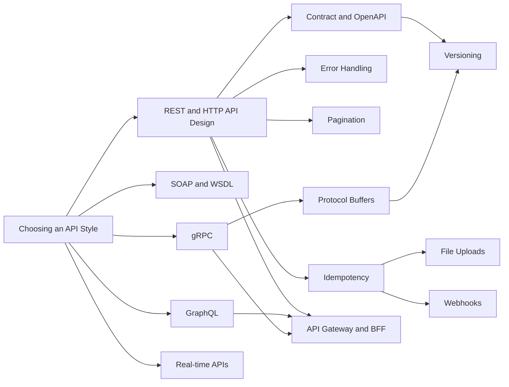

# 05 APIs MOC

> [!summary] What this folder covers
> How to design, document, evolve and operate APIs: choosing a style, REST done properly, contracts, errors, pagination, versioning, idempotency, uploads, webhooks, GraphQL, gRPC, real-time push and the gateway in front of it all. After this folder you can design and defend a production API in an interview.

## Before and after

- **Before this:** [[02 Networking & Web MOC]]
- **After this:** [[06 Backend Engineering in Go MOC]] · [[18 AI Engineering MOC]]

## Learning path

Back to [[Home]].

1. [[Choosing an API Style]] · basic. A decision guide for REST, GraphQL, gRPC, real-time and webhooks before you commit to one.
2. [[REST and HTTP API Design]] · basic. Resources, methods, status codes and conditional requests: the foundation every other note builds on.
3. [[API Contract Design and OpenAPI]] · intermediate. Writing the contract first with OpenAPI 3.1 so clients and servers agree before code exists.
4. [[API Error Handling]] · intermediate. Problem Details (RFC 9457), stable error codes and one mapping layer from Go errors to HTTP.
5. [[Pagination, Filtering and Sorting]] · intermediate. Why keyset cursors beat offsets, and how to expose filters and sorts safely.
6. [[API Versioning and Backward Compatibility]] · intermediate. Classifying breaking changes, where the version lives and how to retire old versions.
7. [[Idempotency and Idempotency Keys]] · intermediate. Making retries safe with the Idempotency-Key protocol and race-free storage.
8. [[File Upload Architecture]] · intermediate. Presigned URLs, multipart uploads and the processing pipeline behind them.
9. [[Webhooks - Sending and Receiving]] · intermediate. Signed, retried, idempotent server-to-server notifications on both sides.
10. [[SOAP and WSDL (Legacy Integrations)]] · basic. Enough SOAP to integrate with banks and legacy partners without fear.
11. [[GraphQL]] · intermediate. Client-shaped queries, resolvers, DataLoader and cost control.
12. [[gRPC]] · intermediate → advanced. Typed RPC over HTTP/2 with deadlines, streaming and status codes.
13. [[Protocol Buffers and Schema Evolution]] · intermediate. The wire format and the rules that keep `.proto` changes compatible.
14. [[Real-time APIs - WebSocket, SSE and Long Polling]] · intermediate → advanced. Pushing to browsers, with reconnects, heartbeats and scaling.
15. [[API Gateway and BFF]] · advanced. The edge layer: auth, rate limits, routing and a backend per client.

## Concept map

## Interview focus

- When would you pick REST, GraphQL or gRPC? → [[Choosing an API Style]]
- What is the difference between PUT and PATCH, and which methods are idempotent? → [[REST and HTTP API Design]]
- How do you make a payment API safe to retry? → [[Idempotency and Idempotency Keys]]
- Why is cursor pagination better than offset pagination? → [[Pagination, Filtering and Sorting]]
- What counts as a breaking change, and how do you version an API? → [[API Versioning and Backward Compatibility]]
- How should an API report errors to clients? → [[API Error Handling]]
- How do you design reliable webhooks? → [[Webhooks - Sending and Receiving]]
- How do you upload a 5 GB file without passing it through your servers? → [[File Upload Architecture]]
- WebSocket vs SSE vs long polling: which and why? → [[Real-time APIs - WebSocket, SSE and Long Polling]]
- What does an API gateway do, and when do you need a BFF? → [[API Gateway and BFF]]

## Sources worth reading

- RFC 9110 (HTTP Semantics) and RFC 9457 (Problem Details for HTTP APIs).
- Google API Improvement Proposals (aip.dev), especially pagination, errors and versioning.
- Stripe API reference and the Stripe engineering post on idempotency keys.
- OpenAPI Specification 3.1 (spec.openapis.org).
- GraphQL specification and the "GraphQL Best Practices" guide at graphql.org.
- gRPC documentation (grpc.io) and the Protocol Buffers language guide (protobuf.dev).
- Standard Webhooks specification (standardwebhooks.com).
- Sam Newman, *Building Microservices* (2nd ed.), chapters on communication styles and the BFF pattern.
