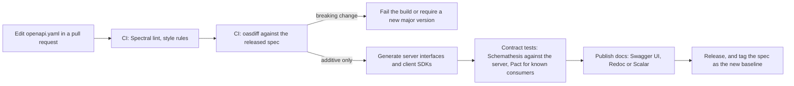
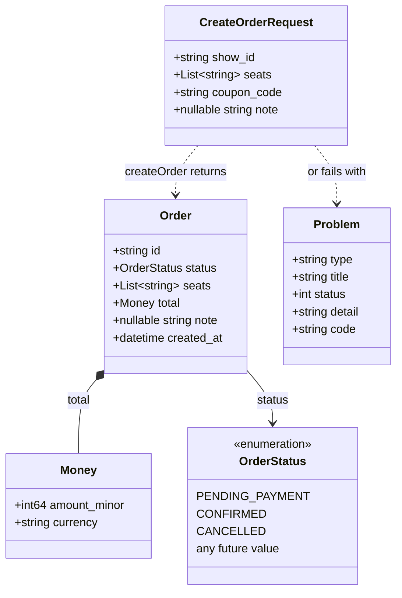
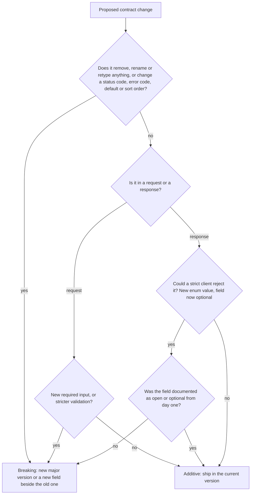

# API Contract Design and OpenAPI

> [!summary] TL;DR
> An **API contract** is the written promise of what an API accepts and returns: URLs, fields, types, limits, errors and headers. **OpenAPI** is the standard file format for writing that promise for HTTP APIs, so machines can lint it, diff it, generate code from it and test against it. Design the contract first, evolve it only by additive changes, and let CI reject anything that would break existing clients.

## 1. Why it exists

A mobile app shows an order's total from `order.total`. A backend developer renames it to `order.total_amount` because it reads better. The change passes code review and every server test.

App store releases are slow and users update late, so suppose 30% of users still run the old app a month later (an estimate; measure your own version spread). For that 30%, the order screen now shows nothing or crashes, and the server logs show only `200 OK`. Nothing told the developer that `total` was a promise to clients they cannot redeploy.

A contract makes the promise explicit and checkable:

- the field list, types and limits are written down in one file;
- a CI step compares the new file with the last released one and fails on `total` disappearing;
- client SDKs, server stubs, docs and tests are generated from the same file, so they cannot quietly disagree.

## 2. Mental model

A contract is an **electrical socket standard**. The plug maker and the socket maker never meet; both build to the published shape. You can add a new socket type (additive), but you cannot move the pins of the old one (breaking) while millions of plugs are in use.

OpenAPI is the **technical drawing** of the socket: precise enough that a machine can check a plug against it.

## 3. How it works

### Contract-first vs code-first

| Approach | How | Strength | Weakness |
| --- | --- | --- | --- |
| **Contract-first** (spec-first) | Write `openapi.yaml`, review it, then generate server interfaces and clients from it | Clients can start before the server exists; the spec is reviewed as a design | Needs a generator that fits your stack; spec authoring takes practice |
| **Code-first** | Write handlers, then produce the spec from annotations or types | Fast for one team; no separate file to keep in sync by hand | The design is reviewed only as code; the spec reflects whatever the code happened to do |

Either way, the danger is **drift**: the spec says one thing and the server does another. Contract-first prevents drift by generating the server interface from the spec, so a handler that returns the wrong type does not compile. Code-first prevents it by regenerating the spec in CI and failing if the committed file differs.



### OpenAPI 3.1 anatomy

An OpenAPI document has a few top-level parts:

- `openapi`, `info`, `servers`: the version of the format, the API's own version, and base URLs.
- `paths`: each URL and method, with `parameters` (path, query, header, cookie), `requestBody` and `responses` by status code.
- `components`: reusable `schemas`, `parameters`, `responses`, `securitySchemes`, referenced with `$ref`.
- `security`: which scheme applies, globally or per operation. An operation can override it, for example `security: []` for a public health check.
- `webhooks` (new in 3.1): requests your API sends to subscribers.

A complete contract for `POST /orders`:

```yaml
openapi: 3.1.0
info:
  title: Orders API
  version: 1.4.0
servers:
  - url: https://api.example.com/v1
security:
  - bearerAuth: []
paths:
  /orders:
    post:
      operationId: createOrder
      summary: Book seats for a show
      tags: [orders]
      parameters:
        - $ref: "#/components/parameters/IdempotencyKey"
      requestBody:
        required: true
        content:
          application/json:
            schema:
              $ref: "#/components/schemas/CreateOrderRequest"
            examples:
              twoSeats:
                value:
                  show_id: shw_9f2c
                  seats: [A7, A8]
      responses:
        "201":
          description: Order created. Retries with the same Idempotency-Key replay this response.
          headers:
            Location:
              description: URL of the new order
              schema:
                type: string
                format: uri-reference
          content:
            application/json:
              schema:
                $ref: "#/components/schemas/Order"
        "400":
          $ref: "#/components/responses/Problem"
        "401":
          $ref: "#/components/responses/Problem"
        "409":
          $ref: "#/components/responses/Problem"
        "422":
          $ref: "#/components/responses/Problem"
        "429":
          $ref: "#/components/responses/Problem"
  /health:
    get:
      operationId: health
      security: []
      responses:
        "204":
          description: The service is up
components:
  securitySchemes:
    bearerAuth:
      type: http
      scheme: bearer
      bearerFormat: JWT
  parameters:
    IdempotencyKey:
      name: Idempotency-Key
      in: header
      required: true
      description: >
        Client-generated unique key, for example a UUID. The server stores the
        first response for 24 hours and replays it for retries with the same key.
        Reusing a key with a different body returns 422; a retry while the first
        request is still running returns 409.
      schema:
        type: string
        minLength: 8
        maxLength: 255
  responses:
    Problem:
      description: Error as RFC 9457 problem details
      content:
        application/problem+json:
          schema:
            $ref: "#/components/schemas/Problem"
  schemas:
    CreateOrderRequest:
      type: object
      additionalProperties: false
      required: [show_id, seats]
      properties:
        show_id:
          type: string
          maxLength: 64
        seats:
          type: array
          minItems: 1
          maxItems: 10
          uniqueItems: true
          items:
            type: string
            pattern: "^[A-Z][0-9]{1,2}$"
        coupon_code:
          type: string
          maxLength: 32
        note:
          type: [string, "null"]
          maxLength: 500
    Order:
      type: object
      required: [id, status, seats, total, created_at]
      properties:
        id:
          type: string
          examples: [ord_81f2]
        status:
          $ref: "#/components/schemas/OrderStatus"
        seats:
          type: array
          items:
            type: string
        total:
          $ref: "#/components/schemas/Money"
        note:
          type: [string, "null"]
        created_at:
          type: string
          format: date-time
          examples: ["2026-11-02T08:15:00Z"]
    OrderStatus:
      type: string
      description: >
        Open set. New values may be added without a new API version;
        clients must treat values they do not know as "unknown".
      examples: [PENDING_PAYMENT, CONFIRMED, CANCELLED]
    Money:
      type: object
      required: [amount_minor, currency]
      properties:
        amount_minor:
          type: integer
          format: int64
          minimum: 0
          description: Amount in the currency's minor unit (paise for INR, cents for USD).
          examples: [45000]
        currency:
          type: string
          pattern: "^[A-Z]{3}$"
          description: ISO 4217 currency code
          examples: [INR]
    Problem:
      type: object
      required: [type, title, status]
      properties:
        type:
          type: string
          format: uri-reference
        title:
          type: string
        status:
          type: integer
        detail:
          type: string
        instance:
          type: string
          format: uri-reference
        code:
          type: string
          description: Stable machine-readable error code, for example SEAT_TAKEN
```

Points the example makes on purpose:

- **Every limit is written down**: `maxLength`, `maxItems: 10`, `pattern`. Unbounded strings and arrays are how a client sends a 50 MB body or a value longer than your database column.
- **`additionalProperties: false` on the request** rejects typos such as `seat` instead of `seats` (but see the rollout trap in the deep dive).
- **Errors are one shared response**, `application/problem+json`, so every endpoint fails the same way (see [[API Error Handling]]).
- **The `Idempotency-Key` header is part of the contract**: required, bounded, with retention and reuse rules spelled out (see [[Idempotency and Idempotency Keys]]).
- **`OrderStatus` is documented as an open set** instead of a closed `enum`, so a new status is not a breaking change.



### Conventions that prevent client bugs

| Topic | Rule | Why |
| --- | --- | --- |
| Field casing | One style everywhere: `snake_case` (Stripe, Zalando) or `lowerCamelCase` (Google, Microsoft) | Mixed casing guarantees typos in clients |
| Times | RFC 3339 strings in UTC: `2026-11-02T08:15:00Z` (`format: date-time`) | Unambiguous, sortable, parsed by every language |
| Money | Integer minor units plus an ISO 4217 code: `{"amount_minor": 45000, "currency": "INR"}` | Floats cannot represent `0.10` exactly; minor-unit digits differ (JPY has 0, INR 2, KWD 3) |
| IDs | Strings, even when the database uses integers | JavaScript loses precision above 2^53 − 1; strings let you change ID schemes later |
| Enums | `UPPER_SNAKE` strings, documented as open in responses | Numbers are unreadable; closed enums make additions breaking |
| Optional fields | Absent means "not set"; do not send `""` or `0` as "no value" | Empty values are real values to clients |
| Collections | Always paged, with a documented maximum `limit` | One unbounded list can take the service down (see [[Pagination, Filtering and Sorting]]) |

### Required, optional and nullable are three different things

- **Required**: the key must be present (`required: [show_id, seats]`).
- **Optional**: the key may be absent.
- **Nullable**: the key may be present with the value `null`. OpenAPI 3.0 wrote this as `nullable: true`; OpenAPI 3.1 uses JSON Schema's `type: [string, "null"]`.

The difference matters most in partial updates. With JSON Merge Patch, an absent `note` means "leave it", `"note": null` means "clear it" and `"note": "aisle"` means "set it". A server that cannot tell absent from `null` will wipe fields the client never mentioned.

### What counts as a breaking change

A change is breaking if **any existing, correctly written client** can fail or misbehave. The rules differ for what clients send and what they receive:

| Change | In a request | In a response |
| --- | --- | --- |
| Add an optional field | Safe | Safe for tolerant readers |
| Add a required field | **Breaking** | Safe |
| Remove or rename a field | **Breaking** | **Breaking** |
| Change a type or format | **Breaking** | **Breaking** |
| Make a required field optional | Safe | **Breaking**: clients assume it is there |
| Make an optional field required | **Breaking** | Safe |
| Add an enum value | Safe | **Breaking** for strict clients, safe if documented as open |
| Tighten validation (`maxLength` 500 → 200) | **Breaking** | Not applicable |
| Change a status code, error code, default value or sort order | **Breaking** | **Breaking** |



The safe path for a rename: add `total_amount`, keep sending `total`, mark `total` as `deprecated: true` in the spec, watch until no client reads it, then remove it in the next major version (see [[API Versioning and Backward Compatibility]]).

**Tolerant reader.** Clients should read only the fields they need, ignore fields they do not know, and map unknown enum values to an "unknown" case. Servers can then add things freely. This is the half of the robustness principle that works well; being liberal in what a server *accepts* is riskier, because sloppy input becomes behaviour clients then depend on.

## 4. Worked example

A Go 1.24 client for the `Order` schema above, written as a tolerant reader. It shows three contract rules in code: unknown fields and enum values do not break decoding, the server can still be strict about requests, and absent, `null` and set are three different states. It passes `go vet` and `go test -race`.

```go
package orderclient

import (
	"encoding/json"
	"time"
)

// OrderStatus is an open enum: a newer server may send values this client
// has never seen, so unknown values decode to StatusUnknown instead of failing.
type OrderStatus string

const (
	StatusPendingPayment OrderStatus = "PENDING_PAYMENT"
	StatusConfirmed      OrderStatus = "CONFIRMED"
	StatusCancelled      OrderStatus = "CANCELLED"
	StatusUnknown        OrderStatus = "UNKNOWN"
)

func (s *OrderStatus) UnmarshalText(b []byte) error {
	switch v := OrderStatus(b); v {
	case StatusPendingPayment, StatusConfirmed, StatusCancelled:
		*s = v
	default:
		*s = StatusUnknown // tolerant reader: render "unknown", do not crash
	}
	return nil
}

// Money is an integer amount in the currency's minor unit plus an ISO 4217 code.
// 45000 with "INR" means 450.00 rupees. Never a float.
type Money struct {
	AmountMinor int64  `json:"amount_minor"`
	Currency    string `json:"currency"`
}

// Order is the client's view of the Order schema. encoding/json ignores
// fields it does not know, which is what a tolerant reader wants.
type Order struct {
	ID        string      `json:"id"`
	Status    OrderStatus `json:"status"`
	Seats     []string    `json:"seats"`
	Total     Money       `json:"total"`
	CreatedAt time.Time   `json:"created_at"` // RFC 3339, e.g. 2026-11-02T08:15:00Z
}

// Field tells apart the three states a JSON property can be in.
// A *string cannot: absent and null both leave it nil.
type Field[T any] struct {
	Present bool // the key appeared in the body
	Null    bool // the key appeared with the value null
	Value   T
}

func (f *Field[T]) UnmarshalJSON(b []byte) error {
	f.Present = true
	if string(b) == "null" {
		f.Null = true
		return nil
	}
	return json.Unmarshal(b, &f.Value)
}

// OrderPatch is a JSON Merge Patch body: absent = keep, null = clear, value = set.
type OrderPatch struct {
	Note Field[string] `json:"note"`
}
```

```go
package orderclient

import (
	"bytes"
	"encoding/json"
	"testing"
)

// A newer server added a status and a field. An old client must keep working.
func TestTolerantReader(t *testing.T) {
	body := []byte(`{
		"id": "ord_81f2",
		"status": "ON_HOLD",
		"seats": ["A7", "A8"],
		"total": {"amount_minor": 45000, "currency": "INR"},
		"created_at": "2026-11-02T08:15:00Z",
		"loyalty_points": 120
	}`)
	var o Order
	if err := json.Unmarshal(body, &o); err != nil {
		t.Fatalf("old client broke on a newer response: %v", err)
	}
	if o.Status != StatusUnknown {
		t.Fatalf("status = %q, want UNKNOWN", o.Status)
	}
	if o.Total.AmountMinor != 45000 || o.CreatedAt.Hour() != 8 {
		t.Fatalf("known fields lost: %+v", o)
	}
}

// Servers can be strict about requests instead: a typo is rejected, not ignored.
func TestStrictRequestDecoding(t *testing.T) {
	type CreateOrderRequest struct {
		ShowID string   `json:"show_id"`
		Seats  []string `json:"seats"`
	}
	dec := json.NewDecoder(bytes.NewReader([]byte(`{"show_id": "shw_9f2c", "seat": ["A7"]}`)))
	dec.DisallowUnknownFields() // matches additionalProperties: false in the spec
	var req CreateOrderRequest
	if err := dec.Decode(&req); err == nil {
		t.Fatal(`typo "seat" was silently ignored`)
	}
}

func TestAbsentNullAndValueAreDifferent(t *testing.T) {
	cases := []struct {
		body          string
		present, null bool
		value         string
	}{
		{`{}`, false, false, ""},
		{`{"note": null}`, true, true, ""},
		{`{"note": "aisle seat"}`, true, false, "aisle seat"},
	}
	for _, c := range cases {
		var p OrderPatch
		if err := json.Unmarshal([]byte(c.body), &p); err != nil {
			t.Fatal(err)
		}
		if p.Note.Present != c.present || p.Note.Null != c.null || p.Note.Value != c.value {
			t.Errorf("%s: got %+v", c.body, p.Note)
		}
	}

	// The same bodies through a pointer: absent and null look identical.
	var a, b struct {
		Note *string `json:"note"`
	}
	_ = json.Unmarshal([]byte(`{}`), &a)
	_ = json.Unmarshal([]byte(`{"note": null}`), &b)
	if a.Note != nil || b.Note != nil {
		t.Fatal("expected both pointers to be nil")
	}
}

func TestMoneyAsMinorUnits(t *testing.T) {
	var asFloat float64
	var asMinor int64
	for i := 0; i < 10; i++ {
		asFloat += 0.10 // ten payments of 0.10
		asMinor += 10   // ten payments of 10 paise
	}
	if asFloat == 1.0 {
		t.Fatal("float64 summed exactly; expected binary rounding error")
	}
	if asMinor != 100 {
		t.Fatalf("minor units = %d, want 100", asMinor)
	}
}
```

Result (measured with `go test -race -count=1`, Go 1.24.4, 2026-11-02): all 4 tests pass. The response from the "newer server", with status `ON_HOLD` and an extra `loyalty_points` field, decodes without error. A `*string` field cannot tell `{}` from `{"note": null}`; `Field[string]` can. Ten float64 additions of `0.10` do not equal `1.0`, while ten additions of 10 minor units equal exactly 100.

**Spec check (measured, 2026-11-02).** The YAML contract above was fed to oapi-codegen v2.8.2 (built from source with `go run`) with models, a strict `net/http` server and a client enabled. Generation succeeded and the generated package passes `go vet` on Go 1.24.4. For the nullable `note` field it generated `Note *string` by default, which has exactly the absent-or-null ambiguity the test shows. Since v2.1.0, the `nullable-type: true` output option generates `nullable.Nullable[string]` instead.

## 5. Variants and comparison

**Tools along the contract pipeline:**

| Stage | Tool | What it does |
| --- | --- | --- |
| Lint and style | Spectral | Rules over the spec: naming, every operation has an `operationId`, every 4xx uses problem details, limits are present |
| Breaking-change diff | oasdiff | Compares the released spec with the new one: `oasdiff breaking base.yaml new.yaml --fail-on ERR` |
| Go server and client | oapi-codegen, ogen | Types, a server interface (oapi-codegen's strict server for `net/http`, chi, echo and others) and a typed client |
| Runtime validation | kin-openapi `openapi3filter` | Middleware that validates requests and responses against the spec |
| Code-first in Go | swaggo/swag | Builds a spec from comment annotations; its v1 releases emit Swagger 2.0, not OpenAPI 3 |
| SDKs in other languages | openapi-generator | Client libraries for dozens of languages from one spec |
| Contract tests | Schemathesis | Generates many valid and edge-case requests from the spec and checks the server's responses match it |
| Consumer-driven contracts | Pact | Each consumer records the requests and fields it relies on; the provider's CI replays them |
| Docs | Swagger UI, Redoc, Scalar | Render the spec as browsable documentation |

Go-specific setup (generation config, strict handlers, validation middleware) is in [[OpenAPI-First Development in Go]].

**Contract formats by API style:**

| Style | Contract | Evolution rule |
| --- | --- | --- |
| REST | OpenAPI (3.0 or 3.1) | Additive changes; tolerant readers |
| Events and async APIs | AsyncAPI, or JSON Schema per event | Same rules; consumers may lag days behind |
| gRPC | `.proto` files | Never reuse field numbers; see [[Protocol Buffers and Schema Evolution]] |
| GraphQL | SDL schema | Add fields, deprecate with `@deprecated`, never remove quickly; see [[GraphQL]] |
| SOAP | WSDL + XSD | Usually frozen; a change means a new WSDL |

**Style guides worth copying:** Google's API Improvement Proposals (AIPs, enforced on `.proto` files by `api-linter`), the Zalando RESTful API Guidelines and the Microsoft REST API Guidelines. Pick one as the base and write down only your exceptions.

## 6. Trade-offs and when not to use

- **Contract-first costs speed early.** For a prototype or an internal endpoint with one caller in the same repository, writing the spec first may be ceremony. Generate the spec from code and add the CI diff once a second consumer appears.
- **Generated code shapes your codebase.** Generators decide type names, optional-field representation (pointers or wrapper types) and routing. Keep generated types at the edge and map them to domain types, or the spec's shape leaks into business logic.
- **Strict request validation blocks safe rollouts.** `additionalProperties: false` rejects a new optional field sent by a newer client to an older server instance during a deploy.
- **Pact needs known consumers.** It works for internal services that can publish their expectations. A public API cannot collect pacts from strangers, so it relies on the spec diff instead.
- **A spec cannot capture everything.** Ordering, latency, rate limits and side effects are part of the real contract but are only prose in OpenAPI (Hyrum's law: every observable behaviour will be depended on by someone).

## 7. In production

- **Real systems:**
	- **Stripe** publishes the OpenAPI description of its API in the `stripe/openapi` repository, including an SDK variant of the spec with annotations for generating client libraries. Files in its official SDKs, such as stripe-go, carry the header "File generated from our OpenAPI spec".
	- **GitHub** publishes the OpenAPI description of its REST API in `github/rest-api-description`.
	- **Google** defines APIs in `.proto` files that follow the AIPs and enforces them with `api-linter`.
- **Failure modes → fixes:**
	- Spec and server drift apart → generate the server interface from the spec, or regenerate the spec in CI and fail on any diff.
	- A field rename ships and old apps break → oasdiff in CI against the last released spec, with breaking changes blocked unless the major version changes.
	- A new enum value crashes an old client → document response enums as open from day one and test clients with unknown values. Zalando's guidelines (rule 112) list the known values under `examples` (OpenAPI 3.1) with an "Extensible enum" description prefix; until October 2025 they recommended the `x-extensible-enum` extension, which remains the fallback for OpenAPI 3.0 specs.
	- Missing limits let a client send a 20 MB description field → add `maxLength`, `maxItems` and a body size limit in the server (`http.MaxBytesReader` in Go), and a lint rule that every string has a `maxLength`.
	- Examples in the docs do not validate against the schema → lint examples in CI; Spectral can check them.
- **What to monitor:**
	- Requests rejected by contract validation, per field and per client version.
	- Calls to `deprecated` operations and reads of deprecated fields, per client.
	- Responses that fail schema validation in staging (a response validator in tests catches server-side drift).

## 8. Deep dive

- **OpenAPI 3.0 vs 3.1.** 3.1 adopts JSON Schema Draft 2020-12 completely, while 3.0 used a modified subset. In practice: `nullable: true` becomes `type: [T, "null"]`, schema `example` becomes `examples` (a list), `exclusiveMinimum` takes a number instead of a boolean, `$ref` may sit beside `summary` and `description`, `paths` became optional, and `webhooks` is new. Check generator support before moving: oapi-codegen v2.8.2's README states support for 3.0 and 3.1 (3.1 support is recent), and older releases needed a 3.1 spec downgraded to 3.0.
- **The `additionalProperties: false` rollout trap.** During a rolling deploy, new and old server instances serve traffic together. A new client that sends a new optional field to an old instance gets a `400`. Options: deploy the server before any client uses the field (usual), or let servers ignore unknown request fields and only lint for typos in client tests.
- **Large integers.** JSON numbers have no size limit, but JavaScript parses them as doubles, exact only up to 2^53 − 1 (9,007,199,254,740,991). A 64-bit ID such as a Snowflake ID loses its last digits in a browser. Send IDs, and `int64` amounts that might grow that large, as strings.
- **Polymorphism.** `oneOf` with a `discriminator` (`"type": "card"` vs `"type": "upi"`) models payment methods. Generators handle it unevenly, and adding a new variant is a breaking change for clients that switch exhaustively. Treat the variant list like an open enum.
- **Contract tests vs schema validation.** Schema validation proves a response has the right shape. It does not prove `POST /orders` then `GET /orders/{id}` returns the same order. Schemathesis can chain operations using OpenAPI links; Pact tests the exact interactions consumers use.
- **The Idempotency-Key contract in detail.** Document scope (per API key or account), retention (Stripe: removable after 24 hours), the reuse error (`422` for a different body in the IETF draft), the in-flight error (`409`) and which operations accept it. Without these, clients cannot write correct retry logic.

## 9. Interview questions

> [!question]- What belongs in an API contract?
> Who calls it and with what auth; the method, URL, headers, query parameters and body; success response shapes; one error shape with stable codes; pagination, filtering and sorting rules and their limits; idempotency behaviour for creates and payments; rate limits; the versioning and deprecation policy; and request IDs for tracing.

> [!question]- Trap: is adding a field to a response a breaking change? Adding an enum value?
> Adding a response field is safe if clients are tolerant readers; it breaks clients that validate strictly or use `DisallowUnknownFields`-style decoding. Adding an enum value to a response breaks any client that switches exhaustively or validates against a closed `enum`. So document response enums as open and test clients with unknown values.

> [!question]- Contract-first or code-first?
> Contract-first when several teams or external clients consume the API: the design gets reviewed before code, clients start in parallel, and generated interfaces prevent drift. Code-first for a fast-moving internal API with one consumer, as long as CI regenerates the spec and diffs it against the last release.

> [!question]- Why send money as integer minor units with a currency code?
> Binary floats cannot represent `0.10` exactly, so sums drift (ten additions of `0.10` do not equal `1.0` in float64). Integers in minor units are exact. The currency code is required because the number of minor digits differs: JPY has 0, INR and USD have 2, KWD has 3.

> [!question]- How do you stop breaking changes from reaching production?
> Keep the released spec as a baseline, run oasdiff on every pull request and fail on breaking changes unless the major version changes. Add contract tests: Schemathesis against the server for the spec, Pact for known internal consumers. Watch deprecated-field usage before removing anything.

> [!question]- Required, optional and nullable: why does the difference matter?
> They are three separate promises. Required means the key is always present; optional means it may be absent; nullable means it may be present as `null`. In a merge-patch update, absent means "keep" and `null` means "clear". A Go `*string` cannot tell those apart, so use a wrapper type that records whether the key appeared.

> [!question]- A partner says your API "broke" but the spec did not change. What could it be?
> A behaviour the spec did not capture: default sort order, page size, a stricter validation rule, a new error code, slower responses, or a field that is now sometimes missing. That is Hyrum's law. Fix it by writing these behaviours into the contract (ordering, limits, error codes) and diffing them too.

## 10. Cheat sheet

- The contract is the promise; OpenAPI is the machine-checkable file that records it.
- Contract-first for shared APIs; either way, CI must catch drift and breaking changes (Spectral + oasdiff).
- Write every limit: string lengths, array sizes, page size, body size.
- RFC 3339 UTC times, integer minor-unit money with ISO 4217 code, string IDs, one casing style.
- Required ≠ optional ≠ nullable; 3.1 writes nullable as `type: [T, "null"]`.
- Requests and responses evolve differently: new required input breaks, new response fields do not.
- Clients are tolerant readers: ignore unknown fields, map unknown enum values to "unknown".
- One error schema (problem details) and an explicit `Idempotency-Key` contract for every create.

## Links

- **Before this:** [[REST and HTTP API Design]], [[Choosing an API Style]]
- **Next:** [[API Error Handling]], [[API Versioning and Backward Compatibility]], [[Idempotency and Idempotency Keys]], [[OpenAPI-First Development in Go]]
- **Compare with:** [[Protocol Buffers and Schema Evolution]] (the same evolution rules for `.proto`), [[GraphQL]] (SDL schema as the contract)
