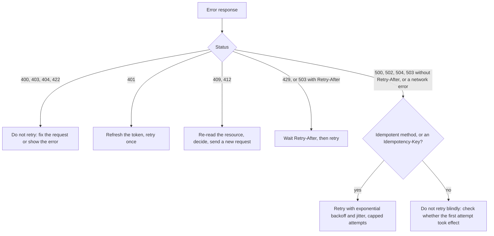
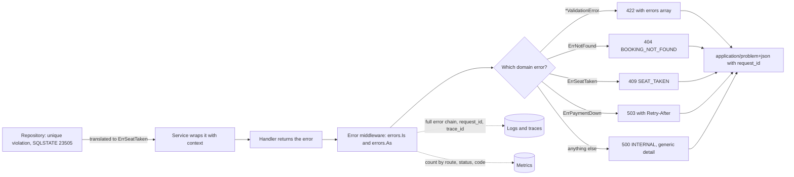
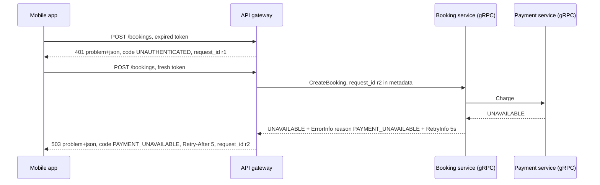

# API Error Handling

> [!summary] TL;DR
> When an API call fails, the response must tell the **client program** what went wrong (a status code and a stable error code it can branch on), tell the **human** how to fix it (a readable message, with every invalid field listed), and tell **you** where to look (a request ID that links to the full error in your logs). The standard body for this over HTTP is **Problem Details** (RFC 9457, `application/problem+json`).

## 1. Why it exists

A booking API returns this when a seat is taken, when the database is down, and when the JSON is broken:

```json
{"error": "something went wrong"}
```

with status `200`. Three things go wrong at once:

- **Clients cannot react.** The app cannot tell "pick another seat" from "try again in a minute", so it shows the same generic popup for both and users retry bookings that will never work.
- **Monitoring is blind.** Every failure is a `200`, so the 5xx dashboard stays green while payments fail.
- **Support cannot debug.** A user reports "it failed at 8:15". Without a request ID, someone searches millions of log lines for the right one.

The opposite mistake is just as common: returning `pq: relation "payments" does not exist` or a stack trace in the body. That tells attackers your database, table names and library versions, and tells users nothing useful.

## 2. Mental model

An API error is a **hospital discharge note**, written for three readers:

- a **code** the pharmacy's system reads (`SEAT_TAKEN`, like a diagnosis code),
- a **sentence** the patient understands ("Choose different seats and try again"),
- a **case number** (`request_id`) that lets the doctor pull up the full internal record.

The internal record (stack trace, SQL, hostnames) never leaves the hospital.

## 3. How it works

### The Problem Details format (RFC 9457)

```json
{
  "type": "https://api.example.com/problems/SEAT_TAKEN",
  "title": "Seat already taken",
  "status": 409,
  "detail": "Seat A7 was booked by someone else. Choose different seats.",
  "instance": "/bookings",
  "code": "SEAT_TAKEN",
  "request_id": "req-7f3a"
}
```

| Member | Meaning | Rule |
| --- | --- | --- |
| `type` | A URI that identifies the **kind** of problem; ideally a docs page | Defaults to `about:blank`. Clients may branch on it |
| `title` | Short summary of the kind | Same text for every occurrence of that `type` |
| `status` | The HTTP status code | Advisory copy; must match the real status line |
| `detail` | Explanation of **this** occurrence | Helps the client fix it; never debugging data |
| `instance` | A URI reference for this occurrence | Often the request path, or a URN with the request ID |
| extensions | Any extra members | Here: `code`, `request_id` and `errors` |

The media type is `application/problem+json`. RFC 9457 replaced RFC 7807 in 2023 with the same core members; it added a registry of common problem types and an example of reporting several problems at once.

### Stable codes and human messages

- **The status code** groups the failure (`409` = conflict with current state). Generic HTTP tools act on it: proxies, retry libraries, dashboards.
- **The error code** (`SEAT_TAKEN`, `CARD_EXPIRED`) is the precise reason. It is part of the contract: documented, `UPPER_SNAKE`, never renamed (see [[API Contract Design and OpenAPI]]). Clients branch on it.
- **The message** (`title`, `detail`) is for humans. Clients must never parse it, so you can reword or translate it freely.

### Field-level validation errors

Report **every** invalid field at once, each with a pointer into the request body, so a form can highlight all of them after one round trip:

```json
"errors": [
  {"pointer": "#/seats/1", "code": "INVALID_FORMAT", "detail": "use a row letter and a number, like A7"},
  {"pointer": "#/show_id", "code": "REQUIRED", "detail": "show_id is required"}
]
```

The pointer is a JSON Pointer (`#/seats/1` = the second seat), which is the style RFC 9457's own example uses.

### Status mapping

| Status | Domain situation | Example code | Client should retry? |
| --- | --- | --- | --- |
| `400` | Body or parameters cannot be parsed | `MALFORMED_REQUEST` | No: fix the request |
| `401` | Missing, expired or invalid credentials | `UNAUTHENTICATED` | Once, after refreshing the token |
| `403` | Authenticated but not allowed | `FORBIDDEN` | No |
| `404` | Resource does not exist, or the caller may not know it exists | `BOOKING_NOT_FOUND` | No |
| `409` | Conflicts with current state | `SEAT_TAKEN`, `ALREADY_CANCELLED` | No; re-read state and decide |
| `412` | `If-Match` precondition failed | `VERSION_MISMATCH` | After re-reading and re-applying the change |
| `422` | Parsed but invalid values | `VALIDATION_FAILED` | No: fix the fields |
| `429` | Rate limit or quota exceeded | `RATE_LIMITED` | Yes, after `Retry-After` |
| `500` | Bug or unexpected failure here | `INTERNAL` | Only if the request is idempotent or carries an `Idempotency-Key` |
| `502` | An upstream returned an invalid response | `BAD_UPSTREAM` | With backoff, only if the request is idempotent or carries an `Idempotency-Key`: the upstream may have done the work before its response broke |
| `503` | Overloaded, in maintenance, or a dependency is down | `PAYMENT_UNAVAILABLE` | Yes, after `Retry-After`; without it, treat it like `502` |
| `504` | An upstream did not answer in time | `UPSTREAM_TIMEOUT` | With backoff, only if idempotent or keyed: the first attempt may have succeeded |

The method-level meaning of each status is in [[REST and HTTP API Design]]; this table is about choosing one for a domain error.

### Retryable vs non-retryable

Error handling is half of a retry policy. Clients need a rule they can apply without reading the message:



`Retry-After` is either seconds (`Retry-After: 5`) or an HTTP date. A `504` is the dangerous case: the server gave up waiting, but the work may still finish, so retrying a non-idempotent `POST` can do it twice (see [[Idempotency and Idempotency Keys]] and [[Timeouts, Retries and Backoff]]).

### One mapping layer

Domain code returns **domain errors** and never imports `net/http`. One middleware at the edge maps them to responses and logs each failure once:



The repository translates driver errors it understands (a unique violation on the seat index means `ErrSeatTaken`) and wraps everything else unchanged. Anything the middleware does not recognise becomes a `500` whose body says nothing about the cause.

## 4. Worked example

Three files in Go 1.24: a domain package with sentinel and typed errors, an `api` package that is the only place errors become HTTP, and its tests. The mapping uses `errors.Is` for sentinels and `errors.As` for typed errors, so wrapping with `%w` at each layer keeps working. It passes `go vet` and `go test -race`.

```go
// Package booking is the domain layer. It knows nothing about HTTP or gRPC.
package booking

import (
	"errors"
	"fmt"
	"regexp"
	"strconv"
)

// Sentinel errors: fixed conditions that callers test with errors.Is.
var (
	ErrNotFound    = errors.New("booking not found")
	ErrSeatTaken   = errors.New("seat already taken")
	ErrPaymentDown = errors.New("payment provider unavailable")
)

// FieldError is one invalid input field. Field is a JSON Pointer such as /seats/2.
type FieldError struct {
	Field, Code, Detail string
}

// ValidationError is a typed error: it carries data (every bad field at once).
type ValidationError struct {
	Fields []FieldError
}

func (e *ValidationError) Error() string {
	return fmt.Sprintf("validation failed on %d field(s)", len(e.Fields))
}

var seatPattern = regexp.MustCompile(`^[A-Z][0-9]{1,2}$`)

// ValidateSeats returns nil or a *ValidationError listing every problem.
func ValidateSeats(seats []string) error {
	var v ValidationError
	if len(seats) == 0 {
		v.Fields = append(v.Fields, FieldError{"/seats", "REQUIRED", "pick at least one seat"})
	}
	if len(seats) > 10 {
		v.Fields = append(v.Fields, FieldError{"/seats", "TOO_MANY", "at most 10 seats per booking"})
	}
	for i, s := range seats {
		if !seatPattern.MatchString(s) {
			v.Fields = append(v.Fields, FieldError{"/seats/" + strconv.Itoa(i), "INVALID_FORMAT", "use a row letter and a number, like A7"})
		}
	}
	if len(v.Fields) > 0 {
		return &v // return the error only when there is one
	}
	return nil // an untyped nil, never a nil *ValidationError
}
```

```go
// Package api is the HTTP edge: the only place that turns errors into responses.
package api

import (
	"context"
	"crypto/rand"
	"encoding/hex"
	"encoding/json"
	"errors"
	"log/slog"
	"net/http"
	"strconv"

	"example.com/errs/booking"
)

// InvalidParam is one entry of the "errors" extension member.
type InvalidParam struct {
	Pointer string `json:"pointer"`
	Code    string `json:"code"`
	Detail  string `json:"detail"`
}

// Problem is an RFC 9457 problem details object plus three extension members.
type Problem struct {
	Type      string         `json:"type"`
	Title     string         `json:"title"`
	Status    int            `json:"status"`
	Detail    string         `json:"detail,omitempty"`
	Instance  string         `json:"instance,omitempty"`
	Code      string         `json:"code"`             // stable, machine-readable
	RequestID string         `json:"request_id"`       // to find the logs
	Errors    []InvalidParam `json:"errors,omitempty"` // per-field validation errors
}

// ErrMalformed marks a body that could not be parsed at all.
var ErrMalformed = errors.New("malformed request body")

func problem(status int, code, title, detail string) Problem {
	return Problem{Type: "https://api.example.com/problems/" + code, Title: title,
		Status: status, Detail: detail, Code: code}
}

// toProblem maps an error chain to a response. retryAfter is in seconds (0 = none).
func toProblem(err error) (p Problem, retryAfter int) {
	var ve *booking.ValidationError
	switch {
	case errors.As(err, &ve) && ve != nil: // ve != nil guards against a typed nil
		p = problem(422, "VALIDATION_FAILED", "Request has invalid fields", "Fix the fields listed in errors.")
		for _, f := range ve.Fields {
			p.Errors = append(p.Errors, InvalidParam{Pointer: "#" + f.Field, Code: f.Code, Detail: f.Detail})
		}
	case errors.Is(err, ErrMalformed):
		p = problem(400, "MALFORMED_REQUEST", "Request body is not valid JSON", "")
	case errors.Is(err, booking.ErrNotFound):
		p = problem(404, "BOOKING_NOT_FOUND", "Booking not found", "")
	case errors.Is(err, booking.ErrSeatTaken):
		p = problem(409, "SEAT_TAKEN", "Seat already taken", "Choose different seats and try again.")
	case errors.Is(err, booking.ErrPaymentDown):
		p, retryAfter = problem(503, "PAYMENT_UNAVAILABLE", "Payments are temporarily unavailable", ""), 5
	case errors.Is(err, context.DeadlineExceeded):
		p, retryAfter = problem(504, "UPSTREAM_TIMEOUT", "A dependency did not answer in time", ""), 2
	default: // unknown: never echo err.Error(), it may hold SQL or hostnames
		p = problem(500, "INTERNAL", "Internal error", "Quote request_id when contacting support.")
	}
	return p, retryAfter
}

// HandlerFunc is a handler that returns its error instead of writing it.
type HandlerFunc func(w http.ResponseWriter, r *http.Request) error

// Errors adapts h. It writes problem+json and logs each failure once, here.
func Errors(log *slog.Logger, h HandlerFunc) http.Handler {
	return http.HandlerFunc(func(w http.ResponseWriter, r *http.Request) {
		reqID := r.Header.Get("X-Request-Id")
		if reqID == "" {
			b := make([]byte, 8)
			_, _ = rand.Read(b)
			reqID = hex.EncodeToString(b)
		}
		w.Header().Set("X-Request-Id", reqID)

		err := h(w, r)
		if err == nil {
			return
		}
		p, retryAfter := toProblem(err)
		p.Instance, p.RequestID = r.URL.Path, reqID

		level := slog.LevelInfo // client errors: expected, keep them quiet
		if p.Status >= 500 {
			level = slog.LevelError
		}
		log.Log(r.Context(), level, "request failed", "request_id", reqID,
			"route", r.Pattern, "status", p.Status, "code", p.Code, "err", err.Error())

		if retryAfter > 0 {
			w.Header().Set("Retry-After", strconv.Itoa(retryAfter))
		}
		w.Header().Set("Content-Type", "application/problem+json")
		w.WriteHeader(p.Status)
		_ = json.NewEncoder(w).Encode(p)
	})
}
```

```go
package api

import (
	"bytes"
	"encoding/json"
	"errors"
	"fmt"
	"log/slog"
	"net/http"
	"net/http/httptest"
	"strings"
	"testing"

	"example.com/errs/booking"
)

// serve runs one request through the Errors middleware with a handler that fails with err.
func serve(t *testing.T, err error) (*httptest.ResponseRecorder, Problem, string) {
	t.Helper()
	var logs bytes.Buffer
	log := slog.New(slog.NewTextHandler(&logs, nil))
	mux := http.NewServeMux()
	mux.Handle("POST /bookings", Errors(log, func(http.ResponseWriter, *http.Request) error { return err }))

	req := httptest.NewRequest("POST", "/bookings", nil)
	req.Header.Set("X-Request-Id", "req-7f3a")
	rec := httptest.NewRecorder()
	mux.ServeHTTP(rec, req)

	var p Problem
	if rec.Code != http.StatusOK {
		if ct := rec.Header().Get("Content-Type"); ct != "application/problem+json" {
			t.Fatalf("Content-Type = %q", ct)
		}
		if e := json.Unmarshal(rec.Body.Bytes(), &p); e != nil {
			t.Fatalf("body is not JSON: %v", e)
		}
	}
	return rec, p, logs.String()
}

func TestMapping(t *testing.T) {
	cases := []struct {
		name       string
		err        error
		status     int
		code       string
		retryAfter string
	}{
		{"wrapped sentinel", fmt.Errorf("cancel booking 42: %w", booking.ErrNotFound), 404, "BOOKING_NOT_FOUND", ""},
		{"conflict", fmt.Errorf("reserve A7: %w", booking.ErrSeatTaken), 409, "SEAT_TAKEN", ""},
		{"malformed", fmt.Errorf("%w: unexpected EOF", ErrMalformed), 400, "MALFORMED_REQUEST", ""},
		{"dependency down", fmt.Errorf("charge: %w", booking.ErrPaymentDown), 503, "PAYMENT_UNAVAILABLE", "5"},
		{"unknown", errors.New("boom"), 500, "INTERNAL", ""},
	}
	for _, c := range cases {
		rec, p, _ := serve(t, c.err)
		if rec.Code != c.status || p.Status != c.status || p.Code != c.code {
			t.Errorf("%s: got %d/%d %s, want %d %s", c.name, rec.Code, p.Status, p.Code, c.status, c.code)
		}
		if got := rec.Header().Get("Retry-After"); got != c.retryAfter {
			t.Errorf("%s: Retry-After = %q, want %q", c.name, got, c.retryAfter)
		}
		if p.RequestID != "req-7f3a" || p.Instance != "/bookings" {
			t.Errorf("%s: request_id %q instance %q", c.name, p.RequestID, p.Instance)
		}
	}
}

func TestValidationListsEveryField(t *testing.T) {
	err := booking.ValidateSeats([]string{"A7", "7A", "B12", "zz"})
	rec, p, _ := serve(t, fmt.Errorf("create booking: %w", err))
	if rec.Code != 422 || len(p.Errors) != 2 {
		t.Fatalf("got %d with %d field errors, want 422 with 2", rec.Code, len(p.Errors))
	}
	if p.Errors[0].Pointer != "#/seats/1" || p.Errors[1].Pointer != "#/seats/3" {
		t.Fatalf("pointers: %+v", p.Errors)
	}
}

func TestInternalsStayInTheLogs(t *testing.T) {
	dbErr := errors.New(`ERROR: duplicate key value violates unique constraint "bookings_pkey" (SQLSTATE 23505)`)
	rec, p, logs := serve(t, fmt.Errorf("insert booking: %w", dbErr))
	if rec.Code != 500 || strings.Contains(rec.Body.String(), "bookings_pkey") {
		t.Fatalf("leaked internals: %d %s", rec.Code, rec.Body.String())
	}
	if !strings.Contains(logs, "bookings_pkey") || !strings.Contains(logs, "request_id=req-7f3a") {
		t.Fatalf("log line lacks the cause or the request id: %s", logs)
	}
	if !strings.Contains(logs, "level=ERROR") || p.Detail == "" {
		t.Fatalf("5xx must log at ERROR and tell the client what to quote: %s", logs)
	}
}

// The typed-nil trap: a nil *ValidationError stored in an error interface is not nil.
func validateBuggy(seats []string) error {
	var v *booking.ValidationError
	if len(seats) == 0 {
		v = &booking.ValidationError{}
	}
	return v // BUG: returns a non-nil error holding a nil pointer
}

func TestTypedNilBecomesA500(t *testing.T) {
	err := validateBuggy([]string{"A7"}) // valid input
	if err == nil {
		t.Fatal("expected the typed-nil trap: err != nil")
	}
	// A valid request now fails. Logging err.Error() would even panic,
	// because Error() reads e.Fields through a nil pointer.
	if p, _ := toProblem(err); p.Status != 500 {
		t.Fatalf("got %d; without the ve != nil guard toProblem would panic", p.Status)
	}
	if booking.ValidateSeats([]string{"A7"}) != nil {
		t.Fatal("the correct validator must return an untyped nil")
	}
}
```

Result (measured with `go test -race -count=1`, Go 1.24.4, 2026-11-02): all 4 tests pass. Running the same middleware once with an invalid seat and once with a raw database error produced these responses and log lines. The `time=` attribute that `slog`'s text handler prints first is left out, and the one-line JSON bodies are pretty-printed for reading:

```text
level=INFO msg="request failed" request_id=req-7f3a route="POST /bookings" status=422 code=VALIDATION_FAILED err="create booking: validation failed on 1 field(s)"
HTTP 422 application/problem+json
{
  "type": "https://api.example.com/problems/VALIDATION_FAILED",
  "title": "Request has invalid fields",
  "status": 422,
  "detail": "Fix the fields listed in errors.",
  "instance": "/bookings",
  "code": "VALIDATION_FAILED",
  "request_id": "req-7f3a",
  "errors": [
    {
      "pointer": "#/seats/1",
      "code": "INVALID_FORMAT",
      "detail": "use a row letter and a number, like A7"
    }
  ]
}

level=ERROR msg="request failed" request_id=req-7f3a route="POST /bookings/{id}/pay" status=500 code=INTERNAL err="charge booking 42: insert payment: ERROR: relation \"payments\" does not exist (SQLSTATE 42P01)"
HTTP 500 application/problem+json
{
  "type": "https://api.example.com/problems/INTERNAL",
  "title": "Internal error",
  "status": 500,
  "detail": "Quote request_id when contacting support.",
  "instance": "/bookings/42/pay",
  "code": "INTERNAL",
  "request_id": "req-7f3a"
}
```

The table name stays in the log line, linked by `request_id`; the client sees only what it can act on. The middleware reuses any incoming `X-Request-Id`; at a public edge, accept it only from your own gateway, or check its length and characters first, because it is copied into logs and responses. While writing this example, the first version of `TestTypedNilBecomesA500` sent the typed-nil error through the full middleware and the test **panicked** inside `(*ValidationError).Error`, called by the log line. That is the trap described in the deep dive.

## 5. Variants and comparison

| Format | Shape | Use when | Cost |
| --- | --- | --- | --- |
| Problem Details (RFC 9457) | Flat object: `type`, `title`, `status`, `detail`, `instance` + extensions | New HTTP APIs; frameworks support it (Spring's `ProblemDetail`, ASP.NET Core's `ProblemDetails`) | You still define codes and extensions yourself |
| Custom envelope | `{"error": {"code": "SEAT_TAKEN", "message": "...", "request_id": "..."}}` | An existing API already uses it; consistency beats switching | No standard media type; every client parses it by hand |
| Stripe's error object | `{"error": {"type": "card_error", "code": "card_declined", "decline_code": "...", "message": "...", "param": "...", "doc_url": "..."}}` | Reference for a payments API: a broad `type`, a precise `code`, the offending `param` and a docs link | Its own shape |
| Google AIP-193 | `google.rpc.Status`: numeric `code`, `message`, typed `details`; over HTTP `{"error": {"code": 409, "message": "...", "status": "ABORTED", "details": [...]}}` | gRPC-first APIs that are also served as JSON | Needs the `google.rpc` detail types |
| GraphQL `errors` | `200` with an `errors` array beside partial `data` | GraphQL only: one response can partly fail | HTTP status no longer reflects failure; monitor the `errors` array (see [[GraphQL]]) |

**gRPC.** gRPC has its own status codes and error details. Map domain errors at the gRPC edge just as at the HTTP edge, and keep both mappings consistent:

| Domain error | gRPC code | HTTP status (per `google/rpc/code.proto`) |
| --- | --- | --- |
| Invalid input | `INVALID_ARGUMENT` (3) | `400` |
| Not found | `NOT_FOUND` (5) | `404` |
| Duplicate create | `ALREADY_EXISTS` (6) | `409` |
| Concurrency conflict | `ABORTED` (10) | `409` |
| Wrong state for the operation | `FAILED_PRECONDITION` (9) | `400` |
| Not allowed | `PERMISSION_DENIED` (7) | `403` |
| No or bad credentials | `UNAUTHENTICATED` (16) | `401` |
| Rate limited, quota | `RESOURCE_EXHAUSTED` (8) | `429` |
| Dependency down | `UNAVAILABLE` (14) | `503` |
| Timeout | `DEADLINE_EXCEEDED` (4) | `504` |
| Bug | `INTERNAL` (13) | `500` |

Rich details travel in `google.rpc.Status.details`: `BadRequest` (field violations, like the `errors` array), `ErrorInfo` (a machine-readable `reason`, a `domain` and metadata; AIP-193 says every error response must include one), `RetryInfo` (how long to wait) and `QuotaFailure`. In grpc-go you attach them with `status.New(codes.InvalidArgument, "...").WithDetails(...)` (see [[gRPC]] and [[gRPC Services in Go]]).

The client should see one error shape no matter which hop failed. Here the gateway rejects one request itself and translates a gRPC failure from deep inside for the next:



## 6. Trade-offs and when not to use

- **Do not invent a code per line of code.** 20 to 50 documented codes for a whole API is a manageable estimate; hundreds of codes become impossible for clients to handle. Group by what the client can do differently.
- **Detail vs. security.** `404` for a booking the caller may not see hides its existence, but makes support harder. `409 SEAT_TAKEN` with the seat number helps the user; `409` naming *who* booked it leaks personal data.
- **Field-level errors cost server work.** Validating everything and collecting all failures is slower to write than failing on the first error. It pays off for forms and public APIs; for internal machine-to-machine calls, first-error is often enough.
- **Do not use `200` with an error body**, except where the protocol requires it (GraphQL partial results, batch endpoints with per-item results). Even then, document how clients detect failure.
- **Localised messages belong to the client** when you can manage it: the server sends the stable code and parameters, the app renders the text in the user's language. Server-side localisation (`Accept-Language`) works but multiplies the messages you must maintain.

## 7. In production

- **Real systems:**
	- **Stripe** returns an error object with `type` (such as `card_error`, `invalid_request_error`, `api_error`), `code`, `decline_code` for card declines, `param` naming the bad field, a `message` and a `doc_url`, and every response carries a `Request-Id` header.
	- **Google APIs** follow AIP-193: canonical gRPC codes plus `ErrorInfo` with a stable reason, mapped to HTTP for JSON clients.
	- **Kubernetes** returns a `Status` object with `reason` (`NotFound`, `Conflict`, `AlreadyExists`) and `details`, so `kubectl` can react to the reason instead of the message.
- **Consistency across the gateway and services.** The gateway produces errors of its own: `401` from token checks, `429` from rate limiting (see [[Rate Limiting - Algorithms and Distributed Design]]), `502` and `504` when a service fails. Out of the box, many proxies and load balancers return HTML error pages for these. Configure the gateway to emit the same `application/problem+json` shape and to pass through service errors untouched, and propagate the request ID in both directions (see [[API Gateway and BFF]]).
- **Failure modes → fixes:**
	- SQL or stack traces in responses → a default branch that returns a generic `500`; a test that asserts internal strings never appear in bodies.
	- The same error logged five times (repository, service, handler, middleware, gateway) → wrap and return in inner layers, log once at the edge (see [[Structured Logging]]).
	- Clients retry `422`s forever → document retryability per status and code; send `Retry-After` only when a retry can succeed.
	- An error code renamed in a refactor breaks a client's branch → treat codes as contract; diff them in CI like fields.
	- A handler writes half a response, then returns an error → the middleware cannot change the status any more; validate and do all fallible work before writing the body.
- **What to monitor:**
	- Request rate split into 2xx, 4xx and 5xx per route. 5xx is your fault and counts against the SLO (see [[SLIs, SLOs, SLAs and Error Budgets]]); a 4xx spike right after a deploy often means you broke the contract.
	- Top error codes per route and per client version, as a metric label (`code="SEAT_TAKEN"`), not parsed from logs.
	- `429` and `503` rates with the `Retry-After` values sent, and how many clients retry before it expires.

## 8. Deep dive

- **The typed-nil trap.** An `error` is an interface: a type and a value. Returning a nil `*ValidationError` as `error` yields an interface whose type is set, so `err != nil` is true. The middleware then treats a valid request as failed, `errors.As` matches and hands back a nil pointer, and calling `Error()` on it panics if `Error()` reads a field. The test above checks the first, the `ve != nil` guard handles the second, and the third is what crashed the first version of the test. Fix: return a literal `nil` on success, and guard `ve != nil` after `errors.As`. More Go error mechanics (`errors.Join`, several `%w` in one `fmt.Errorf` since Go 1.20, wrapping rules) are in [[Error Handling]].
- **Translate, do not leak, at layer boundaries.** If the repository returns the raw driver error, every caller must know about PostgreSQL error codes. Translate the ones that have domain meaning (`23505` on the seat index → `ErrSeatTaken`; `40001` serialization failure → retry inside the service) and wrap the rest as opaque internal errors.
- **`errors.Is` vs `errors.As` vs string matching.** `Is` compares against a sentinel through the whole wrap chain; `As` finds the first error of a type and gives you its data. Matching on `err.Error()` text breaks as soon as someone adds context with `fmt.Errorf`, which is exactly what wrapping is for.
- **Retryable as a property, not a status.** Inside services, attach retryability to the error (a small interface such as `Retryable() bool`, or a `RetryInfo` detail in gRPC) so retry loops do not re-derive it from status codes. Only the edge turns it into `Retry-After`.
- **Panics are not errors.** A recover middleware turns a panic into a `500` with the same problem shape and logs the stack trace, so the client sees a consistent error and the process survives (see [[Middleware]]).
- **`instance` and request IDs.** RFC 9457 lets `instance` be any URI reference. Using the request path is common but not unique per occurrence; `urn:request:req-7f3a` makes it unique. Either way, also return the request ID in a response header such as `X-Request-Id` (some teams return the trace ID taken from the W3C `traceparent` request header instead) so clients can quote it even when the body is lost.
- **Errors in streaming responses.** Once a `200` and part of an SSE stream or a chunked body have been sent, the status cannot change. Send an error event in the stream's own format; gRPC can do better because its status travels in trailers after the messages.

## 9. Interview questions

> [!question]- What should an API error response contain?
> A correct HTTP status, a stable machine-readable error code, a human-readable message that helps fix the problem, field-level errors for validation failures, and a request ID that links to the full error in the logs. Never stack traces, SQL or hostnames. RFC 9457 Problem Details gives a standard shape for all of it.

> [!question]- Trap: the client sends valid JSON with `quantity: -3`. Is that `400` or `422`?
> Either is defensible. `400` is for requests the server cannot parse; `422` is for parsed content that fails validation, so `422` is the more precise choice. Google's AIPs use `400 INVALID_ARGUMENT` for both. The real mistake is mixing them randomly: pick one rule, document it, and carry the specific reason in the error code.

> [!question]- How do you avoid leaking internal details while keeping errors debuggable?
> Map known domain errors to specific codes; send every unknown error as a generic `500` with no cause in the body. Log the full wrapped error chain once at the edge, with the request ID and trace ID, and return that request ID to the client. Support searches logs by the ID the user quotes.

> [!question]- Which errors should a client retry?
> `429` and `503` after `Retry-After`; `502`, `504` and network errors with exponential backoff and jitter, but only for idempotent requests or ones with an `Idempotency-Key`. Never `400`, `403`, `404` or `422`. Retry `401` once after refreshing the token, and `412` only after re-reading the resource.

> [!question]- Where should domain errors become HTTP status codes in a Go service?
> In one place at the edge: a middleware or handler adapter that uses `errors.Is` for sentinels and `errors.As` for typed errors. The domain package must not import `net/http`, so the same errors can be mapped to gRPC codes by a gRPC interceptor. Inner layers wrap with `%w` and return; only the edge logs.

> [!question]- Your gateway returns HTML error pages for `502` and `504`. Why does it matter?
> Clients parse `application/problem+json` and crash or show garbage on HTML. Every error a client can receive is part of the contract, including the gateway's own `401`, `429`, `502` and `504`. Configure the gateway to emit the same problem format with a request ID, and pass service errors through untouched.

> [!question]- How do gRPC errors carry the same information?
> A gRPC status has a canonical code (`NOT_FOUND`, `INVALID_ARGUMENT`, `UNAVAILABLE`) and a message, plus typed details in `google.rpc.Status`: `BadRequest` for field violations, `ErrorInfo` for a stable reason, `RetryInfo` for when to retry. Transcoding gateways map the codes to HTTP statuses (`UNAVAILABLE` → `503`, `DEADLINE_EXCEEDED` → `504`).

## 10. Cheat sheet

- Three readers: a status and stable code for programs, a message for humans, a request ID for you.
- Use `application/problem+json` (RFC 9457): `type`, `title`, `status`, `detail`, `instance` + extensions.
- List every invalid field with a JSON Pointer and a code; validation is `422` (or `400`, consistently).
- Retry `429`/`503` after `Retry-After`; `502`/`504` with backoff only if idempotent; never `4xx` validation errors.
- Unknown errors → generic `500`; the cause goes to logs, once, with the request ID.
- Domain returns errors; one edge middleware maps them with `errors.Is` and `errors.As`.
- gRPC: canonical codes + `ErrorInfo`, `BadRequest`, `RetryInfo`; keep HTTP and gRPC mappings aligned.
- Monitor 4xx vs 5xx per route and the top error codes; a 4xx spike after a deploy is a contract break.

## Links

- **Before this:** [[REST and HTTP API Design]], [[API Contract Design and OpenAPI]], [[Error Handling]] (Go errors: sentinel, typed, wrapping)
- **Next:** [[Idempotency and Idempotency Keys]], [[Timeouts, Retries and Backoff]], [[Building REST Endpoints]]
- **Compare with:** [[gRPC]] (status codes and rich details), [[GraphQL]] (errors beside partial data), [[API Gateway and BFF]] (errors the gateway produces)
