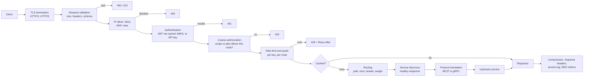
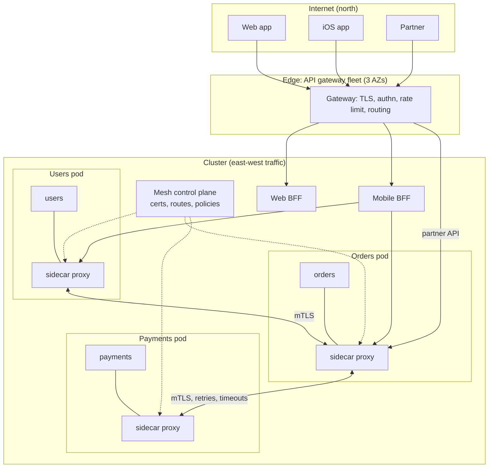
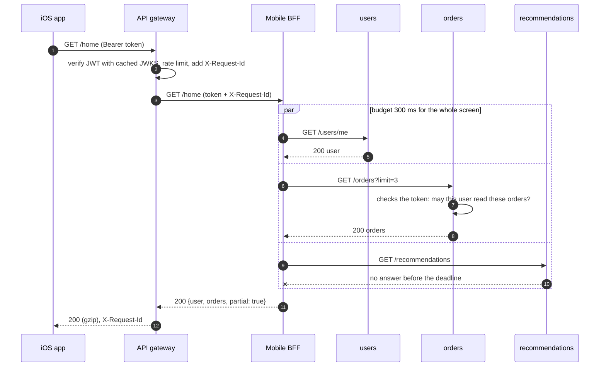

# API Gateway and BFF

> [!summary] TL;DR
> An **API gateway** is the single front door for outside clients: a reverse proxy that terminates TLS, authenticates, rate-limits, routes each request to the right service and records what happened. A **BFF (backend for frontend)** is a small service per client type (web, iOS, partner) that calls several services and shapes one response for that client. Keep both free of business rules: the gateway does cross-cutting checks, the BFF does composition, and the services still make their own authorization decisions.

## 1. Why it exists

A shop splits its monolith into 30 services. Without a gateway:

- **Every service re-implements the edge.** TLS certificates, JWT validation, CORS, rate limits, request logging: 30 copies, 30 slightly different behaviours, and one forgotten check is a breach.
- **Clients know the internal topology.** The mobile app hard-codes `orders.shop.com`, `users.shop.com`, … Splitting or renaming a service breaks shipped apps that users never update.
- **Phones pay for chattiness.** The home screen needs user, orders, recommendations, cart, offers and notifications: 6 calls. On a mobile link with about 100 ms round-trip time (an estimate), six sequential calls cost about 600 ms of network alone, before any server time. HTTP/2 lets the app send independent calls in parallel, but calls that need an earlier result (orders need the user's ID) still wait, and every call costs radio time, battery and repeated headers. Through a BFF the phone makes 1 call (about 100 ms) and the BFF fans out in parallel inside the data centre, where a round trip is around 1 ms (also an estimate).

The gateway gives one stable public surface and one place for cross-cutting policy. The BFF gives each client exactly the data it needs in one round trip.

## 2. Mental model

The gateway is the **reception desk of an office building**. It checks your badge, signs you in, tells you which floor to go to and keeps the visitor log. It does not do anyone's job on the floors above, and each office still decides whether *you* may open *its* filing cabinet.

A BFF is a **personal assistant per type of visitor**. The assistant for mobile visitors collects documents from five offices and hands over one slim folder; the assistant for partners hands over a different folder.

## 3. How it works

### The filter pipeline

Every request runs through an ordered chain of filters (Envoy calls them filters, Kong calls them plugins). Cheap rejections come first, so expensive work only happens for requests that deserve it.



- **TLS termination** and HTTP/2 or HTTP/3 to clients ([[HTTP-1.1 vs HTTP-2 vs HTTP-3]]); plain HTTP or mTLS to upstreams.
- **Validation:** body size limits, required headers, optionally the request body against the OpenAPI schema.
- **Authentication** verifies tokens or API keys ([[JWT - Structure, Validation and Pitfalls]], [[OAuth 2.0 and OpenID Connect]]). The gateway caches the identity provider's JWKS keys so it validates signatures locally.
- **Coarse authorization** answers "may this caller use this route at all?" (scope `orders:read`, partner plan). Fine-grained decisions ("may user 42 see order 7?") stay in the service.
- **Rate limits and quotas** per API key, user or route ([[Rate Limiting - Algorithms and Distributed Design]]).
- **Routing** by path, host, header or weight, then **service discovery** to pick a healthy instance ([[Service Discovery]]).
- **Protocol translation:** JSON over HTTP outside, gRPC inside (Envoy's gRPC-JSON transcoder, or grpc-gateway in Go; see [[Serving REST and gRPC Together]]).
- **Caching** of public `GET` responses and **compression** of responses ([[HTTP Caching - Cache-Control, ETag, Conditional Requests]]).

### North-south vs east-west



- **The gateway handles north-south traffic**: requests entering from outside. It cares about API keys, end-user tokens, quotas, public routing and API products.
- **A service mesh handles east-west traffic**: calls between services inside. Sidecar proxies (Istio with Envoy, Linkerd with its own Rust proxy) give every call mTLS identity, retries, timeouts and telemetry, configured centrally by a control plane. Istio's ambient mode (generally available since Istio 1.24, November 2024) replaces sidecars with a per-node proxy for mTLS and optional waypoint proxies for L7 rules; the north-south vs east-west split is the same.
- They complement each other. Many teams run both, often on the same proxy technology (Envoy).

### BFF: one response per client



Rules for a BFF:

- **One BFF per client experience** (web, mobile, partner), owned by the team that builds that client. Not one per service, and not one shared "BFF" that every client uses, which is just a second monolith.
- It **aggregates and shapes**: parallel calls, field selection, format conversion, and **degradation** (drop optional parts on timeout and say so).
- It **contains no domain rules**. "Can this order be cancelled?" belongs to the orders service; the BFF only shows the answer.

## 4. Worked example

A minimal gateway in Go: request IDs, longest-prefix routing, identity headers set only from a verified token, per-route load shedding and a weighted canary. It compiles and passes `go vet` and `go test -race` on Go 1.24. A production gateway is a product (section 5), not 80 lines; the code shows what each step really does.

```go
package gateway

import (
	"crypto/rand"
	"net/http"
	"net/http/httputil"
	"net/url"
	"sort"
	"strings"
)

// Route sends a path prefix to an upstream, optionally splitting off a canary.
type Route struct {
	Prefix      string
	Stable      *url.URL
	Canary      *url.URL // optional
	CanaryPct   int      // share of requests for Canary, 0..100
	MaxInFlight int      // must be > 0; above it the route sheds load with 503
}

type route struct {
	Route
	stable, canary *httputil.ReverseProxy
	slots          chan struct{}
}

// Gateway is a deliberately thin edge: tag, route, authenticate, shed, proxy.
// No business logic lives here.
type Gateway struct {
	routes []*route
	auth   func(*http.Request) (userID string, ok bool) // e.g. JWT checked against JWKS
	roll   func() int                                   // 0..99, injectable for tests
}

func proxyTo(u *url.URL) *httputil.ReverseProxy {
	return &httputil.ReverseProxy{Rewrite: func(pr *httputil.ProxyRequest) {
		pr.SetURL(u)
		pr.SetXForwarded()
	}}
}

func New(routes []Route, auth func(*http.Request) (string, bool), roll func() int) *Gateway {
	g := &Gateway{auth: auth, roll: roll}
	for _, rt := range routes {
		r := &route{Route: rt, stable: proxyTo(rt.Stable), slots: make(chan struct{}, rt.MaxInFlight)}
		if rt.Canary != nil {
			r.canary = proxyTo(rt.Canary)
		}
		g.routes = append(g.routes, r)
	}
	// Longest prefix first, so /orders/admin wins over /orders.
	sort.Slice(g.routes, func(i, j int) bool { return len(g.routes[i].Prefix) > len(g.routes[j].Prefix) })
	return g
}

func (g *Gateway) ServeHTTP(w http.ResponseWriter, r *http.Request) {
	r = r.Clone(r.Context()) // a handler must not modify the request it was given
	id := r.Header.Get("X-Request-Id")
	if id == "" {
		id = rand.Text() // since Go 1.24
	}
	r.Header.Set("X-Request-Id", id)
	w.Header().Set("X-Request-Id", id)

	var rt *route
	for _, c := range g.routes {
		if r.URL.Path == c.Prefix || strings.HasPrefix(r.URL.Path, c.Prefix+"/") {
			rt = c
			break
		}
	}
	if rt == nil {
		http.Error(w, "no route", http.StatusNotFound)
		return
	}

	// Identity headers from the internet are never trusted: drop, then set.
	r.Header.Del("X-User-Id")
	user, ok := g.auth(r)
	if !ok {
		http.Error(w, "unauthenticated", http.StatusUnauthorized)
		return
	}
	r.Header.Set("X-User-Id", user)

	select { // load shedding: a full route answers at once instead of queueing
	case rt.slots <- struct{}{}:
		defer func() { <-rt.slots }()
	default:
		w.Header().Set("Retry-After", "1")
		http.Error(w, "overloaded", http.StatusServiceUnavailable)
		return
	}

	if rt.canary != nil && g.roll() < rt.CanaryPct {
		rt.canary.ServeHTTP(w, r)
		return
	}
	rt.stable.ServeHTTP(w, r)
}
```

Tracing `GET /orders/7` with `Authorization: Bearer good` and a forged `X-User-Id: admin` through it:

1. No `X-Request-Id` arrived, so the gateway generates one and returns it to the client, which can quote it in a support ticket.
2. Routes are tried longest first: `/orders/admin` does not match, `/orders` does. `/ordersx` matches nothing and gets `404`.
3. The forged `X-User-Id: admin` is deleted; the verified token sets `X-User-Id: u-42`.
4. A free slot exists (fewer than `MaxInFlight` requests running), so the request proceeds; otherwise `503` with `Retry-After: 1` comes back immediately.
5. With `CanaryPct: 10`, a roll below 10 sends it to the canary upstream.

The tests check exactly these points: routing with the spoofed header replaced (`orders /orders/7 user=u-42`), `404` and `401`; **100 of 1,000** requests reaching the canary with a deterministic roll; and with `MaxInFlight: 1`, a second request getting `503` and `Retry-After: 1` while the first is still running, after which the first completes with `200`.

**The BFF aggregation**, tested the same way:

```go
package gateway

import (
	"context"
	"encoding/json"
	"fmt"
	"io"
	"net/http"
	"sync"
	"time"
)

// HomeBFF builds the mobile home screen from three services.
type HomeBFF struct {
	UserURL, OrdersURL, RecsURL string
	Budget                      time.Duration // for the whole screen
	Client                      *http.Client
}

type homeScreen struct {
	User    json.RawMessage `json:"user"`
	Orders  json.RawMessage `json:"orders"`
	Recs    json.RawMessage `json:"recommendations,omitempty"`
	Partial bool            `json:"partial,omitempty"`
}

func (b *HomeBFF) ServeHTTP(w http.ResponseWriter, r *http.Request) {
	ctx, cancel := context.WithTimeout(r.Context(), b.Budget)
	defer cancel()

	urls := []string{b.UserURL, b.OrdersURL, b.RecsURL}
	parts := make([]json.RawMessage, len(urls))
	errs := make([]error, len(urls))
	var wg sync.WaitGroup
	for i, u := range urls { // all three in parallel: latency = slowest, not sum
		wg.Add(1)
		go func() {
			defer wg.Done()
			parts[i], errs[i] = b.fetch(ctx, u, r)
		}()
	}
	wg.Wait()

	if errs[0] != nil || errs[1] != nil { // user and orders are required
		http.Error(w, "upstream failed", http.StatusBadGateway)
		return
	}
	out := homeScreen{User: parts[0], Orders: parts[1]}
	if errs[2] == nil {
		out.Recs = parts[2]
	} else {
		out.Partial = true // degrade: the screen renders without recommendations
	}
	w.Header().Set("Content-Type", "application/json")
	json.NewEncoder(w).Encode(out) // status already sent; an error here means the client left
}

// fetch GETs one service and forwards the caller's token and request ID,
// so the service can still authorize the user.
func (b *HomeBFF) fetch(ctx context.Context, url string, in *http.Request) (json.RawMessage, error) {
	req, err := http.NewRequestWithContext(ctx, http.MethodGet, url, nil)
	if err != nil {
		return nil, err
	}
	req.Header.Set("Authorization", in.Header.Get("Authorization"))
	req.Header.Set("X-Request-Id", in.Header.Get("X-Request-Id"))
	resp, err := b.Client.Do(req)
	if err != nil {
		return nil, err
	}
	defer resp.Body.Close()
	if resp.StatusCode != http.StatusOK {
		return nil, fmt.Errorf("%s: HTTP %d", url, resp.StatusCode)
	}
	body, err := io.ReadAll(io.LimitReader(resp.Body, 1<<20))
	if err != nil {
		return nil, err
	}
	if !json.Valid(body) {
		return nil, fmt.Errorf("%s: invalid JSON", url)
	}
	return body, nil
}
```

`fetch` forwards `X-Request-Id` and the caller's `Authorization` header, so each service can still check the user's rights. Measured in the test (Go 1.24.4, `-race`): with recommendations hanging and a 200 ms budget, the BFF answered in about **200 ms** with `{"user":{"name":"Asha"},"orders":[{"id":7}],"partial":true}`; when the required orders service returned `500`, the BFF returned `502`. All 5 tests pass.

**Sizing the fleet** (all inputs are estimates). Peak is 30,000 requests per second and one gateway instance handles about 5,000, so 6 instances carry the peak. To survive losing one of 3 availability zones, the remaining 2 zones must still hold 6 instances: 3 per zone, **9 in total**, behind an L4 load balancer or DNS that spans the zones.

## 5. Variants and comparison

**What sits in front of services:**

| Component | Layer and scope | Main job | Does not do |
| --- | --- | --- | --- |
| Reverse proxy (NGINX, HAProxy) | L7, in front of one app or a few | TLS, static routing, buffering ([[Forward and Reverse Proxies - L4 vs L7]]) | API keys, quotas, developer portal |
| Load balancer (AWS ALB or NLB) | L4 or L7, one service's instances | Spread traffic over healthy instances ([[Load Balancing]]) | Per-consumer auth and quotas |
| API gateway | L7, the whole public API | Authn, coarse authz, rate limits, routing, translation, API products | Business logic |
| BFF | Application code, one client type | Aggregation and shaping for that client | Cross-cutting edge policy |
| Service mesh | L4 and L7, every service-to-service call | mTLS identity, retries, timeouts, telemetry east-west | Public API management |

**Gateway products:**

| Product | How it works | Use when | Cost and limits |
| --- | --- | --- | --- |
| Kong Gateway | NGINX and OpenResty with Lua plugins; database or DB-less config | Self-hosted, rich plugin catalogue, Kubernetes or VMs | You run it; advanced plugins are in the paid tier |
| Envoy Gateway | Envoy proxy managed through the Kubernetes Gateway API | Kubernetes, already using Envoy or a mesh | Kubernetes-centric; API-product features are thin |
| NGINX (plain) | Config-file reverse proxy with `limit_req`, `auth_request` | Simple routing and TLS at the edge | No developer portal or key management; reloads for config changes |
| AWS API Gateway REST API | Managed; usage plans, API keys, request validation, caching, WAF | AWS, need the full feature set | 3.50 USD per million requests (us-east-1, first tier); 29 s default integration timeout; 10 MB payload |
| AWS API Gateway HTTP API | Managed, simpler and faster; native JWT authorizers | AWS, Lambda or HTTP back ends, cost-sensitive | 1.00 USD per million (us-east-1, first tier); 30 s timeout; no usage plans, caching or request validation |
| Apigee (Google Cloud) | Managed API management: proxies, policies, analytics, portal, monetisation | Selling or governing APIs for external developers | Expensive; heavy for internal-only APIs |

## 6. Trade-offs and when not to use

- **An extra hop and an extra system.** Every request pays a proxy hop (typically around a millisecond in-region, an estimate) and you operate one more critical tier. A single service with a few clients only needs a load balancer and a middleware chain ([[Middleware]]).
- **The gateway can become a monolith.** Business rules, response rewriting and per-feature scripts creep in, and soon every team waits for the gateway team to deploy. Keep it to configuration; push logic into services or BFFs.
- **BFF duplication.** Three BFFs repeat some calls and mappings. Share client libraries, not a shared BFF. With many similar clients, a GraphQL layer can be a better fit ([[GraphQL]]).
- **Timeout ceilings.** Managed gateways cap request time (AWS REST APIs: 29 s by default). Long work must become asynchronous: `202 Accepted` plus a status URL or a webhook ([[Background Jobs and Worker Pools]]).
- **Not a security boundary on its own.** If services trust anything that reaches them, one gateway misconfiguration or one internal attacker exposes everything.

## 7. In production

- **Real systems:** Netflix's Zuul edge gateway; SoundCloud's BFFs (Phil Calçado, formerly of SoundCloud, coined the name, and Sam Newman's 2015 article describes the pattern in use at SoundCloud and REA); Kong, Envoy Gateway and AWS API Gateway as the common off-the-shelf choices; Istio and Linkerd as meshes behind the edge.
- **Failure modes → fixes:**
	- **Single point of failure** → run several stateless instances across availability zones behind an L4 load balancer or anycast; keep config in a store that survives the loss of an instance; keep rate-limit counters in a replicated store or accept per-instance limits.
	- **Retry storms:** the gateway retries, the BFF retries, the service retries, and 3 × 3 × 3 = 27 attempts hit a struggling database → retry only at one layer, only idempotent requests, with a **retry budget** (an Envoy retry budget, once configured, caps concurrent retries at a share of active plus pending requests: 20% by default, never below 3 concurrent retries) ([[Timeouts, Retries and Backoff]]).
	- **Slow upstream exhausts the gateway** → per-route timeouts, circuit breakers (Envoy defaults: 1,024 max connections, pending requests and requests per cluster, 3 concurrent retries), and per-route concurrency limits with fast `503`, as in the code above ([[Circuit Breaker]], [[Bulkheads and Concurrency Limits]], [[Load Shedding and Graceful Degradation]]).
	- **Timeouts that grow inward** → deadlines must shrink as you go deeper: client 10 s > gateway route 3 s > service 2.5 s > database 1 s. Otherwise the gateway gives up while the work continues, and retries pile duplicate work on top.
	- **Bad config push takes down every route** → validate config in CI, roll it out gradually, keep the last good version for instant rollback.
	- **Canary goes wrong** → weighted routing (1%, 10%, 50%) with automatic rollback on error-rate or latency regressions ([[Deployment Strategies - Rolling, Blue-Green, Canary]]).
- **What to monitor:**
	- RED metrics **per route and per upstream**: request rate, error rate (separate 4xx from 5xx, and gateway-generated 401, 429 and 503 from upstream errors), and p50, p99 latency ([[Metrics and Prometheus]]).
	- Gateway overhead (total latency minus upstream latency), shed and rate-limited counts, circuit-breaker state, certificate expiry.
	- Structured access logs with request ID, route, consumer, status, upstream and durations; inject a trace context (W3C `traceparent`) so traces start at the edge ([[Distributed Tracing with OpenTelemetry]]).

## 8. Deep dive

**Zero trust: the gateway authenticates, services still authorize.** The gateway proves *who* is calling and whether the caller may use the route. It cannot know whether user 42 may read order 7; only the orders service knows who owns order 7. So services must:

- accept identity only over a trusted channel: mesh mTLS plus either the original JWT (re-verified locally against the cached JWKS) or a short-lived internal token minted by the gateway;
- never trust a plain `X-User-Id` header that any pod in the cluster could forge (the gateway strips client-sent copies, as in the code, but internal callers could still set one);
- make object-level decisions themselves. Broken object-level authorization is the first item in the OWASP API Security Top 10 ([[OWASP API Security Top 10]]).

**Rate limits across a gateway fleet.** Nine instances each enforcing "100 requests per minute" locally allow up to 900. Either share counters in Redis (one extra network call, a dependency to protect), or divide the limit by the instance count and accept some unevenness, or use a dedicated rate-limit service like Envoy's global rate limiting. Details live in [[Rate Limiting - Algorithms and Distributed Design]].

**Load shedding vs queueing.** A gateway that queues requests under overload turns a short spike into long latency for everyone, and clients time out on work the server still finishes. Rejecting extra requests at once with `503` and `Retry-After` keeps latency normal for the requests it admits. Shed low-priority routes first (recommendations before checkout).

**REST to gRPC translation.** The gateway or a sidecar maps `GET /v1/orders/7` to `OrderService.GetOrder(id=7)` using `google.api.http` annotations in the `.proto` file, and maps gRPC status codes back to HTTP (`NOT_FOUND` to 404, `UNAVAILABLE` to 503). The public contract stays JSON while services use protobuf internally ([[gRPC]]).

**Canary routing details.** Weighted routing per request spreads one user across both versions; for user-visible changes, hash a stable key (user ID or cookie) so each user sticks to one version. Route internal users or one region first, and compare canary vs stable error rates per route, not globally.

**BFF vs GraphQL vs gateway aggregation.** Gateway-level aggregation (scripts in the gateway) puts client-specific logic in shared infrastructure: avoid it. A BFF puts it in code owned by the client team. GraphQL lets clients pick fields themselves, which suits many similar clients but moves cost control (query depth, complexity limits) to the server.

**AWS API Gateway specifics worth knowing.** REST API integrations time out after 29 s by default; since June 2024 Regional and private REST APIs can request a higher limit, which may lower the account's throttle quota. HTTP APIs allow up to 30 s. Both cap payloads at 10 MB, and in most Regions an account starts with a 10,000 requests per second throttle (5,000 burst); some newer Regions start lower.

## 9. Interview questions

> [!question]- Why put an API gateway in front of microservices?
> One stable public surface that hides internal topology, and one place for cross-cutting edge concerns: TLS, authentication, rate limits and quotas, routing, request IDs, logs and metrics. Services stop re-implementing them inconsistently, and clients survive internal refactors.

> [!question]- How is an API gateway different from a load balancer and from a service mesh?
> A load balancer spreads traffic over the instances of one service. A gateway is the L7 front door for the whole API and knows consumers, keys, quotas and routes. A mesh handles east-west calls between services (mTLS, retries, telemetry via sidecars), while the gateway handles north-south traffic from outside.

> [!question]- What should never go into the gateway?
> Business logic: pricing, order rules, per-feature response rewriting. It couples every team to one shared deploy, makes the gateway slow and risky to change, and hides domain behaviour in config. Keep it to policy and routing; put composition in BFFs and rules in services.

> [!question]- Trap: "The gateway validates the JWT, so services can skip authorization." Right?
> No. The gateway proves identity and coarse route access only. Services must still check object-level rights (may this user read order 7?) and must not trust identity headers anyone inside the network could forge. Use mTLS plus a verifiable token, and authorize in the service.

> [!question]- What is a BFF and when is it worth it?
> A backend owned by one client team (web, mobile, partner) that aggregates several services into responses shaped for that client, in parallel and with degradation. Worth it when clients need very different data or phones suffer from many round trips. Not worth it for one client with simple needs.

> [!question]- How do you stop the gateway from becoming a single point of failure?
> Run stateless instances across at least 2 or 3 availability zones behind an L4 load balancer or anycast, size it so it survives losing a zone, roll config out gradually with fast rollback, and keep dependencies (rate-limit store, auth keys cache) failing safely.

> [!question]- A downstream service is slow. What protects the gateway and the other routes?
> Per-route timeouts shorter than the client's, a circuit breaker per upstream, per-route concurrency limits that shed with `503` and `Retry-After`, and a retry budget so retries cannot multiply load. Slow routes then fail fast without starving healthy ones.

> [!question]- You are on AWS API Gateway and a report endpoint takes 45 seconds. What do you do?
> REST APIs time out at 29 s by default and HTTP APIs at 30 s. Make the endpoint asynchronous: return `202 Accepted` with a job ID, process in a worker, and let the client poll a status URL or receive a webhook. Raising the REST timeout quota is possible but treats the symptom.

## 10. Cheat sheet

- Gateway = north-south front door: TLS, validate, IP rules, authn (JWT via JWKS or API key), coarse authz, rate limits, routing, discovery, translation, caching, compression, logs.
- Mesh = east-west: sidecars give mTLS, retries, timeouts and telemetry between services.
- BFF = one backend per client experience: parallel fan-out, shaping, degrade optional parts; no domain rules.
- Services still authorize every object; never trust a bare identity header.
- Resilience: deadlines shrink inward, one retry layer with a budget, circuit breakers, shed with `503` instead of queueing.
- No single point of failure: stateless instances across zones, gradual config rollout.
- AWS API Gateway: 29 s default (REST) or 30 s (HTTP API) timeout, 10 MB payload; long work goes async.

## Links

- **Before this:** [[REST and HTTP API Design]], [[Forward and Reverse Proxies - L4 vs L7]], [[Load Balancing]]
- **Next:** [[Rate Limiting - Algorithms and Distributed Design]], [[Service-to-Service Auth - API Keys, HMAC, mTLS]], [[Circuit Breaker]], [[Load Shedding and Graceful Degradation]], [[Serving REST and gRPC Together]]
- **Compare with:** [[GraphQL]] (client-chosen aggregation), [[AWS 06 - Load Balancing (ALB vs NLB)]], [[Monolith vs Microservices]], [[Choosing an API Style]]
