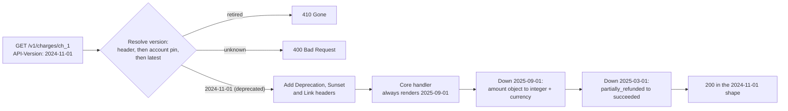
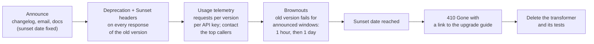

# API Versioning and Backward Compatibility

> [!summary] TL;DR
> **Backward compatibility** means a client written last year still works after today's deploy. Most changes can be made compatibly (add a field, add an endpoint). A **breaking change** (remove, rename or retype a field, change a meaning) needs a new **API version** that old clients do not see until they opt in, plus a planned way to retire the old version.

> [!abstract] Core idea
> - Most changes can be backward compatible: add fields and endpoints, never remove or change meaning.
> - A **breaking change** needs a new version that old clients do not see until they opt in.
> - Serve every version from one core: build the latest response, then walk it back for older clients.
> - Retire old versions on a published schedule with `Deprecation` and `Sunset` headers.
> - Classic mistake: copying the whole codebase per version, so every fix must be made N times.

## 1. Why it exists

Your payments API returns `"amount": 49900` (an integer, in paise). The mobile app parses it straight into an `Int`. The backend team decides amounts should carry their currency and ships:

```json
{"amount": {"value": 49900, "currency": "inr"}}
```

Every installed copy of the app now fails to decode the payment screen. You can ship a fixed app, but you cannot make users install it: app versions linger on phones for months (an estimate of a typical tail; measure your own with an app-version header). Partners who integrated through your SDK broke the same day, and their deploy calendar is not yours.

Versioning lets the server keep changing while each client sees the contract it was written against, until that client chooses to move.

## 2. Mental model

An API is a contract with many signatories you cannot call into a room. Two rules follow:

- **Add, never change.** New fields, new endpoints and new optional inputs are safe because a well-behaved client ignores what it does not know (the "tolerant reader").
- **Breaking changes get a new contract number.** Old signatories keep the old terms until they sign the new one, and you give notice before you stop honouring the old terms.

Analogy: one power grid, many plug shapes. You do not build a second grid for travellers with old plugs; you hand them an **adapter**. In the best designs the server has one core implementation (the grid) and a thin adapter per old version (the version transformers).

## 3. How it works

### Step 1: classify the change

| Change | Breaking? | Why, or the safe alternative |
| --- | --- | --- |
| Add an endpoint, an optional request field, or a response field | No, for tolerant clients | Clients that reject unknown fields break; say in the contract that new fields will appear |
| Remove or rename a response field | **Yes** | Add the new field, keep the old one, retire it in a new version |
| Change a field's type (`int` → `string`, scalar → object) | **Yes** | Add a new field with the new type |
| Make an optional input required, or add a new required input | **Yes** | Give it a server-side default for old versions |
| Change a default or a meaning (paise → rupees, `limit` default 10 → 50) | **Yes**, and silent | The worst kind: nothing fails, numbers are just wrong |
| Add an enum value | **Yes for strict clients** | Clients with exhaustive `switch` or strict decoders crash; document "expect unknown values" and map new values down for old versions |
| Change a status code (`200` → `201`, `404` → `403`) or an error code | **Yes** | Clients branch on them |
| Tighten validation (max length 255 → 100) | **Yes** | Requests that used to succeed now fail |
| Loosen validation, or make a required input optional | No | Old clients still send valid requests |

Hyrum Wright's observation ("Hyrum's law") applies: with enough users, every observable behaviour, including field order, error text and timing, is depended on by somebody. The table lists what you promise; telemetry tells you what people actually rely on.

### Step 2: pick where the version lives

- **URI path:** `/v1/orders`, `/v2/orders`. Visible, easy to route and cache. Google uses major versions this way (AIP-185).
- **Custom header:** `API-Version: 2025-03-01`. Clean URLs; one resource has one URI. New headers should not use the `X-` prefix (RFC 6648).
- **Media type:** `Accept: application/vnd.example.v2+json`. Most "RESTful", least convenient; GitHub's older `application/vnd.github.v3+json` worked this way.
- **Query parameter:** `?api-version=2023-01-01`. Azure REST APIs require it on every call.
- **Date-based with pinning:** Stripe pins an account to the latest version at its first request; a request can override with `Stripe-Version`. GitHub's REST API takes `X-GitHub-Api-Version: 2022-11-28`.

### Step 3: serve old versions from one core

Stripe's 2017 post describes the approach that lets it keep every API version since 2011 working: responses are first rendered for the current version, then the system walks back through time, applying each **version change module** until it reaches the version the request asked for.



Requests need the mirror image: an `Up` step per change that upgrades an old request body before the core sees it. The core code never contains `if version < X`.

### Step 4: retire old versions on a schedule



- `Deprecation: @1756684800` (RFC 9745, published March 2025) carries the deprecation date as a Unix timestamp; it may be in the future.
- `Sunset: Tue, 01 Sep 2026 00:00:00 GMT` (RFC 8594) says when the resource is expected to stop responding. RFC 9745 says the sunset must not be earlier than the deprecation date.
- `Link: <https://docs.example.com/upgrades>; rel="deprecation"` points humans to the migration guide.
- **Brownouts** turn the old version off for short, announced windows. Clients that ignored emails and headers now see errors while you can still switch the version back on.
- After the sunset, answer `410 Gone` rather than `404`: the version existed and was removed on purpose.

## 4. Worked example

### Whiteboard version

One core shape, walked back for an older version. The full version below adds the production concerns.

```go
package versioning

// Charge is always built in the latest shape.
type Charge struct {
	ID     string
	Amount map[string]any // since 2025-09-01: {"value": 499, "currency": "INR"}
}

// Render walks the latest shape back for clients pinned to an older version.
func Render(c Charge, version string) map[string]any {
	out := map[string]any{"id": c.ID, "amount": c.Amount}
	if version < "2025-09-01" { // ISO dates compare correctly as strings
		out["amount"] = c.Amount["value"] // old clients expect a plain number
	}
	return out
}
```

### Full version

A charge resource with two breaking changes: on 2025-03-01 the status enum gained `partially_refunded`; on 2025-09-01 `amount` became an object. One core handler renders the latest shape; the policy walks it back for older clients, adds deprecation headers, and rejects retired or unknown versions. It compiles and passes `go vet` and `go test -race` on Go 1.24 (`slices.Backward` needs Go 1.23 or later).

```go
// Package apiversion serves every supported API version from one core
// handler by walking its latest-version response back through a chain of
// version changes (the model Stripe described in 2017).
package apiversion

import (
	"encoding/json"
	"fmt"
	"log"
	"net/http"
	"slices"
	"time"
)

// Change is one breaking change, named by the date it shipped.
// Down rewrites a response from the shape after the change to the shape before it.
type Change struct {
	Version string // "YYYY-MM-DD": dates compare correctly as strings
	Down    func(body map[string]any)
}

type Deprecation struct {
	At     time.Time // when the version was deprecated
	Sunset time.Time // when it stops working
}

type Policy struct {
	Latest     string
	Supported  []string                     // versions still served
	Retired    map[string]bool              // past their sunset: 410 Gone
	Deprecated map[string]Deprecation       // still served, with warnings
	Changes    []Change                     // ascending by Version
	PinnedFor  func(r *http.Request) string // account's pinned version, "" if none
	DocsURL    string
}

// Core always speaks the latest version.
type Core func(r *http.Request) (status int, body map[string]any)

func (p *Policy) Handler(core Core) http.Handler {
	return http.HandlerFunc(func(w http.ResponseWriter, r *http.Request) {
		v := r.Header.Get("API-Version") // explicit per-request override
		if v == "" && p.PinnedFor != nil {
			v = p.PinnedFor(r) // pinned at the account's first request
		}
		if v == "" {
			v = p.Latest
		}
		switch {
		case p.Retired[v]:
			http.Error(w, fmt.Sprintf("API version %s was retired, see %s", v, p.DocsURL), http.StatusGone)
			return
		case !slices.Contains(p.Supported, v):
			http.Error(w, fmt.Sprintf("unknown API version %q", v), http.StatusBadRequest)
			return
		}
		if d, ok := p.Deprecated[v]; ok {
			w.Header().Set("Deprecation", fmt.Sprintf("@%d", d.At.Unix()))   // RFC 9745
			w.Header().Set("Sunset", d.Sunset.UTC().Format(http.TimeFormat)) // RFC 8594
			w.Header().Set("Link", fmt.Sprintf("<%s>; rel=\"deprecation\"", p.DocsURL))
		}

		status, body := core(r)
		// Undo every change newer than the client's version, newest first.
		for _, c := range slices.Backward(p.Changes) {
			if c.Version <= v {
				break
			}
			c.Down(body)
		}
		w.Header().Set("API-Version", v)
		w.Header().Set("Vary", "API-Version") // caches must not mix versions
		w.Header().Set("Content-Type", "application/json")
		w.WriteHeader(status)
		if err := json.NewEncoder(w).Encode(body); err != nil {
			// The status line is already sent; a write error can only be logged.
			log.Printf("apiversion: write response: %v", err)
		}
	})
}
```

The test drives the handler with `httptest` at three versions, through a header and through an account pin, and checks the retired and unknown cases:

```go
package apiversion

import (
	"encoding/json"
	"net/http"
	"net/http/httptest"
	"testing"
	"time"
)

// Two breaking changes to a charge resource.
var changes = []Change{
	{ // 2025-03-01 added the enum value "partially_refunded".
		Version: "2025-03-01",
		Down: func(b map[string]any) {
			if b["status"] == "partially_refunded" {
				b["status"] = "succeeded" // old clients only know succeeded/refunded/failed
			}
		},
	},
	{ // 2025-09-01 turned amount into {value, currency}.
		Version: "2025-09-01",
		Down: func(b map[string]any) {
			if m, ok := b["amount"].(map[string]any); ok {
				b["amount"], b["currency"] = m["value"], m["currency"]
			}
		},
	},
}

func core(r *http.Request) (int, map[string]any) {
	return http.StatusOK, map[string]any{
		"id":     "ch_1",
		"amount": map[string]any{"value": 49900, "currency": "inr"},
		"status": "partially_refunded",
	}
}

func newServer() http.Handler {
	p := &Policy{
		Latest:    "2025-09-01",
		Supported: []string{"2024-11-01", "2025-03-01", "2025-09-01"},
		Retired:   map[string]bool{"2023-06-01": true},
		Deprecated: map[string]Deprecation{"2024-11-01": {
			At:     time.Date(2025, 9, 1, 0, 0, 0, 0, time.UTC),
			Sunset: time.Date(2026, 9, 1, 0, 0, 0, 0, time.UTC),
		}},
		Changes:   changes,
		PinnedFor: func(r *http.Request) string { return r.Header.Get("X-Test-Pinned") },
		DocsURL:   "https://docs.example.com/upgrades",
	}
	return p.Handler(core)
}

func get(t *testing.T, h http.Handler, hdr map[string]string) (*httptest.ResponseRecorder, map[string]any) {
	t.Helper()
	req := httptest.NewRequest(http.MethodGet, "/v1/charges/ch_1", nil)
	for k, v := range hdr {
		req.Header.Set(k, v)
	}
	rec := httptest.NewRecorder()
	h.ServeHTTP(rec, req)
	var body map[string]any
	if rec.Code == http.StatusOK {
		if err := json.Unmarshal(rec.Body.Bytes(), &body); err != nil {
			t.Fatal(err)
		}
	}
	return rec, body
}

func TestEachVersionGetsItsShape(t *testing.T) {
	h := newServer()

	_, latest := get(t, h, nil)
	if _, nested := latest["amount"].(map[string]any); !nested || latest["status"] != "partially_refunded" {
		t.Fatalf("latest = %v", latest)
	}

	_, mid := get(t, h, map[string]string{"API-Version": "2025-03-01"})
	if mid["amount"] != 49900.0 || mid["currency"] != "inr" || mid["status"] != "partially_refunded" {
		t.Fatalf("2025-03-01 = %v", mid)
	}

	rec, old := get(t, h, map[string]string{"X-Test-Pinned": "2024-11-01"}) // pinned, no header
	if old["amount"] != 49900.0 || old["status"] != "succeeded" {
		t.Fatalf("2024-11-01 = %v", old)
	}
	if rec.Header().Get("Deprecation") != "@1756684800" ||
		rec.Header().Get("Sunset") != "Tue, 01 Sep 2026 00:00:00 GMT" ||
		rec.Header().Get("Vary") != "API-Version" {
		t.Fatalf("deprecation headers = %v", rec.Header())
	}
}

func TestRetiredAndUnknownVersions(t *testing.T) {
	h := newServer()
	if rec, _ := get(t, h, map[string]string{"API-Version": "2023-06-01"}); rec.Code != http.StatusGone {
		t.Fatalf("retired version: status %d, want 410", rec.Code)
	}
	if rec, _ := get(t, h, map[string]string{"API-Version": "2024-02-30"}); rec.Code != http.StatusBadRequest {
		t.Fatalf("unknown version: status %d, want 400", rec.Code)
	}
}
```

The exchange a 2024-11-01 client sees, reconstructed from the handler above (the body is what the test decodes; `encoding/json` sorts map keys; the `Date` and `Content-Length` headers that `net/http` adds are left out):

```http
GET /v1/charges/ch_1 HTTP/1.1
Host: api.example.com
API-Version: 2024-11-01

HTTP/1.1 200 OK
Api-Version: 2024-11-01
Content-Type: application/json
Deprecation: @1756684800
Link: <https://docs.example.com/upgrades>; rel="deprecation"
Sunset: Tue, 01 Sep 2026 00:00:00 GMT
Vary: API-Version

{"amount":49900,"currency":"inr","id":"ch_1","status":"succeeded"}
```

Notes on the design:

- The `Down` for the enum maps the new value to the closest old one. Old clients never see a value they cannot handle, and new clients get the precise state.
- Versions are ISO dates so plain string comparison orders them. A semver-style `v10` would sort before `v9` as a string.
- The core returns `map[string]any` so transformers can reshape freely. In a typed codebase the core returns a struct, marshals it once to a generic tree, and the transformers edit the tree.

## 5. Variants and comparison

Where the version lives:

| Scheme | Example | Use when | Cost |
| --- | --- | --- | --- |
| URI path | `/v2/orders` | Public APIs with rare, big revisions; easy routing, caching and logs | Every link and SDK changes on a bump; tempts teams into whole-API rewrites |
| Custom header | `API-Version: 2025-03-01` | Frequent small changes; stable URLs | Invisible in a browser bar; caches must `Vary` on it |
| Media type | `Accept: application/vnd.example.v2+json` | Per-representation versioning, content negotiation | Awkward for clients and tooling |
| Query parameter | `?api-version=2023-01-01` (Azure) | Simple to send from any client; easy to see in logs | Mixes control data with query data |
| Date-based + account pin | `Stripe-Version`; pinned at first request | Many small breaking changes; long-lived integrations | Needs a transformer chain and per-account state |
| No versions, evolve only | GraphQL `@deprecated`; protobuf field rules | Schemas where clients select fields or skip unknown ones | Discipline: never break, only add and deprecate |

How old versions are served:

| Strategy | How it works | Use when | Cost |
| --- | --- | --- | --- |
| Parallel deployments | `v1` and `v2` run as separate code or services | A full rewrite; very few versions | Every bug fix and security patch lands in each copy |
| Branches in the code | `if version < "2025-03-01" { ... }` in handlers | One or two small changes | Version checks spread everywhere and are never deleted |
| One core + transformers | Core renders the latest; a chain of `Down`/`Up` steps per change | Many versions, long support windows | Transformer per change, contract tests per version |

## 6. Trade-offs and when not to use

- **Every live version costs money.** Each one adds transformers, contract tests, docs and support load. A version nobody calls still costs review time on every change near it.
- **Internal APIs with one owner rarely need versions.** If every caller deploys from the same repository or you control all consumers, use expand/contract instead: add the new field, move callers, then remove the old field.
- **A version bump is not a design tool.** Shipping `/v2` to clean up naming forces every client to migrate for no gain to them. Batch breaking changes, and only for real benefit.
- **URI versions invite big-bang rewrites.** Date-based versions push teams toward small, frequent, well-documented changes.
- **Versioning does not cover behaviour drift.** Changing rate limits, latency, or ordering of results can break clients without any field changing; announce those in the changelog too.

## 7. In production

- **Real systems:**
	- Stripe pins each account to the newest version at its first request, allows a per-request `Stripe-Version` override, and lets accounts upgrade from the dashboard. Its 2017 post describes keeping every version since 2011 working through version change modules applied backwards. Version strings now also carry a release name (for example `2024-09-30.acacia`).
	- GitHub's REST API uses `X-GitHub-Api-Version` with dates and promises at least 24 months of support for the previous version after a new one ships. Requests without the header get the default, `2022-11-28`; after `2026-03-10` shipped, `2022-11-28` was given an end-of-support date of 10 March 2028 (GitHub docs, checked 2026-11-02).
	- Azure REST APIs take a required `api-version` query parameter; Twilio's REST API carries `2010-04-01` in the URI path; Google APIs use `v1`, `v1beta1` in the path (AIP-185).
- **Failure modes → fixes:**
	- A "harmless" new enum value crashes an old Android app with an exhaustive `when` → document that enums are open, test clients against unknown values, and map new values down for old versions.
	- A field rename ships without a version and partner integrations break → a contract test suite per supported version, run in CI against the latest core (see [[Contract Testing]]).
	- A deprecated version still carries 30% of traffic on sunset day → start telemetry at announcement, contact the top keys, and run brownouts weeks before the sunset.
	- A cache serves a `v2` body to a `v1` client → send `Vary: API-Version` when the version comes from a header.
	- The force-update endpoint itself changes and old apps can no longer learn they must update → keep that endpoint tiny, unversioned and frozen forever.
- **What to monitor:**
	- Requests per version per API key or app version (the input to every deprecation decision).
	- Traffic still on deprecated versions, as a percentage, trending toward zero before the sunset.
	- Error rates per version after each deploy (a transformer bug shows up only for old versions).
	- 410 responses after the sunset, by client, to find stragglers.

## 8. Deep dive

**Mobile clients that never update.** Apps send their version on every request (`User-Agent` or an app-version header). The server keeps a **minimum supported app version** per platform and exposes it through a small config endpoint. Below the minimum, the app shows a blocking "update required" screen; between minimum and latest, a dismissible prompt. On the server side, reject requests from apps below the minimum with a specific error code that the oldest apps already understand. `426 Upgrade Required` is a poor fit: RFC 9110 defines it for protocol upgrades and requires an `Upgrade` header naming the protocol.

**Expand/contract for a field rename** (`name` → `display_name`):

1. **Expand:** add `display_name` to responses, keep `name`, accept either in requests (prefer the new one).
2. **Migrate:** update SDKs and first-party clients; watch telemetry by client version.
3. **Contract:** ship a new version without `name`. Its transformer re-adds `name` for older versions, so nobody breaks; drop the transformer at that version's sunset.

The same three steps drive database renames (see [[Zero-Downtime Schema Migrations]]) and event schema changes (see [[Event Schemas and Schema Registry]]).

**GraphQL evolves instead of versioning.** Add fields freely, mark old ones `@deprecated(reason: "Use displayName")`, and remove them when usage reaches zero. Because every query names the fields it reads, the server can log per-field usage, which REST cannot do. See [[GraphQL]].

**Protobuf and gRPC rules** (details in [[Protocol Buffers and Schema Evolution]]): never change or reuse a field number; mark removed numbers and names `reserved`; do not change a field's type; adding fields is safe because old readers skip unknown fields; proto3 enums are open, so an old reader keeps an unknown enum value as its number. Package names carry the major version (`acme.payments.v1`).

**Semver for SDKs.** SDKs follow Semantic Versioning: MAJOR for a breaking change in the SDK's own surface, MINOR for additions, PATCH for fixes. The SDK version and the API version are different axes. Stripe's SDKs for strongly typed languages (Go, Java, .NET), for example, use a fixed API version, the latest one when that SDK release shipped, and Stripe advises against overriding it, so moving such an integration to a new API version means upgrading the SDK. Its Ruby, Python, PHP and Node SDKs have also defaulted to their release's API version since their 2023 major versions, but accept a per-client or per-request override (Stripe docs, "Set a Stripe API version", checked 2026-11-02).

**Webhooks are versioned too.** An event payload is a response the receiver never asked for. Render each event at the version of the receiving endpoint (Stripe lets each webhook endpoint set one) and run it through the same transformer chain. See [[Webhooks - Sending and Receiving]].

**How many versions to support.** With transformers, the cost grows with the number of *changes*, not versions, which is why date-based APIs can keep many versions alive. With parallel deployments, cost grows with versions, so keep two (current and previous) and publish a fixed support window. A common rule of thumb for public APIs is a deprecation notice of at least 6 to 12 months (an estimate of common practice; GitHub commits to 24 months).

**Transformers are code with edge cases.** A `Down` must handle every place the resource appears: list items, nested expansions, webhook payloads, and error bodies. Keep one golden-file test per version per resource so a core change that a transformer forgot shows up as a diff.

## 9. Interview questions

> [!question]- Is adding a field to a JSON response a breaking change? (trap)
> Not by contract, if you documented that clients must ignore unknown fields. In practice it breaks clients that validate strictly (`additionalProperties: false`, generated strict decoders) or that store the whole object in a fixed-size schema. Say "additive is safe for tolerant readers", state that rule in the contract, and test popular SDKs against new fields.

> [!question]- Is adding a new enum value safe?
> No for strict clients: an exhaustive `switch` or a strict enum decoder fails on the unknown value. Document that enums are open, require a default branch in SDKs, and for old API versions map the new value to the closest old one in a transformer.

> [!question]- URI versioning or header versioning?
> URI (`/v2`) is visible, cache-friendly and easy to route, and suits rare, large revisions. Headers (date-based) keep URLs stable and suit frequent small changes with per-account pinning, but need `Vary` for caches and are less visible. Both work; consistency and a deprecation process matter more than the choice.

> [!question]- How does Stripe keep many API versions without forking code?
> The core speaks only the latest version. Each breaking change ships as a version change module; for an older client, the response walks back through the modules newer than the client's version. Accounts are pinned to the version current at their first request and opt into upgrades.

> [!question]- How do you retire `v1` without an outage?
> Announce a sunset date, send `Deprecation` and `Sunset` headers on every `v1` response, track `v1` calls per API key and contact the biggest callers, run announced brownouts, then return `410 Gone` with a link to the migration guide. Delete the code only after 410 traffic fades.

> [!question]- How do you rename a field without breaking anyone?
> Expand/contract: add the new field and keep the old one, accept both in requests, migrate clients while watching telemetry, then remove the old field only in a new version whose transformer re-adds it for older versions.

> [!question]- Half your users are on an app version from last year. What does your API do?
> Treat the oldest supported app version as a client you must not break: version the API or keep changes additive. Keep a minimum supported version, enforced by a tiny, frozen config endpoint and a stable error code, so you can force an update when a change is unavoidable.

## 10. Cheat sheet

- Additive (new endpoint, optional input, new response field) is safe for tolerant readers; say so in the contract.
- Breaking: remove, rename or retype a field, new required input, changed default or meaning, new enum value for strict clients, changed status codes, tighter validation.
- Version in path (`/v2`), header (`API-Version`), media type, query (`api-version`), or date + account pin (Stripe).
- Best implementation: one core at the latest version plus `Down`/`Up` transformers per change.
- Retire with `Deprecation` (RFC 9745) + `Sunset` (RFC 8594) headers, telemetry, brownouts, then `410 Gone`.
- Mobile: minimum supported version, frozen force-update endpoint, never trust that users update.
- GraphQL: `@deprecated` and field usage; protobuf: never reuse field numbers, use `reserved`.

## Links

- **Before this:** [[REST and HTTP API Design]], [[API Contract Design and OpenAPI]], [[Pagination, Filtering and Sorting]]
- **Next:** [[Idempotency and Idempotency Keys]], [[Contract Testing]]
- **Compare with:** [[Protocol Buffers and Schema Evolution]] (wire-level rules), [[GraphQL]] (evolution without versions), [[Zero-Downtime Schema Migrations]] (expand/contract in the database), [[Event Schemas and Schema Registry]] (compatibility modes for events), [[Feature Flags]] (rolling out behaviour, not contracts)
