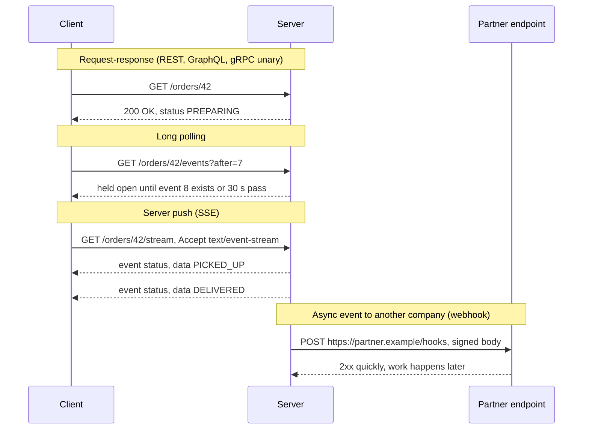
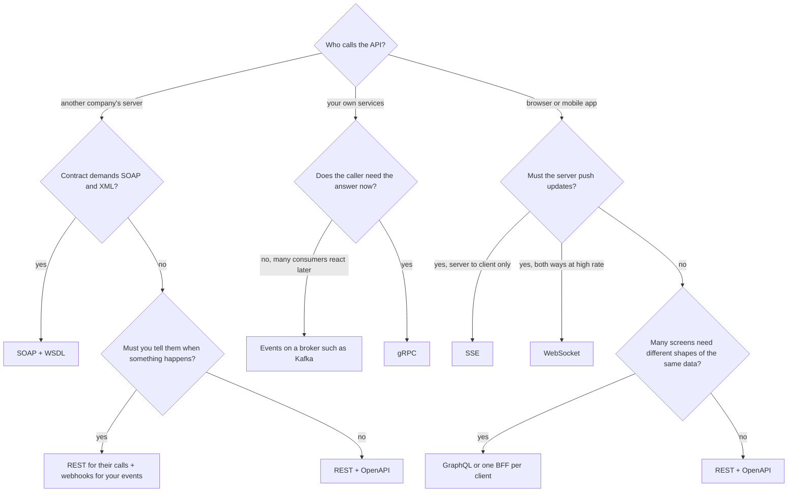
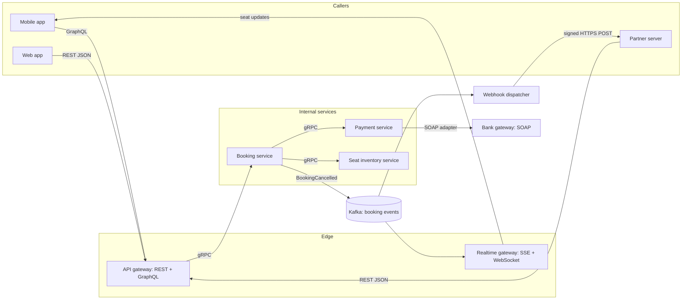

# Choosing an API Style

> [!summary] TL;DR
> An **API style** is the set of rules two programs use to talk: how a request is shaped, what travels over the wire, and who starts the conversation. Pick it by asking **who calls** (a browser, your own service, another company) and **which way data flows** (ask-and-answer, server push, streams, or events). REST is the default for public resource APIs; the others win in specific cases.

> [!abstract] Core idea
> - Start from the **caller** (browser, own service, partner company) and the **data flow** (ask-and-answer, server push, two-way stream, event).
> - REST is the default for anything public and resource-shaped; pick something else only for a specific reason.
> - gRPC fits internal service-to-service calls; GraphQL or a BFF (backend for frontend) fits many-screen mobile clients; SSE, WebSocket or webhooks fit push.
> - Classic mistake: choosing a style because it is fashionable rather than because of who calls and which way data flows.

## 1. Why it exists

A movie-ticket platform needs five kinds of communication at once:

- a mobile app that lists shows and books seats,
- a seat map that must show other people's bookings within a second or two,
- 40 internal services calling each other thousands of times per second,
- cinema partners who must be told when a booking is cancelled,
- one old bank partner whose payment gateway only accepts SOAP.

Forcing one style onto all five hurts. If the seat map **polls** every 2 seconds with 50,000 people watching, that is 25,000 requests per second even when nothing changes (arithmetic, not a benchmark). If partners must **poll** for cancellations, they either miss them or hammer you. If internal calls use JSON over HTTP/1.1, every call pays for text parsing, and every in-flight call needs its own connection because HTTP/1.1 cannot multiplex (carry several requests at the same time on one connection).

Each API style exists because it makes one of these shapes cheap. Choosing well means matching style to caller and data flow, and keeping the number of styles small.

## 2. Mental model

Think of the ways a restaurant talks to people:

| Restaurant | API style |
| --- | --- |
| A printed menu: ask for item 12, get item 12 | **REST**: named resources, standard verbs |
| "Build your own plate": the customer lists exactly what goes on it | **GraphQL**: the client picks the fields |
| The kitchen's internal ticket system: fast, fixed codes, staff only | **gRPC**: typed, binary, internal |
| A buzzer that vibrates when your order is ready | **SSE** (Server-Sent Events, one way) or **WebSocket** (both ways) |
| Asking the waiter "is it ready?" and he waits at the kitchen before answering | **Long polling** |
| The restaurant phones the supplier when stock runs low | **Webhook**: your server calls theirs |
| A notarised paper order form a government supplier insists on | **SOAP**: XML envelope and a strict contract |

Two questions decide most cases: **who is calling** and **who speaks first**.

## 3. How it works

### The four communication patterns

Every style is one of four patterns, or a mix:

1. **Request-response.** The client asks, the server answers once. REST, GraphQL queries and mutations, gRPC unary calls, SOAP.
2. **Server push.** The client opens a channel once, then the server sends whenever it has news. SSE, WebSocket, GraphQL subscriptions. Long polling fakes push with repeated requests.
3. **Streaming.** Many messages flow over one call, in one or both directions. gRPC server, client and bidirectional streams; WebSocket.
4. **Async events.** The producer does not wait for the consumer. Webhooks (across companies) and message brokers such as Kafka (inside a company, see [[Event-Driven Architecture Basics]]).



### The decision

Ask about the **caller first**, then the **direction of data**. The old "is it normal CRUD?" first question is the wrong root: almost everything looks like CRUD, so the push and internal branches never get asked. In the chart, a **BFF** (backend for frontend) is a small server per client type that calls the internal services and returns exactly the shape that client's screens need.



Real systems end up with **several styles**, one per edge. The usual layout puts REST or GraphQL at the public edge, gRPC between internal services, a broker for events, and webhooks for partners:



## 4. Worked example

### Whiteboard version

The whole decision fits in one function. The full version below adds the production concerns.

```go
package choosing

// Pick returns the default API style for a caller and a data-flow shape.
func Pick(caller, flow string) string {
	switch {
	case flow == "server-push-one-way":
		return "SSE"
	case flow == "two-way-realtime":
		return "WebSocket"
	case flow == "event-to-partner":
		return "Webhook (signed, retried)"
	case caller == "internal-service":
		return "gRPC"
	case caller == "mobile-many-screens":
		return "GraphQL or a BFF"
	default: // browser or third party, request-response
		return "REST"
	}
}
```

### Full version

**Interview drill: "How would you expose seat booking for a movie-ticket platform?"** Walk each caller through the decision tree, then size the push channel.

| Need | Caller | Style | Why |
| --- | --- | --- | --- |
| List shows, book seats, cancel | Web and mobile apps | REST: `GET /shows/{id}/seats`, `POST /bookings`, `POST /bookings/{id}/cancel` | Resource-shaped, cacheable reads, every client and tool speaks it |
| Home screen that mixes shows, offers, history | Mobile app (5 screen variants) | GraphQL behind the gateway, or a mobile BFF | One round trip per screen instead of one REST call per data source |
| Live seat map while choosing seats | Browser | SSE stream `GET /shows/{id}/seat-events` | Server-to-client only; plain HTTP; built-in reconnect |
| Booking → inventory → payment | Internal services | gRPC with deadlines | Typed contract, protobuf, HTTP/2 multiplexing |
| Tell cinemas about cancellations | Partner servers | Webhooks, signed, retried | Partners do not have to poll |
| Charge through an old bank | Bank's server | SOAP client in one adapter service | The bank's WSDL is fixed; isolate it |

**Sizing the seat map (estimates, by arithmetic).** Assume 50,000 people have a seat map open, spread over many shows, and the seat map each person watches changes about once every 10 seconds on average.

- Polling every 2 s: 50,000 / 2 = **25,000 requests/s**. About 4 of every 5 polls find nothing new (one change per 10 s, one poll per 2 s), and a change still waits up to 2 s to appear.
- Long polling: about one request per change per client, 50,000 / 10 = **5,000 requests/s**, plus 50,000 held-open requests and one reconnect round trip after every change. Its cost grows with the update rate: if a hot show changed 5 times per second, each of its viewers could send up to 5 requests/s, which is worse than polling every 2 s unless the server batches events.
- SSE: **50,000 open connections** and about **5,000 small messages/s** pushed, with no request per update. The cost moves from request rate to connection count, which is a memory and file-descriptor question (see [[Scaling WebSockets]]; the same scaling rules apply to SSE).

Which to pick depends on what is scarce. With HTTP/2 at the edge, SSE avoids the browser limit of 6 HTTP/1.1 connections per domain, shared by all tabs of that browser, which hurts SSE over HTTP/1.1 (documented on MDN).

**The "one company uses many styles" check.** The table above uses six styles: REST, GraphQL, gRPC, SSE, webhooks and SOAP. That is normal. What is not normal is using two styles for the **same caller and job**, for example REST and GraphQL both serving the same mobile screen. That doubles the contracts, auth paths and tests with no gain.

## 5. Variants and comparison

| Style | Transport | Payload | Contract | Browser support | HTTP caching | Streaming | Best fit |
| --- | --- | --- | --- | --- | --- | --- | --- |
| REST | HTTP/1.1, HTTP/2 or HTTP/3 | JSON usually; any media type | OpenAPI | Native (`fetch`) | Yes: `GET` + `Cache-Control`, `ETag` | No, one response per request | Public resource APIs, CRUD, partner APIs |
| GraphQL | HTTP, one endpoint, usually `POST` | JSON | SDL schema | Native | Hard: `POST` bodies are not cached; persisted queries over `GET` make it possible | Subscriptions, usually over WebSocket | Many client shapes, aggregation across services |
| gRPC | HTTP/2 required | Protobuf (binary) | `.proto` | Not directly: needs gRPC-Web or Connect through a proxy | No | Server, client and bidirectional streams | Internal service-to-service calls |
| WebSocket | HTTP/1.1 `Upgrade` (RFC 6455); HTTP/2 and HTTP/3 extended `CONNECT` (RFC 8441, RFC 9220) | Text or binary frames in your own format | None built in (AsyncAPI can describe it) | Native `WebSocket` | No | Full duplex | Chat, collaborative editing, games |
| SSE | One long HTTP response, `text/event-stream` | UTF-8 text events | None built in | Native `EventSource` | No | Server to client only | Live feeds, notifications, job progress |
| Long polling | Repeated HTTP requests held open | Any | Same as REST | Native | No | Simulated | Fallback when streams are blocked |
| Webhooks | HTTPS `POST` from provider to consumer | JSON | Event catalogue; OpenAPI 3.1 `webhooks` | Not applicable (server to server) | No | No, one `POST` per event | Cross-company event notification |
| SOAP | Usually HTTP `POST` | XML envelope | WSDL + XSD | Possible, painful | No | No | Legacy banking, telecom and government partners |

Per-style details live in their own notes: [[REST and HTTP API Design]], [[GraphQL]], [[gRPC]], [[Real-time APIs - WebSocket, SSE and Long Polling]], [[Webhooks - Sending and Receiving]], [[SOAP and WSDL (Legacy Integrations)]].

## 6. Trade-offs and when not to use

- **Do not expose gRPC directly to browsers.** Browsers cannot read HTTP/2 trailers through `fetch`, where gRPC puts its status, so you need gRPC-Web or Connect plus a proxy. Binary payloads are also harder for partners to debug with `curl`.
- **Do not add GraphQL for one client and simple CRUD.** You pay for a schema, resolvers, N+1 batching (DataLoader), query cost limits and lost HTTP caching, and get nothing a few REST endpoints would not give you.
- **Do not reach for WebSocket when data only flows down.** WebSocket connections are stateful: sticky routing, heartbeats, reconnect and resume logic, and a different scaling model. SSE runs over ordinary HTTP and reconnects by itself with `Last-Event-ID`.
- **Polling is fine when updates are rare.** A dashboard that refreshes every 60 s does not need a push channel; plain `GET` with an `ETag` returns a cheap `304` most of the time (see [[HTTP Caching - Cache-Control, ETag, Conditional Requests]]).
- **Webhooks are at-least-once.** Receivers must deduplicate by event ID (see [[Delivery Semantics and Exactly-Once]]). If partners cannot host an HTTPS endpoint, offer an events list endpoint they can poll instead.
- **Every extra style has a fixed cost:** another contract format, code generator, auth integration, gateway rule, dashboard and on-call runbook.

## 7. In production

- **Real systems:**
	- **Stripe**'s main (v1) API is REST: resource URLs, form-encoded request bodies, JSON responses, and webhooks for events.
	- **GitHub** runs a REST API and a GraphQL API side by side, so integrators choose per use case.
	- **Google Cloud APIs** are defined in `.proto` files and served over gRPC, and also as REST/JSON through HTTP transcoding rules (AIP-127).
	- **Slack** uses three styles: an RPC-over-HTTP Web API (`POST /api/chat.postMessage`), the Events API that `POST`s to your URL, and Socket Mode that delivers the same events over a WebSocket.
	- **Kubernetes** serves REST and adds `?watch=true`, which streams change events over one long HTTP response. **etcd v3**, its datastore, exposes a gRPC API.
- **Failure modes → fixes:**
	- gRPC behind an L4 load balancer sends all of one client's calls to one backend, because HTTP/2 keeps one long-lived connection → balance per request at L7 (Envoy) or on the client (see [[Forward and Reverse Proxies - L4 vs L7]]).
	- A GraphQL query nests ten levels deep and takes the database down → enforce depth and cost limits, or allow only persisted queries.
	- SSE events arrive in bursts → a proxy buffers the response; turn buffering off (in nginx, `proxy_buffering off` or the `X-Accel-Buffering: no` response header).
	- WebSocket connections drop after a minute of silence → load balancers close idle connections (the AWS ALB default is 60 s); send heartbeats more often than the idle timeout.
	- A partner's webhook endpoint is down for an hour → retry with exponential backoff, park failures in a dead-letter store and offer a replay endpoint.
- **What to monitor:**
	- Per style: request rate, error rate, p99 latency.
	- For push channels: open connections, reconnects per minute, messages per second.
	- For webhooks: delivery success rate, delivery lag, retries per endpoint.
	- For gRPC: the distribution of status codes (`UNAVAILABLE`, `DEADLINE_EXCEEDED`).

## 8. Deep dive

- **Why gRPC needs HTTP/2.** gRPC sends each call as an HTTP/2 stream: headers, length-prefixed protobuf messages, then **trailers** carrying `grpc-status` and `grpc-message`. Multiplexing lets thousands of concurrent calls share one TCP connection. Browsers' `fetch` does not expose trailers, which is why gRPC-Web moves the status into the response body. A translating proxy such as Envoy then converts gRPC-Web to gRPC, unless the server speaks gRPC-Web itself (Connect servers do).
- **One contract, two surfaces.** With the `google.api.http` option, a method like `GetBooking` maps to `GET /v1/{name=bookings/*}`. grpc-gateway generates a Go reverse proxy from that mapping, and Envoy's gRPC-JSON transcoder does the same inside the proxy. You write the service once in gRPC and expose REST/JSON at the edge (see [[Serving REST and gRPC Together]]).
- **Why REST caches and the others do not.** Shared caches store responses to `GET` (and `HEAD`). RFC 9110 allows caching a `POST` response only with explicit freshness and a matching `Content-Location`, and common caches do not do it. GraphQL sends queries as `POST`, so CDNs pass them through. Persisted queries fix this: the client sends a hash of a pre-registered query in a `GET` URL, which a CDN can cache.
- **Message size limits are part of the style.** grpc-go rejects incoming messages over 4 MiB by default (`MaxRecvMsgSize`). Large files belong in object storage with a presigned URL, not in an RPC (see [[File Upload Architecture]]).
- **Head-of-line blocking.** HTTP/2 removes blocking between requests at the HTTP layer, but one lost TCP packet still stalls every stream on the connection. HTTP/3 over QUIC removes that (see [[HTTP-1.1 vs HTTP-2 vs HTTP-3]]). This matters for gRPC and SSE on lossy mobile networks.
- **GraphQL vs BFF.** Both solve "each client needs a different shape". GraphQL lets each client ask for its own shape from one shared schema. A BFF (backend for frontend) is a small server per client type that composes the calls in code. GraphQL scales to many clients; a BFF is simpler when there are two or three and each team owns its own (see [[API Gateway and BFF]]).

## 9. Interview questions

> [!question]- How would you expose live order tracking for a food-delivery app?
> REST for placing and reading orders (`POST /orders`, `GET /orders/{id}`). SSE for the live courier position and status, because data only flows to the client and SSE reconnects by itself. gRPC between the order, courier and pricing services. Webhooks to tell restaurants about new orders. Size the SSE fleet by open connections, not request rate.

> [!question]- REST, GraphQL or gRPC for a public API used by third-party developers?
> REST with OpenAPI. Every language and tool speaks it, `GET` responses are cacheable, errors use standard status codes, and partners can test with `curl`. GraphQL is a strong second when consumers need flexible aggregation (GitHub offers both). gRPC suits internal callers better.

> [!question]- Trap: "gRPC is faster, so make the public web API gRPC." What is wrong?
> Browsers cannot speak native gRPC: they cannot read HTTP/2 trailers through `fetch`, so you need gRPC-Web or Connect and a proxy. You lose HTTP caching and easy debugging. Payload size rarely dominates a browser request's latency anyway; the network round trip does. Use gRPC inside and transcode to REST at the edge.

> [!question]- SSE or WebSocket for a live score feed?
> SSE. Data flows one way, SSE is plain HTTP (works with proxies, cookies and HTTP/2 multiplexing) and the browser reconnects automatically, sending `Last-Event-ID` so the server can resume. One catch: the browser's `EventSource` cannot set an `Authorization` header, so bearer-token auth needs a cookie, a short-lived token in the URL, or a `fetch`-based SSE client. Choose WebSocket only when the client also sends frequent messages, as in chat or games.

> [!question]- When do you use webhooks instead of letting partners poll?
> When events are sparse and partners need them quickly. Polling wastes requests and still adds up to one interval of delay. Webhooks need more from both sides: signing, retries with backoff, idempotent receivers and a replay or events endpoint for missed deliveries. Many providers (Stripe, GitHub) offer both.

> [!question]- GraphQL or a BFF for a mobile and a web client?
> With two clients and separate teams, a BFF per client is usually simpler: plain code, normal HTTP caching, no query-cost limits. GraphQL pays off when many clients or teams need different shapes from the same data and you want one schema instead of many BFFs.

> [!question]- Can one system use several styles without duplicating business logic?
> Yes. Keep business logic in internal services with one contract (often `.proto`). Expose it as REST through transcoding (grpc-gateway or Envoy), as GraphQL through resolvers that call the same services, and as events through a broker. Each edge is a thin adapter.

## 10. Cheat sheet

- Decide by **caller** (browser, own service, partner) and **direction** (ask, push, stream, event).
- Public resource API → **REST + OpenAPI**. Many client shapes → **GraphQL** or a **BFF**.
- Internal low-latency typed calls → **gRPC** (HTTP/2, protobuf, deadlines, streams).
- Push to browsers → **SSE** for one way, **WebSocket** for two way, long polling as a fallback.
- Cross-company events → **webhooks** (signed, retried, idempotent receivers). Inside the company → a **broker**.
- **SOAP** only when a partner's WSDL forces it; isolate it in one adapter.
- Only `GET` is cacheable in practice: REST caches, GraphQL over `POST` and gRPC do not.
- Mixed is normal: REST/GraphQL at the edge, gRPC inside, transcoding to avoid duplicate logic.

## Links

- **Before this:** [[HTTP Fundamentals - Methods, Status Codes, Headers, Cookies]], [[HTTP-1.1 vs HTTP-2 vs HTTP-3]]
- **Next:** [[REST and HTTP API Design]], [[API Contract Design and OpenAPI]], [[GraphQL]], [[gRPC]], [[Real-time APIs - WebSocket, SSE and Long Polling]], [[Webhooks - Sending and Receiving]]
- **Compare with:** [[API Gateway and BFF]] (where the styles meet), [[Event-Driven Architecture Basics]] (async events inside a company), [[SOAP and WSDL (Legacy Integrations)]]
