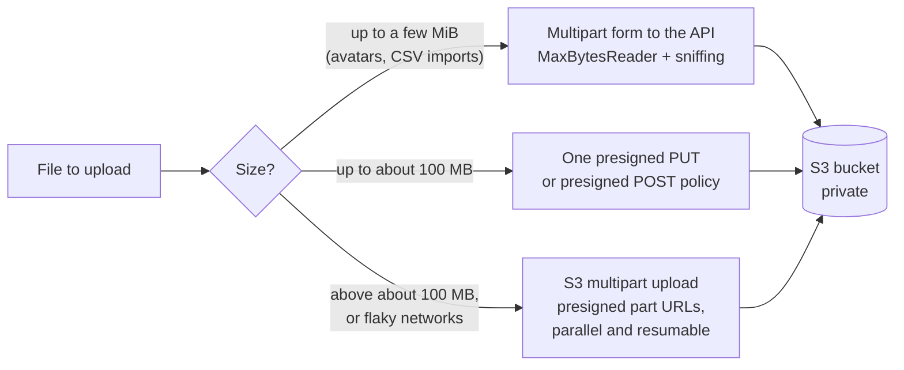
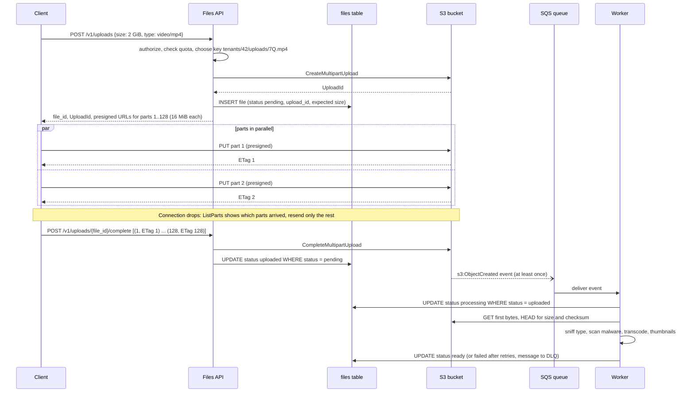
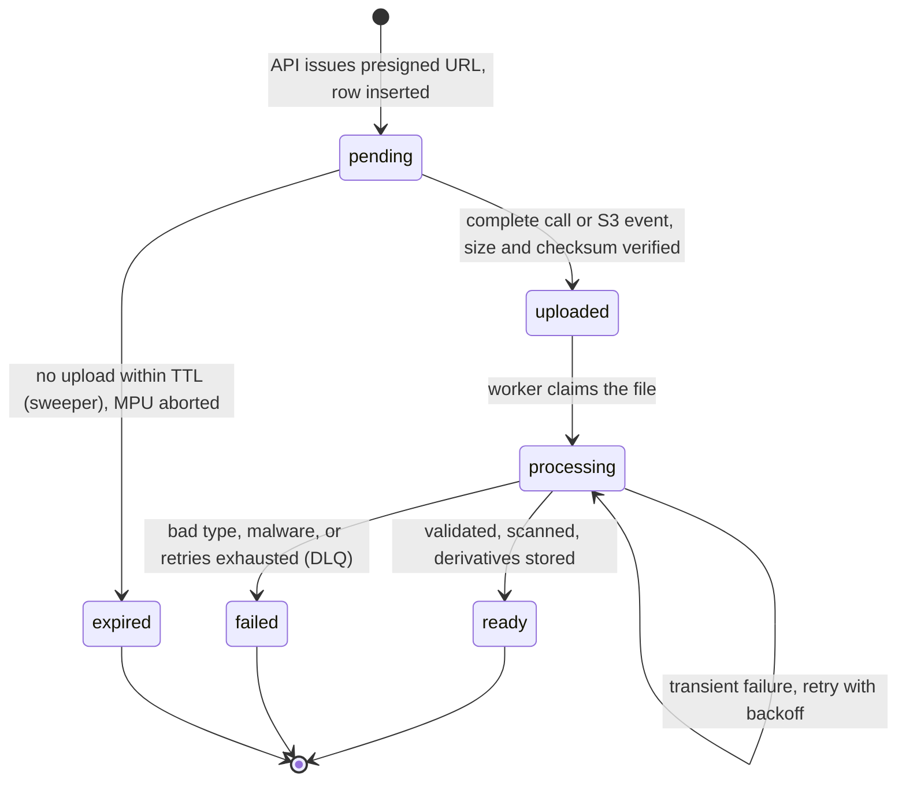

# File Upload Architecture

> [!summary] TL;DR
> Do not stream big files through your API servers. The API **authorizes** the upload and hands the client a short-lived **presigned URL**; the client sends the bytes **straight to object storage** (S3); an event then tells a worker to validate and process the file, and a status column tracks it from `pending` to `ready`.

## 1. Why it exists

A user uploads a 500 MB video through `POST /v1/videos`, and the API server receives the bytes and forwards them to S3.

- **Time.** On a 10 Mbit/s mobile uplink, 500 MB takes 400 seconds. A Go server with `ReadTimeout: 30 * time.Second` cuts it off, because that timeout covers reading the entire request, body included.
- **Limits on the way in.** nginx rejects bodies above `client_max_body_size` (1 MiB by default) with `413`. Amazon API Gateway caps payloads at 10 MB and a synchronous Lambda invocation at 6 MB.
- **Memory and connections.** A handler that buffers files needs `file size × concurrent uploads` of RAM: 100 concurrent 50 MB uploads is 5 GB (arithmetic, not a measurement). Even when streaming, each upload pins a connection and a goroutine for minutes, and you pay to move every byte twice (client → API → S3).
- **Retries restart from zero.** A dropped connection at 480 MB means sending all 500 MB again.

Object storage is built for exactly this traffic. The API only has to decide **who may upload what, where, and for how long**.

## 2. Mental model

The API is a **ticket office**, not a loading dock. It checks your identity and quota, writes down "Priya may drop off one PNG, up to 10 MB, at locker `tenants/42/uploads/7Q…`, in the next 15 minutes", and hands you a signed ticket. You drive to the warehouse (S3) yourself. The warehouse checks the ticket's signature and conditions, accepts the parcel, and rings the office (an event) when it arrives. Only then does a worker open the parcel and inspect it.

## 3. How it works

### Pick the path by size



AWS suggests considering multipart uploads once an object reaches 100 MB.

### Presigned PUT vs presigned POST policy

A **presigned PUT** is a URL with a SigV4 signature over the method, bucket, key, expiry and a list of **signed headers**. The client must send exactly those header values; anything else fails the signature check. It can pin an **exact** `Content-Type`, an exact `Content-Length` and an `x-amz-checksum-sha256`, but it cannot express a **range** such as "any size up to 10 MB" or "any `image/*` type".

A **presigned POST** (browser form upload) signs a **policy document** with conditions, and S3 enforces them:

```json
{
  "expiration": "2026-11-02T03:31:28Z",
  "conditions": [
    {"bucket": "uploads-prod"},
    {"key": "tenants/t1/uploads/abc"},
    ["content-length-range", 1, 26214400],
    ["starts-with", "$Content-Type", "image/"]
  ]
}
```

(Abridged from the policy that the test in section 4 generated with aws-sdk-go-v2 `service/s3` v1.114.6; the full policy also carries `X-Amz-Algorithm`, `X-Amz-Credential` and `X-Amz-Date` conditions, and S3 rejects an upload that breaks any condition.)

Keep both kinds short-lived (5 to 15 minutes is a common choice). A SigV4 presigned URL can live at most 7 days with long-term credentials, and it stops working when the temporary credentials that signed it expire, whatever its `X-Amz-Expires` says.

### Multipart upload, completion and processing



Multipart rules (S3 docs): parts are 5 MiB to 5 GiB except the last, which can be smaller; at most 10,000 parts; part numbers 1 to 10,000. A 2 GiB file in 16 MiB parts is 128 parts, and a failed part costs a 16 MiB retry instead of a 2 GiB restart.

**Two completion signals, one idempotent handler.** The client's `complete` call is fast but unreliable (the app may die right after the last part). The S3 event is reliable but at-least-once and usually seconds late. Use both, and make both call the same conditional transition, `UPDATE files SET status = 'uploaded' WHERE id = $1 AND status = 'pending'`, so a duplicate does nothing. See [[Idempotency and Idempotency Keys]].

### File lifecycle



Readers only ever see files in `ready`. A download endpoint that serves `pending` or `failed` files serves unvalidated bytes.

## 4. Worked example

**Small files through the API.** Avatars and CSV imports of a few MiB can go through the API if the handler bounds the body, ignores the client's filename and declared type, sniffs the real type from the first bytes, and stores under a key the server chooses. It compiles and passes `go vet` and `go test -race` on Go 1.24 (`crypto/rand.Text` needs Go 1.24).

```go
// Package upload accepts small files through the API itself:
// bounded, sniffed, hashed, and stored under a server-chosen key.
package upload

import (
	"context"
	"crypto/rand"
	"crypto/sha256"
	"encoding/hex"
	"encoding/json"
	"errors"
	"io"
	"net/http"
)

// MaxFileBytes caps one file. Bigger files go straight to object storage.
const MaxFileBytes = 5 << 20 // 5 MiB

// Sniffed content type -> extension. Client-sent types and names are ignored.
var allowed = map[string]string{
	"image/jpeg":      ".jpg",
	"image/png":       ".png",
	"application/pdf": ".pdf",
}

// Saver writes one object, for example an S3 PutObject call.
type Saver func(ctx context.Context, key, contentType string, body []byte) error

type Stored struct {
	Key         string `json:"key"`
	ContentType string `json:"content_type"`
	Size        int    `json:"size"`
	SHA256      string `json:"sha256"`
}

func Handler(save Saver, tenant func(*http.Request) string) http.Handler {
	return http.HandlerFunc(func(w http.ResponseWriter, r *http.Request) {
		// Bound the whole body first: the file plus multipart headers.
		r.Body = http.MaxBytesReader(w, r.Body, MaxFileBytes+64<<10)
		mr, err := r.MultipartReader() // streams; ParseMultipartForm would spill to temp files
		if err != nil {
			http.Error(w, "expected multipart/form-data", http.StatusBadRequest)
			return
		}
		part, err := mr.NextPart()
		if err != nil || part.FormName() != "file" {
			http.Error(w, `expected a "file" part`, http.StatusBadRequest)
			return
		}
		data, err := io.ReadAll(io.LimitReader(part, MaxFileBytes+1))
		var tooBig *http.MaxBytesError
		switch {
		case errors.As(err, &tooBig) || len(data) > MaxFileBytes:
			http.Error(w, "file larger than 5 MiB", http.StatusRequestEntityTooLarge)
			return
		case err != nil:
			http.Error(w, "could not read upload", http.StatusBadRequest)
			return
		}
		// Trust the bytes, not the client: sniff the real type from magic bytes.
		ct := http.DetectContentType(data)
		ext, ok := allowed[ct]
		if !ok {
			http.Error(w, "unsupported file type "+ct, http.StatusUnsupportedMediaType)
			return
		}
		sum := sha256.Sum256(data)
		out := Stored{
			Key:         "tenants/" + tenant(r) + "/uploads/" + rand.Text() + ext, // never the client's filename
			ContentType: ct,
			Size:        len(data),
			SHA256:      hex.EncodeToString(sum[:]),
		}
		if err := save(r.Context(), out.Key, ct, data); err != nil {
			http.Error(w, "storage unavailable", http.StatusServiceUnavailable)
			return
		}
		w.Header().Set("Content-Type", "application/json")
		w.WriteHeader(http.StatusCreated)
		json.NewEncoder(w).Encode(out)
	})
}
```

```go
package upload

import (
	"bytes"
	"context"
	"crypto/sha256"
	"encoding/hex"
	"encoding/json"
	"mime/multipart"
	"net/http"
	"net/http/httptest"
	"net/textproto"
	"strings"
	"sync"
	"testing"
)

type fakeBucket struct {
	mu      sync.Mutex
	objects map[string][]byte
}

func (b *fakeBucket) save(_ context.Context, key, _ string, body []byte) error {
	b.mu.Lock()
	defer b.mu.Unlock()
	b.objects[key] = body
	return nil
}

// post builds a multipart request whose part claims filename and type.
func post(t *testing.T, filename, claimedType string, content []byte) *http.Request {
	t.Helper()
	var buf bytes.Buffer
	mw := multipart.NewWriter(&buf)
	h := textproto.MIMEHeader{}
	h.Set("Content-Disposition", `form-data; name="file"; filename="`+filename+`"`)
	h.Set("Content-Type", claimedType)
	pw, err := mw.CreatePart(h)
	if err != nil {
		t.Fatal(err)
	}
	if _, err := pw.Write(content); err != nil {
		t.Fatal(err)
	}
	if err := mw.Close(); err != nil {
		t.Fatal(err)
	}
	req := httptest.NewRequest(http.MethodPost, "/v1/avatars", &buf)
	req.Header.Set("Content-Type", mw.FormDataContentType())
	return req
}

func serve(b *fakeBucket, req *http.Request) *httptest.ResponseRecorder {
	rec := httptest.NewRecorder()
	Handler(b.save, func(*http.Request) string { return "t1" }).ServeHTTP(rec, req)
	return rec
}

var pngHeader = []byte("\x89PNG\r\n\x1a\n\x00\x00\x00\rIHDR")

func TestStoresSniffedTypeUnderServerKey(t *testing.T) {
	b := &fakeBucket{objects: map[string][]byte{}}
	content := append(pngHeader, bytes.Repeat([]byte{0}, 1000)...)
	rec := serve(b, post(t, "../../etc/passwd", "application/octet-stream", content))
	if rec.Code != http.StatusCreated {
		t.Fatalf("status %d: %s", rec.Code, rec.Body)
	}
	var got Stored
	if err := json.Unmarshal(rec.Body.Bytes(), &got); err != nil {
		t.Fatal(err)
	}
	sum := sha256.Sum256(content)
	if got.ContentType != "image/png" || !strings.HasPrefix(got.Key, "tenants/t1/uploads/") ||
		!strings.HasSuffix(got.Key, ".png") || strings.Contains(got.Key, "passwd") ||
		got.SHA256 != hex.EncodeToString(sum[:]) || !bytes.Equal(b.objects[got.Key], content) {
		t.Fatalf("stored %+v", got)
	}
}

func TestRejectsDisguisedHTMLAndOversizedFiles(t *testing.T) {
	b := &fakeBucket{objects: map[string][]byte{}}
	html := []byte("<html><script>steal(document.cookie)</script></html>")
	if rec := serve(b, post(t, "cat.png", "image/png", html)); rec.Code != http.StatusUnsupportedMediaType {
		t.Fatalf("disguised HTML: status %d, want 415", rec.Code)
	}
	big := append(pngHeader, make([]byte, MaxFileBytes-len(pngHeader)+1)...) // 5 MiB + 1 byte
	if rec := serve(b, post(t, "big.png", "image/png", big)); rec.Code != http.StatusRequestEntityTooLarge {
		t.Fatalf("oversized: status %d, want 413", rec.Code)
	}
	if len(b.objects) != 0 {
		t.Fatalf("rejected uploads reached storage: %d objects", len(b.objects))
	}
}
```

What the tests prove: a PNG sent as `application/octet-stream` with the filename `../../etc/passwd` is stored as `image/png` under `tenants/t1/uploads/<random>.png`; an HTML page claiming to be `image/png` gets `415`; a file one byte over 5 MiB gets `413`; nothing rejected reaches storage. Buffering up to 5 MiB per request is a deliberate choice: it bounds memory per upload, and anything larger takes the presigned path.

**Presigned grants for direct uploads.** Compiled and tested with aws-sdk-go-v2 (`aws-sdk-go-v2` v1.47.5, `credentials` v1.20.13, `service/s3` v1.114.6). Presigning is local HMAC computation, so the tests need no network or AWS account.

```go
// Package presign issues short-lived S3 upload grants, so file bytes go
// from the client straight to S3 and never through the API servers.
package presign

import (
	"context"
	"time"

	"github.com/aws/aws-sdk-go-v2/aws"
	v4 "github.com/aws/aws-sdk-go-v2/aws/signer/v4"
	"github.com/aws/aws-sdk-go-v2/service/s3"
)

const ttl = 15 * time.Minute

// PUT pins exact values: the client must send exactly this Content-Type,
// this Content-Length and a body whose SHA-256 matches, or S3 rejects it.
func PUT(ctx context.Context, pc *s3.PresignClient, bucket, key, contentType string,
	size int64, sha256Base64 string) (*v4.PresignedHTTPRequest, error) {
	return pc.PresignPutObject(ctx, &s3.PutObjectInput{
		Bucket:         aws.String(bucket),
		Key:            aws.String(key),
		ContentType:    aws.String(contentType),
		ContentLength:  aws.Int64(size),
		ChecksumSHA256: aws.String(sha256Base64),
	}, s3.WithPresignExpires(ttl))
}

// POST signs a policy with ranges: any size from 1 byte to maxBytes and any
// image/* type, which a presigned PUT cannot express.
func POST(ctx context.Context, pc *s3.PresignClient, bucket, key string,
	maxBytes int64) (*s3.PresignedPostRequest, error) {
	return pc.PresignPostObject(ctx, &s3.PutObjectInput{
		Bucket: aws.String(bucket),
		Key:    aws.String(key),
	}, func(o *s3.PresignPostOptions) {
		o.Expires = ttl
		o.Conditions = []any{
			[]any{"content-length-range", 1, maxBytes},
			[]any{"starts-with", "$Content-Type", "image/"},
		}
	})
}
```

```go
package presign

import (
	"context"
	"encoding/base64"
	"encoding/json"
	"net/url"
	"strings"
	"testing"
	"time"

	"github.com/aws/aws-sdk-go-v2/credentials"
	"github.com/aws/aws-sdk-go-v2/service/s3"
)

// Presigning is local HMAC math: no network or AWS account is needed.
func client() *s3.PresignClient {
	return s3.NewPresignClient(s3.New(s3.Options{
		Region:      "ap-south-1",
		Credentials: credentials.NewStaticCredentialsProvider("AKIDEXAMPLE", "secret", ""),
	}))
}

func TestPresignedPUTSignsExactHeaders(t *testing.T) {
	req, err := PUT(context.Background(), client(), "uploads-prod", "tenants/t1/uploads/abc.png",
		"image/png", 1048576, "47DEQpj8HBSa+/TImW+5JCeuQeRkm5NMpJWZG3hSuFU=")
	if err != nil {
		t.Fatal(err)
	}
	q, _ := url.ParseQuery(req.URL[strings.IndexByte(req.URL, '?')+1:])
	signed := q.Get("X-Amz-SignedHeaders")
	if req.Method != "PUT" || q.Get("X-Amz-Expires") != "900" ||
		signed != "content-length;content-type;host;x-amz-checksum-sha256" {
		t.Fatalf("method=%s expires=%s signed=%q", req.Method, q.Get("X-Amz-Expires"), signed)
	}
}

func TestPresignedPOSTPolicyHasRanges(t *testing.T) {
	req, err := POST(context.Background(), client(), "uploads-prod", "tenants/t1/uploads/abc", 25<<20)
	if err != nil {
		t.Fatal(err)
	}
	raw, err := base64.StdEncoding.DecodeString(req.Values["policy"])
	if err != nil {
		t.Fatal(err)
	}
	var policy struct {
		Expiration time.Time `json:"expiration"`
		Conditions []any     `json:"conditions"`
	}
	if err := json.Unmarshal(raw, &policy); err != nil {
		t.Fatal(err)
	}
	conds, _ := json.Marshal(policy.Conditions)
	for _, want := range []string{`["content-length-range",1,26214400]`, `["starts-with","$Content-Type","image/"]`,
		`{"key":"tenants/t1/uploads/abc"}`} {
		if !strings.Contains(string(conds), want) {
			t.Errorf("policy conditions %s lack %s", conds, want)
		}
	}
	if left := time.Until(policy.Expiration); left < 14*time.Minute || left > 15*time.Minute {
		t.Errorf("policy expires in %v, want about 15m", left)
	}
	if req.Values["X-Amz-Signature"] == "" {
		t.Error("form fields carry no signature")
	}
}
```

**Measured** by these tests (2026-11-02): the presigned PUT signs `content-length;content-type;host;x-amz-checksum-sha256` with `X-Amz-Expires=900`, so S3 will accept only a 1,048,576-byte `image/png` body with that exact SHA-256. (The test's checksum, `47DEQpj8…`, is the SHA-256 of an empty body, used only as a placeholder; a real client sends the hash of its own file, so no 1 MiB body could match this one.) The POST policy carries `["content-length-range",1,26214400]` and `["starts-with","$Content-Type","image/"]` and expires 15 minutes after signing.

**The API's side of a direct upload:** the `files` row (PostgreSQL 17, not executed here):

```sql
CREATE TABLE files (
    id           uuid        PRIMARY KEY,
    tenant_id    bigint      NOT NULL,
    object_key   text        NOT NULL UNIQUE,     -- tenants/{tenant}/uploads/{random}
    status       text        NOT NULL DEFAULT 'pending'
                 CHECK (status IN ('pending', 'uploaded', 'processing', 'ready', 'failed', 'expired')),
    declared_type text       NOT NULL,            -- what the client claimed
    sniffed_type text,                            -- what the worker found
    size_bytes   bigint,
    sha256       bytea,
    upload_id    text,                            -- S3 multipart UploadId, if any
    created_at   timestamptz NOT NULL DEFAULT now(),
    updated_at   timestamptz NOT NULL DEFAULT now()
);
CREATE INDEX files_pending_created ON files (created_at) WHERE status = 'pending';
```

The partial index serves the orphan sweeper: `SELECT id, object_key, upload_id FROM files WHERE status = 'pending' AND created_at < now() - interval '24 hours' LIMIT 500`.

## 5. Variants and comparison

| Option | How it works | Use when | Cost |
| --- | --- | --- | --- |
| Proxy through the API | Multipart form to the API, which writes to storage | Small files (a few MiB) needing synchronous validation | API bandwidth, memory and timeouts; doubles data transfer |
| Presigned PUT | URL signed for one key, exact headers | Mobile and server clients; known size and type | Cannot express size or type ranges |
| Presigned POST policy | Signed policy with conditions (`content-length-range`, `starts-with`) | Browser form uploads; size ranges; type prefixes | Form encoding; single request up to the S3 single-upload limit |
| Multipart with presigned parts | `CreateMultipartUpload`, presigned `UploadPart` URLs, `CompleteMultipartUpload` | Large files, parallelism, resume after failure | More API calls; incomplete uploads to clean up |
| Resumable protocol (tus, GCS resumable sessions) | Server or storage tracks the byte offset; client resumes from it | Very unreliable networks; uploads that span app restarts | A tus server or vendor-specific API |
| Temporary credentials (STS) | Client gets scoped, short-lived credentials and uses the SDK directly | Trusted desktop or backend clients doing many uploads | Credentials are broader than one URL; scope them to a prefix |

## 6. Trade-offs and when not to use

- **Direct uploads move validation later.** The API cannot inspect bytes it never sees, so every file is untrusted until the worker marks it `ready`. Products that need an instant "this file is invalid" message either proxy small files or validate on the client and again in the worker.
- **More moving parts.** Presigning, events, queues, workers and sweepers replace one `POST`. For an internal tool uploading 200 KB files a few times a day, a proxied upload with `MaxBytesReader` is simpler and fine.
- **Presigned URLs are bearer tokens.** Anyone holding one can use it until it expires; never log them in full, and keep expiry short.
- **CORS is required for browsers.** Direct browser uploads need a CORS rule on the bucket allowing your origin and the `PUT` or `POST` method; see [[CORS and Same-Origin Policy]].
- **Cost moves, not vanishes.** You stop paying API bandwidth but pay for requests per part, incomplete multipart storage until aborted, and event and queue traffic.

## 7. In production

- **Real systems:** S3, Google Cloud Storage and Azure Blob Storage all offer signed upload URLs (Azure calls them SAS tokens). Large services serve user content from a separate domain; GitHub's `raw.githubusercontent.com` is the familiar example.
- **Failure modes → fixes:**
	- The client gets a URL but never uploads → `pending` rows with a TTL; a sweeper marks them `expired`, aborts any multipart upload, and deletes partial objects.
	- Abandoned multipart uploads keep billing for stored parts → a lifecycle rule with `AbortIncompleteMultipartUpload` (`DaysAfterInitiation: 7`, for example) on the upload prefix.
	- The upload succeeds but the `complete` call is lost → the S3 event drives the same idempotent transition; the sweeper also checks `HeadObject` before expiring a row.
	- Duplicate `complete` calls or duplicate S3 events → conditional status updates (`WHERE status = 'pending'`), so the second one changes nothing.
	- File type spoofing (an HTML page named `cat.png`) → sniff magic bytes in the worker, allow-list types, and set the stored `Content-Type` from the sniffed type.
	- A private file exposed through a public bucket or policy → Block Public Access on, bucket private, every download through a presigned GET or a CDN signed URL.
	- A worker crashes during thumbnailing or transcoding → retries with backoff, a poison file moves to a DLQ after N attempts and the row to `failed` ([[Dead Letter Queues and Poison Messages]]).
	- Uploaded HTML or SVG runs as script on your domain → never serve user files from the app's domain (see section 8).
- **Security checklist:**
	- Do not trust the client's MIME type or filename; sniff and allow-list.
	- Enforce maximum size at every layer: the policy or signed `Content-Length`, the API's `MaxBytesReader`, and the worker's `HeadObject` check.
	- Keep buckets private; short-lived presigned URLs; no client-chosen keys.
	- Store owner and tenant in the `files` row and check them on every download.
	- Scan untrusted files for malware before `ready`.
	- Serve downloads with `Content-Disposition: attachment` and `X-Content-Type-Options: nosniff`, from a separate domain.
- **What to monitor:**
	- Upload funnel: presigned URLs issued vs uploads completed vs files `ready`, per client version.
	- Age of the oldest `pending` and `processing` rows; orphan count; incomplete multipart uploads.
	- Worker queue lag, DLQ depth, processing and scan failure rates.
	- S3 `4xx` on uploads (expired or mismatched signatures) and download `403`/`404` rates.
	- Average upload size and storage bytes per tenant.

## 8. Deep dive

**Post-upload validation in the worker.** The worker reads the first bytes with a ranged `GET` (`Range: bytes=0-511` is enough for `http.DetectContentType`) and checks the type against the allow-list, compares `HeadObject` size with the size the API expected, and verifies the checksum. If the client sent `x-amz-checksum-sha256`, S3 already rejected a mismatching body; storing the checksum on the `files` row lets the worker and later downloads verify too. For images, decoding the file (and re-encoding it) both proves it is an image and strips metadata such as GPS coordinates. A malware scan (ClamAV or a managed scanner) runs before `ready`.

**Async processing.** Thumbnails and transcodes are jobs keyed by `file_id`, retried with exponential backoff, and written to deterministic keys (`tenants/42/derived/7Q/thumb_256.webp`), so a retried job overwrites instead of duplicating. A video transcode can take minutes; the client polls `GET /v1/files/{id}` or receives a webhook or SSE event when the status changes.

**Tenant key layout and IAM.** The server chooses keys such as `tenants/{tenant_id}/uploads/{random}.{ext}`, never the user's filename (path traversal, collisions, and information leaks via names). Keep the original filename in the `files` row for display. The role that signs URLs gets `s3:PutObject` only on `arn:aws:s3:::uploads-prod/tenants/*`, and a presigned URL can never grant more than its signer has. S3 scales request rates per prefix (3,500 writes and 5,500 reads per second per partitioned prefix, per the S3 docs), and random, high-cardinality keys spread load naturally.

**Secure downloads.** Use a presigned `GET` with a short expiry, or CloudFront signed URLs or signed cookies when the file should be cached at the edge ([[CDN and Edge]]). Add `response-content-disposition=attachment` to the presigned `GET` (S3 honours these override parameters only on signed requests) so browsers download instead of rendering. Serve user files from a **separate registrable domain** (for example `usercontent-example.net`), so a malicious HTML or SVG file that does render cannot read the app's cookies or call its APIs as the user. Set `X-Content-Type-Options: nosniff` so browsers do not reinterpret a "PNG" as HTML ([[CSRF, XSS and Security Headers]]).

**Resuming multipart uploads.** The client persists `file_id`, `UploadId` and the list of finished parts. After a crash it asks the API for `ListParts` (at most 1,000 parts per page), uploads only the missing part numbers with fresh presigned URLs, and completes. Parts can be uploaded in any order and in parallel; S3 assembles them by part number. With at most 10,000 parts, choose the part size from the file size: a 200 GiB file needs parts of at least about 20.5 MiB.

**Quotas and abuse.** Reserve quota when issuing the URL (expected size), confirm it on `uploaded` (actual size), and release it on `expired`. Rate-limit URL issuance per user, since each URL can create a billable object ([[Rate Limiting - Algorithms and Distributed Design]]).

## 9. Interview questions

> [!question]- Why not upload every file through the backend?
> Large uploads hold API connections and memory for minutes, hit proxy and gateway body limits (nginx 1 MiB default, API Gateway 10 MB) and server read timeouts, and double the data transfer. Direct-to-storage uploads let the API authorize while object storage moves the bytes. Small files can still go through the API with `MaxBytesReader`.

> [!question]- Your presigned URL "restricts size to 10 MB". How exactly? (trap)
> A presigned PUT cannot express a range: it can only pin an exact signed `Content-Length` (and type and checksum). For "anything up to 10 MB", use a presigned POST policy with `["content-length-range", 1, 10485760]`. Either way, the worker re-checks the size with `HeadObject`, and the API validates the declared size before signing.

> [!question]- How do you handle upload completion safely?
> Track `pending → uploaded → processing → ready`. Accept both the client's `complete` call and the S3 `ObjectCreated` event, and make both run the same conditional update (`WHERE status = 'pending'`), after verifying that the object exists with the expected size and checksum. Then enqueue processing; duplicates change nothing.

> [!question]- How would you upload a 5 GB video from a phone on a flaky network?
> S3 multipart upload: the API creates the upload and presigns part URLs; the client uploads 16 to 64 MiB parts in parallel, stores the ETags, and after a drop uses `ListParts` to resend only missing parts, then completes. A lifecycle rule aborts uploads that never complete. tus is an alternative when you run your own upload server.

> [!question]- A user uploads `invoice.pdf` that is actually HTML with a script. What can go wrong, and how do you stop it?
> If you serve it from your app's domain with a sniffable or client-supplied type, the browser may run the script with your cookies: stored XSS. Sniff magic bytes and allow-list types, store the sniffed `Content-Type`, serve with `Content-Disposition: attachment` and `nosniff`, and serve user content from a separate domain.

> [!question]- What can go wrong, and what do you monitor?
> Orphaned pending rows and incomplete multipart uploads, lost completion calls, duplicate events, spoofed types, malware, public buckets, and worker failures. Monitor the issued-to-ready funnel, pending and processing age, orphan and incomplete-upload counts, queue lag and DLQ depth, scan failures, and upload `4xx` and download `403` rates.

## 10. Cheat sheet

- API authorizes and signs; bytes go client → S3; the worker validates; readers see only `ready`.
- Presigned PUT pins exact headers (type, length, checksum); presigned POST policy expresses ranges (`content-length-range`, `starts-with`).
- Multipart: parts 5 MiB to 5 GiB (last part smaller), at most 10,000; consider it from 100 MB; resume with `ListParts`.
- Completion: client callback plus S3 event, both into one conditional, idempotent update.
- Validate after upload: magic bytes, size, `x-amz-checksum-sha256`, malware scan; process async with retries and a DLQ.
- Clean up: pending TTL sweeper plus an `AbortIncompleteMultipartUpload` lifecycle rule.
- Downloads: presigned GET or CDN signed URLs, `Content-Disposition: attachment`, `nosniff`, separate user-content domain.
- Small files via the API: `http.MaxBytesReader`, `MultipartReader`, `DetectContentType`, server-chosen keys.

## Links

- **Before this:** [[REST and HTTP API Design]], [[AWS 07 - S3]], [[Idempotency and Idempotency Keys]]
- **Next:** [[File Uploads and Object Storage]] (the Go service implementation), [[Webhooks - Sending and Receiving]] (notifying clients when processing finishes), [[Case Study - File Storage and Sync]]
- **Compare with:** [[Background Jobs and Worker Pools]] (the processing side), [[AWS SQS, SNS and EventBridge]] (event routing), [[CDN and Edge]] (download delivery), [[Case Study - Video Streaming]] (transcoding pipelines)
