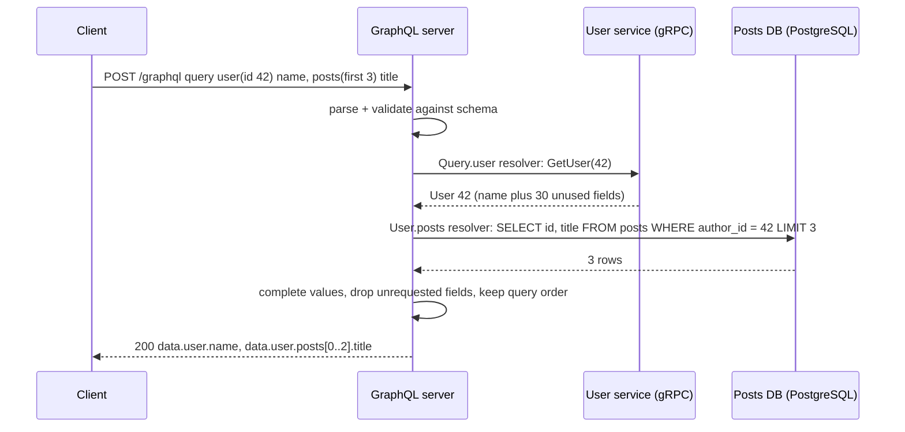
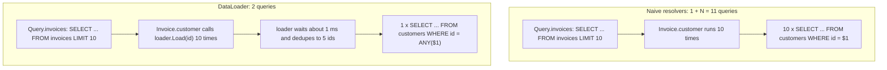
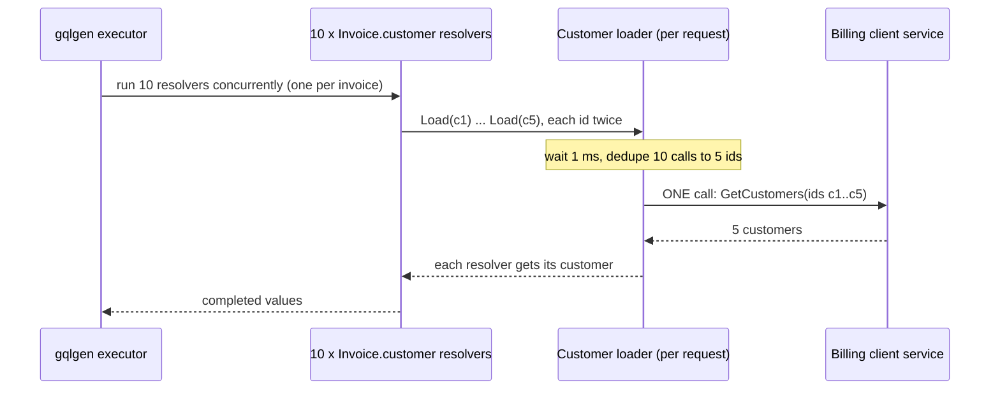

# GraphQL

> [!summary] TL;DR
> GraphQL is a query language for APIs. The server publishes a typed **schema**, and the client sends one **query** that names exactly the fields it wants, across related objects, in one request. Small functions called **resolvers** fetch each field from databases or other services, and the server returns JSON in the same shape as the query.

> [!abstract] Core idea
> - The server publishes a typed schema; the client asks for exactly the fields it needs in one query.
> - Each field is filled by a resolver function, parent before child, and the response has the same shape as the query.
> - Rule: batch child lookups with a DataLoader (collect keys, fetch once) or a list of N items causes N extra queries (N+1).
> - Classic mistake: exposing the graph without depth/cost limits and per-field authorization.

## 1. Why it exists

A game page shows a game's title, its reviews, and each reviewer's name. The data forms a graph: Game → Reviews → Authors.

With a resource-per-URL REST API the client needs three calls:

1. `GET /games/7` returns 30 fields; the page uses 1. That is **over-fetching**.
2. `GET /games/7/reviews` returns review rows with `author_id`, but no names. One call was not enough. That is **under-fetching**.
3. `GET /authors?ids=3,9,12` fetches the names.

Calls 1 and 2 can go out in parallel, but call 3 needs the author IDs from call 2, so at least two round trips happen one after the other. On a mobile link with a 150 ms round trip (an estimate), that is at least 300 ms before rendering. With GraphQL the client sends one query and waits one round trip (150 ms):

```graphql
query GamePage {
  game(id: "7") {
    title
    reviews {
      rating
      author { name }
    }
  }
}
```

Facebook built GraphQL in 2012 for exactly this: many client screens, each needing a different slice of the same graph, over slow mobile networks. It was open-sourced in 2015.

## 2. Mental model

- The **schema** is a typed menu of everything a client may ask for.
- A **query** is an order written against that menu. The response mirrors the order's shape, field by field.
- Each field on the menu has a **resolver**, a function that knows how to fetch that one field.

The client **never talks to the database**. It calls one GraphQL server endpoint (usually `POST /graphql`). The server's resolvers call databases, caches, REST or gRPC services, and the server merges their results into one JSON response.

**Analogy:** a restaurant waiter. You order one plate with exactly the items you want. The waiter (the GraphQL server) walks to the grill, the salad station and the bar (resolvers calling services), and brings back one plate laid out as you ordered.

## 3. How it works

### The schema (SDL)

The Schema Definition Language describes types and the three root operation types.

```graphql
directive @auth(requires: Role!) on FIELD_DEFINITION

enum Role { VIEWER BILLING_ADMIN }

interface Node { id: ID! }                 # anything with a global ID

enum InvoiceStatus { DRAFT SENT PAID OVERDUE }

type Customer implements Node {
  id: ID!
  name: String!
  email: String @auth(requires: BILLING_ADMIN)   # field-level rule, enforced in a directive
}

type Invoice implements Node {
  id: ID!
  number: String!
  status: InvoiceStatus!
  totalCents: Int!            # Int is a signed 32-bit integer: max 2,147,483,647
  customer: Customer          # nullable on purpose: it comes from another service
  lines: [InvoiceLine!]!      # non-null list of non-null items
  clientName: String @deprecated(reason: "Use customer.name")
}

type InvoiceLine { description: String!, quantity: Int!, unitCents: Int! }

union SearchResult = Invoice | Customer

input LineInput { description: String!, quantity: Int!, unitCents: Int! }
input CreateInvoiceInput { customerId: ID!, lines: [LineInput!]! }

type InvoiceEdge { cursor: String!, node: Invoice! }
type PageInfo { hasNextPage: Boolean!, endCursor: String }
type InvoiceConnection { edges: [InvoiceEdge!]!, pageInfo: PageInfo! }

type Dashboard {
  totalPaid: Int!
  totalOverdue: Int!
  recentInvoices(first: Int = 10, after: String): InvoiceConnection!
}

type Query {
  invoice(id: ID!): Invoice
  invoices(first: Int = 20, after: String): InvoiceConnection!
  search(text: String!): [SearchResult!]!
  dashboard: Dashboard!
}

type UserError { field: [String!], message: String! }
type CreateInvoicePayload { invoice: Invoice, userErrors: [UserError!]! }

type Mutation { createInvoice(input: CreateInvoiceInput!): CreateInvoicePayload! }
type Subscription { invoicePaid(customerId: ID!): Invoice! }
```

- `!` means non-null. `[T!]!` is a list that is never null and never holds a null; `[T]` allows both.
- `input` types are the only object types allowed as arguments. Output types cannot be reused as inputs.
- An **interface** lists shared fields that every implementing type must have. A **union** is "one of these types" with no shared fields. Clients pick fields per concrete type with inline fragments: `... on Invoice { number }`.
- The `__typename` field and the introspection queries (`__schema`, `__type`) let tools read the schema at runtime.

### Operations, variables and fragments

```graphql
query Dashboard($first: Int!, $after: String) {
  dashboard {
    totalPaid
    totalOverdue
    recentInvoices(first: $first, after: $after) {
      edges { cursor node { ...InvoiceRow } }
      pageInfo { hasNextPage endCursor }
    }
  }
}

fragment InvoiceRow on Invoice {
  id
  number
  status
  totalCents
  customer { name }
}

mutation CreateInvoice($input: CreateInvoiceInput!) {
  createInvoice(input: $input) {
    invoice { id number status }
    userErrors { field message }
  }
}

subscription OnInvoicePaid($customerId: ID!) {
  invoicePaid(customerId: $customerId) { id totalCents }
}
```

The schema above and these operations were validated with `github.com/graph-gophers/graphql-go` v1.9.0 (`ParseSchema`, then `ValidateWithVariables`).

Variables travel separately as JSON (`{"first": 10}`), so the query text stays constant. That keeps it cacheable and avoids string-building injection. A **fragment** is a reusable field selection; Relay co-locates one fragment with each UI component.

### Execution: one resolver per field, parent before child

1. **Parse** the query text into an AST.
2. **Validate** it against the schema: fields exist, argument types match, fragments fit. A failure here means nothing runs.
3. **Execute**: start at the root type and call each selected field's resolver. Each resolver gets `(parent value, arguments, context)`. A child resolver runs only after its parent returns, and it receives the parent's value.
4. **Complete** values: check them against the declared types, apply non-null rules, and build the JSON in query order.

The spec allows the fields of a query to resolve in parallel. The top-level fields of a **mutation** run one after another, in order.



The over-fetching did not disappear; it moved to the server side of the network, where bandwidth is cheap and latency is low.

### The N+1 problem and DataLoader

Resolvers are per field, so a naive `Invoice.customer` resolver runs one query per invoice. Ten invoices produce 1 + 10 SELECTs. A **DataLoader** collects every key requested during one short window (or one execution tick), then issues one batched query.



The loader must be **created per request**. Its memo cache would otherwise serve stale rows, and worse, serve one user's authorized data to another user.

## 4. Worked example

### Whiteboard version

The bare idea behind a DataLoader: collect the keys requested while resolving a list, then fetch them in one batch query. The full version below adds per-request caching, a batching window, concurrency safety and tests.

```go
package main

import "fmt"

// loadUsers is the batch function: one query for many ids.
func loadUsers(ids []int) map[int]string {
	fmt.Println("SELECT ... WHERE id IN", ids) // runs once, not once per post
	out := map[int]string{}
	for _, id := range ids {
		out[id] = fmt.Sprintf("user-%d", id)
	}
	return out
}

func main() {
	posts := []struct{ ID, AuthorID int }{{1, 7}, {2, 9}, {3, 7}}
	// Collect keys while resolving the list, then fetch them in one batch.
	var keys []int
	seen := map[int]bool{}
	for _, p := range posts {
		if !seen[p.AuthorID] {
			seen[p.AuthorID] = true
			keys = append(keys, p.AuthorID)
		}
	}
	authors := loadUsers(keys)
	for _, p := range posts {
		fmt.Println(p.ID, authors[p.AuthorID])
	}
}
```

### Full version

A minimal, generic DataLoader in Go 1.24 using only the standard library. It shows the mechanism that `github.com/vikstrous/dataloadgen` (the loader gqlgen's docs use) implements with more features. It compiles and passes `go vet` and `go test -race` on Go 1.24.4.

```go
package dataloader

import (
	"context"
	"sync"
	"time"
)

// BatchFunc loads many keys in one round trip, for example
// SELECT id, name FROM customers WHERE id = ANY($1).
// Keys with no row are simply absent from the returned map.
type BatchFunc[K comparable, V any] func(ctx context.Context, keys []K) (map[K]V, error)

// Loader collects Load calls for a short window, then calls fetch once with
// the unique keys. Create one Loader per request: its memo cache must never
// be shared between users or outlive the request.
type Loader[K comparable, V any] struct {
	ctx   context.Context
	fetch BatchFunc[K, V]
	wait  time.Duration

	mu      sync.Mutex
	memo    map[K]*result[V]
	pending []K
}

type result[V any] struct {
	done  chan struct{}
	val   V
	found bool
	err   error
}

func New[K comparable, V any](ctx context.Context, wait time.Duration, fetch BatchFunc[K, V]) *Loader[K, V] {
	return &Loader[K, V]{ctx: ctx, fetch: fetch, wait: wait, memo: make(map[K]*result[V])}
}

// Load blocks until the batch containing key has been fetched.
func (l *Loader[K, V]) Load(key K) (V, bool, error) {
	l.mu.Lock()
	r, seen := l.memo[key]
	if !seen {
		r = &result[V]{done: make(chan struct{})}
		l.memo[key] = r
		l.pending = append(l.pending, key)
		if len(l.pending) == 1 { // first key of a new batch starts the timer
			time.AfterFunc(l.wait, l.dispatch)
		}
	}
	l.mu.Unlock()

	select {
	case <-r.done:
		return r.val, r.found, r.err
	case <-l.ctx.Done():
		var zero V
		return zero, false, l.ctx.Err()
	}
}

func (l *Loader[K, V]) dispatch() {
	l.mu.Lock()
	keys := l.pending
	l.pending = nil
	waiting := make([]*result[V], len(keys))
	for i, k := range keys {
		waiting[i] = l.memo[k]
	}
	l.mu.Unlock()

	vals, err := l.fetch(l.ctx, keys)
	for i, k := range keys {
		r := waiting[i]
		r.val, r.found = vals[k]
		r.err = err
		close(r.done) // publishes val, found and err to every waiter
	}
}
```

The test plays the role of gqlgen, which runs each resolver-backed field in its own goroutine: ten `Invoice.customer` resolvers call `Load` at the same time. Five customers appear twice each.

```go
package dataloader

import (
	"context"
	"fmt"
	"sync"
	"testing"
	"time"
)

type fakeDB struct {
	mu      sync.Mutex
	batches [][]int
}

func (db *fakeDB) customersByID(_ context.Context, ids []int) (map[int]string, error) {
	db.mu.Lock()
	db.batches = append(db.batches, ids)
	db.mu.Unlock()
	out := make(map[int]string, len(ids))
	for _, id := range ids {
		if id != 404 { // 404 plays a deleted customer
			out[id] = fmt.Sprintf("customer-%d", id)
		}
	}
	return out, nil
}

func TestTenInvoicesOneBatch(t *testing.T) {
	db := &fakeDB{}
	loader := New(context.Background(), 5*time.Millisecond, db.customersByID)

	invoiceCustomer := []int{1, 2, 3, 4, 5, 1, 2, 3, 4, 5} // 10 invoices
	names := make([]string, len(invoiceCustomer))
	var wg sync.WaitGroup
	for i, id := range invoiceCustomer {
		wg.Add(1)
		go func() { // one goroutine per Invoice.customer resolver
			defer wg.Done()
			name, found, err := loader.Load(id)
			if err != nil || !found {
				t.Errorf("Load(%d) = %q, %v, %v", id, name, found, err)
			}
			names[i] = name
		}()
	}
	wg.Wait()

	if len(db.batches) != 1 || len(db.batches[0]) != 5 {
		t.Fatalf("batches = %v, want one batch of 5 unique ids", db.batches)
	}
	if names[5] != "customer-1" {
		t.Fatalf("names[5] = %q", names[5])
	}
}

func TestMissingKeyIsNotFound(t *testing.T) {
	db := &fakeDB{}
	loader := New(context.Background(), time.Millisecond, db.customersByID)
	if _, found, err := loader.Load(404); found || err != nil {
		t.Fatalf("found = %v, err = %v; want not found, no error", found, err)
	}
}
```

**Measured result** (the test asserts it): 10 resolver calls became **1 batched query with 5 unique ids**. Together with the invoice list query, the request makes 2 database round trips instead of 11.

**Wait window trade-off:** a 1–5 ms window adds that much latency to every level of the query that goes through a loader, and saves N − 1 round trips at that level. Production loaders also cap the batch size (for example 100 keys), so one huge list does not build a giant `ANY($1)` array.

## 5. Variants and comparison

| Option | How it works | Use when | Cost |
| --- | --- | --- | --- |
| REST ([[REST and HTTP API Design]]) | One URL per resource, HTTP verbs, server-chosen shape | Public APIs, CRUD, cacheable reads | Over-/under-fetching, many round trips for nested data |
| GraphQL | One endpoint, typed schema, client-chosen shape | Many clients (web, iOS, Android) needing different slices of one graph | Query cost control, N+1, harder HTTP caching |
| [[gRPC]] | Typed RPC methods over HTTP/2, protobuf bytes | Internal service-to-service calls, streaming | No native browser support, binary payloads |
| BFF ([[API Gateway and BFF]]) | One hand-written endpoint per screen | Few clients, stable screens | One endpoint to change per UI change |
| Apollo Federation | Each team owns a subgraph; a router composes one supergraph | Many teams contributing to one graph | A router to run, schema composition checks in CI |

Side by side, topic by topic:

| Topic | REST | GraphQL |
| --- | --- | --- |
| Endpoints | Many, one per resource | Usually one, `/graphql` |
| Data shape | Server decides | Client asks, within the schema |
| Over-fetching | Common | Avoided on the wire |
| Under-fetching | Common (extra round trips) | Avoided: nested fields in one query |
| HTTP caching | Works per URL out of the box | Needs GET + persisted queries, or client-side caches |
| Errors | HTTP status codes | Usually HTTP 200 with an `errors` array |
| Learning curve | Low | Higher: schema, resolvers, DataLoader, cost limits |

## 6. Trade-offs and when not to use

- **Server-to-server calls:** use [[gRPC]] or REST. A backend knows its exact needs, so client-chosen shapes add parsing and cost-analysis work for nothing.
- **One client, a few screens:** a BFF or plain REST is simpler.
- **Public, highly cacheable reads** (product pages, files): REST with `Cache-Control` and a CDN wins (see [[HTTP Caching - Cache-Control, ETag, Conditional Requests]]).
- **File uploads and downloads:** GraphQL has no native binary type. Upload to object storage with a pre-signed URL ([[File Upload Architecture]]) and pass the object key in a mutation.
- **Costs you take on:** a query can be arbitrarily expensive, the N+1 problem appears by default, every error looks like HTTP 200 to a load balancer, and rate limiting must count query cost instead of requests.

## 7. In production

- **Real systems:**
	- GitHub's GraphQL API (once called v4) enforces cost limits (GitHub Docs). Every connection must pass `first` or `last` between 1 and 100. One call may request at most 500,000 nodes. Users get 5,000 points per hour. A query's price is the number of requests needed to fill every connection, assuming each one returns its full `first`/`last`, divided by 100 (minimum 1 point).
	- Shopify's Admin API is GraphQL with a calculated query cost.
	- Netflix runs a federated graph whose subgraph services are built with its open-source DGS framework for Spring Boot.

### Errors and partial data

By long-standing convention, a server that answers with `application/json` returns **HTTP 200** even when some fields failed. Failures go in a top-level `errors` array, and the rest of `data` is still returned.

```json
{
  "data": {
    "invoice": { "id": "inv_1", "number": "2026-0042", "customer": null }
  },
  "errors": [
    {
      "message": "customer service unavailable",
      "path": ["invoice", "customer"],
      "locations": [{ "line": 4, "column": 5 }],
      "extensions": { "code": "UNAVAILABLE" }
    }
  ]
}
```

- `path` says which field failed. `extensions.code` gives machines a stable code. The message is for humans.
- **Non-null propagation:** had `customer` been declared `Customer!`, the server could not return `null` there. The null would bubble up to the nearest nullable parent and wipe out the whole `invoice`. Mark fields that depend on other services as nullable.
- The GraphQL-over-HTTP specification (still a working draft in late 2026) adds the `application/graphql-response+json` media type, whose status codes carry meaning. A request error with no `data` at all gets a 4xx: 400 when the document cannot be parsed and, in the September 2026 draft, 422 when it fails validation. A result with partial `data` stays 2xx: older drafts said 200, and recent drafts have discussed a dedicated partial-success status code so that proxies can count partial failures. The draft is still changing, so check which revision your server and gateway follow.
- Monitoring must parse `errors`. An alert based only on HTTP status can report 100% success while a backend service is down.
- For expected business failures (an invalid coupon), prefer a typed `userErrors` field in the mutation payload over the `errors` array.

### Authorization

There is one endpoint, so URL-based rules cannot express "who may read `Customer.email`". Authorization happens in the resolver layer:

- **Authentication** happens once, in HTTP middleware. It puts the caller (from a session cookie or a token, see [[JWT - Structure, Validation and Pitfalls]]) into the request context.
- **Object-level checks** (may this user see invoice `inv_1`?) belong in the resolver or the data layer that loads the object. A query can reach the same object through many paths (`invoice`, `customer.invoices`, `search`, `node(id:)`), so a check on one entry field is not enough.
- **Field-level checks** (only billing admins may see `email`) fit a schema directive such as `@auth`, enforced before the field resolver runs.

### Cost control

A single nested query can explode: `users(first: 100) { posts(first: 50) { comments(first: 20) { author { name } } } }` can return 100 × 50 × 20 = 100,000 comments.

| Defence | What it does |
| --- | --- |
| Depth limit | Rejects queries nested deeper than, for example, 10 levels |
| Complexity scoring | Each field costs 1 point; list fields multiply their children by `first`. Reject above a budget before executing |
| Pagination caps | `first` must be between 1 and 100, as GitHub does |
| Persisted queries (trusted documents) | Production clients may only send query IDs registered at build time; arbitrary queries are refused |
| Timeouts and cancellation | A per-request deadline in the context, checked by resolvers and passed to DB calls |
| Cost-based rate limits | Charge the query's computed cost against a budget (see [[Rate Limiting - Algorithms and Distributed Design]]) |
| Introspection off in production | Do not hand attackers the full schema map on public APIs |

### Caching

- **HTTP caches do not help by default.** Every query is a `POST /graphql` with a different body, and CDNs do not cache POST.
- **Automatic persisted queries (APQ):** the client sends only a SHA-256 hash of the query in `extensions.persistedQuery`. On a miss the server replies `PersistedQueryNotFound`, the client resends the hash with the full text, and the server stores it. Small hash-only requests can then go out as **GET**, which a CDN can cache. APQ saves bandwidth but still accepts any query, so it is not a security control. Trusted documents are.
- **Normalized client caches:** Apollo Client and Relay split each response into objects keyed by `__typename` + `id` (Relay uses a global ID). When a mutation returns `Invoice:inv_1` with a new status, every screen that shows that invoice updates.

### Pagination and schema evolution

- **Relay cursor connections** are the standard shape: `invoices(first: 20, after: "cursor")` returns `edges { cursor node }` and `pageInfo { hasNextPage endCursor }`. The cursor is an opaque string, usually the base64 of the sort key. Why cursors beat offsets lives in [[Pagination, Filtering and Sorting]].
- **Evolve, don't version:** add fields and types freely, because old clients never ask for them. Mark old fields `@deprecated(reason: "...")`, watch field-usage metrics until traffic reaches zero, then delete. Removing a field, making a nullable argument non-null, or turning a non-null output field nullable breaks clients. Adding an enum value or a union member is "dangerous" rather than breaking: a client with an exhaustive `switch` meets a value it has never seen, so clients must handle unknown values. Compare with URL versioning in [[API Versioning and Backward Compatibility]].

### Federation

With Apollo Federation 2, each team runs a **subgraph** that owns some types. A subgraph marks an entity type with `@key(fields: "id")`, and other subgraphs declare the same type with the same key and add their own fields. **Composition** (the Rover CLI or GraphOS) merges the subgraph schemas into one supergraph schema. The **router** loads that supergraph, plans each query across the subgraphs, and fetches entities through each subgraph's `_entities` field. Composition and schema checks run in CI, so a conflicting or breaking change fails a build instead of production. See [[API Gateway and BFF]] for where the router sits.

### What to monitor

- p95 latency and error count **per operation name** and per resolver, not per URL.
- Query cost and depth histograms, and the number of rejected queries.
- DataLoader batch sizes and the number of DB queries per request.
- Usage of every `@deprecated` field.

### Implementing in Go with gqlgen

gqlgen is schema-first: you write the SDL, and it generates the Go types and resolver interfaces.

```bash
go run github.com/99designs/gqlgen init       # gqlgen.yml, graph/schema.graphqls, server.go
go run github.com/99designs/gqlgen generate   # rerun after every schema change
```

- `generate` writes `graph/generated.go` (the executor), `graph/model/models_gen.go` (Go structs for schema types) and `graph/schema.resolvers.go`. New resolvers start as stubs that panic with "not implemented".
- A resolver looks like `func (r *invoiceResolver) Customer(ctx context.Context, obj *model.Invoice) (*model.Customer, error)`. `obj` is the parent. `ctx` carries the authenticated user that middleware stored, so the resolver checks object-level access there.
- Field-level rules: declare `directive @auth(requires: Role!) on FIELD_DEFINITION` and set `cfg.Directives.Auth` to a function that checks the role in `ctx` before calling `next(ctx)`.
- N+1: middleware creates fresh loaders per request (with `dataloadgen.NewLoader(fetchFn, dataloadgen.WithWait(time.Millisecond))`) and stores them in `ctx`. Resolvers call `loaders.Customer.Load(ctx, obj.CustomerID)`.
- Server setup: build the server with `handler.New(...)`, which adds nothing by default. Then opt in explicitly: `transport.POST{}`, `transport.Websocket{KeepAlivePingInterval: 10 * time.Second}` for subscriptions (subscription resolvers return a `<-chan *model.Invoice`), `extension.FixedComplexityLimit(300)`, and `extension.AutomaticPersistedQuery{Cache: lru.New[string](100)}`. Add `extension.Introspection{}` only outside production. gqlgen ships no depth-limit extension (its `extension` package holds only complexity, APQ and introspection), so a depth cap needs your own operation middleware or a third-party package. The older `handler.NewDefaultServer`, marked deprecated in current gqlgen, turns introspection on. These names were checked against the gqlgen v0.17.98 source.
- Errors: return a `*gqlerror.Error` with `Extensions: map[string]any{"code": "FORBIDDEN"}`. The client receives HTTP 200 with that code in `errors[0].extensions`. Parse and validation failures are different: gqlgen's POST transport answers them with 422 over `application/json`, and with 400 when the client asked for `application/graphql-response+json` (v0.17.98 source).
- Tests: `client.New(srv)` from `github.com/99designs/gqlgen/client` runs a query against the real handler in-process, for example `c.MustPost(query, &resp)`.



## 8. Deep dive

- **Why DataLoader batching works at all:** sibling resolvers in a list all start before any of them gets an answer. graphql-js calls all ten `Invoice.customer` resolvers in the same tick, and each returns a promise; gqlgen runs them in parallel goroutines. Either way, their keys meet in one batch. Execution is not strictly breadth-first, though: an executor that ran one sibling to completion before starting the next would defeat batching. Loaders deduplicate keys and memoize per request, so `customer(1)` asked from three places costs one key.
- **Batching across nested levels:** a loader fixes one level. A query three levels deep still makes one query per level (1 + 1 + 1), which is fine. Batch sizes grow with list sizes, so cap `first`.
- **Ordering contract:** the classic JavaScript DataLoader requires the batch function to return values in the same order as the keys. The map-based loader above avoids that bug class: a missing key is "not found", not a shifted value.
- **Int is 32-bit:** `totalCents: Int!` cannot hold more than 2,147,483,647 cents (about 21.4 million in currency units). The spec does not let the value wrap around: the server must raise a field error instead, so a large invoice suddenly comes back as `null` plus an error. Use a custom scalar (`Money`, or a decimal string) for large amounts. The same applies to 64-bit IDs: expose them as `ID` (a string).
- **Mutations are serial, queries are not:** two top-level mutation fields in one request run in order, so `payInvoice(id: "inv_1")` followed by `archiveInvoice(id: "inv_1")` happens in that order. One field cannot pass its result to the next, though: creating an invoice and then sending it by its new ID takes two requests. Two query fields may run concurrently, so they must not depend on each other's side effects.
- **Subscriptions** are long-lived operations, usually carried over WebSocket with the `graphql-transport-ws` subprotocol (from the `graphql-ws` library). The older Apollo protocol is confusingly named `graphql-ws`, so check which one the client speaks. They inherit every scaling problem in [[Real-time APIs - WebSocket, SSE and Long Polling]] and [[Scaling WebSockets]]. For fan-out to many listeners, a subscription resolver should subscribe to a broker topic rather than poll the database.
- **Query-plan caching:** parsing and validating the same query text on every request wastes CPU. Servers cache the parsed and validated document by query text or hash (gqlgen's query cache), and persisted queries make that cache hit almost every time.
- **Introspection is not a secret store:** turning it off hides the map, but field names still leak through client bundles and suggestion messages ("Did you mean `email`?"). Real protection is authorization in resolvers plus trusted documents.

## 9. Interview questions

> [!question]- Why does GraphQL make N+1 queries likely, and how does DataLoader fix it?
> Resolvers run per field, so a list of N parents calls the child resolver N times, giving 1 + N queries. DataLoader collects the keys requested during one tick or a short window, deduplicates them, and runs one `WHERE id = ANY($1)` query. The loader must be per request, so its memo cache never leaks data between users or goes stale.

> [!question]- Trap: a GraphQL response came back with HTTP 200. Did the request succeed?
> Not necessarily. Field errors come back as HTTP 200 with an `errors` array next to partial `data`. Clients and monitoring must inspect `errors` and `extensions.code`. Parse and validation failures may get a 4xx instead: the GraphQL-over-HTTP draft asks for 400 or 422 with `application/graphql-response+json`, and gqlgen already returns 422 for them over `application/json`. A 4xx can also come from a proxy, so a client should trust the body only when the response is a GraphQL one.

> [!question]- How do you stop a client from sending a query that brings the server down?
> Validate before executing: a depth limit, complexity scoring that multiplies by `first`, and hard caps on page sizes. Add per-request timeouts and cost-based rate limits. For first-party clients, accept only persisted (trusted) documents. Turn introspection off on public endpoints.

> [!question]- How do you cache GraphQL when everything is a POST to one URL?
> Client side, use a normalized cache keyed by `__typename` + `id` (Apollo, Relay). At the edge, use persisted queries sent as GET with variables in the URL, so a CDN can key on them. Server side, use DataLoader memoization per request and ordinary caches behind the resolvers.

> [!question]- How does a GraphQL API evolve without `/v2`?
> Only additive changes: new types, new fields, new optional arguments. Mark replaced fields `@deprecated(reason: ...)`, track their usage per client, and remove them once usage is zero. Schema checks in CI (federation composition or a schema diff) block breaking changes such as removed fields or new required arguments.

> [!question]- Where do authorization checks go?
> Authentication runs in HTTP middleware and puts the user into the context. Object-level checks go where the object is loaded, because the same object is reachable through many query paths. Field-level checks go in a directive or the field's resolver. Gateway rules per URL cannot help, because there is only one URL.

> [!question]- When would you pick REST or gRPC instead?
> Choose gRPC for internal service-to-service calls and streaming, where both sides share a proto contract and speed matters. Choose REST for public, cacheable, resource-shaped APIs and simple CRUD with one client. GraphQL pays off when many different clients need different slices of the same connected data.

## 10. Cheat sheet

- Schema (SDL) = typed menu; query = order; resolvers fetch one field each, parent before child.
- `!` non-null, `[T!]!` non-null list of non-null items, `input` types for arguments, interfaces and unions for polymorphism.
- One round trip for nested data; over-fetching moves server side.
- N+1 by default: fix it with a per-request DataLoader (11 queries became 2 in the test above).
- HTTP 200 + `errors[]` + partial `data`; nulls bubble up to the nearest nullable parent.
- Guard cost: depth limit, complexity with `first` multipliers, page caps, timeouts, trusted documents.
- Cache with APQ + GET at the edge and normalized client caches; evolve with `@deprecated`, not versions.
- Go: gqlgen schema-first, `handler.New` + explicit transports and extensions, dataloadgen, `client.New` in tests.

## Links

- **Before this:** [[REST and HTTP API Design]], [[Choosing an API Style]], [[N+1 Query Problem]]
- **Next:** [[gRPC]], [[Real-time APIs - WebSocket, SSE and Long Polling]], [[API Gateway and BFF]]
- **Compare with:** [[REST and HTTP API Design]] (resource URLs and HTTP caching), [[gRPC]] (typed RPC for internal calls), [[Pagination, Filtering and Sorting]] (cursor design)
