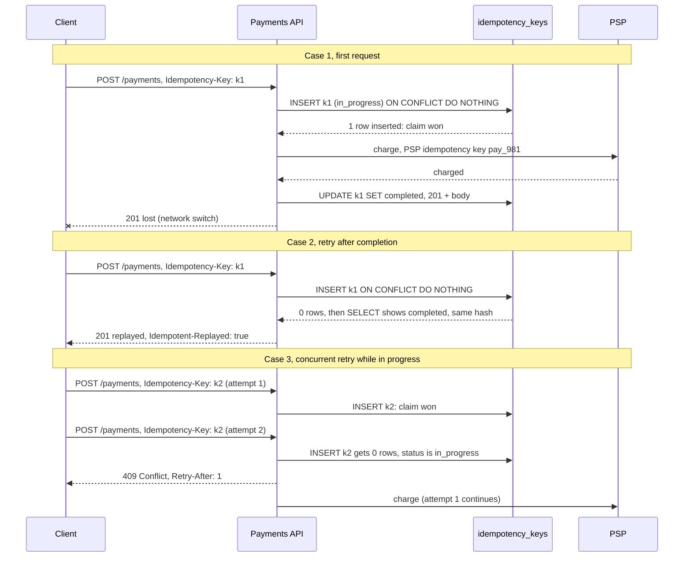
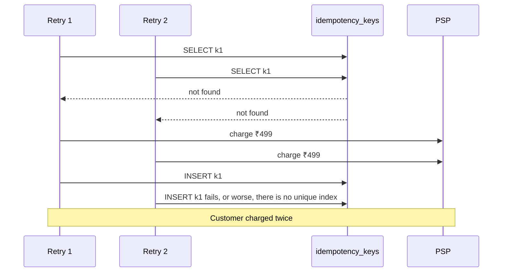
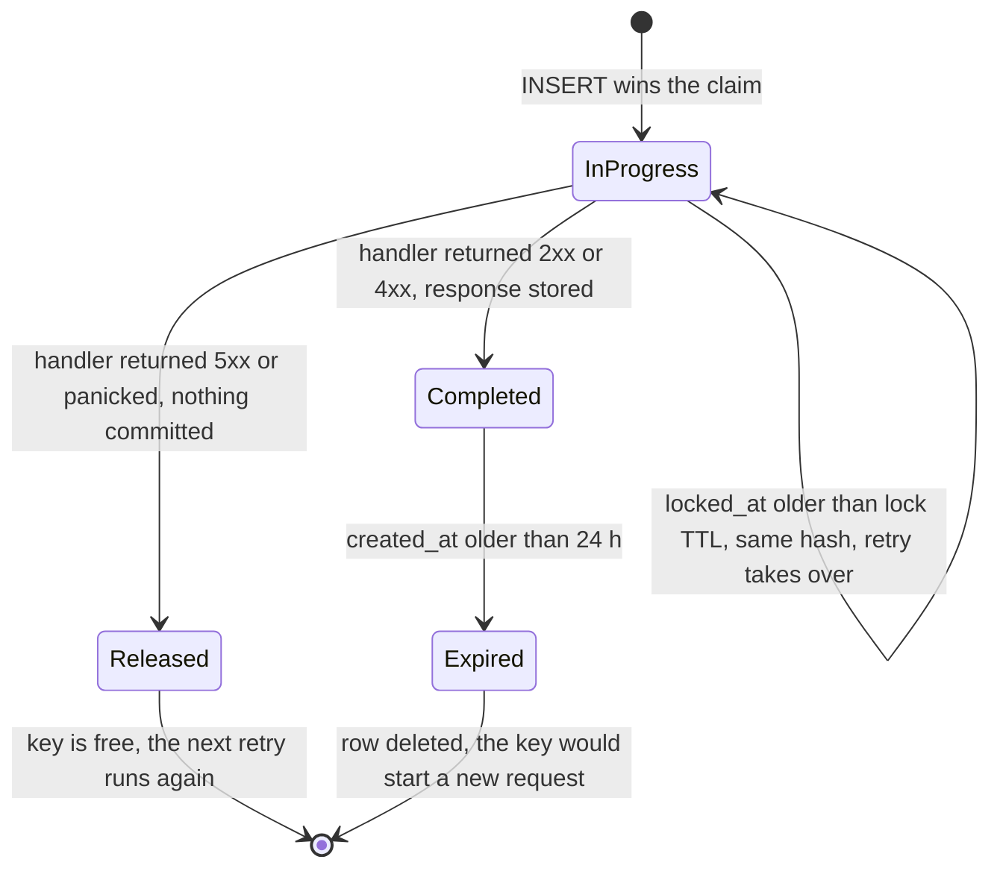

# Idempotency and Idempotency Keys

> [!summary] TL;DR
> An operation is **idempotent** when doing it twice has the same effect as doing it once. Networks force clients to retry, so every write that can be retried must be idempotent. `PUT` and `DELETE` are idempotent by definition; `POST` is not, so the client sends an **`Idempotency-Key`** header and the server remembers the key and the response, so a retry gets the stored answer instead of a second charge.

## 1. Why it exists

A user taps **Pay ₹499**. The app sends `POST /v1/payments`; the server charges the card at the payment service provider (PSP) and commits the payment. The response is on its way back when the phone switches from Wi-Fi to mobile data, and the app's 10-second timeout fires. The app cannot tell "the request never arrived" from "it worked but the answer got lost", so it retries, or the user taps again. Without protection, the user is charged twice.

This is not rare at scale. If 0.1% of payment requests time out at the client after the server committed (an estimate; measure it as "client timeouts with a server-side 2xx"), then 1,000,000 payments a day produce 1,000 double charges a day.

Retries are the only cure for lost responses, and retries are only safe when the operation is idempotent. The idempotency key turns a non-idempotent `POST` into one whose retries are harmless.

## 2. Mental model

- **Safe** means "no effect on the server": `GET` just reads.
- **Idempotent** means "the effect of N identical requests equals the effect of one". Setting a value is idempotent (`balance = 100`); adding to it is not (`balance += 100`).

An elevator call button is idempotent: press it five times, one elevator comes. A payment `POST` is a vending machine: press five times, pay five times, unless the machine remembers that this was the same press.

The idempotency key is a **cloakroom ticket**. The client invents a ticket number for *one logical operation* and shows it on every attempt. The first attempt does the work and pins the result to the ticket; every later attempt with the same ticket gets that same result back.

## 3. How it works

### HTTP methods (RFC 9110)

| Method | Safe | Idempotent | Notes |
| --- | --- | --- | --- |
| `GET`, `HEAD`, `OPTIONS`, `TRACE` | Yes | Yes | Read-only, so retrying is always fine |
| `PUT` | No | Yes | Replaces the whole resource: the second identical `PUT` changes nothing |
| `DELETE` | No | Yes | The second call may return `404`, but the state is the same: the resource is gone |
| `POST` | No | **No** | "Create" or "process": each call may create something new |
| `PATCH` | No | **No** by definition | `{"status":"paid"}` behaves idempotently; `{"op":"add", "path":"/items/-"}` does not |

RFC 9110 lets a client retry an idempotent request automatically after a connection failure. For a non-idempotent method such as `POST` it says the client should not, unless it knows this particular request is idempotent anyway or can tell that the original was never applied. Go's `http.Transport` follows that rule: it silently retries a request that failed on a reused connection only when the body is absent or re-creatable (`GetBody` is set) **and** either the method is `GET`, `HEAD`, `OPTIONS` or `TRACE` or the request carries an `Idempotency-Key` or `X-Idempotency-Key` header (checked in the Go 1.24 source, `Request.isReplayable`). Sending the header therefore also tells Go's own client that a `POST` may be resent.

### Make it naturally idempotent first

Before adding keys, check whether the operation can be idempotent by design:

- **PUT the full state with a client-chosen ID:** `PUT /v1/orders/7f9c…` with a UUID the client generated. A retry writes the same row.
- **Conditional updates:** `UPDATE accounts SET balance = $1, version = version + 1 WHERE id = $2 AND version = $3`, or `If-Match: "etag"` on HTTP (see [[HTTP Caching - Cache-Control, ETag, Conditional Requests]] and [[Locking - Optimistic vs Pessimistic]]). The retry's condition fails instead of applying twice.
- **Unique business keys:** `UNIQUE (order_id)` on `payments` means an order can be paid once, however many requests arrive.

When none of these fit ("charge this card", "send this SMS", "create a transfer"), use an idempotency key.

### The Idempotency-Key protocol

1. The client generates a random key per **logical operation**, not per attempt. The IETF draft recommends a UUID (RFC 9562); Stripe accepts keys up to 255 characters.
2. It persists the key with the pending operation (so an app restart reuses it), then sends `Idempotency-Key: "8e03978e-40d5-43e8-bc93-6894a57f9324"`. The draft defines the value as a structured-field string, which is why it is quoted; Stripe takes it unquoted.
3. The server, scoped to the caller, keeps one record per key:

| Field | Purpose |
| --- | --- |
| `scope` + `key` | Primary key. Scope is the tenant or user (plus the endpoint), so callers never collide or read each other's responses |
| `request_hash` | SHA-256 fingerprint of method, path and body; the same key must always mean the same request |
| `status` | `in_progress` or `completed` |
| `response_code`, `response_body` | What to replay on a retry, including errors |
| `locked_at` | When the current attempt claimed the key; detects stuck claims and acts as a fencing token |
| `created_at` | Expiry: records are deleted after a published window (24 hours at Stripe) |

4. On each request the server **claims first**: insert the record, and only the request whose insert succeeded may do the work. Everyone else reads the existing record:
	- fingerprint differs → `422 Unprocessable Content` (the draft's recommendation): a client bug.
	- `in_progress` → `409 Conflict` with `Retry-After` (Stripe returns 409 here too).
	- `completed` → replay the stored status and body.
5. A missing key on an endpoint that requires one → `400 Bad Request`.



### The check-then-insert race

The obvious version, "look the key up; if absent, do the work and save the key", is broken. Two retries arriving together both see "absent":



The fix is to make the **check and the claim one atomic statement** on a unique key: `INSERT … ON CONFLICT DO NOTHING`. The database's unique index decides the winner; the loser's insert affects zero rows. Section 4 measures both versions.

### Lifecycle of a key record



## 4. Worked example

A Go middleware for `POST` and `PATCH`: it fingerprints the request, claims the key atomically, returns `409` while the first attempt runs, `422` for a reused key with a different body, replays completed responses (errors included), releases the key on `5xx`, and fences stale claims. It compiles and passes `go vet` and `go test -race` on Go 1.24.

The store. `MemStore` mirrors the PostgreSQL table; its `Claim` holds one lock for the whole check-and-insert, which is exactly what `INSERT … ON CONFLICT DO NOTHING` gives you in the database.

```go
// Package idem implements the Idempotency-Key pattern for POST endpoints.
package idem

import (
	"sync"
	"time"
)

type State int

const (
	InProgress State = iota
	Completed
)

// Record mirrors one row of the idempotency_keys table.
type Record struct {
	State       State
	Fingerprint [32]byte // SHA-256 of method, path and body
	Status      int      // stored response, replayed on retries
	ContentType string
	Body        []byte
	LockedAt    time.Time // claim time; doubles as a fencing token
	CreatedAt   time.Time
}

type Store interface {
	// Claim inserts an in-progress record, or returns the existing one.
	Claim(key string, fp [32]byte) (rec Record, claimed bool)
	// Complete and Release act only if the caller still holds the claim.
	Complete(key string, claimedAt time.Time, status int, contentType string, body []byte)
	Release(key string, claimedAt time.Time)
}

// MemStore is the in-memory twin of the PostgreSQL table.
type MemStore struct {
	mu      sync.Mutex
	recs    map[string]Record
	TTL     time.Duration // records expire after this (24h)
	LockTTL time.Duration // an older in-progress claim may be taken over
	Now     func() time.Time
}

func NewMemStore() *MemStore {
	return &MemStore{recs: map[string]Record{}, TTL: 24 * time.Hour, LockTTL: time.Minute, Now: time.Now}
}

// Claim is atomic, like INSERT ... ON CONFLICT DO NOTHING RETURNING.
func (s *MemStore) Claim(key string, fp [32]byte) (Record, bool) {
	s.mu.Lock()
	defer s.mu.Unlock()
	now := s.Now()
	rec, ok := s.recs[key]
	expired := ok && now.Sub(rec.CreatedAt) > s.TTL
	stale := ok && rec.State == InProgress && rec.Fingerprint == fp && now.Sub(rec.LockedAt) > s.LockTTL
	if ok && !expired && !stale {
		return rec, false
	}
	rec = Record{State: InProgress, Fingerprint: fp, LockedAt: now, CreatedAt: now}
	s.recs[key] = rec
	return rec, true
}

func (s *MemStore) Complete(key string, claimedAt time.Time, status int, ct string, body []byte) {
	s.mu.Lock()
	defer s.mu.Unlock()
	rec, ok := s.recs[key]
	if !ok || rec.State != InProgress || !rec.LockedAt.Equal(claimedAt) {
		return // someone took over our stale claim: their result wins
	}
	rec.State, rec.Status, rec.ContentType, rec.Body = Completed, status, ct, body
	s.recs[key] = rec
}

func (s *MemStore) Release(key string, claimedAt time.Time) {
	s.mu.Lock()
	defer s.mu.Unlock()
	if rec, ok := s.recs[key]; ok && rec.State == InProgress && rec.LockedAt.Equal(claimedAt) {
		delete(s.recs, key)
	}
}
```

The middleware:

```go
package idem

import (
	"bytes"
	"crypto/sha256"
	"errors"
	"io"
	"net/http"
	"strings"
)

type Middleware struct {
	Store   Store
	Scope   func(r *http.Request) string // caller identity: keys are per tenant
	MaxBody int64
}

// recorder passes the response through and keeps a copy to store.
type recorder struct {
	http.ResponseWriter
	status int
	body   bytes.Buffer
}

func (r *recorder) WriteHeader(code int) {
	r.status = code
	r.ResponseWriter.WriteHeader(code)
}

func (r *recorder) Write(b []byte) (int, error) {
	if r.status == 0 {
		r.status = http.StatusOK
	}
	r.body.Write(b)
	return r.ResponseWriter.Write(b)
}

func (m *Middleware) Wrap(next http.Handler) http.Handler {
	return http.HandlerFunc(func(w http.ResponseWriter, r *http.Request) {
		key := strings.Trim(r.Header.Get("Idempotency-Key"), `"`) // the IETF draft quotes it
		if (r.Method != http.MethodPost && r.Method != http.MethodPatch) || key == "" {
			next.ServeHTTP(w, r) // GET, PUT, DELETE are idempotent by definition
			return
		}
		if len(key) > 255 {
			http.Error(w, "Idempotency-Key longer than 255 characters", http.StatusBadRequest)
			return
		}
		body, err := io.ReadAll(http.MaxBytesReader(w, r.Body, m.MaxBody))
		if err != nil {
			var tooBig *http.MaxBytesError
			if errors.As(err, &tooBig) {
				http.Error(w, "request body too large", http.StatusRequestEntityTooLarge)
			} else {
				http.Error(w, "could not read request body", http.StatusBadRequest)
			}
			return
		}
		r.Body = io.NopCloser(bytes.NewReader(body))
		fp := sha256.Sum256(append([]byte(r.Method+" "+r.URL.Path+"\n"), body...))
		scoped := m.Scope(r) + "|" + r.Method + " " + r.URL.Path + "|" + key

		rec, claimed := m.Store.Claim(scoped, fp)
		switch {
		case !claimed && rec.Fingerprint != fp:
			http.Error(w, "Idempotency-Key reused with a different request", http.StatusUnprocessableEntity)
		case !claimed && rec.State == InProgress:
			w.Header().Set("Retry-After", "1")
			http.Error(w, "a request with this Idempotency-Key is in progress", http.StatusConflict)
		case !claimed: // completed: replay the stored response, errors included
			w.Header().Set("Content-Type", rec.ContentType)
			w.Header().Set("Idempotent-Replayed", "true")
			w.WriteHeader(rec.Status)
			w.Write(rec.Body)
		default:
			m.run(next, w, r, scoped, rec)
		}
	})
}

func (m *Middleware) run(next http.Handler, w http.ResponseWriter, r *http.Request, key string, rec Record) {
	rw := &recorder{ResponseWriter: w}
	done := false
	defer func() {
		if !done {
			m.Store.Release(key, rec.LockedAt) // handler panicked: let a retry run
		}
	}()
	next.ServeHTTP(rw, r)
	if rw.status == 0 {
		// The handler wrote nothing: net/http sends an implicit 200. Storing 0
		// would make the replay call WriteHeader(0), which panics.
		rw.status = http.StatusOK
	}
	if rw.status >= 500 {
		// Retryable failure. Safe only because the handler commits its effect
		// atomically: a 5xx means nothing was committed.
		m.Store.Release(key, rec.LockedAt)
	} else {
		m.Store.Complete(key, rec.LockedAt, rw.status, rw.Header().Get("Content-Type"), rw.body.Bytes())
	}
	done = true
}
```

The tests fire 50 identical retries at the same instant, compare against a check-then-insert store, and cover the replay, `422`, `5xx`, empty-response and stale-claim paths:

```go
package idem

import (
	"net/http"
	"net/http/httptest"
	"strconv"
	"strings"
	"sync"
	"sync/atomic"
	"testing"
	"time"
)

// chargeHandler stands in for "create a payment": it counts real executions.
func chargeHandler(charges *atomic.Int64, fail *atomic.Bool) http.Handler {
	return http.HandlerFunc(func(w http.ResponseWriter, r *http.Request) {
		time.Sleep(20 * time.Millisecond) // the PSP call
		if fail.Load() {
			http.Error(w, "psp timeout", http.StatusBadGateway)
			return
		}
		n := charges.Add(1)
		w.Header().Set("Content-Type", "application/json")
		w.WriteHeader(http.StatusCreated)
		w.Write([]byte(`{"payment_id":` + strconv.FormatInt(n, 10) + `}`))
	})
}

func send(h http.Handler, key, body string) *httptest.ResponseRecorder {
	req := httptest.NewRequest(http.MethodPost, "/v1/payments", strings.NewReader(body))
	req.Header.Set("Idempotency-Key", key)
	rec := httptest.NewRecorder()
	h.ServeHTTP(rec, req)
	return rec
}

func newAPI(s Store, charges *atomic.Int64, fail *atomic.Bool) http.Handler {
	m := &Middleware{Store: s, Scope: func(*http.Request) string { return "tenant-7" }, MaxBody: 1 << 20}
	return m.Wrap(chargeHandler(charges, fail))
}

// racyStore reproduces the classic bug: SELECT, then INSERT, as two steps.
type racyStore struct{ *MemStore }

func (s racyStore) Claim(key string, fp [32]byte) (Record, bool) {
	s.mu.Lock()
	rec, ok := s.recs[key]
	s.mu.Unlock()
	if ok {
		return rec, false
	}
	time.Sleep(time.Millisecond) // the gap between "not found" and the insert
	s.mu.Lock()
	defer s.mu.Unlock()
	rec = Record{State: InProgress, Fingerprint: fp, LockedAt: s.Now(), CreatedAt: s.Now()}
	s.recs[key] = rec
	return rec, true
}

func fire(h http.Handler, n int) map[int]int {
	codes := map[int]int{}
	var mu sync.Mutex
	var wg sync.WaitGroup
	start := make(chan struct{})
	for range n {
		wg.Add(1)
		go func() {
			defer wg.Done()
			<-start
			rec := send(h, "pay-42", `{"amount":49900}`)
			mu.Lock()
			codes[rec.Code]++
			mu.Unlock()
		}()
	}
	close(start) // release all retries at once
	wg.Wait()
	return codes
}

func TestConcurrentRetriesChargeOnce(t *testing.T) {
	var charges atomic.Int64
	var fail atomic.Bool
	h := newAPI(NewMemStore(), &charges, &fail)

	codes := fire(h, 50) // late goroutines may see the replayed 201 instead of 409
	if charges.Load() != 1 || codes[http.StatusCreated]+codes[http.StatusConflict] != 50 {
		t.Fatalf("charges=%d codes=%v; want 1 charge, only 201s and 409s", charges.Load(), codes)
	}
	// After completion, a retry replays the stored response.
	rec := send(h, "pay-42", `{"amount":49900}`)
	if rec.Code != http.StatusCreated || rec.Header().Get("Idempotent-Replayed") != "true" ||
		rec.Body.String() != `{"payment_id":1}` || charges.Load() != 1 {
		t.Fatalf("replay: %d %q replayed=%q", rec.Code, rec.Body, rec.Header().Get("Idempotent-Replayed"))
	}

	var racyCharges atomic.Int64
	racy := newAPI(racyStore{NewMemStore()}, &racyCharges, &fail)
	fire(racy, 50)
	if racyCharges.Load() < 2 {
		t.Fatalf("check-then-insert charged %d times; expected the race to double-charge", racyCharges.Load())
	}
	t.Logf("atomic claim: 1 charge, codes %v; check-then-insert: %d charges", codes, racyCharges.Load())
}

func TestMismatchAndRetryableFailure(t *testing.T) {
	var charges atomic.Int64
	var fail atomic.Bool
	h := newAPI(NewMemStore(), &charges, &fail)

	fail.Store(true) // first attempt: the PSP times out, nothing committed
	if rec := send(h, "pay-43", `{"amount":100}`); rec.Code != http.StatusBadGateway {
		t.Fatalf("first attempt: %d", rec.Code)
	}
	fail.Store(false) // 5xx released the key, so the retry really runs
	if rec := send(h, "pay-43", `{"amount":100}`); rec.Code != http.StatusCreated || charges.Load() != 1 {
		t.Fatalf("retry after 5xx: %d, charges=%d", rec.Code, charges.Load())
	}
	// Same key, different amount: a client bug, never a new charge.
	if rec := send(h, "pay-43", `{"amount":999}`); rec.Code != http.StatusUnprocessableEntity {
		t.Fatalf("mismatched payload: %d, want 422", rec.Code)
	}
}

func TestEmptyResponseIsReplayed(t *testing.T) {
	m := &Middleware{Store: NewMemStore(), Scope: func(*http.Request) string { return "tenant-7" }, MaxBody: 1 << 20}
	// The handler writes nothing (an implicit 200); the second call is a replay.
	h := m.Wrap(http.HandlerFunc(func(http.ResponseWriter, *http.Request) {}))
	for i := range 2 {
		if rec := send(h, "pay-44", `{}`); rec.Code != http.StatusOK {
			t.Fatalf("attempt %d: %d, want 200", i+1, rec.Code)
		}
	}
}

func TestStaleClaimIsFenced(t *testing.T) {
	now := time.Date(2026, 11, 2, 9, 0, 0, 0, time.UTC)
	s := NewMemStore()
	s.Now = func() time.Time { return now }
	fp := [32]byte{1}

	a, _ := s.Claim("k", fp) // worker A claims, then stalls (GC pause, lost network)
	now = now.Add(2 * time.Minute)
	b, claimed := s.Claim("k", fp) // B retries after the lock TTL and takes over
	if !claimed {
		t.Fatal("stale claim was not taken over")
	}
	s.Complete("k", a.LockedAt, 201, "application/json", []byte(`"A"`)) // A wakes up: ignored
	s.Complete("k", b.LockedAt, 201, "application/json", []byte(`"B"`))
	if got, _ := s.Claim("k", fp); string(got.Body) != `"B"` {
		t.Fatalf("stored body = %s, want B's result", got.Body)
	}
}
```

**Measured** (`go test -race -count=10`, Go 1.24, Apple Silicon laptop, 2026-11-02), 50 concurrent requests with one key and a 20 ms handler:

| Claim strategy | Charges per run (10 runs) | Responses |
| --- | --- | --- |
| Atomic claim (`ON CONFLICT DO NOTHING` semantics) | 1 in every run | one `201`, forty-nine `409` |
| Check, then insert (1 ms gap) | Between 17 and 50, varying with scheduling (50 in 7 of 10 runs; a second set of 10 runs gave 31 to 50) | mostly `201`s: the customer is charged many times |

### The same thing in PostgreSQL 17

Not executed in this vault; this is the schema and SQL the store above stands in for.

```sql
CREATE TABLE idempotency_keys (
    scope         text        NOT NULL,              -- tenant + endpoint
    key           text        NOT NULL CHECK (length(key) <= 255),
    request_hash  bytea       NOT NULL,              -- SHA-256 of method, path, body
    status        text        NOT NULL DEFAULT 'in_progress'
                  CHECK (status IN ('in_progress', 'completed')),
    response_code int,
    content_type  text,
    response_body bytea,                             -- raw bytes: error bodies may not be JSON
    locked_at     timestamptz NOT NULL DEFAULT now(),
    created_at    timestamptz NOT NULL DEFAULT now(),
    PRIMARY KEY (scope, key)
);
CREATE INDEX idempotency_keys_created_at ON idempotency_keys (created_at);

-- 1. Claim. A returned row means this request owns the key.
INSERT INTO idempotency_keys (scope, key, request_hash)
VALUES ($1, $2, $3)
ON CONFLICT (scope, key) DO NOTHING
RETURNING locked_at;

-- 2. No row returned: read what the other attempt left.
SELECT status, request_hash, response_code, content_type, response_body, locked_at
FROM idempotency_keys
WHERE scope = $1 AND key = $2;

-- 3. Take over a stuck claim (the first attempt crashed), same request only.
UPDATE idempotency_keys
SET locked_at = now()
WHERE scope = $1 AND key = $2
  AND status = 'in_progress'
  AND request_hash = $3
  AND locked_at < now() - interval '60 seconds'
RETURNING locked_at;

-- 4. Complete, fenced by the claim time we hold.
UPDATE idempotency_keys
SET status = 'completed', response_code = $4, content_type = $5, response_body = $6
WHERE scope = $1 AND key = $2
  AND status = 'in_progress'
  AND locked_at = $3;

-- 5. Expiry sweeper, run every few minutes in small batches.
DELETE FROM idempotency_keys
WHERE (scope, key) IN (
    SELECT scope, key FROM idempotency_keys
    WHERE created_at < now() - interval '24 hours'
    LIMIT 5000
);
```

If step 4 updates zero rows, another attempt took over the key; do not report success from this attempt.

## 5. Variants and comparison

| Option | How it works | Use when | Cost |
| --- | --- | --- | --- |
| Naturally idempotent `PUT` | Client-chosen ID, full replacement | Creating or replacing resources whose ID the client can mint | Client must generate good IDs (UUIDv4 or v7) |
| Unique business key | `UNIQUE (order_id)` on the effect table | One effect per business entity ("pay this order once") | Only fits when such a key exists |
| Conditional update | `WHERE version = $n` or `If-Match` | Updates to existing state | Retry sees a conflict and must re-read |
| Idempotency key in the database | Claim row, store response, replay | Payments, transfers, any `POST` with external effects | One extra write per request; table to expire |
| Idempotency key in Redis | `SET idem:{scope}:{key} <hash> NX EX 86400` claims; a second write stores the response | High request rates, effects outside your database | Redis must be durable enough; claim and effect are not atomic together |
| Idempotent consumer | `processed_events(event_id PRIMARY KEY)` inserted in the effect's transaction | Webhooks and queue consumers with at-least-once delivery | A dedupe table per consumer; see [[Delivery Semantics and Exactly-Once]] |

## 6. Trade-offs and when not to use

- **Every keyed `POST` costs at least two extra writes** (claim and complete) and a stored response body. For a high-volume, naturally idempotent endpoint, use `PUT` or a unique constraint instead.
- **The key store is now on the critical path.** If it is down, fail closed for money movement (return 503) rather than process without protection.
- **Stored responses can hold personal data.** Store the minimum needed to replay, scope by tenant, and expire on time.
- **It protects one hop only.** Your API being idempotent does not stop your worker from charging the PSP twice; each downstream call needs its own key (section 8).
- **Read-only and naturally idempotent calls do not need it.** Stripe ignores keys on `GET` and `DELETE` because they are idempotent by definition.

## 7. In production

- **Real systems:**
	- Stripe accepts `Idempotency-Key` on every `POST`, keys up to 255 characters, prunes keys once they are at least 24 hours old, compares parameters with the original request, and replays the first result, including `500` errors. It saves a result only once the endpoint has started executing, so a request that failed validation, or conflicted with a concurrent one, can simply be retried.
	- Other PSPs follow the same model under other names: Adyen uses an `Idempotency-Key` header, PayPal a `PayPal-Request-Id` header. AWS EC2's `RunInstances` takes a `ClientToken`.
	- The IETF `httpapi` working group's draft (still an Internet-Draft) standardizes the header and recommends the `400`/`409`/`422` responses. It requires servers to publish an idempotency specification, including the expiry policy when keys expire.
- **Failure modes → fixes:**
	- The client makes a new key per attempt, so every retry is "new" → generate the key once per operation, store it with the pending operation, reuse it on every retry and after an app restart.
	- A crash leaves a key `in_progress` forever and every retry gets 409 → a lock TTL with takeover by the same request hash, fenced by `locked_at`.
	- The key store expires keys after 1 hour but clients retry for 6 hours → the expiry window must exceed the longest client retry horizon.
	- A key is reused across endpoints or tenants → scope the key by tenant and endpoint.
	- A slow first attempt and a fast retry both reach the PSP → propagate a deterministic downstream key, such as the internal payment ID.
- **What to monitor:**
	- Replay rate (retries that were absorbed) and 409 rate (concurrent duplicates) per endpoint.
	- 422 rate: clients reusing keys with different bodies are buggy.
	- Count and age of `in_progress` rows older than the lock TTL, and takeovers per hour.
	- Key table size and sweeper lag.

## 8. Deep dive

**Claim in the same transaction as the effect.** When the effect is purely local (rows in your database), put the claim, the effect and the stored response in **one** transaction:

```sql
BEGIN;
INSERT INTO idempotency_keys (scope, key, request_hash, status, response_code, content_type, response_body)
VALUES ($1, $2, $3, 'completed', 201, 'application/json', $4)
ON CONFLICT (scope, key) DO NOTHING
RETURNING 1;            -- no row: someone else owns the key; ROLLBACK and replay
INSERT INTO transfers (id, from_account, to_account, amount_paise) VALUES ($5, $6, $7, $8);
UPDATE accounts SET balance_paise = balance_paise - $8 WHERE id = $6;
UPDATE accounts SET balance_paise = balance_paise + $8 WHERE id = $7;
COMMIT;
```

At the default `READ COMMITTED` level, a concurrent duplicate's `INSERT` waits on the unique index until the first transaction commits, then sees the conflict and replays the committed response. If the first transaction rolls back, the duplicate's insert succeeds and it does the work. There is no `in_progress` state, no 409, and nothing can get stuck.

**External effects need atomic phases.** A PSP call cannot sit inside your database transaction. Brandur Leach's 2017 write-up of Stripe-style keys splits the work into phases, each a local transaction that records a **recovery point**: claim and create a local `payment` row; call the PSP; record the PSP result and complete the key. A retry that takes over a stale claim resumes from the last recovery point. The PSP call is safe to repeat only because it carries its own idempotency key.

**Propagate keys downstream.** Derive the downstream key deterministically from your own durable state, for example `Idempotency-Key: pay_981` where `981` is your `payments.id`. Then a crash after the PSP charged but before you recorded it is harmless: the retry sends the same downstream key, and the PSP returns the original charge. A random key generated per attempt would charge again.

**What to replay.** Replay deterministic outcomes, including `4xx` errors such as `402 card_declined`: a retry should not suddenly succeed because the second attempt hit a different code path. For `5xx` there are two defensible policies. Stripe replays them: the first attempt may have had partial effects, so it refuses to guess. The middleware above releases the key on `5xx`, which is correct **only** if the handler's effects are atomic (rolled back on failure) or protected by downstream keys. Pick one per endpoint and document it.

**Fingerprinting.** Hash the method, the path and a canonical body. Hashing raw bytes treats `{"a":1,"b":2}` and `{"b":2,"a":1}` as different requests; a client library that re-serializes on retry would hit spurious 422s. Hash the parsed, validated request (or canonical JSON) instead, and leave out volatile fields such as client timestamps or trace IDs.

**Idempotent APIs vs idempotent consumers.** An idempotent API protects the request path: the client holds the key. An idempotent **consumer** protects message handling: the producer's `event_id` is the key, and the consumer inserts it into `processed_events` in the same transaction as the effect. Brokers and webhook senders deliver at least once, so "exactly-once" processing is at-least-once delivery plus an idempotent consumer. See [[Delivery Semantics and Exactly-Once]], [[Receiving Webhooks Idempotently]] and [[Transactional Outbox and CDC]].

**Where to use it:** payments and refunds, order creation, money transfers, sending emails and SMS, inventory reservations, webhook handlers, and any `POST` a client or gateway may retry.

## 9. Interview questions

> [!question]- `DELETE /orders/7` returns 204, the retry returns 404. Is `DELETE` still idempotent? (trap)
> Yes. Idempotency is about the server's state, not the response: after one call or two, the order is gone. A client that treats 404 on a retried `DELETE` as success is handling it correctly.

> [!question]- Why does `POST` need an idempotency key while `PUT` does not?
> `PUT` replaces a resource at a URI the client chose, so repeating it writes the same state. `POST` asks the server to create or process something new, and the server cannot tell a retry from a second intent. The key carries the client's intent ("this is the same operation") across attempts.

> [!question]- What is wrong with "SELECT the key; if absent, process, then INSERT the key"?
> Two concurrent retries both see "absent" and both process: the classic check-then-act race. Claim first with an atomic `INSERT … ON CONFLICT DO NOTHING` on a unique `(scope, key)`; only the request whose insert wins does the work. In my test, 50 concurrent retries charged between 17 and 50 times with check-then-insert (it varies run to run) and exactly once with the atomic claim.

> [!question]- A retry arrives while the first attempt is still running. What do you return?
> `409 Conflict` with `Retry-After` (Stripe and the IETF draft both use 409); the client retries shortly and then gets the replayed result. Alternatively, block until the first attempt finishes, which is what an in-transaction claim does for free.

> [!question]- Same key, different request body?
> Reject it with `422 Unprocessable Content`. The key promises "same operation", so a different body is a client bug; processing it would either double-charge or silently ignore the new amount. Detect it by storing a fingerprint of method, path and canonical body.

> [!question]- The server charged the card, then crashed before storing the response. What happens on retry?
> The key is stuck `in_progress`. After the lock TTL, a retry with the same fingerprint takes over (fenced by `locked_at`, so the old attempt cannot overwrite the result). It calls the PSP again with the same deterministic downstream key, the PSP returns the original charge, and the customer is charged once.

> [!question]- How long should you keep keys?
> Longer than any client keeps retrying the same operation; 24 hours is the common choice (Stripe). After expiry the same key starts a new request, so the window is part of the API contract and must be published. Delete in batches or drop daily partitions.

## 10. Cheat sheet

- Idempotent = same effect for one or many calls; safe = no effect. `GET`, `PUT`, `DELETE` are idempotent; `POST` and `PATCH` are not.
- Prefer natural idempotency: `PUT` with client IDs, conditional updates, unique business keys.
- `Idempotency-Key` per logical operation (UUID), reused on every retry, scoped by tenant and endpoint.
- Claim first: `INSERT … ON CONFLICT DO NOTHING`; never check-then-insert.
- Different body → 422; in progress → 409 + `Retry-After`; completed → replay, errors included; missing where required → 400.
- Store request hash, status, response, `locked_at`, `created_at`; expire after a published window (24 h).
- Propagate deterministic keys downstream; consumers dedupe on `event_id`.

## Links

- **Before this:** [[HTTP Fundamentals - Methods, Status Codes, Headers, Cookies]], [[Timeouts, Retries and Backoff]], [[Transactions and ACID]]
- **Next:** [[Webhooks - Sending and Receiving]], [[Delivery Semantics and Exactly-Once]], [[Receiving Webhooks Idempotently]] (the Go service side), [[Case Study - Payment System]]
- **Compare with:** [[Locking - Optimistic vs Pessimistic]] (conditional updates), [[Distributed Locks and Fencing Tokens]] (the `locked_at` fence), [[Transactional Outbox and CDC]] (making the effect and the message atomic)
