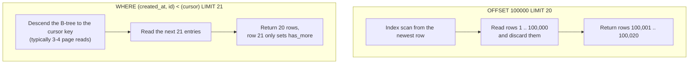
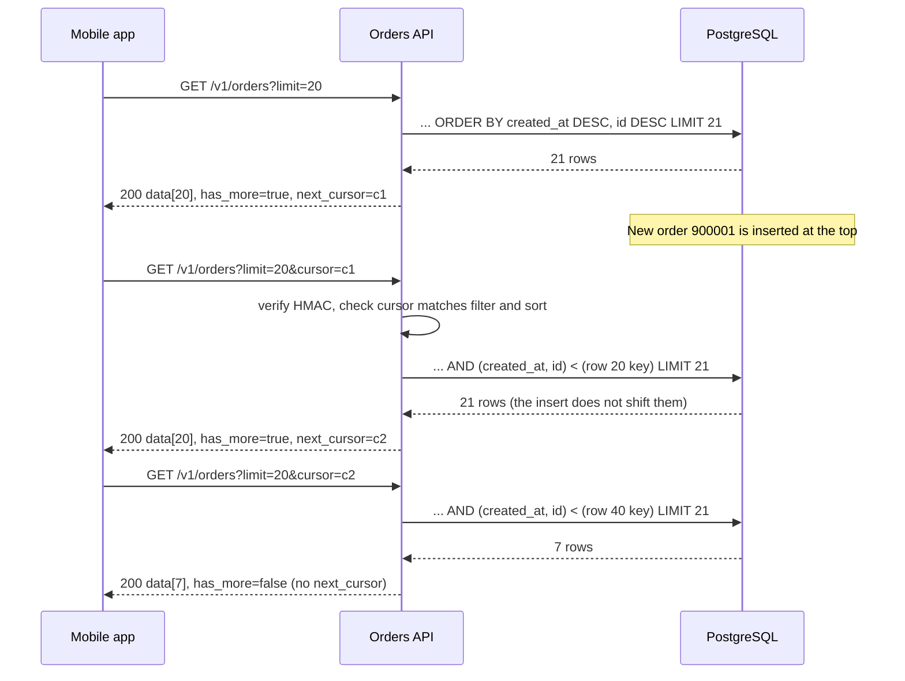

# Pagination, Filtering and Sorting

> [!summary] TL;DR
> A list endpoint never returns "all rows". It returns one **page** (for example 20 orders) plus a **cursor**: a token that says where the next page starts. The fast, stable way to build it is **keyset pagination**: remember the sort key of the last row you returned and ask the database for rows *after* that key, using an index, instead of skipping rows with `OFFSET`.

## 1. Why it exists

A customer with 200,000 orders opens "My orders". Without pagination, `GET /orders` serializes 200,000 rows (about 40 MB of JSON at 200 bytes per order, an estimate), holds them in server memory, and the phone shows 20 of them.

Pagination fixes the size problem. The naive fix, `LIMIT 20 OFFSET n`, creates two new ones:

- **Cost grows with depth.** To return rows 100,001–100,020, the database walks the first 100,000 rows in sort order and throws them away. PostgreSQL's docs say it directly: rows skipped by `OFFSET` still have to be computed inside the server. Page 1 reads 20 rows; page 5,001 reads 100,020.
- **Pages shift under the reader.** If a new order arrives between page 1 and page 2, every row moves down one position. Row 20 of page 1 becomes row 21, so page 2 starts with it again: the client shows a **duplicate**. A delete does the opposite and the client **skips** a row it never saw. The Go test in section 4 reproduces the duplicate.

Keyset pagination fixes both: every page costs about the same, and inserts or deletes elsewhere in the list never shift it.

## 2. Mental model

- **Offset** is "skip the first 100,000 lines of the phone book, then read 20". You still have to count past 100,000 lines.
- **Keyset** is "open the phone book at *Sharma, Priya* and read the next 20 names". The book is sorted, so you jump straight there.

The cursor is the bookmark: the sort key of the last row the client saw. As long as the sort key is **unique** and the list is read **in index order**, the bookmark always points to the same place, no matter what is inserted before it.

## 3. How it works

### Offset scan vs keyset seek



### Keyset step by step

1. **Pick a unique, stable sort key.** `created_at` alone is not unique (two orders in the same microsecond), so add the primary key as a tie-breaker: sort by `(created_at DESC, id DESC)`.
2. **Index exactly that order**, after the equality filters:

```sql
CREATE INDEX orders_customer_created_id
    ON orders (customer_id, created_at DESC, id DESC);
```

3. **First page:** no cursor.

```sql
SELECT id, created_at, status, total_cents
FROM orders
WHERE customer_id = $1
ORDER BY created_at DESC, id DESC
LIMIT 21;
```

4. **Next page:** pass the last row's `(created_at, id)` back as the cursor. The row-value comparison `(a, b) < (x, y)` means `a < x OR (a = x AND b < y)`, and PostgreSQL can turn it into a single B-tree range start.

```sql
SELECT id, created_at, status, total_cents
FROM orders
WHERE customer_id = $1
  AND (created_at, id) < ($2, $3)
ORDER BY created_at DESC, id DESC
LIMIT 21;
```

5. **`limit + 1` trick.** Ask for 21 rows, return 20. If row 21 exists, `has_more = true` and the cursor is built from row 20. This avoids both a `count(*)` and the classic bug of `has_more = len(rows) == limit`, which reports a phantom next page whenever the last page is exactly full.
6. **Encode and sign the cursor** so the client treats it as an opaque token and cannot edit it (section 4). Base64 is an encoding, not encryption: anyone can decode the payload, so encrypt it as well if the key values must stay hidden.

Representative output (PostgreSQL 17) for a customer with 200,000 orders. Offset to page 5,001:

```text
Limit  (cost=4319.61..4320.47 rows=20 width=32) (actual time=38.904..38.913 rows=20 loops=1)
  ->  Index Scan using orders_customer_created_id on orders  (cost=0.43..8638.79 rows=200000 width=32) (actual time=0.027..35.118 rows=100020 loops=1)
        Index Cond: (customer_id = 7)
Planning Time: 0.109 ms
Execution Time: 38.936 ms
```

Keyset to the same position:

```text
Limit  (cost=0.43..1.37 rows=21 width=32) (actual time=0.031..0.044 rows=21 loops=1)
  ->  Index Scan using orders_customer_created_id on orders  (cost=0.43..4434.71 rows=99000 width=32) (actual time=0.030..0.041 rows=21 loops=1)
        Index Cond: ((customer_id = 7) AND (ROW(created_at, id) < ROW('2026-03-14 09:15:00+00'::timestamp with time zone, 812345)))
Planning Time: 0.131 ms
Execution Time: 0.061 ms
```

The inner node tells the story: offset read `rows=100020` to return 20; keyset read 21.

### A client walking the list



## 4. Worked example

The list handler's core in Go: parse and allow-list the query, build the keyset SQL, apply the `limit + 1` trick, and issue an HMAC-signed cursor bound to the filter and sort. It compiles and passes `go vet` and `go test -race` on Go 1.24.

```go
// Package orders lists a customer's orders with keyset pagination.
package orders

import (
	"crypto/hmac"
	"crypto/sha256"
	"encoding/base64"
	"encoding/json"
	"errors"
	"fmt"
	"net/url"
	"strconv"
	"strings"
	"time"
)

const (
	DefaultLimit = 20
	MaxLimit     = 100
)

var ErrBadCursor = errors.New("invalid cursor")

// Only these filter values are accepted; anything else is a 400.
var allowedStatus = map[string]bool{"pending": true, "paid": true, "shipped": true}

type Order struct {
	ID         int64     `json:"id"`
	CreatedAt  time.Time `json:"created_at"`
	Status     string    `json:"status"`
	TotalCents int64     `json:"total_cents"`
}

// Cursor is the sort key of the last row a client saw, plus a
// fingerprint of the filter and sort it was issued for.
type Cursor struct {
	CreatedAt time.Time `json:"t"`
	ID        int64     `json:"i"`
	Query     string    `json:"q"`
}

// Codec makes cursors opaque and tamper-proof: base64url(json).base64url(hmac).
type Codec struct{ Key []byte }

func (c Codec) mac(b []byte) []byte {
	m := hmac.New(sha256.New, c.Key)
	m.Write(b)
	return m.Sum(nil)
}

func (c Codec) Encode(cur Cursor) string {
	b, _ := json.Marshal(cur) // cannot fail for this struct
	enc := base64.RawURLEncoding
	return enc.EncodeToString(b) + "." + enc.EncodeToString(c.mac(b))
}

// Decode rejects forged cursors and cursors issued for another query.
func (c Codec) Decode(s, query string) (Cursor, error) {
	enc := base64.RawURLEncoding
	payload, sig, ok := strings.Cut(s, ".")
	if !ok {
		return Cursor{}, ErrBadCursor
	}
	b, err1 := enc.DecodeString(payload)
	got, err2 := enc.DecodeString(sig)
	if err1 != nil || err2 != nil || !hmac.Equal(got, c.mac(b)) {
		return Cursor{}, ErrBadCursor
	}
	var cur Cursor
	if json.Unmarshal(b, &cur) != nil || cur.Query != query {
		return Cursor{}, ErrBadCursor
	}
	return cur, nil
}

// ListParams is a parsed, validated list request.
type ListParams struct {
	CustomerID  int64
	Status      string // optional filter
	Limit       int
	After       *Cursor
	Fingerprint string // filter + sort; a cursor is valid only for this
}

// Parse reads ?status=&limit=&cursor= for one customer.
func Parse(q url.Values, customerID int64, c Codec) (ListParams, error) {
	p := ListParams{CustomerID: customerID, Status: q.Get("status"), Limit: DefaultLimit}
	if p.Status != "" && !allowedStatus[p.Status] {
		return ListParams{}, fmt.Errorf("unknown status %q", p.Status)
	}
	if s := q.Get("limit"); s != "" {
		n, err := strconv.Atoi(s)
		if err != nil || n < 1 {
			return ListParams{}, errors.New("limit must be a positive integer")
		}
		p.Limit = min(n, MaxLimit)
	}
	p.Fingerprint = "status=" + p.Status + ";sort=-created_at,-id"
	if s := q.Get("cursor"); s != "" {
		cur, err := c.Decode(s, p.Fingerprint)
		if err != nil {
			return ListParams{}, err
		}
		p.After = &cur
	}
	return p, nil
}

// SQL builds the keyset query. It fetches Limit+1 rows: the extra row
// only tells us whether another page exists.
func (p ListParams) SQL() (string, []any) {
	var sb strings.Builder
	args := []any{p.CustomerID}
	sb.WriteString("SELECT id, created_at, status, total_cents FROM orders WHERE customer_id = $1")
	if p.Status != "" {
		args = append(args, p.Status)
		fmt.Fprintf(&sb, " AND status = $%d", len(args))
	}
	if p.After != nil {
		args = append(args, p.After.CreatedAt, p.After.ID)
		fmt.Fprintf(&sb, " AND (created_at, id) < ($%d, $%d)", len(args)-1, len(args))
	}
	args = append(args, p.Limit+1)
	fmt.Fprintf(&sb, " ORDER BY created_at DESC, id DESC LIMIT $%d", len(args))
	return sb.String(), args
}

type Page struct {
	Data       []Order `json:"data"`
	NextCursor string  `json:"next_cursor,omitempty"`
	HasMore    bool    `json:"has_more"`
}

// NewPage trims the extra row and builds the cursor from the last row kept.
func NewPage(rows []Order, p ListParams, c Codec) Page {
	pg := Page{Data: rows, HasMore: len(rows) > p.Limit}
	if pg.HasMore {
		pg.Data = rows[:p.Limit]
		last := pg.Data[p.Limit-1]
		pg.NextCursor = c.Encode(Cursor{CreatedAt: last.CreatedAt, ID: last.ID, Query: p.Fingerprint})
	}
	return pg
}
```

The status filter uses an allow-list even though it is a bound parameter: an unknown value is a client bug worth a 400, not an empty page. With a status filter, the index becomes `(customer_id, status, created_at DESC, id DESC)`.

The tests run against a fake store that applies the same `ORDER BY` and row-value predicate as the SQL. They prove three things: offset repeats a row after an insert while keyset does not, the `id` tie-breaker keeps two orders with the same timestamp, and a cursor cannot be forged or reused with another filter.

```go
package orders

import (
	"errors"
	"net/url"
	"slices"
	"testing"
	"time"
)

var codec = Codec{Key: []byte("test-secret")}

// fakeDB applies the same ORDER BY and row-value predicate as the SQL.
type fakeDB struct{ rows []Order }

func newer(a, b Order) bool { // true if a sorts first in created_at DESC, id DESC
	if !a.CreatedAt.Equal(b.CreatedAt) {
		return a.CreatedAt.After(b.CreatedAt)
	}
	return a.ID > b.ID
}

func (db *fakeDB) sorted() []Order {
	s := slices.Clone(db.rows)
	slices.SortFunc(s, func(a, b Order) int {
		switch {
		case newer(a, b):
			return -1
		case newer(b, a):
			return 1
		}
		return 0 // a comparator must report equal elements as 0
	})
	return s
}

func (db *fakeDB) keyset(p ListParams) []Order {
	var out []Order
	for _, o := range db.sorted() {
		if p.After != nil && !newer(Order{CreatedAt: p.After.CreatedAt, ID: p.After.ID}, o) {
			continue // keep only rows with (created_at, id) < cursor
		}
		if len(out) == p.Limit+1 {
			break
		}
		out = append(out, o)
	}
	return out
}

func (db *fakeDB) offset(offset, limit int) []Order {
	s := db.sorted()
	return s[min(offset, len(s)):min(offset+limit, len(s))]
}

func seed() *fakeDB {
	t0 := time.Date(2026, 11, 1, 12, 0, 0, 0, time.UTC)
	at := func(sec int) time.Time { return t0.Add(time.Duration(sec) * time.Second) }
	// Orders 3 and 4 share a timestamp: the id tie-breaker must keep both.
	return &fakeDB{rows: []Order{
		{ID: 1, CreatedAt: at(1)}, {ID: 2, CreatedAt: at(2)}, {ID: 3, CreatedAt: at(3)},
		{ID: 4, CreatedAt: at(3)}, {ID: 5, CreatedAt: at(4)},
	}}
}

func TestOffsetDuplicatesButKeysetDoesNot(t *testing.T) {
	// Offset: read page 1, a new order arrives, read page 2.
	db := seed()
	p1 := db.offset(0, 2)
	db.rows = append(db.rows, Order{ID: 6, CreatedAt: time.Date(2026, 11, 1, 13, 0, 0, 0, time.UTC)})
	p2 := db.offset(2, 2)
	if p1[1].ID != 4 || p2[0].ID != 4 {
		t.Fatalf("expected offset to repeat order 4, got %v then %v", p1, p2)
	}

	// Keyset: same story, walk to the end with next_cursor.
	db = seed()
	var seen []int64
	q := url.Values{"limit": {"2"}}
	for i := 0; ; i++ {
		p, err := Parse(q, 7, codec)
		if err != nil {
			t.Fatal(err)
		}
		pg := NewPage(db.keyset(p), p, codec)
		for _, o := range pg.Data {
			seen = append(seen, o.ID)
		}
		if i == 0 {
			db.rows = append(db.rows, Order{ID: 6, CreatedAt: time.Date(2026, 11, 1, 13, 0, 0, 0, time.UTC)})
		}
		if !pg.HasMore {
			break
		}
		q.Set("cursor", pg.NextCursor)
	}
	if want := []int64{5, 4, 3, 2, 1}; !slices.Equal(seen, want) {
		t.Fatalf("keyset walk = %v, want %v", seen, want)
	}
}

func TestCursorIsBoundToQueryAndSigned(t *testing.T) {
	p, _ := Parse(url.Values{"status": {"paid"}, "limit": {"1"}}, 7, codec)
	rows := []Order{{ID: 9, CreatedAt: time.Now()}, {ID: 8, CreatedAt: time.Now()}}
	next := NewPage(rows, p, codec).NextCursor

	// Same cursor, different filter: rejected.
	_, err := Parse(url.Values{"status": {"shipped"}, "cursor": {next}}, 7, codec)
	if !errors.Is(err, ErrBadCursor) {
		t.Fatalf("cross-query cursor: err = %v", err)
	}
	// Flip one character of the payload: rejected.
	forged := []byte(next)
	forged[3] ^= 1
	if _, err := codec.Decode(string(forged), p.Fingerprint); !errors.Is(err, ErrBadCursor) {
		t.Fatalf("forged cursor: err = %v", err)
	}
}

func TestParseAllowListAndLimits(t *testing.T) {
	if _, err := Parse(url.Values{"status": {"paid' OR 1=1--"}}, 7, codec); err == nil {
		t.Fatal("unknown status accepted")
	}
	p, err := Parse(url.Values{"limit": {"5000"}}, 7, codec)
	if err != nil || p.Limit != MaxLimit {
		t.Fatalf("limit = %d, err = %v; want clamp to %d", p.Limit, err, MaxLimit)
	}
	sql, args := p.SQL()
	want := "SELECT id, created_at, status, total_cents FROM orders WHERE customer_id = $1" +
		" ORDER BY created_at DESC, id DESC LIMIT $2"
	if sql != want || args[1] != MaxLimit+1 {
		t.Fatalf("sql = %q args = %v", sql, args)
	}
}
```

**Measured** with the test above (Go 1.24, 2026-11-02): five orders, page size 2, one order inserted after page 1. Offset returned order 4 on page 1 and again on page 2. Keyset returned `5, 4, 3, 2, 1`, each once, including orders 3 and 4 that share a timestamp. The new order 6 is not on the later pages; the client sees it when it refreshes from the top, which is the behaviour users expect from a feed.

**The response** the handler writes (one of the 20 items shown; the cursor payload is real base64url of `{"t":"2026-11-02T08:01:12Z","i":812366,"q":"status=paid;sort=-created_at,-id"}`, signature shortened):

```json
{
  "data": [
    {"id": 812366, "created_at": "2026-11-02T08:01:12Z", "status": "paid", "total_cents": 49900}
  ],
  "next_cursor": "eyJ0IjoiMjAyNi0xMS0wMlQwODowMToxMloiLCJpIjo4MTIzNjYsInEiOiJzdGF0dXM9cGFpZDtzb3J0PS1jcmVhdGVkX2F0LC1pZCJ9.kPq1...",
  "has_more": true
}
```

and, for clients that prefer headers, the same link per RFC 8288:

```http
Link: <https://api.example.com/v1/orders?status=paid&limit=20&cursor=eyJ0Ijoi...>; rel="next"
```

## 5. Variants and comparison

| Option | How it works | Use when | Cost |
| --- | --- | --- | --- |
| Offset / page number | `LIMIT n OFFSET k`, or `?page=7&per_page=20` | Small or admin lists; users need "jump to page 7"; data rarely changes | Reads `k + n` rows; duplicates and skips under concurrent writes |
| Keyset / seek | `WHERE (sort_key, id) < (last) LIMIT n+1` on a matching index | Feeds, infinite scroll, exports, sync jobs, any large or changing list | No random page jumps; one index per supported sort; cursor plumbing |
| Opaque cursor over keyset | The keyset values encoded (and signed) into a token | Public APIs that want to change the implementation later | Encoding, signing, expiry rules |
| ID cursor (Stripe style) | `?starting_after=obj_123`; the server looks up that object's sort key | Lists sorted by creation time with stable object IDs | An extra lookup; fails if the referenced object is deleted, unless handled |
| Snapshot / server-side cursor | Database cursor, or Elasticsearch point in time, holds a consistent view | Exports and reports that must see one consistent snapshot | Server state per client; snapshots expire and hold resources |
| Search engine paging | `from`/`size` up to a window, then `search_after` | Full-text or faceted search results | Deep `from` is capped (10,000 by default in Elasticsearch) |

What well-known APIs do:

| API | Request | Response |
| --- | --- | --- |
| GitHub REST | `?per_page=100&page=2` (some endpoints `before`/`after`) | `Link` header with `rel="next"`, `"prev"`, `"first"`, `"last"` |
| Stripe | `?limit=100&starting_after=cus_123` or `ending_before` | `{"object": "list", "data": [...], "has_more": true}` |
| Google APIs (AIP-158) | `page_size`, `page_token` | `next_page_token`; an empty string means the end |
| GraphQL Relay | `first: 20, after: "..."` or `last`, `before` | `edges { cursor node }`, `pageInfo { hasNextPage endCursor }` |

## 6. Trade-offs and when not to use

- **No random access.** Keyset cannot jump to page 50. If the product truly needs page numbers (a back-office table), use offset with a cap on depth, or jump by value ("orders before 1 March") instead of by position.
- **One index per sort order.** Every sort the API allows needs its own composite index ending in the tie-breaker. Five sortable fields with two directions and two filters can mean many indexes and slower writes. Allow only the sorts the product actually uses.
- **Cursors expire in meaning.** A cursor encodes a position under one filter and sort. Changing either must start from page 1, which is why the code binds the cursor to a fingerprint.
- **Small lists do not need it.** A settings list with at most 50 items can return everything; pagination plumbing there is pure cost.
- **Totals are not free.** `count(*)` has to visit every matching row (see section 8). Offer `has_more` by default and a total only when the product needs it.

## 7. In production

- **Real systems:**
	- GitHub's REST API paginates with the RFC 8288 `Link` header, caps `per_page` at 100, and its search API returns at most 1,000 results per search, however large `total_count` is.
	- Stripe uses object-ID cursors (`starting_after`, `ending_before`), `limit` between 1 and 100 (default 10), and `has_more` instead of a total.
	- Google's API design guide (AIP-158) uses opaque `page_token`s. The other request parameters must match the call that issued the token, and a mismatch should be rejected with `INVALID_ARGUMENT`. Its optional `total_size` may be an estimate if the API documents that.
	- Elasticsearch refuses `from + size` beyond `index.max_result_window` (default 10,000) and recommends `search_after` with a point in time for deeper paging.
- **Failure modes → fixes:**
	- Deep offset pages time out or overload the database (often a crawler walking `?page=1..50000`) → switch to keyset, or cap `page` and return 400 beyond it.
	- Clients see duplicates or gaps in infinite scroll → add the unique tie-breaker to the sort and the cursor; never paginate on a non-unique key alone.
	- Rows vanish when the sort column is `NULL` → row comparisons with `NULL` are unknown, so make the column `NOT NULL` or sort on `COALESCE(col, sentinel)` in both the index and the query.
	- Clients hand-craft cursors or old cursors break after a deploy → make cursors opaque, sign them, version their format, and return a clear 400 for an invalid cursor.
	- `limit=100000` requests → clamp to a documented maximum (AIP-158 says to coerce down) or reject with 400; never pass the raw value to SQL.
- **What to monitor:**
	- p99 latency of list endpoints split by "first page" and "has cursor".
	- Rows read per row returned (from `pg_stat_statements` or `EXPLAIN` sampling); a ratio far above 1 means an offset or a missing index.
	- 400 responses for invalid cursors after each deploy.
	- Distribution of requested `limit` values and of page depth.

## 8. Deep dive

**Why an index cannot make `OFFSET` fast.** A B-tree is ordered but does not store how many entries sit under each subtree, so the database cannot compute "where is entry 100,000" without walking the leaves. Keyset turns the position into a **value**, and finding a value is what a B-tree does in `O(log n)`.

**Mixed sort directions.** The row comparison `(a, b) < (x, y)` works only when both columns sort the same way. For `ORDER BY price ASC, id DESC` you must expand it: `WHERE price > $1 OR (price = $1 AND id < $2)`, with an index on `(price ASC, id DESC)`. PostgreSQL may not use that `OR` as a single index range, so check the plan, or keep every API sort in the same direction as its tie-breaker.

**Backward cursors ("previous page").** Flip the comparison and the order, then reverse the rows in the application:

```sql
SELECT id, created_at, status, total_cents
FROM orders
WHERE customer_id = $1
  AND (created_at, id) > ($2, $3)
ORDER BY created_at ASC, id ASC
LIMIT 21;
```

The cursor carries its direction (Stripe's `ending_before`, Relay's `last` and `before`). The extra row now means "there is a previous page" (`hasPreviousPage`).

**Sorting by a user-chosen field.** The cursor must hold the value of *that* field plus the tie-breaker, for example `{"sort": "total_cents", "v": 49900, "i": 812366}`. Column names cannot be SQL placeholders, so map API field names to fixed SQL fragments through an allow-list (`"total" → "total_cents"`) and never splice user text into `ORDER BY`. Common request syntaxes: `?sort=-created_at` (JSON:API style), `?order_by=created_at desc` (Google AIP-132), `?filter[status]=paid` or `?status=paid`, and range operators like `?created_after=2026-10-01T00:00:00Z`. Pick one style per API and reject unknown fields with 400.

**Total counts.** Options, from cheapest:

1. No total; `has_more` only (Stripe).
2. A capped count: `SELECT count(*) FROM (SELECT 1 FROM orders WHERE customer_id = $1 LIMIT 10001) t` and show "10,000+".
3. A planner estimate. For a whole table, `SELECT reltuples::bigint FROM pg_class WHERE oid = 'orders'::regclass;` (updated by `VACUUM`, `ANALYZE` and a few DDL commands such as `CREATE INDEX`; since PostgreSQL 14, `-1` means the table has never been vacuumed or analyzed). For a filter, read the `rows=` estimate from `EXPLAIN (FORMAT JSON)`.
4. A maintained counter (a `customer_stats` row updated in the same transaction, or a cache with a TTL).
5. An exact `count(*)`, which in PostgreSQL must check visibility of every matching row (an index-only scan helps only when the visibility map is current).

**Search engines.** In Elasticsearch, `from: 9980, size: 20` makes every shard return its top 10,000 hits to the coordinating node, which then sorts `shards × 10,000` entries to keep 20. That is why `index.max_result_window` defaults to 10,000. `search_after` is keyset pagination: pass the sort values of the last hit, with a point in time (PIT) so the view stays consistent, and a unique tie-breaker (`_shard_doc` with a PIT).

**GraphQL and gRPC shapes.** Relay connections wrap each item in an edge with its own cursor, so a client can resume from any item, not only the last. In gRPC, AIP-158 puts `page_size` and `page_token` on the request and `next_page_token` on the response; a `page_size` of 0 means "server default", values above the maximum are coerced down, and the token is opaque. Both are keyset designs with different wrapping; see [[GraphQL]] and [[gRPC]].

**Caching.** A first page with no cursor changes on every insert, so cache it briefly or not at all. Pages fetched by cursor are more stable, but with deletes they can still change; see [[HTTP Caching - Cache-Control, ETag, Conditional Requests]] before adding `Cache-Control`.

## 9. Interview questions

> [!question]- Why is `OFFSET 100000` slow even with an index on the sort column? (trap)
> The index gives the order, but a B-tree cannot jump to "the 100,000th entry": it has no subtree counts. The database walks and discards 100,000 entries before returning 20. Keyset turns the position into a value (`(created_at, id) < (x, y)`), which the B-tree finds in a few page reads.

> [!question]- Design pagination for a feed where new posts arrive every second.
> Sort by `(created_at DESC, id DESC)`, index `(feed_id, created_at DESC, id DESC)`, and return an opaque cursor built from the last row's key. New posts land above the cursor, so later pages never shift. To show new posts, the client fetches from the top again (or uses a `before` cursor from its first item).

> [!question]- Why put `id` in the cursor when you sort by `created_at`?
> `created_at` is not unique. With `created_at < x` alone, every other row sharing the boundary timestamp is skipped; with `<=`, rows repeat. The unique tie-breaker makes the sort a total order, so every row has exactly one position.

> [!question]- How do you compute `has_more` without a count?
> Fetch `limit + 1` rows. If the extra row exists, there is another page; drop it and build the cursor from the last row kept. Checking `len(rows) == limit` is wrong: it promises a next page whenever the last page happens to be exactly full.

> [!question]- Product wants "Page 3 of 2,481". What do you say?
> An exact total costs a full count on every request, and page numbers force offset with its depth cost and drift. Offer "10,000+" with a capped count, a planner estimate, or a maintained counter. If random page access is truly needed, keep offset with a depth cap, or jump by value (date) instead of by position.

> [!question]- What goes into a cursor, and why make it opaque and signed?
> The sort-key values of the last row, the direction, and a fingerprint of the filter and sort, plus a format version. Opaque means clients cannot depend on its structure, so you can change the implementation. Signing stops clients from editing it to probe other positions or inject odd values, and binding it to the query rejects reuse under a different filter.

> [!question]- How do you page past 10,000 results in Elasticsearch?
> Not with `from`/`size`: each shard must return `from + size` hits to be merged, so cost grows with depth, and the default window stops at 10,000. Use `search_after` with the last hit's sort values, a unique tie-breaker, and a point in time for a consistent view.

## 10. Cheat sheet

- Offset reads `offset + limit` rows and drifts under writes; keyset reads about `limit` rows and does not drift.
- Keyset: `WHERE (created_at, id) < ($2, $3) ORDER BY created_at DESC, id DESC LIMIT 21`, index `(filter cols, created_at DESC, id DESC)`.
- Always end the sort with a unique tie-breaker; avoid `NULL` sort columns.
- `limit + 1` gives `has_more` for free; clamp `limit` to a maximum (100 is common).
- Cursor = opaque, signed, versioned, bound to filter and sort; invalid cursor → 400.
- Response: `data`, `next_cursor`, `has_more`, optionally an RFC 8288 `Link` header.
- Totals: skip, cap, estimate, or maintain a counter; exact `count(*)` is a full visit.
- Allow-list filter and sort fields; never splice them into SQL.

## Links

- **Before this:** [[REST and HTTP API Design]], [[Indexing Fundamentals]], [[Index Types and Index Design]]
- **Next:** [[API Versioning and Backward Compatibility]], [[Building REST Endpoints]] (the full Go handler)
- **Compare with:** [[GraphQL]] (Relay connections), [[gRPC]] (`page_token`), [[Search Engines and Inverted Indexes]] (`search_after`), [[Query Plans and EXPLAIN]] (reading the plans above)
