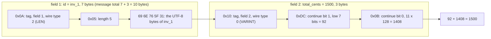
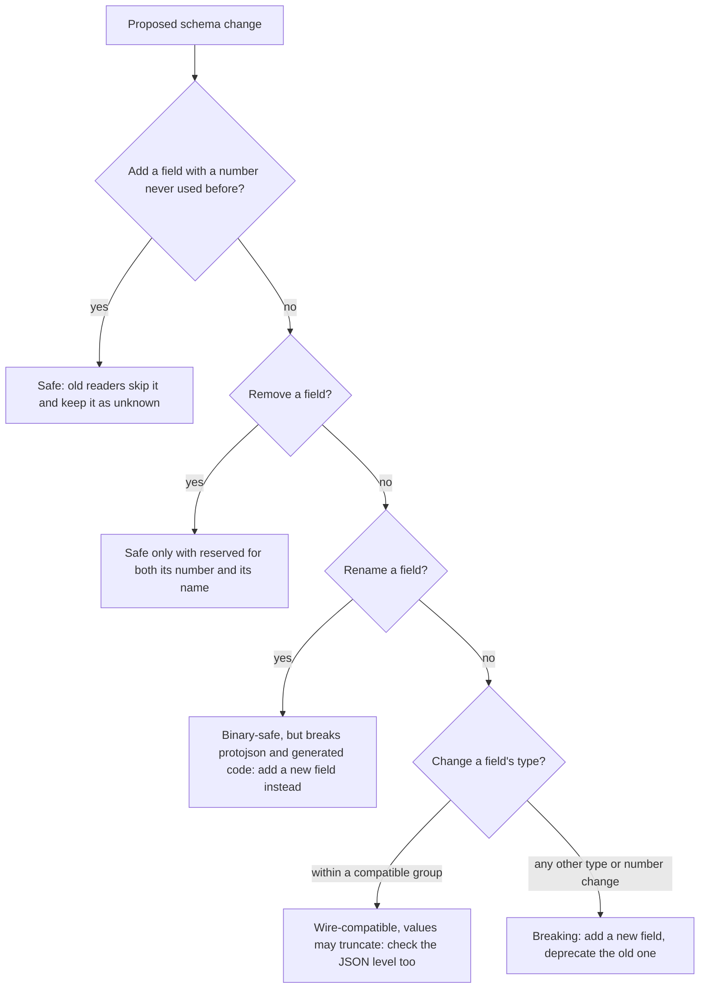

# Protocol Buffers and Schema Evolution

> [!summary] TL;DR
> Protocol Buffers (protobuf) is a binary format for structured data. You declare messages in a `.proto` file, giving every field a **number**. On the wire, only those numbers and compact values travel, never field names. A schema can evolve safely for years if you follow a few rules: add fields with new numbers, never reuse a number, and `reserved` what you delete.

> [!abstract] Core idea
> - Protobuf is a compact binary format; every field in a `.proto` message has a number.
> - Only field numbers and values go on the wire, never names, so renaming a field is safe but renumbering is not.
> - Rule: add fields with new numbers, never reuse a number, and `reserved` the numbers and names you delete.
> - Classic mistake: changing a field's type or reusing a deleted number, so old readers silently decode garbage.

## 1. Why it exists

An `InvoicePaid` event is written by the billing service and read by six consumers (email, ledger, analytics and others) that deploy on their own schedules. Billing adds a `currency` field on Monday; the ledger consumer will not redeploy until Friday.

- With **JSON**, every message repeats every field name, and compatibility depends on each consumer's parser being lenient. Nothing checks a change before it ships.
- With **protobuf**, the ledger's old code reads the new message, skips the field number it does not know, and keeps its bytes. The change was safe by construction, and `buf breaking` in CI checks it before merge.

Size matters too. **Measured** in section 4: `Invoice{id: "inv_1", total_cents: 1500}` is **10 bytes** in protobuf and **34 bytes** as protobuf's own JSON mapping. In the section 4 benchmark (Go, one small message), binary parsing was about 8 times faster than protojson parsing.

## 2. Mental model

A protobuf message is a **form with numbered boxes**. The `.proto` file says "box 1 holds the invoice ID, box 2 holds the total in cents". The encoded message is just a list of "box number, value" pairs.

- A reader that does not know box 3 skips it, and keeps it so it is not lost if the message is passed on.
- A reader that expects box 4 but finds nothing uses the default (0, empty string, false).
- Box **numbers are forever**. Labels (field names) are for humans and for JSON, so changing them is not free either.

## 3. How it works

### Messages and field numbers

```protobuf
syntax = "proto3";

package invoice.v1;

import "google/protobuf/field_mask.proto";
import "google/protobuf/timestamp.proto";

option go_package = "example.com/invoiceops/gen/invoice/v1;invoicev1";

enum InvoiceStatus {
  INVOICE_STATUS_UNSPECIFIED = 0; // the default: "not set", never a real state
  INVOICE_STATUS_DRAFT = 1;
  INVOICE_STATUS_SENT = 2;
  INVOICE_STATUS_PAID = 3;
}

message Invoice {
  reserved 4;                // was: string client_name = 4;
  reserved "client_name";    // so nobody reuses the name either

  string id = 1;
  int64 total_cents = 2;     // money as int64 minor units: no float rounding
  InvoiceStatus status = 3;
  google.protobuf.Timestamp issued_at = 5;
  optional string po_number = 6;          // explicit presence: unset differs from ""
  repeated int64 line_ids = 7;            // packed by default in proto3
  map<string, int64> tax_cents_by_region = 8;
  oneof payer {                           // at most one is set
    string customer_id = 9;
    string partner_id = 10;
  }
}

message UpdateInvoiceRequest {
  Invoice invoice = 1;
  google.protobuf.FieldMask update_mask = 2; // for example paths "status", "po_number"
}
```

This file was compiled with `protocompile` v0.14.1 (a pure-Go compiler) to check it; Go code was not generated from it, because `protoc` is not installed here.

- **Field numbers** run from 1 to 2^29 − 1 (536,870,911). Numbers 19000–19999 are reserved for the protobuf implementation.
- **Numbers 1–15 encode in a one-byte tag**; 16–2047 take two bytes. Give the 1–15 range to fields set in almost every message.
- The first enum value must be zero. Name it `<ENUM>_UNSPECIFIED`, because it is what a reader sees when the field was never set. Prefix every value with the enum name: enum values are scoped like siblings of the enum in C++, so two enums in one package cannot both declare `PAID`.

### Wire format

Each field is encoded as a **tag**, then a value. The tag is a varint (a variable-length integer: 7 bits per byte, high bit means "more bytes follow") holding `field_number << 3 | wire_type`.

| Wire type | ID | Used for | Value layout |
| --- | --- | --- | --- |
| VARINT | 0 | `int32`, `int64`, `uint32`, `uint64`, `sint32`, `sint64`, `bool`, `enum` | varint |
| I64 | 1 | `fixed64`, `sfixed64`, `double` | 8 bytes, little-endian |
| LEN | 2 | `string`, `bytes`, embedded messages, packed repeated fields | varint length, then that many bytes |
| SGROUP, EGROUP | 3, 4 | groups (deprecated): proto2 groups, or messages with the Editions feature `message_encoding = DELIMITED` | start tag, the fields, end tag |
| I32 | 5 | `fixed32`, `sfixed32`, `float` | 4 bytes, little-endian |

- **Varint:** 7 bits of the number per byte, least significant group first, and the top bit set on every byte except the last. 1 to 127 take 1 byte; 1500 takes 2.
- **Negative numbers in `int32`/`int64`** are sign-extended to 64 bits, so `-1` costs **10 bytes**. **`sint32`/`sint64` use ZigZag** encoding first (0 → 0, −1 → 1, 1 → 2, −2 → 3), so small negative numbers stay small. Use `sint*` for fields that are often negative, such as deltas.
- `fixed32` (always 4 bytes) beats `uint32` when values are often above 2^28, and `fixed64` (always 8 bytes) beats `uint64` above 2^56, for example hashes and random IDs.
- **Packed repeated:** in proto3, `repeated int64 line_ids = 7` with values `[1, 2, 3]` is one tag (`0x3a`), one length (`0x03`), then `01 02 03`. Parsers accept both packed and unpacked forms.
- A **map** is encoded as a repeated entry message with key as field 1 and value as field 2. Map order is not preserved.



### Presence: was the field set?

- **proto3 implicit presence** (plain `string po_number = 6;`): zero values are not sent. A reader cannot tell "set to empty" from "never set". Section 4's test shows a zero-valued invoice encodes to 0 bytes.
- **`optional` (explicit presence)** generates a `HasPoNumber`-style check (in Go, a pointer field in the classic API). Use it when "unset" and "zero" mean different things, for example in partial updates or `0%` vs "no discount".
- **Wrapper types** (`google.protobuf.Int64Value`, `StringValue`) were the way to get presence in proto3 before protoc 3.15 (2021) enabled proto3 `optional` by default. Prefer `optional` in new schemas.
- `oneof` fields and message fields always track presence.

### Unknown fields and enums

- A parser keeps fields it does not know as **unknown fields** and writes them back when it re-encodes. A proxy built against an old schema therefore does not drop data added by newer producers (tested in section 4). proto3 runtimes before protobuf 3.5 (2017) dropped unknown fields, so very old binaries are the exception.
- proto3 enums are **open**: an unrecognized number (a new `INVOICE_STATUS_REFUNDED = 4` read by old code) is kept in the field as that number. In Go, `String()` prints the number. Code must have a `default:` branch for unknown values.

### Well-known types

| Type | Use it for |
| --- | --- |
| `Timestamp` | A point in time: seconds and nanos since the Unix epoch, UTC. JSON: RFC 3339 string |
| `Duration` | A span of time. JSON: `"1.5s"` |
| `FieldMask` | Partial updates: `update_mask` lists the paths to change (Google AIP-134) |
| `Struct`, `Value` | Arbitrary JSON-like data, when the shape is truly unknown |
| `Any` | A packed message of any type plus its type URL. JSON: an `@type` field |
| `Empty` | A request or response with no fields |

### JSON mapping (protojson)

- Field names become **lowerCamelCase** (`total_cents` → `totalCents`). Parsers accept both the camelCase and the original name.
- **64-bit integers become JSON strings** (`"1500"`), because JavaScript numbers lose precision above 2^53. Parsers accept both strings and numbers.
- Enums become their names (`"INVOICE_STATUS_PAID"`), and bytes become base64.
- Fields with zero values are omitted unless you set `EmitUnpopulated`.
- Go's `protojson` deliberately adds random whitespace in some builds, so nobody can depend on byte-exact output. Compare parsed values, not strings.

## 4. Worked example

### Whiteboard version

The bare idea: one field encoded by hand as a tag (`number << 3 | wire type`) plus a varint value. The full version below uses the real `google.golang.org/protobuf` library and tests evolution cases.

```go
package main

import "fmt"

// Encode field 1 (varint) the way protobuf does: tag = number<<3 | wireType.
func appendVarint(b []byte, v uint64) []byte {
	for v >= 0x80 {
		b = append(b, byte(v)|0x80)
		v >>= 7
	}
	return append(b, byte(v))
}

func main() {
	const fieldNumber, wireVarint = 1, 0
	var b []byte
	b = appendVarint(b, fieldNumber<<3|wireVarint) // tag byte 0x08
	b = appendVarint(b, 150)                       // value 150 -> 0x96 0x01
	fmt.Printf("% x\n", b)                         // 08 96 01: no field name on the wire
}
```

### Full version

The code builds the `Invoice` message (fields 1 and 2 only) at runtime from a descriptor, the same structure `protoc` produces, so the real `google.golang.org/protobuf` v1.36.10 library encodes it without code generation. It compiles and passes `go vet` and `go test -race` on Go 1.24.4.

```go
// Package invoicepb builds the note's Invoice message at runtime, so the real
// protobuf library can encode it without running protoc.
package invoicepb

import (
	"google.golang.org/protobuf/proto"
	"google.golang.org/protobuf/reflect/protodesc"
	"google.golang.org/protobuf/reflect/protoreflect"
	"google.golang.org/protobuf/types/descriptorpb"
)

// FileProto is the descriptor protoc would produce for:
//
//	syntax = "proto3";
//	package invoice.v1;
//	message Invoice { string id = 1; int64 total_cents = 2; }
func FileProto() *descriptorpb.FileDescriptorProto {
	singular := descriptorpb.FieldDescriptorProto_LABEL_OPTIONAL.Enum() // proto3 default label
	return &descriptorpb.FileDescriptorProto{
		Name:    proto.String("invoice/v1/invoice.proto"),
		Package: proto.String("invoice.v1"),
		Syntax:  proto.String("proto3"),
		MessageType: []*descriptorpb.DescriptorProto{{
			Name: proto.String("Invoice"),
			Field: []*descriptorpb.FieldDescriptorProto{
				{Name: proto.String("id"), Number: proto.Int32(1), Label: singular,
					Type: descriptorpb.FieldDescriptorProto_TYPE_STRING.Enum()},
				{Name: proto.String("total_cents"), Number: proto.Int32(2), Label: singular,
					Type: descriptorpb.FieldDescriptorProto_TYPE_INT64.Enum()},
			},
		}},
	}
}

// InvoiceDescriptor links FileProto into a usable message descriptor.
func InvoiceDescriptor() (protoreflect.MessageDescriptor, error) {
	fd, err := protodesc.NewFile(FileProto(), nil)
	if err != nil {
		return nil, err
	}
	return fd.Messages().ByName("Invoice"), nil
}
```

```go
package invoicepb

import (
	"bytes"
	"encoding/json"
	"testing"

	"google.golang.org/protobuf/encoding/protojson"
	"google.golang.org/protobuf/encoding/protowire"
	"google.golang.org/protobuf/proto"
	"google.golang.org/protobuf/reflect/protoreflect"
	"google.golang.org/protobuf/types/descriptorpb"
	"google.golang.org/protobuf/types/dynamicpb"
)

// Dynamic messages keep fields in a map, so plain proto.Marshal may emit them
// in any order. Deterministic output sorts them by field number.
var det = proto.MarshalOptions{Deterministic: true}

func newInvoice(t testing.TB, id string, cents int64) *dynamicpb.Message {
	t.Helper()
	md, err := InvoiceDescriptor()
	if err != nil {
		t.Fatal(err)
	}
	m := dynamicpb.NewMessage(md)
	m.Set(md.Fields().ByName("id"), protoreflect.ValueOfString(id))
	m.Set(md.Fields().ByName("total_cents"), protoreflect.ValueOfInt64(cents))
	return m
}

func TestInvoiceWireBytes(t *testing.T) {
	got, err := det.Marshal(newInvoice(t, "inv_1", 1500))
	if err != nil {
		t.Fatal(err)
	}
	var want []byte // the same bytes, one primitive at a time
	want = protowire.AppendTag(want, 1, protowire.BytesType)  // 0x0a = 1<<3 | 2
	want = protowire.AppendString(want, "inv_1")              // 0x05, then 5 bytes
	want = protowire.AppendTag(want, 2, protowire.VarintType) // 0x10 = 2<<3 | 0
	want = protowire.AppendVarint(want, 1500)                 // 0xdc 0x0b
	literal := []byte{0x0a, 0x05, 'i', 'n', 'v', '_', '1', 0x10, 0xdc, 0x0b}
	if !bytes.Equal(got, want) || !bytes.Equal(got, literal) {
		t.Fatalf("got % x, want % x", got, literal)
	}
}

func TestZeroValuesAreNotSent(t *testing.T) {
	got, err := proto.Marshal(newInvoice(t, "", 0)) // implicit presence
	if err != nil || len(got) != 0 {
		t.Fatalf("got % x, %v; want 0 bytes", got, err)
	}
}

func TestJSONMapping(t *testing.T) {
	out, err := protojson.Marshal(newInvoice(t, "inv_1", 1500))
	if err != nil {
		t.Fatal(err)
	}
	var compact bytes.Buffer // protojson output is deliberately unstable: compact it
	if err := json.Compact(&compact, out); err != nil {
		t.Fatal(err)
	}
	if got, want := compact.String(), `{"id":"inv_1","totalCents":"1500"}`; got != want {
		t.Fatalf("got %s, want %s", got, want)
	}
}

func TestUnknownFieldsSurvive(t *testing.T) {
	// A newer producer added `string currency = 3;`. This binary's schema lacks it.
	wire, err := det.Marshal(newInvoice(t, "inv_1", 1500))
	if err != nil {
		t.Fatal(err)
	}
	wire = protowire.AppendTag(wire, 3, protowire.BytesType)
	wire = protowire.AppendString(wire, "EUR")

	old := newInvoice(t, "", 0)
	if err := proto.Unmarshal(wire, old); err != nil {
		t.Fatal(err)
	}
	if len(old.GetUnknown()) != 5 { // 0x1a 0x03 'E' 'U' 'R'
		t.Fatalf("unknown = % x", old.GetUnknown())
	}
	again, err := det.Marshal(old)
	if err != nil || !bytes.Equal(again, wire) {
		t.Fatalf("re-encoded % x, want % x (%v)", again, wire, err)
	}
}

func TestVarintSizes(t *testing.T) {
	minusOne := int32(-1)
	checks := []struct {
		name      string
		got, want int
	}{
		{"tag of field 15", protowire.SizeTag(15), 1},
		{"tag of field 16", protowire.SizeTag(16), 2},
		{"int32 -1, sign-extended to 64 bits", protowire.SizeVarint(uint64(int64(minusOne))), 10},
		{"sint32 -1, ZigZag-encoded to 1", protowire.SizeVarint(protowire.EncodeZigZag(int64(minusOne))), 1},
		{"int64 1500", protowire.SizeVarint(1500), 2},
	}
	for _, c := range checks {
		if c.got != c.want {
			t.Errorf("%s: %d bytes, want %d", c.name, c.got, c.want)
		}
	}
	if protowire.MaxValidNumber != 1<<29-1 || protowire.FirstReservedNumber != 19000 {
		t.Fatal("field number limits changed")
	}
}

// The benchmarks use descriptorpb.FileDescriptorProto, a generated message
// that ships inside the protobuf module, because no code generator ran here.
func BenchmarkMarshal(b *testing.B) {
	msg := FileProto()
	b.Run("binary", func(b *testing.B) {
		for b.Loop() {
			if _, err := proto.Marshal(msg); err != nil {
				b.Fatal(err)
			}
		}
	})
	b.Run("protojson", func(b *testing.B) {
		for b.Loop() {
			if _, err := protojson.Marshal(msg); err != nil {
				b.Fatal(err)
			}
		}
	})
}

func BenchmarkUnmarshal(b *testing.B) {
	pb, _ := proto.Marshal(FileProto())
	js, _ := protojson.Marshal(FileProto())
	b.Logf("encoded size: binary %d bytes, protojson %d bytes", len(pb), len(js))
	b.Run("binary", func(b *testing.B) {
		for b.Loop() {
			if err := proto.Unmarshal(pb, new(descriptorpb.FileDescriptorProto)); err != nil {
				b.Fatal(err)
			}
		}
	})
	b.Run("protojson", func(b *testing.B) {
		for b.Loop() {
			if err := protojson.Unmarshal(js, new(descriptorpb.FileDescriptorProto)); err != nil {
				b.Fatal(err)
			}
		}
	})
}
```

**What the tests measured:**

- `Invoice{id: "inv_1", total_cents: 1500}` = `0a 05 69 6e 76 5f 31 10 dc 0b`: **10 bytes**. protojson gives `{"id":"inv_1","totalCents":"1500"}`: **34 bytes**, with the camelCase name and the int64 as a string.
- Zero values are not on the wire at all: an all-zero invoice is 0 bytes.
- Field 3, unknown to this schema, survived a decode and re-encode unchanged.
- Without `Deterministic`, the dynamic message once wrote field 2 before field 1 during development of this test. Both orders are valid protobuf. **Never compare or hash encoded bytes** to test equality; use `proto.Equal`.
- An `int32` of −1 costs 10 bytes; the same value as `sint32` costs 1.

**Benchmark** (measured on an Apple M4, darwin/arm64, Go 1.24.4, protobuf-go v1.36.10, with `go test -bench . -benchmem -benchtime=300ms`). The message is the `FileDescriptorProto` above: 90 bytes in binary, 282 bytes as protojson output in this run.

| Operation | Binary protobuf | protojson | Ratio |
| --- | --- | --- | --- |
| Marshal | 435 ns/op, 1 alloc | 3,371 ns/op, 37 allocs | 7.7× slower |
| Unmarshal | 791 ns/op, 25 allocs | 6,347 ns/op, 69 allocs | 8.0× slower |
| Size | 90 bytes | 282 bytes | 3.1× larger |

These are numbers for one small message on one machine. Measure your own messages before deciding on performance grounds.

## 5. Variants and comparison

| Format | Field identity on the wire | Schema needed to read? | Evolution model | Use when |
| --- | --- | --- | --- | --- |
| JSON | Field names | No | Convention only (ignore unknown keys) | Public APIs, browsers, debugging by eye |
| Protobuf | Field numbers + wire types | To skip or pass on fields, no; to interpret them, yes (a LEN field may be a string, bytes or a message) | Numbered fields, `reserved`, `buf breaking` | gRPC, internal events, mobile clients |
| Apache Avro | Nothing: fields are written in schema order | Yes: the writer's schema, usually from a schema registry | Reader and writer schemas resolved by field name, with defaults | Kafka pipelines with a registry, Hadoop files |
| Apache Thrift | Field IDs, like protobuf | Like protobuf: to skip, no; to interpret, yes | Like protobuf | Systems already on Thrift RPC |
| FlatBuffers | Offsets into a buffer | Yes | Add fields at the end, deprecate, never remove | Games, mobile: read without parsing (zero-copy) |

For how events carry schemas across teams, see [[Event Schemas and Schema Registry]].

## 6. Trade-offs and when not to use

- **Public web APIs:** JSON is readable, works in every browser and tool, and is what partners expect. Protobuf binary needs the schema to make sense of it.
- **Debugging and logs:** binary messages need `protoc --decode`, `buf convert` or a JSON dump. Log the protojson form.
- **Schemaless or very dynamic data:** `Struct` works, but you lose every benefit. Use JSON.
- **Tiny payloads, few calls:** the size and speed gains do not matter; the toolchain cost does.
- **Do not use `float`/`double` for money.** Use `int64` minor units (as `total_cents` does) or a decimal string.

## 7. In production

- **Real systems:** gRPC uses protobuf as its default format ([[gRPC]]). Google's public Cloud APIs are designed as protobuf services with JSON mappings. Confluent Schema Registry stores protobuf schemas and checks compatibility for Kafka topics.

### Evolution rules

The rules, each with its reason:

1. **Never reuse a field number**, and never change the number of an existing field. Old data and old readers would decode the new field's bytes as the old field.
2. **Delete with `reserved`.** Reserve both the number and the name (as `Invoice` does for 4 and `client_name`), so the compiler rejects reuse.
3. **Add, do not rename.** A rename is safe on the binary wire, because names never travel there. It **breaks the JSON mapping** (protojson writes and reads names), text format and every line of generated code that used the old accessor. Add the new field, deprecate the old one with `[deprecated = true]`, migrate readers, then reserve.
4. **Enums start with `_UNSPECIFIED = 0`**, and readers handle unknown values.
5. **Version the package** (`invoice.v1` → `invoice.v2`) only for a deliberate breaking redesign, and run both side by side. See [[API Versioning and Backward Compatibility]].

**Type changes that keep the wire compatible** (from the protobuf language guide):

- `int32`, `uint32`, `int64`, `uint64` and `bool` are compatible with each other; values are truncated or reinterpreted as a C++ cast would. A 64-bit value read as `int32` loses its high bits.
- `sint32` ↔ `sint64` are compatible with each other, but not with the other integer types (ZigZag differs).
- `string` ↔ `bytes` are compatible as long as the bytes are valid UTF-8.
- An embedded message ↔ `bytes` are compatible when the bytes hold an encoded message.
- `fixed32` ↔ `sfixed32` and `fixed64` ↔ `sfixed64`.
- An `enum` ↔ `int32`/`uint32`/`int64`/`uint64` on the wire, but the JSON mapping changes (names vs numbers).

**`oneof` and `optional`:**

- Moving **one** existing field with explicit presence (an `optional` field or a message field) into a **new** `oneof` is wire-safe. A plain proto3 scalar changes meaning when moved, because inside a `oneof` its zero value is sent and detectable. Moving several fields is safe only if no writer ever sets more than one of them. Moving a field into an **existing** `oneof` is not safe. In Go, any of these moves changes the generated API.
- Adding a field to a `oneof` is wire-safe, but old readers see the new member as an unknown field, so the oneof looks unset to them.
- Adding or removing `optional` keeps the wire format but changes generated code, which makes it a source-breaking change.



### Catch breaks in CI with buf

`buf breaking` compares the schema against a previous version, such as the main branch or the last release, and fails the build on incompatible changes. Its rule categories, strictest first:

| Category | Protects | Allows |
| --- | --- | --- |
| `FILE` (default) | Generated code, per file | Nothing that moves or renames generated symbols |
| `PACKAGE` | Generated code, per package | Moving types between files of one package |
| `WIRE_JSON` | Binary and JSON encodings | Changes invisible in both encodings; a field rename is still rejected, because JSON uses names |
| `WIRE` | Binary encoding only | Field renames too; JSON clients may break |

Use `FILE` or `PACKAGE` for code shared through generated libraries. Use `WIRE_JSON` when other teams only see the bytes or the JSON. Use `WIRE` only when no one uses the JSON form.

### Editions

Protobuf **Editions** replace `syntax = "proto2"` and `syntax = "proto3"` with `edition = "2023";` (and later `"2024"`). Instead of two syntaxes, each behaviour is a **feature** with a default per edition, which you can override per file, message or field. In Edition 2023, `field_presence` defaults to `EXPLICIT` (like proto2), `enum_type` to `OPEN`, and `repeated_field_encoding` to `PACKED`. To keep proto3 behaviour for a field, set `features.field_presence = IMPLICIT`. Moving a file to an edition keeps its encoding unchanged only if features restore the old behaviour: a proto3 file needs `option features.field_presence = IMPLICIT;` at file level, or zero values that were never sent start being sent and presence semantics change. Check toolchain support (protoc, buf, protoc-gen-go) before adopting a new edition.

### What to monitor

- `buf breaking` results on every pull request, and a list of deprecated fields still in use.
- Decode errors per message type and producer version.
- Message size percentiles: they creep up as fields accumulate. gRPC rejects messages over 4 MiB by default ([[gRPC]]).

## 8. Deep dive

- **Go API rules (protobuf-go):**
	- Never copy a message by value (`*m`). Generated structs hold internal state, and `go vet`'s copylocks check flags the copy. Use `proto.Clone`.
	- Compare with `proto.Equal`, not `==` or `reflect.DeepEqual`, which see internal fields.
	- Getters are nil-safe, so `inv.GetCustomer().GetName()` returns "" instead of panicking when `Customer` is nil. The trap: `inv.GetIssuedAt().AsTime()` also does not panic on nil, but returns 1970-01-01 UTC. Check `inv.GetIssuedAt() != nil` when a missing time must not look like a real one.
	- The **Opaque API** (protobuf-go v1.36.0, December 2024) generates structs with hidden fields and accessor methods only (`GetX`, `SetX`, `HasX`, `ClearX`). It enables lazy decoding and prevents aliasing bugs. It is opted into per file with an Editions feature, and a "hybrid" API eases migration.
- **Determinism:** `MarshalOptions{Deterministic: true}` makes output stable within one binary (it sorts map keys and, for dynamic messages, fields). It is not a cross-language or cross-version guarantee. Never use encoded bytes as cache keys or signatures without a canonical form.
- **Last one wins:** if a singular field appears twice on the wire, parsers keep the last value; embedded messages are merged. Concatenating two encoded messages therefore merges them, which is how some systems apply patches.
- **Size limits:** a single message must be under 2 GiB. Long before that, gRPC's 4 MiB default limit applies; stream large data in chunks.
- **Recursion limit:** protobuf-go refuses nesting deeper than 10,000 levels by default (`protowire.DefaultRecursionLimit`), which stops stack-exhaustion attacks with crafted input.
- **FieldMask semantics:** in an update, a path in the mask with no value in the message means "clear this field". A missing mask, per AIP-134, means "update every field that is set", which cannot clear implicit-presence fields. Clients that send a full object with a mask avoid that ambiguity.

## 9. Interview questions

> [!question]- Trap: can you safely rename a protobuf field?
> On the binary wire, yes: only numbers travel. But protojson uses names, so JSON clients and stored JSON break, and every generated accessor changes. Add a new field with a new number, deprecate the old one, migrate, then reserve the old number and name.

> [!question]- Why does `int32` with value −1 take 10 bytes, and what do you use instead?
> `int32` values are sign-extended to 64 bits before varint encoding, so −1 has 64 significant bits and needs 10 bytes of 7 bits each. `sint32` applies ZigZag first, mapping −1 to 1, so it takes 1 byte. Use `sint*` for fields that are often negative.

> [!question]- You deleted a field. What exactly must you do?
> Add `reserved <number>;` and `reserved "<name>";`. Otherwise a later developer can reuse the number, and old data or old clients would decode the new field's bytes as the deleted one, silently corrupting values.

> [!question]- What is the difference between implicit and explicit presence, and when does it matter?
> With implicit presence (plain proto3 scalars), a zero value is not sent, so "unset" and "set to zero" look the same. With `optional` (explicit presence), the reader can ask `Has...`. It matters for partial updates, defaults that differ from zero, and tri-state flags.

> [!question]- A service on an old schema forwards messages from a newer producer. Is data lost?
> No. Unknown fields are preserved on parse and written back on serialize, so field 3 survives the hop (the test in section 4 shows this). Data is lost only if the service copies fields one by one into a new message, or converts through JSON.

> [!question]- How do you stop breaking changes from reaching production?
> Run `buf breaking` in CI against the main branch or the last release, using the `FILE`, `PACKAGE`, `WIRE_JSON` or `WIRE` category that matches how consumers use the schema. Combine it with review rules: reserve deleted fields and add instead of renaming.

> [!question]- Why does protojson encode `int64` as a string?
> JSON numbers are usually parsed as IEEE-754 doubles, which hold integers exactly only up to 2^53. An `int64` ID like 9,007,199,254,740,993 would be silently rounded in JavaScript. Strings keep every digit, and parsers accept both forms.

## 10. Cheat sheet

- Tag = `field_number << 3 | wire_type`; varints are 7 bits per byte; LEN fields carry a length prefix.
- Field numbers 1–15 take a 1-byte tag; 19000–19999 are reserved; the maximum is 2^29 − 1.
- Negative `int32` = 10 bytes; use `sint32`/`sint64` (ZigZag) for negative-heavy fields.
- proto3 scalars have implicit presence; use `optional` when unset differs from zero.
- Enums: `_UNSPECIFIED = 0`, prefixed values, handle unknown numbers.
- Evolve: add new numbers, never reuse, `reserved` number and name, add instead of renaming (JSON uses names).
- protojson: lowerCamelCase names, int64 as strings, never compare output bytes.
- `buf breaking` in CI; Editions replace `syntax`; Go: `proto.Clone`, `proto.Equal`, nil-safe getters.

## Links

- **Before this:** [[gRPC]], [[Number Representation and Text Encoding]]
- **Next:** [[gRPC Services in Go]], [[Event Schemas and Schema Registry]], [[API Versioning and Backward Compatibility]]
- **Compare with:** [[API Contract Design and OpenAPI]] (JSON contracts), [[Event Schemas and Schema Registry]] (Avro and registries)
