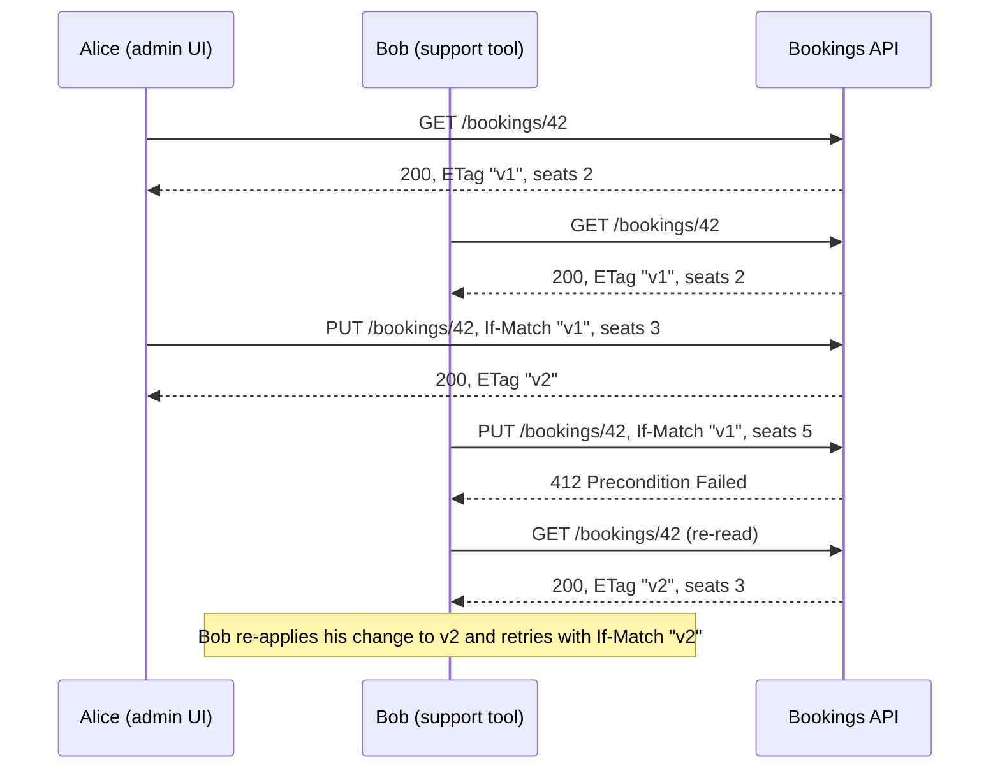
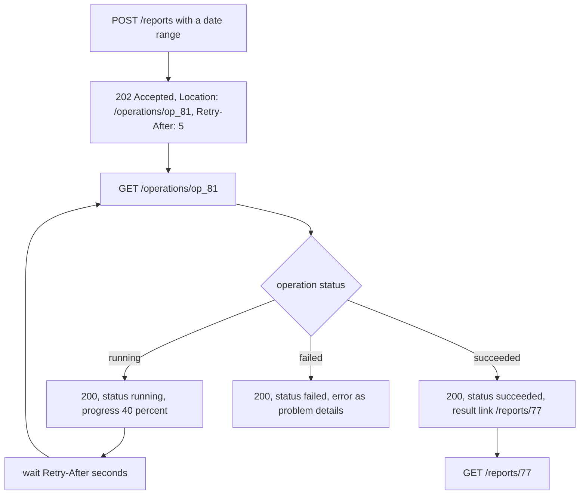
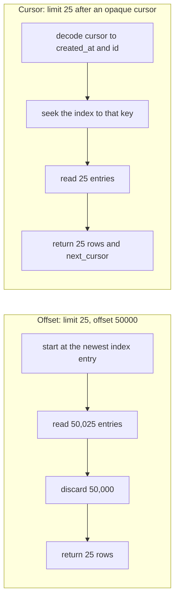
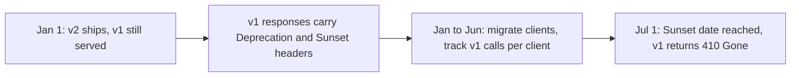
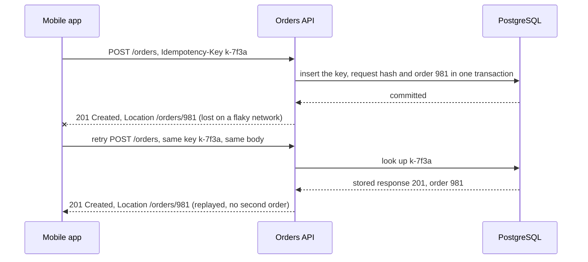

# REST and HTTP API Design

> [!summary] TL;DR
> REST is a way to design an API as a set of **resources** (things with URLs, like `/orders/42`) that clients read and change with the standard **HTTP methods** (`GET`, `POST`, `PUT`, `PATCH`, `DELETE`), getting back standard **status codes**. Good REST design is mostly about naming resources well and using HTTP's built-in meaning (safe and idempotent methods, conditional requests, caching) instead of inventing your own.

## 1. Why it exists

Imagine an API that grew without rules:

```text
POST /getUsers                  {"page": 3}
POST /api/v3/getAllProducts
POST /updateBookingSeats        {"bookingId": 42, "seats": 3}
200 OK                          {"error": "booking not found"}
```

Every endpoint is a `POST`, so nothing can be cached and nothing can be retried safely. Every error is a `200`, so load balancers, dashboards and client libraries think everything works. Each new client must read the docs for every endpoint, because nothing follows a pattern.

REST replaces those private conventions with shared ones that HTTP already defines. `GET /bookings/42` is safe to retry and can be cached by a CDN (content delivery network: a fleet of caches close to users). `404` means the same thing to every client, proxy and monitoring tool. When two support agents edit the same booking, HTTP's conditional requests stop one from silently overwriting the other.

## 2. Mental model

A REST API is a **library catalogue**:

- Every book has a **shelf address** (the URL). The address names a thing, never an action: `/products`, not `/getAllProducts`.
- You do a small, fixed set of things to any book: look at it (`GET`), add a new one (`POST`), replace it (`PUT`), amend it (`PATCH`), remove it (`DELETE`).
- What you carry away is a **copy** in some format (JSON, CSV): the **representation**, not the book itself.
- The librarian keeps no memory of you between visits; you show your card every time (**statelessness**).

## 3. How it works

### The REST constraints

Roy Fielding defined REST in his 2000 dissertation as a set of constraints. Each one buys a property:

| Constraint | Meaning | What it buys |
| --- | --- | --- |
| Client-server | UI and data storage are separate | Each side evolves on its own |
| Stateless | Each request carries everything needed, including credentials; the server keeps no session between requests | Any instance can serve any request, so you scale by adding instances |
| Cacheable | Responses say whether and how long they may be cached | CDNs and browsers absorb read traffic |
| Uniform interface | Resources have identifiers; clients change them through representations; messages are self-descriptive; hypermedia drives state (HATEOAS) | Generic clients, proxies and tools work with every API |
| Layered system | A client cannot tell whether it talks to the origin or a gateway or CDN | You can insert caches, gateways and load balancers freely |
| Code on demand (optional) | The server may send code to run, such as JavaScript | Rarely used in JSON APIs |

**Richardson maturity model.** A quick way to grade how much of HTTP an API uses:

| Level | What the API does | Example |
| --- | --- | --- |
| 0 | One URL, one method, the action in the body (RPC over HTTP) | `POST /api` with `{"action": "getUser", "id": 42}`, or `POST /getUsers` |
| 1 | Separate URLs per resource, still one method | `POST /users/42` for both reads and writes |
| 2 | Proper methods and status codes | `GET /users/42` → `200` or `404` |
| 3 | Hypermedia: responses link to the next allowed actions | an order includes a `cancel` link only while it can be cancelled |

Most good public APIs sit at level 2 and borrow one idea from level 3: links for pagination (`next`) and `Location` headers for new resources.

### Resources and URLs

- **Plural nouns for collections, an ID for an item:** `/products` and `/products/{id}`. Never verbs: `/api/v3/products` is right, `/api/v3/getAllProducts` is wrong.
- **Sub-resources show ownership, one level deep:** `/users/{id}/addresses`. Stop at one level, two at most.
- **Prefer filters to deep nesting.** `/posts/{postId}/comments/{commentId}/likes` couples clients to a hierarchy. Give comments a top-level home and filter: `/comments?post_id=7`. Each resource gets **one canonical URL**.
- **Lowercase, hyphens or one consistent casing, no file extensions:** `/order-items`, not `/OrderItems.json`.

### Where each piece of data goes

| Place | Carries | Example |
| --- | --- | --- |
| Path | Which resource | `/users/42/orders` |
| Query | How to view a collection: filter, sort, page, sparse fields | `?status=paid&sort=-created_at&limit=25&fields=id,total` |
| Body | The representation being created or changed | `{"seats": 3}` on `PUT` or `PATCH` |
| Headers | Metadata about the exchange | `Authorization`, `Accept`, `Content-Type`, `If-Match`, `Idempotency-Key`, `traceparent` |

A body on `GET` has no generally defined meaning in HTTP (RFC 9110), and some servers and proxies reject such requests. If a search needs a large query, use `POST /orders/search`.

### A route table

| Action | Request | Success response |
| --- | --- | --- |
| List | `GET /api/v3/products?limit=25&offset=50` | `200` with a page of items |
| Read one | `GET /api/v3/products/{id}` | `200`, or `404` |
| Create | `POST /api/v3/products` | `201 Created` + `Location: /api/v3/products/981` |
| Replace | `PUT /api/v3/products/{id}` | `200` with the new state, or `204` |
| Partial update | `PATCH /api/v3/products/{id}` | `200` with the new state |
| Delete | `DELETE /api/v3/products/{id}` | `204 No Content` |
| Action that is not CRUD | `POST /api/v3/orders/{id}/cancel` | `200` with the cancelled order, or `409` if already shipped |

### Method semantics

**Safe** means the client asks for no change on the server. **Idempotent** means sending the same request twice has the same effect on server state as sending it once (the response may differ). Both matter because clients, proxies and retry libraries may resend safe and idempotent requests after a timeout.

| Method | Safe | Idempotent | Cacheable | Typical use |
| --- | --- | --- | --- | --- |
| `GET` | yes | yes | yes | Read |
| `HEAD` | yes | yes | yes | Read headers only |
| `OPTIONS` | yes | yes | no | Capabilities, CORS preflight |
| `PUT` | no | **yes** | no | Replace the whole resource, or create at a known URL |
| `DELETE` | no | **yes** | no | Remove |
| `POST` | no | **no** | only with explicit freshness and `Content-Location`; almost never in practice | Create in a collection, actions |
| `PATCH` | no | **not necessarily** | same rule as `POST` | Partial update |

**`PUT` vs `PATCH`.** `PUT` sends the complete new representation: a missing field is reset. `PATCH` sends a patch document in one of two standard formats:

- **JSON Merge Patch** (RFC 7396, `application/merge-patch+json`): send the fields to change, `{"seats": 3}`. A `null` deletes a field, so you cannot set a field to `null`, and arrays are replaced whole.
- **JSON Patch** (RFC 6902, `application/json-patch+json`): a list of operations, applied atomically: `[{"op": "test", "path": "/status", "value": "PENDING"}, {"op": "replace", "path": "/seats", "value": 3}]`. The `test` operation turns it into a conditional update.

### Status codes that matter

| Code | Use it when | Common mistake |
| --- | --- | --- |
| `200 OK` | A read or update succeeded and returns a body | Returning `200` with an error inside |
| `201 Created` | A `POST` (or `PUT`) created a resource; add `Location` | Returning `200` and no URL |
| `202 Accepted` | Work was queued; return where to check progress | Using it when the work already finished |
| `204 No Content` | Success with no body (`DELETE`) | Sending a body anyway |
| `301` / `308` | The resource moved for good (`308` keeps the method) | `301` on a `POST` makes many clients switch to `GET` |
| `304 Not Modified` | A conditional `GET` matched; the cached copy is still valid | Forgetting to resend `ETag` and `Cache-Control` |
| `400 Bad Request` | The request cannot be parsed: broken JSON, wrong types | |
| `422 Unprocessable Content` | Well-formed but invalid: `seats: 99` | Mixing `400` and `422` randomly; pick one rule and document it |
| `401 Unauthorized` | No valid credentials; send `WWW-Authenticate` | Using it for "logged in but not allowed" |
| `403 Forbidden` | Authenticated, but not allowed | Leaking that a private resource exists (use `404`) |
| `404 Not Found` / `410 Gone` | Does not exist / existed and was removed for good | |
| `409 Conflict` | The request conflicts with current state: already cancelled, duplicate unique key | |
| `412 Precondition Failed` | An `If-Match` or `If-Unmodified-Since` check failed | Answering a failed `If-Match` with `409`, which generic HTTP clients do not tie to the precondition |
| `428 Precondition Required` | The server demands a conditional request | |
| `429 Too Many Requests` | Rate limit hit; add `Retry-After` | No `Retry-After`, so clients retry at once |
| `500` | A bug or unexpected failure in this service | Including a stack trace |
| `502` / `504` | An upstream returned garbage / did not answer in time | |
| `503 Service Unavailable` | Overloaded or in maintenance; add `Retry-After` | |

Errors carry a machine-readable body, normally `application/problem+json` (RFC 9457). The format, codes and Go mapping are in [[API Error Handling]].

### Conditional requests

An **ETag** is a version label for a representation, sent in a response header. Clients send it back in two ways:

- `If-None-Match: "v1"` on `GET`: "send the body only if it changed". The server answers `304 Not Modified` with no body. This is cache revalidation (see [[HTTP Caching - Cache-Control, ETag, Conditional Requests]]).
- `If-Match: "v1"` on `PUT`, `PATCH` or `DELETE`: "apply this only if nobody changed it since I read v1". A mismatch gets `412 Precondition Failed`. This is **optimistic concurrency**, and it prevents the **lost update**:



Without `If-Match`, Bob's `PUT` would win and Alice's change would vanish without an error. In the database this is a version column (see [[Locking - Optimistic vs Pessimistic]]):

```sql
-- PostgreSQL 17: the WHERE clause is the If-Match check
UPDATE bookings
SET seats = $2, status = $3, version = version + 1
WHERE id = $1 AND version = $4
RETURNING version;
-- 0 rows: either no booking 42 (404) or the version moved on (412)
```

### Content negotiation

The client says what it accepts, and the server picks:

- `Accept: text/csv` on `GET /reports/77` gets CSV. `Accept-Language` and `Accept-Encoding` work the same way.
- The response names what it chose in `Content-Type` and lists the request headers it depended on in `Vary: Accept`, so caches store one copy per format.
- `406 Not Acceptable` when no format matches; `415 Unsupported Media Type` when the request body's `Content-Type` is not supported.

### Long-running operations

Some requests take minutes: a report export, a bulk import, a refund across banks. Holding the HTTP request open for that long hits load balancer timeouts. Return `202 Accepted` with an **operation resource** instead:



The operation itself is a resource, so `GET /operations/op_81` returns `200` even when the job failed: the request to read the status succeeded. RFC 9110 gives `Location` and `Retry-After` no defined meaning on a `202`; using them to point at the status monitor is a common convention (Azure names its header `Operation-Location`), so document it in the contract. Clients that cannot poll can register a webhook instead (see [[Webhooks - Sending and Receiving]]).

### Bulk endpoints

Creating 500 items with 500 requests costs 500 round trips. A bulk endpoint takes a capped list:

- `POST /products:batchCreate` (Google's custom-method style) or `POST /products/batch`, with a hard limit such as 100 items.
- Decide and document **atomic** (all or nothing, one transaction) or **partial** (a per-item result list with each item's status and error).
- Partial success should still return `200` with per-item results; WebDAV's `207 Multi-Status` exists but is rarely used outside WebDAV.

## 4. Worked example

Optimistic concurrency and cache revalidation in Go 1.24 with only the standard library. The `{id}` path patterns need Go 1.22 or later. An in-memory map stands in for the table; the lock makes the version check and the write one atomic step, exactly as the `UPDATE ... WHERE version = $4` statement does. It passes `go vet` and `go test -race`.

```go
package booking

import (
	"encoding/json"
	"net/http"
	"strconv"
	"strings"
	"sync"
)

// Booking is the representation clients read and replace.
type Booking struct {
	ID     string `json:"id"`
	Seats  int    `json:"seats"`
	Status string `json:"status"`
}

type record struct {
	b       Booking
	version int // bumped on every write; exposed as the ETag
}

// Store is an in-memory stand-in for a table with a version column.
type Store struct {
	mu sync.Mutex
	m  map[string]record
}

func NewStore() *Store { return &Store{m: make(map[string]record)} }

func (s *Store) Put(b Booking) {
	s.mu.Lock()
	defer s.mu.Unlock()
	s.m[b.ID] = record{b: b, version: 1}
}

func etag(version int) string { return `"v` + strconv.Itoa(version) + `"` }

// matches checks a comma-separated If-Match / If-None-Match value.
// strong=true is the If-Match rule: a weak tag (W/"...") never matches.
func matches(header, tag string, strong bool) bool {
	for _, t := range strings.Split(header, ",") {
		t = strings.TrimSpace(t)
		if t == "*" {
			return true
		}
		if !strong {
			t = strings.TrimPrefix(t, "W/")
		}
		if t == tag {
			return true
		}
	}
	return false
}

func (s *Store) Routes() *http.ServeMux {
	mux := http.NewServeMux()
	mux.HandleFunc("GET /bookings/{id}", s.get)
	mux.HandleFunc("PUT /bookings/{id}", s.put)
	return mux
}

func (s *Store) get(w http.ResponseWriter, r *http.Request) {
	s.mu.Lock()
	rec, ok := s.m[r.PathValue("id")]
	s.mu.Unlock()
	if !ok {
		http.Error(w, "booking not found", http.StatusNotFound)
		return
	}
	tag := etag(rec.version)
	w.Header().Set("ETag", tag)
	if inm := r.Header.Get("If-None-Match"); inm != "" && matches(inm, tag, false) {
		w.WriteHeader(http.StatusNotModified) // cache revalidation: no body
		return
	}
	w.Header().Set("Content-Type", "application/json")
	_ = json.NewEncoder(w).Encode(rec.b)
}

func (s *Store) put(w http.ResponseWriter, r *http.Request) {
	ifMatch := r.Header.Get("If-Match")
	if ifMatch == "" {
		http.Error(w, "send If-Match with the ETag you read", http.StatusPreconditionRequired) // 428
		return
	}
	var in Booking
	if err := json.NewDecoder(r.Body).Decode(&in); err != nil {
		http.Error(w, "malformed JSON", http.StatusBadRequest)
		return
	}
	if in.Seats < 1 || in.Seats > 10 {
		http.Error(w, "seats must be 1..10", http.StatusUnprocessableEntity)
		return
	}
	id := r.PathValue("id")
	in.ID = id

	s.mu.Lock() // compare and swap under one lock, like UPDATE ... WHERE version = $n
	rec, ok := s.m[id]
	if !ok {
		s.mu.Unlock()
		http.Error(w, "booking not found", http.StatusNotFound)
		return
	}
	if !matches(ifMatch, etag(rec.version), true) {
		s.mu.Unlock()
		http.Error(w, "booking changed since you read it", http.StatusPreconditionFailed) // 412
		return
	}
	rec = record{b: in, version: rec.version + 1}
	s.m[id] = rec
	s.mu.Unlock()

	w.Header().Set("ETag", etag(rec.version))
	w.Header().Set("Content-Type", "application/json")
	_ = json.NewEncoder(w).Encode(rec.b)
}
```

The tests trace the lost-update story from the diagram, the status-code rules and twenty concurrent writers:

```go
package booking

import (
	"net/http"
	"net/http/httptest"
	"strings"
	"sync"
	"testing"
)

func do(t *testing.T, h http.Handler, method, path, body string, hdr map[string]string) *httptest.ResponseRecorder {
	t.Helper()
	req := httptest.NewRequest(method, path, strings.NewReader(body))
	for k, v := range hdr {
		req.Header.Set(k, v)
	}
	rec := httptest.NewRecorder()
	h.ServeHTTP(rec, req)
	return rec
}

func newServer() http.Handler {
	s := NewStore()
	s.Put(Booking{ID: "42", Seats: 2, Status: "CONFIRMED"})
	return s.Routes()
}

func TestConditionalGet(t *testing.T) {
	h := newServer()
	first := do(t, h, "GET", "/bookings/42", "", nil)
	if first.Code != 200 || first.Header().Get("ETag") != `"v1"` {
		t.Fatalf("got %d etag %q", first.Code, first.Header().Get("ETag"))
	}
	again := do(t, h, "GET", "/bookings/42", "", map[string]string{"If-None-Match": `"v1"`})
	if again.Code != http.StatusNotModified || again.Body.Len() != 0 {
		t.Fatalf("revalidation: got %d with %d body bytes", again.Code, again.Body.Len())
	}
}

func TestLostUpdateIsPrevented(t *testing.T) {
	h := newServer()
	// Alice and Bob both read version 1.
	tag := do(t, h, "GET", "/bookings/42", "", nil).Header().Get("ETag")

	alice := do(t, h, "PUT", "/bookings/42", `{"seats":3,"status":"CONFIRMED"}`, map[string]string{"If-Match": tag})
	if alice.Code != 200 || alice.Header().Get("ETag") != `"v2"` {
		t.Fatalf("alice: got %d etag %q", alice.Code, alice.Header().Get("ETag"))
	}
	bob := do(t, h, "PUT", "/bookings/42", `{"seats":5,"status":"CONFIRMED"}`, map[string]string{"If-Match": tag})
	if bob.Code != http.StatusPreconditionFailed {
		t.Fatalf("bob overwrote alice: got %d, want 412", bob.Code)
	}
	if got := do(t, h, "GET", "/bookings/42", "", nil).Body.String(); !strings.Contains(got, `"seats":3`) {
		t.Fatalf("alice's write was lost: %s", got)
	}
}

func TestStatusCodes(t *testing.T) {
	h := newServer()
	cases := []struct {
		name, body string
		hdr        map[string]string
		want       int
	}{
		{"no If-Match", `{"seats":3}`, nil, http.StatusPreconditionRequired},
		{"weak tag never matches If-Match", `{"seats":3}`, map[string]string{"If-Match": `W/"v1"`}, http.StatusPreconditionFailed},
		{"malformed JSON", `{"seats":`, map[string]string{"If-Match": `"v1"`}, http.StatusBadRequest},
		{"valid JSON, invalid value", `{"seats":99}`, map[string]string{"If-Match": `"v1"`}, http.StatusUnprocessableEntity},
	}
	for _, c := range cases {
		if got := do(t, h, "PUT", "/bookings/42", c.body, c.hdr).Code; got != c.want {
			t.Errorf("%s: got %d, want %d", c.name, got, c.want)
		}
	}
	if got := do(t, h, "DELETE", "/bookings/42", "", nil).Code; got != http.StatusMethodNotAllowed {
		t.Errorf("DELETE: got %d, want 405", got)
	}
}

func TestConcurrentWritersExactlyOneWins(t *testing.T) {
	h := newServer()
	var wg sync.WaitGroup
	codes := make(chan int, 20)
	for i := 0; i < 20; i++ {
		wg.Add(1)
		go func() {
			defer wg.Done()
			codes <- do(t, h, "PUT", "/bookings/42", `{"seats":4,"status":"CONFIRMED"}`, map[string]string{"If-Match": `"v1"`}).Code
		}()
	}
	wg.Wait()
	close(codes)
	wins := 0
	for c := range codes {
		if c == 200 {
			wins++
		} else if c != http.StatusPreconditionFailed {
			t.Fatalf("unexpected status %d", c)
		}
	}
	if wins != 1 {
		t.Fatalf("%d writers won with the same If-Match, want exactly 1", wins)
	}
}
```

Result (measured with `go test -race -count=1`, Go 1.24.4, 2026-11-02): all 4 tests pass. Of 20 concurrent `PUT`s carrying `If-Match: "v1"`, exactly one gets `200` and 19 get `412`.

## 5. Variants and comparison

**Collections: pagination, filtering, sorting.** Any collection can grow without bound, so every list endpoint pages from day one. Full design is in [[Pagination, Filtering and Sorting]]; the core choice:

| Option | Request | How the database serves it | Use when | Cost |
| --- | --- | --- | --- | --- |
| Offset | `?limit=25&offset=50` | `LIMIT 25 OFFSET 50`: reads and discards `offset` rows first | Small tables, admin screens that jump to page N | Slow at deep offsets; rows inserted between pages cause duplicates or skips |
| Cursor (keyset) | `?limit=25&cursor=eyJ0Ijo...` | `WHERE (created_at, id) < ($1, $2) ORDER BY created_at DESC, id DESC LIMIT 25` on an index | Feeds, public APIs, large tables | No "jump to page 40"; the sort must be on indexed, unique columns |
| Total count | `"total": 1204331` | `count(*)` over every matching row | Small filtered sets | Visits every matching row on each request, which is slow on big tables; prefer `has_more` |



The cursor is **opaque** by contract: for example, base64 of the last row's sort key. Base64 hides nothing, so a client could decode and edit it; the contract says clients must not, which lets you change its contents later. Sign or encrypt the cursor if you need to enforce that.

**Versioning and deprecation.** Additive changes (a new optional field, a new endpoint) need no new version, as long as clients ignore unknown fields. Breaking changes (removing or renaming a field, changing a type, making an optional field required, changing a status code) need one. Details and policies live in [[API Versioning and Backward Compatibility]].

| Option | Example | Use when | Cost |
| --- | --- | --- | --- |
| URI | `/v1/products` → `/v2/products` | Public APIs; easy to route, log and test in a browser | The URL of "the same" product changes |
| Header | `Api-Version: 2`, or date versions like Stripe's `Stripe-Version` | Many small versions; one stable URL | Invisible in logs and links unless you record it |
| Media type | `Accept: application/vnd.example.v2+json` | Purist REST, per-representation versions | Hard to test by hand; caches need `Vary: Accept` |



A deprecated response announces the plan in standard headers: `Deprecation: @1767225600` (RFC 9745, a Unix timestamp), `Sunset: Wed, 01 Jul 2026 00:00:00 GMT` (RFC 8594) and `Link: <https://api.example.com/docs/v2-migration>; rel="deprecation"`.

**Retries that create things.** `POST` is not idempotent, so a retry after a lost response can create a second order. The fix is an `Idempotency-Key` header: the server stores the first response under the key and replays it (see [[Idempotency and Idempotency Keys]]):



The IETF draft for this header answers `409` while the first request with that key is still running, and `422` when a key is reused with a different body.

**When another style fits better:** server push (SSE, WebSocket), many client shapes (GraphQL or a BFF), internal high-rate calls (gRPC). See [[Choosing an API Style]].

## 6. Trade-offs and when not to use

- **Chatty clients.** A mobile screen that needs a user, their orders and each order's items makes `1 + 1 + N` calls. Use sparse fields and embedding (`?expand=items`), a BFF, or GraphQL.
- **Actions do not fit CRUD.** "Cancel", "refund", "resend email" have side effects beyond a field change. Model them as `POST /orders/{id}/cancel` (Google's AIP-136 writes `POST /v1/orders/42:cancel`) instead of pretending with `PATCH {"status": "CANCELLED"}`, which hides the refund and notification behind a field write.
- **Strict HATEOAS rarely pays off** for JSON APIs: clients are written against documentation and generated SDKs, not discovered links. Keep the cheap parts: `Location`, `next` links and `Link` headers (RFC 8288).
- **HTTP caching needs discipline.** Personalised responses must be `Cache-Control: private` or `no-store`, and responses that vary by language or format must send `Vary`, or a CDN will serve one user's data to another.
- **REST is not the best internal RPC.** Text JSON and per-request HTTP overhead add up at thousands of calls per second between services, where gRPC is a better fit.

## 7. In production

- **Real systems:**
	- **GitHub's REST API** returns `ETag` headers; a conditional request that gets `304` does not count against the primary rate limit, provided it was sent with a valid `Authorization` header. It returns `404` instead of `403` for private repositories, so their existence does not leak.
	- **Stripe** accepts an `Idempotency-Key` on `POST` requests and replays the saved result for retries; keys can be removed once they are at least 24 hours old.
	- **Kubernetes** does optimistic concurrency with `resourceVersion`, but answers a stale update with `409 Conflict`, not `412`. The version travels in the object's `metadata.resourceVersion` field in the body, not in an `If-Match` header.
	- **Azure** APIs return `202` with an `Operation-Location` header for long-running operations; **Google** returns an `Operation` resource (AIP-151).
- **Failure modes → fixes:**
	- Lost updates when two people edit the same record → `ETag` + `If-Match`, backed by a version column; return `428` when `If-Match` is missing.
	- Duplicate orders from mobile retries → `Idempotency-Key` on every creating `POST`.
	- List endpoints slow down as data grows → keyset pagination and a capped `limit` (for example 100).
	- Retry storms after an outage → `429` or `503` with `Retry-After`, and jittered backoff in clients (see [[Timeouts, Retries and Backoff]] and [[Rate Limiting - Algorithms and Distributed Design]]).
	- A CDN serves English to French users → `Vary: Accept-Language`, or put the language in the URL.
- **What to monitor:**
	- Status codes per route, split into 4xx and 5xx. A rise in `412` or `409` means contention on hot records.
	- `429` per client, and calls to deprecated versions per client (who must migrate before the sunset date).
	- p99 latency per route, response size, and the `limit` values clients actually send.

## 8. Deep dive

- **Idempotent does not mean "same response".** The first `DELETE /bookings/42` returns `204` and the second returns `404`, yet the server state after both is the same. The guarantee is about effects, which is why retry libraries may resend `PUT` and `DELETE` but not `POST`.
- **Why `PATCH` is not idempotent in general.** A JSON Patch `{"op": "add", "path": "/tags/-", "value": "vip"}` appends to an array on every call. A merge patch that only sets fields is idempotent in practice, but the method does not promise it, so clients cannot assume it.
- **Create-only and update-only `PUT`.** `If-None-Match: *` on `PUT /users/42/avatar` means "create only if nothing exists" and returns `412` if something does. `If-Match: *` means "update only if it exists". A client sends one or the other, so a `PUT` with a client-chosen ID never silently overwrites (create-only) or silently creates (update-only).
- **Strong and weak ETags.** `W/"v1"` is a weak tag: the representations are equivalent but maybe not byte-identical. `If-None-Match` uses weak comparison, so weak tags are fine for revalidation. `If-Match` uses strong comparison, so a weak tag never matches (the Go test above checks this). Proxies that compress on the fly may weaken strong ETags (nginx's gzip module turns `"v1"` into `W/"v1"`), so clients that echo the weak tag in `If-Match` get `412` on every write.
- **How to build ETags.** A version column is cheapest: no need to render the body to compare. Hashing the rendered body works for any resource but costs the full render. The tag must change whenever anything that shapes the representation changes, including `?fields=` and language, or clients get the wrong `304`.
- **What a `304` must carry.** It has no body but must repeat headers a `200` would have sent, such as `ETag`, `Cache-Control`, `Vary` and `Expires`, so caches can refresh their stored metadata.
- **Statelessness and sessions.** Fielding's constraint puts session state on the client. A server-side session store reached through a cookie technically breaks it but scales fine if the store is shared. The practical rule: no request depends on which instance served the previous one.
- **400 vs 422.** RFC 9110 defines `422 Unprocessable Content` for syntactically valid but semantically wrong content. Google's AIP style uses `400 INVALID_ARGUMENT` for both. Either works if the API applies one rule everywhere and puts field errors in the body.

## 9. Interview questions

> [!question]- Trap: is `PATCH` idempotent?
> Not necessarily. RFC 5789 does not require it. A JSON Patch `add` to the end of an array appends again on every retry. A merge patch that only sets fields happens to be idempotent, but clients cannot rely on that, so retried `PATCH`es need `If-Match` or an idempotency key.

> [!question]- The second `DELETE` of a resource returns `404`. Is `DELETE` still idempotent?
> Yes. Idempotency is about the effect on server state, not the response. After one or two `DELETE`s the resource is gone either way. Some APIs return `204` both times to make client retries simpler; both are correct.

> [!question]- Two admins edit the same product at the same time. How does your API stop one from overwriting the other?
> Return an `ETag` on `GET`, require `If-Match` on `PUT` and `PATCH` (`428` if missing), and answer `412` when the tag is stale. In the database, `UPDATE ... WHERE id = $1 AND version = $2`, and zero rows updated means conflict. The losing client re-reads and re-applies its change.

> [!question]- `401` vs `403`, and `400` vs `422`?
> `401` means "no valid credentials" and must send `WWW-Authenticate`. `403` means "I know who you are and you may not do this". Return `404` instead of `403` when even revealing existence is a leak. `400` is for requests that cannot be parsed, `422` for parsed but invalid content. Pick one rule and apply it everywhere.

> [!question]- Design the endpoint to cancel an order.
> `POST /orders/{id}/cancel`, optionally with a reason in the body. It returns `200` with the cancelled order, or `409` if the order already shipped. A custom action is clearer than `PATCH {"status": "CANCELLED"}` because cancelling triggers a refund and notifications. Accept an `Idempotency-Key` so a retried cancel is safe.

> [!question]- A report export takes three minutes. What does the API look like?
> `POST /reports` returns `202 Accepted` with `Location: /operations/{id}` and `Retry-After`. The client polls the operation, which reports `running`, `succeeded` with a link to `/reports/{id}`, or `failed` with problem details. Offer a webhook for clients that would rather not poll.

> [!question]- Why does `?offset=100000` get slow, and what do you do instead?
> The database must walk and discard 100,000 rows before returning the page, so cost grows with depth, and inserts between pages shift rows into duplicates or gaps. Use keyset pagination: an opaque cursor holding the last `(created_at, id)`, and `WHERE (created_at, id) < (...)` on a matching index.

> [!question]- Which Richardson level is your API, and do you need HATEOAS?
> Most production APIs are level 2: resources, proper methods and status codes. Full level 3 helps when generic clients must discover workflows, which is rare. Use the cheap hypermedia parts: `Location` on `201`, `next` links for pages, links for allowed actions where the UI needs them.

## 10. Cheat sheet

- Nouns, plural, one canonical URL per resource; nest one level; filter instead of deep nesting.
- Path = which resource, query = how to view the collection, body = the representation, headers = metadata.
- Safe: `GET`, `HEAD`, `OPTIONS`. Idempotent: those plus `PUT`, `DELETE`. Not idempotent: `POST`, and `PATCH` by default.
- `201` + `Location`, `202` + operation resource, `204` for no body, `412` for a failed `If-Match`, `429` and `503` with `Retry-After`.
- `ETag` + `If-None-Match` → `304` (caching). `ETag` + `If-Match` → `412` (no lost updates).
- Non-CRUD actions are `POST /resource/{id}/action`; long jobs are `202` + `/operations/{id}`.
- Page with opaque cursors; avoid deep offsets and exact totals on big tables.
- Additive changes need no new version; breaking ones do. Announce removals with `Deprecation` and `Sunset`.

## Links

- **Before this:** [[HTTP Fundamentals - Methods, Status Codes, Headers, Cookies]], [[Choosing an API Style]]
- **Next:** [[API Contract Design and OpenAPI]], [[API Error Handling]], [[Pagination, Filtering and Sorting]], [[API Versioning and Backward Compatibility]], [[Idempotency and Idempotency Keys]]
- **Compare with:** [[GraphQL]], [[gRPC]], [[HTTP Caching - Cache-Control, ETag, Conditional Requests]]
- **Build it in Go:** [[Building REST Endpoints]]
