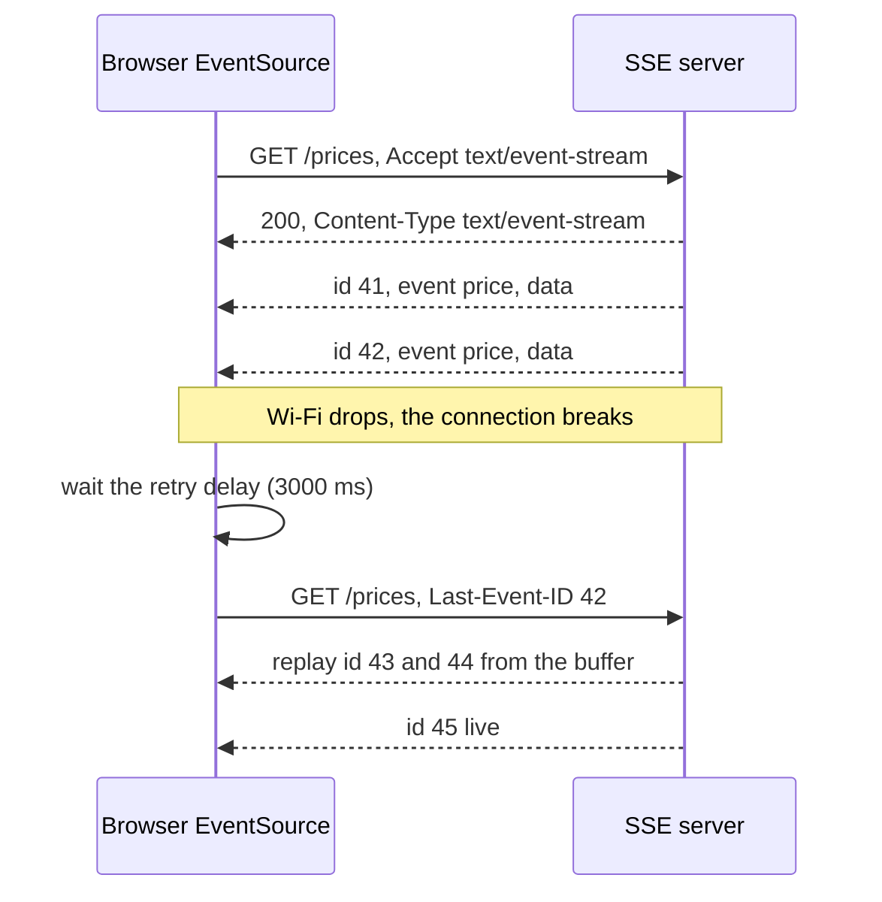
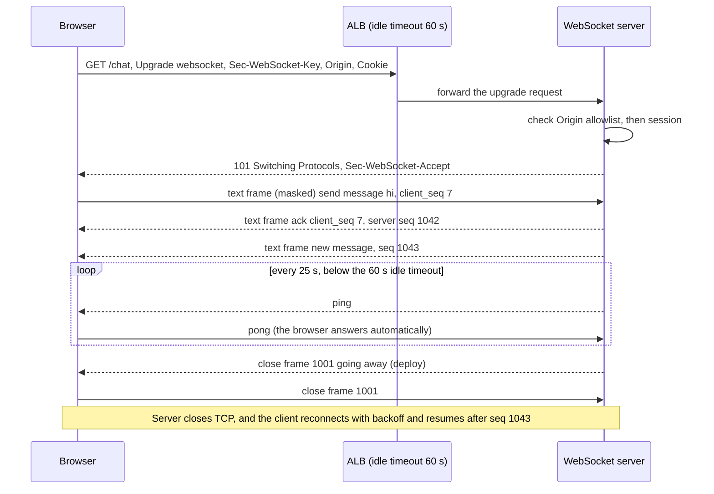
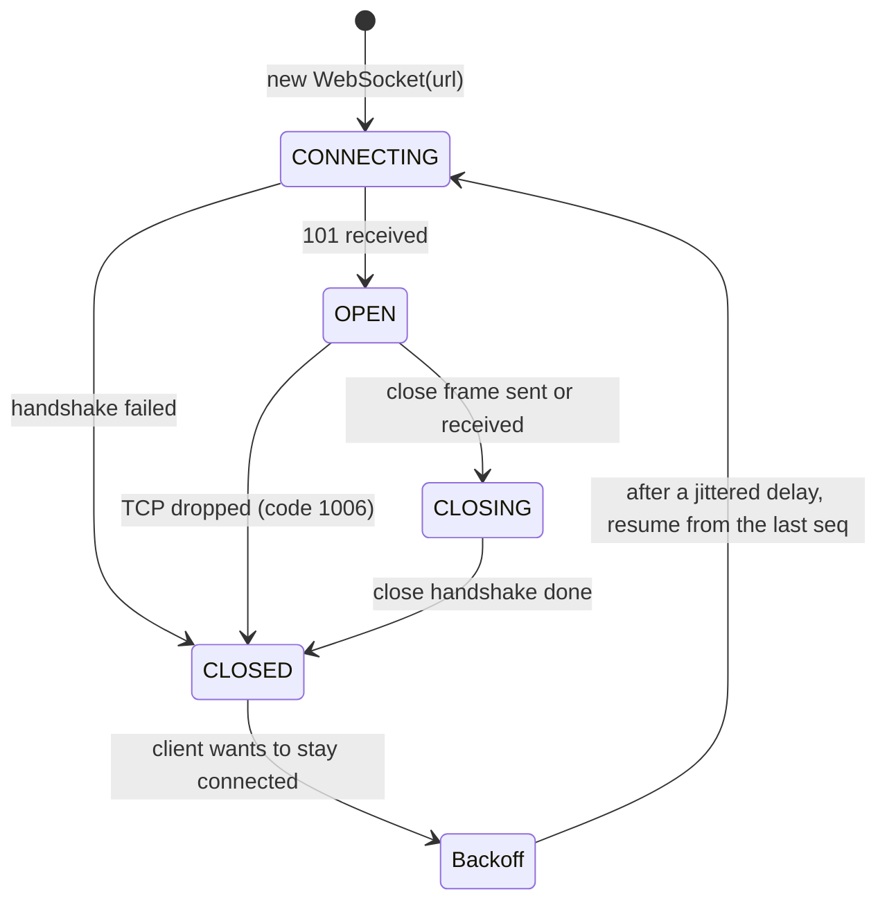
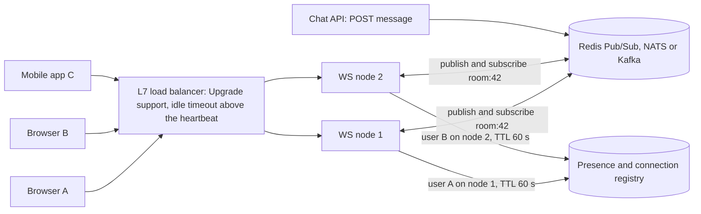

# Real-time APIs - WebSocket, SSE and Long Polling

> [!summary] TL;DR
> Plain HTTP only answers when the client asks. Real-time APIs let the **backend push to the frontend without a new request**, because a connection stays open. **Long polling** holds a request open until there is news; **Server-Sent Events (SSE)** keep one HTTP response open and stream events down it; a **WebSocket** upgrades the connection into a two-way message channel.

> [!abstract] Core idea
> - Plain HTTP only answers when asked; real-time APIs keep a connection open so the server can push.
> - Long polling holds a request until there is news; SSE streams events down one HTTP response; WebSocket is a two-way channel.
> - Rule: pick SSE for server-to-client updates, WebSocket only when the client also sends often.
> - Classic mistake: no heartbeats, no resume after reconnect, and unbounded buffers for slow clients.

## 1. Why it exists

A trading screen shows prices that change several times a second. With plain request/response the browser has to ask.

- **Short polling** every 5 s: on average a change waits 2.5 s before the next poll sees it. 100,000 open screens make 100,000 / 5 = **20,000 requests per second**, and most return "nothing new". Each one carries full HTTP headers, often 500 bytes to 1 KB with cookies (an estimate).
- **A pushed update** arrives one network delay after it happens, and costs a few bytes of framing on a connection that already exists.

The same problem appears in chat, notifications, live dashboards, collaborative editing, multiplayer games and streaming LLM output.

## 2. Mental model

- **Short polling:** you call the shop every five minutes to ask "is my order ready?".
- **Long polling:** you call once, and the clerk stays on the line until the order is ready, then hangs up. You call again right away.
- **SSE:** the shop keeps a one-way radio channel open to you and announces updates. If the signal drops, your radio retunes automatically and asks for "everything after announcement 41".
- **WebSocket:** an open phone line. Both sides talk whenever they want.

## 3. How it works

| | Short polling | Long polling | SSE | WebSocket |
| --- | --- | --- | --- | --- |
| Direction | Client pulls | Client pulls, server answers when ready | Server to client only | Both ways |
| Latency for a new event | Up to the interval (half on average) | About one network delay, plus a reconnect gap | About one network delay | About one network delay |
| Overhead per message | Full HTTP request and response | Full HTTP request and response | A few bytes (`data:` line) | 2–14 bytes of frame header |
| Transport | Plain HTTP | Plain HTTP | Plain HTTP response, `text/event-stream` | HTTP/1.1 `Upgrade`, then its own framing |
| Proxies and firewalls | Always fine | Fine; watch proxy timeouts | Fine if proxies do not buffer | Needs `Upgrade` support and long idle timeouts |
| Reconnect and resume | Not needed | Client re-requests with a cursor | Built into the browser (`Last-Event-ID`) | Hand-written |
| Binary data | Yes | Yes | No (UTF-8 text) | Yes |

### Long polling

1. The client sends `GET /updates?after=41`.
2. The server holds the request until an event after 41 exists, or until a timeout (for example 25 s, shorter than every proxy timeout on the path).
3. It answers with the events (or an empty `200`), and the client immediately sends `GET /updates?after=<last id>`.

The cursor makes it lossless: events that arrive between two requests are picked up by the next one. Real uses: the Telegram Bot API's `getUpdates` with a `timeout`, and Amazon SQS `ReceiveMessage` with `WaitTimeSeconds` up to 20 s. Long polling works everywhere plain HTTP works, which is why it survives as a fallback.

### Server-Sent Events

The browser's `EventSource` sends a `GET`. The server answers `200` with `Content-Type: text/event-stream` and never finishes the response. Each event is a block of `field: value` lines ended by a blank line:

```text
retry: 3000

id: 42
event: price
data: {"symbol":"AAPL","priceMicros":187420000}

: ping

```

- `data` is the payload; several `data:` lines are joined with newlines. `event` picks the listener (`addEventListener("price", ...)`). A line starting with `:` is a comment, which makes a cheap heartbeat.
- `id` sets the stream position. When the connection drops, the browser **reconnects by itself** after the `retry` delay (milliseconds) and sends the header `Last-Event-ID: 42`. The server replays everything after 42.
- A `204 No Content` response, any other status than 200 (after redirects), or a `Content-Type` other than `text/event-stream` tells the browser to stop reconnecting. A dropped connection, or the server ending a 200 stream normally, triggers the automatic reconnect.
- **Connection limit:** over HTTP/1.1, browsers allow about **6 connections per domain**, shared by all tabs. Six tabs with one SSE stream each block every other request to that domain. Over HTTP/2, all streams share one connection, so serve SSE over HTTP/2.
- `EventSource` cannot set request headers, so no `Authorization: Bearer`. Use a cookie (sent automatically to the same origin; a cross-origin stream needs `withCredentials: true` and matching CORS headers), or a fetch-based SSE client.



### WebSocket

**The handshake** is an ordinary HTTP/1.1 request that asks to switch protocols:

```http
GET /chat HTTP/1.1
Host: app.example.com
Upgrade: websocket
Connection: Upgrade
Sec-WebSocket-Key: dGhlIHNhbXBsZSBub25jZQ==
Sec-WebSocket-Version: 13
Origin: https://app.example.com
Cookie: session=...

HTTP/1.1 101 Switching Protocols
Upgrade: websocket
Connection: Upgrade
Sec-WebSocket-Accept: s3pPLMBiTxaQ9kYGzzhZRbK+xOo=
```

- `Sec-WebSocket-Accept` = base64(SHA-1(`Sec-WebSocket-Key` + the fixed GUID `258EAFA5-E914-47DA-95CA-C5AB0DC85B11`)). It proves the server really speaks WebSocket and is not a cache or a plain HTTP server echoing headers. It is **not** authentication. The pair above is the example from RFC 6455, and the Go test in section 4 reproduces it.
- After `101`, the same TCP connection carries WebSocket **frames** instead of HTTP.

**Frames:**

- Each frame has a FIN bit, a 4-bit **opcode**, a mask bit, a payload length (7 bits, or 16 or 64 bits for larger payloads) and, from clients, a 4-byte masking key.
- Opcodes: `0x1` text (must be UTF-8), `0x2` binary, `0x0` continuation, and the control frames `0x8` close, `0x9` ping and `0xA` pong.
- **Client-to-server frames must be masked**, and server-to-client frames must not be. Masking XORs the payload with a random key so that a malicious page cannot make the bytes look like a valid HTTP request to a confused intermediary (a cache-poisoning attack). It is not encryption; use `wss://` (TLS) for that.
- **Fragmentation:** a large message can be split into a first frame (FIN=0), continuation frames, and a final frame (FIN=1). Control frames carry at most 125 bytes, are never fragmented, and may be sent between fragments, so a ping is not stuck behind a 50 MB message.
- **Close codes:** `1000` normal closure, `1001` going away (server shutdown or page navigation), `1008` policy violation (for example a failed auth check), `1009` message too big, `1011` server internal error. `1006` is never sent on the wire: it is what the API reports when the connection died **without** a close frame, such as a network drop or an idle timeout.





`CONNECTING`, `OPEN`, `CLOSING` and `CLOSED` are the browser's `readyState` values 0 to 3. The backoff state is application code.

**Over HTTP/2 and HTTP/3**, WebSockets use extended `CONNECT` (RFC 8441 and RFC 9220) so one connection can carry many sockets. Most deployments still upgrade over HTTP/1.1.

## 4. Worked example

### Whiteboard version

The bare SSE endpoint: set `text/event-stream`, write `id:` and `data:` lines, flush, stop when the client leaves. The full version below adds resume with `Last-Event-ID`, a replay buffer, slow-consumer limits and heartbeats.

```go
package main

import (
	"fmt"
	"net/http"
	"time"
)

func events(w http.ResponseWriter, r *http.Request) {
	w.Header().Set("Content-Type", "text/event-stream")
	w.Header().Set("Cache-Control", "no-cache")
	flusher, ok := w.(http.Flusher)
	if !ok {
		http.Error(w, "streaming unsupported", http.StatusInternalServerError)
		return
	}
	for i := 1; ; i++ {
		select {
		case <-r.Context().Done(): // client went away
			return
		case <-time.After(time.Second):
			fmt.Fprintf(w, "id: %d\ndata: tick %d\n\n", i, i) // blank line ends an event
			flusher.Flush()
		}
	}
}

func main() { http.HandleFunc("/events", events); http.ListenAndServe(":8080", nil) }
```

### Full version

An SSE hub in Go 1.24 with the standard library. It shows four design points: resume with `Last-Event-ID`, a replay buffer, a bounded per-client buffer that disconnects slow consumers, and heartbeat comments. The file also computes `Sec-WebSocket-Accept`. It compiles and passes `go vet` and `go test -race` on Go 1.24.4, using `net/http/httptest` for real HTTP connections.

```go
// Package live is a minimal Server-Sent Events hub: replay for Last-Event-ID,
// a bounded buffer per client, and heartbeats.
package live

import (
	"crypto/sha1"
	"encoding/base64"
	"fmt"
	"net/http"
	"strconv"
	"sync"
	"time"
)

type Event struct {
	ID   uint64
	Name string // SSE "event:" field, dispatched to addEventListener(Name)
	Data string // must be one line; JSON without newlines is
}

// Hub fans events out to subscribers and keeps the newest `keep` events,
// so a reconnecting client can resume where it stopped.
type Hub struct {
	keep      int
	buf       int           // per-client buffer: the slow-consumer limit
	heartbeat time.Duration // must be shorter than every proxy idle timeout

	mu     sync.Mutex
	nextID uint64
	recent []Event // oldest first
	subs   map[chan Event]struct{}
}

func NewHub(keep, perClientBuffer int, heartbeat time.Duration) *Hub {
	return &Hub{keep: keep, buf: perClientBuffer, heartbeat: heartbeat,
		subs: make(map[chan Event]struct{})}
}

// Publish assigns the next ID and never blocks: a subscriber whose buffer is
// full is disconnected, and resumes from its last ID when it reconnects.
func (h *Hub) Publish(name, data string) Event {
	h.mu.Lock()
	defer h.mu.Unlock()
	h.nextID++
	ev := Event{ID: h.nextID, Name: name, Data: data}
	h.recent = append(h.recent, ev)
	if len(h.recent) > h.keep {
		h.recent = h.recent[1:]
	}
	for ch := range h.subs {
		select {
		case ch <- ev:
		default: // slow consumer: drop the connection, not the event
			delete(h.subs, ch)
			close(ch)
		}
	}
	return ev
}

// Subscribe returns the buffered events after lastID and a channel for new
// ones, taken under one lock so nothing falls between replay and live.
// complete is false when events after lastID were already trimmed: the
// client has a gap and must reload its state. lastID 0 means a new client.
func (h *Hub) Subscribe(lastID uint64) (backlog []Event, live chan Event, complete bool) {
	h.mu.Lock()
	defer h.mu.Unlock()
	complete = true
	if lastID > 0 && len(h.recent) > 0 {
		complete = lastID+1 >= h.recent[0].ID
		for _, ev := range h.recent {
			if ev.ID > lastID {
				backlog = append(backlog, ev)
			}
		}
	}
	live = make(chan Event, h.buf)
	h.subs[live] = struct{}{}
	return backlog, live, complete
}

func (h *Hub) Unsubscribe(ch chan Event) {
	h.mu.Lock()
	defer h.mu.Unlock()
	if _, ok := h.subs[ch]; ok {
		delete(h.subs, ch)
		close(ch)
	}
}

// ServeHTTP streams events as text/event-stream.
func (h *Hub) ServeHTTP(w http.ResponseWriter, r *http.Request) {
	lastID, _ := strconv.ParseUint(r.Header.Get("Last-Event-ID"), 10, 64)
	backlog, live, complete := h.Subscribe(lastID)
	defer h.Unsubscribe(live)

	w.Header().Set("Content-Type", "text/event-stream")
	w.Header().Set("Cache-Control", "no-cache")
	rc := http.NewResponseController(w)

	fmt.Fprint(w, "retry: 3000\n\n") // browser reconnect delay, in ms
	if !complete {
		fmt.Fprint(w, "event: reset\ndata: {}\n\n") // gap: client must reload
	}
	for _, ev := range backlog {
		writeEvent(w, ev)
	}
	if err := rc.Flush(); err != nil {
		return
	}

	tick := time.NewTicker(h.heartbeat)
	defer tick.Stop()
	for {
		select {
		case ev, open := <-live:
			if !open {
				return // dropped as a slow consumer; the browser reconnects
			}
			writeEvent(w, ev)
		case <-tick.C:
			fmt.Fprint(w, ": ping\n\n") // comment line: keeps idle timers reset
		case <-r.Context().Done():
			return
		}
		if err := rc.Flush(); err != nil {
			return
		}
	}
}

func writeEvent(w http.ResponseWriter, ev Event) {
	fmt.Fprintf(w, "id: %d\nevent: %s\ndata: %s\n\n", ev.ID, ev.Name, ev.Data)
}

// AcceptKey computes Sec-WebSocket-Accept from the client's Sec-WebSocket-Key
// (RFC 6455): base64(SHA-1(key + fixed GUID)).
func AcceptKey(clientKey string) string {
	const guid = "258EAFA5-E914-47DA-95CA-C5AB0DC85B11"
	sum := sha1.Sum([]byte(clientKey + guid))
	return base64.StdEncoding.EncodeToString(sum[:])
}
```

```go
package live

import (
	"bufio"
	"context"
	"fmt"
	"io"
	"net/http"
	"net/http/httptest"
	"strings"
	"testing"
	"time"
)

// readEvents parses an SSE stream into one field map per dispatched event.
func readEvents(body io.Reader) <-chan map[string]string {
	out := make(chan map[string]string, 16)
	go func() {
		defer close(out)
		sc := bufio.NewScanner(body)
		ev := map[string]string{}
		for sc.Scan() {
			line := sc.Text()
			switch {
			case line == "": // a blank line dispatches the event
				if _, ok := ev["data"]; ok {
					out <- ev
				}
				ev = map[string]string{}
			case strings.HasPrefix(line, ":"): // comment, used as heartbeat
			default:
				k, v, _ := strings.Cut(line, ": ")
				ev[k] = v
			}
		}
	}()
	return out
}

func next(t *testing.T, events <-chan map[string]string) map[string]string {
	t.Helper()
	select {
	case ev := <-events:
		return ev
	case <-time.After(2 * time.Second):
		t.Fatal("timed out waiting for an event")
		return nil
	}
}

func TestResumeWithLastEventID(t *testing.T) {
	hub := NewHub(100, 16, time.Hour)
	srv := httptest.NewServer(hub)
	defer srv.Close()
	for i := 1; i <= 3; i++ {
		hub.Publish("price", fmt.Sprintf(`{"seq":%d}`, i))
	}

	ctx, cancel := context.WithCancel(context.Background())
	defer cancel()
	req, _ := http.NewRequestWithContext(ctx, http.MethodGet, srv.URL, nil)
	req.Header.Set("Last-Event-ID", "1") // what EventSource sends on reconnect
	resp, err := srv.Client().Do(req)
	if err != nil {
		t.Fatal(err)
	}
	defer resp.Body.Close()
	if ct := resp.Header.Get("Content-Type"); ct != "text/event-stream" {
		t.Fatalf("Content-Type = %q", ct)
	}

	events := readEvents(resp.Body)
	for _, want := range []string{"2", "3"} { // replayed from the buffer
		if ev := next(t, events); ev["id"] != want || ev["event"] != "price" {
			t.Fatalf("got %v, want id %s", ev, want)
		}
	}
	hub.Publish("price", `{"seq":4}`) // live, after the replay
	if ev := next(t, events); ev["id"] != "4" || ev["data"] != `{"seq":4}` {
		t.Fatalf("got %v", ev)
	}
}

func TestSlowConsumerIsDisconnectedThenResumes(t *testing.T) {
	hub := NewHub(100, 2, time.Hour)
	_, live, _ := hub.Subscribe(0)
	for i := 0; i < 3; i++ { // the third event does not fit in 2 slots
		hub.Publish("price", "{}")
	}
	got := 0
	for range live { // drains 2 buffered events, then sees the close
		got++
	}
	if got != 2 {
		t.Fatalf("received %d events before disconnect, want 2", got)
	}
	backlog, _, complete := hub.Subscribe(2) // reconnect with Last-Event-ID 2
	if !complete || len(backlog) != 1 || backlog[0].ID != 3 {
		t.Fatalf("backlog = %v, complete = %v", backlog, complete)
	}
}

func TestGapOlderThanBufferIsReported(t *testing.T) {
	hub := NewHub(2, 16, time.Hour) // keeps only the newest 2 events
	for i := 0; i < 5; i++ {
		hub.Publish("price", "{}")
	}
	if _, _, complete := hub.Subscribe(1); complete { // events 2 and 3 are gone
		t.Fatal("complete = true, want false: the client must reload")
	}
}

func TestHeartbeatComment(t *testing.T) {
	hub := NewHub(10, 16, 10*time.Millisecond)
	srv := httptest.NewServer(hub)
	defer srv.Close()
	ctx, cancel := context.WithTimeout(context.Background(), 2*time.Second)
	defer cancel()
	req, _ := http.NewRequestWithContext(ctx, http.MethodGet, srv.URL, nil)
	resp, err := srv.Client().Do(req)
	if err != nil {
		t.Fatal(err)
	}
	defer resp.Body.Close()
	sc := bufio.NewScanner(resp.Body)
	for sc.Scan() {
		if sc.Text() == ": ping" {
			return
		}
	}
	t.Fatal("no heartbeat before the timeout")
}

func TestAcceptKeyRFC6455Example(t *testing.T) {
	if got := AcceptKey("dGhlIHNhbXBsZSBub25jZQ=="); got != "s3pPLMBiTxaQ9kYGzzhZRbK+xOo=" {
		t.Fatalf("AcceptKey = %q", got)
	}
}
```

**What the tests show:**

- A client reconnecting with `Last-Event-ID: 1` receives events 2 and 3 from the buffer, then event 4 live. `Subscribe` takes the backlog and registers the live channel under **one lock**. Doing those as two steps would lose any event published between them.
- A client with a 2-slot buffer that stops reading is **disconnected on the third event**, and the publisher never blocks. On reconnect it asks for "after 2" and gets event 3: nothing is lost while the buffer still covers the gap.
- When the gap is older than the buffer (the client asks for "after 1" but only 4 and 5 remain), the hub reports it, and the handler sends a `reset` event so the client reloads its full state instead of silently missing events.
- RFC 6455's example key produces `s3pPLMBiTxaQ9kYGzzhZRbK+xOo=`.

## 5. Variants and comparison

Side by side, topic by topic:

| Topic | WebSocket | SSE |
| --- | --- | --- |
| Direction | Full duplex | Server to client; client uses normal HTTP requests to send |
| Protocol | Upgrade, then its own frames | Plain HTTP response |
| Data | Text and binary | UTF-8 text only |
| Reconnect and resume | You build it | Built in (`retry`, `Last-Event-ID`) |
| Auth | Cookie or ticket; no custom headers from browsers | Cookie; no custom headers from `EventSource` |
| HTTP/2 multiplexing | Only with RFC 8441 support | Yes, automatically |
| Through proxies and CDNs | Needs `Upgrade` support | Works if buffering is off |
| Fits | Chat, games, collaborative editing | Feeds, notifications, tickers, LLM token streams |

**Choosing:**

| Need | Pick | Why |
| --- | --- | --- |
| Server-to-browser feed, client rarely sends | SSE | Plain HTTP, automatic resume, HTTP/2 multiplexing |
| Frequent messages both ways, or binary data | WebSocket | Full duplex, low framing overhead |
| Hostile networks, or a fallback path | Long polling | Works wherever HTTP works |
| A few updates per minute, simplicity first | Short polling | Stateless and cacheable, no connection management |
| Service-to-service streams | [[gRPC]] streaming | Typed contracts, deadlines, flow control |
| GraphQL clients | GraphQL subscriptions over WebSocket ([[GraphQL]]) | Same schema as queries |

## 6. Trade-offs and when not to use

- **Long-lived connections are state.** Every node now holds thousands of sockets that deploys, autoscaling and load balancers must respect. Polling servers stay stateless.
- **No HTTP caching:** real-time responses bypass CDN caches. If many users see the same slowly changing data, cached polling can be cheaper than fan-out.
- **Mobile apps:** a socket kept open in the background drains the battery, and the OS kills it anyway. Use push notifications (APNs, FCM) for background delivery and a socket only while the app is in front.
- **Do not use WebSocket just for server push.** SSE covers it with less code, and HTTP/2 removes its connection-limit problem.
- **Do not build request/response on top of WebSocket** for ordinary CRUD. You lose status codes, caching, retries and standard tooling, and you rebuild them with message IDs.

## 7. In production

- **Real systems:** Slack delivers real-time events to apps over WebSockets (Socket Mode). Exchanges publish market-data tickers over public WebSocket feeds. Collaborative editors such as Figma sync document changes over WebSockets. LLM APIs from OpenAI and Anthropic stream generated tokens as SSE.

### Authentication on connect

- **Browsers cannot set an `Authorization` header** on a WebSocket or an `EventSource`. That leaves:
	- **A cookie**, sent automatically with the upgrade request. Then you **must check the `Origin` header** against an allowlist. Same-origin policy and CORS do not protect WebSocket handshakes, so without the check any site the user visits can open a socket with their cookie and read their data. This is **cross-site WebSocket hijacking**. `SameSite=Lax` or `Strict` cookies reduce the risk, because browsers do not send them on cross-site handshakes, but not every browser applies `Lax` by default and a sibling subdomain counts as same-site. Check `Origin` anyway. See [[CORS and Same-Origin Policy]] and [[Sessions and Cookies]].
	- **A short-lived ticket:** the client calls an authenticated `POST /ws-ticket`, gets a random single-use ticket valid for about 30 s, and connects to `wss://.../ws?ticket=...`. The server redeems and deletes it. Query strings end up in access logs, which is why the ticket must be short-lived and single-use. A long-lived JWT in the URL is not acceptable.
	- **An auth message** as the first frame. The server closes with `1008` if it does not arrive within a few seconds.
- **Re-auth:** a socket can outlive the token that opened it. Store the token's expiry per connection. Before it passes, ask the client to send a fresh token in-band, or close with an application code (the 4000–4999 range is reserved for applications) so the client reconnects with new credentials. Revoked users must be disconnected actively, because nothing re-checks them otherwise. Token rules are in [[JWT - Structure, Validation and Pitfalls]].

### Heartbeats and idle timeouts

- Every hop has an idle timeout. An AWS Application Load Balancer closes a connection that has carried no data for **60 seconds by default**, and that includes WebSockets. Nginx's `proxy_read_timeout` also defaults to 60 s.
- Send a heartbeat well inside the shortest timeout, for example every 20–30 s. WebSocket servers send **ping** frames, and browsers answer with **pong** automatically. SSE servers send a comment line.
- Browser JavaScript cannot send WebSocket pings. To detect a dead connection from the client side (a phone switching networks often leaves a half-open TCP connection), send an application-level heartbeat message and reconnect when replies stop.
- Proxies must not buffer SSE: disable response buffering for the route (for Nginx, the response header `X-Accel-Buffering: no` or `proxy_buffering off`).

### Reconnect and resume

- **Exponential backoff with full jitter:** wait a random time between 0 and `min(cap, base × 2^attempt)`, for example base 1 s and cap 30 s. After a deploy drops 50,000 sockets at once, jitter spreads the reconnects over seconds instead of one spike.
- **Resume from the last offset:** every event carries a sequence number. The client remembers the last one it processed and sends it on reconnect (`Last-Event-ID` for SSE, a resume message or query parameter for WebSocket). The server replays from a buffer or a durable log (a Redis Stream ID, a Kafka offset). If the gap is too old, tell the client to reload its state, as the `reset` event above does.
- **Graceful deploys:** send close `1001` (or end the SSE response) and let clients reconnect elsewhere. Drain over minutes rather than dropping everyone in one second.

### Scaling, briefly

The full treatment, with capacity numbers, lives in [[Scaling WebSockets]]. The scale-out picture:



- **Per-node limits:** each connection costs a file descriptor (raise `ulimit -n`), kernel socket buffers and per-connection application memory. Tens of kilobytes per connection is a common planning estimate. Measure your own, because buffer sizes dominate.
- **Fan-out:** a message for room 42 must reach members connected to other nodes. Nodes publish to a backplane, and each node forwards to its local members. Redis Pub/Sub is fire-and-forget with no replay. Redis Streams, NATS JetStream or Kafka add replay for resume ([[Redis as a Queue - Lists, Streams and Pub-Sub]]).
- **Connection registry:** a presence store maps user to node with a TTL refreshed by heartbeats. It is used for targeted sends and "online" indicators.
- **Sticky sessions:** a WebSocket is pinned to its node for its whole life anyway. Stickiness across reconnects is needed only when state lives in node memory, or for transports that spread one session over several HTTP requests (long-polling fallbacks). It costs uneven load and slow draining, so prefer shared state and resumable streams.

### Backpressure and slow consumers

- Every connection gets a **bounded send buffer**, such as 64 messages or 1 MB. The fan-out loop must never block on one client.
- When the buffer is full, choose: **drop** (fine for latest-value data such as prices; better, conflate to the newest value per key), or **disconnect** and let the client resume from its last sequence number (the hub above does this).
- Set a write deadline (for example 10 s) on every write, so a stuck TCP peer cannot pin a goroutine and its buffer forever. More patterns are in [[Backpressure and Flow Control]].

### Ordering and delivery guarantees

- TCP keeps messages in order **within one connection**. Nothing is promised across reconnects, and messages in flight when the connection drops are simply lost. WebSocket has no acknowledgements.
- For "at least once", add per-stream sequence numbers, client acks or last-seen IDs, a server replay buffer, and client-side deduplication by sequence number. Exactly-once processing is a separate problem ([[Delivery Semantics and Exactly-Once]]).
- For client-to-server messages, give each a client-generated ID (`client_seq` in the diagram) so a resend after reconnect is idempotent.

### Implementing in Go

Use one **reader goroutine** and one **writer goroutine** per WebSocket connection. `gorilla/websocket` allows at most one concurrent reader and one concurrent writer. `github.com/coder/websocket` allows concurrent writes but still only one reader. With either library, a single writer goroutine is the simplest way to keep a bounded queue per client. The writer goroutine owns every write, including pings, and drains the bounded send channel. The reader goroutine sets read deadlines, extends them on each pong, and exits on error, which cancels the writer. In gorilla, a nil `Upgrader.CheckOrigin` rejects cross-origin handshakes; replacing it with a function that always returns true reopens cross-site WebSocket hijacking for cookie auth. Full handlers are in [[WebSockets and SSE in Go]].

### What to monitor

- Open connections per node and in total, plus connects and disconnects per second. A spike in disconnects means a deploy, a load-balancer timeout or a network problem.
- Close codes, especially the share of `1006` (no clean close).
- Send-buffer drops and slow-consumer disconnects.
- Replay requests, and how many arrived too late for the buffer.
- Delivery lag: event creation time to send time, p99.

## 8. Deep dive

- **Half-open connections:** if a phone loses its network, the server's TCP stack may not learn about it for many minutes. Only heartbeats with a read deadline detect it. Without them, dead connections accumulate along with their buffers and goroutines.
- **Head-of-line blocking:** one WebSocket is one TCP stream. A 5 MB binary message delays every chat message behind it. WebSocket fragmentation does not help here: only control frames (ping, pong, close) may go between the fragments of one message, never another data message. Split large payloads into several application-level chunks (separate messages) with chat messages sent between them, or upload them over HTTP and send only a URL.
- **Compression:** the `permessage-deflate` extension compresses messages but can keep a compression context per connection between messages ("context takeover"). zlib documents about 256 KiB for one deflate stream at default settings, so 100,000 sockets could hold about 25 GB of compressor state (an estimate: 100,000 × 256 KiB). Enable it only for large, compressible messages, or disable context takeover. Compressing secrets alongside attacker-controlled text also enables CRIME-style attacks.
- **Event IDs must survive restarts.** An in-memory counter, like the hub's `nextID`, resets when the process restarts. A client resuming "after 9,000" then gets no replay and no `reset`, because the hub sees no gap, and if it deduplicates by sequence number it discards every new event (IDs 1, 2, 3...) as already seen. Production IDs come from a durable log (a Redis Stream ID, a Kafka offset, or a database sequence), and the replay buffer is that log.
- **Thundering herd on deploy:** draining 50,000 connections in one second makes them all reconnect to the remaining nodes at once, and the newest node gets few of them. Drain in batches, add jitter, and use least-connections balancing for new connections.
- **Ordering across nodes:** two messages for the same room published from different nodes can arrive in different orders at different members. Give each room a single sequencer (one partition key in Kafka, or one Redis Stream) when order matters ([[Message Ordering and Partition Keys]]).

## 9. Interview questions

> [!question]- Trap: every idle WebSocket in production disconnects after exactly 60 seconds. What is going on?
> An intermediary idle timeout, most likely the AWS ALB default of 60 s (or Nginx's 60 s `proxy_read_timeout`). WebSocket traffic does not count as "active" unless bytes flow. Send pings or application heartbeats every 20–30 s, raise the timeouts if needed, and make clients reconnect with jittered backoff anyway.

> [!question]- SSE or WebSocket for a notifications feed?
> SSE. The data flows one way, SSE is plain HTTP, the browser reconnects and resumes with `Last-Event-ID` by itself, and HTTP/2 removes the 6-connection limit. The client sends its rare actions (mark as read) as normal HTTP requests. Choose WebSocket when the client sends frequently or the data is binary.

> [!question]- How do you authenticate a browser WebSocket, and what is cross-site WebSocket hijacking?
> Browsers cannot add an `Authorization` header to the handshake, so use the session cookie plus a strict `Origin` allowlist check, or a short-lived single-use ticket in the URL. Without the Origin check, any site can open a socket that carries the victim's cookie, because same-origin policy and CORS do not apply to WebSocket handshakes.

> [!question]- How does a message reach a user connected to a different node?
> The sending node publishes to a backplane (Redis Pub/Sub, NATS, Kafka) on a topic such as the room or user. Every node subscribed to that topic forwards the message to its local sockets. A presence registry with TTLs tells you which node holds a user, for targeted sends.

> [!question]- One client reads slowly while you broadcast 1,000 messages a second. What do you do?
> Give each connection a bounded send buffer and a write deadline. When the buffer fills, conflate (keep only the newest value per key) for ticker-style data, or disconnect the client and let it resume from its last sequence number. Never let one slow socket block the fan-out loop.

> [!question]- Does WebSocket guarantee delivery and ordering?
> Ordering only within one TCP connection, and no delivery guarantee: messages in flight when it drops are lost, and there are no acks. Add sequence numbers, acks or last-seen IDs on reconnect, a server-side replay buffer, and client deduplication.

> [!question]- Why does long polling still exist?
> It works through every proxy and firewall that passes HTTP, needs no special server support, and with a cursor it loses nothing between requests. Libraries use it as a fallback when WebSockets are blocked. APIs such as Telegram's `getUpdates` and SQS `ReceiveMessage` use it to cut empty responses.

## 10. Cheat sheet

- Short poll = simple but laggy and wasteful; long poll = held request plus a cursor; SSE = one-way HTTP stream; WebSocket = full duplex after `101`.
- Handshake: `Sec-WebSocket-Accept` = base64(SHA-1(key + GUID)); it is not auth.
- Frames: text, binary, continuation, close, ping, pong; clients mask; close 1000, 1001, 1006 (never sent), 1011.
- SSE: `text/event-stream`, `id` + `Last-Event-ID` resume, `retry`, comment heartbeats, 6-connection limit on HTTP/1.1.
- Auth: cookie + Origin allowlist, or a short-lived single-use ticket; re-auth before the token expires.
- Heartbeat under every idle timeout (ALB 60 s); reconnect with jittered backoff; resume from the last seq.
- Bounded send buffers: drop, conflate or disconnect slow consumers; never block fan-out.
- No built-in delivery guarantee: seq numbers, acks, replay buffer, dedupe.

## Links

- **Before this:** [[HTTP Fundamentals - Methods, Status Codes, Headers, Cookies]], [[HTTP-1.1 vs HTTP-2 vs HTTP-3]], [[TCP - Handshake, Reliability, Flow and Congestion Control]]
- **Next:** [[Scaling WebSockets]], [[WebSockets and SSE in Go]], [[Case Study - Chat System]], [[Case Study - Notification System]]
- **Compare with:** [[gRPC]] (streaming between services), [[GraphQL]] (subscriptions), [[Webhooks - Sending and Receiving]] (server-to-server push over plain HTTP)
