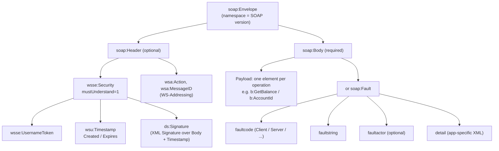
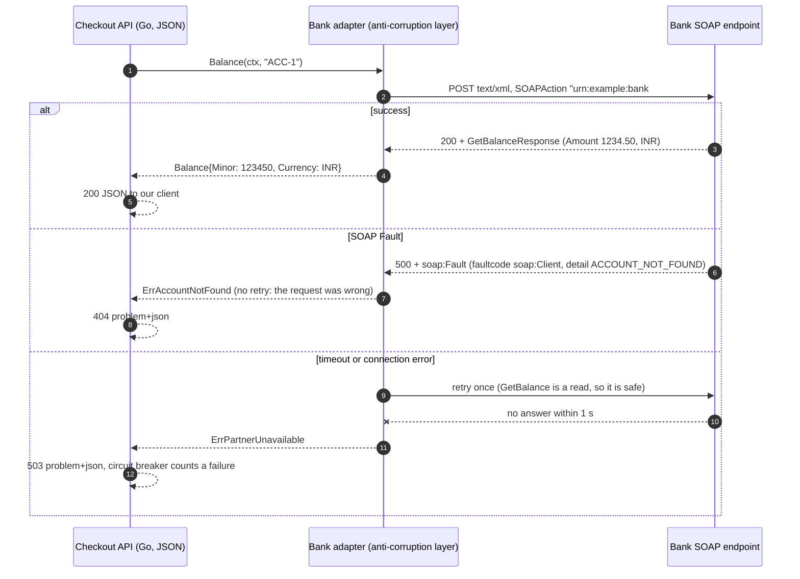

# SOAP and WSDL (Legacy Integrations)

> [!summary] TL;DR
> SOAP is an XML messaging protocol: every call is an XML **Envelope** with an optional **Header** and a **Body**, usually sent with HTTP `POST`, and errors come back as a **Fault**. **WSDL** is the XML contract that lists the operations, their XML schemas and the endpoint URL. You rarely design new SOAP APIs today, but banks, insurers, travel systems and governments still expose them, so you must know how to call one safely and hide it behind your own clean API.

> [!abstract] Core idea
> - A SOAP call is an XML Envelope (Header + Body) sent with HTTP `POST`; errors come back as a Fault in the body.
> - WSDL is the XML contract: operations, message schemas and the endpoint URL; tools generate clients from it.
> - Rule: wrap the SOAP service in an adapter so the rest of your code only sees domain types and domain errors.
> - Classic mistake: building XML by string concatenation without escaping, or treating an HTTP 500 Fault as a generic network error.

## 1. Why it exists

Around 2000, companies wanted programs on different platforms (Java, .NET, mainframes) to call each other over the internet. HTTP and XML were already supported on every one of those platforms, so SOAP put a typed XML message inside an HTTP `POST`, and WSDL described it precisely enough for tools to **generate the client code**.

The scenario today: your Go checkout service must check an account balance at a partner bank. The bank publishes `AccountService.wsdl` and nothing else: no JSON, no OpenAPI. You need to:

- build the right XML envelope and headers,
- understand faults that arrive with HTTP 500,
- add timeouts and safe retries,
- and keep XML out of the rest of your codebase.

The cost is real. Measured with the Go client below: the `GetBalance` request is **251 bytes** of XML; the equivalent JSON `{"accountId":"ACC-1"}` is **21 bytes**, about 12 times smaller.

## 2. Mental model

SOAP is **registered post with a strict form**:

- The **Envelope** is the outer envelope.
- The **Header** is the stamps and seals: security tokens, message ids, routing. Each header block can say "you must understand me, or reject the letter" (`mustUnderstand`).
- The **Body** is the letter itself: exactly one operation request or response.
- A **Fault** is the official rejection slip, put in the Body instead of the reply.
- The **WSDL** is the post office's rule book: which letters exist, what each must contain, and the address to send them to.

The name: SOAP 1.1 stood for "Simple Object Access Protocol". SOAP 1.2 dropped the expansion; it is just "SOAP" now.

## 3. How it works

### The envelope



A SOAP 1.1 request and its success response:

```xml
<?xml version="1.0" encoding="UTF-8"?>
<soap:Envelope xmlns:soap="http://schemas.xmlsoap.org/soap/envelope/"
               xmlns:b="urn:example:bank">
  <soap:Header/>
  <soap:Body>
    <b:GetBalance>
      <b:AccountId>ACC-1</b:AccountId>
    </b:GetBalance>
  </soap:Body>
</soap:Envelope>

<soap:Envelope xmlns:soap="http://schemas.xmlsoap.org/soap/envelope/"
               xmlns:b="urn:example:bank">
  <soap:Body>
    <b:GetBalanceResponse>
      <b:Amount>1234.50</b:Amount>
      <b:Currency>INR</b:Currency>
    </b:GetBalanceResponse>
  </soap:Body>
</soap:Envelope>
```

The same request over HTTP, in SOAP 1.1 and SOAP 1.2:

```http
POST /soap/account HTTP/1.1
Host: bank.example.com
Content-Type: text/xml; charset=utf-8
SOAPAction: "urn:example:bank#GetBalance"

POST /soap/account HTTP/1.1
Host: bank.example.com
Content-Type: application/soap+xml; charset=utf-8; action="urn:example:bank#GetBalance"
```

### The WSDL contract

A WSDL 1.1 file has five parts, read from abstract to concrete:

1. **`types`**: XML Schema (XSD) for every element in the messages.
2. **`message`**: named messages made of parts that point at those elements.
3. **`portType`**: the interface, a list of operations with input, output and fault messages.
4. **`binding`**: how the operations travel: SOAP 1.1 or 1.2, `document` or `rpc` style, `literal` or `encoded` use, and the `soapAction` value.
5. **`service`**: one or more **ports**, each a binding plus an address URL.

```xml
<definitions name="AccountService" targetNamespace="urn:example:bank"
    xmlns="http://schemas.xmlsoap.org/wsdl/"
    xmlns:soap="http://schemas.xmlsoap.org/wsdl/soap/"
    xmlns:tns="urn:example:bank"
    xmlns:xsd="http://www.w3.org/2001/XMLSchema">
  <types>
    <xsd:schema targetNamespace="urn:example:bank" elementFormDefault="qualified">
      <xsd:element name="GetBalance">
        <xsd:complexType><xsd:sequence>
          <xsd:element name="AccountId" type="xsd:string"/>
        </xsd:sequence></xsd:complexType>
      </xsd:element>
      <xsd:element name="GetBalanceResponse">
        <xsd:complexType><xsd:sequence>
          <xsd:element name="Amount" type="xsd:decimal"/>
          <xsd:element name="Currency" type="xsd:string"/>
        </xsd:sequence></xsd:complexType>
      </xsd:element>
    </xsd:schema>
  </types>
  <message name="GetBalanceIn"><part name="parameters" element="tns:GetBalance"/></message>
  <message name="GetBalanceOut"><part name="parameters" element="tns:GetBalanceResponse"/></message>
  <portType name="AccountPort">
    <operation name="GetBalance">
      <input message="tns:GetBalanceIn"/>
      <output message="tns:GetBalanceOut"/>
    </operation>
  </portType>
  <binding name="AccountBinding" type="tns:AccountPort">
    <soap:binding style="document" transport="http://schemas.xmlsoap.org/soap/http"/>
    <operation name="GetBalance">
      <soap:operation soapAction="urn:example:bank#GetBalance"/>
      <input><soap:body use="literal"/></input>
      <output><soap:body use="literal"/></output>
    </operation>
  </binding>
  <service name="AccountService">
    <port name="AccountPort" binding="tns:AccountBinding">
      <soap:address location="https://bank.example.com/soap/account"/>
    </port>
  </service>
</definitions>
```

This is the common **document/literal wrapped** style: the Body holds one element named after the operation (`GetBalance`), and that element is fully described by the XSD.

## 4. Worked example

### Whiteboard version

The bare call: build an escaped envelope, `POST` it with the `SOAPAction` header, decode the body or the Fault. The full adapter below adds timeouts, retries only for safe operations, fault mapping and the anti-corruption layer.

```go
package main

import (
	"bytes"
	"encoding/xml"
	"fmt"
	"net/http"
)

const envelope = `<soap:Envelope xmlns:soap="http://schemas.xmlsoap.org/soap/envelope/">
  <soap:Body><GetBalance xmlns="urn:bank"><Account>%s</Account></GetBalance></soap:Body>
</soap:Envelope>`

type resp struct {
	Balance string `xml:"Body>GetBalanceResponse>Balance"`
	Fault   string `xml:"Body>Fault>faultstring"`
}

func getBalance(url, account string) (string, error) {
	var buf bytes.Buffer
	xml.EscapeText(&buf, []byte(account)) // never paste raw input into XML
	body := fmt.Sprintf(envelope, buf.String())
	req, _ := http.NewRequest(http.MethodPost, url, bytes.NewBufferString(body))
	req.Header.Set("Content-Type", "text/xml; charset=utf-8")
	req.Header.Set("SOAPAction", `"urn:bank#GetBalance"`)
	res, err := http.DefaultClient.Do(req)
	if err != nil {
		return "", err
	}
	defer res.Body.Close()
	var r resp
	if err := xml.NewDecoder(res.Body).Decode(&r); err != nil {
		return "", err
	}
	if r.Fault != "" {
		return "", fmt.Errorf("soap fault: %s", r.Fault)
	}
	return r.Balance, nil
}

func main() { fmt.Println(getBalance("http://localhost:8080/bank", "ACC-1")) }
```

### Full version

A Go service calls the bank through an **adapter** (an anti-corruption layer). Nothing outside the adapter sees XML; callers get a domain `Balance` or a domain error.



The SOAP client. It compiles and passes `go vet` and `go test -race` on Go 1.24, using only `encoding/xml` and `net/http`:

```go
package soap

import (
	"bytes"
	"context"
	"encoding/xml"
	"errors"
	"fmt"
	"io"
	"net/http"
	"strings"
)

const envNS = "http://schemas.xmlsoap.org/soap/envelope/" // SOAP 1.1

type reqEnvelope struct {
	XMLName xml.Name `xml:"http://schemas.xmlsoap.org/soap/envelope/ Envelope"`
	Body    struct {
		Payload any
	} `xml:"http://schemas.xmlsoap.org/soap/envelope/ Body"`
}

// Fault is a SOAP 1.1 fault; its children are unqualified elements.
type Fault struct {
	Code   string `xml:"faultcode"` // a QName such as "soap:Client"
	String string `xml:"faultstring"`
	Actor  string `xml:"faultactor"`
	Detail struct {
		Inner string `xml:",innerxml"`
	} `xml:"detail"`
}

func (f *Fault) Error() string { return "soap fault " + f.Code + ": " + f.String }

// Local returns the code without its prefix: "Client", "Server", ...
func (f *Fault) Local() string {
	if _, local, ok := strings.Cut(f.Code, ":"); ok {
		return local
	}
	return f.Code // some servers send the code with no prefix
}

// Client calls one SOAP 1.1 endpoint. Give HTTP a Timeout.
type Client struct {
	URL  string
	HTTP *http.Client
}

// Call posts in as the Body and decodes the Body's first element into out.
// A Fault comes back as *Fault whatever the HTTP status (SOAP 1.1 uses 500).
func (c *Client) Call(ctx context.Context, action string, in, out any) error {
	var env reqEnvelope
	env.Body.Payload = in
	var buf bytes.Buffer
	buf.WriteString(xml.Header)
	if err := xml.NewEncoder(&buf).Encode(env); err != nil {
		return err
	}
	req, err := http.NewRequestWithContext(ctx, http.MethodPost, c.URL, &buf)
	if err != nil {
		return err
	}
	req.Header.Set("Content-Type", "text/xml; charset=utf-8")
	req.Header.Set("SOAPAction", `"`+action+`"`) // SOAP 1.1: a quoted URI
	resp, err := c.HTTP.Do(req)
	if err != nil {
		return err
	}
	defer resp.Body.Close()

	err = decodeBody(io.LimitReader(resp.Body, 4<<20), out)
	var f *Fault
	if errors.As(err, &f) {
		return f
	}
	if resp.StatusCode != http.StatusOK {
		if err != nil {
			return fmt.Errorf("soap: HTTP %d: %w", resp.StatusCode, err)
		}
		return fmt.Errorf("soap: HTTP %d", resp.StatusCode)
	}
	return err
}

// decodeBody walks tokens so that namespace prefixes declared on the
// Envelope still resolve inside the Body.
func decodeBody(r io.Reader, out any) error {
	d := xml.NewDecoder(r)
	inBody := false
	for {
		tok, err := d.Token()
		if err != nil {
			return fmt.Errorf("soap: no body element: %w", err)
		}
		se, ok := tok.(xml.StartElement)
		if !ok {
			continue
		}
		switch {
		case !inBody && se.Name.Space == envNS && se.Name.Local == "Header":
			if err := d.Skip(); err != nil {
				return err
			}
		case !inBody && se.Name.Space == envNS && se.Name.Local == "Body":
			inBody = true
		case inBody && se.Name.Space == envNS && se.Name.Local == "Fault":
			f := &Fault{}
			if err := d.DecodeElement(f, &se); err != nil {
				return err
			}
			return f
		case inBody:
			return d.DecodeElement(out, &se)
		}
	}
}
```

Two details that bite in practice:

- **Read the body before judging the status.** SOAP 1.1 sends every fault with HTTP 500, so treating 500 as "server crashed" throws away the reason.
- **Decode the Body as a stream.** A cheap trick is to grab the Body's inner XML as bytes and unmarshal that. It breaks as soon as the server declares a prefix such as `xmlns:b="urn:example:bank"` on the Envelope, because the copied bytes no longer carry the declaration. `xml.Decoder.Token` keeps the namespace context.

The adapter: wire types mirror the WSDL; the domain type uses integer minor units, because `xsd:decimal` must never pass through `float64`.

```go
package soap

import (
	"context"
	"encoding/xml"
	"errors"
	"fmt"
	"strconv"
	"strings"
	"time"
)

// Wire types: they mirror the partner's WSDL and never leave this package.
type GetBalance struct {
	XMLName   xml.Name `xml:"urn:example:bank GetBalance"`
	AccountID string   `xml:"AccountId"`
}

type GetBalanceResponse struct {
	XMLName  xml.Name `xml:"urn:example:bank GetBalanceResponse"`
	Amount   string   `xml:"Amount"` // xsd:decimal: never parse into float64
	Currency string   `xml:"Currency"`
}

// Domain side of the anti-corruption layer.
type Balance struct {
	Minor    int64 // amount in minor units (paise, cents)
	Currency string
}

var (
	ErrAccountNotFound    = errors.New("account not found")
	ErrPartnerUnavailable = errors.New("bank unavailable")
)

type BankAdapter struct {
	SOAP    *Client
	Timeout time.Duration // per attempt
}

func (a *BankAdapter) Balance(ctx context.Context, accountID string) (Balance, error) {
	var out GetBalanceResponse
	var err error
	// GetBalance is a read, so one retry after a transport error is safe.
	// A money transfer would never be retried blindly.
	for attempt := 1; attempt <= 2; attempt++ {
		actx, cancel := context.WithTimeout(ctx, a.Timeout)
		err = a.SOAP.Call(actx, "urn:example:bank#GetBalance", GetBalance{AccountID: accountID}, &out)
		cancel()
		var f *Fault
		if err == nil || errors.As(err, &f) || ctx.Err() != nil {
			break
		}
	}
	var f *Fault
	switch {
	case errors.As(err, &f) && f.Local() == "Client" && strings.Contains(f.Detail.Inner, "ACCOUNT_NOT_FOUND"):
		return Balance{}, ErrAccountNotFound
	case err != nil:
		return Balance{}, fmt.Errorf("%w: %v", ErrPartnerUnavailable, err)
	}
	minor, err := toMinor(out.Amount)
	if err != nil {
		return Balance{}, fmt.Errorf("%w: bad amount %q", ErrPartnerUnavailable, out.Amount)
	}
	return Balance{Minor: minor, Currency: out.Currency}, nil
}

// toMinor turns an xsd:decimal such as "1234.50" into minor units (123450)
// for a two-decimal currency, without float64. "1.500" is accepted (it equals
// 1.50); "1.005" is rejected because it cannot be stored in paise or cents.
func toMinor(s string) (int64, error) {
	s = strings.TrimSpace(s)
	neg := false
	if s != "" && (s[0] == '-' || s[0] == '+') {
		neg = s[0] == '-'
		s = s[1:]
	}
	whole, frac, _ := strings.Cut(s, ".")
	frac = strings.TrimRight(frac, "0")
	digits := whole + frac
	if digits == "" || len(frac) > 2 || strings.Trim(digits, "0123456789") != "" {
		return 0, fmt.Errorf("soap: unsupported decimal %q", s)
	}
	n, err := strconv.ParseInt(whole+frac+strings.Repeat("0", 2-len(frac)), 10, 64)
	if err != nil {
		return 0, err
	}
	if neg {
		n = -n
	}
	return n, nil
}
```

What the client actually sends (measured by printing the request body in an `httptest` server):

```xml
<?xml version="1.0" encoding="UTF-8"?>
<Envelope xmlns="http://schemas.xmlsoap.org/soap/envelope/"><Body xmlns="http://schemas.xmlsoap.org/soap/envelope/"><GetBalance xmlns="urn:example:bank"><AccountId>ACC-1</AccountId></GetBalance></Body></Envelope>
```

`encoding/xml` writes default-namespace declarations instead of `soap:` prefixes. That is valid XML and equivalent to the prefixed form; a partner that rejects it has a broken parser, which does happen, and then you build the envelope from a template instead.

The tests (all 4 pass under `go test -race`, Go 1.24.4) cover: a prefixed success response decoded into `Balance{Minor: 123450, Currency: "INR"}` with the right `SOAPAction` and `Content-Type`; a fault with HTTP 500 mapped to `ErrAccountNotFound` with exactly one call; a hanging bank, retried once and then reported as `ErrPartnerUnavailable`; and decimal conversion, including rejecting `1.005`. The fault test:

```go
package soap

import (
	"context"
	"errors"
	"io"
	"net/http"
	"net/http/httptest"
	"sync/atomic"
	"testing"
	"time"
)

const faultResponse = `<soap:Envelope xmlns:soap="http://schemas.xmlsoap.org/soap/envelope/">
  <soap:Body>
    <soap:Fault>
      <faultcode>soap:Client</faultcode>
      <faultstring>Account not found</faultstring>
      <detail><b:Error xmlns:b="urn:example:bank"><b:Code>ACCOUNT_NOT_FOUND</b:Code></b:Error></detail>
    </soap:Fault>
  </soap:Body>
</soap:Envelope>`

func adapter(url string) *BankAdapter {
	return &BankAdapter{
		SOAP:    &Client{URL: url, HTTP: &http.Client{Timeout: 2 * time.Second}},
		Timeout: time.Second,
	}
}

func TestFaultWithHTTP500BecomesDomainError(t *testing.T) {
	var calls atomic.Int32
	srv := httptest.NewServer(http.HandlerFunc(func(w http.ResponseWriter, r *http.Request) {
		calls.Add(1)
		w.Header().Set("Content-Type", "text/xml; charset=utf-8")
		w.WriteHeader(http.StatusInternalServerError) // SOAP 1.1 sends every fault as 500
		io.WriteString(w, faultResponse)
	}))
	defer srv.Close()

	_, err := adapter(srv.URL).Balance(context.Background(), "ACC-404")
	if !errors.Is(err, ErrAccountNotFound) {
		t.Fatalf("got %v, want ErrAccountNotFound", err)
	}
	if calls.Load() != 1 {
		t.Fatalf("a fault must not be retried; calls = %d", calls.Load())
	}
}
```

## 5. Variants and comparison

**SOAP 1.1 vs SOAP 1.2:**

| Aspect | SOAP 1.1 (W3C Note, 2000) | SOAP 1.2 (W3C Recommendation, 2003) |
| --- | --- | --- |
| Envelope namespace | `http://schemas.xmlsoap.org/soap/envelope/` | `http://www.w3.org/2003/05/soap-envelope` |
| Content-Type | `text/xml` | `application/soap+xml` |
| Operation name on the wire | `SOAPAction` HTTP header (required, may be `""`) | optional `action` parameter of the Content-Type |
| Fault shape | `faultcode`, `faultstring`, `faultactor`, `detail` | `Code/Value` (+ `Subcode`), `Reason/Text`, `Node`, `Role`, `Detail` |
| Fault codes | `VersionMismatch`, `MustUnderstand`, `Client`, `Server` | `VersionMismatch`, `MustUnderstand`, `DataEncodingUnknown`, `Sender`, `Receiver` |
| HTTP status for a fault | always 500 | 400 for `Sender` faults, 500 for the rest |
| Header targeting | `actor` attribute | `role` attribute |

A version mismatch is a classic first-day bug: sending a 1.1 envelope to a 1.2-only endpoint returns a `VersionMismatch` fault or a bare HTTP error.

**Binding styles (WSDL `style` + `use`):**

| Combination | What the Body looks like | Status |
| --- | --- | --- |
| document/literal (wrapped) | One element named after the operation, fully defined by XSD | The default today (.NET, JAX-WS) |
| rpc/literal | Element named after the operation, parts as children, typed by the WSDL | Allowed by WS-I, less common |
| rpc/encoded | SOAP encoding (`xsi:type` on every value, arrays and references) | Forbidden by WS-I Basic Profile; only in very old services |
| document/encoded | Not used in practice | — |

**SOAP vs REST vs gRPC:**

| | SOAP | REST + JSON | gRPC |
| --- | --- | --- | --- |
| Contract | WSDL + XSD, required | OpenAPI, optional | `.proto`, required |
| Payload | XML, verbose | JSON | Protobuf, binary |
| Transport | HTTP `POST` almost always (also JMS, SMTP) | HTTP methods and URLs | HTTP/2 |
| Errors | `Fault` in the body | Status codes + `problem+json` ([[API Error Handling]]) | gRPC status codes |
| Security | TLS, or message-level WS-Security | TLS + OAuth tokens | TLS/mTLS + tokens |
| HTTP caching | Practically none: calls are `POST` (SOAP 1.2 defines a `GET` binding, rarely used) | Built in for `GET` | None |
| Use when | The partner only offers SOAP, or contract-level signing is required | Public and web APIs | Internal service-to-service calls ([[gRPC]]) |

## 6. Trade-offs and when not to use

- **Do not design a new public API in SOAP.** Every mainstream client stack expects JSON over HTTP; choose with [[Choosing an API Style]].
- **XML is expensive:** about 12 times the bytes of the same JSON in the example above, slower parsing, and practically no HTTP caching because calls are `POST`s.
- **Generated code is brittle.** A partner adding one optional element or changing a namespace can break generated clients, and WSDL features such as `xsd:choice`, substitution groups and polymorphic types map poorly to Go structs.
- **Message-level security is hard to get right.** Signing XML requires canonicalisation, and XML Signature Wrapping attacks (moving the signed element and inserting a forged one where the application reads) have broken real implementations. Prefer TLS or mTLS when the partner accepts it.
- **Where SOAP still wins:** the partner already has it, the contract is stable for years, or a regulator demands signed messages that survive passing through intermediaries.

## 7. In production

- **Where it still lives:**
	- Banks and payment processors (core banking, account and mandate services).
	- Insurance carriers (quotes, policies, claims).
	- Telecom provisioning (OSS/BSS).
	- Government systems, for example the EU's VIES VAT-number validation service.
	- Enterprise software: the Salesforce SOAP API, Workday Web Services, and Exchange Web Services (EWS) in on-premises Exchange Server. Microsoft announced that Exchange Online starts blocking EWS requests from non-Microsoft apps on 1 October 2026 and points integrations to Microsoft Graph.
	- Travel distribution: Sabre and Amadeus web services.
- **Failure modes → fixes:**
	- Every error looks like "HTTP 500" in dashboards → parse the Fault and log `faultcode` and the partner's error code from `detail`.
	- A timed-out `Transfer` is retried and the money moves twice → retry only reads and operations that carry a client reference the partner deduplicates; otherwise query the status first ([[Idempotency and Idempotency Keys]]).
	- The partner updates its WSDL and the generated client breaks at runtime → pin the WSDL version in the repository and run a contract test against the partner's test endpoint in CI ([[Contract Testing]]).
	- The partner is slow (seconds per call) and drags down your API → strict per-call timeouts, a circuit breaker, a bulkhead (a separate connection pool), and caching of read results where allowed ([[Circuit Breaker]]).
	- A WS-Security `Timestamp` is rejected → clock skew; run NTP on both sides and check the `Expires` window.
- **What to monitor:** latency per operation, faults per `faultcode` and partner error code, timeouts, circuit-breaker state, and certificate expiry for WS-Security signing keys.

## 8. Deep dive

**WS-Security is a separate standard.** SOAP itself defines only the envelope, the processing model and the bindings. Security, reliability and transactions come from separate WS-* specifications layered on top through headers: WS-Security (OASIS), WS-ReliableMessaging, WS-AtomicTransaction, WS-Addressing and WS-Policy. A partner "using SOAP" may use none of them.

A typical WS-Security header with a timestamp and a `UsernameToken`:

```xml
<soap:Header>
  <wsse:Security soap:mustUnderstand="1"
      xmlns:wsse="http://docs.oasis-open.org/wss/2004/01/oasis-200401-wss-wssecurity-secext-1.0.xsd"
      xmlns:wsu="http://docs.oasis-open.org/wss/2004/01/oasis-200401-wss-wssecurity-utility-1.0.xsd">
    <wsu:Timestamp wsu:Id="TS-1">
      <wsu:Created>2026-11-02T03:30:00Z</wsu:Created>
      <wsu:Expires>2026-11-02T03:35:00Z</wsu:Expires>
    </wsu:Timestamp>
    <wsse:UsernameToken>
      <wsse:Username>acme-merchant</wsse:Username>
      <wsse:Password Type="http://docs.oasis-open.org/wss/2004/01/oasis-200401-wss-username-token-profile-1.0#PasswordDigest">BASE64_DIGEST</wsse:Password>
      <wsse:Nonce EncodingType="http://docs.oasis-open.org/wss/2004/01/oasis-200401-wss-soap-message-security-1.0#Base64Binary">BASE64_NONCE</wsse:Nonce>
      <wsu:Created>2026-11-02T03:30:00Z</wsu:Created>
    </wsse:UsernameToken>
  </wsse:Security>
</soap:Header>
```

- **UsernameToken** sends a username plus a password, either as plain text (only safe inside TLS) or as `PasswordDigest = Base64(SHA-1(nonce + created + password))`. The digest forces the server to store the plain password, so it is weak by today's standards.
- **Timestamp** limits replay to the `Created`–`Expires` window; servers also remember nonces inside that window.
- **XML Signature** signs selected elements (Body, Timestamp) after canonicalisation (Exclusive C14N), usually with an X.509 key; **XML Encryption** can encrypt parts. Go's standard library has neither. The usual answers are an XML-signature library such as `github.com/russellhaering/goxmldsig` or a gateway that does WS-Security for you. `goxmldsig` was built for SAML-style enveloped signatures, so check that it covers the signature layout your partner's WS-Security policy requires before you depend on it.

**MTOM for binary data.** Inside XML, binary must be base64, which adds 33% (4 output bytes per 3 input bytes) plus parsing cost. MTOM (with XOP) sends the envelope as the first part of a `multipart/related` MIME message and moves each binary into its own raw part, referenced from the XML by `<xop:Include href="cid:..."/>`. Scanned documents and PDFs in insurance and banking integrations travel this way.

**Code generation in Go.** `gowsdl` generates Go structs and an operation client from a WSDL. It saves time on large, stable WSDLs, but review the output: unsupported XSD features are skipped or mistyped, and regenerating after a partner change can produce a large diff. For two or three operations, hand-written structs as above are easier to read, test and fix.

**`mustUnderstand`.** A header block marked `mustUnderstand="1"` (1.1) or `"true"` (1.2) must be processed by its target or the whole message fails with a `MustUnderstand` fault. Your client must not set it on headers the partner does not support, and your adapter must not ignore one it receives.

**XML parser safety.** Go's `encoding/xml` never fetches external entities, so XML External Entity (XXE) attacks do not apply to it. Parsers in other stacks must have DTD processing disabled when they read partner XML.

**Wrapping the partner (anti-corruption layer).** The adapter in section 4 is the anti-corruption layer from [[Domain-Driven Design - Strategic Design]] and a driven adapter in [[Hexagonal Architecture (Ports and Adapters)]]. It translates names, types (decimal strings to minor units), and faults to domain errors, and it owns the timeouts, retries, circuit breaker and caching. When the bank later ships a REST API, you replace one adapter, and nothing else changes ([[Strangler Fig Pattern and Legacy Migration]]).

## 9. Interview questions

> [!question]- What are the parts of a SOAP message?
> An `Envelope` containing an optional `Header` (security, addressing, other blocks, each can be `mustUnderstand`) and a required `Body` holding the operation's request or response, or a `Fault` on error.

> [!question]- What does a WSDL contain?
> `types` (XSD schemas), `message` (parts referencing those elements), `portType` (operations with input, output and fault messages), `binding` (SOAP version, style, use, `soapAction`) and `service` (ports with endpoint addresses).

> [!question]- Trap: "SOAP has built-in security, transactions and reliability." True?
> No. SOAP defines the envelope, processing model and bindings. Security, reliable messaging and transactions are separate WS-* standards (WS-Security, WS-ReliableMessaging, WS-AtomicTransaction) carried in SOAP headers, and a given service may implement none of them.

> [!question]- How do SOAP 1.1 and SOAP 1.2 differ on the wire?
> Different envelope namespaces; 1.1 uses `text/xml` plus a `SOAPAction` header, 1.2 uses `application/soap+xml` with an optional `action` parameter. Faults changed shape (`Code/Reason` in 1.2) and codes were renamed (`Client`/`Server` became `Sender`/`Receiver`). 1.1 returns every fault as HTTP 500; 1.2 returns 400 for `Sender` faults.

> [!question]- What is document/literal wrapped and why did rpc/encoded die out?
> The Body carries one element named after the operation, fully described by XSD, so it can be validated against the schema. rpc/encoded used SOAP encoding with runtime type attributes that different toolkits interpreted differently; WS-I Basic Profile banned it for interoperability.

> [!question]- A SOAP call to transfer money timed out. Do you retry?
> Not blindly: the bank may have executed it. Retry only if the operation is idempotent or carries a client reference the bank deduplicates; otherwise call a status-inquiry operation with that reference first, and reconcile later.

> [!question]- How would you integrate a SOAP-only bank into a JSON microservice platform?
> Put it behind one adapter service or package: wire types from the WSDL, translation to domain types, faults mapped to domain errors and then to `problem+json`, strict timeouts, a circuit breaker, safe retries only for reads, and contract tests against the bank's sandbox. No XML leaks past the adapter.

## 10. Cheat sheet

- Envelope → optional Header (WS-Security, WS-Addressing, `mustUnderstand`) + Body (one operation) or Fault.
- SOAP 1.1: `text/xml`, `SOAPAction` header, faults always HTTP 500. SOAP 1.2: `application/soap+xml; action=...`, `Sender` faults are 400.
- WSDL 1.1 = types, message, portType, binding, service. Use document/literal wrapped.
- Security, reliability and transactions are separate WS-* specs, not part of SOAP.
- In Go: `encoding/xml`, decode the Body with a token stream, read faults even on 500, decimals as strings or integers, never `float64`.
- Timeouts always; retries only for reads or deduplicated operations; circuit breaker on the partner.
- Hide the partner behind an anti-corruption adapter so it can be replaced.

## Links

- **Before this:** [[HTTP Fundamentals - Methods, Status Codes, Headers, Cookies]], [[Choosing an API Style]]
- **Next:** [[Calling External APIs]] (the Go client side), [[Domain-Driven Design - Strategic Design]] (anti-corruption layer), [[Strangler Fig Pattern and Legacy Migration]]
- **Compare with:** [[REST and HTTP API Design]], [[gRPC]], [[GraphQL]], [[API Contract Design and OpenAPI]] (OpenAPI as the JSON-world counterpart of WSDL)
