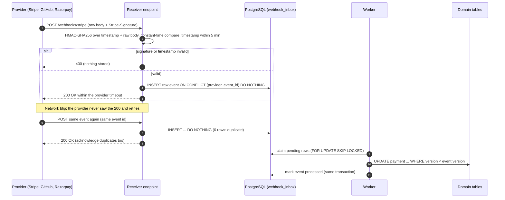
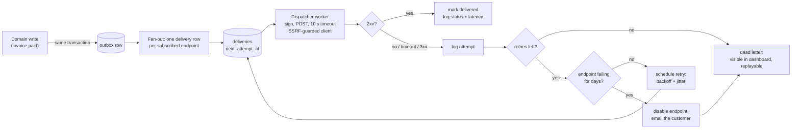
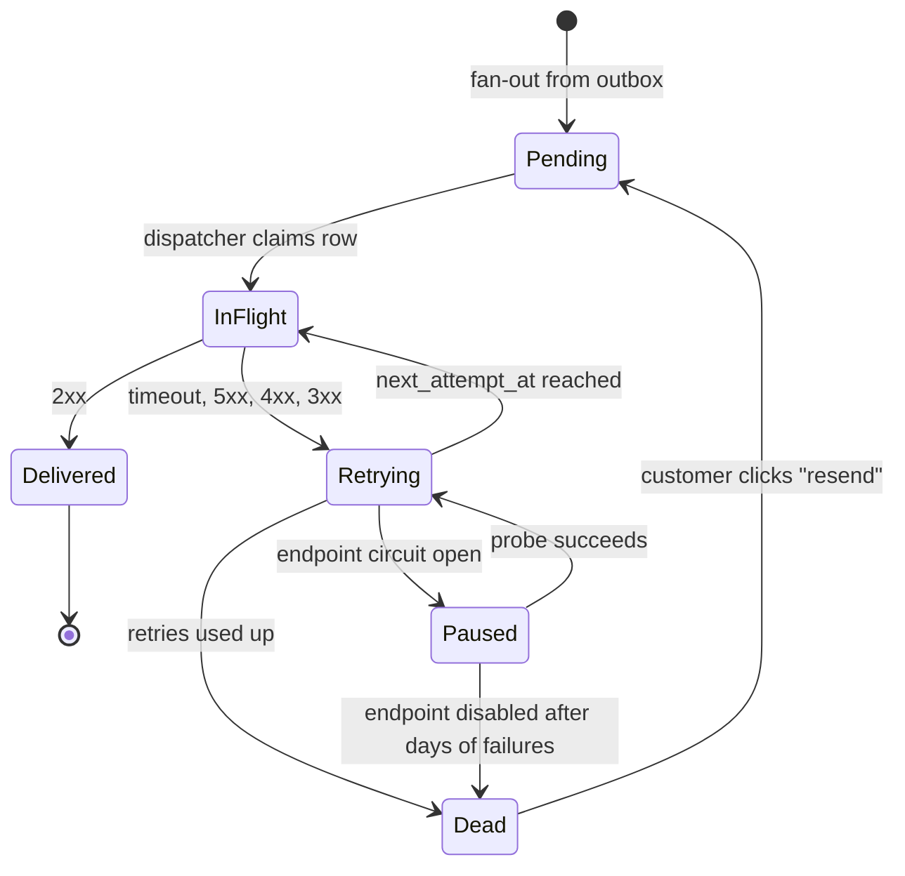

# Webhooks - Sending and Receiving

> [!summary] TL;DR
> A webhook is an HTTP `POST` that one system sends to a URL you registered, the moment something happens ("payment succeeded"). The receiver must check the signature on the raw body, store the event, answer `2xx` fast and do the real work later, because deliveries can be duplicated, late, out of order or forged. The sender must queue, sign, retry with backoff and protect itself from slow or malicious customer URLs.

## 1. Why it exists

A marketplace has 20,000 open payments at a payment provider and needs to know when each one settles.

- **Polling:** ask about every payment every 15 s. That is 20,000 / 15 ≈ **1,333 requests per second**, or about **115 million requests a day**. If about 50,000 payments change state per day (an estimate), more than 99.9% of those calls return "no change". Each change is still seen 7.5 s late on average (half the interval).
- **Webhooks:** the provider sends one `POST` per change: about **50,000 requests a day**, roughly 2,300 times fewer, and each arrives seconds after the change.

Webhooks turn "keep asking" into "get told". The price is that the provider now calls *you*, across the internet, with its own retry rules, so your endpoint becomes a public API with its own security and reliability problems.

## 2. Mental model

A webhook is a **reverse API call**: the provider is the client and you are the server.

Think of a courier with a doorbell. You do not stand at the window all day; the courier rings when the parcel arrives. But a courier may ring twice, ring for yesterday's parcel after today's, or be an impostor in a courier jacket. So you:

1. check the ID badge (the **signature**),
2. sign for the parcel and put it in the hallway (**persist raw, answer 2xx**),
3. unpack it later (**async worker**), ignoring a parcel you already unpacked (**dedupe by event id**) and an older one that arrives late (**version check**).

The rule that follows: **the webhook request only records the event; it never does the business work.**

## 3. How it works

### Receiving: verify, persist, acknowledge, process later



1. **Read the raw bytes** with a size limit. Do not let a framework parse and re-serialise the JSON first: the signature covers bytes, not meaning.
2. **Verify** the HMAC with a constant-time compare, and check the signed timestamp against a tolerance window (Stripe's libraries default to 5 minutes) to block replays. Stripe signs every retry again with a fresh timestamp, so the window never rejects a legitimate retry; check that your provider does the same before you enforce a window. HMAC itself is covered in [[Service-to-Service Auth - API Keys, HMAC, mTLS]].
3. **Persist the raw event** in an inbox table whose primary key is the provider's event id. A duplicate insert does nothing.
4. **Acknowledge with 2xx** inside the provider's timeout (GitHub allows 10 seconds). Answer `2xx` for duplicates too, or the provider keeps retrying them.
5. **Process asynchronously.** Workers claim inbox rows, apply them idempotently, and retry failures into a DLQ. The Go service side of this lives in [[Receiving Webhooks Idempotently]].

### Sending: outbox, dispatcher, retries, disable



- The **outbox** ([[Transactional Outbox and CDC]]) guarantees that an event exists if and only if the domain change committed. Sending the `POST` inside the request that changed the data loses events on crashes and sends events for rolled-back changes.
- **Fan-out** creates one delivery per endpoint, so one slow customer never delays another.
- Each attempt is **signed**, sent with a short timeout through a client that refuses internal addresses, and **logged** (status, latency, response snippet) so customers can debug from a delivery-log page.
- Failures are retried with **exponential backoff and jitter** over hours or days ([[Timeouts, Retries and Backoff]]). After the last retry the delivery goes to a **dead-letter** state that customers can replay. An endpoint that fails for days is **disabled** and its owner notified.

### Delivery lifecycle on the sender



## 4. Worked example

**The bytes.** The provider signs `"<timestamp>.<raw body>"` with HMAC-SHA256 and sends:

```http
POST /webhooks/stripe HTTP/1.1
Content-Type: application/json
Stripe-Signature: t=1730534400,v1=<64 hex chars>

{"id":"evt_42","type":"invoice.paid","data":{"object":{"id":"in_7","amount_paid":4999}}}
```

**Verification in Go.** This is the Stripe-style `t=…,v1=…` scheme. It compiles and passes `go vet` and `go test -race` on Go 1.24. In production, prefer the provider's SDK (for example `webhook.ConstructEvent` in `stripe-go`); the point here is what such code must do.

```go
package webhooks

import (
	"crypto/hmac"
	"crypto/sha256"
	"encoding/hex"
	"errors"
	"strconv"
	"strings"
	"time"
)

var (
	ErrBadHeader = errors.New("webhook: malformed signature header")
	ErrNoMatch   = errors.New("webhook: no valid signature")
	ErrStale     = errors.New("webhook: timestamp outside tolerance")
)

// sign returns HMAC-SHA256("<unix ts>.<raw body>"), the Stripe-style v1 scheme.
func sign(secret []byte, ts int64, body []byte) []byte {
	m := hmac.New(sha256.New, secret)
	m.Write([]byte(strconv.FormatInt(ts, 10) + "."))
	m.Write(body)
	return m.Sum(nil)
}

// SignatureHeader is what a sender puts in the header: one v1 signature per
// active secret, so receivers keep working while a secret is rotated.
func SignatureHeader(secrets [][]byte, ts int64, body []byte) string {
	parts := []string{"t=" + strconv.FormatInt(ts, 10)}
	for _, s := range secrets {
		parts = append(parts, "v1="+hex.EncodeToString(sign(s, ts, body)))
	}
	return strings.Join(parts, ",")
}

// Verify checks a header such as "t=1730534400,v1=ab12…,v1=cd34…" against
// the raw body. Any v1 value may match any of the receiver's active secrets.
func Verify(header string, body []byte, secrets [][]byte, now time.Time, tolerance time.Duration) error {
	ts := int64(-1)
	var sigs [][]byte
	for _, part := range strings.Split(header, ",") {
		k, v, ok := strings.Cut(strings.TrimSpace(part), "=")
		if !ok {
			continue
		}
		switch k {
		case "t":
			n, err := strconv.ParseInt(v, 10, 64)
			if err != nil {
				return ErrBadHeader
			}
			ts = n
		case "v1":
			if b, err := hex.DecodeString(v); err == nil {
				sigs = append(sigs, b)
			}
		}
	}
	if ts < 0 || len(sigs) == 0 {
		return ErrBadHeader
	}
	matched := false
	for _, secret := range secrets {
		want := sign(secret, ts, body)
		for _, got := range sigs {
			if hmac.Equal(want, got) { // constant-time compare
				matched = true
			}
		}
	}
	if !matched {
		return ErrNoMatch
	}
	// The timestamp is inside the signed bytes, so it can be trusted now.
	if age := now.Sub(time.Unix(ts, 0)); age > tolerance || age < -tolerance {
		return ErrStale
	}
	return nil
}
```

Unknown schemes are ignored, such as the fake `v0` signature that Stripe adds to test events. Stripe's docs ask for exactly this to block downgrade attacks: an attacker cannot strip `v1` and offer a weaker scheme.

**The receiver.** Verify, store, answer. Nothing else happens inside the request.

```go
package webhooks

import (
	"context"
	"encoding/json"
	"io"
	"net/http"
	"time"
)

// Inbox stores raw events durably. Insert returns inserted=false when
// (provider, eventID) is already stored: a duplicate delivery.
type Inbox interface {
	Insert(ctx context.Context, provider, eventID, eventType string, raw []byte) (inserted bool, err error)
}

// Receiver does only the fast part: verify, persist, acknowledge.
// A separate worker processes inbox rows later.
type Receiver struct {
	Provider  string
	Header    string // for example "Stripe-Signature"
	Secrets   [][]byte
	Tolerance time.Duration // Stripe's libraries default to 5 minutes
	Inbox     Inbox
	Now       func() time.Time
}

func (rc *Receiver) ServeHTTP(w http.ResponseWriter, r *http.Request) {
	// 1 MiB suits Stripe; size the limit per provider (GitHub payloads reach 25 MB).
	raw, err := io.ReadAll(http.MaxBytesReader(w, r.Body, 1<<20))
	if err != nil {
		http.Error(w, "body too large", http.StatusRequestEntityTooLarge)
		return
	}
	// Verify the exact bytes received, before any JSON parsing.
	if err := Verify(r.Header.Get(rc.Header), raw, rc.Secrets, rc.Now(), rc.Tolerance); err != nil {
		http.Error(w, "invalid signature", http.StatusBadRequest)
		return
	}
	var ev struct {
		ID   string `json:"id"`
		Type string `json:"type"`
	}
	if err := json.Unmarshal(raw, &ev); err != nil || ev.ID == "" {
		http.Error(w, "missing event id", http.StatusBadRequest)
		return
	}
	if _, err := rc.Inbox.Insert(r.Context(), rc.Provider, ev.ID, ev.Type, raw); err != nil {
		http.Error(w, "retry later", http.StatusServiceUnavailable) // provider will retry
		return
	}
	w.WriteHeader(http.StatusOK) // new or duplicate: both are acknowledged
}
```

The test below covers what goes wrong in real life. A receiver test with an in-memory inbox (not shown) also fires the same event from 10 goroutines and checks that the inbox holds one row and every call got `200`.

```go
package webhooks

import (
	"errors"
	"testing"
	"time"
)

var (
	newSecret = []byte("whsec_new")
	oldSecret = []byte("whsec_old")
	now       = time.Unix(1730534400, 0)
)

func TestVerifyRejects(t *testing.T) {
	body := []byte(`{"id":"evt_1","amount":500}`)
	h := SignatureHeader([][]byte{newSecret}, now.Unix(), body)
	tampered := []byte(`{"id":"evt_1","amount":50000}`)
	reformatted := []byte(`{"id": "evt_1", "amount": 500}`) // same JSON, different bytes
	cases := []struct {
		name   string
		header string
		body   []byte
		now    time.Time
		want   error
	}{
		{"tampered body", h, tampered, now, ErrNoMatch},
		{"re-serialised JSON", h, reformatted, now, ErrNoMatch},
		{"replayed after 6 min", h, body, now.Add(6 * time.Minute), ErrStale},
		{"wrong secret", SignatureHeader([][]byte{oldSecret}, now.Unix(), body), body, now, ErrNoMatch},
		{"no timestamp", "v1=00", body, now, ErrBadHeader},
	}
	for _, c := range cases {
		err := Verify(c.header, c.body, [][]byte{newSecret}, c.now, 5*time.Minute)
		if !errors.Is(err, c.want) {
			t.Errorf("%s: got %v, want %v", c.name, err, c.want)
		}
	}
}
```

Checked with `go vet` and `go test -race` (Go 1.24.4): the rejection cases above pass, and so do tests not shown here for rotation overlap, 10 concurrent duplicates and the SSRF dial guard from section 8.

**The inbox and the worker (PostgreSQL 17).** Keep the raw bytes in `bytea`: `jsonb` drops whitespace and reorders keys, so the signature could never be re-checked from it.

```sql
CREATE TABLE webhook_inbox (
    provider     text        NOT NULL,
    event_id     text        NOT NULL,
    event_type   text        NOT NULL,
    raw_body     bytea       NOT NULL,
    received_at  timestamptz NOT NULL DEFAULT now(),
    status       text        NOT NULL DEFAULT 'pending',   -- pending | done | dead
    attempts     int         NOT NULL DEFAULT 0,
    last_error   text,
    PRIMARY KEY (provider, event_id)
);

-- Receiver: the primary key is the dedupe table.
INSERT INTO webhook_inbox (provider, event_id, event_type, raw_body)
VALUES ('stripe', 'evt_42', 'invoice.paid', $1)
ON CONFLICT (provider, event_id) DO NOTHING;
```

Representative output (PostgreSQL 17): the first delivery prints `INSERT 0 1`; the retry of the same event prints `INSERT 0 0`.

The worker claims and applies an event in **one transaction**, so the business change and "processed" commit together:

```sql
BEGIN;
SELECT provider, event_id, raw_body
FROM webhook_inbox
WHERE status = 'pending'
ORDER BY received_at
LIMIT 1
FOR UPDATE SKIP LOCKED;

-- Out-of-order guard: an older or repeated event changes 0 rows.
-- 17 stands for a monotonic version carried by the event. Stripe objects
-- carry none, so for Stripe use the state machine or a re-fetch (section 8).
UPDATE invoices
SET status = 'paid', provider_version = 17, updated_at = now()
WHERE provider_invoice_id = 'in_7'
  AND provider_version < 17;

UPDATE webhook_inbox SET status = 'done', attempts = attempts + 1
WHERE provider = 'stripe' AND event_id = 'evt_42';
COMMIT;
```

`SKIP LOCKED` lets many workers share the table without blocking each other ([[Background Jobs and Worker Pools]]). A failing event gets `attempts + 1` and `last_error`; after N attempts it becomes `dead`, which is the receiver's DLQ ([[Dead Letter Queues and Poison Messages]]).

**Replay tooling** is then one guarded statement behind an admin command, run after the bug is fixed: `UPDATE webhook_inbox SET status = 'pending', attempts = 0 WHERE status = 'dead' AND event_type = 'invoice.paid';`. Because the worker is idempotent and version-guarded, replaying an event that already took effect changes nothing.

## 5. Variants and comparison

**Getting change notifications:**

| Option | How it works | Use when | Cost |
| --- | --- | --- | --- |
| Polling | Client calls `GET` on a timer | Few objects, no public endpoint possible, or as a safety-net reconciliation | Wasted calls; latency up to one interval |
| Webhooks | Provider `POST`s to a registered HTTPS URL | Events cross company boundaries (SaaS to customer) | Public endpoint, signatures, dedupe, retries on both sides |
| Pub/sub or a broker (Kafka, SNS, EventBridge) | Producer publishes to a topic; consumers subscribe | Both sides are inside one organisation or cloud account | Shared infrastructure and credentials; not for arbitrary third parties |
| SSE, WebSocket, long polling | Client keeps a connection open | Pushing to browsers and apps ([[Real-time APIs - WebSocket, SSE and Long Polling]]) | Connection state on the server |

**Payload style:**

| Style | What the event carries | Use when | Cost |
| --- | --- | --- | --- |
| Fat (snapshot) | The full object as it was when the event happened | Receivers want zero extra calls | Can be stale on arrival; leaks data if the URL is wrong; bigger bodies |
| Thin | Type and id only; receiver fetches the current state | Ordering matters, or payloads are sensitive | One API call per event; receiver needs read credentials |

Stripe offers both: classic snapshot events and, in its newer event destinations, thin events that you resolve with an API call.

**Signature schemes you will meet:**

| Provider | Header | Signed bytes | Replay defence |
| --- | --- | --- | --- |
| Stripe | `Stripe-Signature: t=…,v1=…` | `t + "." + raw body`, HMAC-SHA256, hex | Signed timestamp, 5-minute default tolerance |
| GitHub | `X-Hub-Signature-256: sha256=…` | raw body, HMAC-SHA256, hex | None in the signature: dedupe on `X-GitHub-Delivery` |
| Razorpay | `X-Razorpay-Signature` | raw body, HMAC-SHA256, hex | Dedupe on `x-razorpay-event-id` |
| Standard Webhooks (Svix and others) | `webhook-signature: v1,…` plus `webhook-id`, `webhook-timestamp` | `id + "." + timestamp + "." + body`, HMAC-SHA256, base64 | Signed timestamp and id; several space-separated signatures allow rotation |

## 6. Trade-offs and when not to use

- **You must run a public endpoint.** Behind a firewall, or for a batch job that runs once a night, polling or a file drop is simpler.
- **Delivery is at-least-once at best** ([[Delivery Semantics and Exactly-Once]]). Every receiver needs dedupe and ordering logic; a pure `GET` loop has neither problem.
- **Webhooks can be lost** after the sender's retries run out or while your endpoint was disabled. You still need a reconciliation job, so webhooks reduce polling rather than remove it.
- **Within one company**, a broker gives replay, consumer groups and backpressure for free. Do not build HTTP callbacks between your own services when a queue would do.
- **Senders take on real cost:** a delivery pipeline, per-customer logs, a replay UI, SSRF defence and support tickets from customers whose endpoints are broken.

## 7. In production

- **Real systems:**
	- **Stripe** signs with a timestamp, retries for up to 3 days in live mode with exponential backoff, does not guarantee order and may send the same event twice. Its docs also warn that one change occasionally produces two separate Event objects with different ids, so the business update must be idempotent too (the version or state guard), not only the inbox. Its Events API lists the last 30 days of events, which makes reconciliation easy. Stripe also publishes the IP addresses it sends from, for an allowlist on top of signature checks.
	- **GitHub** expects a `2xx` within 10 seconds and does **not** retry failed deliveries automatically; you redeliver them through the UI or API (deliveries from the past 3 days). Payloads are capped at 25 MB. `X-GitHub-Delivery` stays the same on redelivery, so it works as the dedupe key.
	- **Razorpay** signs the raw body in `X-Razorpay-Signature` and warns against parsing or re-serialising the body before verifying; `x-razorpay-event-id` identifies duplicates.
	- **Svix** and the Standard Webhooks spec give senders an off-the-shelf signing format and delivery service.
- **Failure modes → fixes:**
	- Handler does the work inline, takes 20 s, the provider times out and retries → the same order ships twice. Fix: persist and ack, process async, dedupe.
	- Signature fails only in production → a proxy or framework re-encoded the body. Fix: verify the raw bytes before any middleware touches them.
	- `invoice.paid` arrives before `invoice.created` → the worker creates nothing or overwrites newer state. Fix: version guard, or re-fetch the object from the provider.
	- Secret rotated on one side only → every delivery fails. Fix: two active secrets during an overlap window.
	- Your deploy was down for 2 hours and retries ran out for some events → reconcile from the provider's events API and replay into the inbox.
	- (Sender) one customer's endpoint hangs → dispatcher threads pile up. Fix: per-endpoint concurrency cap, short timeout, circuit breaker ([[Circuit Breaker]]).
	- (Sender) a customer registers `http://169.254.169.254/` → your dispatcher reads the cloud metadata service. Fix: SSRF guard at dial time (section 8).
- **What to monitor:**
	- Receiver: signature failures per provider, inbox insert latency, duplicates per hour, oldest `pending` row age, `dead` count.
	- Sender: delivery success rate and p99 latency per endpoint, retry queue depth, endpoints paused or disabled, DLQ size, time from domain event to first attempt.

## 8. Deep dive

**Out-of-order events.** Providers retry independently per event, so a retry of an old event can arrive after a newer one. Three defences, from cheapest to strongest:

1. **Monotonic version guard.** Store the provider's version (or a sequence number) and update only `WHERE provider_version < $new`. Event `created` timestamps make poor versions: Stripe's have one-second resolution, so two events can tie.
2. **Status state machine.** Allow only legal transitions (`pending → paid → refunded`, never `paid → pending`).
3. **Re-fetch.** Treat the event as a hint: call the provider's API and store what it says *now*. This is why thin events exist. It costs one API call per event but cannot apply stale data.

**Secret rotation without downtime.** Senders sign with every active secret and receivers accept any configured secret. Stripe does exactly this: while you roll a secret and keep the old one active (up to 24 hours), each event carries one `v1` signature per secret. With `Verify` from section 4, a receiver configured with only the old or only the new secret accepts a header signed with both; a test checks both cases.

**Why constant-time compare.** `bytes.Equal` returns at the first differing byte. An attacker who can time thousands of requests can learn a valid signature byte by byte. `hmac.Equal` (which uses `crypto/subtle`) always compares every byte.

**SSRF on the sender.** Customer URLs are attacker-controlled input. Checking the hostname when the endpoint is registered is not enough: DNS can answer a public IP at registration and `127.0.0.1` at delivery time (DNS rebinding). Check the IP at **dial time**, after resolution, with `net.Dialer.Control`:

```go
// Ranges that are global unicast to Go but must still never get a webhook.
var extraBlocked = []netip.Prefix{
	netip.MustParsePrefix("0.0.0.0/8"),
	netip.MustParsePrefix("100.64.0.0/10"), // carrier-grade NAT
	netip.MustParsePrefix("198.18.0.0/15"), // benchmarking
}

// blocked reports whether a customer URL may not resolve to ip.
func blocked(ip netip.Addr) bool {
	ip = ip.Unmap() // ::ffff:127.0.0.1 is 127.0.0.1
	if !ip.IsGlobalUnicast() || ip.IsPrivate() {
		return true // loopback, link-local (169.254.169.254), multicast, RFC 1918, fc00::/7
	}
	for _, p := range extraBlocked {
		if p.Contains(ip) {
			return true
		}
	}
	return false
}

// dialGuard runs after DNS resolution, on the exact IP being dialled,
// so a DNS-rebinding answer cannot sneak past a check done earlier.
func dialGuard(_, address string, _ syscall.RawConn) error {
	ap, err := netip.ParseAddrPort(address)
	if err != nil {
		return err
	}
	if blocked(ap.Addr()) {
		return fmt.Errorf("webhook: refusing to dial %s", ap.Addr())
	}
	return nil
}

// NewDeliveryClient is the HTTP client for customer-supplied endpoint URLs.
func NewDeliveryClient(timeout time.Duration) *http.Client {
	d := &net.Dialer{Timeout: 5 * time.Second, Control: dialGuard}
	return &http.Client{
		Timeout: timeout,
		Transport: &http.Transport{
			DialContext:         d.DialContext,
			Proxy:               nil, // a proxy would hide the real destination
			TLSHandshakeTimeout: 5 * time.Second,
		},
		CheckRedirect: func(*http.Request, []*http.Request) error {
			return http.ErrUseLastResponse // a 3xx counts as a failed delivery
		},
	}
}
```

`IsGlobalUnicast` in Go still returns true for RFC 1918 addresses, hence the extra `IsPrivate` check. The block list is a minimum, not a complete list: if your network routes NAT64 (`64:ff9b::/96`), unwrap the embedded IPv4 address and check it as well. The test posts to an `httptest` server on `127.0.0.1` and expects `refusing to dial 127.0.0.1`. Redirects are refused because a public URL could redirect to an internal one. Many senders also run the dispatcher in a network segment with no route to internal services, as a second layer.

**Retry schedule.** One reasonable schedule, with ±20% jitter on each wait so that a recovering endpoint is not hit by every queued delivery in the same second. It is a design choice, not a standard:

| Retry | 1 | 2 | 3 | 4 | 5 | 6 | 7 | 8 |
| --- | --- | --- | --- | --- | --- | --- | --- | --- |
| Wait before it | 1 min | 5 min | 30 min | 2 h | 6 h | 12 h | 24 h | 24 h |
| Total elapsed | 1 min | 6 min | 36 min | 2.6 h | 8.6 h | 20.6 h | 44.6 h | 68.6 h |

So the 9th attempt (the 8th retry) happens about 2.9 days after the first, close to Stripe's 3-day window.

**Per-endpoint circuit breaker and auto-disable.** Track consecutive failures per endpoint. After, say, 20 in a row (a design choice), stop sending real deliveries and send one probe at the next retry time; if the endpoint fails for several days, disable it and email the owner. Deliveries for a disabled endpoint stay in the DLQ, so re-enabling plus "replay since" recovers everything.

**Reconciliation.** Run a job (hourly or daily) that lists objects changed at the provider since the last checkpoint and compares them with your state. Anything missing is inserted into the inbox as a synthetic event and flows through the same idempotent worker. This catches events lost to expired retries, disabled endpoints or your own bugs.

**Event versioning.** Put `type`, `id`, `created` and a schema or API version in every envelope. Add fields freely; never change the meaning of an existing field. For a breaking change, emit a new event type or let each endpoint pin a version. Stripe fixes a snapshot event's shape by the API version in force when the event is created, so a later account upgrade never rewrites old events.

## 9. Interview questions

> [!question]- Why must a webhook handler return 2xx quickly instead of doing the work?
> The provider has a timeout (GitHub: 10 s) and retries anything that is not a timely 2xx. Slow work therefore causes duplicate deliveries and retry storms. Verify, persist the raw event, return 2xx, and let a worker do the work with its own retries.

> [!question]- How do you make processing idempotent?
> Store events in an inbox keyed by the provider's event id (`ON CONFLICT DO NOTHING`), and acknowledge duplicates with 2xx. Apply each event in one transaction that also marks it processed. Make the business update itself safe to repeat, for example with a version guard.

> [!question]- Trap: "We parse the JSON, then verify the signature of `json.Marshal(event)`." What breaks?
> The signature covers the exact bytes sent. Re-serialising changes whitespace, key order and number formatting, so valid events fail. Teams then "fix" it by disabling verification. Always verify the raw body before parsing.

> [!question]- How do you stop replay attacks?
> Sign a timestamp together with the body and reject anything outside a short window (Stripe: 5 minutes). Also dedupe on the event id, which is the only defence for schemes without a signed timestamp, such as GitHub's.

> [!question]- Events arrive out of order. How do you avoid applying stale state?
> Use a monotonic version and update only when it is newer, or enforce legal state transitions, or treat the event as a hint and re-fetch the object from the provider. Event timestamps alone can tie.

> [!question]- You are building the sending side for a SaaS product. What does the pipeline look like?
> Domain change and outbox row in one transaction; fan-out to one delivery per endpoint; a dispatcher that signs, posts with a short timeout through an SSRF-guarded client, and logs each attempt. Failures retry with backoff and jitter over days, then go to a DLQ with a replay button. A per-endpoint breaker pauses and finally disables endpoints that keep failing.

> [!question]- How do you rotate a webhook secret without dropping events?
> Keep two active secrets for an overlap window. The sender signs with both, and the receiver accepts a match with either. Once all receivers have the new secret, retire the old one.

## 10. Cheat sheet

- Receiver: raw bytes → HMAC with constant-time compare → timestamp window → `INSERT … ON CONFLICT DO NOTHING` → `2xx` → async worker.
- Acknowledge duplicates with `2xx`; dedupe on the provider's event id (`X-GitHub-Delivery`, Stripe `evt_…`, `x-razorpay-event-id`).
- Order is not guaranteed: version guard, state machine, or re-fetch.
- Store the raw body as `bytea`, not `jsonb`.
- Sender: outbox → fan-out → signed `POST` → backoff with jitter over about 3 days → DLQ and replay → disable endpoints that keep failing.
- Customer URLs are SSRF input: check the IP at dial time, refuse redirects.
- Webhooks can still be missed: run reconciliation against the provider's API.

## Links

- **Before this:** [[HTTP Fundamentals - Methods, Status Codes, Headers, Cookies]], [[Idempotency and Idempotency Keys]], [[Service-to-Service Auth - API Keys, HMAC, mTLS]]
- **Next:** [[Receiving Webhooks Idempotently]] (the Go service), [[Transactional Outbox and CDC]], [[Dead Letter Queues and Poison Messages]], [[Case Study - Payment System]], [[Case Study - Notification System]]
- **Compare with:** [[Real-time APIs - WebSocket, SSE and Long Polling]] (push to browsers), [[Queues vs Streams and Broker Comparison]] (push inside one organisation), [[Delivery Semantics and Exactly-Once]]
