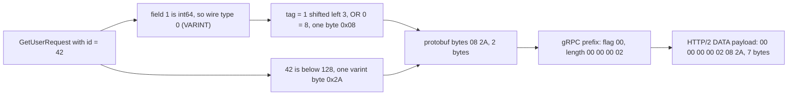
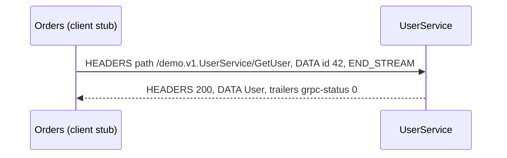
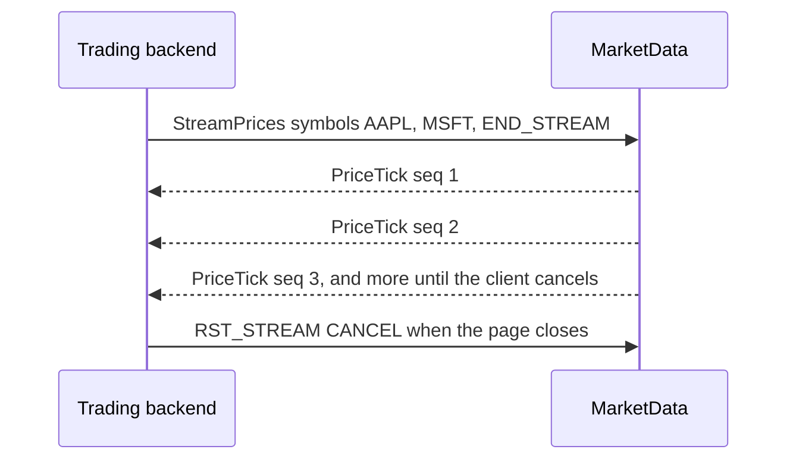
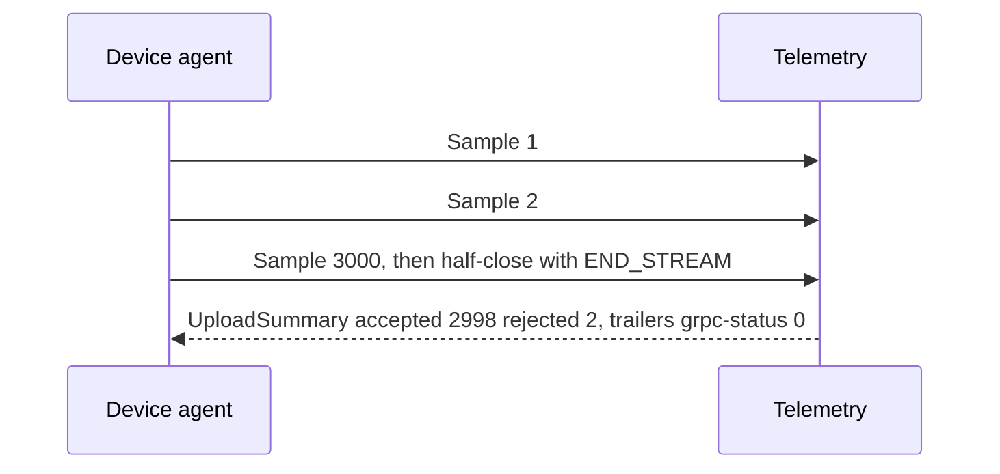
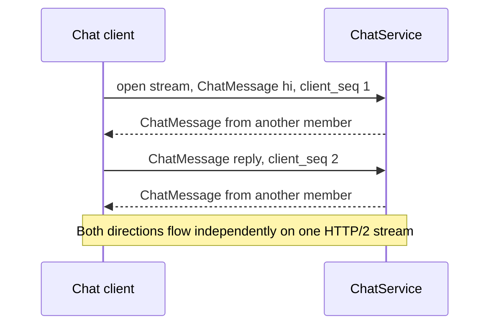
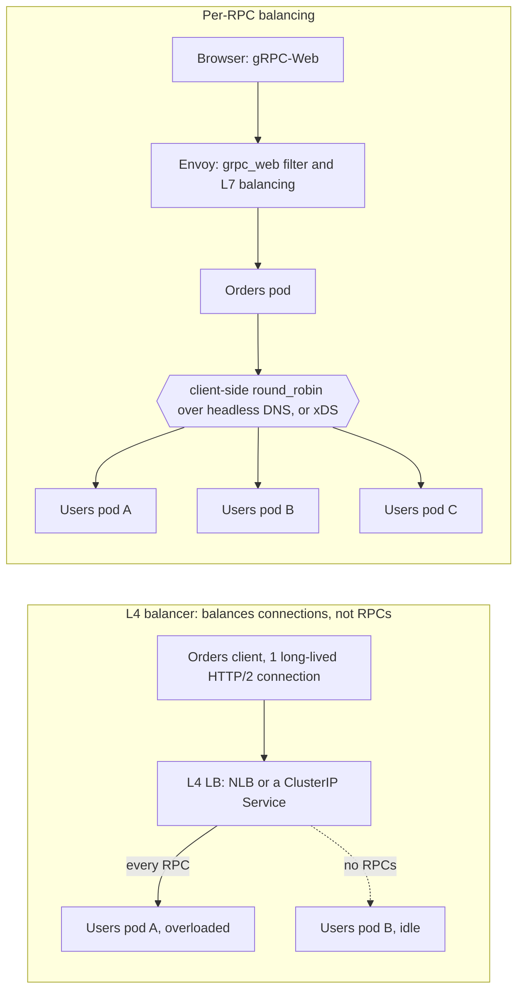

# gRPC

> [!summary] TL;DR
> gRPC lets one service call a function on another service as if it were local. You describe the functions and messages once in a `.proto` file (an **IDL**, an interface definition language). Tools generate typed client and server code for each language, and calls travel as compact protobuf bytes over **HTTP/2**, with deadlines, status codes and streaming built in.

> [!abstract] Core idea
> - You define services and messages in a `.proto` file; tools generate typed client and server code.
> - Calls are protobuf bytes over HTTP/2, so many calls share one connection and streaming is built in.
> - Rule: every call carries a deadline, and servers pass the remaining deadline on to the calls they make.
> - Classic mistake: no deadline (calls hang forever) or retrying non-idempotent calls on every error code.

## 1. Why it exists

An Orders service calls a Users service 2,000 times per second with JSON over HTTP/1.1 (an example load):

- **No enforced contract.** Users renames `user_id` to `id`, and Orders finds out from production errors.
- **Text payloads.** `{"id":42}` is 9 bytes and must be parsed character by character. The protobuf encoding of the same request is 2 bytes (`08 2A`, traced in section 4).
- **One request per connection at a time.** HTTP/1.1 cannot interleave responses on a connection, so 100 concurrent calls need up to 100 connections or wait in line.
- **Every team hand-writes clients**, each with its own timeout, retry and error conventions.

gRPC fixes all four. The `.proto` file is the contract, and code generation turns contract drift into a compile error. Protobuf is compact binary. HTTP/2 multiplexes many calls on one connection. Deadlines, cancellation, status codes, metadata and retries are part of the framework, not team conventions. Google built it from its internal RPC system, Stubby, and open-sourced it in 2015.

## 2. Mental model

**A remote procedure call (RPC) is a function call that happens to cross the network.** The generated client stub looks like a local method, `client.GetUser(ctx, req)`. Underneath, it encodes the request, sends it on an HTTP/2 stream, waits for the response or the deadline, and decodes the result or a status code.

**Analogy:** an international phone call with a shared phrasebook. Both sides own the same phrasebook (the `.proto` file), so they exchange short code numbers instead of full sentences. The phone network (HTTP/2) carries many calls on one line at the same time.

gRPC ships one maintained client library per language (Go, Java, C++, Python, C#, Node and others). Each library hides HTTP/2 from your code, so application code never handles frames. Browsers are a separate problem. JavaScript in a browser cannot control HTTP/2 framing or read trailers, so a browser cannot speak native gRPC. It needs gRPC-Web or Connect, usually through a proxy (section 5).

## 3. How it works

### Define the service, then generate code

```protobuf
syntax = "proto3";

package demo.v1;

option go_package = "example.com/demo/gen/demo/v1;demov1";

message GetUserRequest { int64 id = 1; }
message User {
  int64 id = 1;
  string name = 2;
  string email = 3;
}

message StreamPricesRequest { repeated string symbols = 1; }
message PriceTick {
  string symbol = 1;
  int64 price_micros = 2; // 1 currency unit = 1,000,000 micros: no float money
  int64 seq = 3;          // per-stream sequence number, so gaps are detectable
}

message Sample {
  string sensor_id = 1;
  double value = 2;
  int64 unix_ms = 3;
}
message UploadSummary {
  int64 accepted = 1;
  int64 rejected = 2;
}

message ChatMessage {
  string room_id = 1;
  string text = 2;
  int64 client_seq = 3;
}

service UserService {
  rpc GetUser(GetUserRequest) returns (User); // unary
}
service MarketData {
  rpc StreamPrices(StreamPricesRequest) returns (stream PriceTick); // server streaming
}
service Telemetry {
  rpc Upload(stream Sample) returns (UploadSummary); // client streaming
}
service ChatService {
  rpc Converse(stream ChatMessage) returns (stream ChatMessage); // bidirectional
}
```

This file was compiled with `protocompile` v0.14.1 (a pure-Go protobuf compiler) to check its syntax. Go code was not generated from it, because `protoc` is not installed in this environment.

- **Codegen:** `protoc` with the `protoc-gen-go` and `protoc-gen-go-grpc` plugins, or `buf generate` driven by a `buf.gen.yaml` with pinned plugin versions. The output contains message structs, a client interface with one method per RPC, and a server interface you implement.
- **Method path:** each RPC becomes the HTTP/2 path `/<package>.<Service>/<Method>`, for example `/demo.v1.UserService/GetUser`. Renaming the package, service or method changes the path and breaks every existing client.
- **Field rules:** clients and servers built from different versions of the file still interoperate if you only add fields, never reuse a field number, and `reserved` deleted numbers and names. The full rules live in [[Protocol Buffers and Schema Evolution]].

### From message to bytes

Protobuf writes each field as a **tag** followed by a value. The tag packs the field number and a 3-bit **wire type**: `tag = field_number << 3 | wire_type`. Integers use **varints**: 7 bits per byte, with the high bit meaning "more bytes follow", so small numbers take one byte. Field names never travel; numbers do. That is why protobuf is smaller than JSON.



### On HTTP/2

- Each RPC is one **HTTP/2 stream**. Many streams share one TCP connection, interleaved as frames, so a slow call does not block a fast one at the HTTP layer. The basics of streams and multiplexing live in [[HTTP-1.1 vs HTTP-2 vs HTTP-3]].
- Headers are compressed with **HPACK**. After the first call, repeated headers such as `:path` and `content-type` shrink to an index into a shared table.
- **Request:** a HEADERS frame (`:method POST`, `:path`, `content-type: application/grpc`, `te: trailers`, optional `grpc-timeout` and custom metadata), then DATA frames holding length-prefixed messages.
- **Response:** HEADERS (`:status 200`), DATA frames, then **trailers**: a final HEADERS frame carrying `grpc-status` and `grpc-message`. The HTTP status is 200 even when the call failed. The real outcome is `grpc-status`, which can only be known after the last message is sent.

### Four call types

| Call type | Shape | Real examples | Not a good fit |
| --- | --- | --- | --- |
| Unary | 1 request, 1 response | `GetUser`, `CreateInvoice` | Large results: page them or stream them |
| Server streaming | 1 request, N responses | Price ticker, `kubectl logs -f` style log tail, progress of a long-running job | Video: it streams as HLS/DASH segments over plain HTTP and CDNs, not gRPC |
| Client streaming | N requests, 1 response | Telemetry upload, chunked file upload | Uploads from browsers: gRPC-Web cannot client-stream |
| Bidirectional | N requests and N responses, independently | Chat, multiplayer game state, Envoy's xDS config streams, etcd `Watch` (watches are created and cancelled on one stream) | Simple request/response: unary is easier to retry and balance |









## 4. Worked example

### Whiteboard version

The bare idea from the caller's side: a generated method takes a `context` with a deadline and returns a typed result or a status error. The full version below shows the real bytes on the wire, the framing and the `grpc-timeout` header.

```go
package main

import (
	"context"
	"errors"
	"fmt"
	"time"
)

// A generated gRPC client method looks like this: context first, typed in and out.
type UserClient interface {
	GetUser(ctx context.Context, id int64) (string, error)
}

type fake struct{}

func (fake) GetUser(ctx context.Context, id int64) (string, error) {
	select {
	case <-time.After(50 * time.Millisecond): // the remote call
		return fmt.Sprintf("user-%d", id), nil
	case <-ctx.Done(): // deadline hit: gRPC returns DEADLINE_EXCEEDED
		return "", ctx.Err()
	}
}

func main() {
	var c UserClient = fake{}
	ctx, cancel := context.WithTimeout(context.Background(), 300*time.Millisecond)
	defer cancel() // always set a deadline on every call
	u, err := c.GetUser(ctx, 42)
	fmt.Println(u, err, errors.Is(err, context.DeadlineExceeded))
}
```

### One unary call on the wire

`GetUser({id: 42})` with a 300 ms deadline, traced frame by frame. The bytes follow from the gRPC HTTP/2 spec and the protobuf encoding rules; the Go test below checks the request frame. The client sends the time left when the stream starts, so a real trace shows a `grpc-timeout` slightly below `300000u`.

```text
client -> server   HEADERS (stream 1)
                     :method: POST
                     :scheme: https
                     :path: /demo.v1.UserService/GetUser
                     :authority: users.internal:443
                     content-type: application/grpc
                     te: trailers
                     grpc-timeout: 300000u
                     authorization: Bearer <token>
client -> server   DATA (stream 1, END_STREAM)
                     00 | 00 00 00 02 | 08 2a
                     flag=0, length=2, field 1 varint 42

server -> client   HEADERS (stream 1)
                     :status: 200
                     content-type: application/grpc
server -> client   DATA (stream 1)
                     00 | 00 00 00 07 | 08 2a 12 03 41 64 61
                     User{id: 42, name: "Ada"}: field 2 is tag 0x12, length 3, "Ada"
server -> client   HEADERS (stream 1, END_STREAM)   <- trailers
                     grpc-status: 0
```

If the user does not exist, the server answers with a single **Trailers-Only** HEADERS frame: `:status: 200`, `content-type: application/grpc`, `grpc-status: 5`, `grpc-message: user 42 not found`.

### The framing and the timeout header in Go

Two protocol details come up in design reviews: the 5-byte message prefix, and the `grpc-timeout` header. This standard-library code implements both. It compiles and passes `go vet` and `go test -race` on Go 1.24.4. Production code uses grpc-go, which does this internally (see [[gRPC Services in Go]]).

```go
// Package grpcwire implements two pieces of the gRPC wire protocol:
// message framing and the grpc-timeout header.
package grpcwire

import (
	"encoding/binary"
	"errors"
	"fmt"
	"io"
	"strconv"
	"time"
)

// DefaultMaxRecv is grpc-go's default receive limit per message (4 MiB),
// on both servers and clients.
const DefaultMaxRecv = 4 << 20

// ErrTooLarge becomes status RESOURCE_EXHAUSTED in real gRPC stacks.
var ErrTooLarge = errors.New("grpc: message larger than receive limit")

// WriteMessage writes one Length-Prefixed-Message:
// a 1-byte compressed flag, a 4-byte big-endian length, then the bytes.
func WriteMessage(w io.Writer, msg []byte, compressed bool) error {
	var hdr [5]byte
	if compressed {
		hdr[0] = 1
	}
	binary.BigEndian.PutUint32(hdr[1:], uint32(len(msg)))
	if _, err := w.Write(hdr[:]); err != nil {
		return err
	}
	_, err := w.Write(msg)
	return err
}

// ReadMessage reads one message. It checks the declared length before
// allocating, so a hostile 4 GiB length prefix costs nothing.
// io.EOF means the stream ended cleanly between messages.
func ReadMessage(r io.Reader, maxSize uint32) (msg []byte, compressed bool, err error) {
	var hdr [5]byte
	if _, err := io.ReadFull(r, hdr[:]); err != nil {
		return nil, false, err
	}
	n := binary.BigEndian.Uint32(hdr[1:])
	if n > maxSize {
		return nil, false, fmt.Errorf("%w: %d > %d bytes", ErrTooLarge, n, maxSize)
	}
	msg = make([]byte, n)
	if _, err := io.ReadFull(r, msg); err != nil {
		if errors.Is(err, io.EOF) {
			err = io.ErrUnexpectedEOF
		}
		return nil, false, err
	}
	return msg, hdr[0] == 1, nil
}

// EncodeTimeout formats a grpc-timeout value: a positive integer of at most
// 8 digits plus a unit (n, u, m, S, M, H). Like grpc-go, it picks the finest
// unit that fits and rounds up.
func EncodeTimeout(d time.Duration) string {
	const maxValue = 99_999_999
	if d <= 0 {
		return "0n"
	}
	units := []struct {
		size time.Duration
		name string
	}{
		{time.Nanosecond, "n"}, {time.Microsecond, "u"}, {time.Millisecond, "m"},
		{time.Second, "S"}, {time.Minute, "M"}, {time.Hour, "H"},
	}
	for _, u := range units {
		v := int64(d / u.size)
		if d%u.size != 0 {
			v++ // round up rather than truncate
		}
		if v <= maxValue {
			return strconv.FormatInt(v, 10) + u.name
		}
	}
	return strconv.Itoa(maxValue) + "H"
}
```

```go
package grpcwire

import (
	"bytes"
	"errors"
	"io"
	"testing"
	"time"
)

func TestFrameGetUserRequest(t *testing.T) {
	proto := []byte{0x08, 0x2A} // GetUserRequest{id: 42}: tag 1<<3|0, varint 42
	var buf bytes.Buffer
	if err := WriteMessage(&buf, proto, false); err != nil {
		t.Fatal(err)
	}
	want := []byte{0x00, 0x00, 0x00, 0x00, 0x02, 0x08, 0x2A}
	if !bytes.Equal(buf.Bytes(), want) {
		t.Fatalf("frame = % x, want % x", buf.Bytes(), want)
	}
	msg, compressed, err := ReadMessage(&buf, DefaultMaxRecv)
	if err != nil || compressed || !bytes.Equal(msg, proto) {
		t.Fatalf("ReadMessage = % x, %v, %v", msg, compressed, err)
	}
	if _, _, err := ReadMessage(&buf, DefaultMaxRecv); err != io.EOF {
		t.Fatalf("after the last message err = %v, want io.EOF", err)
	}
}

func TestRejectsOversizedBeforeAllocating(t *testing.T) {
	hdr := []byte{0x00, 0x00, 0x50, 0x00, 0x00} // claims 5 MiB; no body follows
	if _, _, err := ReadMessage(bytes.NewReader(hdr), DefaultMaxRecv); !errors.Is(err, ErrTooLarge) {
		t.Fatalf("err = %v, want ErrTooLarge", err)
	}
}

func TestTruncatedBody(t *testing.T) {
	frame := []byte{0x00, 0x00, 0x00, 0x00, 0x05, 0x08} // claims 5 bytes, has 1
	if _, _, err := ReadMessage(bytes.NewReader(frame), DefaultMaxRecv); err != io.ErrUnexpectedEOF {
		t.Fatalf("err = %v, want io.ErrUnexpectedEOF", err)
	}
}

func TestEncodeTimeout(t *testing.T) {
	cases := []struct {
		d    time.Duration
		want string
	}{
		{50 * time.Millisecond, "50000000n"}, // 8 digits of nanoseconds still fit
		{300 * time.Millisecond, "300000u"},  // 9 digits do not: switch to microseconds
		{2 * time.Second, "2000000u"},
		{5 * time.Minute, "300000m"},
		{1500 * time.Nanosecond, "1500n"},
		{0, "0n"},
	}
	for _, c := range cases {
		if got := EncodeTimeout(c.d); got != c.want {
			t.Errorf("EncodeTimeout(%v) = %q, want %q", c.d, got, c.want)
		}
	}
}
```

What the tests pin down:

- `GetUserRequest{id: 42}` is 2 protobuf bytes and 7 bytes on the HTTP/2 DATA frame. The JSON `{"id":42}` is 9 bytes before any framing.
- A reader must check the length prefix against its limit **before** allocating. Otherwise one 5-byte header can make a server allocate gigabytes.
- `grpc-timeout` is a **relative** duration, so client and server clocks never need to agree.

## 5. Variants and comparison

| Topic | REST + JSON | gRPC |
| --- | --- | --- |
| Contract | Optional (OpenAPI) | Required (`.proto`), with codegen |
| Payload | JSON text | Protobuf binary |
| Transport | HTTP/1.1 or HTTP/2 | HTTP/2 only |
| Streaming | Via SSE, WebSocket or chunked responses, with no typed contract | Four call types, built in |
| Errors | HTTP status codes | `grpc-status` in trailers (17 codes) |
| Browsers | Native | Needs gRPC-Web or Connect plus a proxy |
| HTTP caching and CDNs | Works per URL | Does not apply (every call is a POST) |
| Debugging | `curl` and a browser | `grpcurl`, `buf curl`, server reflection |
| Best for | Public APIs, browsers, cacheable reads | Internal service-to-service calls, streaming, polyglot teams |

**Getting gRPC to browsers and REST clients:**

| Option | How it works | Use when | Cost |
| --- | --- | --- | --- |
| gRPC-Web | A variant protocol with trailers encoded in the response body. A proxy (Envoy's `grpc_web` filter) translates it to gRPC | A browser app must call existing gRPC services | No client streaming or bidi; a proxy to run |
| Connect | Buf's protocol: plain HTTP POST with protobuf or JSON, works on HTTP/1.1. `connect-go` servers also speak gRPC and gRPC-Web on the same port | New services that want one handler for browsers, `curl` and gRPC clients | Another library family to standardize on |
| grpc-gateway | Generates a REST/JSON reverse proxy from `google.api.http` annotations in the `.proto` | Public REST API in front of internal gRPC | A generated layer to version, plus JSON mapping rules |

See [[Serving REST and gRPC Together]] for the Go setup.



## 6. Trade-offs and when not to use

- **Public APIs for unknown clients:** use REST + JSON ([[REST and HTTP API Design]]). Everyone has `curl`; few partners want to install a protobuf toolchain.
- **Browser-first products:** you will need gRPC-Web or Connect plus a proxy anyway. Consider REST, or [[GraphQL]] for flexible reads.
- **Cacheable content:** gRPC calls are POSTs on long-lived connections, so CDN and HTTP caching do not apply.
- **Push to millions of browsers or phones:** use WebSocket or SSE ([[Real-time APIs - WebSocket, SSE and Long Polling]]). gRPC streams fit service-to-service and native mobile apps.
- **Costs you take on:** a codegen pipeline, binary payloads that need tools to read, HTTP/2 end to end (or translating proxies), and load-balancer changes (section 7).

## 7. In production

- **Real systems:** the Kubernetes container runtime interface (kubelet to containerd) is gRPC. The etcd v3 API is gRPC, and its `Watch` method is a bidirectional stream. Envoy usually receives its dynamic configuration over gRPC xDS streams (files and REST polling are the alternatives).

### Deadlines, propagation and cancellation

- **Always set a deadline.** Without one, a call to a hung server waits forever and holds a goroutine, a stream and memory.
- **Propagation:** the client sends the remaining time as `grpc-timeout`. The server's handler context gets that deadline. If the handler passes the **same context** to its downstream calls, grpc-go sends each of them the time still left. Example: the edge sets 300 ms, spends 40 ms, and calls Users with about 260 ms left. Users spends 60 ms and calls its DB with about 200 ms left.
- **Cancellation:** when the deadline passes or the client cancels, the client sends `RST_STREAM`, and the server's context is cancelled. Handlers must watch `ctx.Done()` and stop work. A handler that calls downstream with `context.Background()` breaks both propagation and cancellation.
- **`DEADLINE_EXCEEDED` does not mean "nothing happened".** The server may have committed the write just before the deadline. Retry only idempotent calls, or carry an idempotency key ([[Idempotency and Idempotency Keys]]).

### Status codes and retries

| Code (number) | Meaning | Client action |
| --- | --- | --- |
| `OK` (0) | Success | |
| `CANCELLED` (1) | The caller cancelled | Do not retry |
| `INVALID_ARGUMENT` (3) | Bad input, whatever the system state | Fix the request |
| `DEADLINE_EXCEEDED` (4) | The deadline passed; the work may still have happened | Retry only if idempotent and within the budget |
| `NOT_FOUND` (5), `ALREADY_EXISTS` (6) | Entity missing or duplicate | Do not retry |
| `PERMISSION_DENIED` (7) | Authenticated but not allowed | Do not retry |
| `RESOURCE_EXHAUSTED` (8) | Quota, rate limit or message size exceeded | Quota or rate limit: back off and honour server pushback. Message too large: do not retry, the same message fails again |
| `FAILED_PRECONDITION` (9) | The system is not in the required state | Fix the state first |
| `ABORTED` (10) | Concurrency conflict | Retry the whole read-modify-write at a higher level |
| `UNIMPLEMENTED` (12) | Method not served here | Do not retry |
| `INTERNAL` (13) | A server bug or broken invariant | Do not retry blindly |
| `UNAVAILABLE` (14) | Transient: server down, connection reset | Retry with backoff: the safe default |
| `UNAUTHENTICATED` (16) | Missing or invalid credentials | Refresh the token, then retry once |

Retries are configured per method in the **service config** (gRFC A6), not hand-written loops:

```json
{
  "methodConfig": [{
    "name": [{ "service": "demo.v1.UserService", "method": "GetUser" }],
    "timeout": "0.3s",
    "retryPolicy": {
      "maxAttempts": 3,
      "initialBackoff": "0.05s",
      "maxBackoff": "0.5s",
      "backoffMultiplier": 2,
      "retryableStatusCodes": ["UNAVAILABLE"]
    }
  }],
  "retryThrottling": { "maxTokens": 10, "tokenRatio": 0.1 }
}
```

- `maxAttempts` counts the original call, and values above 5 are treated as 5.
- **Retry throttling is the retry budget.** The client keeps a token count that starts at `maxTokens`. Each failed call removes 1 token, and each success adds `tokenRatio`. Only failures with a retryable status code, or with server pushback saying "do not retry", count. When the count is at or below `maxTokens / 2`, the client stops retrying until it climbs back above. A struggling server therefore sees fewer retries, not three times its load. General backoff and budget theory lives in [[Timeouts, Retries and Backoff]].
- **Hedging** (also gRFC A6) sends extra copies of the same idempotent call, one per `hedgingDelay`, and takes the first successful answer. The copies typically land on different backends, but nothing guarantees it. Hedging cuts tail latency at the price of extra load.

### Metadata and interceptors

- **Metadata** is gRPC's name for headers: lowercase keys, string values. Keys ending in `-bin` carry binary values, base64-encoded on the wire. The `grpc-` prefix is reserved. A server can send **headers** (before the first message) and **trailers** (after the last one).
- **Interceptors** are middleware around every call: unary and streaming variants, chained on both client and server. A typical server chain is recovery → tracing → logging → authentication → validation → handler. Client interceptors attach tokens and trace IDs. Go APIs are in [[gRPC Services in Go]].
- Rich errors travel in the `grpc-status-details-bin` trailer as a serialized `google.rpc.Status` with typed details, for example `BadRequest` with one entry per invalid field.

### Load balancing

HTTP/2 connections are long-lived, and one connection carries every call. An **L4** balancer (AWS NLB, a Kubernetes ClusterIP Service) picks a backend once per connection, so one client pins all its calls to one pod (see the diagram in section 5). Fixes:

1. **Client-side balancing:** the client resolves every backend address and spreads calls across them. In Kubernetes use a headless Service (`clusterIP: None`, so DNS returns all pod IPs) with the `round_robin` policy, or **xDS** from a control plane such as Istio for proxyless gRPC.
2. **An L7 proxy** that balances per request: Envoy, Linkerd, or an AWS ALB with gRPC support ([[Forward and Reverse Proxies - L4 vs L7]]).
3. **`MaxConnectionAge` on servers:** connections are closed after a set age, so clients reconnect and newly added pods get traffic. grpc-go re-resolves DNS only when a connection breaks, so this matters for headless DNS.

### Security and tooling

- **TLS** is the default for anything leaving a host; gRPC negotiates HTTP/2 with ALPN `h2`. Service identity uses **mTLS** or per-RPC tokens in the `authorization` metadata. The mechanisms are in [[Service-to-Service Auth - API Keys, HMAC, mTLS]] and [[TLS and HTTPS]].
- **Server reflection** lets tools list services and fetch descriptors at runtime. Enable it in development; on public endpoints it hands out your API map.
- **Health checking protocol:** the `grpc.health.v1.Health` service with `Check` and `Watch`, returning `SERVING` or `NOT_SERVING` per service. Kubernetes has native gRPC probes (GA since Kubernetes 1.27).
- **grpcurl** is `curl` for gRPC. Example commands (not run here):

```bash
grpcurl -plaintext localhost:50051 list
grpcurl -plaintext -d '{"id": 42}' localhost:50051 demo.v1.UserService/GetUser
grpcurl -plaintext localhost:50051 grpc.health.v1.Health/Check
```

### What to monitor

- Rate, latency histogram and status-code counts **per method**. HTTP-level metrics can show 100% `200 OK` while calls fail, because the failure travels in `grpc-status`.
- Calls per backend pod: a skew means connection pinning.
- Active streams per server, stream duration, and message sizes near the 4 MiB limit.
- GOAWAY counts, reconnects and keepalive failures.

## 8. Deep dive

- **Keepalive:** clients can send HTTP/2 PING frames to detect dead connections behind NAT or load-balancer idle timeouts. grpc-go sends none unless you set `keepalive.ClientParameters`. Servers enforce a minimum ping interval: grpc-go's default `EnforcementPolicy.MinTime` is 5 minutes. A client that pings more often gets `GOAWAY` with `ENHANCE_YOUR_CALM` and the debug data `too_many_pings`, and its connection closes. Align the client's `keepalive.ClientParameters.Time` with the server's policy.
- **Message size:** grpc-go rejects received messages over 4 MiB by default, on both servers and clients, with `RESOURCE_EXHAUSTED`. Raise the limit deliberately, or better, stream the payload in chunks (for example 64 KiB each) or upload it to object storage and pass a key ([[File Upload Architecture]]).
- **Flow control:** HTTP/2 has per-stream and per-connection windows. A slow consumer of a server stream stops granting window, and the sender's `Send` blocks. That is backpressure for free, but an unbounded fan-out goroutine behind `Send` still needs its own limit ([[Backpressure and Flow Control]]).
- **Stream limits:** a server advertises `SETTINGS_MAX_CONCURRENT_STREAMS`. When a client reaches it on its one connection, new calls wait on the client side. Very high-concurrency clients may need several connections.
- **Trailers matter:** the final status travels in trailers, so every hop must speak HTTP/2 end to end, or translate (gRPC-Web). An HTTP/1.1 proxy in the middle breaks gRPC in confusing ways.
- **Long-lived streams and deploys:** a stream that lives for hours pins a client to one pod, survives scale-out, and dies on every deploy. Design streams to resume from a sequence number (the `seq` field above) and reconnect with jittered backoff. Go patterns are in [[gRPC Streaming in Go]].
- **Compatibility beyond fields:** adding a method or a service is safe. Renaming a method, changing a unary method to streaming, or moving a service to another package breaks the path or the call shape. Deprecate and add instead.

## 9. Interview questions

> [!question]- Trap: you put gRPC services behind an L4 load balancer and one pod is at 100% CPU while the others idle. Why?
> HTTP/2 multiplexes every call over one long-lived connection, and an L4 balancer picks a backend once per connection. Balance per call instead: client-side `round_robin` over a headless Service or xDS, or an L7 proxy such as Envoy. Add `MaxConnectionAge` so connections rotate and new pods receive traffic.

> [!question]- What happens to a deadline as a call passes through three services?
> The client sends the remaining time as the relative `grpc-timeout` header. Each server's context gets that deadline, and passing the same context downstream sends the time still left, so the budget shrinks at every hop. When it runs out, every hop's context is cancelled, and the caller sees `DEADLINE_EXCEEDED`.

> [!question]- Which status codes should a client retry automatically?
> `UNAVAILABLE`, with exponential backoff, jitter and a retry budget such as gRFC A6 retry throttling. `RESOURCE_EXHAUSTED` only after backing off. `DEADLINE_EXCEEDED` only for idempotent calls, because the work may have completed. Never retry `INVALID_ARGUMENT`, `PERMISSION_DENIED` or `NOT_FOUND`.

> [!question]- Why can't a browser call a gRPC server directly, and what do you do?
> Browser JavaScript cannot control HTTP/2 framing or read trailers, and gRPC puts the final status in trailers. Use gRPC-Web through a proxy such as Envoy (unary and server streaming only), Connect (plain HTTP POST, also serves gRPC), or grpc-gateway to expose REST/JSON.

> [!question]- Why is a protobuf message smaller than the same JSON?
> Field names never travel: each field is a tag byte holding the field number and wire type. Integers are varints, so 42 is one byte. `{"id":42}` is 9 bytes in JSON and 2 bytes (`08 2A`) in protobuf, plus a 5-byte gRPC frame prefix.

> [!question]- A price feed must reach 50,000 browsers. Is gRPC server streaming the right tool?
> No. Server streaming fits service-to-service calls and native clients. Browsers would need gRPC-Web through a proxy, and the fan-out problem is the same as for any long-lived connection. Use SSE or WebSocket at the edge, fed internally by gRPC streams or a broker.

> [!question]- How do you change a `.proto` without breaking deployed clients?
> Only add fields and methods. Never reuse or renumber a field; `reserved` removed numbers and names. Never rename packages, services or methods, because they form the HTTP/2 path. Run `buf breaking` in CI against the last released schema.

## 10. Cheat sheet

- `.proto` = contract; codegen gives typed clients and servers; path `/<package>.<Service>/<Method>`.
- Wire: tag `field << 3 | wire_type`, varints; frame = 1-byte flag + 4-byte length + message; 4 MiB default receive limit.
- HTTP/2: one stream per call, HPACK headers, `grpc-status` in trailers, HTTP status 200 even on failure.
- Four call types: unary (`GetUser`), server stream (ticker, log tail), client stream (telemetry, upload), bidi (chat).
- Always set deadlines; pass the incoming `ctx` downstream; retry only `UNAVAILABLE` (plus idempotent calls) with backoff and a budget.
- L4 balancers pin connections: use client-side `round_robin`/xDS or an L7 proxy, plus `MaxConnectionAge`.
- Browsers need gRPC-Web, Connect or grpc-gateway; use reflection and `grpcurl` in development, health service for probes.

## Links

- **Before this:** [[HTTP-1.1 vs HTTP-2 vs HTTP-3]], [[Choosing an API Style]], [[REST and HTTP API Design]]
- **Next:** [[Protocol Buffers and Schema Evolution]], [[gRPC Services in Go]], [[gRPC Streaming in Go]], [[Serving REST and gRPC Together]]
- **Compare with:** [[GraphQL]] (client-shaped queries), [[Real-time APIs - WebSocket, SSE and Long Polling]] (push to browsers), [[Load Balancing]] (L4 vs L7 balancing)
