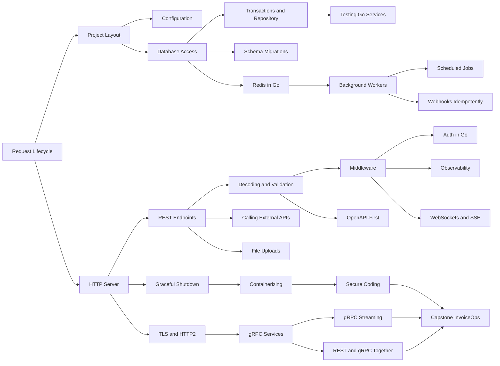

# 06 Backend Engineering in Go MOC

> [!summary] What this folder covers
> Building a production Go service end to end, from the request pipeline and database access to shutdown, TLS and gRPC, ending with the InvoiceOps capstone.

## Before and after

- **Before this:** [[04 Go Language MOC]] · [[05 APIs MOC]]
- **After this:** [[13 DevOps & Cloud MOC]] · [[15 Testing MOC]] · [[16 Software Architecture MOC]]

## Learning path

Back to [[Home]]. All 29 notes are written.

1. [[Backend Request Lifecycle and Layering]] · basic. How a request flows through transport, service and store layers.
2. [[Service Project Layout and Wiring]] · basic. Where packages live and how `main` wires dependencies together.
3. [[Configuration and Secrets]] · basic. Loading typed, validated config and keeping secrets out of code.
4. [[HTTP Server Fundamentals (net-http)]] · basic. The `http.Server`, `ServeMux` and handler model.
5. [[Building REST Endpoints]] · basic. Routing, status codes and JSON responses for a resource.
6. [[Request Decoding, Validation and DTOs]] · intermediate. Strict decoding and turning bad input into clear 4xx errors.
7. [[Middleware]] · intermediate. Wrapping handlers for logging, recovery and auth.
8. [[OpenAPI-First Development in Go]] · intermediate. Generating server stubs from the contract.
9. [[Database Access (database-sql, pgx, sqlc)]] · intermediate. Pools, queries and type-safe generated SQL.
10. [[Transactions and the Repository Pattern]] · intermediate. Running several writes atomically behind a clean interface.
11. [[Schema Migrations in Go Services]] · intermediate. Versioned, safe schema changes.
12. [[Testing Go Services]] · intermediate. Handler, store and integration tests.
13. [[Authentication and Authorization in Go]] · intermediate. Verifying identity and enforcing permissions in handlers.
14. [[Calling External APIs]] · intermediate. Timeouts, retries and idempotency on outbound calls.
15. [[Redis in Go]] · intermediate. Caching and rate limiting with go-redis.
16. [[Background Workers and Job Queues]] · intermediate. Moving slow work off the request path.
17. [[Scheduled Jobs]] · intermediate. Running periodic work safely across replicas.
18. [[Receiving Webhooks Idempotently]] · intermediate. Verify, store and acknowledge fast, then process once.
19. [[File Uploads and Object Storage]] · intermediate. Streaming uploads and presigned URLs.
20. [[Observability in Go Services]] · intermediate. Logs, metrics and traces with slog and OpenTelemetry.
21. [[Graceful Shutdown and Health Checks]] · intermediate. Draining in-flight work and reporting readiness.
22. [[TLS, HTTPS and HTTP2 in Go Servers]] · intermediate. Configuring `tls.Config` and HTTP/2 correctly.
23. [[Containerizing Go Services]] · intermediate. Small, secure multi-stage images.
24. [[Secure Coding for Go Services]] · advanced. Common Go-specific vulnerabilities and fixes.
25. [[gRPC Services in Go]] · intermediate. Defining protos, serving unary RPCs and mapping errors.
26. [[gRPC Streaming in Go]] · advanced. Server, client and bidirectional streams with flow control.
27. [[Serving REST and gRPC Together]] · advanced. One service, two transports.
28. [[WebSockets and SSE in Go]] · advanced. Pushing real-time updates to browsers.
29. [[Capstone - InvoiceOps]] · advanced. Every piece combined into one service.

## Concept map

## Interview focus

- How do you structure a Go service into layers, and why? See [[Backend Request Lifecycle and Layering]].
- How do you inject dependencies without a framework? See [[Service Project Layout and Wiring]].
- How do you validate input and return consistent errors? See [[Request Decoding, Validation and DTOs]].
- How do you run several queries in one transaction in Go? See [[Transactions and the Repository Pattern]].
- How do you size and tune a database connection pool? See [[Database Access (database-sql, pgx, sqlc)]].
- How do you make outbound calls resilient? See [[Calling External APIs]].
- How do you process a webhook exactly once? See [[Receiving Webhooks Idempotently]].
- How does graceful shutdown work in Kubernetes? See [[Graceful Shutdown and Health Checks]].
- How do you stop a worker from losing jobs on deploy? See [[Background Workers and Job Queues]].
- How do gRPC deadlines and status codes work in Go? See [[gRPC Services in Go]].

## Sources worth reading

- Go standard library docs for `net/http`, `database/sql` and `crypto/tls` (pkg.go.dev).
- Mat Ryer, "How I write HTTP services in Go after 13 years" (Grafana blog).
- The sqlc and pgx documentation.
- grpc-go examples and the gRPC Go documentation (grpc.io).
- Alex Edwards, *Let's Go Further*.
