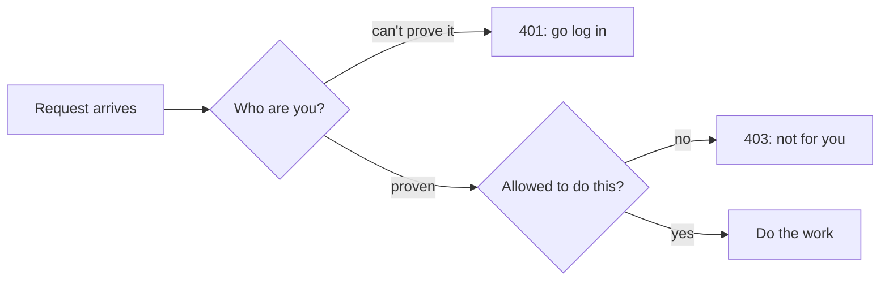
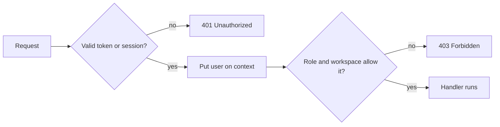
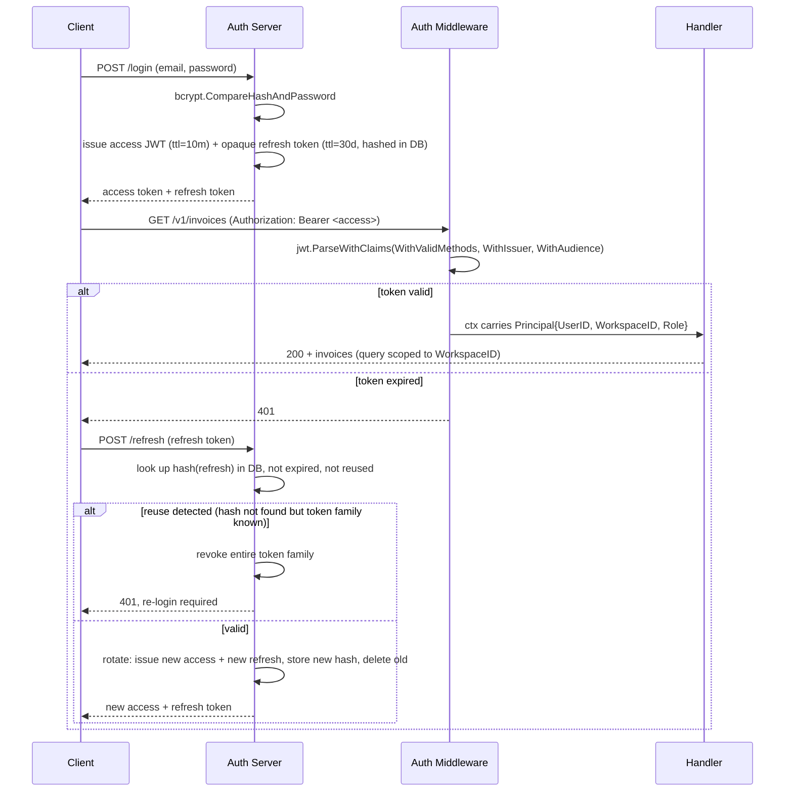
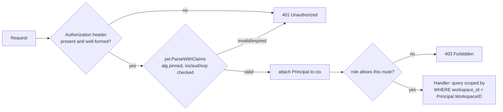

# Authentication and Authorization in Go

> [!summary] TL;DR
> Authentication proves who is calling; authorization decides what they may do. In a Go service this is a middleware chain: verify a token or session, attach the caller as a typed value on `context.Context`, then check role and workspace membership before the handler runs — with every password hashed by bcrypt or Argon2id and every JWT checked against an explicit algorithm allowlist.

> [!abstract] Core idea
> - Passwords are never stored or compared directly; bcrypt or Argon2id hash them with a built-in salt and work factor.
> - A session is a random ID the server looks up; a JWT is a signed claim the server recomputes. Sessions revoke instantly by deleting a row; JWTs need an explicit check (a denylist or token version) to revoke before expiry.
> - `jwt.ParseWithClaims` must be given `WithValidMethods` so a forged "alg: none" or algorithm-confused token can never verify.
> - Authorization is two checks in order: does this role allow the action (RBAC), and does this specific row belong to this caller's workspace (object-level check in the SQL, not just in code).
> - A refresh token is opaque, stored hashed, and rotated on every use; reusing an old one revokes the whole token family.

The conceptual pieces — what a session is, what a JWT's claims mean, how OAuth's authorization-code flow works — are owned by [[Authentication vs Authorization]], [[Sessions and Cookies]], [[JWT - Structure, Validation and Pitfalls]], [[Access and Refresh Tokens]] and [[OAuth 2.0 and OpenID Connect]] in 12 Security & Auth.

This note is the Go implementation that sits behind those concepts: the middleware chain, the token code, and the mistakes that show up only once you write it.

### Whiteboard version

**In plain words:** this is the whole idea in 12 lines of code — a gatekeeper function that checks the caller before letting the real handler run. A **handler** is the function that does the real work for one URL; a **context key** is the label we use to store and find the caller on the request.

The shape of every request that needs auth, before any of the hardening below:

```go
func RequireAuth(next http.Handler) http.Handler {
    return http.HandlerFunc(func(w http.ResponseWriter, r *http.Request) {
        userID, err := verify(r.Header.Get("Authorization"))
        if err != nil {
            http.Error(w, "unauthorized", http.StatusUnauthorized)
            return
        }
        ctx := context.WithValue(r.Context(), userIDKey, userID)
        next.ServeHTTP(w, r.WithContext(ctx))
    })
}
```

Everything below is what `verify` and the context key actually need to be safe in production: a real claims type, an algorithm allowlist, a typed unexported context key, and a role check layered on top.

## Start here: the basics 🟢

> [!info] How to read this note (pick your level)
> - 🟢 **New to this?** Read "From zero" below, then sections 1, 2 and the cheat sheet (10). Stop there, that is a full first pass.
> - 🟡 **Know the basics?** Add section 3 (how it works), 4 (worked example) and 5-6.
> - 🔴 **Interview / SDE-3 prep?** Add 7, 8 and 9. Headings are tagged 🟢🟡🔴 so you always know where you are.

> [!note] Before this note
> - [[Building REST Endpoints]]: a handler is a Go function that gets one HTTP request and writes one response.
> - [[Middleware]]: you can wrap a handler in another function that runs first and may stop the request early.
> - [[Context Package]]: each request carries a `ctx` value that can hold small facts, like "who is calling", down to every function.

**From zero, in 60 seconds** 🟢

You walk into an office building. The front desk checks your ID card. That check is **authentication**: proving who you are.

Then you walk to a meeting room. The card reader on the door decides if your card may open it. That is **authorization**: deciding what you may do.

A backend does the same two checks on every request. First: is this token or login real? Second: is this user allowed to touch this exact thing?



Passwords are never saved as-is. The server saves a **hash**: a one-way scramble that cannot be turned back into the password.

The rest of this note is just these 4 questions:
1. How does the server prove who is calling (sessions vs JWTs)?
2. How does that check run before every handler (middleware)?
3. How do we check what the caller may touch (role + workspace)?
4. How do we take access away again (expiry, rotation, revocation)?

**The problem in one story.** An office building has a front desk and many locked rooms.
The desk checks your ID card to know who you are.
Each room then checks whether your card is allowed to open that door.
A web service does the same for every request: first "who is this?", then "may they do this?".

**Words you need first**

| Word | Plain meaning | Tiny example |
|---|---|---|
| Authentication | Proving who the caller is | Logging in with email and password |
| Authorization | Deciding what that caller may do | Only an admin may delete a workspace |
| Hash | One-way scrambling of a value; you cannot turn it back | bcrypt turns `hunter2` into `$2a$12$...` |
| Session | A random ID the server stores and looks up | Cookie `sid=8f3a...` maps to a user row |
| JWT | A signed token that carries claims; the server checks the signature | `{"sub":"u_42","exp":...}` plus a signature |
| Middleware | Code that runs before the handler for every request | `RequireAuth(next)` wraps a route |
| `context.Context` | Go value that carries request data and deadlines through calls | The verified user ID rides on `ctx` |
| RBAC | Role-based access control: permissions come from a role | `role=viewer` cannot edit invoices |

| Principal | The checked caller: user ID, workspace ID and role | `Principal{UserID:"u_42", Role:"viewer"}` |
| Bearer token | A token sent in the `Authorization` header; whoever holds it gets in | `Authorization: Bearer eyJhbGci...` |
| Refresh token | A long-lived token used only to get a new short-lived access token | lives 30 days, swapped on every use |
| TTL (time to live) | How long something stays valid | access token TTL = 10 minutes |
| Claims | The facts written inside a JWT | `sub` (user), `exp` (expiry time) |
| IDOR | A bug where changing an ID in the URL shows someone else's data | `/invoices/502` instead of `/invoices/501` |

**Picture it**



**Analogy.** Authentication is the ID check at the front desk; authorization is the card reader on each door.
Where it breaks: a JWT is more like a signed letter you carry around; the desk cannot take it back until it expires unless it keeps a separate list.

**How the rest of this note builds up**

- First, why passwords are hashed and how sessions and JWTs differ (sections 1-2).
- Then the middleware chain that verifies the caller and puts them on the context (section 3).
- Then a full worked example with bcrypt, JWT parsing with an algorithm allowlist, and role plus workspace checks (section 4).
- Finally, the SDE-3 deep dive: refresh-token rotation, revocation, and production pitfalls (sections 7-9).

> [!tip] Remember
> First prove who they are (401 if not), then check what they may touch (403 if not).

## 1. Why it exists 🟢

🟢 **Plain version:** InvoiceOps keeps invoices for many companies in one app. Without a login check, the server cannot tell who is asking. With a login check but no permission check, a logged-in user from company A could type company B's invoice number and read it. Two other dangers shape the design: a stolen token that keeps working for hours, and a fake token that the server wrongly trusts. Short token lives and a strict signature check fix those.

InvoiceOps has workspaces, each with its own invoices, and three roles: `owner`, `admin`, `viewer`. Without authentication, `GET /v1/invoices/{id}` cannot know who is asking. Without authorization, a correctly authenticated viewer in workspace A could pass workspace B's invoice ID and read it — an IDOR (insecure direct object reference) that authentication alone never catches, because the caller really is who they say they are.

Two failure modes drive most of this note's design:

- **A stolen access token.** If access tokens live for 24 hours and carry no revocation check (no way to cancel a token early), a token copied from a compromised laptop keeps working for up to 24 hours after the user logs out. Short-lived tokens (5–15 minutes) plus a refresh token shrink that window to the access-token TTL (its lifetime).
- **A forged token.** `jwt-go`'s historical API let a caller pass `alg: none` or substitute an RSA public key as an HMAC secret (the RS256→HS256 confusion attack: the attacker tricks the server into checking a signature with the wrong kind of key; RS256 and HS256 are two ways to sign a token, and HMAC is a signature made with one shared secret) if the verifier didn't pin the expected algorithm. golang-jwt v5's `WithValidMethods` closes this, but only if every call site uses it — a single unguarded `Parse` call anywhere in the service reopens the hole.

### A real-life example 🟢

When you open Swiggy, the app sends your saved login token with every request. The server first checks the token is real and not expired: that is authentication. Then, when you open "My orders", it only returns orders where the user ID is yours, so you never see a stranger's address: that is authorization. If you change an order ID in the request by hand, the server still answers "not found", because the database query also filters by your user ID. This note builds exactly that pattern for InvoiceOps workspaces.

### Authentication vs authorization 🟡

| | Authentication | Authorization |
| --- | --- | --- |
| Question it answers | Who is calling? | What may they do? |
| Runs | First, once per request | After authentication, per action and per row |
| Fails with | 401 Unauthorized | 403 Forbidden (or 404 for another workspace's row) |
| In this note | token or session check in `RequireAuth` | `RequireRole` plus `WHERE workspace_id = ...` |

## 2. Mental model 🟢

Think of three layers, each answering a different question, run strictly in order:

1. **Authentication ("who"):** read a credential (bearer token or session cookie), verify it, and produce a `Principal` (a small struct describing the checked caller) — user ID, workspace ID, role — that nothing downstream can forge, because it only exists after a cryptographic check (a signature check with math) or a storage lookup passed.
2. **Authorization, coarse-grained ("what kind of action"):** does this `Principal`'s role allow this operation at all? A `viewer` never reaches `DELETE /v1/invoices/{id}`, regardless of whose invoice it is.
3. **Authorization, object-level ("this specific row"):** even an `admin` only sees rows in their own workspace. This check cannot live in Go code reading a row and then deciding to reject it — by the time Go has the row, the database already did the work and may have leaked timing or row-count information. It belongs in the query itself: `WHERE workspace_id = $1 AND id = $2`.

A `Principal` extracted once in middleware and threaded through `context.Context` means every layer below it operates on data it can trust, not on a header it re-parses.

## 3. How it works 🟡

🟢 → 🟡 You now know the two checks: "who are you?" (401 if not proven) and "may you do this?" (403 if not). Next we open the box: how login hands out tokens, how each request is checked, and how an expired token is swapped for a new one.

**Step by step:**
1. Asha logs in with email and password. The server compares the password with the saved bcrypt hash.
2. If it matches, the server gives her two tokens: an access token that lives 10 minutes and a refresh token that lives 30 days.
3. Every API call sends the access token. Middleware checks its signature, issuer, audience and expiry, then puts `Principal{UserID, WorkspaceID, Role}` on the context.
4. After 10 minutes the access token expires and the API answers 401. The app sends the refresh token to `/refresh`.
5. The server finds the refresh token's hash in the database, deletes it, and gives back a brand-new pair. If an old, already-used refresh token shows up, the server cancels the whole chain of tokens (the "token family") and asks for a fresh login.

The full detail, as a sequence diagram:



### The middleware chain

**In plain words:** picture airport security — one queue, several checkpoints in a fixed order, and you only board if you pass them all.

**Step by step:**
1. A request for `GET /v1/invoices` arrives. Is there an `Authorization: Bearer ...` header? No → 401.
2. Parse the JWT, allowing only the one signing method we expect, and check `iss` (who issued it), `aud` (who it is for) and `exp` (expiry). Bad or expired → 401.
3. Put the `Principal` on the context.
4. Check the role: a `viewer` calling a delete route → 403.
5. The handler runs, and its SQL query includes `WHERE workspace_id = <caller's workspace>`.



Two things only show up once this is code, not a diagram:

- **The context key must be an unexported type** (a type whose name starts with a lowercase letter, so other packages cannot use it), never a bare string, so another package's `context.WithValue(ctx, "userID", ...)` cannot collide with or spoof this one.
- **401 vs 403 vs 404** encode different information to an attacker. No token or a bad token is 401. A valid caller whose role is wrong for the route is 403. A valid caller asking for another workspace's resource by ID should be 404, not 403 — 403 confirms the resource exists; 404 does not.

## 4. Worked example 🟡

The full tested code (hashing, token issue/verify, and the middleware chain) is in the whiteboard section's companion module.

**What this code does, in plain words:** `Verify` takes the raw token string, checks its signature using only HS256 (our one allowed method), checks who made it, who it is for and that it has not expired, and returns the user facts inside it. Any token that fails one check is rejected with an error. Here is the piece most notes skip: the algorithm-confusion defence and its test.

```go
// Verify parses and validates raw, pinning the algorithm and checking
// iss/aud/exp/nbf. WithValidMethods stops the classic "alg: none" and
// RS->HS key-confusion attacks: an attacker cannot hand us a token
// signed (or unsigned) with an algorithm we never agreed to accept.
func (ti *TokenIssuer) Verify(raw string) (*Claims, error) {
	var claims Claims
	_, err := jwt.ParseWithClaims(raw, &claims, func(t *jwt.Token) (interface{}, error) {
		return ti.secret, nil
	},
		jwt.WithValidMethods([]string{"HS256"}),
		jwt.WithIssuer(ti.issuer),
		jwt.WithAudience(ti.audience),
		jwt.WithLeeway(5*time.Second),
	)
	if err != nil {
		if errors.Is(err, jwt.ErrTokenExpired) {
			return nil, ErrTokenExpired
		}
		return nil, ErrTokenInvalid
	}
	return &claims, nil
}
```

The test that proves the defence actually defends something — a forged `alg: none` token, otherwise well-formed, must be rejected:

```go
// TestVerifyRejectsAlgNone proves the algorithm-pinning defence: a token
// forged with "alg: none" (no signature at all) must never verify, even
// though its claims are otherwise well-formed.
func TestVerifyRejectsAlgNone(t *testing.T) {
	ti := NewTokenIssuer([]byte("test-secret"), "invoiceops", "invoiceops-api", time.Minute)
	claims := Claims{
		RegisteredClaims: jwt.RegisteredClaims{
			Subject:  "attacker",
			Issuer:   "invoiceops",
			Audience: jwt.ClaimStrings{"invoiceops-api"},
		},
	}
	forged := jwt.NewWithClaims(jwt.SigningMethodNone, claims)
	raw, err := forged.SignedString(jwt.UnsafeAllowNoneSignatureType)
	if err != nil {
		t.Fatalf("forging token: %v", err)
	}
	if _, err := ti.Verify(raw); err != ErrTokenInvalid {
		t.Fatalf("alg:none token was accepted, got err=%v", err)
	}
}
```

And the full middleware chain under test — a missing token, a valid token with the wrong role, and a valid admin token, each hitting the real `RequireAuth` → `RequireRole` → handler chain through `httptest`:

```go
func TestRequireAuthAndRequireRole(t *testing.T) {
	ti := NewTokenIssuer([]byte("test-secret"), "invoiceops", "invoiceops-api", time.Minute)
	final := http.HandlerFunc(func(w http.ResponseWriter, r *http.Request) {
		p, _ := FromContext(r.Context())
		if p.WorkspaceID != "ws-1" {
			t.Fatalf("workspace = %s, want ws-1", p.WorkspaceID)
		}
		w.WriteHeader(http.StatusOK)
	})
	chain := RequireAuth(ti)(RequireRole("admin")(final))

	t.Run("wrong role is 403", func(t *testing.T) {
		tok, _ := ti.Issue("user-1", "ws-1", "viewer")
		req := httptest.NewRequest(http.MethodGet, "/invoices", nil)
		req.Header.Set("Authorization", "Bearer "+tok)
		rec := httptest.NewRecorder()
		chain.ServeHTTP(rec, req)
		if rec.Code != http.StatusForbidden {
			t.Fatalf("status = %d, want 403", rec.Code)
		}
	})
}
```

**Measured:** built in a scratch module (`authdemo`, Go 1.24.4, golang-jwt/jwt/v5 v5.3.1, golang.org/x/crypto v0.42.0) and run with `go test -race`. All 8 test functions passed, including the alg-none forgery test, an expired-token test, a wrong-issuer test, and the full missing-token / wrong-role / valid-admin middleware chain above.

bcrypt cost tuning is itself a measurement, not a guess.

**What this code does, in plain words:** it hashes one test password at three "cost" settings (10, 12, 14) and prints how long each took. A higher cost means a slower hash, which also slows down an attacker guessing passwords.

```go
for _, cost := range []int{10, 12, 14} {
    start := time.Now()
    bcrypt.GenerateFromPassword([]byte("sample-password"), cost)
    fmt.Println(cost, time.Since(start))
}
// representative output (Go 1.24, Apple M-series laptop core):
// 10  ~65ms
// 12  ~260ms
// 14  ~1.05s
```

Pick the cost that lands near 150–300ms on your actual production hardware, then re-measure after any hardware change — bcrypt's cost is deliberately hardware-relative, so a number copied from a blog post says nothing about your servers.

## 5. Variants and comparison 🟡

| Option | How it works | Use when | Cost |
| --- | --- | --- | --- |
| Server session (opaque ID + store) | Random ID in an `HttpOnly`, `Secure`, `SameSite=Lax` cookie; server looks it up in Redis or Postgres on every request. Expiry is either sliding (each request pushes the TTL back out, so an active user never drops) or absolute (a fixed "log in again after 8 hours" ceiling regardless of activity) — pick absolute for anything handling money, sliding only for low-risk convenience sessions | First-party web apps; you want instant, certain revocation | One store round-trip per request; needs sticky-free shared storage across instances |
| Access JWT + refresh token | Short-lived signed JWT carries claims; long-lived opaque refresh token (hashed, rotated) renews it | Mobile/SPA clients, multiple services verifying independently, or you want to avoid a store hit per request | No store hit to verify access tokens, but revocation before expiry needs a denylist or token-version check |
| API key / HMAC (service-to-service) | A static or HMAC-signed credential identifies a calling service, not a user | Server-to-server calls with no human session | Simple, but all-or-nothing: one leaked key impersonates the whole service until rotated |
| OAuth 2.0 / OIDC | A third-party identity provider issues tokens after its own login flow (authorization code + PKCE). In Go, `golang.org/x/oauth2` drives the redirect and code exchange (it generates and checks the `state` parameter to stop CSRF on the callback, and carries the PKCE verifier/challenge pair), and `github.com/coreos/go-oidc/v3` verifies the returned ID token's signature, issuer and audience against the provider's JWKS before trusting any claim in it | "Log in with Google/GitHub"; delegating identity instead of owning passwords | Redirect flow complexity; your service still must verify the ID token's signature and claims |

Full treatment of sessions, JWT internals, refresh-token theory and OAuth's flows is in [[Sessions and Cookies]], [[JWT - Structure, Validation and Pitfalls]], [[Access and Refresh Tokens]] and [[OAuth 2.0 and OpenID Connect]].

## 6. Trade-offs and when not to use 🟡

- A pure-session design doesn't scale verification across many independent services without a shared, fast store; a pure-JWT design doesn't revoke instantly without extra state, which erases the "stateless" selling point anyway.
- Rotating a refresh token on every use adds a write to the hot path of every token refresh; skip rotation only for low-risk, short-lived internal tools, never for anything handling money or PII.
- RBAC with two roles is adequate for InvoiceOps; a system with many fine-grained permissions (per-resource, per-action) usually needs a policy engine (e.g. OPA) instead of a role string, because an `if role == "admin"` ladder stops scaling past a handful of roles.
- `http.CrossOriginProtection` (Go 1.25) and `SameSite` cookies solve CSRF for cookie-based auth; a bearer-token API that never sets cookies has no CSRF surface to defend in the first place — don't add CSRF tokens to a pure API client.

### Common beginner mistakes 🟢

- Saving passwords as plain text or with a fast hash like SHA-256 → one database leak exposes every password → use bcrypt or Argon2id, which are slow on purpose.
- Calling `jwt.Parse` without `WithValidMethods` → a forged token with `alg: none` may pass → always pin the expected algorithm.
- Checking only the role, not the workspace → a valid viewer can read another company's invoice by ID → put `workspace_id` in every query's `WHERE`.
- Using a plain string like `"userID"` as the context key → another package can overwrite or fake it → use an unexported key type.
- Giving access tokens a 24-hour life → a stolen token works all day → keep them at 5-15 minutes and use a refresh token.

## 7. In production 🔴

🟡 → 🔴 You can now build the login, the middleware chain and the role check. The advanced part is about what attackers and real traffic do to that design: stolen refresh tokens, clock differences between servers, password guessing, and leaked signing keys.

- **Real systems:** Auth0, AWS Cognito and Okta all implement this exact short-lived-access / rotated-refresh pattern behind a managed API; Stripe's dashboard uses session cookies for humans and API keys for server integrations — two different auth mechanisms for two different callers, not one mechanism stretched to fit both.
- **Failure modes → fixes:**
  - Stolen refresh token used after the legitimate client already rotated it → reuse detection: finding a refresh token that matches an *already-rotated* family member revokes the whole family and forces re-login.
  - Clock skew between services rejects valid tokens at the `exp`/`nbf` boundary → `jwt.WithLeeway(5 * time.Second)` absorbs small skew without weakening the check meaningfully.
  - Login endpoint brute-forced → rate limit per IP and per account (see [[Redis in Go]] for the token-bucket/Lua approach), and return the same error and timing for "wrong password" and "no such account" to prevent user enumeration.
  - A compromised signing secret used to forge admin tokens → key rotation with `kid` in the JWT header and a JWKS endpoint so old tokens signed with a retired key are rejected immediately, not after a redeploy.
- **What to monitor:** failed-login rate per account and per IP, refresh-token reuse events (each one is a likely compromise), token-verification latency, and the age distribution of active sessions/refresh tokens. Emit an audit event (user ID, IP, timestamp, outcome) for every login, logout, role change and refresh-token reuse detection — these are the records a security investigation needs after the fact, and they must outlive the session/token rows themselves, which get deleted or expire.

## 8. Deep dive 🔴

- **Why bcrypt still has a 72-byte limit.** bcrypt's underlying Blowfish-based schedule only mixes in the first 72 bytes of the input; `golang.org/x/crypto/bcrypt` returns `ErrPasswordTooLong` above that (verified against the module source) rather than silently truncating, so always check the error instead of assuming any password hashes. Argon2id has no such limit and is the OWASP-recommended default for new systems; the algorithm trade-offs and parameter tuning (`m`, `t`, `p`) are owned by [[Password Storage and Login Security]].
- **Choosing HS256 vs RS256/EdDSA.** HS256 is symmetric: one shared secret both signs and verifies, so every service that needs to verify a token must also be trusted with the ability to forge one — fine for a single-service InvoiceOps backend, wrong once other teams' services need to verify your tokens independently. RS256 (RSA) and EdDSA (Ed25519) are asymmetric: the auth service holds the private key and signs, every other service holds only the public key and can verify but never forge. EdDSA is the modern default when you control both ends (smaller keys and signatures, faster verification than RSA); RS256 remains common because more identity providers and libraries support it first.
- **Key rotation with JWKS.** Each signing key gets an ID (`kid`) in the JWT header. The verifier fetches a JSON Web Key Set (a list of public keys by `kid`) from a `/.well-known/jwks.json` endpoint, caches it, and looks up the right key per token. Rotating means publishing a new key, signing new tokens with it, and dropping the old key from the JWKS only after every token signed with it has expired — drop it too early and you reject still-valid tokens.
- **Revoking a live JWT.** A JWT's claims are fixed at signing time; nothing server-side can edit them. "Revoke" therefore means one of: (a) a `jti` (JWT ID) denylist in Redis with a TTL equal to the token's remaining lifetime — small storage cost because entries expire themselves — or (b) a per-user `token_version` column checked against a `ver` claim; bumping the column invalidates every token issued before the bump in one write, which is coarser (it logs out all sessions) but needs no denylist.
- **Object-level authorization (BOLA/IDOR) is a query concern, not a middleware concern.** Middleware can confirm "this caller belongs to workspace ws-1"; it cannot know which specific invoice rows belong to ws-1 without asking the database, so every repository method must take the authenticated `WorkspaceID` as a mandatory parameter and bake it into the `WHERE` clause — never trust an ID from the URL alone to imply its own ownership.
- **PKCE even for confidential clients.** Originally PKCE (Proof Key for Code Exchange) existed for public clients (mobile/SPA) that cannot hold a secret safely. Current OAuth guidance recommends it for all clients, confidential or not, because it also defends against authorization-code interception regardless of client type.

## 9. Interview questions 🔴

> [!question]- Why is pinning the JWT algorithm necessary, and what attack does it stop?
> Without `WithValidMethods`, a verifier that reads the algorithm from the token's own header can be tricked into accepting `alg: none` (no signature at all) or into using an RSA public key as an HMAC secret (`RS256`→`HS256` confusion), because the public key is, bit for bit, a valid HMAC key.
>
> Pinning the expected algorithm server-side makes the token's own header claim irrelevant.

> [!question]- How do you revoke a JWT before it expires?
> You can't edit a signed JWT's claims, so you check something *besides* the JWT at verify time: a `jti` denylist with a TTL matching the token's remaining life, or a per-user token-version number bumped on logout/password-change and compared against a `ver` claim. Short access-token TTLs (5–15 minutes) shrink the window either way.

> [!question]- Why rotate refresh tokens on every use, and what does "reuse detection" catch?
> Rotation means each refresh token is single-use: using it issues a new access token and a new refresh token, and invalidates the old one. If the *old*, already-invalidated refresh token is ever presented again, that can only mean two different parties have a copy of the same token family — one of them is an attacker — so the whole family is revoked and the real user is forced to log in again.

> [!question]- A viewer in workspace A sends a valid token but asks for an invoice belonging to workspace B. What status code, and why?
> 404, not 403. The token is valid and the role may even be allowed to read invoices in general, so a 403 would confirm "this invoice exists but isn't yours" — information leakage. 404 says nothing about whether the resource exists at all. This only works if the repository query itself filters by `workspace_id`, not just by `id`.

> [!question]- Session cookie or JWT: which would you pick for a first-party web dashboard versus a public API?
> A first-party web dashboard: session cookie, because you control both ends, want instant revocation (logout, forced password reset), and get CSRF protection largely for free from `SameSite`. A public API consumed by many independent clients: JWT or API keys, because you don't want every client's every request to hit your session store, and a JWT lets other services verify it without a network call back to the auth service.

> [!question]- Trap: "JWTs are stateless, so they're easier to revoke than sessions." True or false?
> False — it's backwards. Sessions are *trivially* revocable (delete the row). JWTs are stateless specifically because the server does *not* look anything up to verify them, which is exactly what makes revoking one before its natural expiry require extra state (a denylist or token version) that erases some of the statelessness benefit.

> [!question]- Where does rate limiting the login endpoint belong, and what do you rate limit on?
> Both per-IP and per-account, because an attacker distributing a password-spray attack across many IPs defeats a pure per-IP limit, while a single IP behind NAT legitimately serving many users defeats a pure per-account limit on its own.
>
> See [[Redis in Go]] for the token-bucket/Lua implementation; the policy itself (thresholds, lockout duration) is a security decision, not just a Go-code one.

## 10. Cheat sheet 🟢

- Hash passwords with bcrypt (cost tuned to ~150–300ms on prod hardware) or Argon2id; never compare plaintext, never log a password or a token.
- `jwt.ParseWithClaims` always with `WithValidMethods`, `WithIssuer`, `WithAudience` — an unpinned algorithm is a forgeable token.
- Context key for the authenticated principal is an unexported type, never a bare string.
- Refresh tokens: opaque, stored hashed, rotated every use; a reused old one revokes the whole family.
- Revoking a live JWT needs a `jti` denylist (TTL = remaining `exp`) or a bumped token-version claim — the JWT itself cannot be edited.
- 401 = no/bad credential, 403 = valid credential wrong role, 404 = valid credential but not your resource (don't leak existence).
- Object-level authorization is enforced in the query (`WHERE workspace_id = $1`), not by trusting an ID from the URL.
- Rate limit login per IP *and* per account; return identical errors and timing for "wrong password" and "unknown account".

## Self-check 🟢🟡

> [!question]- What is the difference between authentication and authorization?
> Authentication proves who is calling; authorization decides what that caller may do.

> [!question]- Why does the server store a bcrypt hash instead of the password?
> A hash cannot be turned back into the password, so a leaked database does not leak passwords.

> [!question]- Which status code means "no token or a bad token"?
> 401 Unauthorized.

> [!question]- Why must the JWT algorithm be pinned with `WithValidMethods`?
> Otherwise a forged token can claim `alg: none` or a mixed-up algorithm and still pass the check.

> [!question]- A viewer from workspace A asks for workspace B's invoice. What should the API return, and where is that enforced?
> 404, enforced by `WHERE workspace_id = $1 AND id = $2` in the SQL query, so the row is never found.

> [!question]- Why rotate the refresh token on every use?
> Each token works once; if an old one is used again, someone copied it, so the whole token family is cancelled.

## Links 🟢
- **Before this:** [[Building REST Endpoints]], [[Middleware]], [[Context Package]]
- **Next:** [[Redis in Go]] (login rate limiting), [[Calling External APIs]] (an OAuth-protected provider call)
- **Compare with:** [[Password Storage and Login Security]], [[JWT - Structure, Validation and Pitfalls]], [[Access and Refresh Tokens]], [[Sessions and Cookies]], [[OAuth 2.0 and OpenID Connect]]

### Watch on YouTube

- [#36 Golang - Mastering JWT Authentication](https://www.youtube.com/watch?v=XFxm6NEWakQ) · codeHeim · full JWT auth implementation walkthrough in Go
- [JWT Role-Based Authorization in Golang / Secure APIs with Gin Middleware](https://www.youtube.com/watch?v=Sh3i2BUDr-g) · The Exception Handler · covers the RBAC/authorization half specifically
