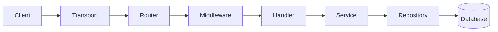
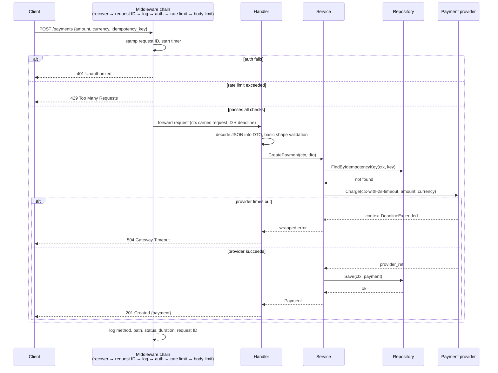
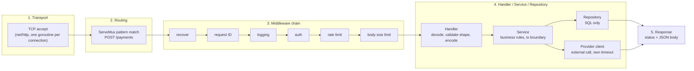

# Backend Request Lifecycle and Layering

> [!summary] TL;DR
> A backend request moves through a fixed pipeline: the network accepts the connection, a router picks a handler, a chain of middleware runs first, then a handler/service/repository split does the actual work, and a response comes back out through the same chain.
>
> Knowing this pipeline by name is what lets you say exactly where validation, auth, logging and error handling belong.

> [!abstract] Core idea
> - Every request passes through the same five stages: transport → routing → middleware → handler/service/repository → response.
> - Each stage has one job. A handler decodes and encodes; a service decides; a repository persists. None of them do each other's job.
> - `context.Context` carries the request's deadline and request-scoped values through every stage, so any layer can stop early.
> - A domain error (e.g. "invoice is void") is just a Go error until the handler maps it to an HTTP status; the service layer never imports `net/http`.
> - Production backends add observability (request ID, logs, metrics) and graceful shutdown around this pipeline, not inside the business logic.

## Start here: the basics

**The problem in one story.** You post a letter to pay a bill.
It goes through the post office, a sorting room, a clerk who reads it, an accountant who decides, and a filing cabinet.
Then a receipt comes back the same way.
A web request is that letter, and each room has one clear job.

**Words you need first**

| Word | Plain meaning | Tiny example |
|---|---|---|
| Request | A message a client sends to the server | `POST /payments` with a JSON body |
| Router | Picks which code handles a URL and method | `/payments` goes to `CreatePayment` |
| Middleware | Code that runs around every handler | Logging, auth, rate limiting |
| Handler | Turns HTTP into Go values and back | Decodes JSON into a `PaymentInput` struct |
| Service | Holds the business rules | "A void invoice cannot be paid" |
| Repository | The only layer that talks SQL | `INSERT INTO payments ...` |
| `context.Context` | Carries deadline and request data through all layers | A 2-second timeout stops a slow query |
| Status code | Number saying how the request went | 400 bad input, 502 provider down |

**Picture it**



**Analogy.** It is like airport security: each checkpoint can stop you and send you back, and only cleared passengers reach the gate.
Where it breaks: in a real airport you do not come back through the same checkpoints; a response does pass back out through the middleware chain.

**How the rest of this note builds up**

- First, why a fixed pipeline stops every endpoint reinventing auth and errors (sections 1-2).
- Then each stage, from transport to response, with a sequence diagram (section 3).
- Then `POST /payments` end to end in code (section 4).
- Finally, the SDE-3 deep dive on variants, trade-offs and production concerns (sections 5-9).

> [!tip] Remember
> Handler translates, service decides, repository persists; middleware wraps them all.

## 1. Why it exists

Without an agreed pipeline, every endpoint reinvents where auth, validation and error formatting live. A team of five without this agreement ends up with five different places that check `X-Api-Key`, five different error JSON shapes, and a bug where one handler forgets rate limiting because nothing enforces that it runs for every route.

Concretely: `POST /payments` on InvoiceOps has to authenticate the caller, validate the amount and currency, call a payment provider over the network (which can time out), write the result to Postgres, and return a consistent error body whether the failure was "bad input" (400) or "provider unreachable" (502).

If that logic is scattered across the handler, a shared library, and ad hoc `if` statements, a new engineer cannot answer "where does a timeout turn into a 504?" without reading every file touched by the request.

The lifecycle gives that question one answer: transport and routing are fixed by `net/http`, middleware runs in a declared order for every route, the handler only translates HTTP ↔ Go types, the service owns the business decision and the transaction boundary, and the repository is the only thing that knows SQL exists.

## 2. Mental model

Think of the request as a parcel going through airport security, not a function call. Each checkpoint (middleware) can stop the parcel and send a response back immediately — a `401` from auth, a `429` from rate limiting — without the parcel ever reaching the handler.

The handler is a translator standing at a desk: it turns the parcel's contents (JSON bytes) into typed Go values, hands them to the one expert behind the desk (the service), and translates the expert's answer back into parcel form (JSON + status code).

The service is the only one allowed an opinion about the business ("a void invoice cannot be paid"); the repository is a filing clerk who only knows how to put a form in a cabinet and take one out, with no opinion about whether the form made sense.

## 3. How it works



The project layout that backs this pipeline — which package does which job, and the import directions between them — is its own topic: see [[Service Project Layout and Wiring]]. The piece specific to this note is the flow of **one request** through those packages:



**Stage by stage:**

1. **Transport.** `net/http`'s server accepts a TCP connection and runs each connection on its own goroutine, not each request. You never see this layer directly; it is why a slow handler only blocks the requests sharing its connection, not the whole process — until the goroutine count itself becomes the problem (see [[HTTP Server Fundamentals (net-http)]] for the timeout settings that bound this, and the deep dive below for why keep-alive requests on one connection share that one goroutine).
2. **Routing.** Since Go 1.22, `http.ServeMux` matches method and path together (`POST /payments`) and supports wildcards (`/invoices/{id}`). The matched pattern decides which handler runs; it decides nothing else.
3. **Middleware**, in a fixed order for every route: **recover** (turn a panic into a 500 instead of a crash) must run first so it wraps everything after it; **request ID** next, so every later log line and the response header carry it; **logging** wraps the rest so it can time the whole chain; **auth** before any handler-specific logic runs; **rate limit** after auth, since you usually rate-limit per authenticated identity; **body size limit** last, right before the handler reads the body. The full reasoning for this order, and how to write a middleware that can short-circuit, lives in [[Middleware]].
4. **Handler → Service → Repository**, the layer this note is really about:
   - The **handler** decodes the request body into a DTO, does shape validation (right types, required fields present), calls exactly one service method, and encodes the result. It holds no business rules. Full decoding/validation rules live in [[Request Decoding, Validation and DTOs]]; the HTTP-specific parts of this split (status codes, response envelopes) live in [[Building REST Endpoints]].
   - The **service** holds the business rules and owns the transaction boundary: in `CreatePayment` above, "check idempotency, then charge, then persist" is one unit of business logic even though it is not one SQL transaction. A service method takes and returns plain Go types and errors — never an `http.Request` or a status code.
   - The **repository** is an interface the service declares (see [[Service Project Layout and Wiring]] for why the consumer owns the interface) and a concrete type elsewhere implements against `database/sql` or `pgx`. It does queries and nothing else; see [[Database Access (database-sql, pgx, sqlc)]].
5. **Response.** The handler is the only layer that writes HTTP status codes and body bytes. Logging middleware then records the status a lower layer already wrote (see the `statusWriter` gotcha in the code below).

**Context propagation.** `ctx` flows in one direction only: the router passes it into middleware, middleware into the handler, the handler into the service, the service into the repository and provider client. Each stage reads the deadline or does `context.WithTimeout` to carve out a shorter one for one outbound call, and reads request-scoped values (like the request ID) that an earlier stage set with `context.WithValue`.

No layer below the handler stores or reuses a `ctx` past the call that received it. The full rules for deadlines, cancellation and the `context.Context` API live in [[Context Package]]; this note only shows the shape of the propagation.

**Error mapping.** A domain error such as `ErrInvalidAmount` is created deep inside the service and wrapped with `%w` as it returns up the stack. Exactly one function, at the boundary between the handler and the service, turns that error into a status code with `errors.Is`.

Nothing below the handler ever constructs an `http.StatusX` value. The richer version of this mapping — error response bodies, field-level validation errors — belongs to [[API Error Handling]]; this note only establishes that the mapping happens in one place.

## 4. Worked example

### Whiteboard version

The shape without any of the production concerns: a handler that calls a service, and one function that turns an error into a status code.

```go
func paymentHandler(svc *Service) http.HandlerFunc {
    return func(w http.ResponseWriter, r *http.Request) {
        var req CreatePaymentRequest
        json.NewDecoder(r.Body).Decode(&req)

        payment, err := svc.CreatePayment(r.Context(), req)
        if err != nil {
            status, _ := mapError(err)
            http.Error(w, err.Error(), status)
            return
        }
        json.NewEncoder(w).Encode(payment)
    }
}
```

The full version below adds the parts that make it production code: middleware, idempotency, a bounded outbound call, and tests.

### `POST /payments` end to end

The service layer. It never imports `net/http`:

```go
// Domain errors. The HTTP layer maps each one to a status code; the
// service layer never imports net/http.
var (
    ErrInvalidAmount  = errors.New("amount must be positive")
    ErrDuplicateKey   = errors.New("idempotency key already used")
    ErrProviderFailed = errors.New("payment provider failed")
)

type CreatePaymentRequest struct {
    IdempotencyKey string
    AmountMinor    int64 // money as integer minor units (cents)
    Currency       string
}

type Payment struct {
    ID, Currency, ProviderRef, IdempotencyKey string
    AmountMinor                               int64
}

// Repo is the interface the service depends on; the store package
// implements it (see the project layout note for why the consumer owns it).
type Repo interface {
    FindByIdempotencyKey(ctx context.Context, key string) (*Payment, bool, error)
    Save(ctx context.Context, p *Payment) error
}

type Provider interface {
    Charge(ctx context.Context, amountMinor int64, currency string) (providerRef string, err error)
}

type Service struct {
    repo     Repo
    provider Provider
    newID    func() string
}

func NewService(repo Repo, provider Provider) *Service {
    return &Service{repo: repo, provider: provider, newID: newID}
}

// CreatePayment owns the transaction boundary: validate, check
// idempotency, call the provider, persist, in that order, inside the
// request's context.
func (s *Service) CreatePayment(ctx context.Context, req CreatePaymentRequest) (*Payment, error) {
    if req.AmountMinor <= 0 {
        return nil, fmt.Errorf("create payment: %w", ErrInvalidAmount)
    }

    if existing, found, err := s.repo.FindByIdempotencyKey(ctx, req.IdempotencyKey); err != nil {
        return nil, fmt.Errorf("create payment: lookup: %w", err)
    } else if found {
        return existing, nil // same key seen before: don't charge twice
    }

    // Outbound call gets its own bounded timeout, carved out of the
    // request's remaining deadline.
    providerCtx, cancel := context.WithTimeout(ctx, 2*time.Second)
    defer cancel()

    ref, err := s.provider.Charge(providerCtx, req.AmountMinor, req.Currency)
    if err != nil {
        return nil, fmt.Errorf("create payment: %w: %w", ErrProviderFailed, err)
    }

    p := &Payment{ID: s.newID(), AmountMinor: req.AmountMinor, Currency: req.Currency,
        ProviderRef: ref, IdempotencyKey: req.IdempotencyKey}
    if err := s.repo.Save(ctx, p); err != nil {
        return nil, fmt.Errorf("create payment: save: %w", err)
    }
    return p, nil
}
```

The middleware chain and the handler that maps errors to status codes:

```go
type ctxKey string

const requestIDKey ctxKey = "request_id"

// writeError writes a small JSON error envelope; the full shape (field
// errors, error codes as a stable contract) belongs to the API Error
// Handling note.
func writeError(w http.ResponseWriter, status int, code, message string) {
    w.Header().Set("Content-Type", "application/json")
    w.WriteHeader(status)
    _ = json.NewEncoder(w).Encode(map[string]string{"code": code, "message": message})
}

func Recover(log *slog.Logger) func(http.Handler) http.Handler {
    return func(next http.Handler) http.Handler {
        return http.HandlerFunc(func(w http.ResponseWriter, r *http.Request) {
            defer func() {
                if rec := recover(); rec != nil {
                    log.Error("panic recovered", "panic", rec, "path", r.URL.Path)
                    writeError(w, http.StatusInternalServerError, "internal_error", "something went wrong")
                }
            }()
            next.ServeHTTP(w, r)
        })
    }
}

func RequestID(genID func() string) func(http.Handler) http.Handler {
    return func(next http.Handler) http.Handler {
        return http.HandlerFunc(func(w http.ResponseWriter, r *http.Request) {
            id := r.Header.Get("X-Request-Id")
            if id == "" {
                id = genID()
            }
            w.Header().Set("X-Request-Id", id)
            next.ServeHTTP(w, r.WithContext(context.WithValue(r.Context(), requestIDKey, id)))
        })
    }
}

// statusWriter captures the status code so Logging can report it.
// Gotcha: if a handler never calls WriteHeader, Write defaults it to
// 200, which is what statusWriter also defaults to here.
type statusWriter struct {
    http.ResponseWriter
    status      int
    wroteHeader bool
}

func (w *statusWriter) WriteHeader(code int) {
    if w.wroteHeader {
        return // a second WriteHeader call is a net/http no-op plus a log warning
    }
    w.status, w.wroteHeader = code, true
    w.ResponseWriter.WriteHeader(code)
}

func Logging(log *slog.Logger) func(http.Handler) http.Handler {
    return func(next http.Handler) http.Handler {
        return http.HandlerFunc(func(w http.ResponseWriter, r *http.Request) {
            start := time.Now()
            sw := &statusWriter{ResponseWriter: w, status: http.StatusOK}
            next.ServeHTTP(sw, r)
            log.Info("request", "request_id", r.Context().Value(requestIDKey),
                "method", r.Method, "path", r.URL.Path,
                "status", sw.status, "duration_ms", time.Since(start).Milliseconds())
        })
    }
}

// Chain applies middleware in the order given, so the first one listed
// runs first: Chain(h, Recover(l), RequestID(g), Logging(l)) builds
// recover(requestID(logging(h))).
func Chain(h http.Handler, mw ...func(http.Handler) http.Handler) http.Handler {
    for i := len(mw) - 1; i >= 0; i-- {
        h = mw[i](h)
    }
    return h
}

func PaymentHandler(svc *Service) http.HandlerFunc {
    return func(w http.ResponseWriter, r *http.Request) {
        if r.Method != http.MethodPost {
            writeError(w, http.StatusMethodNotAllowed, "method_not_allowed", "use POST")
            return
        }
        var body struct {
            IdempotencyKey string `json:"idempotency_key"`
            AmountMinor    int64  `json:"amount_minor"`
            Currency       string `json:"currency"`
        }
        dec := json.NewDecoder(r.Body)
        dec.DisallowUnknownFields()
        if err := dec.Decode(&body); err != nil {
            writeError(w, http.StatusBadRequest, "bad_request", "invalid JSON body")
            return
        }

        p, err := svc.CreatePayment(r.Context(), CreatePaymentRequest{
            IdempotencyKey: body.IdempotencyKey, AmountMinor: body.AmountMinor, Currency: body.Currency,
        })
        if err != nil {
            status, code := mapError(err)
            writeError(w, status, code, err.Error())
            return
        }
        w.Header().Set("Content-Type", "application/json")
        w.WriteHeader(http.StatusCreated)
        _ = json.NewEncoder(w).Encode(p)
    }
}

// mapError is the one place that turns a domain error into a status
// code. Everything upstream of this function only ever sees Go errors.
func mapError(err error) (status int, code string) {
    switch {
    case errors.Is(err, ErrInvalidAmount):
        return http.StatusBadRequest, "invalid_amount"
    case errors.Is(err, ErrDuplicateKey):
        return http.StatusConflict, "duplicate_key"
    case errors.Is(err, ErrProviderFailed):
        return http.StatusBadGateway, "provider_failed"
    case errors.Is(err, context.DeadlineExceeded):
        return http.StatusGatewayTimeout, "timeout"
    default:
        return http.StatusInternalServerError, "internal_error"
    }
}
```

Tests, run with `go test -race`, covering the part of the lifecycle most bugs hide in — the error-to-status mapping and the idempotent replay. The fakes and helpers the tests share:

```go
// fakeProvider stands in for the real payment provider; err simulates a
// provider failure or a context.DeadlineExceeded timeout.
type fakeProvider struct {
    ref     string
    err     error
    charges int
}

func (f *fakeProvider) Charge(ctx context.Context, amountMinor int64, currency string) (string, error) {
    f.charges++
    if f.err != nil {
        return "", f.err
    }
    return f.ref, nil
}

// fakeRepo is an in-memory Repo used only by tests; it is not the
// production repository (see the Database Access note).
type fakeRepo struct {
    byKey map[string]*Payment
}

func newFakeRepo() *fakeRepo { return &fakeRepo{byKey: map[string]*Payment{}} }

func (r *fakeRepo) FindByIdempotencyKey(ctx context.Context, key string) (*Payment, bool, error) {
    p, ok := r.byKey[key]
    return p, ok, nil
}

func (r *fakeRepo) Save(ctx context.Context, p *Payment) error {
    r.byKey[p.IdempotencyKey] = p
    return nil
}

func newTestService(provider Provider) (*Service, *fakeRepo) {
    repo := newFakeRepo()
    return NewService(repo, provider), repo
}

func testHandler(t *testing.T, provider Provider) http.Handler {
    t.Helper()
    svc, _ := newTestService(provider)
    return PaymentHandler(svc)
}

func TestCreatePayment_IdempotentReplay(t *testing.T) {
    provider := &fakeProvider{ref: "prov_1"}
    svc, _ := newTestService(provider)
    req := CreatePaymentRequest{IdempotencyKey: "key-1", AmountMinor: 500, Currency: "INR"}

    first, _ := svc.CreatePayment(context.Background(), req)
    second, _ := svc.CreatePayment(context.Background(), req)

    if first.ID != second.ID {
        t.Fatalf("replay returned a different payment: %v vs %v", first.ID, second.ID)
    }
    if provider.charges != 1 {
        t.Fatalf("provider charged %d times, want 1 (second call must not re-charge)", provider.charges)
    }
}

func TestCreatePayment_Success(t *testing.T) {
    provider := &fakeProvider{ref: "prov_1"}
    svc, _ := newTestService(provider)

    p, err := svc.CreatePayment(context.Background(), CreatePaymentRequest{
        IdempotencyKey: "key-1", AmountMinor: 500, Currency: "INR",
    })

    if err != nil {
        t.Fatalf("CreatePayment: %v", err)
    }
    if p.ProviderRef != "prov_1" {
        t.Fatalf("ProviderRef = %q, want prov_1", p.ProviderRef)
    }
}

func TestCreatePayment_InvalidAmount(t *testing.T) {
    svc, _ := newTestService(&fakeProvider{ref: "prov_1"})

    _, err := svc.CreatePayment(context.Background(), CreatePaymentRequest{AmountMinor: 0, Currency: "INR"})

    if !errors.Is(err, ErrInvalidAmount) {
        t.Fatalf("err = %v, want ErrInvalidAmount", err)
    }
}

func TestCreatePayment_ProviderTimeoutWrapsDeadlineExceeded(t *testing.T) {
    svc, _ := newTestService(&fakeProvider{err: context.DeadlineExceeded})

    _, err := svc.CreatePayment(context.Background(), CreatePaymentRequest{AmountMinor: 500, Currency: "INR"})

    if !errors.Is(err, context.DeadlineExceeded) {
        t.Fatalf("err = %v, want context.DeadlineExceeded", err)
    }
}

func TestPaymentHandler_ProviderFailureMapsTo502(t *testing.T) {
    h := testHandler(t, &fakeProvider{err: errors.New("gateway down")})
    req := httptest.NewRequest(http.MethodPost, "/payments",
        bytes.NewBufferString(`{"idempotency_key":"key-1","amount_minor":500,"currency":"INR"}`))
    rec := httptest.NewRecorder()

    h.ServeHTTP(rec, req)

    if rec.Code != http.StatusBadGateway {
        t.Fatalf("status = %d, want %d", rec.Code, http.StatusBadGateway)
    }
}

func TestPaymentHandler_SuccessReturns201(t *testing.T) {
    h := testHandler(t, &fakeProvider{ref: "prov_1"})
    req := httptest.NewRequest(http.MethodPost, "/payments",
        bytes.NewBufferString(`{"idempotency_key":"key-1","amount_minor":500,"currency":"INR"}`))
    rec := httptest.NewRecorder()

    h.ServeHTTP(rec, req)

    if rec.Code != http.StatusCreated {
        t.Fatalf("status = %d, want %d", rec.Code, http.StatusCreated)
    }
}

func TestPaymentHandler_InvalidAmountMapsTo400(t *testing.T) {
    h := testHandler(t, &fakeProvider{ref: "prov_1"})
    req := httptest.NewRequest(http.MethodPost, "/payments",
        bytes.NewBufferString(`{"idempotency_key":"key-1","amount_minor":0,"currency":"INR"}`))
    rec := httptest.NewRecorder()

    h.ServeHTTP(rec, req)

    if rec.Code != http.StatusBadRequest {
        t.Fatalf("status = %d, want %d", rec.Code, http.StatusBadRequest)
    }
}

func TestPaymentHandler_MalformedJSONMapsTo400(t *testing.T) {
    h := testHandler(t, &fakeProvider{ref: "prov_1"})
    req := httptest.NewRequest(http.MethodPost, "/payments", bytes.NewBufferString(`{not json`))
    rec := httptest.NewRecorder()

    h.ServeHTTP(rec, req)

    if rec.Code != http.StatusBadRequest {
        t.Fatalf("status = %d, want %d", rec.Code, http.StatusBadRequest)
    }
}
```

**Measured** (Go 1.24.4, `go test -race -v ./...`, 2026-11-07): 8 tests, all pass — 4 at the service level (success, invalid amount, idempotent replay charges the provider exactly once, provider timeout maps to `context.DeadlineExceeded`) and 4 through the full middleware chain (201 on success, 400 on invalid amount, 502 on provider failure, 400 on malformed JSON).

Graceful shutdown wires the whole chain into one server and ties its lifetime to a signal, not to the process exiting mid-request:

```go
logger := slog.Default()
srv := &http.Server{
    Addr: ":8080", Handler: mux,
    ReadTimeout: 5 * time.Second, ReadHeaderTimeout: 3 * time.Second,
    WriteTimeout: 10 * time.Second, IdleTimeout: 120 * time.Second,
}
ctx, stop := signal.NotifyContext(context.Background(), syscall.SIGTERM, syscall.SIGINT)
defer stop()
go func() {
    if err := srv.ListenAndServe(); err != nil && !errors.Is(err, http.ErrServerClosed) {
        logger.Error("listen", "err", err)
    }
}()
<-ctx.Done()
stop()
shutdownCtx, cancel := context.WithTimeout(context.Background(), 10*time.Second)
defer cancel()
if err := srv.Shutdown(shutdownCtx); err != nil { // waits for in-flight requests, up to 10s, instead of killing them
    logger.Error("shutdown", "err", err)
}
```

The timeout fields on `http.Server` and why their zero values are dangerous are covered in [[HTTP Server Fundamentals (net-http)]].

## 5. Variants and comparison

| Layering style | How it works | Use when | Cost |
| --- | --- | --- | --- |
| Handler → service → repository (this note) | Three layers, one direction of calls, interfaces owned by the service | Default for most backend services; matches how this vault's other 06 notes are written | A bit of ceremony for trivial CRUD |
| Transaction Script | Each use case is one function that does validation, DB calls and response shaping together | A handful of simple CRUD endpoints with no shared business rules | Logic duplicates across endpoints as the service grows |
| Hexagonal / Ports and Adapters | Same idea as handler/service/repo, but the service layer defines "ports" for every external dependency (DB, provider, clock), and `main` wires "adapters" to them | Many external dependencies, or you want to swap adapters per environment (e.g. fake clock in tests) | More interfaces and wiring code upfront |
| CQRS (command/query split) | Writes and reads go through separate models, sometimes separate stores | Read and write load or shapes differ enough that one model serves neither well | Two models to keep consistent; usually only worth it at scale |

Hexagonal architecture is the same core idea as handler/service/repository with more names for the same seams; InvoiceOps-sized services get the same testability from the plain three-layer split without the extra vocabulary.

## 6. Trade-offs and when not to use

- Three layers for a single `GET /health` endpoint is pure ceremony; a one-line handler is fine for truly static or trivial routes.
- The split only pays off once a service method is called from more than one place (HTTP handler, a worker, a CLI) or needs a unit test that doesn't want a real database.
- Over-applying "the service never sees `http`" can go too far: validation errors that are inherently about the wire format (malformed JSON, wrong content type) belong in the handler, not smuggled into the service as a special error type.
- A strict interface-per-dependency style (ports and adapters) on a two-person team building a CRUD app is usually over-engineering; start with concrete types and extract an interface when a second implementation or a test actually needs one.

## 7. In production

- **Real systems:** this is the shape of a typical Go REST service at companies using `net/http` plus a thin router (Chi, Echo) or the 1.22+ standard `ServeMux` — e.g. the layering taught in Ardan Labs' public Go service training materials, which describe handler packages calling into business-logic packages, which call into storage packages. Several large Go shops are reported to favor a similar handler → service → storage split in their internal style guides, but that specific detail isn't independently checkable here, so it's left out rather than stated as fact.
- **Failure modes → fixes:**
  - A handler panics on unexpected input (nil pointer from a bad decode) → `Recover` middleware turns it into a 500 instead of killing the process; add a regression test for the input that panicked.
  - The provider call hangs past the client's patience → bound every outbound call with `context.WithTimeout` carved from the request context, never call it with `context.Background()`.
  - Logs don't correlate across services → propagate `X-Request-Id` (or a W3C `traceparent` header) end to end and key every log line on it.
  - A deploy kills in-flight requests mid-response → graceful shutdown (`srv.Shutdown`) draining for a few seconds before the process exits.
- **What to monitor:** request count and error rate by status code class (4xx vs 5xx) and by route; p50/p95/p99 latency by route; in-flight request count; time spent in each outbound dependency (the provider call above) separately from total handler time.

## 8. Deep dive

- **Why `net/http` gives one goroutine per connection, not per request.** A keep-alive HTTP/1.1 connection serves many requests serially on the same goroutine; HTTP/2 multiplexes several requests over one connection but `net/http` still schedules each request's handler to run concurrently via its own goroutine, synchronized by the connection's internal state. The practical effect for this note: a slow handler only blocks the goroutines currently serving requests on its connection(s), not every client — but with enough slow handlers, goroutine count and memory still grow unbounded without the timeouts in [[HTTP Server Fundamentals (net-http)]].
- **Where the transaction boundary really is.** In the worked example, "check idempotency, charge, persist" is a business transaction but not a single database transaction — the provider call cannot be inside a DB transaction since it's a network call with its own side effects. This is why idempotency keys exist: they make "charge, then maybe fail to persist, then retry" safe, because a retry with the same key replays the first result instead of charging twice. See [[Idempotency and Idempotency Keys]] for the general pattern and [[Transactions and the Repository Pattern]] for the parts that are a true DB transaction.
- **`context.WithValue` is for request-scoped metadata, not configuration.** The request ID in this note's middleware is the textbook legitimate use: data that is per-request, flows through layers that don't otherwise need to know about it, and never changes the business decision. A service's dependency (its `Repo`, its `Provider`) must never travel through `context.Context` — it travels through the constructor, as the worked example shows.
- **The check-then-act idempotency window, and why `ErrDuplicateKey` exists.** `FindByIdempotencyKey` then `Save` is two steps, not one atomic operation: two concurrent requests carrying the same idempotency key can both see "not found" and both call the provider, charging twice. The in-memory `Repo` above doesn't guard against this; a real repository backed by Postgres closes the window with a `UNIQUE` constraint on `idempotency_key`, and `Save` returns `ErrDuplicateKey` when that constraint is violated so the service (or a retry) can treat it as "already charged" instead of a fresh failure. `mapError` already has a case for it; this note's simplified example just never triggers that path.
- **Why the handler, not the service, owns `errors.Is` on `context.DeadlineExceeded`.** The service returns the raw `context` error (wrapped) because it has no opinion on what HTTP status a timeout deserves; a worker consuming the same service method might retry a timeout instead of surfacing it to a user at all. Only the HTTP-facing boundary decides that a timeout is a `504`.

## 9. Interview questions

> [!question]- Walk me through what happens between a client sending `POST /payments` and getting a response.
> TCP accept → `net/http` routes the request on its own goroutine → `ServeMux` matches the method+path pattern → the middleware chain runs in order (recover, request ID, logging, auth, rate limit, body limit) → the handler decodes JSON into a DTO and calls one service method → the service validates, checks idempotency, calls the provider with a bounded timeout, and persists → the handler maps any error to a status code and encodes the response → logging middleware records the status and duration on the way back out.

> [!question]- Where should business logic live, and why not in the handler?
> In the service layer. A handler that also decides business rules can't be reused from a worker or a CLI, and can't be unit-tested without spinning up an actual HTTP server. Keeping the handler to "decode, call one service method, encode" means the service is the only thing you need to test for correctness.

> [!question]- Your handler never calls `w.WriteHeader` explicitly before `w.Write`. What status code does the client see, and why does that matter for logging middleware?
> `net/http` implicitly calls `WriteHeader(http.StatusOK)` the first time `Write` is used, so the client sees 200. Logging middleware that wraps `ResponseWriter` must default its captured status to 200 for the same reason, or it will log an empty status for every handler that never calls `WriteHeader` explicitly — a common gotcha when writing the wrapper.

> [!question]- Why does the service return a plain Go error instead of an HTTP status code?
> Because the service doesn't know who is calling it. The same `CreatePayment` method might be called from an HTTP handler, a background worker retrying a queued payment, or a test. Only the caller at the HTTP boundary knows "a timeout here means 504"; a worker might instead decide to retry silently.

> [!question]- A middleware runs recover() but logging still shows no error. What's wrong?
> Middleware order. If logging is registered to run *before* recover in the chain (i.e. recover wraps logging, not the other way around), a panic recovered inside recover never reaches the logging middleware's deferred log statement, because that statement already ran on the way in, not after a panic further in.
>
> Recover must be outermost so every later middleware's work — including logging's final line — runs inside its deferred recover.

> [!question]- Where does `context.Context` fit into this pipeline, and what's one thing it should never carry?
> It carries the request's deadline/cancellation and small request-scoped values (request ID, auth claims) from the router through every layer down to the repository and provider client. It should never carry a dependency like a database connection or a service struct — those are passed through constructors, not through `context.WithValue`.

> [!question]- Trap: a client complains a request "hangs forever" even though you set `context.WithTimeout(ctx, 2*time.Second)` around the provider call. What else could be missing?
> `http.Server`'s own `ReadTimeout`/`WriteTimeout`/`IdleTimeout` are separate from any per-call context you create inside a handler. If the client is slow to send the request body or slow to read the response, and the server has no `ReadTimeout`/`WriteTimeout` set, the connection itself can hang indefinitely regardless of what timeouts your handler code sets internally. See [[HTTP Server Fundamentals (net-http)]].

## 10. Cheat sheet

- Five stages, always in this order: transport → routing → middleware → handler/service/repository → response.
- Middleware order: recover → request ID → logging → auth → rate limit → body limit.
- Handler: decode + encode only. Service: business rules + transaction boundary. Repository: SQL only.
- `ctx` flows one direction, carries deadline + small request-scoped values, never a dependency.
- One function maps domain errors to HTTP status, usually right where the handler calls the service.
- Idempotency keys make "charge, maybe fail to persist, retry" safe without double-charging.
- `net/http` defaults an unset status to 200 on the first `Write` — a logging middleware wrapper must match that default.
- `http.Server` timeouts are independent of any `context.WithTimeout` inside a handler; both are needed.

## Links

- **Before this:** [[Context Package]]
- **Next:** [[Service Project Layout and Wiring]], [[HTTP Server Fundamentals (net-http)]], [[Middleware]]
- **Compare with:** [[REST and HTTP API Design]] (the contract this pipeline serves), [[API Error Handling]] (the full error-response shape)

### Watch on YouTube

- [10. What are controllers, services, repositories, middlewares and request context?](https://www.youtube.com/watch?v=hyc-7w3pee8) · Sriniously · clear explainer of the handler/service/repository split and request context
