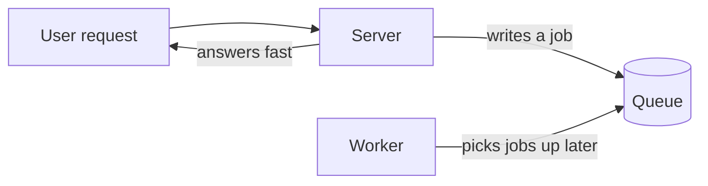
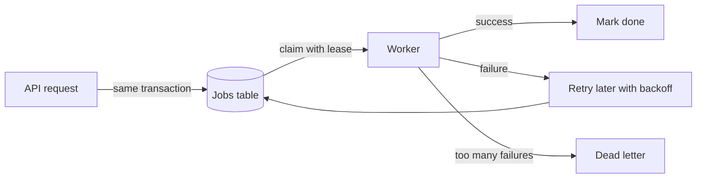
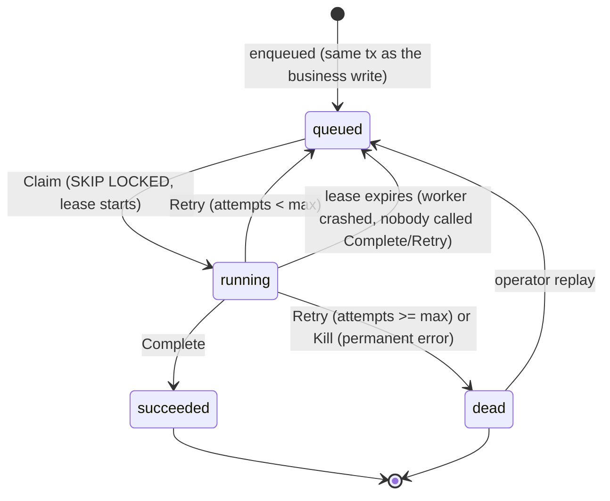
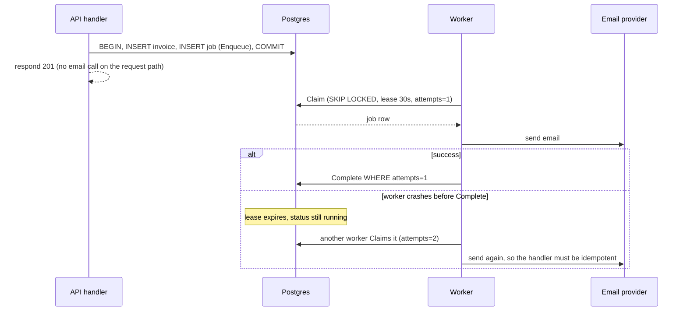
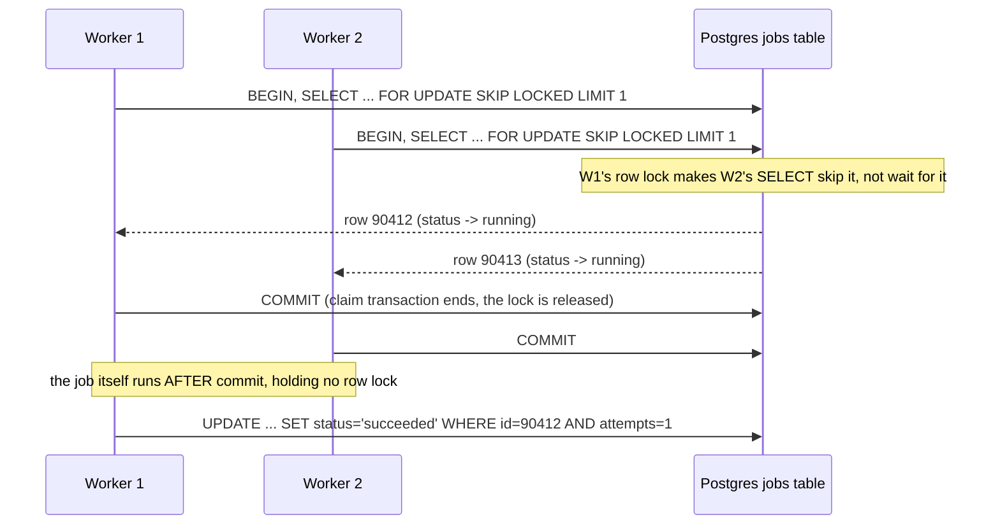

# Background Workers and Job Queues

> [!summary] TL;DR
> A background worker in Go claims one job at a time from a durable queue, runs it, and reports success or failure back to that queue — never a bare goroutine pool, which loses every queued job on a crash.
>
> This note is the Go implementation: a `SELECT ... FOR UPDATE SKIP LOCKED` claim loop against Postgres, `asynq` against Redis, retries with full-jitter backoff, a dead-letter state, and a graceful stop that lets in-flight work finish instead of killing it.

> [!abstract] Core idea
> - An in-process worker pool (a channel and N goroutines) is fast and simple, and it is **not durable**: a crash drops every job still sitting in the channel. It is the right tool only for work the process can afford to lose.
> - A durable queue — a Postgres jobs table with `SKIP LOCKED`, or Redis via `asynq` — survives a crash because the job's state lives outside the worker's memory. The worker only ever holds a **lease** on it.
> - At-least-once delivery is the deal every durable queue makes: a worker can die after finishing the work but before marking the job done, and another worker will redo it. Handlers must be idempotent, or this silently double-sends.
> - Classic mistake: enqueuing in a goroutine right after a database commit. If the process dies between the two, the job is lost; write the job (or an outbox row) in the **same transaction** as the data it depends on.

## Start here: the basics 🟢

> [!info] How to read this note (pick your level)
> - 🟢 **New to this?** Read "From zero" below, then sections 1, 2 and the cheat sheet (10). Stop there, that is a full first pass.
> - 🟡 **Know the basics?** Add section 3 (how it works), 4 (worked example) and 5-6.
> - 🔴 **Interview / SDE-3 prep?** Add 7, 8 and 9. Headings are tagged 🟢🟡🔴 so you always know where you are.

**From zero, in 60 seconds** 🟢

Some work is too slow to do while a user waits — sending an email, building a PDF. So the server writes a little to-do item (a **job**) into a list (a **queue**) and answers the user right away.

A separate loop called a **worker** keeps pulling jobs off that list and doing them, one at a time.



The hard part is not losing jobs. If the worker crashes mid-job, the job must go back on the list, not vanish. If a job fails 10 times, it goes to a parking lot (the **dead-letter** state) instead of retrying forever.

The rest of this note is just these 4 questions:
1. Why is a plain goroutine not a safe worker?
2. How does a worker claim a job so no other worker grabs it too?
3. What happens when a job fails (retries, backoff, dead letter)?
4. How does a worker stop without dropping the job it is holding?

**The problem in one story.** A restaurant takes your order and gives you a ticket.
The waiter does not cook while you wait at the counter; the ticket goes on a rail for the kitchen.
If a cook goes home sick, the ticket is still on the rail and another cook picks it up.
Background jobs are those tickets: slow work leaves the request and is done later, safely.

**Words you need first**

| Word | Plain meaning | Tiny example |
|---|---|---|
| Job | One unit of work to do later | "Send invoice email for inv_42" |
| Queue | Ordered list of waiting jobs | A `jobs` table or a Redis list |
| Worker | Loop that takes a job, runs it, reports back | A goroutine polling the jobs table |
| Goroutine | Lightweight Go thread | `go sendEmail(id)` |
| Durable | Survives a crash or restart | Job stored in Postgres, not in memory |
| Lease | A time-limited claim on a job | "Worker 3 owns job 9 until 12:05" |
| Idempotent | Running twice has the same effect as once | Skip sending if the email is already marked sent |
| Dead letter | Where jobs go after too many failures | `status = 'dead'`, a human looks at it |

**Picture it**



**Analogy.** The ticket rail in a kitchen: orders wait outside any one cook's head, so no order is lost when a cook leaves.
Where it breaks: a cook rarely cooks the same dish twice by accident, but a worker can redo a job after a crash, so handlers must be idempotent.

**How the rest of this note builds up**

- First, why a bare goroutine loses work and what a durable queue fixes (sections 1-2).
- Then the pieces: enqueue in the same transaction, the `SKIP LOCKED` claim loop, backoff, dead letters, graceful stop (section 3).
- Then a full Postgres worker in code, plus `asynq` on Redis for comparison (section 4).
- Finally, the SDE-3 deep dive on brokers, trade-offs and production (sections 5-9).

> [!tip] Remember
> Store the job durably in the same transaction, claim it with a lease, and make the handler idempotent.

## 1. Why it exists 🟢

InvoiceOps's `POST /invoices` handler needs to send a confirmation email. Doing it inline adds the email provider's latency (and its outages) to every invoice creation request — for a typical transactional email API, assume **p50 around 150 ms and p99 over 1 second** (illustrative, not measured; provider latency varies, so measure your own).

Moving it off the request path is the easy part: `go sendEmail(invoice)`. The question this note exists to answer is what happens next, three ways:

1. **The process restarts mid-send** (a deploy, a crash, an OOM-kill). A bare goroutine's state lives only in that goroutine's stack and the channel it came from — both gone. The email is never sent, and nothing knows that.
2. **The email provider is down for ten minutes.** Something has to retry, with a backoff that doesn't hammer a provider that is already struggling, and eventually give up and tell a human instead of retrying forever.
3. **Two workers claim the same job** because a reminder-email job was enqueued twice (a retried webhook, a flaky network call that looked like it failed but didn't). The customer should get one email, not two.

[[Background Jobs and Worker Pools]] already lays out the job lifecycle and the general shape of this problem in the abstract (there, with an in-memory model built for teaching, not for running).

This note wires the same ideas to the libraries a Go service actually ships with: pgx against a Postgres jobs table, and `asynq` against Redis — plus the graceful-shutdown shape that makes "the process restarts mid-send" a non-event instead of a lost job.

## 2. Mental model 🟢

Separate the question "where does work live between being created and being run" from "how many goroutines run it at once." A `chan Job` answers the second question well and the first question not at all — it is memory, and memory does not survive a crash.

A durable queue (a database table, or Redis through `asynq`) answers the first question: the job's current state — queued, running, done, or dead — is a row or a value **outside any one process**, so any worker, including a replacement for the one that just died, can pick it up where it was left.



A worker never truly "owns" a job — it holds a **lease**, timestamped when it claims the row, and the claim query is the only place that lease is checked. If the worker dies holding it, the lease simply expires and the next claim (whose `WHERE` clause also matches expired `running` rows) picks the job back up, which is why the state diagram above has no "crashed" state of its own: a crash just looks like an unusually long `running`.

## 3. How it works 🟡

### In-process pool: fast, and not durable

**In plain words:** goroutines inside your server are fast but forget everything when the process dies — that is the whole problem.

[[select and Concurrency Patterns]] has the general-purpose version — `Submit`, backpressure, `Stop` that drains the queue. The version here is the same shape, specialized to a job type, to make one point concrete: it is a perfectly good tool for work that only needs to survive within the process's own lifetime (fan-out over a batch already held in memory, for example), and the wrong tool the moment "this must still happen after a crash" is a requirement — which most background jobs are.

### Enqueue in the same transaction

The producer side matters as much as the worker. `Enqueue` (in the store code below) takes the caller's `pgx.Tx`, so the invoice row and its job row commit or roll back together.

When the queue lives in another system (Redis, SQS, Kafka), write an outbox row in the same transaction and let a relay publish it; see [[Transactional Outbox and CDC]].



### The durable claim loop (Postgres)

**In plain words:** the worker asks the database "give me one unclaimed job and mark it mine" in a single step, so two workers can never grab the same job.

A Postgres table is a complete job queue for most services, and `FOR UPDATE SKIP LOCKED` is the one clause that makes it safe under concurrent workers: instead of blocking on a row another transaction already locked, a worker simply skips it and takes the next one.



The claim, complete, and retry statements all guard on `attempts`, the value the claimer read when it took the lease. A worker whose lease expired and whose result arrives late — after another worker already reclaimed and finished the job — finds its `WHERE attempts = $2` guard matches zero rows, so its stale write is simply a no-op instead of corrupting the result a faster worker already recorded.

### Backoff, retries, and the dead-letter state

**In plain words:** when a job fails, wait a bit and try again; wait longer each time; after enough failures, park it where a human can look at it.

A failed job is retried with **exponential backoff and full jitter**: the delay before attempt *n* is a random draw between 0 and `min(2ⁿ seconds, cap)`, not a fixed `2ⁿ` — fixed backoff means every job that failed in the same incident retries in lockstep, turning one outage into a synchronized thundering herd the moment the dependency recovers.

After `max_attempts`, the job moves to a `dead` state instead of retrying forever: that is the entire dead-letter mechanism in a single-table design — one more status value and a guarded `UPDATE`, not a separate queue.

An operator (or a small CLI) replays a dead job by setting it back to `queued`; the `last_error` column recorded why it died.

A **permanent error** — a malformed payload, a 4xx from a downstream API that will never succeed no matter how many times you ask — should skip straight to `dead` without spending the remaining attempts.

The worked example below marks this with a sentinel error (`ErrPermanent`) a handler wraps its own error in, the same shape `asynq.SkipRetry` uses on the Redis side.

### Poison jobs, timeouts, fairness and trace context

- **Poison messages.** A job that fails every time is retried `max_attempts` times and then dead-lettered; a job that crashes the process every time is caught by the `attempts < max_attempts` clause plus `Reap`. Either way it ends in `dead` with `last_error` set instead of looping forever. Alert on the dead count; replay after the fix ships.
- **Per-job timeout.** Every attempt runs under a deadline (`SetJobTimeout`) shorter than the lease. A hung downstream call then fails the attempt instead of pinning a worker slot, and a job still running when its lease lapses is the only way two workers run the same job at once.
- **Concurrency limits per tenant or provider.** One noisy tenant can fill all N slots. Add a `tenant_id` column and cap it in the claim query, or use a separate queue (asynq queues, a `kind`-filtered worker pool) with its own concurrency per provider, so a slow email provider cannot starve payment jobs.
- **Trace context.** Put the W3C `traceparent` in the job payload at enqueue time and start the handler's span from it, so one trace spans the HTTP request and the background work.

### Brokers, in one paragraph each

- **SQS.** A received message is hidden for the visibility timeout (default 30 seconds). If the worker has not deleted it by then, it reappears. For a long job, call `ChangeMessageVisibility` periodically as a heartbeat. After `maxReceiveCount` receives, the redrive policy moves the message to a DLQ.
- **RabbitMQ.** A consumer `ack`s on success and `nack`s (with requeue or to a dead-letter exchange) on failure; an unacked message returns to the queue when the channel closes. Set `prefetch` (QoS) to cap unacked messages per consumer, or one worker hoards the queue.
- **Kafka.** Consumers in a group share partitions; ordering holds only within a partition. Commit the offset after processing (at-least-once); committing before processing risks losing a message on a crash. There is no per-message retry: use a retry topic and a dead-letter topic.
- **River.** The Go library for the Postgres design above: `river.Client.InsertTx(ctx, tx, args, nil)` enqueues in your transaction, workers implement `Work(ctx, job)`, and it brings migrations, retries with backoff, uniqueness and `LISTEN/NOTIFY` wake-ups.
- **Temporal (or similar durable workflow engines).** For multi-step sagas with waits and compensation, a workflow engine persists each step's progress so you do not hand-build a state machine on top of a job table.

### Graceful stop: release the lease, don't just stop the goroutine

**In plain words:** when shutting down, the worker finishes or hands back the job it holds, like a shift worker clocking out properly.

A worker's shutdown is a different shape from the HTTP server's. [[Graceful Shutdown and Health Checks]] covers the signal → `Shutdown(ctx)` → drain sequence a worker plugs into; what is specific to a *durable* queue is what "drain" means for a job whose state lives in Postgres rather than in a Go channel:

- **In-flight jobs** get a bounded window (the same drain deadline as the HTTP server) to finish normally and call `Complete`.
- **A job that outlives the drain window** is not killed mid-write — it is simply abandoned by this process. Its database lease expires on its own, and the next worker (this one restarted, or another replica) claims it again. This is one more reason handlers must be idempotent: an abandoned job's side effects may or may not have completed.
- **No new jobs are claimed** once shutdown starts — the claim loop checks the context before every claim rather than racing to grab one more job it won't have time to finish.
- **Jobs run under their own context**, not the signal context. If handlers inherited the cancelled signal context, every in-flight job and its `Complete` write would fail the instant SIGTERM arrived. The worker cancels the job context only when the drain deadline passes.

### Redis-backed: `asynq`

`asynq` is a Redis-backed queue with retries, scheduled tasks, unique tasks, named weighted queues and an archive (its dead-letter set) built in. It stores tasks in Redis lists and sorted sets and moves them with Lua scripts; a worker holds a lease on an active task, and if the worker dies the lease lapses and a recoverer re-queues the task.

Delivery is at-least-once, so handlers must be idempotent exactly as with Postgres. Choose it when the service already runs Redis (see [[Redis as a Queue - Lists, Streams and Pub-Sub]] for the underlying primitives) or needs higher throughput than polling a table.

The catch is Section 5's: the enqueue is a write to a second system, so it cannot share a transaction with your business data. `asynq.Unique` makes a duplicate enqueue return `asynq.ErrDuplicateTask` instead of a second task, but that lock is time-limited and is not a substitute for an idempotent handler.

On shutdown, `srv.Shutdown()` stops fetching and waits up to `Config.ShutdownTimeout` (default 8 seconds) for active tasks before pushing them back to the queue.

## 4. Worked example 🟡

### Whiteboard version

**In plain words:** the smallest runnable sketch of the worker loop, before the production hardening.

The bare shape of the durable claim loop, no retries, no locking details:

```go
package wb

import "context"

type Job struct {
	ID       int64
	Attempts int
}

type Store interface {
	Claim(ctx context.Context) (Job, bool)
	Complete(ctx context.Context, id int64) error
}

func runOnce(ctx context.Context, s Store, handle func(Job) error) {
	j, ok := s.Claim(ctx)
	if !ok {
		return
	}
	if handle(j) == nil {
		_ = s.Complete(ctx, j.ID)
	}
}
```

The full version below adds what production needs: a real `pgx`-backed store with the `SKIP LOCKED` SQL and an in-transaction `Enqueue`, exponential backoff with full jitter, a dead-letter state, a bounded-concurrency worker with a per-job timeout and a graceful stop that abandons (not kills) a job past its drain deadline, a comparable in-process pool, and an `asynq` wiring for comparison.

It passes `go vet` and `go test -race` on Go 1.24.4. Postgres is replaced by an in-memory fake implementing the same `Store` interface in every test — `pgx`/`pgxpool` compile against the real driver but are never exercised against a live database, same for `asynq` against a live Redis.

**The in-process pool** (fast, not durable — see "How it works"):

```go
package workers

import (
	"context"
	"sync"
)

// PoolJob is the minimal unit the in-process pool runs. It is a separate
// type from Store's Job below: that one is a durable row with an id,
// attempts and a status; this one lives only in a Go channel for the
// lifetime of the process.
type PoolJob struct {
	ID     string
	Handle func(ctx context.Context) error
}

// Pool is the bounded, in-process worker pool: N goroutines pulling from one
// buffered channel. It is the right tool for CPU-bound or short I/O-bound
// work that lives and dies with the process — see the Concurrency Patterns
// note for the general-purpose version (Submit, backpressure, Stop) this one
// specializes. It is NOT durable: a crash mid-queue silently drops every job
// still sitting in the channel. The rest of this note exists because that
// line matters in production.
type Pool struct {
	jobs    chan PoolJob
	wg      sync.WaitGroup
	onError func(PoolJob, error) // called from a worker goroutine; must not block
}

func NewPool(workers, queueSize int, onError func(PoolJob, error)) *Pool {
	p := &Pool{jobs: make(chan PoolJob, queueSize), onError: onError}
	for i := 0; i < workers; i++ {
		p.wg.Add(1)
		go p.loop()
	}
	return p
}

func (p *Pool) loop() {
	defer p.wg.Done()
	for j := range p.jobs {
		if err := j.Handle(context.Background()); err != nil && p.onError != nil {
			p.onError(j, err)
		}
	}
}

// Submit enqueues a job. It blocks once the queue is full: that backpressure
// is deliberate — an unbounded channel turns a slow downstream into an
// out-of-memory crash instead of a visible slowdown.
func (p *Pool) Submit(j PoolJob) {
	p.jobs <- j
}

// Stop closes the queue and waits for every worker to drain it. There is no
// mid-flight cancellation here on purpose: see "Graceful stop" for why a
// durable queue needs a different shutdown shape (release the lease, don't
// just stop the goroutine).
func (p *Pool) Stop() {
	close(p.jobs)
	p.wg.Wait()
}
```

**The durable store** (pgx against Postgres; `Store` is also implemented by an in-memory fake in the tests):

```go
package workers

import (
	"context"
	"errors"
	"time"

	"github.com/jackc/pgx/v5"
	"github.com/jackc/pgx/v5/pgxpool"
)

// Job is one row of the jobs table.
type Job struct {
	ID          int64
	Kind        string
	Payload     []byte
	Attempts    int
	MaxAttempts int
}

// ErrNoJob is returned by Claim when nothing is ready to run.
var ErrNoJob = errors.New("workers: no job ready")

// Store is everything the worker loop needs from the job table. PostgresStore
// below implements it against pgx; a fake implements it in memory in the
// tests, so the loop, retry and DLQ logic can be tested without a database.
// Postgres is replaced by a fake in every test in this note.
type Store interface {
	// Claim atomically takes ownership of one ready job, or returns ErrNoJob.
	Claim(ctx context.Context) (Job, error)
	// Complete marks a job done. attempts guards against a worker whose
	// lease already expired overwriting the result of whoever reclaimed it.
	Complete(ctx context.Context, id int64, attempts int) error
	// Retry schedules another attempt after delay, or moves the job to the
	// dead-letter state if attempts has reached the job's MaxAttempts. reason
	// is stored as last_error either way.
	Retry(ctx context.Context, id int64, attempts int, delay time.Duration, reason string) error
	// Kill moves a job straight to the dead-letter state, for an error a
	// retry could never fix (see ErrPermanent below).
	Kill(ctx context.Context, id int64, attempts int, reason string) error
}

// PostgresStore is the production Store. Every statement is written to be
// safe under many concurrent workers: FOR UPDATE SKIP LOCKED never blocks on
// a row another worker already claimed, and every write is guarded by the
// attempts value the claimer read, so a worker that stalls past its lease
// can never clobber the result of whoever reclaimed the job after it.
type PostgresStore struct {
	pool *pgxpool.Pool
}

func NewPostgresStore(pool *pgxpool.Pool) *PostgresStore { return &PostgresStore{pool: pool} }

// Claim is one statement, so it runs in its own implicit short transaction:
// the row lock from FOR UPDATE SKIP LOCKED is held only long enough to flip
// the row to running and stamp a lease. The job itself runs outside that
// transaction, so a slow job never holds a database lock.
//
// The WHERE clause also picks up a 'running' row whose lease has expired (its
// worker crashed or was abandoned at shutdown), which is what makes the lease
// real. attempts < max_attempts stops a job that keeps killing its worker
// from being reclaimed forever: reapSQL below moves those to 'dead'.
//
// representative SQL (PostgreSQL 17):
//
//	WITH next AS (
//	    SELECT id FROM jobs
//	    WHERE (status = 'queued' AND run_at <= now())
//	       OR (status = 'running' AND leased_until < now() AND attempts < max_attempts)
//	    ORDER BY run_at
//	    LIMIT 1
//	    FOR UPDATE SKIP LOCKED
//	)
//	UPDATE jobs SET status = 'running', attempts = attempts + 1,
//	       leased_until = now() + interval '30 seconds'
//	FROM next WHERE jobs.id = next.id
//	RETURNING jobs.id, jobs.kind, jobs.payload, jobs.attempts, jobs.max_attempts
const claimSQL = `
WITH next AS (
    SELECT id FROM jobs
    WHERE (status = 'queued' AND run_at <= now())
       OR (status = 'running' AND leased_until < now() AND attempts < max_attempts)
    ORDER BY run_at
    LIMIT 1
    FOR UPDATE SKIP LOCKED
)
UPDATE jobs SET status = 'running', attempts = attempts + 1,
       leased_until = now() + interval '30 seconds'
FROM next WHERE jobs.id = next.id
RETURNING jobs.id, jobs.kind, jobs.payload, jobs.attempts, jobs.max_attempts`

func (s *PostgresStore) Claim(ctx context.Context) (Job, error) {
	var j Job
	err := s.pool.QueryRow(ctx, claimSQL).Scan(&j.ID, &j.Kind, &j.Payload, &j.Attempts, &j.MaxAttempts)
	if errors.Is(err, pgx.ErrNoRows) {
		return Job{}, ErrNoJob
	}
	if err != nil {
		return Job{}, err
	}
	return j, nil
}

// reapSQL dead-letters jobs whose lease expired after their last allowed
// attempt. Run it periodically (every minute is plenty).
const reapSQL = `
UPDATE jobs SET status = 'dead', last_error = 'lease expired on final attempt'
WHERE status = 'running' AND leased_until < now() AND attempts >= max_attempts`

// Reap runs reapSQL and returns how many jobs it dead-lettered.
func (s *PostgresStore) Reap(ctx context.Context) (int64, error) {
	tag, err := s.pool.Exec(ctx, reapSQL)
	if err != nil {
		return 0, err
	}
	return tag.RowsAffected(), nil
}

// Enqueue inserts a job inside the caller's transaction. Call it in the same
// pgx.Tx that writes the invoice: either both rows commit or neither does, so
// the "commit, then enqueue" dual write cannot lose the job.
func Enqueue(ctx context.Context, tx pgx.Tx, kind string, payload []byte, maxAttempts int) error {
	_, err := tx.Exec(ctx,
		`INSERT INTO jobs (kind, payload, max_attempts, status, run_at)
		 VALUES ($1, $2, $3, 'queued', now())`, kind, payload, maxAttempts)
	return err
}

const completeSQL = `
UPDATE jobs SET status = 'succeeded', finished_at = now()
WHERE id = $1 AND attempts = $2 AND status = 'running'`

func (s *PostgresStore) Complete(ctx context.Context, id int64, attempts int) error {
	_, err := s.pool.Exec(ctx, completeSQL, id, attempts)
	return err
}

// representative SQL (PostgreSQL 17): the CASE sends a job whose attempts has
// reached max_attempts straight to 'dead' instead of back to 'queued', which
// is the whole dead-letter mechanism — no separate table, one guarded UPDATE.
const retrySQL = `
UPDATE jobs SET
    status = CASE WHEN attempts >= max_attempts THEN 'dead' ELSE 'queued' END,
    run_at = now() + make_interval(secs => $3),
    last_error = $4
WHERE id = $1 AND attempts = $2 AND status = 'running'`

func (s *PostgresStore) Retry(ctx context.Context, id int64, attempts int, delay time.Duration, reason string) error {
	_, err := s.pool.Exec(ctx, retrySQL, id, attempts, delay.Seconds(), reason)
	return err
}

// representative SQL (PostgreSQL 17): last_error records why, for the
// replay tool an operator uses to re-queue dead jobs after a fix ships.
const killSQL = `
UPDATE jobs SET status = 'dead', last_error = $3
WHERE id = $1 AND attempts = $2 AND status = 'running'`

func (s *PostgresStore) Kill(ctx context.Context, id int64, attempts int, reason string) error {
	_, err := s.pool.Exec(ctx, killSQL, id, attempts, reason)
	return err
}
```

**The worker**: claim loop, bounded concurrency, backoff, and graceful stop:

```go
package workers

import (
	"context"
	"errors"
	"math/rand/v2"
	"sync"
	"time"
)

// Handler runs one job's business logic. A non-nil, non-permanent error
// triggers a retry; returning an error wrapping ErrPermanent sends the job
// straight to the dead-letter state without spending the remaining attempts.
type Handler func(ctx context.Context, j Job) error

// ErrPermanent wraps an error that retrying can never fix (a malformed
// payload, a 400 from a downstream API). Unwrap with errors.Is.
var ErrPermanent = errors.New("workers: permanent failure")

// Worker claims jobs from a Store and runs them with N concurrent goroutines.
// Unlike Pool, it is durable: a crash loses at most the jobs currently
// leased, and their expiring leases hand them back to the next worker that
// polls. Nothing sitting in a Go channel is ever silently gone.
type Worker struct {
	store       Store
	handle      Handler
	concurrency int
	pollEvery   time.Duration
	jobTimeout  time.Duration // per-attempt deadline; keep it below the lease (30s in claimSQL)

	sem     chan struct{}      // bounds concurrent job goroutines
	wg      sync.WaitGroup     // tracks jobs currently in flight, for drain
	jobCtx  context.Context    // parent of every job's ctx; NOT cancelled when Run's ctx is
	abandon context.CancelFunc // cancels jobCtx once the drain deadline passes
}

func NewWorker(store Store, handle Handler, concurrency int, pollEvery time.Duration) *Worker {
	return &Worker{
		store:       store,
		handle:      handle,
		concurrency: concurrency,
		pollEvery:   pollEvery,
		jobTimeout:  25 * time.Second,
		sem:         make(chan struct{}, concurrency),
	}
}

// SetJobTimeout changes the per-attempt deadline. A handler that hangs (a
// provider that never answers) is cancelled at this deadline and the attempt
// counts as a failure, so one stuck call cannot hold a worker slot forever.
// Call it before Run.
func (w *Worker) SetJobTimeout(d time.Duration) { w.jobTimeout = d }

// Run polls for jobs until ctx is cancelled, then performs a graceful stop:
// it stops claiming new jobs immediately and waits (bounded by drain) for
// every job already running to finish, so a job is never killed mid-write.
// The jobs run under a context that is NOT cancelled when ctx is, otherwise
// every in-flight handler and its Complete call would fail the moment
// shutdown starts. If a job outlives the drain deadline, its context is
// cancelled and Run returns: the job is abandoned, its lease expires in
// Postgres, and another worker (or this one after a restart) reclaims it.
// Call Run at most once per Worker.
func (w *Worker) Run(ctx context.Context, drain time.Duration) {
	w.jobCtx, w.abandon = context.WithCancel(context.WithoutCancel(ctx))
	defer w.abandon()

	ticker := time.NewTicker(w.pollEvery)
	defer ticker.Stop()

	for {
		select {
		case <-ctx.Done():
			w.drain(drain)
			return
		case <-ticker.C:
			w.claimAndRunReady(ctx)
		}
	}
}

func (w *Worker) claimAndRunReady(ctx context.Context) {
	for ctx.Err() == nil { // no new claims once shutdown has started
		select {
		case w.sem <- struct{}{}:
		default:
			return // at concurrency limit; wait for the next tick
		}

		j, err := w.store.Claim(ctx)
		if err != nil {
			<-w.sem
			return // ErrNoJob, or a transient claim error: try again next tick
		}

		w.wg.Add(1)
		go func() {
			defer w.wg.Done()
			defer func() { <-w.sem }()
			w.runOne(j)
		}()
	}
}

func (w *Worker) runOne(j Job) {
	hctx, cancel := context.WithTimeout(w.jobCtx, w.jobTimeout)
	err := w.handle(hctx, j)
	cancel()

	// The result write uses w.jobCtx (alive until abandonment), not the
	// handler's possibly-expired context, so a timed-out job can still be
	// recorded as failed. A failed write is safe to lose: the lease expires
	// and the job is redone, which is why handlers are idempotent.
	switch {
	case err == nil:
		_ = w.store.Complete(w.jobCtx, j.ID, j.Attempts)
	case errors.Is(err, ErrPermanent):
		_ = w.store.Kill(w.jobCtx, j.ID, j.Attempts, err.Error())
	default:
		_ = w.store.Retry(w.jobCtx, j.ID, j.Attempts, backoff(j.Attempts), err.Error())
	}
}

// backoff is exponential with full jitter: base 2^attempts seconds, capped
// at 5 minutes, then a uniform random draw over [0, cap]. Full jitter (Go
// rand/v2) avoids every failed job in a batch retrying in lockstep.
func backoff(attempts int) time.Duration {
	capped := 5 * time.Minute
	base := time.Duration(1<<uint(min(attempts, 10))) * time.Second
	if base > capped {
		base = capped
	}
	return time.Duration(rand.Int64N(int64(base) + 1))
}

func (w *Worker) drain(timeout time.Duration) {
	done := make(chan struct{})
	go func() {
		w.wg.Wait()
		close(done)
	}()
	select {
	case <-done:
	case <-time.After(timeout):
		// In-flight jobs past the drain deadline are abandoned, not killed:
		// their context is cancelled (a well-behaved handler stops), and
		// their Postgres lease expires so another worker reclaims them. This
		// is why handlers must be idempotent.
		w.abandon()
	}
}
```

**Tests** (Postgres replaced throughout by an in-memory `fakeStore` implementing the same `Store` interface):

```go
package workers

import (
	"context"
	"errors"
	"fmt"
	"sync"
	"testing"
	"time"
)

// fakeStore replaces Postgres in every test in this note: an in-memory
// table with the same claim/complete/retry state machine (queued -> running
// -> succeeded, or -> queued again, or -> dead), guarded by a mutex instead
// of row locks.
type fakeStore struct {
	mu   sync.Mutex
	rows map[int64]*row
}

type row struct {
	job    Job
	status string // queued, running, succeeded, dead
}

func newFakeStore(jobs ...Job) *fakeStore {
	rows := make(map[int64]*row, len(jobs))
	for _, j := range jobs {
		rows[j.ID] = &row{job: j, status: "queued"}
	}
	return &fakeStore{rows: rows}
}

func (s *fakeStore) Claim(_ context.Context) (Job, error) {
	s.mu.Lock()
	defer s.mu.Unlock()
	for _, r := range s.rows {
		if r.status == "queued" {
			r.status = "running"
			r.job.Attempts++
			return r.job, nil
		}
	}
	return Job{}, ErrNoJob
}

func (s *fakeStore) Complete(ctx context.Context, id int64, attempts int) error {
	if err := ctx.Err(); err != nil {
		return err // like pgx: a cancelled ctx means the write never happens
	}
	s.mu.Lock()
	defer s.mu.Unlock()
	r, ok := s.rows[id]
	if !ok || r.job.Attempts != attempts || r.status != "running" {
		return nil // stale caller: the SQL version's WHERE guard, modeled as a no-op
	}
	r.status = "succeeded"
	return nil
}

func (s *fakeStore) Retry(ctx context.Context, id int64, attempts int, _ time.Duration, _ string) error {
	if err := ctx.Err(); err != nil {
		return err
	}
	s.mu.Lock()
	defer s.mu.Unlock()
	r, ok := s.rows[id]
	if !ok || r.job.Attempts != attempts || r.status != "running" {
		return nil
	}
	if r.job.Attempts >= r.job.MaxAttempts {
		r.status = "dead"
		return nil
	}
	r.status = "queued"
	return nil
}

func (s *fakeStore) Kill(ctx context.Context, id int64, attempts int, _ string) error {
	if err := ctx.Err(); err != nil {
		return err
	}
	s.mu.Lock()
	defer s.mu.Unlock()
	r, ok := s.rows[id]
	if !ok || r.job.Attempts != attempts || r.status != "running" {
		return nil
	}
	r.status = "dead"
	return nil
}

func (s *fakeStore) statusOf(id int64) string {
	s.mu.Lock()
	defer s.mu.Unlock()
	return s.rows[id].status
}

func waitFor(t *testing.T, timeout time.Duration, cond func() bool) {
	t.Helper()
	deadline := time.Now().Add(timeout)
	for time.Now().Before(deadline) {
		if cond() {
			return
		}
		time.Sleep(time.Millisecond)
	}
	t.Fatal("condition was never true before the timeout")
}

func TestWorker_SucceedsAndMarksComplete(t *testing.T) {
	store := newFakeStore(Job{ID: 1, Kind: "send_email", MaxAttempts: 3})
	w := NewWorker(store, func(_ context.Context, j Job) error {
		return nil
	}, 2, time.Millisecond)

	ctx, cancel := context.WithCancel(context.Background())
	go w.Run(ctx, time.Second)
	waitFor(t, time.Second, func() bool { return store.statusOf(1) == "succeeded" })
	cancel()
}

func TestWorker_RetriesThenGoesDeadAfterMaxAttempts(t *testing.T) {
	// The fake ignores the backoff delay and re-queues immediately, so the
	// retry loop runs to completion in milliseconds instead of minutes; the
	// delay itself is covered by TestBackoffIsBoundedAndJittered below.
	store := newFakeStore(Job{ID: 2, Kind: "flaky", MaxAttempts: 3})
	w := NewWorker(store, func(_ context.Context, j Job) error {
		return errors.New("downstream is down")
	}, 1, time.Millisecond)

	ctx, cancel := context.WithCancel(context.Background())
	go w.Run(ctx, time.Second)
	waitFor(t, time.Second, func() bool { return store.statusOf(2) == "dead" })
	cancel()

	store.mu.Lock()
	attempts := store.rows[2].job.Attempts
	store.mu.Unlock()
	if attempts != 3 {
		t.Fatalf("want exactly 3 attempts before dead-lettering, got %d", attempts)
	}
}

func TestBackoffIsBoundedAndJittered(t *testing.T) {
	for _, attempts := range []int{1, 5, 20} {
		for i := 0; i < 50; i++ {
			d := backoff(attempts)
			if d < 0 || d > 5*time.Minute {
				t.Fatalf("attempts=%d: backoff %v out of [0, 5m]", attempts, d)
			}
		}
	}
}

func TestWorker_PermanentErrorSkipsStraightToDead(t *testing.T) {
	store := newFakeStore(Job{ID: 3, Kind: "bad_payload", MaxAttempts: 5})
	w := NewWorker(store, func(_ context.Context, j Job) error {
		return fmt.Errorf("decode payload: %w", ErrPermanent)
	}, 1, time.Millisecond)

	ctx, cancel := context.WithCancel(context.Background())
	go w.Run(ctx, time.Second)
	waitFor(t, time.Second, func() bool { return store.statusOf(3) == "dead" })
	cancel()

	store.mu.Lock()
	attempts := store.rows[3].job.Attempts
	store.mu.Unlock()
	if attempts != 1 {
		t.Fatalf("a permanent error must dead-letter on the first attempt, got %d attempts", attempts)
	}
}

func TestWorker_JobTimeoutCancelsAHungHandlerAndRetries(t *testing.T) {
	store := newFakeStore(Job{ID: 6, Kind: "hang", MaxAttempts: 2})
	w := NewWorker(store, func(ctx context.Context, _ Job) error {
		<-ctx.Done() // a provider that never answers
		return ctx.Err()
	}, 1, time.Millisecond)
	w.SetJobTimeout(10 * time.Millisecond)

	ctx, cancel := context.WithCancel(context.Background())
	defer cancel()
	go w.Run(ctx, time.Second)
	waitFor(t, 2*time.Second, func() bool { return store.statusOf(6) == "dead" })
}

func TestWorker_ConcurrencyLimitBoundsInFlightJobs(t *testing.T) {
	jobs := make([]Job, 0, 10)
	for i := int64(1); i <= 10; i++ {
		jobs = append(jobs, Job{ID: i, Kind: "slow", MaxAttempts: 1})
	}
	store := newFakeStore(jobs...)

	var mu sync.Mutex
	inFlight, maxInFlight := 0, 0
	release := make(chan struct{})

	w := NewWorker(store, func(_ context.Context, _ Job) error {
		mu.Lock()
		inFlight++
		if inFlight > maxInFlight {
			maxInFlight = inFlight
		}
		mu.Unlock()
		<-release
		mu.Lock()
		inFlight--
		mu.Unlock()
		return nil
	}, 3, time.Millisecond)

	ctx, cancel := context.WithCancel(context.Background())
	go w.Run(ctx, time.Second)

	waitFor(t, time.Second, func() bool {
		mu.Lock()
		defer mu.Unlock()
		return maxInFlight == 3
	})
	close(release)
	cancel()

	mu.Lock()
	defer mu.Unlock()
	if maxInFlight != 3 {
		t.Fatalf("want at most 3 jobs in flight, saw %d", maxInFlight)
	}
}

func TestWorker_GracefulStopDrainsInFlightJobBeforeReturning(t *testing.T) {
	store := newFakeStore(Job{ID: 4, Kind: "slow", MaxAttempts: 1})
	started := make(chan struct{})
	finish := make(chan struct{})

	w := NewWorker(store, func(_ context.Context, _ Job) error {
		close(started)
		<-finish
		return nil
	}, 1, time.Millisecond)

	ctx, cancel := context.WithCancel(context.Background())
	stopped := make(chan struct{})
	go func() {
		w.Run(ctx, time.Second) // drain budget long enough to outlast the job
		close(stopped)
	}()

	<-started
	cancel() // ask Run to stop; the in-flight job must still finish
	close(finish)
	<-stopped

	if got := store.statusOf(4); got != "succeeded" {
		t.Fatalf("want the in-flight job to finish and be marked succeeded, got %q", got)
	}
}

func TestWorker_ShutdownAbandonsAJobThatOutlivesTheDrainBudget(t *testing.T) {
	store := newFakeStore(Job{ID: 5, Kind: "stuck", MaxAttempts: 1})
	started := make(chan struct{})
	w := NewWorker(store, func(_ context.Context, _ Job) error {
		close(started)
		time.Sleep(time.Second) // far longer than the drain budget below
		return nil
	}, 1, time.Millisecond)

	ctx, cancel := context.WithCancel(context.Background())
	stopped := make(chan struct{})
	go func() {
		w.Run(ctx, 20*time.Millisecond)
		close(stopped)
	}()

	<-started
	cancel()
	<-stopped // Run returns at the drain deadline, without waiting for the job

	if got := store.statusOf(5); got != "running" {
		t.Fatalf("an abandoned job is left 'running' for its Postgres lease to expire, got %q", got)
	}
}
```

**`Pool` tests** (the in-process, non-durable pool):

```go
package workers

import (
	"context"
	"errors"
	"sync/atomic"
	"testing"
)

func TestPool_RunsEveryJobExactlyOnce(t *testing.T) {
	p := NewPool(4, 10, nil)
	var ran int64
	for i := 0; i < 20; i++ {
		p.Submit(PoolJob{ID: "j", Handle: func(context.Context) error {
			atomic.AddInt64(&ran, 1)
			return nil
		}})
	}
	p.Stop()
	if ran != 20 {
		t.Fatalf("want 20 jobs run, got %d", ran)
	}
}

func TestPool_StopDrainsQueuedJobsInsteadOfDroppingThem(t *testing.T) {
	p := NewPool(1, 5, nil)
	var ran int64
	for i := 0; i < 5; i++ {
		p.Submit(PoolJob{ID: "j", Handle: func(context.Context) error {
			atomic.AddInt64(&ran, 1)
			return nil
		}})
	}
	p.Stop() // must wait for all 5, not just the one currently running
	if ran != 5 {
		t.Fatalf("want all 5 queued jobs drained before Stop returns, got %d", ran)
	}
}

func TestPool_OnErrorSeesAFailedJobInsteadOfSwallowingIt(t *testing.T) {
	var gotErr error
	p := NewPool(1, 1, func(_ PoolJob, err error) { gotErr = err })
	p.Submit(PoolJob{ID: "bad", Handle: func(context.Context) error {
		return errors.New("downstream rejected the job")
	}})
	p.Stop()
	if gotErr == nil || gotErr.Error() != "downstream rejected the job" {
		t.Fatalf("want onError to see the job's error, got %v", gotErr)
	}
}
```

**Measured:** `go vet ./...` clean; `go test -race ./...` — 11 tests, all passed, also with `-count=3`, about 0.6 s per run (Go 1.24.4; pgx v5.7.2 and hibiken/asynq v0.26.0 compiled and type-checked only, never run against a live Postgres or Redis, so the SQL is representative and unexecuted; 2026-11-07).

### Redis-backed, for comparison: `asynq`

```go
package workers

import (
	"context"
	"encoding/json"
	"errors"
	"fmt"
	"time"

	"github.com/hibiken/asynq"
)

// This file wires hibiken/asynq (Redis-backed) for comparison with the
// Postgres SKIP LOCKED store above. It compiles and type-checks against
// asynq v0.26.0; it is not exercised by a test in this note because that
// would need a live Redis for the client and server to talk through —
// unlike the SKIP LOCKED claim loop, there is no in-memory fake for an
// external queueing protocol worth building just for a test.

const TaskSendInvoiceEmail = "invoice:send_email"

type SendInvoiceEmailPayload struct {
	InvoiceID int64 `json:"invoice_id"`
}

// NewSendInvoiceEmailTask builds a task with per-task retry and uniqueness
// options: asynq defaults to 25 retries with exponential backoff, which is
// almost always too many for an email send — cap it explicitly.
func NewSendInvoiceEmailTask(invoiceID int64) (*asynq.Task, error) {
	payload, err := json.Marshal(SendInvoiceEmailPayload{InvoiceID: invoiceID})
	if err != nil {
		return nil, err
	}
	return asynq.NewTask(
		TaskSendInvoiceEmail, payload,
		asynq.MaxRetry(5),
		asynq.Timeout(10*time.Second),
		// Unique for 1 minute: a webhook retried by the provider within that
		// window must not re-enqueue a second send for the same invoice.
		asynq.Unique(time.Minute),
	), nil
}

// EnqueueSendInvoiceEmail is called by the outbox relay, which reads outbox
// rows committed with the invoice. Calling it directly from the HTTP handler
// after the commit would be the dual write described above. A duplicate within
// the unique window returns asynq.ErrDuplicateTask, which the relay should
// treat as success.
func EnqueueSendInvoiceEmail(ctx context.Context, client *asynq.Client, invoiceID int64) error {
	task, err := NewSendInvoiceEmailTask(invoiceID)
	if err != nil {
		return err
	}
	_, err = client.EnqueueContext(ctx, task)
	if errors.Is(err, asynq.ErrDuplicateTask) {
		return nil
	}
	return err
}

// handleSendInvoiceEmail is the asynq.HandlerFunc the server dispatches to.
// asynq retries automatically on a returned error, using the task's
// MaxRetry and its own backoff; returning asynq.SkipRetry sends it straight
// to the dead letter set it calls the "archive".
func handleSendInvoiceEmail(sendEmail func(ctx context.Context, invoiceID int64) error) asynq.HandlerFunc {
	return func(ctx context.Context, t *asynq.Task) error {
		var p SendInvoiceEmailPayload
		if err := json.Unmarshal(t.Payload(), &p); err != nil {
			// A payload that cannot even decode will never decode later:
			// skip the remaining retries and archive it for a human.
			return fmt.Errorf("%w: %v", asynq.SkipRetry, err)
		}
		return sendEmail(ctx, p.InvoiceID)
	}
}

// NewAsynqServer wires the mux and the concurrency/queue-weight config asynq
// uses instead of a bare worker count: three named queues with a weighted
// share, so a flood of bulk jobs cannot starve critical ones.
func NewAsynqServer(redisAddr string, sendEmail func(ctx context.Context, invoiceID int64) error) (*asynq.Server, *asynq.ServeMux) {
	srv := asynq.NewServer(
		asynq.RedisClientOpt{Addr: redisAddr},
		asynq.Config{
			Concurrency: 20,
			Queues:      map[string]int{"critical": 6, "default": 3, "bulk": 1},
		},
	)
	mux := asynq.NewServeMux()
	mux.Handle(TaskSendInvoiceEmail, handleSendInvoiceEmail(sendEmail))
	return srv, mux
}
```

## 5. Variants and comparison 🟡

| Option | How it works | Use when | Cost |
| --- | --- | --- | --- |
| In-process `Pool` | Bounded Go channel, N goroutines | Work the process can afford to lose; bounding fan-out over data already in memory | Not durable: a crash drops every queued job |
| Postgres `SKIP LOCKED` | Row lock + guarded `UPDATE`; poll or `LISTEN/NOTIFY` wake-up | Already on Postgres; want the enqueue in the same transaction as the business write | Table/index churn under high throughput; polling adds latency unless paired with `LISTEN/NOTIFY` |
| River | Same Postgres idea, as a maintained library: migrations, a UI, `LISTEN/NOTIFY` built in | Want the SKIP LOCKED design without hand-rolling the SQL and worker plumbing | Another dependency; still bound by one Postgres instance's throughput |
| `asynq` (Redis) | Lists/sorted sets and Lua scripts with a lease; built-in retry/backoff/unique/scheduled tasks and an archive (DLQ) | High job rate, low latency, scheduling and uniqueness out of the box | Enqueue is a second system from your DB — needs an outbox relay to avoid the dual-write problem |
| SQS / RabbitMQ / Kafka | Broker-managed visibility timeout or ack/nack, often with consumer groups | Cross-service or cross-language queues; very high throughput; ordering guarantees (Kafka) | Operational surface area of a separate broker; see [[Background Jobs and Worker Pools]] for the semantics each one gives, and "Brokers, in one paragraph each" above |

## 6. Trade-offs and when not to use 🟡

- Durability costs a database round trip per claim; an in-process pool is strictly cheaper when losing queued work on a crash is acceptable.
- A single Postgres jobs table competes for I/O with the rest of the database's workload; a large, bursty job volume is a reason to move to a dedicated broker (Redis, SQS, Kafka) instead of scaling the claim query further.
- At-least-once delivery is not optional with any of these — if a handler genuinely cannot be made idempotent (a non-idempotent third-party charge API with no idempotency key of its own), the fix belongs in front of the queue (a dedupe table keyed by a request id), not inside the worker.
- `asynq`'s retry and scheduling conveniences assume Redis is already a trusted dependency in this service; if it isn't, the Postgres-only design avoids introducing one just for queueing.

## 7. In production 🔴

- **Real systems:** River and `asynq` are widely used Go job queues (Postgres and Redis respectively); Sidekiq (Ruby/Redis), Celery (Python, RabbitMQ/Redis) and BullMQ (Node/Redis) are the same durable-queue-with-retries idea in other ecosystems (Redis- or broker-backed rather than `SKIP LOCKED`).
- **Failure modes → fixes:**
  - The handler isn't idempotent and a retried job double-charges or double-sends → make the side effect idempotent (a natural unique constraint, or a dedupe table keyed by job id) before relying on retries at all.
  - A dual write (commit the invoice, then enqueue in a separate call) loses the job if the process dies between the two → enqueue inside the same transaction, or through an outbox row a separate relay publishes (see [[Transactional Outbox and CDC]]).
  - Fixed (non-jittered) backoff synchronizes every failed job's retry the moment a downstream recovers, re-triggering the outage → full jitter, as in `backoff` above.
  - A worker crashes while holding a lease and nothing reclaims the job → the lease must have a finite expiry (`leased_until`), and the claim query must match expired `running` rows (as `claimSQL` does), with `Reap` dead-lettering the ones out of attempts.
- **What to monitor:** queue depth (`queued` count), oldest-job age (`now() - run_at` for the oldest ready job — the single best "is this backing up" signal), throughput (jobs completed/sec), failure and retry counts, dead-letter count and age (a growing DLQ with no one looking at it is a silent outage), per-job duration, and the retry-to-success ratio.

## 8. Deep dive 🔴

- **Why the claim is its own short transaction, not the whole job.** If `Claim` and the job's work ran in one transaction, the row lock `FOR UPDATE` takes would be held for the job's entire duration — a slow email provider would hold a Postgres lock open for seconds. Splitting them means the lock is held for microseconds (one `UPDATE`), and a slow job only ever holds its lease, which other workers' claims simply skip past via `SKIP LOCKED`, not block on.
- **The `attempts` guard is the whole "don't clobber a reclaimed job" story.** Every write (`Complete`, `Retry`, `Kill`) checks `WHERE attempts = $2`. If worker A's lease expires and worker B reclaims the job, B's claim increments `attempts`. When A eventually finishes its stale work and calls `Complete` with its old `attempts` value, the `WHERE` clause matches zero rows — A's write is silently a no-op instead of overwriting B's (possibly different) outcome.
- **Why wake-up latency is a real number, not a detail.** Polling every `pollEvery` (1 ms in the tests above, more realistically 100 ms–1 s in production) adds up to that much latency to every job and runs that many empty `SELECT`s per second per worker when the queue is idle. `LISTEN/NOTIFY` (which River uses) lets Postgres push a wake-up the instant a row is inserted, with polling kept only as a fallback — notifications are not themselves durable, so a missed one must still be caught by the next poll.
- **Priorities without starvation.** A strict "always run `critical` before `bulk`" rule starves `bulk` under sustained load from `critical` alone. `asynq`'s weighted queue config (`{"critical": 6, "default": 3, "bulk": 1}` above) picks which queue to dequeue from at random in proportion to the weights, so `bulk` gets roughly 1 in 10 fetches instead of none. (`asynq.Config{StrictPriority: true}` is the opposite choice: strict ordering, with the starvation risk.)
- **Postgres queue throughput, roughly.** A single well-indexed `SKIP LOCKED` table comfortably handles on the order of a few thousand claims/second on modest hardware (an order-of-magnitude estimate, not measured here; it depends heavily on row size, index layout and concurrent write load, so measure with your own schema and `pgbench`-style load).

## 9. Interview questions 🔴

> [!question]- Why is a bounded `chan Job` with N worker goroutines not enough for "background jobs"?
> It is memory: a crash, deploy, or OOM-kill loses every job still sitting in the channel with no trace. A durable design keeps the job's state (queued, running, done) outside the worker process, in a database row or a broker, so any worker — including a replacement for the one that died — can pick up where it left off.

> [!question]- What does `FOR UPDATE SKIP LOCKED` actually buy you that a plain `FOR UPDATE` doesn't?
> A plain `FOR UPDATE` makes a second worker's claim query *block* waiting for the first worker's row lock to release. `SKIP LOCKED` makes it instead skip that row and take the next unlocked one, so N workers can claim N different jobs concurrently without ever queuing behind each other's transactions.

> [!question]- Trap: your worker enqueues a job right after committing the business transaction. What's wrong with that, and what's the fix?
> If the process dies between the commit and the enqueue call, the job is lost even though the business data was saved — a dual write. Put the job row (or an outbox row a relay publishes) inside the *same* transaction as the business write, so either both happen or neither does.

> [!question]- Why full jitter instead of plain exponential backoff?
> Plain exponential backoff still has every failed job compute the same delay for the same attempt number, so a batch that failed together during an outage all retry at the same instant the moment the dependency comes back — re-triggering the outage. Full jitter draws a random delay between 0 and the exponential cap, spreading retries out.

> [!question]- At-least-once delivery means a job can run twice. What makes a handler safe under that?
> Idempotency: either the operation is naturally safe to repeat (an `UPDATE ... SET status = 'sent'` that no-ops if already sent), or it's made safe with a dedupe check (a unique constraint on a natural key, or a processed-ids table checked before the side effect runs).

> [!question]- Your worker is draining on SIGTERM and a job is still running when the drain deadline hits. What happens to it, and why is that the right answer?
> The worker abandons it — stops waiting and returns — rather than killing it mid-write, which could leave a half-applied side effect with no record of what happened. The job's database lease simply expires on its own schedule, and another worker reclaims and reruns it; this is exactly why handlers must be idempotent.

> [!question]- Postgres `SKIP LOCKED` or a dedicated broker like SQS or Kafka: how do you decide?
> Start with Postgres if the service already runs one: enqueueing in the same transaction as business data removes a whole class of dual-write bugs, and `SKIP LOCKED` throughput is enough for most services.
>
> Move to a dedicated broker when job volume or fan-out starts competing with the database's primary workload, when you need cross-service queueing, or when you need guarantees Postgres doesn't give cheaply (partition-ordered delivery, very high sustained throughput).

## 10. Cheat sheet 🟢

- In-process `Pool` = fast, not durable. A durable `Store` (Postgres or Redis) = state survives a crash; the worker only ever holds a lease.
- `SELECT ... FOR UPDATE SKIP LOCKED LIMIT 1` is the whole "N workers, no blocking, no double-claim" trick.
- Guard every write with the `attempts` the claimer read — it's what stops a stale worker from clobbering a reclaimed job's result.
- Dead-letter is one more status value plus a guarded `UPDATE`, not a separate system.
- Backoff: exponential, with **full jitter** — `rand(0, min(2ⁿ, cap))`, not a fixed `2ⁿ`.
- Enqueue inside the same transaction as the business write (or via an outbox); never "commit, then enqueue" in two steps.
- Graceful stop: stop claiming, let in-flight jobs finish within a deadline, abandon (don't kill) anything past it — the lease, not the goroutine, is what makes that safe.
- At-least-once delivery is the deal: handlers must be idempotent, full stop.

## Links 🟢

- **Before this:** [[select and Concurrency Patterns]], [[Background Jobs and Worker Pools]], [[Database Access (database-sql, pgx, sqlc)]]
- **Next:** [[Graceful Shutdown and Health Checks]], [[Scheduled Jobs]]
- **Compare with:** [[Redis in Go]] (the client this note's `asynq` wiring shares with the rest of the service), [[Dead Letter Queues and Poison Messages]] (the DLQ concept this note implements in one table), [[Timeouts, Retries and Backoff]] (the general backoff/retry theory), [[Transactional Outbox and CDC]] (the enqueue-atomically pattern)

### Watch on YouTube

- [(Backend #54) Implement background worker in Go with Redis and asynq](https://www.youtube.com/watch?v=XOXdYs8mKkI) · TECH SCHOOL · practical asynq + Redis worker implementation in Go
