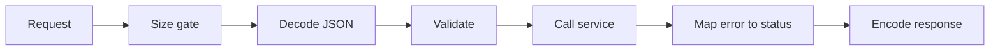
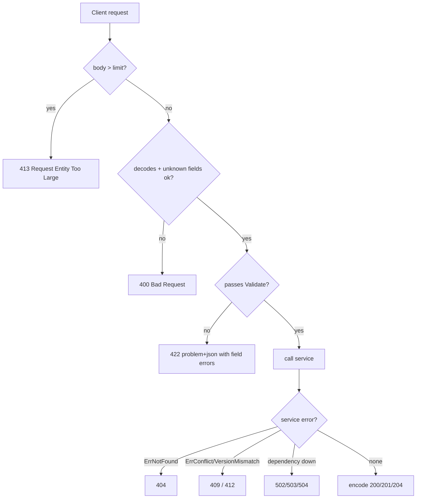
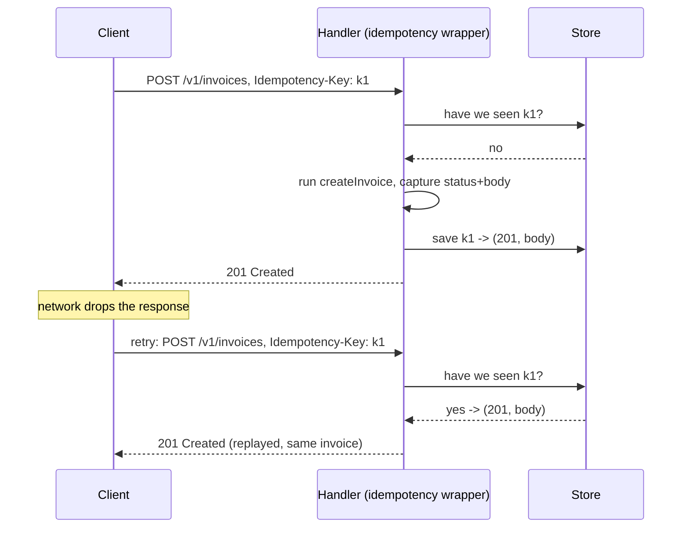

# Building REST Endpoints

> [!summary] TL;DR
> A production REST endpoint in Go is a thin `net/http` handler that decodes a request, validates it, calls a service, maps the result to an HTTP status, and encodes a response — using the standard library's own router, without a framework.

> [!abstract] Core idea
> - `http.ServeMux` since Go 1.22 already does method matching, path wildcards and precedence; a handler never checks `r.Method` by hand.
> - A handler's job is five steps in order: gate the body → decode → validate → call the service → map the error → encode. Nothing else belongs in it.
> - Every error the service returns is mapped to an HTTP status in exactly one place, using `errors.Is`/`errors.As`, never scattered string comparisons.
> - Pagination, idempotency keys and optimistic concurrency (ETags) are endpoint-level concerns, not service concerns — the service layer never imports `net/http`.

## Start here: the basics

**The problem in one story.** A shop counter takes orders by form.
The clerk checks the form is not too big, reads it, checks it is filled in right, passes it to the back office, and hands back a clear receipt.
If you hand in the same form twice because you did not hear the answer, a good shop does not charge you twice.
A REST endpoint is that counter for one URL.

**Words you need first**

| Word | Plain meaning | Tiny example |
|---|---|---|
| REST endpoint | A URL plus HTTP method that does one thing | `POST /v1/invoices` creates an invoice |
| HTTP method | The verb of the request | `GET` reads, `POST` creates, `PATCH` updates |
| Status code | Number telling the client what happened | 201 created, 404 not found, 409 conflict |
| `http.ServeMux` | Go's built-in router | `mux.HandleFunc("GET /v1/invoices/{id}", h)` |
| JSON decode | Turning request bytes into a Go struct | `json.NewDecoder(r.Body).Decode(&in)` |
| Idempotency key | Client-chosen ID so a retry does not repeat the action | `Idempotency-Key: 7c1e...` |
| Pagination | Returning a long list in pages | `?limit=50&after=inv_99` |
| ETag | Version tag of a resource for safe updates | `If-Match: "v3"` |

**Picture it**



**Analogy.** A counter with a row of checks: any check can stop the form and give an answer.
Where it breaks: a real clerk can scribble two notes on one form; an HTTP response has only one status line, so only one gate may write it.

**How the rest of this note builds up**

- First, why routing, status codes, pagination and idempotency need policies (sections 1-2).
- Then Go 1.22 routing, idempotency keys, error mapping, `problem+json`, keyset pagination and ETags (section 3).
- Then a full invoice endpoint in code (section 4).
- Finally, the SDE-3 deep dive on variants, trade-offs and production (sections 5-9).

> [!tip] Remember
> Gate, decode, validate, call the service, map the error in one place, encode.

## 1. Why it exists

Say InvoiceOps exposes `POST /v1/invoices` to create an invoice, and two clients retry on timeout. Without an idempotency key, a request that actually succeeded but whose *response* got lost over a flaky connection creates two invoices when the client retries — a real customer gets billed twice.

Without a status-code policy, one engineer returns `400` for "invoice not found" and another returns `500`; client code ends up branching on response body text instead of the status line. Without pagination that scales, `GET /v1/invoices?page=400` on a 2-million-row table makes Postgres walk and discard 399 pages before it can return page 400, so an endpoint that was fast at launch gets slower every month even though query load per request never changed.

These are not abstract complaints: they are the concrete reasons a REST endpoint needs a routing convention, a status-code policy, a pagination strategy, and idempotency — before a single line of business logic is written.

## 2. Mental model

A handler is a pipeline, not a function that "handles a request". Picture a row of gates the request passes through, each one able to stop it and write a response:

```text
size gate → decode gate → validation gate → auth/authorization gate → service call → error-mapping gate → encode
```

If the request clears every gate, the service produces a result and the last gate turns it into bytes on the wire. If it fails any gate, that gate writes the whole response — the pipeline never runs two gates' worth of writes on the same request, because `ResponseWriter` only accepts one status line.

## 3. How it works

### Routing with Go 1.22's `ServeMux`

Since Go 1.22, `http.ServeMux` patterns can carry a method and wildcards:

```go
mux.HandleFunc("GET /v1/invoices/{$}", a.listInvoices)
mux.HandleFunc("POST /v1/invoices", a.createInvoice)
mux.HandleFunc("GET /v1/invoices/{id}", a.getInvoice)
mux.HandleFunc("PATCH /v1/invoices/{id}", a.patchInvoiceStatus)
```

- `{$}` matches the path exactly, so `GET /v1/invoices/` does not fall through to the `{id}` pattern below it.
- The most specific pattern always wins, regardless of registration order; two patterns that could both match the same request and are equally specific cause a panic *at registration time*, not at request time.
- A path registered for `GET` only still gets an automatic `405 Method Not Allowed` with an `Allow` header for any other method — the handler never writes `if r.Method != http.MethodPost`.
- `r.PathValue("id")` reads a wildcard segment; the stdlib decodes it, so it is still untrusted input to validate (not raw SQL, not a filesystem path).



### Idempotency keys on unsafe methods



### Status codes, as a policy, not a guess

| Status | Meaning here | Who decides it |
|---|---|---|
| `200 OK` | successful GET/PATCH that returns a body | handler |
| `201 Created` + `Location` | a new resource now exists | handler, after `store.Create` |
| `202 Accepted` | queued for async work (not in this example) | handler |
| `204 No Content` | success, nothing to return | handler |
| `400 Bad Request` | malformed JSON, unparseable query param | decode gate |
| `401` / `403` | no/invalid principal vs. principal lacks permission | auth middleware |
| `404 Not Found` | `ErrNotFound` | error-mapping gate |
| `409 Conflict` | `ErrConflict` — valid request, invalid current state | error-mapping gate |
| `412 Precondition Failed` | `If-Match` didn't match the current `ETag` | error-mapping gate |
| `415 Unsupported Media Type` | wrong `Content-Type` (not shown below; same gate as size) | decode gate |
| `422 Unprocessable Entity` | well-formed JSON, failed validation | validation gate |
| `429 Too Many Requests` | rate limit, see [[Middleware]] | middleware |
| `500` | unmapped/programmer error | error-mapping gate default |
| `502`/`503`/`504` | a downstream dependency (payment provider, DB) is down or slow | error-mapping gate |

### Error mapping lives in one function

The service layer returns plain Go errors — sentinel (`ErrNotFound`), typed (`*ValidationError`) or wrapped — and never imports `net/http`; see [[Error Handling]] and [[Interfaces]] for why that split holds up in Go. Exactly one function per API turns an error into a status:

```go
func mapErr(err error) (status int, problemType string) {
    var ve *ValidationError
    switch {
    case err == nil:
        return http.StatusOK, ""
    case errors.As(err, &ve):
        return http.StatusUnprocessableEntity, "validation-error"
    case errors.Is(err, ErrNotFound):
        return http.StatusNotFound, "not-found"
    case errors.Is(err, ErrConflict):
        return http.StatusConflict, "conflict"
    case errors.Is(err, ErrVersionMismatch):
        return http.StatusPreconditionFailed, "precondition-failed"
    case errors.Is(err, errDependencyUnavailable):
        return http.StatusBadGateway, "dependency-unavailable"
    default:
        return http.StatusInternalServerError, "internal-error"
    }
}
```

### Error envelope: RFC 9457 `problem+json`

A field-level validation failure is useless to a client as a bare string. `application/problem+json` gives it a stable shape:

```json
{
  "type": "https://invoiceops.dev/problems/validation-error",
  "title": "request failed validation",
  "status": 422,
  "errors": [{"field": "client_id", "reason": "required"}]
}
```

### Keyset pagination

Offset pagination (`?page=400&limit=20`) makes the database compute and throw away `(page-1) * limit` rows before it can return the page you asked for — the cost grows with the page number. A keyset (cursor) page asks instead for "the next 20 rows after this exact position":

```sql
-- representative output (PostgreSQL 17); keyset page, index on (created_at, id)
SELECT id, client_id, status, total, created_at
FROM invoices
WHERE status = 'overdue'
  AND (created_at, id) > ($1, $2)   -- the previous page's last row
ORDER BY created_at, id
LIMIT 20;
```

The cursor sent back to the client is an opaque, base64-encoded `(created_at, id)` pair — opaque so the client can never construct or tamper with one, and so the server is free to change its internal shape later.

### PATCH and optimistic concurrency

A `PATCH` only changes the fields the client actually sent. A pointer field (`*string`) tells "the client didn't send `status`" (`nil`) apart from "the client wants to set it" — see [[Request Decoding, Validation and DTOs]] for the same absent-vs-null problem on the decode side.

To stop a `PATCH` from silently overwriting a concurrent writer's change, the client must echo back the `ETag` it last read as `If-Match`; a stale value gets `412 Precondition Failed` instead of a quiet overwrite.

## 4. Worked example

### Whiteboard version

The shape of one handler, stripped to its five steps:

```go
func (a *api) getInvoice(w http.ResponseWriter, r *http.Request) {
    inv, err := a.store.Get(r.PathValue("id")) // 1. call service (decode/validate don't apply to GET)
    if err != nil {
        writeProblem(w, err) // 2. map error -> status
        return
    }
    w.Header().Set("ETag", strconv.Itoa(inv.Version))
    writeJSON(w, http.StatusOK, toDTO(inv)) // 3. encode
}
```

The full version below adds routing, pagination, idempotency and PATCH concurrency, and is exactly what the tests run against.

**`writeJSON`, in the order that matters** (headers before `WriteHeader`, `WriteHeader` before `Encode`, because the first `Write` locks in the header map):

```go
func writeJSON(w http.ResponseWriter, status int, v any) {
    w.Header().Set("Content-Type", "application/json; charset=utf-8")
    w.WriteHeader(status)
    if err := json.NewEncoder(w).Encode(v); err != nil {
        // The status line is already sent, so this can only be logged,
        // never turned into a different response.
        slog.Error("encode response failed", "error", err)
    }
}
```

**Status mapping and the problem envelope:**

```go
func writeProblem(w http.ResponseWriter, err error) {
    status, kind := mapErr(err)
    p := Problem{Type: "https://invoiceops.dev/problems/" + kind, Status: status}
    var ve *ValidationError
    switch {
    case errors.As(err, &ve):
        p.Title = "request failed validation"
        p.Errors = []FieldError{{Field: ve.Field, Reason: ve.Reason}}
    case status == http.StatusInternalServerError:
        // Never put an unmapped error's real message on the wire: it can
        // carry a driver string, a file path or other internal detail a
        // client has no business seeing. Log the real error server-side
        // and send a generic, client-safe title instead.
        slog.Error("unmapped error", "error", err)
        p.Title = "internal server error"
    default:
        p.Title = err.Error()
    }
    w.Header().Set("Content-Type", "application/problem+json; charset=utf-8")
    w.WriteHeader(status)
    if encErr := json.NewEncoder(w).Encode(p); encErr != nil {
        slog.Error("encode problem failed", "error", encErr)
    }
}
```

**Keyset cursor, as an opaque token:**

```go
type Cursor struct {
    CreatedAt time.Time
    ID        string
}

func (c Cursor) encode() string {
    raw := c.CreatedAt.UTC().Format(time.RFC3339Nano) + "|" + c.ID
    return base64.URLEncoding.EncodeToString([]byte(raw))
}

func decodeCursor(s string) (*Cursor, error) {
    if s == "" {
        return nil, nil
    }
    raw, err := base64.URLEncoding.DecodeString(s)
    if err != nil {
        return nil, fmt.Errorf("decode cursor: %w", err)
    }
    var ts, id string
    for i, b := range raw {
        if b == '|' {
            ts, id = string(raw[:i]), string(raw[i+1:])
            break
        }
    }
    if ts == "" || id == "" {
        return nil, fmt.Errorf("malformed cursor")
    }
    t, err := time.Parse(time.RFC3339Nano, ts)
    if err != nil {
        return nil, fmt.Errorf("decode cursor time: %w", err)
    }
    return &Cursor{CreatedAt: t, ID: id}, nil
}
```

**Filtering through an allowlist, never through string splicing:**

```go
// allowedStatusFilter: never splice an unchecked query parameter into
// ORDER BY or WHERE. A value like "status; DROP TABLE invoices" never
// reaches the query, because it is only ever matched against this set.
var allowedStatusFilter = map[string]bool{"": true, "draft": true, "sent": true, "paid": true, "overdue": true}
```

**Idempotency key wrapper, replaying a captured response:**

```go
func (s *idempotencyStore) withIdempotency(next http.HandlerFunc) http.HandlerFunc {
    return func(w http.ResponseWriter, r *http.Request) {
        key := r.Header.Get("Idempotency-Key")
        if key == "" {
            next(w, r)
            return
        }
        s.mu.Lock()
        if cached, ok := s.seen[key]; ok {
            s.mu.Unlock()
            w.Header().Set("Content-Type", "application/json; charset=utf-8")
            w.Header().Set("Idempotency-Replayed", "true")
            w.WriteHeader(cached.status)
            _, _ = w.Write(cached.body)
            return
        }
        s.mu.Unlock()

        rec := &statusRecorder{ResponseWriter: w, status: http.StatusOK}
        next(rec, r)

        s.mu.Lock()
        s.seen[key] = storedResponse{status: rec.status, body: rec.body}
        s.mu.Unlock()
    }
}
```

**PATCH with `If-Match` optimistic concurrency:**

```go
func (a *api) patchInvoiceStatus(w http.ResponseWriter, r *http.Request) {
    ifMatch := r.Header.Get("If-Match")
    if ifMatch == "" {
        writeProblem(w, &ValidationError{Field: "If-Match", Reason: "required for PATCH"})
        return
    }
    wantVersion, err := strconv.Atoi(ifMatch)
    if err != nil {
        writeProblem(w, &ValidationError{Field: "If-Match", Reason: "must be the ETag integer"})
        return
    }

    var req patchInvoiceRequest
    if err := json.NewDecoder(r.Body).Decode(&req); err != nil {
        writeProblem(w, &ValidationError{Field: "body", Reason: "invalid JSON"})
        return
    }
    if req.Status == nil {
        // No field was sent to change: this is a no-op PATCH, so the
        // response must still be the invoice's real current state, not an
        // empty struct — a caller that doesn't check req.Status would
        // otherwise hand back a zero-value DTO on every no-op request.
        inv, err := a.store.Get(r.PathValue("id"))
        if err != nil {
            writeProblem(w, err)
            return
        }
        w.Header().Set("ETag", strconv.Itoa(inv.Version))
        writeJSON(w, http.StatusOK, toDTO(inv))
        return
    }

    inv, err := a.store.UpdateStatus(r.PathValue("id"), *req.Status, wantVersion)
    if err != nil {
        writeProblem(w, err)
        return
    }
    w.Header().Set("ETag", strconv.Itoa(inv.Version))
    writeJSON(w, http.StatusOK, toDTO(inv))
}
```

The handler tests, run with `httptest` through the real `ServeMux` (no handler is ever called directly, so routing bugs show up too):

```go
func TestServeMux_WrongMethod_Returns405WithAllow(t *testing.T) {
    // Go 1.22's method-aware ServeMux answers 405 + Allow automatically;
    // the handler needs no manual r.Method check.
    mux := newTestMux()
    req := httptest.NewRequest(http.MethodDelete, "/v1/invoices", nil)
    rec := httptest.NewRecorder()
    mux.ServeHTTP(rec, req)
    if rec.Code != http.StatusMethodNotAllowed {
        t.Fatalf("got %d, want 405", rec.Code)
    }
    if rec.Header().Get("Allow") == "" {
        t.Fatalf("Allow header missing on 405")
    }
}

func TestIdempotencyKey_ReplaysSameResponseOnRetry(t *testing.T) {
    mux := newTestMux()
    makeReq := func() *http.Request {
        r := httptest.NewRequest(http.MethodPost, "/v1/invoices", strings.NewReader(`{"client_id":"c_1","total":100}`))
        r.Header.Set("Idempotency-Key", "retry-key-1")
        return r
    }
    rec1 := httptest.NewRecorder()
    mux.ServeHTTP(rec1, makeReq())
    rec2 := httptest.NewRecorder()
    mux.ServeHTTP(rec2, makeReq())

    if rec1.Body.String() != rec2.Body.String() {
        t.Fatalf("retry body differs: first=%s second=%s", rec1.Body.String(), rec2.Body.String())
    }
    if rec2.Header().Get("Idempotency-Replayed") != "true" {
        t.Fatalf("second response missing Idempotency-Replayed header")
    }
}

func TestPatch_StaleIfMatch_Returns412(t *testing.T) {
    mux := newTestMux()
    createRec := httptest.NewRecorder()
    mux.ServeHTTP(createRec, httptest.NewRequest(http.MethodPost, "/v1/invoices",
        strings.NewReader(`{"client_id":"c_1","total":100}`)))
    var created invoiceDTO
    _ = json.Unmarshal(createRec.Body.Bytes(), &created)

    rec := httptest.NewRecorder()
    req := httptest.NewRequest(http.MethodPatch, "/v1/invoices/"+created.ID, strings.NewReader(`{"status":"sent"}`))
    req.Header.Set("If-Match", "99") // wrong version
    mux.ServeHTTP(rec, req)
    if rec.Code != http.StatusPreconditionFailed {
        t.Fatalf("got %d, want 412", rec.Code)
    }
}

func TestList_KeysetPagination_CoversAllRowsOnceInOrder(t *testing.T) {
    mux := newTestMux()
    for i := 0; i < 25; i++ {
        rec := httptest.NewRecorder()
        mux.ServeHTTP(rec, httptest.NewRequest(http.MethodPost, "/v1/invoices",
            strings.NewReader(`{"client_id":"c_1","total":`+strconv.Itoa(i+1)+`}`)))
    }
    seen := map[string]bool{}
    cursor, pages := "", 0
    for {
        pages++
        if pages > 10 {
            t.Fatalf("too many pages; pagination likely looping")
        }
        url := "/v1/invoices/?limit=10"
        if cursor != "" {
            url += "&cursor=" + cursor
        }
        rec := httptest.NewRecorder()
        mux.ServeHTTP(rec, httptest.NewRequest(http.MethodGet, url, nil))
        var page listResponse
        _ = json.Unmarshal(rec.Body.Bytes(), &page)
        for _, item := range page.Items {
            if seen[item.ID] {
                t.Fatalf("item %s returned twice across pages", item.ID)
            }
            seen[item.ID] = true
        }
        if page.NextCursor == "" {
            break
        }
        cursor = page.NextCursor
    }
    if len(seen) != 25 {
        t.Fatalf("saw %d distinct invoices across all pages, want 25", len(seen))
    }
}
```

**Measured (Go 1.24.4, `go test -race`, 2026-11-07):** all 4 handler tests shown above pass, including the ones that exercise idempotency replay and keyset pagination end to end through the real mux; `go vet ./...` reports no issues.

## 5. Variants and comparison

| Option | How it works | Use when | Cost |
|---|---|---|---|
| Stdlib `net/http` + `ServeMux` (Go 1.22+) | method+wildcard patterns, manual handler wiring | default choice for new Go 1.22+ services | you write the thin helpers (`writeJSON`, `mapErr`) yourself, once |
| `chi` | stdlib-compatible router, adds middleware chaining and route groups | you want sub-routers and middleware composition stdlib doesn't give you | one extra dependency, otherwise idiomatic `net/http` |
| `gin` / `echo` | their own router, context type and middleware model | team already standardized on it, or wants batteries-included binding/validation | handlers take a framework context, not `http.ResponseWriter`/`*http.Request`; harder to drop stdlib middleware in |
| `fiber` | built on `fasthttp`, not `net/http` | raw throughput matters more than ecosystem compatibility | incompatible with `net/http` middleware, `httptest`, and most Go HTTP tooling |
| Offset pagination | `OFFSET n LIMIT m` | small, rarely-paged-deep tables; "jump to page 7" UIs | scan cost grows with the offset; deep pages get slow |
| Keyset pagination | `WHERE (created_at, id) > (?, ?)` | large or growing tables, infinite-scroll APIs | no "jump to page 7"; needs a stable sort key |

## 6. Trade-offs and when not to use

- A full idempotency-key store (persisted, with a TTL and a unique constraint) adds a write to every unsafe request. For an internal admin tool with no retry risk, skip it.
- `problem+json` for every error is more ceremony than a tiny internal service between two trusted processes needs; a flat `{"error": "..."}` can be enough there.
- Keyset pagination needs a genuinely stable, indexed sort key. If the table is small (tens of thousands of rows) and rarely paged past page 2, offset pagination is simpler to reason about and the cost difference never shows up.
- `ServeMux`'s router is deliberately plain: no regex patterns, no named route groups. A service with many deeply nested route families often reaches for `chi` specifically for that composition, not for raw performance.

## 7. In production

- **Real systems:** Stripe's and GitHub's public APIs both use idempotency keys on POST exactly this way (store key + response, replay on retry). Shopify, GitHub and Stripe all use keyset ("cursor") pagination on their list endpoints for the same reason this note gives: offset pagination doesn't scale past a few million rows.
- **Failure modes → fixes:**
  - Idempotency store grows unbounded → key rows get a TTL (24–72h is typical) and an index/cron sweep; after the TTL a retried request is treated as new.
  - Two concurrent requests with the same idempotency key race before either finishes → the store write needs a unique constraint (DB) or a lock held for the request's duration, or the second request gets a `409` instead of running the handler twice.
  - A client ignores `Location` and polls the wrong URL after `201` → log and alert on repeated `404`s against freshly created IDs; it usually means a client bug, not a server bug.
  - `ETag` based on an in-memory counter but the service runs on multiple instances with a shared DB → the counter must come from the database row's own version column, never from process memory.
- **What to monitor:** status-code distribution per route (a sudden spike in `422` usually means a client shipped a bad request shape); `412` rate (signals real concurrent-edit contention); idempotency replay rate; p99 latency for the list endpoint as the table grows.

## 8. Deep dive

- **Why `ServeMux` panics on ambiguous patterns at registration, not at request time.** Go 1.22 resolves precedence once, when `Handle`/`HandleFunc` is called, by building a routing tree; two patterns that could both match the same path with equal specificity (`GET /a/{x}` and `GET /{y}/b` both matching `/a/b`) are a programmer error, caught at startup instead of silently picking one arbitrarily per request.
- **Why the error-mapping function is the only place that imports both the domain errors and `net/http`.** This is the same boundary the LLD note's `HTTPStatus` function draws: a service that returned `http.StatusConflict` directly could not be reused behind gRPC (see [[gRPC]]) without rewriting its error handling; a service that returns `ErrConflict` can grow a second transport for free.
- **Why idempotency keys store the full response, not just a success flag.** A client that retries needs the *exact* body and status it would have gotten the first time — including the `Location` header and the generated ID — not a generic "already done" acknowledgement, or client code has to re-fetch the resource to learn what it created.
- **Why the cursor is opaque instead of `?after_id=123`.** An opaque cursor lets the sort key change later (e.g. from `id` to `(created_at, id)` for a new secondary index) without breaking any client that saved a cursor; a raw `after_id` bakes the current implementation into the API contract.

## 9. Interview questions

> [!question]- Why does Go 1.22's `ServeMux` make the old `if r.Method != http.MethodPost { ... }` check wrong, not just redundant?
> Because the mux already returns `405 Method Not Allowed` with a correct `Allow` header for any method the pattern doesn't declare. A handler re-checking the method either duplicates that behavior incorrectly (often forgetting the `Allow` header) or can disagree with the mux's own decision.

> [!question]- Why map errors to HTTP status in one function instead of inline in every handler?
> One function keeps the mapping consistent across endpoints (the same `ErrNotFound` always becomes `404`, never `404` in one handler and `400` in another) and keeps the service layer transport-agnostic, so the same errors can later feed a gRPC status mapper too.

> [!question]- A client retries a `POST` with the same `Idempotency-Key` while the first request is still in flight. What goes wrong if the store only checks "have I seen this key" after the handler finishes?
> Both requests see "not seen yet" and both run the handler, creating two invoices — the exact bug idempotency keys exist to prevent. The store needs to claim the key atomically (a DB unique constraint, or a lock held for the whole request) before running the handler, not just record the result afterward.

> [!question]- Why does offset pagination get slower as the client pages deeper, while keyset pagination doesn't?
> `OFFSET n` still has to scan and discard the first `n` matching rows before returning `n+1..n+limit`, so the cost grows with `n`. A keyset predicate (`WHERE (created_at, id) > (?, ?)`) goes straight to an index position and reads exactly `limit` rows regardless of how many pages came before.

> [!question]- Trap: a `PATCH /v1/invoices/{id}` handler validates the body, then calls `store.UpdateStatus`, which can also return `ErrNotFound`. Should the handler check existence itself first?
> No — that would be a check-then-act race: another request could delete the invoice between the handler's existence check and its update. Let `UpdateStatus` do both atomically in one statement (or transaction) and return `ErrNotFound` from there; the error-mapping function already knows what to do with it.

> [!question]- Why does `If-Match` based optimistic concurrency return `412`, not `409`?
> `412 Precondition Failed` specifically means a condition the client attached to the request (here, `If-Match`) did not hold — the request never got far enough to look at business state. `409 Conflict` is reserved for a request that is otherwise valid but the *current state of the resource* makes it impossible to apply, such as updating an already-`paid` invoice.

> [!question]- Why does `writeJSON` set headers and call `WriteHeader` before `Encode`, and why can't a handler fix a mistake after that point?
> The first `Write` (which `json.Encoder.Encode` triggers) implicitly calls `WriteHeader(200)` if it hasn't been called yet, and after any `Write` or explicit `WriteHeader`, the header map is locked in and the status line is already sent to the client. An encode error at that point can only be logged — the response the client receives cannot be changed.

## 10. Cheat sheet

- Go 1.22+ `ServeMux`: method + wildcard patterns, automatic `405` + `Allow`, `{$}` for exact match, most-specific pattern wins, conflicts panic at registration.
- Handler shape: gate → decode → validate → call service → map error → encode. Nothing else belongs in a handler.
- One `mapErr`/`writeProblem` function per API turns domain errors into HTTP status + `problem+json`.
- `201` + `Location`, `204` no body, `409` vs `412` (state conflict vs failed precondition), `422` for validation, `429` for rate limits, `502/503/504` for dependency failures.
- Keyset (cursor) pagination for anything that can grow large; the cursor is an opaque encoding of the last row's sort key.
- Idempotency keys: claim the key atomically, store the *whole* response, replay it byte-for-byte on retry.
- `PATCH` + `If-Match`/`ETag` for optimistic concurrency; a stale `If-Match` is `412`, not a silent overwrite.
- Test handlers through the real `ServeMux` with `httptest`, never by calling the handler function directly — routing bugs only show up through the mux.

## Links

- **Before this:** [[HTTP Server Fundamentals (net-http)]], [[REST and HTTP API Design]], [[Error Handling]]
- **Next:** [[Request Decoding, Validation and DTOs]], [[Middleware]]
- **Compare with:** [[API Error Handling]] (the design-level error contract this note implements in Go), [[Pagination, Filtering and Sorting]] (the design-level pagination tradeoffs), [[Idempotency and Idempotency Keys]] (the general pattern this note's `idempotencyStore` implements)

### Watch on YouTube

- [Building RESTful APIs with Golang 1.22's ServeMux](https://www.youtube.com/watch?v=cs1wlUb2Zq0) · Donutloop · shows the Go 1.22 stdlib-only routing this note is built around
- [Go (Golang) REST API Example (Without Framework)](https://www.youtube.com/watch?v=8S30eoBSojU) · Golang Cafe · full endpoint build without a framework, decode-validate-respond flow
