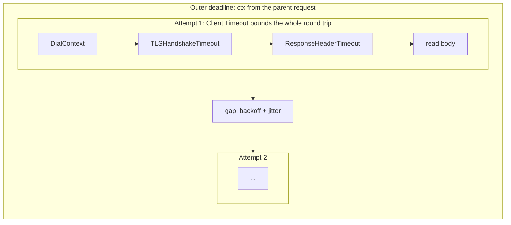
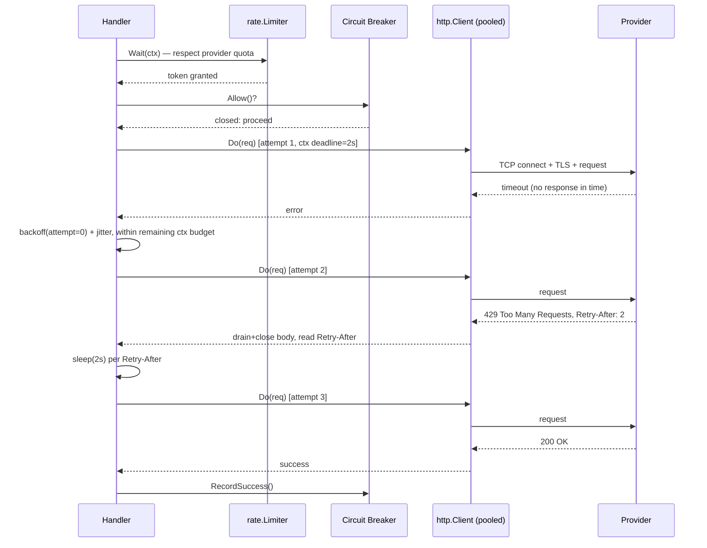
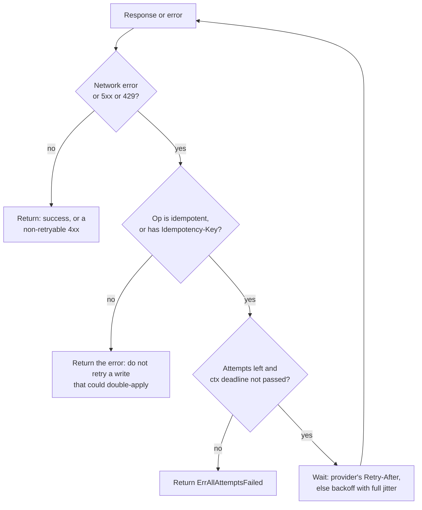

# Calling External APIs

> [!summary] TL;DR
> Calling a payment, email or storage provider safely means one long-lived `http.Client` per provider (never `http.DefaultClient`, which has no timeout), a context deadline on every request, retries limited to idempotent operations with exponential backoff and full jitter, and a circuit breaker so a stuck provider doesn't stall your whole service.

> [!abstract] Core idea
> - `http.DefaultClient` has `Timeout: 0` — no timeout at all. A provider that stops responding mid-response hangs that goroutine forever unless the request's context has its own deadline.
> - Build one `*http.Client` per provider at startup and reuse it for every call; building one per request throws away the connection pool and forces a new TLS handshake each time.
> - Always drain and close the response body, even on an error path, so the transport can reuse the TCP connection instead of opening a new one per call.
> - Retry only idempotent operations, or writes that carry an Idempotency-Key the provider supports; retry with exponential backoff plus full jitter, and prefer the provider's own `Retry-After` header when it sends one.
> - A circuit breaker and a bulkhead (a semaphore limiting concurrent calls) stop one slow dependency from exhausting your service's goroutines and connections.

### Whiteboard version

The shape every outbound call needs, before any of the hardening below:

```go
var providerClient = &http.Client{Timeout: 15 * time.Second} // built once, reused

func callProvider(ctx context.Context, url string) (*http.Response, error) {
    req, err := http.NewRequestWithContext(ctx, http.MethodGet, url, nil)
    if err != nil {
        return nil, err
    }
    resp, err := providerClient.Do(req)
    if err != nil {
        return nil, err
    }
    if resp.StatusCode >= 400 {
        return nil, fmt.Errorf("provider returned %d", resp.StatusCode)
    }
    return resp, nil
}
```

Everything below fixes what this whiteboard version gets wrong: no transport pool tuning, no retry, no drain-and-close, and a status check that is right by luck but not explicit about which codes are retryable.

## 1. Why it exists

InvoiceOps calls four external providers: a payment gateway to charge a card, an email provider to send a receipt, object storage to persist a generated PDF, and an SMS provider for two-factor codes. Each is a network call to a system you do not control, and each can fail in a way a local function call never does: a TCP connect that hangs for 30 seconds because the provider's load balancer is unhealthy, a response that starts streaming and then stalls at byte 40 of a 2KB body, or a `200 OK` with a body that silently contains an error.

Two concrete failures show why this needs explicit engineering, not just "call the HTTP client":

- **No timeout, one bad dependency, service-wide outage.** If every `createInvoice` handler calls the payment provider with `http.DefaultClient` and the provider's connect path degrades to a 60-second hang, every concurrent checkout request parks a goroutine for 60 seconds. At even moderate traffic, the server runs out of available goroutines/file descriptors and stops serving *unrelated* requests, like reading an existing invoice — a dependency that is merely slow takes down a service that didn't even need it.
- **Blind retries double-charge a customer.** If `createCharge` times out after the provider actually processed the charge (the response was simply lost on the way back), and the client naively retries the same POST, a customer is charged twice. The Idempotency-Key pattern — the client generates a key once and the provider deduplicates by it — is what makes a retry here safe at all; see [[Idempotency and Idempotency Keys]] for the key-generation and storage side.

## 2. Mental model

Treat every outbound call as a budget with three nested timers, not one:



- The **outer context deadline** is the absolute budget: if the parent HTTP request has 2 seconds left, no amount of retrying should be allowed to exceed it.
- **`Client.Timeout`** bounds one entire attempt (connect through reading the full body). It is not the same as a per-attempt context deadline — `Client.Timeout` applies even if you pass a context with no deadline, and a context deadline applies even if `Client.Timeout` is zero. Set both: `Client.Timeout` as the per-attempt ceiling, the context deadline as the overall budget.
- **Transport-level timeouts** (`DialContext`, `TLSHandshakeTimeout`, `ResponseHeaderTimeout`) catch failures earlier and more precisely than the blunt `Client.Timeout` — a DNS lookup that hangs is a different failure mode from a slow response body, and distinguishing them in logs matters when you're debugging which part of the call actually failed.

## 3. How it works



The circuit breaker's own state machine (closed → open → half-open) is taught in [[Circuit Breaker]]; here it's one `Allow()`/`RecordSuccess()`/`RecordFailure()` call wrapped around the retry loop above, typically with `sony/gobreaker` in production code.

### Deciding what to retry



## 4. Worked example

The pool-tuned client — a shared transport per provider, built once:

```go
// NewProviderClient builds one shared *http.Client per external provider.
// It is never http.DefaultClient (Timeout: 0, meaning no timeout at all)
// and never built fresh per request (that discards the connection pool
// and forces a new TLS handshake on every call).
func NewProviderClient() *http.Client {
	transport := &http.Transport{
		MaxIdleConns:          100,
		MaxIdleConnsPerHost:   20, // default is 2; one provider host needs more
		MaxConnsPerHost:       50,
		IdleConnTimeout:       90 * time.Second,
		TLSHandshakeTimeout:   5 * time.Second,
		ResponseHeaderTimeout: 10 * time.Second,
		ExpectContinueTimeout: 1 * time.Second,
	}
	return &http.Client{
		Transport: transport,
		Timeout:   15 * time.Second, // overall per-attempt ceiling: dial+TLS+headers+body
	}
}
```

The retry loop: full-jitter backoff, `Retry-After` honoured, non-retryable 4xx returned immediately, and the body always drained:

```go
func CallWithRetry(ctx context.Context, client Doer, newReq func() (*http.Request, error), maxAttempts int, sleep Sleeper) (*http.Response, error) {
	var lastErr error
	for attempt := 0; attempt < maxAttempts; attempt++ {
		if ctx.Err() != nil {
			return nil, fmt.Errorf("%w: %v", ErrAllAttemptsFailed, ctx.Err())
		}
		req, err := newReq()
		if err != nil {
			return nil, err
		}
		resp, err := client.Do(req)
		if err == nil && resp.StatusCode < 500 && resp.StatusCode != http.StatusTooManyRequests {
			return resp, nil // success, or a non-retryable client error (4xx except 429)
		}

		var wait time.Duration
		if err == nil {
			drainAndClose(resp.Body)
			wait = retryAfterOrBackoff(resp.Header.Get("Retry-After"), attempt)
			lastErr = &RetryableError{StatusCode: resp.StatusCode, Err: fmt.Errorf("status %d", resp.StatusCode)}
		} else {
			wait = backoffWithJitter(attempt)
			lastErr = err
		}

		if attempt == maxAttempts-1 {
			break
		}
		select {
		case <-ctx.Done():
			return nil, fmt.Errorf("%w: %v", ErrAllAttemptsFailed, ctx.Err())
		default:
			sleep(wait)
		}
	}
	return nil, fmt.Errorf("%w: %v", ErrAllAttemptsFailed, lastErr)
}

// backoffWithJitter is "full jitter": a uniformly random duration between
// 0 and the exponential cap, so a thundering herd of retrying clients
// does not resynchronize on the same wait schedule.
func backoffWithJitter(attempt int) time.Duration {
	base := 200 * time.Millisecond
	cap := 10 * time.Second
	exp := time.Duration(math.Min(float64(cap), float64(base)*math.Pow(2, float64(attempt))))
	return randDuration(exp)
}
```

`drainAndClose` — the one-line fix for the most common connection-pool churn bug:

```go
// drainAndClose reads the body to EOF (capped) so the underlying TCP
// connection can be reused by the transport's pool, then closes it.
// Skipping this on every early return is the single most common reason
// a "tuned" connection pool still churns connections under load.
func drainAndClose(body io.ReadCloser) {
	_, _ = io.Copy(io.Discard, io.LimitReader(body, 64<<10))
	_ = body.Close()
}
```

Outbound rate limiting with `golang.org/x/time/rate`, so a burst of InvoiceOps invoices never exceeds a provider's published quota:

```go
// ProviderLimiter wraps x/time/rate to keep calls to one provider under
// its published quota. burst allows a short spike (e.g. a batch job)
// without immediately throttling steady traffic.
type ProviderLimiter struct {
	limiter *rate.Limiter
}

func NewProviderLimiter(ratePerSecond float64, burst int) *ProviderLimiter {
	return &ProviderLimiter{limiter: rate.NewLimiter(rate.Limit(ratePerSecond), burst)}
}

func (p *ProviderLimiter) Wait(ctx context.Context) error {
	return p.limiter.Wait(ctx)
}
```

A bulkhead caps how many calls to one provider run at once, so a provider that's gone slow (not down — the circuit breaker hasn't tripped yet) can only ever stall a bounded number of goroutines, never the whole service:

```go
// Bulkhead limits concurrent in-flight calls to one provider with a
// buffered channel used as a counting semaphore. Acquire blocks until a
// slot is free or ctx is done, so a caller waiting for a slot still
// respects the outer deadline instead of queuing forever.
type Bulkhead struct {
	slots chan struct{}
}

func NewBulkhead(maxConcurrent int) *Bulkhead {
	return &Bulkhead{slots: make(chan struct{}, maxConcurrent)}
}

func (b *Bulkhead) Acquire(ctx context.Context) (release func(), err error) {
	select {
	case b.slots <- struct{}{}:
		return func() { <-b.slots }, nil
	case <-ctx.Done():
		return nil, ctx.Err()
	}
}
```

Each outbound call should also log the provider's own request ID (most payment, email and storage providers return one, e.g. `X-Request-Id` or `Stripe-Request-Id`) alongside your own trace ID, and map the provider's status/error body to a domain error your handlers actually switch on (`ErrProviderDeclined`, `ErrProviderRateLimited`, `ErrProviderUnavailable`) instead of leaking the provider's raw status code or JSON shape up to the handler — the handler should never need to know whether the payment gateway's "do not retry" signal is a `402` or a `{"error":{"type":"card_error"}}` body, only that it's one of your own sentinel errors. The provider's request ID is what you hand their support team when a charge needs investigating; without logging it, a dispute means grepping raw response bodies in old logs instead of a one-line lookup.

Tests using `httptest.Server` with fault injection — the exact scenarios a real provider produces: a transient 503 that recovers, a 429 with `Retry-After`, and a 400 that must never be retried:

```go
func TestCallWithRetry_HonoursRetryAfter(t *testing.T) {
	first := true
	srv := httptest.NewServer(http.HandlerFunc(func(w http.ResponseWriter, r *http.Request) {
		if first {
			first = false
			w.Header().Set("Retry-After", "7")
			w.WriteHeader(http.StatusTooManyRequests)
			return
		}
		w.WriteHeader(http.StatusOK)
	}))
	defer srv.Close()

	client := NewProviderClient()
	var slept []time.Duration
	fakeSleep := func(d time.Duration) { slept = append(slept, d) }
	ctx := context.Background()

	resp, err := CallWithRetry(ctx, client, func() (*http.Request, error) {
		return http.NewRequestWithContext(ctx, http.MethodGet, srv.URL, nil)
	}, 3, fakeSleep)
	if err != nil {
		t.Fatalf("CallWithRetry: %v", err)
	}
	drainAndClose(resp.Body)
	if len(slept) != 1 || slept[0] != 7*time.Second {
		t.Fatalf("slept = %v, want [7s] from Retry-After", slept)
	}
}

func TestCallWithRetry_NonRetryable4xxReturnsImmediately(t *testing.T) {
	attempts := 0
	srv := httptest.NewServer(http.HandlerFunc(func(w http.ResponseWriter, r *http.Request) {
		attempts++
		w.WriteHeader(http.StatusBadRequest)
	}))
	defer srv.Close()

	client := NewProviderClient()
	ctx := context.Background()
	resp, err := CallWithRetry(ctx, client, func() (*http.Request, error) {
		return http.NewRequestWithContext(ctx, http.MethodGet, srv.URL, nil)
	}, 5, func(time.Duration) {})
	if err != nil {
		t.Fatalf("CallWithRetry: %v", err)
	}
	drainAndClose(resp.Body)
	if attempts != 1 {
		t.Fatalf("attempts = %d, want 1 (400 is not retried)", attempts)
	}
}
```

**Measured:** built in a scratch module (`extapidemo`, Go 1.24.4, `golang.org/x/time` v0.5.0) and run with `go test -race`. All 7 test functions passed: transient-failure recovery in exactly 3 attempts with 2 sleeps, `Retry-After: 7` honoured as exactly a 7-second sleep, a 400 returned on the first attempt with zero retries, attempt exhaustion returning `ErrAllAttemptsFailed`, and the rate limiter both bursting 2 requests instantly and throttling the 3rd, and returning an error when its context expired while waiting for a token.

## 5. Variants and comparison

| Approach | How it works | Use when | Cost |
| --- | --- | --- | --- |
| Fixed-delay retry | Sleep a constant interval between attempts | Rarely — it synchronizes retrying clients into waves hitting the provider together | Simple but causes retry storms |
| Exponential backoff, no jitter | Delay doubles each attempt | Better than fixed delay, still synchronizes many clients that failed at the same moment | Thundering herd on recovery |
| Exponential backoff + full jitter | Delay is `random(0, min(cap, base × 2^attempt))` | Default for this note's pattern; spreads retrying clients across the whole window | Slightly higher worst-case latency per attempt than no jitter, far better aggregate behaviour |
| Circuit breaker (closed/open/half-open) | Stops calling a provider entirely once failures cross a threshold, probes occasionally | A dependency that is down, not just slow — stop making it worse | Theory and state machine in [[Circuit Breaker]] |
| Hedged requests | Fire a second identical request if the first hasn't answered by some percentile latency, take whichever answers first | Idempotent reads where tail latency matters more than a 2x request-rate cost | Only ever for idempotent operations; doubles load on a slow provider |

## 6. Trade-offs and when not to use

- Retrying a non-idempotent write without an Idempotency-Key is not a tuning choice — it's a correctness bug that can double-charge or double-send. If a provider has no idempotency mechanism, the safe default is zero retries on writes, with the user told to check before retrying manually.
- A circuit breaker adds state and a failure mode of its own: an incorrectly tuned threshold can pop open on a minor blip and reject traffic a merely-degraded (not actually down) provider could still have served.
- Transport pool tuning (`MaxIdleConnsPerHost`, etc.) only matters once request volume to one host is high enough to see connection churn in metrics; for a call made once a minute, the default settings are fine and tuning is wasted effort.
- Hedged requests trade provider load for tail latency — never do this for a payment charge or any write, only for cheap, idempotent reads.

## 7. In production

- **Real systems:** AWS SDKs implement exactly this backoff-plus-jitter default (the "full jitter" formula is from AWS's own Builders' Library). Stripe's API requires an `Idempotency-Key` header on every write and documents retry guidance built around it. Netflix popularized the circuit breaker pattern at scale with Hystrix (now largely superseded by resilience4j and language-native breakers like `sony/gobreaker` in Go).
- **Failure modes → fixes:**
  - A provider's p99 latency creeps up slowly → alert on your own call latency *to that provider*, not just on errors; a circuit breaker triggered by error rate alone won't catch "still succeeding, but at 20 seconds".
  - Connection pool exhaustion under load despite tuning → check for a missing `drainAndClose` on an error path; an unread, unclosed body is a leaked connection even if `resp.Body.Close()` is called, because closing without draining still discards the connection instead of returning it to the pool.
  - SSRF via a user-supplied URL (e.g. a customer's configured webhook delivery URL used as a provider target) → block private/link-local ranges in `Transport.DialContext` using a custom `Control` function, and never let a user supply a raw URL you then fetch without this guard.
  - Idempotency key reused across genuinely different requests → scope the key to (endpoint, request body hash), not just a random UUID, so an accidental key collision cannot apply one request's effect to another's.
- **What to monitor:** per-provider p50/p95/p99 latency, retry rate (not just error rate — a high retry rate with a low final-error rate is still a cost, and a leading indicator), circuit breaker state transitions, and connection pool stats (`Transport` has no built-in metrics exporter in stdlib; wrap `DialContext` or use `httptrace` to count dials vs reused connections).

## 8. Deep dive

- **`Client.Timeout` vs context deadline vs `Transport` timeouts — why all three.** `Client.Timeout` includes connection time, any redirects, and reading the entire response body; it cannot be adjusted per-request once the client is built. A context deadline passed via `NewRequestWithContext` is per-request and composes naturally with the parent request's remaining budget. `Transport`'s `DialContext`, `TLSHandshakeTimeout` and `ResponseHeaderTimeout` catch failures at specific phases, which turns "the call timed out" into "DNS/connect took too long" vs "the provider accepted the connection but never sent headers" — a real debugging difference when a provider's status page says "operational" but your calls still fail.
- **Why `MaxIdleConnsPerHost` defaults to 2 (`http.DefaultMaxIdleConnsPerHost`), and why that's wrong for a single busy provider.** The default assumes many different hosts, each getting a little traffic. A service calling one payment provider host at moderate concurrency will otherwise constantly open new connections (and redo TLS handshakes) because only 2 idle connections are kept per host — set this per-provider based on measured concurrent call volume to that host.
- **SSRF guard mechanics.** `Transport.DialContext` can wrap `net.Dialer.Control`, which runs after the OS resolves the address but before connecting, so you can inspect the resolved IP and refuse private (`10.0.0.0/8`, `172.16.0.0/12`, `192.168.0.0/16`), link-local (`169.254.0.0/16`) and loopback ranges. This matters whenever a URL to fetch comes from user input — even indirectly, such as a webhook delivery address a customer configured — because DNS rebinding can make a hostname that looked external resolve to an internal IP at connect time.
- **Hedging is a tail-latency tool, not a reliability tool.** Firing a second request at, say, the p95 latency mark only helps if the provider's slowness is independent per request (a different backend instance, a different network path) — if the whole provider is uniformly slow, hedging doubles load for no latency benefit. It's valuable specifically for reads against a replicated or horizontally scaled provider API.
- **Tracing an outbound call.** `otelhttp.NewTransport(base)` wraps your `*http.Transport` to emit a client span per call automatically, including the status code and any error, which is what makes a cross-service trace show "handler → payment provider call → 3 retries → success" as one connected timeline instead of three unrelated log lines.

## 9. Interview questions

> [!question]- What's wrong with `http.DefaultClient` for calling an external API?
> `http.DefaultClient` has `Timeout: 0` — no timeout at all — so a provider that accepts the connection and then never finishes the response hangs that call forever unless the request's context carries its own deadline. It's also a shared package-level value other code may configure differently; a dedicated per-provider client avoids surprising interactions.

> [!question]- You retried a POST /charges call after a timeout. The provider says the charge went through twice. What should have prevented this?
> An Idempotency-Key generated once per logical charge attempt and sent on every retry of that same attempt. The provider deduplicates by that key: the second POST with the same key returns the first charge's result instead of creating a new one. Retrying a non-idempotent write with no such mechanism is unsafe regardless of how the retry/backoff is tuned.

> [!question]- Why jitter the backoff instead of a fixed exponential delay?
> If many clients fail at the same instant (e.g. a provider blip) and all back off 1s, 2s, 4s… with no randomness, they retry in synchronized waves that hit the recovering provider just as hard as before. Full jitter — a uniformly random delay up to the exponential cap — spreads those retries across the whole window instead of one spike.

> [!question]- Why does the response body need to be drained before closing it, not just closed?
> `Transport` only returns a connection to its idle pool for reuse once the body has been read to EOF. Closing an unread body still releases resources but the underlying TCP connection cannot be reused, so skipping the drain under load silently turns a tuned connection pool into one that opens a new connection (and redoes the TLS handshake) on every call.

> [!question]- Trap: "A non-2xx response from an HTTP call always comes back as a Go error." True or false?
> False. `client.Do` returns `err == nil` for a successful round trip regardless of the status code — a 404, 429 or 500 is a perfectly well-formed HTTP response, not a Go error. The caller must check `resp.StatusCode` explicitly; treating "no error" as "success" silently ignores failed calls.

> [!question]- When would you add a circuit breaker on top of retries, and what does it protect that retries don't?
> Retries handle a transient blip in one call. A circuit breaker protects the *rest of the service* once a dependency is reliably failing: without one, every request still tries the full retry sequence against a dead provider, holding goroutines and connections the whole time. The breaker trips to "open" after a failure-rate threshold and fails fast immediately, freeing those resources, then probes occasionally ("half-open") to detect recovery. Full state machine in [[Circuit Breaker]].

> [!question]- How would you safely call a URL a customer configured themselves (e.g. a webhook delivery address)?
> Treat it as untrusted input with SSRF potential: resolve the hostname, reject private/link-local/loopback IP ranges via a custom `Dialer.Control`, and re-check on every connection attempt (not just once at config time) because DNS can rebind an external-looking hostname to an internal IP between the check and the actual connect.

## 10. Cheat sheet

- One `*http.Client` per provider, built once; never `http.DefaultClient` (Timeout: 0) and never built per request.
- Set `Client.Timeout` (per-attempt ceiling) and a context deadline (overall budget) — they are not the same thing.
- Tune `MaxIdleConnsPerHost` above the default of 2 for any provider you call often from one process.
- Always drain (`io.Copy(io.Discard, ...)`) and close the response body, on every path, so the connection returns to the pool.
- A non-2xx response is `err == nil` — check `resp.StatusCode` explicitly.
- Retry only idempotent ops or writes carrying an Idempotency-Key; back off with full jitter; prefer the provider's `Retry-After`.
- Outbound rate limit with `x/time/rate` to respect provider quotas; a circuit breaker stops calling a provider that's reliably down.
- SSRF-guard any URL that came from user input, at connect time, not just at input validation time.

## Links
- **Before this:** [[Building REST Endpoints]], [[Context Package]], [[Timeouts, Retries and Backoff]]
- **Next:** [[Circuit Breaker]], [[Redis in Go]] (caching a provider's slow or rate-limited responses)
- **Compare with:** [[Idempotency and Idempotency Keys]], [[Authentication and Authorization in Go]] (calling an OAuth-protected provider)
