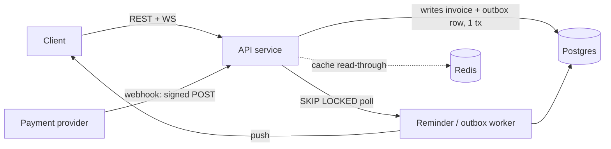
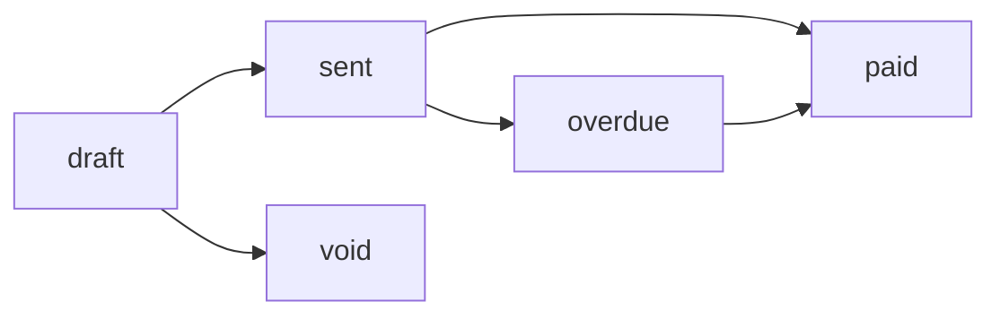
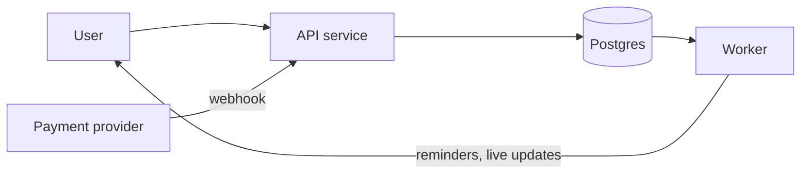
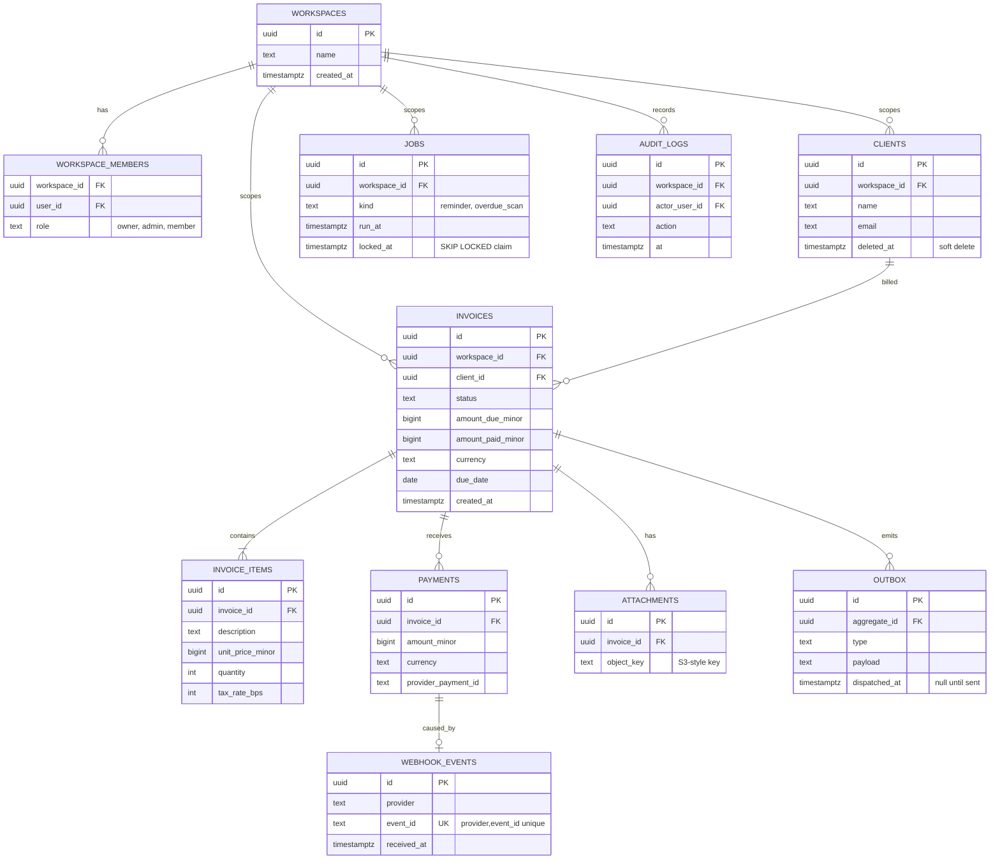
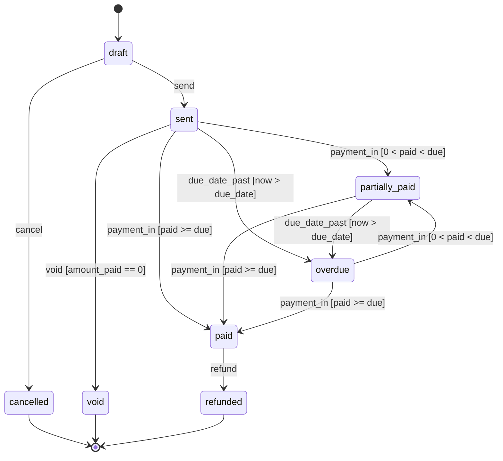
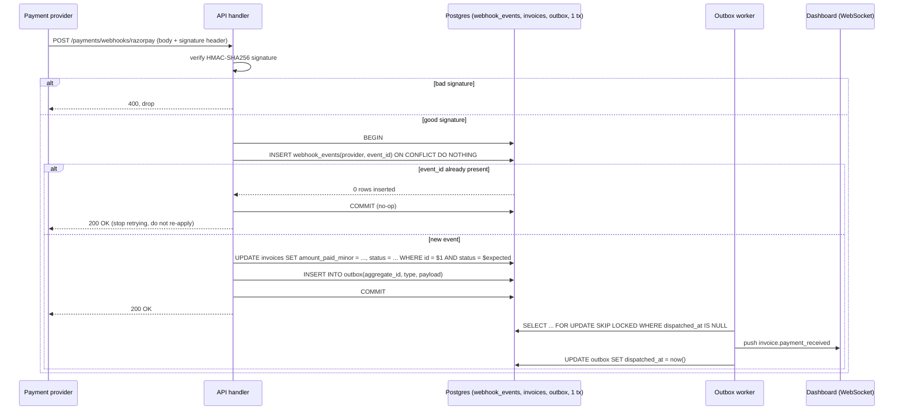
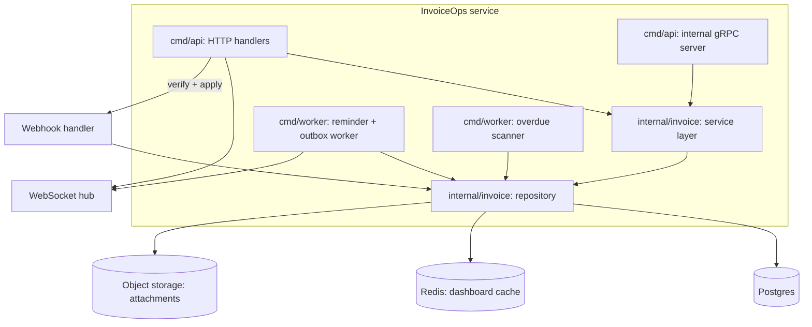
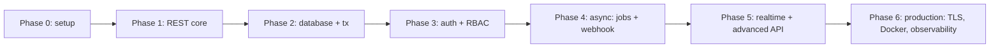

# Capstone - InvoiceOps

> [!summary] TL;DR
> InvoiceOps is one running Go service — an invoicing and payments backend for freelancers and small businesses — that every other `06 Backend Engineering in Go` note builds a piece of.
>
> This note is the project plan: scope, data model, state machine, the two hardest flows end to end, the build order with acceptance criteria per milestone, and the interview story that ties it together.

> [!abstract] Core idea
> - One system, not 29 unrelated exercises: each `06` note is "the chapter that builds InvoiceOps's X", and this note is the table of contents plus the parts no single chapter owns — the schema, the state machine, the tenancy rule and the milestone order.
> - The two flows that make this more than CRUD are the **payment webhook → ledger → live dashboard** path and the **invoice state machine** with its guards. Both get a full worked example below.
> - Multi-tenant from day one: every table carries a `workspace_id`, every query filters on it, and a few tables additionally get Postgres row-level security as a second, defense-in-depth layer.
> - Money is `int64` minor units plus an ISO 4217 currency code, never `float64`. Tax rounds half up. These are the same rules [[Transactions and the Repository Pattern]] assumes without re-deriving them.

### Whiteboard version

**In plain words:** the whole product on one napkin — the few tables and the one state machine everything else hangs off.



A client calls the API over REST (or gRPC internally); every write that changes money state goes into Postgres and an outbox row in the *same* transaction; a worker drains the outbox to push WebSocket updates and send reminders; Redis only ever caches what Postgres already committed, never the source of truth.

If you read nothing else: **the invoice is the aggregate, the outbox is the only way anything leaves that aggregate's transaction, and workspace_id is non-negotiable on every row.**

## Start here: the basics 🟢

> [!info] How to read this note (pick your level)
> - 🟢 **New to this?** Read "From zero" below, then sections 1, 2 and the cheat sheet (10). Stop there, that is a full first pass.
> - 🟡 **Know the basics?** Add section 3 (how it works), 4 (worked example) and 5-6.
> - 🔴 **Interview / SDE-3 prep?** Add 7, 8 and 9. Headings are tagged 🟢🟡🔴 so you always know where you are.

**From zero, in 60 seconds** 🟢

Every note in this folder builds one piece of the same imaginary product: **InvoiceOps**, a small service where freelancers send invoices and get paid.

This note is the blueprint of that product: what it stores, what states an invoice moves through, and in what order to build it.



An invoice is a row in a database that moves through a **state machine**: a fixed set of states with fixed allowed moves. Money amounts are stored as whole cents (integers), never decimals, so rounding can never lose a cent.

Payments arrive as **webhooks**: the payment provider calls us when a card is charged, and the same message may arrive twice, so handling it twice must change nothing.

The rest of this note is just these 4 questions:
1. What exactly is in and out of scope, and what does the data model look like?
2. How do the two hardest flows work (payment webhook, idempotent create)?
3. In what order do you build it, with what "done" check per phase?
4. How do you tell this story in an interview?

**The problem in one story.** A freelancer sends a client an invoice for some work.
The client pays online; the bank tells the freelancer's app; the invoice turns to "paid" and the dashboard updates.
If the client forgets, the app sends a reminder.
InvoiceOps is that app, and every note in this folder builds one part of it.

**Words you need first**

| Word | Plain meaning | Tiny example |
|---|---|---|
| Invoice | A bill sent to a customer | `inv_42`, 1,500.00 INR, due 30 Nov |
| Workspace / tenant | One customer account; data must never leak between them | Every row has `workspace_id` |
| Webhook | An HTTP call a provider sends you when something happens | Provider POSTs "payment succeeded" |
| Ledger | Append-only record of money movements | One row per payment received |
| State machine | Allowed states and moves between them | `draft → sent → paid`, never `void → paid` |
| Outbox | Table of messages written in the same transaction, sent later | Row "invoice 42 paid" for the worker |
| Minor units | Money as whole smallest units, not decimals | 1,500.00 INR stored as `150000` |
| Transaction | Group of database writes that all succeed or all fail | Invoice update plus outbox row together |

**Picture it**



**Analogy.** A small shop's order book: every sale is written in the book first, and the assistant reads the book to send receipts and reminders.
Where it breaks: a shop assistant does not run two copies at once; workers can, so every step must be safe to repeat.

**How the rest of this note builds up**

- First, why one connected project beats separate exercises (sections 1-2).
- Then scope, data model, tenancy, money rules, the state machine and the webhook flow (section 3).
- Then the two hardest flows worked end to end in code (section 4).
- Then build phases with acceptance criteria (section 5).
- Finally, the SDE-3 deep dive: outbox versus CDC, ADRs and the interview story (sections 6-9).

> [!tip] Remember
> The invoice is the aggregate, the outbox is the only way out of its transaction, and `workspace_id` is on every row.

## 1. Why it exists 🟢

A list of Go topics without one body to hang them on teaches each topic in isolation: you can write a correct JWT middleware and a correct webhook handler and still not know how they compose, because nothing ever asked you to make a request pass through both of them against the same schema.

Real backend interviews ask "walk me through what happens when a payment comes in" — a question with no answer if "payment", "invoice" and "webhook" live in three unconnected demo repos.

InvoiceOps is the one system every `06` note writes code against. Concretely: a freelancer creates a client, sends an invoice, the client pays by card through a payment provider, a webhook tells InvoiceOps the money arrived, the invoice flips to `paid`, a dashboard updates live over WebSocket, and if the client only pays part of the amount the invoice sits in `partially_paid` until a second payment (or the due date passes and a scheduled job marks it `overdue`).

That one paragraph already touches nine of the `06` notes.

## 2. Mental model 🟢

Think of InvoiceOps as **one ledger with three doors in**: the REST API (a human or a frontend), the payment webhook (the outside world telling you something happened), and the scheduler (time itself telling you something happened — a due date passed). All three doors write through the same rule: **one database transaction updates the invoice and appends exactly one outbox row**, and nothing downstream (a WebSocket push, an email, a metric) is allowed to be the thing that decides whether the money state changed.

If the outbox write commits, the event *will* eventually be delivered, even across a crash; if it doesn't commit, nothing happened, full stop.

## 3. How it works 🟡

### 3.1 Scope and non-goals

**In scope (MVP):** workspaces, members, clients, invoices with line items, a payment webhook (one provider, Razorpay-shaped), reminders, a dashboard, REST + OpenAPI, one internal gRPC call, one WebSocket stream, auth with workspace-scoped RBAC, Docker, tests.

**Explicit non-goals:** multi-currency conversion (store the invoice's currency, don't convert it), multiple payment providers (the webhook handler is written so a second provider is "one more handler, same core", but only one ships), a public GraphQL API (the capstone marks it optional; see [[REST and HTTP API Design]] for why REST is the default here), partial refunds split across multiple payments (a refund voids the whole payment in this scope).

### 3.2 Data model (ERD)

**In plain words:** the handful of tables and how they point at each other — every workspace owns clients, invoices and payments.



Every table except `workspaces` itself carries `workspace_id` (directly, or via its parent as shown). See [[Database Access (database-sql, pgx, sqlc)]] for the pool and query layer this schema sits on, and [[Schema Migrations in Go Services]] for how these tables get created and changed.

### 3.3 Tenancy

- Every query that touches a tenant-owned table includes `WHERE workspace_id = $1`, where `$1` comes from the authenticated session, never from a path parameter alone (a path parameter says which invoice; the session says which workspace is allowed to ask).
- Composite indexes lead with `workspace_id`: `(workspace_id, status)`, `(workspace_id, due_date)`, `(workspace_id, client_id)`. A query that filters on workspace plus one more column should never do a full-table scan.
- Optional second layer: Postgres **row-level security** (`CREATE POLICY ... USING (workspace_id = current_setting('app.workspace_id')::uuid)`) set per-connection at the start of each request. This is defense in depth for the day a repository method forgets the `WHERE` clause — RLS still blocks the cross-tenant read. It is not a substitute for the application-level filter, because RLS alone gives you no helpful 403, only an empty result set.

### 3.4 Money rules

- Amounts are `int64` minor units (paise for INR, cents for USD) plus a `currency` column; see the `Money` type in the worked example. An invoice's currency never changes after creation — converting currency mid-invoice is out of scope (3.1).
- Tax per line item uses a rate in basis points (1800 = 18% GST) and rounds half up to the nearest minor unit, because that is how GST/VAT invoices round in practice; the exact function is in the worked example and its test table.
- `amount_due_minor` is the sum of line items plus their tax; `amount_paid_minor` is the running sum of applied `payments` rows. The invoice is never the place that does float math — Postgres `numeric` or Go `int64`, never `float64`, anywhere money is stored or summed.

### 3.5 Invoice state machine

**In plain words:** an invoice is only ever in one state, and only certain moves are legal — the code refuses every other move.



`paid`, `cancelled`, `void` and `refunded` are terminal: no event moves an invoice out of them. Every arrow's guard is evaluated against the invoice row read inside the same transaction that applies the event, so two concurrent payment webhooks for the same invoice can never both see "not yet paid" and both write `paid` — the second one's `UPDATE ... WHERE status = $expected` affects zero rows and the handler re-reads and re-evaluates.

The exact guarded transition function, tested against every arrow above (including the `overdue -> partially_paid` arrow the old project plan was missing), is in the worked example.

### 3.6 Payment webhook flow

**In plain words:** the provider tells us "this invoice got paid"; we must record it exactly once even if they tell us three times.



This is the same signature-then-dedupe-then-transaction-then-outbox shape that [[Receiving Webhooks Idempotently]] derives in general; InvoiceOps is where it gets a concrete invoice, a concrete `webhook_events` unique key, and a concrete outbox row shape.

A separate **reconciliation job** (a [[Scheduled Jobs]] task) re-pulls the provider's payment list for any invoice last-updated more than N minutes ago with no matching webhook, for the case where the webhook itself never arrives — polling as the backstop for push.

### 3.7 Component view



Import direction only ever points down this diagram: `cmd` depends on `internal/invoice`'s service, the service depends on a repository *interface* it declares (see [[Service Project Layout and Wiring]] for why the consumer owns the interface), and the concrete Postgres/Redis/S3 clients implement that interface from outside.

Nothing in `internal/invoice` imports `net/http`, `database/sql` concrete types, or a Redis client directly — see [[Backend Request Lifecycle and Layering]] for the general version of this rule.

### 3.8 Idempotent writes, reminders and the dashboard cache

- **`POST /invoices` idempotency.** A client retry after a timed-out request must not create two invoices. The client sends an `Idempotency-Key` header; the handler does `INSERT INTO idempotency_keys(workspace_id, key, response_body) ... ON CONFLICT (workspace_id, key) DO NOTHING` in the same transaction as the invoice insert, and on a conflict replays the stored `response_body` instead of creating a second invoice. This is the same unique-key-inside-one-transaction shape as the webhook's `webhook_events` table in 3.6, applied to a client-initiated write instead of a provider-initiated one.
- **Reminders via scheduler + `SKIP LOCKED` workers.** A `jobs` row of kind `reminder` is inserted with `run_at` set to some offset before `due_date`. A worker polls `SELECT ... FROM jobs WHERE run_at <= now() AND locked_at IS NULL FOR UPDATE SKIP LOCKED LIMIT 20`, which lets N worker replicas share the queue with no double-send: a row another replica already locked is invisible to this `SELECT`, not merely slower to reach. See [[Scheduled Jobs]] for the general pattern this reuses.
- **Dashboard cache invalidated by payment events.** `GET /dashboard/summary` (counts and totals per status) reads through a Redis key keyed by `workspace_id` with a short TTL as a backstop; the outbox worker that handles `invoice.payment_received` (3.6) also issues a `DEL` on that workspace's dashboard key, so a payment is reflected on the next dashboard read rather than waiting out the TTL. Redis is never the write path for money — it only ever caches a read already committed in Postgres. See [[Redis in Go]] for the cache-aside mechanics this relies on.

## 4. Worked example 🟡

The transition table and the webhook's signature-verify-dedupe-apply-outbox shape are small enough to unit test completely without a real Postgres instance (which this environment cannot run), so that is exactly what ships here: a `Money` type, the guarded `Transition` function for every arrow in 3.5, and `HandlePaymentWebhook` tested against an in-memory fake store standing in for the pgx repository.

```go
// Package invoiceops holds the small, independently testable pieces of the
// InvoiceOps capstone domain: money arithmetic and the invoice state machine.
package invoiceops

import "fmt"

// Money is an amount in the smallest unit of a currency (minor units), e.g.
// cents for USD or paise for INR. Never use float64 for money: binary
// floating point cannot represent 0.10 exactly, and repeated rounding drifts
// over thousands of invoices.
type Money struct {
	MinorUnits int64  // e.g. 150000 == ₹1,500.00 (INR has 2 minor-unit digits)
	Currency   string // ISO 4217, e.g. "INR", "USD"
}

// Add returns m+other. It panics on a currency mismatch: adding ₹10 to $10
// is a bug, never a 1:1 sum.
func (m Money) Add(other Money) Money {
	if m.Currency != other.Currency {
		panic(fmt.Sprintf("currency mismatch: %s vs %s", m.Currency, other.Currency))
	}
	return Money{MinorUnits: m.MinorUnits + other.MinorUnits, Currency: m.Currency}
}

// Sub returns m-other, same currency rule as Add.
func (m Money) Sub(other Money) Money {
	if m.Currency != other.Currency {
		panic(fmt.Sprintf("currency mismatch: %s vs %s", m.Currency, other.Currency))
	}
	return Money{MinorUnits: m.MinorUnits - other.MinorUnits, Currency: m.Currency}
}

// IsZero reports whether the amount is exactly zero.
func (m Money) IsZero() bool { return m.MinorUnits == 0 }

// TaxMinorUnits computes tax for a non-negative amount given a rate in basis
// points (1 bp = 0.01%, so 1800 bps == 18% GST), rounding half up to the
// nearest minor unit. Half-up matches how GST/VAT invoices round in
// practice. amount and rateBps must both be >= 0 (line amounts and tax
// rates are never negative; a credit note negates the whole line instead).
// The multiplication is exact int64 math (no float) up to amounts far
// larger than any real invoice line.
func TaxMinorUnits(amount, rateBps int64) int64 {
	num := amount * rateBps
	q := num / 10000
	r := num % 10000
	if r*2 >= 10000 {
		q++
	}
	return q
}
```

```go
package invoiceops

import (
	"fmt"
	"time"
)

// InvoiceStatus is one node of the invoice lifecycle. draft, sent,
// partially_paid and overdue are live states; paid, cancelled, void and
// refunded are terminal — no event moves an invoice out of them.
type InvoiceStatus string

const (
	StatusDraft         InvoiceStatus = "draft"
	StatusSent          InvoiceStatus = "sent"
	StatusPartiallyPaid InvoiceStatus = "partially_paid"
	StatusOverdue       InvoiceStatus = "overdue"
	StatusPaid          InvoiceStatus = "paid"
	StatusCancelled     InvoiceStatus = "cancelled"
	StatusVoid          InvoiceStatus = "void"
	StatusRefunded      InvoiceStatus = "refunded"
)

// Event is something that happens to an invoice: a payment landing, the due
// date passing, or an operator action. The webhook handler, the overdue
// scanner job and the cancel/void endpoints each raise exactly one of these.
type Event string

const (
	EventSend        Event = "send"          // draft -> sent
	EventPaymentIn   Event = "payment_in"    // a webhook posted a payment
	EventDueDatePast Event = "due_date_past" // the overdue scanner job fired
	EventCancel      Event = "cancel"        // operator cancel (before any payment)
	EventVoid        Event = "void"          // operator void (after send, no payment yet)
	EventRefund      Event = "refund"        // a refund webhook posted against a paid invoice
)

// Snapshot is the invoice fields the guards need. AmountDue and AmountPaid
// must share a Currency (an invoice never changes currency after creation).
type Snapshot struct {
	Status     InvoiceStatus
	AmountDue  Money
	AmountPaid Money
	DueDate    time.Time
	Now        time.Time // injected so tests do not depend on wall-clock time
}

// Transition computes the next status for an event, or returns an error if
// the event does not apply to the current status or its guard fails. It is
// pure and has no side effects: the caller (inside one DB transaction) is
// responsible for persisting the new status and appending the outbox event.
// Every case below names its own valid "from" states, so cancelled, void
// and refunded (terminal: no event ever matches them) and paid (only
// EventRefund matches it) fall straight through to that case's own error.
func Transition(s Snapshot, e Event) (InvoiceStatus, error) {
	switch e {
	case EventSend:
		if s.Status != StatusDraft {
			return "", fmt.Errorf("send: invalid from %q, want draft", s.Status)
		}
		return StatusSent, nil

	case EventCancel:
		if s.Status != StatusDraft {
			return "", fmt.Errorf("cancel: invalid from %q, want draft", s.Status)
		}
		return StatusCancelled, nil

	case EventVoid:
		if s.Status != StatusSent {
			return "", fmt.Errorf("void: invalid from %q, want sent", s.Status)
		}
		if !s.AmountPaid.IsZero() {
			return "", fmt.Errorf("void: guard failed, %d minor units already paid", s.AmountPaid.MinorUnits)
		}
		return StatusVoid, nil

	case EventPaymentIn:
		switch s.Status {
		case StatusSent, StatusPartiallyPaid, StatusOverdue:
			if s.AmountPaid.Currency != s.AmountDue.Currency {
				return "", fmt.Errorf("payment_in: currency mismatch %s vs %s", s.AmountPaid.Currency, s.AmountDue.Currency)
			}
			switch {
			case s.AmountPaid.MinorUnits >= s.AmountDue.MinorUnits:
				return StatusPaid, nil
			case s.AmountPaid.MinorUnits > 0:
				return StatusPartiallyPaid, nil
			default:
				return "", fmt.Errorf("payment_in: guard failed, amount paid is zero")
			}
		default:
			return "", fmt.Errorf("payment_in: invalid from %q", s.Status)
		}

	case EventDueDatePast:
		switch s.Status {
		case StatusSent, StatusPartiallyPaid:
			if !s.Now.After(s.DueDate) {
				return "", fmt.Errorf("due_date_past: guard failed, now %s is not after due date %s", s.Now, s.DueDate)
			}
			return StatusOverdue, nil
		default:
			return "", fmt.Errorf("due_date_past: invalid from %q", s.Status)
		}

	case EventRefund:
		if s.Status != StatusPaid {
			return "", fmt.Errorf("refund: invalid from %q, want paid", s.Status)
		}
		return StatusRefunded, nil

	default:
		return "", fmt.Errorf("unknown event %q", e)
	}
}
```

```go
package invoiceops

import (
	"crypto/hmac"
	"crypto/sha256"
	"encoding/hex"
	"errors"
	"fmt"
)

// VerifySignature checks a provider webhook's HMAC-SHA256 signature over the
// raw request body, using constant-time comparison so a timing attack
// cannot be used to guess the signature byte by byte. secret is the
// provider's per-account webhook secret (RAZORPAY_WEBHOOK_SECRET in config).
func VerifySignature(body []byte, signatureHex string, secret []byte) bool {
	mac := hmac.New(sha256.New, secret)
	mac.Write(body)
	want := mac.Sum(nil)
	got, err := hex.DecodeString(signatureHex)
	if err != nil {
		return false
	}
	return hmac.Equal(want, got)
}

// WebhookEvent is one row of the webhook_events table: the provider's event
// id is the natural idempotency key, unique per (provider, event_id).
type WebhookEvent struct {
	Provider string
	EventID  string
	Payload  []byte
}

// OutboxEntry is one row written in the same DB transaction as the business
// update. A separate publisher goroutine/job polls outbox for unsent rows
// and publishes them (WebSocket push, email, metrics) at least once.
type OutboxEntry struct {
	AggregateID string // the invoice id
	Type        string // e.g. "invoice.payment_received"
	Payload     string
}

// EventStore is the subset of the repository the handler needs; the real
// implementation is a pgx-backed repo inside one *sql.Tx (see Database
// Access (database-sql, pgx, sqlc) and Transactions and the Repository
// Pattern for the Postgres side of this interface).
type EventStore interface {
	// MarkProcessed inserts the event id and returns false without error if
	// it was already present (ON CONFLICT DO NOTHING + RowsAffected == 0).
	MarkProcessed(e WebhookEvent) (inserted bool, err error)
	ApplyPayment(invoiceID string, paid Money) error
	AppendOutbox(entry OutboxEntry) error
}

// HandlePaymentWebhook is the pure core of POST /payments/webhooks/razorpay:
// verify -> dedupe -> apply -> outbox, all inside one caller-managed
// transaction. The HTTP handler itself only reads the body, calls this, and
// maps the error to a status code (see Receiving Webhooks Idempotently for
// why the handler must still return 200 on a duplicate, never retry it).
func HandlePaymentWebhook(store EventStore, body []byte, signatureHex string, secret []byte, e WebhookEvent, invoiceID string, paid Money) error {
	if !VerifySignature(body, signatureHex, secret) {
		return errors.New("invalid webhook signature")
	}
	inserted, err := store.MarkProcessed(e)
	if err != nil {
		return fmt.Errorf("mark processed: %w", err)
	}
	if !inserted {
		// Already handled in an earlier delivery of the same event. Return
		// nil (200 OK) so the provider stops retrying; do not re-apply the
		// payment or it would be double-counted.
		return nil
	}
	if err := store.ApplyPayment(invoiceID, paid); err != nil {
		return fmt.Errorf("apply payment: %w", err)
	}
	return store.AppendOutbox(OutboxEntry{
		AggregateID: invoiceID,
		Type:        "invoice.payment_received",
		Payload:     fmt.Sprintf(`{"invoice_id":%q,"amount_minor":%d,"currency":%q}`, invoiceID, paid.MinorUnits, paid.Currency),
	})
}
```

Tests (`go test -race ./...`, Postgres and Redis replaced by a plain Go fake and an in-memory map — no database or broker runs in this environment):

```go
package invoiceops

import "testing"

func TestMoneyAddSub(t *testing.T) {
	a := Money{MinorUnits: 150000, Currency: "INR"}
	b := Money{MinorUnits: 50000, Currency: "INR"}
	if got := a.Add(b); got.MinorUnits != 200000 {
		t.Fatalf("Add: got %d, want 200000", got.MinorUnits)
	}
	if got := a.Sub(b); got.MinorUnits != 100000 {
		t.Fatalf("Sub: got %d, want 100000", got.MinorUnits)
	}
}

func TestTaxMinorUnits(t *testing.T) {
	cases := []struct {
		name    string
		amount  int64
		rateBps int64
		want    int64
	}{
		{"18pct GST on 100000", 100000, 1800, 18000},
		{"rounds down below half", 333, 1000, 33},    // 333*0.10 = 33.3 -> 33
		{"exact amount, no rounding", 250, 1000, 25}, // 250*0.10 = 25.0 exact
		{"100pct rate is a pass-through", 25, 10000, 25},
		{"rounds up above half", 15, 3333, 5}, // 15*0.3333 = 4.9995 -> 5
		{"zero rate", 100000, 0, 0},
	}
	for _, c := range cases {
		t.Run(c.name, func(t *testing.T) {
			if got := TaxMinorUnits(c.amount, c.rateBps); got != c.want {
				t.Errorf("TaxMinorUnits(%d, %d) = %d, want %d", c.amount, c.rateBps, got, c.want)
			}
		})
	}
}
```

```go
package invoiceops

import (
	"testing"
	"time"
)

func inr(minor int64) Money { return Money{MinorUnits: minor, Currency: "INR"} }

func TestTransitionTable(t *testing.T) {
	// One case per arrow in the state diagram (11 arrows), plus 4 rejection
	// cases (a blocked guard, a terminal state, a currency mismatch and a
	// zero-amount guard failure) — 15 sub-tests in total, including the
	// overdue -> partially_paid arrow the old plan's state machine lacked.
	past := time.Date(2026, 1, 1, 0, 0, 0, 0, time.UTC)
	future := past.Add(48 * time.Hour)
	cases := []struct {
		name string
		s    Snapshot
		e    Event
		want InvoiceStatus
		err  bool
	}{
		{"draft -> sent", Snapshot{Status: StatusDraft}, EventSend, StatusSent, false},
		{"draft -> cancelled", Snapshot{Status: StatusDraft}, EventCancel, StatusCancelled, false},
		{"sent -> void (no payment yet)", Snapshot{Status: StatusSent, AmountPaid: inr(0)}, EventVoid, StatusVoid, false},
		{"sent -> partially_paid",
			Snapshot{Status: StatusSent, AmountDue: inr(100000), AmountPaid: inr(40000)},
			EventPaymentIn, StatusPartiallyPaid, false},
		{"sent -> paid",
			Snapshot{Status: StatusSent, AmountDue: inr(100000), AmountPaid: inr(100000)},
			EventPaymentIn, StatusPaid, false},
		{"sent -> overdue",
			Snapshot{Status: StatusSent, DueDate: past, Now: future},
			EventDueDatePast, StatusOverdue, false},
		{"partially_paid -> paid",
			Snapshot{Status: StatusPartiallyPaid, AmountDue: inr(100000), AmountPaid: inr(100000)},
			EventPaymentIn, StatusPaid, false},
		{"partially_paid -> overdue",
			Snapshot{Status: StatusPartiallyPaid, DueDate: past, Now: future},
			EventDueDatePast, StatusOverdue, false},
		{"overdue -> partially_paid",
			Snapshot{Status: StatusOverdue, AmountDue: inr(100000), AmountPaid: inr(40000)},
			EventPaymentIn, StatusPartiallyPaid, false},
		{"overdue -> paid",
			Snapshot{Status: StatusOverdue, AmountDue: inr(100000), AmountPaid: inr(100000)},
			EventPaymentIn, StatusPaid, false},
		{"paid -> refunded", Snapshot{Status: StatusPaid}, EventRefund, StatusRefunded, false},
		{"sent void blocked after partial payment", Snapshot{Status: StatusSent, AmountPaid: inr(100)}, EventVoid, "", true},
		{"terminal state rejects every event", Snapshot{Status: StatusPaid}, EventSend, "", true},
		{"payment_in currency mismatch rejected",
			Snapshot{Status: StatusSent, AmountDue: inr(100000), AmountPaid: Money{MinorUnits: 40000, Currency: "USD"}},
			EventPaymentIn, "", true},
		{"payment_in with nothing paid yet fails its guard",
			Snapshot{Status: StatusSent, AmountDue: inr(100000), AmountPaid: inr(0)},
			EventPaymentIn, "", true},
	}
	for _, c := range cases {
		t.Run(c.name, func(t *testing.T) {
			got, err := Transition(c.s, c.e)
			if c.err {
				if err == nil {
					t.Fatalf("expected an error, got status %q", got)
				}
				return
			}
			if err != nil {
				t.Fatalf("unexpected error: %v", err)
			}
			if got != c.want {
				t.Fatalf("got %q, want %q", got, c.want)
			}
		})
	}
}
```

```go
package invoiceops

import (
	"crypto/hmac"
	"crypto/sha256"
	"encoding/hex"
	"testing"
)

// fakeStore is an in-memory stand-in for the pgx-backed repository: it lets
// HandlePaymentWebhook be tested with no Postgres instance.
type fakeStore struct {
	processed map[string]bool
	paidTotal int64
	outbox    []OutboxEntry
}

func newFakeStore() *fakeStore {
	return &fakeStore{processed: map[string]bool{}}
}

func (f *fakeStore) MarkProcessed(e WebhookEvent) (bool, error) {
	key := e.Provider + ":" + e.EventID
	if f.processed[key] {
		return false, nil
	}
	f.processed[key] = true
	return true, nil
}

func (f *fakeStore) ApplyPayment(invoiceID string, paid Money) error {
	f.paidTotal += paid.MinorUnits
	return nil
}

func (f *fakeStore) AppendOutbox(entry OutboxEntry) error {
	f.outbox = append(f.outbox, entry)
	return nil
}

func sign(t *testing.T, body []byte, secret []byte) string {
	t.Helper()
	mac := hmac.New(sha256.New, secret)
	mac.Write(body)
	return hex.EncodeToString(mac.Sum(nil))
}

func TestHandlePaymentWebhookAppliesOnce(t *testing.T) {
	secret := []byte("whsec_test")
	body := []byte(`{"event_id":"evt_1"}`)
	sig := sign(t, body, secret)
	store := newFakeStore()
	e := WebhookEvent{Provider: "razorpay", EventID: "evt_1"}

	if err := HandlePaymentWebhook(store, body, sig, secret, e, "inv_1", inr(50000)); err != nil {
		t.Fatalf("unexpected error: %v", err)
	}
	if store.paidTotal != 50000 {
		t.Fatalf("paidTotal = %d, want 50000", store.paidTotal)
	}
	if len(store.outbox) != 1 {
		t.Fatalf("outbox has %d rows, want 1", len(store.outbox))
	}
}

func TestHandlePaymentWebhookDedupesRetry(t *testing.T) {
	secret := []byte("whsec_test")
	body := []byte(`{"event_id":"evt_2"}`)
	sig := sign(t, body, secret)
	store := newFakeStore()
	e := WebhookEvent{Provider: "razorpay", EventID: "evt_2"}

	// The provider redelivers the same event 3 times before it sees our 200.
	for i := 0; i < 3; i++ {
		if err := HandlePaymentWebhook(store, body, sig, secret, e, "inv_2", inr(50000)); err != nil {
			t.Fatalf("delivery %d: unexpected error: %v", i, err)
		}
	}
	if store.paidTotal != 50000 {
		t.Fatalf("paidTotal = %d, want 50000 (not 150000 — the retries must not double-apply)", store.paidTotal)
	}
	if len(store.outbox) != 1 {
		t.Fatalf("outbox has %d rows, want 1 (one per unique event, not per delivery)", len(store.outbox))
	}
}

func TestHandlePaymentWebhookBadSignatureRejected(t *testing.T) {
	secret := []byte("whsec_test")
	body := []byte(`{"event_id":"evt_3"}`)
	store := newFakeStore()
	e := WebhookEvent{Provider: "razorpay", EventID: "evt_3"}

	err := HandlePaymentWebhook(store, body, "deadbeef", secret, e, "inv_3", inr(50000))
	if err == nil {
		t.Fatal("expected an error for a bad signature, got nil")
	}
	if store.paidTotal != 0 {
		t.Fatalf("paidTotal = %d, want 0: a bad signature must never touch the ledger", store.paidTotal)
	}
	if len(store.outbox) != 0 {
		t.Fatalf("outbox has %d rows, want 0", len(store.outbox))
	}
}
```

Running this scratch module: `go vet ./...` is clean, and `go test -race -v ./...` passes all 15 `Transition` sub-tests (one per arrow plus the rejected-event cases), the `Money`/tax table, and 3 webhook tests (apply-once, retry-dedupes, bad-signature-rejected).

The suite includes `TestHandlePaymentWebhookDedupesRetry`, which delivers the same webhook 3 times and asserts `paidTotal == 50000`, not `150000` — the concrete regression test for the idempotency story in 3.6.

## 5. Build phases and acceptance criteria 🟡



| Phase | Builds | Acceptance criteria | 06 notes exercised |
| ----- | ------ | -------------------- | ------------------- |
| 0. Setup | module, folder layout, config loader, logger, `/healthz` | `go build ./...` succeeds; `/healthz` returns 200 with no DB dependency | [[Service Project Layout and Wiring]], [[Configuration and Secrets]], [[Graceful Shutdown and Health Checks]] |
| 1. REST core | clients + invoices CRUD, DTOs, error envelope | every endpoint has a request/response example; invalid JSON returns a structured 400, not a panic | [[HTTP Server Fundamentals (net-http)]], [[Building REST Endpoints]], [[Request Decoding, Validation and DTOs]], [[Middleware]] |
| 2. Database + transactions | migrations, repositories, the payment+outbox transaction | every multi-row write has a named transaction boundary; `go test -race` passes on repository tests | [[Schema Migrations in Go Services]], [[Database Access (database-sql, pgx, sqlc)]], [[Transactions and the Repository Pattern]] |
| 3. Auth + tenancy | signup/login, JWT + refresh rotation (or sessions), workspace RBAC, rate-limited login | a cross-workspace GET returns 404, never another workspace's data; login rate limit trips after N attempts | [[Authentication and Authorization in Go]], [[Calling External APIs]] |
| 4. Async: jobs + webhook | reminder scheduler, overdue scanner, payment webhook, idempotency | the duplicate-webhook test (above) passes; a killed-and-restarted worker loses no outbox row | [[Scheduled Jobs]], [[Background Workers and Job Queues]], [[Receiving Webhooks Idempotently]], [[Redis in Go]] |
| 5. Realtime + advanced APIs | WebSocket live status, internal gRPC invoice lookup, file uploads | a WebSocket client disconnect leaks no goroutine (checked with `runtime.NumGoroutine` in a test); the gRPC call carries a deadline | [[gRPC Services in Go]], [[gRPC Streaming in Go]], [[Serving REST and gRPC Together]], [[WebSockets and SSE in Go]], [[File Uploads and Object Storage]] |
| 6. Production | TLS, Docker, OpenTelemetry, structured logs, OpenAPI docs | container starts and passes `/healthz` under `docker run`; a trace spans the webhook → outbox → WebSocket push | [[TLS, HTTPS and HTTP2 in Go Servers]], [[Containerizing Go Services]], [[Observability in Go Services]], [[OpenAPI-First Development in Go]], [[Secure Coding for Go Services]] |

Every note that ships code should do it against this project: if a `06` note has no InvoiceOps code task attached, treat it as unfinished.

## 6. Trade-offs and when not to use 🟡

- **This much structure is overkill for a weekend CRUD toy.** If the goal is "learn `net/http` routing", write 3 endpoints against an in-memory map and stop — don't build the tenancy and outbox machinery for a throwaway.
- **Postgres-as-queue (the outbox + `SKIP LOCKED` workers) vs a real broker.** InvoiceOps chooses Postgres-as-queue for reminders and outbox dispatch because the volumes are low (one row per invoice event, not per click) and it buys exactly-once-effective delivery for free from the same transaction that already has to commit. A system with high job volume or cross-service fan-out should use a real broker instead (see [[Queues vs Streams and Broker Comparison]]) — this is an ADR decision, not a universal rule.
- **JWT + refresh rotation vs server-side sessions.** InvoiceOps picks JWT + refresh rotation so the internal gRPC call and a future mobile client can reuse the same token without a shared session store; a single server-rendered app with no other client would be simpler with sessions (see [[Authentication and Authorization in Go]] for the full comparison).
- **Row-level security is optional, not required.** It adds a real operational cost (every connection must set `app.workspace_id`, and a forgotten `SET` fails closed with confusing empty results, not an error) for a benefit that is pure defense-in-depth on top of an already-correct `WHERE` clause. Skip it if the team isn't ready to debug that failure mode.

## 7. In production 🔴

- **Real systems:** this shape (tenant-scoped ledger + webhook + outbox + worker) matches how billing systems at Stripe-style payment platforms and B2B SaaS invoicing products are built; the specific choice of Postgres-as-queue over a broker is also how small-to-mid-size services commonly start before traffic justifies a broker.
- **Failure modes → fixes:**
  - Webhook arrives before the invoice exists (client clock skew, out-of-order delivery) → the handler's `ApplyPayment` fails to find the invoice; retry via the provider's own retry policy, and alert if an event is still unmatched after the provider's max retry window.
  - Outbox worker crashes mid-dispatch → the row's `dispatched_at` is still null, so the next worker (this one restarted, or another replica) picks it up; `SKIP LOCKED` means two replicas never double-dispatch the same row.
  - A reminder job double-fires because two replicas's clocks disagree on "is it time yet" → the job claim itself (`FOR UPDATE SKIP LOCKED` on the `jobs` row) is the lock, not the clock; see [[Scheduled Jobs]].
- **What to monitor:** webhook → status-update latency (p50/p95/p99, an SLO candidate — e.g. p95 under 2s from webhook receipt to outbox dispatch); outbox backlog depth (rows with `dispatched_at IS NULL` older than 1 minute); webhook signature-rejection rate (a spike means a secret rotated without updating config, or an attack); login rate-limit trip rate.

## 8. Deep dive 🔴

### Why the outbox pattern and not a Kafka/Debezium CDC pipeline for this scope

Change Data Capture (reading Postgres's write-ahead log to emit events) removes the outbox table entirely and guarantees the event reflects exactly what committed, but it adds an operational piece (Debezium + a broker) this capstone's volume does not need yet.

The polling outbox is strictly simpler to run and test, at the cost of a small polling delay (bounded by the worker's poll interval) instead of near-zero CDC latency. Either is "correct"; the choice here is about scope, not correctness — see [[Transactional Outbox and CDC]] for the full comparison.

### ADRs

- **Postgres-as-queue vs a message broker for reminders/outbox** (decided: Postgres-as-queue). Revisit if job volume grows past what a single Postgres instance's `jobs`/`outbox` tables can poll without adding latency, or if a second service needs to consume the same events.
- **JWT + refresh rotation vs server-side sessions** (decided: JWT + refresh rotation). Revisit if the only client ever becomes a single server-rendered app with no API consumers, where sessions remove the token-revocation complexity for free.

### Senior interview story (STAR-shaped)

*Situation:* a small-business invoicing backend needed correct money handling and at-least-once payment processing without losing or double-counting a payment. *Task:* design the schema, the state machine and the webhook path so a provider's retried webhook, a crashed worker, or two concurrent requests could never corrupt an invoice's paid amount. *Action:* every money-changing write became one transaction with a guarded `UPDATE ... WHERE status = $expected` plus an outbox row; webhook idempotency used the provider's event id as a unique key, checked inside that same transaction. *Result:* the duplicate-webhook and concurrent-transition cases are regression tests (above), not assumptions — the same shape a reviewer would check for in a live system design round.

### Test and load-test plan

- Unit: `Money`, `Transition`, webhook core (shown above) — no I/O, run on every commit.
- Integration (`testcontainers-go`, see [[Testing Go Services]]): repository tests against a real, disposable Postgres; a round-trip through `MarkProcessed`'s `ON CONFLICT DO NOTHING` against the real unique index, not a mock.
- Handler tests (`httptest`): REST endpoints against a fake repository.
- Load test target (an estimate, not measured in this environment): the payment webhook path should sustain 50 requests/second with p99 under 300ms on modest hardware (4 vCPU, Postgres with a 20-connection pool) before the connection pool, not the handler logic, becomes the bottleneck — verify with `wrk` or `ghz` for the gRPC path per [[Testing Go Services]].

## 9. Interview questions 🔴

> [!question]- Why does the webhook handler return 200 even when it detects a duplicate event?
> Because the provider's retry policy stops only on a 2xx response. Returning anything else (4xx/5xx) on a duplicate tells the provider to retry a webhook that was already fully processed, which either loops forever or — worse — tempts a future change to "fix" the error by re-applying the payment.

> [!question]- Trap: if `amount_paid_minor >= amount_due_minor` always means `paid`, why keep a separate `partially_paid` state instead of just comparing amounts everywhere?
> Because other code (reminders, the dashboard query, the state diagram's guards) needs to branch on lifecycle stage without re-deriving it from raw amounts every time, and a state column is what a unique index or a `WHERE status = $expected` guard can act on atomically — comparing amounts inline would require recomputing and racing on every check.

> [!question]- What stops two concurrent webhook deliveries from both marking the same invoice `paid` and double-applying the payment?
> The `webhook_events` table's unique `(provider, event_id)` constraint. The first `INSERT ... ON CONFLICT DO NOTHING` to commit wins; the second affects zero rows, so its handler takes the "already processed" branch and returns without touching `invoices` again.

> [!question]- Why is `workspace_id` on every row instead of inferring tenancy from a join through `clients` or `users`?
> A join-based tenancy check means every new query must remember to add the join correctly, and a missed join silently leaks another workspace's row. A direct `workspace_id` column makes the correct query the simple one (`WHERE workspace_id = $1`) and makes an incorrect one (missing that clause) easy to catch in review or with RLS as a backstop.

> [!question]- Why int64 minor units instead of Go's `decimal` or a fixed-point library?
> Minor units are plain integer arithmetic — add, subtract, compare — with no library dependency and no rounding ambiguity for the operations an invoice actually needs (sum line items, compare to a threshold). A decimal library earns its place when you need arbitrary-precision division or display formatting beyond "two decimal places for this currency", which InvoiceOps's scope doesn't require.

> [!question]- Trap: the state diagram shows `overdue -> paid` directly — doesn't the invoice have to pass through `partially_paid` first if any payment arrived before the due date?
> No: an invoice can go `sent -> overdue` (due date passed, zero payments) and then receive one payment that covers the full amount, going straight `overdue -> paid` without ever touching `partially_paid`.
>
> `partially_paid` only applies when `0 < paid < due`; a single sufficient payment skips it entirely, which the `Transition` function's nested switch (checking `paid >= due` before `paid > 0`) encodes directly.

> [!question]- Why Postgres-as-queue for reminders instead of Redis or a broker, given 06 also covers Redis queues?
> Reminders and outbox dispatch need the same transactional guarantee the invoice write already has (claim exactly once, survive a crash) and the volume is low — one row per invoice event, not per click.
>
> Piggybacking on Postgres's `SKIP LOCKED` avoids introducing a second storage system's failure modes for a volume Postgres handles comfortably; see [[Scheduled Jobs]] and [[Background Workers and Job Queues]] for when a real broker earns its place instead.

> [!question]- What would you change if InvoiceOps needed to support a second payment provider tomorrow?
> Keep `VerifySignature` and the core `HandlePaymentWebhook` logic provider-agnostic (already true: it takes a secret and a body, not a provider name), add a second thin HTTP handler that maps that provider's payload into the same `WebhookEvent`/`Money` shapes, and extend the `webhook_events` unique key's `provider` column (already present) to disambiguate event ids across providers.

## 10. Cheat sheet 🟢

- One system, three doors in: REST/gRPC API, payment webhook, scheduler — all three write through one DB transaction plus one outbox row.
- Every tenant-owned table carries `workspace_id`; every query filters on it; RLS is an optional second layer, not a replacement.
- Money is `int64` minor units + ISO 4217 currency, never `float64`; tax rounds half up.
- The invoice state machine has four terminal states (`paid`, `cancelled`, `void`, `refunded`) and every arrow's guard runs inside the transaction that applies it.
- Webhook idempotency key: `(provider, event_id)` unique constraint, checked before any business write, in the same transaction.
- The outbox is the only path anything (WebSocket push, email, metric) takes out of that transaction — nothing downstream decides whether the money state changed.
- Build order: setup → REST core → database/tx → auth/tenancy → async (jobs + webhook) → realtime + advanced APIs → production hardening.
- ADRs you should be able to defend out loud: Postgres-as-queue vs a broker; JWT+refresh vs sessions.

## Links 🟢

- **Before this:** [[Backend Request Lifecycle and Layering]], [[Service Project Layout and Wiring]], [[Configuration and Secrets]]
- **Every 06 note this capstone exercises:** [[HTTP Server Fundamentals (net-http)]] · [[Building REST Endpoints]] · [[Request Decoding, Validation and DTOs]] · [[Middleware]] · [[OpenAPI-First Development in Go]] · [[Database Access (database-sql, pgx, sqlc)]] · [[Transactions and the Repository Pattern]] · [[Schema Migrations in Go Services]] · [[Testing Go Services]] · [[Authentication and Authorization in Go]] · [[Calling External APIs]] · [[Redis in Go]] · [[Background Workers and Job Queues]] · [[Scheduled Jobs]] · [[Receiving Webhooks Idempotently]] · [[File Uploads and Object Storage]] · [[Observability in Go Services]] · [[Graceful Shutdown and Health Checks]] · [[TLS, HTTPS and HTTP2 in Go Servers]] · [[Containerizing Go Services]] · [[Secure Coding for Go Services]] · [[gRPC Services in Go]] · [[gRPC Streaming in Go]] · [[Serving REST and gRPC Together]] · [[WebSockets and SSE in Go]]
- **Compare with:** [[REST and HTTP API Design]], [[API Contract Design and OpenAPI]], [[gRPC]], [[Real-time APIs - WebSocket, SSE and Long Polling]], [[Secrets Management]], [[OWASP API Security Top 10]], [[CSRF, XSS and Security Headers]], [[Transactional Outbox and CDC]]

### Watch on YouTube

- [Production-Grade Webhook System That Never Loses Events](https://www.youtube.com/watch?v=B6PWwIwXnmA) · Madme Codes · maps closely to the capstone's payment-webhook-to-ledger flow
- [Design a Payment System - System Design Interview](https://www.youtube.com/watch?v=olfaBgJrUBI) · Code with Lucian · interview-style system design walkthrough for the payments domain
