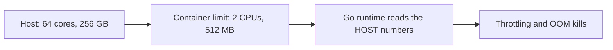
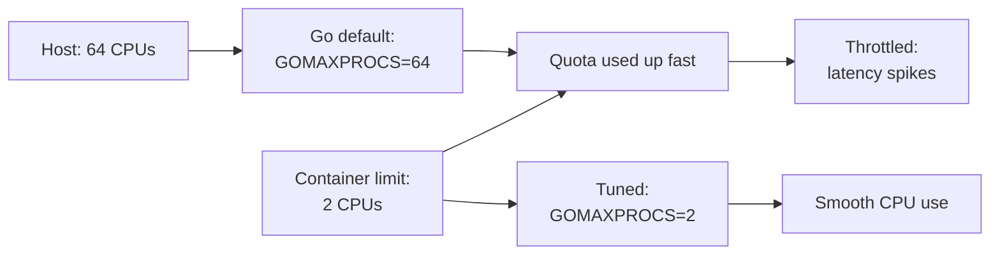
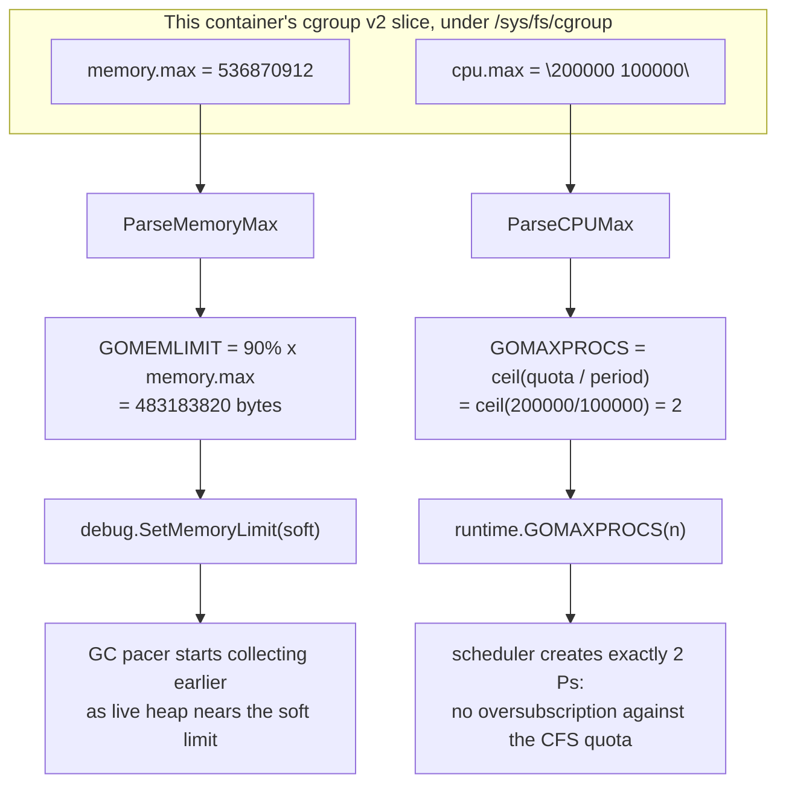
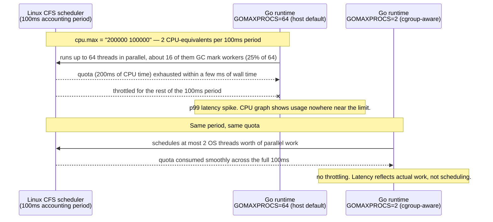

# Containerizing Go Services

> [!summary] TL;DR
> The Dockerfile mechanics of containerizing a Go service — multi-stage builds, a minimal base image, non-root, signal handling — are [[Docker 04 - Writing a Production Dockerfile for Go]]'s job. This note covers what is left once that image is built and scheduled: the Go runtime defaults to sizing itself from the **host's** CPU count and memory, not the **container's** cgroup limits, and left uncorrected that mismatch causes CPU throttling and OOM kills that look like application bugs. `GOMAXPROCS` and `GOMEMLIMIT` are the two knobs that fix it, and `ko` is a Go-specific alternative to a hand-written Dockerfile worth knowing.

> [!abstract] Core idea
> - `runtime.NumCPU()` reads the **host's** core count from `/proc/cpuinfo` or `sched_getaffinity`, not the container's `cpu.max` cgroup limit — a pod capped at 2 CPUs on a 64-core node still gets `GOMAXPROCS=64` by default.
> - An over-large `GOMAXPROCS` doesn't make the pod faster; it makes the Linux CFS scheduler throttle it, because the runtime schedules more parallel work than the cgroup's CPU quota allows per period.
> - `GOMEMLIMIT` (since Go 1.19) is a **soft** cap that makes the garbage collector work harder as live heap approaches it — it reduces OOM-kill risk, it does not eliminate it.
> - `ko` builds and pushes a container image straight from Go source with no Dockerfile at all, by exploiting the fact that a pure-Go binary needs nothing else in the image.
> - Classic mistake: setting `GOMEMLIMIT` to the exact value of `memory.max`. Leave headroom — a limit with no margin still gets OOM-killed by any allocation spike the GC hasn't caught up with yet.

## Start here: the basics 🟢

> [!info] How to read this note (pick your level)
> - 🟢 **New to this?** Read "From zero" below, then sections 1, 2 and the cheat sheet (10). Stop there, that is a full first pass.
> - 🟡 **Know the basics?** Add section 3 (how it works), 4 (worked example) and 5-6.
> - 🔴 **Interview / SDE-3 prep?** Add 7, 8 and 9. Headings are tagged 🟢🟡🔴 so you always know where you are.

**From zero, in 60 seconds** 🟢

You put your Go service in a container and give it limits: "you may use 2 CPUs and 512 MB of memory". Here is the catch: the Go runtime does not look at those limits. It looks at the whole machine.

On a 64-core machine, your 2-CPU container still thinks it has 64 cores, and schedules work like it. Result: the kernel keeps pausing it (**throttling**), and it can eat past its memory cap and get killed (**OOM kill**).



Two settings fix it: `GOMAXPROCS` (how many CPUs Go uses) and `GOMEMLIMIT` (where Go starts cleaning memory harder). This note is about setting both from the container's real limits.

The rest of this note is just these 3 questions:
1. How does the mismatch happen and how do you read the real limits?
2. How do you set `GOMAXPROCS` and `GOMEMLIMIT` correctly?
3. What does `ko` give you instead of a hand-written Dockerfile?

**The problem in one story.**
You pack your Go server into a container and give it 2 CPUs and 512 MB.
The machine underneath has 64 CPUs and lots of memory.
By default Go looks at the machine, not the box you gave it.
It then runs too much at once, gets slowed down, or is killed for using too much memory.

**Words you need first**

| Word | Plain meaning | Tiny example |
| --- | --- | --- |
| Container | A program packed with its files, run in an isolated box | A Docker image running your API |
| Image | The packed, read-only template a container starts from | `myapi:1.4.0` |
| cgroup | Linux feature that limits CPU and memory for a group of processes | `cpu.max`, `memory.max` |
| CPU quota | CPU time allowed per period | 200ms per 100ms = 2 CPUs |
| Throttling | The kernel pausing you after you use up your quota | Requests suddenly slow |
| OOM kill | The kernel killing a process that went over its memory limit | Exit code `137` |
| `GOMAXPROCS` | How many OS threads run Go code at the same time | `GOMAXPROCS=2` |
| `GOMEMLIMIT` | A soft memory target for Go's garbage collector | `GOMEMLIMIT=450MiB` |

**Picture it**



**Analogy.** You rent 2 desks in a 64-desk office, but you hire 64 workers. They all work for a moment, then security sends everyone home until the next hour.
Where it breaks: real throttling lasts only until the next 100ms period, not an hour.

**How the rest of this note builds up**

- First, why a Go binary in a container misjudges its limits (sections 1-2).
- Then how to read the real cgroup limits, set `GOMAXPROCS` and `GOMEMLIMIT`, and build images with `ko` (section 3).
- Then a worked example with a tuned startup and a `/version` endpoint (section 4), plus image choices (section 5).
- Finally the SDE-3 deep dive: CFS throttling, OOM kills, headroom and production debugging (sections 6-8).

> [!tip] Remember
> Tell Go the container's real CPU and memory limits, and leave memory headroom below the hard limit.

## 1. Why it exists 🟢

InvoiceOps' API deployment requests `resources.requests.cpu: "500m"` and caps at `resources.limits.cpu: "2"`, `resources.limits.memory: "512Mi"`, scheduled onto a shared Kubernetes node with 64 physical cores and 256 GiB of RAM. Kubernetes enforces that limit with a cgroup: `cpu.max` for this pod reads `200000 100000` (200ms of CPU time per 100ms period — 2 CPU-equivalents), and `memory.max` reads `536870912` (512 MiB).

Go's runtime never looks at those cgroup files unless told to. `runtime.NumCPU()` asks the kernel how many CPUs the **host** has, gets 64, and `GOMAXPROCS` — the number of OS threads that may run Go code simultaneously — defaults to that.

The Go garbage collector's own background mark workers scale off `GOMAXPROCS` too (up to 25% of it), so a GC cycle can try to run roughly 16 worker goroutines when the cgroup only grants 2 CPU-equivalents per period.

The Linux Completely Fair Scheduler (CFS) does not refuse that work.

It lets the container burn through its entire 200ms-per-100ms quota within a few milliseconds of the period (64 busy threads consume 200ms of CPU time in about 3ms of wall time), and then throttles it for the rest.

That shows up as p99 latency spikes and `container_cpu_cfs_throttled_seconds_total` climbing, while the CPU usage graph itself looks nowhere near the limit, because throttled time is not counted as used time.

The fix costs nothing to apply and nothing to understand once seen: tell the runtime the real number, which is `ceil(200000/100000) = 2`, not 64.

Memory has a sharper failure mode. The default garbage collector target (`GOGC=100`) only triggers a collection once the live heap has roughly doubled since the last one — there is no absolute ceiling.

If a request handler briefly decodes an unusually large batch of invoices into memory, nothing stops that allocation from pushing RSS past the container's 512 MiB `memory.max`.

The kernel's OOM killer does not negotiate.

It sends `SIGKILL` to a process in a cgroup that exceeds its memory limit, with no chance for the Go runtime to run a GC cycle, flush a log line, or finish an in-flight request. The exit code Kubernetes reports is `137` (128 + `SIGKILL`'s signal number 9).

[[Graceful Shutdown and Health Checks]]'s entire `SIGTERM`-then-drain sequence never gets a chance to run, because that note's mechanism only works when the process is asked to stop, and a `SIGKILL` from the OOM killer cannot be caught.

`GOMEMLIMIT` makes the garbage collector responsive to an approaching ceiling instead of only to `GOGC`'s heap-doubling rule, buying real headroom against exactly this failure — not immunity from it.

## 2. Mental model 🟢

The host hands the container a lease that reads "64 rooms, unlimited power" — but the building's real wiring only ever ran 2 circuits to that unit, metered at 512 MiB.

A process that only ever reads the lease behaves as if it had 64 rooms until the breaker trips (CFS throttling) or the meter cuts the power with no warning (OOM kill).

Reading the actual meter — the cgroup files under `/sys/fs/cgroup` — and reconfiguring the runtime at startup is the only way the process behaves according to what it actually has, rather than what the host claims to have.

## 3. How it works 🟡

### Reading the real limits and reconfiguring the runtime

**In plain words:** the container's true CPU and memory caps sit in small files (cgroups); read them and tell Go about them at startup.



**`GOMEMLIMIT` (Go 1.19+).** `runtime/debug.SetMemoryLimit(n)` sets a soft cap, in bytes, on the Go heap plus non-Go memory the runtime tracks. The garbage collector's pacer treats this as an additional trigger alongside `GOGC`: whichever rule would start a collection sooner wins.

Setting it leaves deliberate headroom below the cgroup's hard `memory.max` — the vault's default is 90% — because the soft limit only changes *when* GC runs, not how fast allocation can outrun it; an allocation burst large enough can still exceed the hard limit between one GC cycle and the next.

A common production pattern sets `GOGC=off` (disabling the heap-doubling trigger entirely) and relies on `GOMEMLIMIT` alone, which trades a larger average heap (GC only reacts to the limit, not to heap growth) for fewer, more predictable collections.

**`GOMAXPROCS` (container-aware since Go 1.25; `uber-go/automaxprocs` before that, and still the right choice for services pinned to Go 1.24).** The arithmetic: read `cpu.max`'s two fields — quota and period, both in microseconds, or the literal `max` for "no limit" — and compute `ceil(quota / period)`, floored at 1 so a service is never configured with zero usable processors.

Go 1.25's runtime does this natively: its default `GOMAXPROCS` is the lower of the logical CPU count and the cgroup CPU limit, **rounded up**, and it re-checks periodically so a changed limit is picked up without a restart.

Two conditions apply: the module's `go.mod` must declare `go 1.25` or later (older language versions keep the old behavior), and setting the `GOMAXPROCS` environment variable or calling `runtime.GOMAXPROCS` turns the automatic behavior off. It reads the CPU **limit**, never the request.

On Go 1.24 the same computation is done explicitly, by hand (shown below) or with `automaxprocs`. Note the library rounds the quota **down** by default (with a minimum of 1), unlike Go 1.25 and the code below, which round up.

### `ko`: building a Go container image without a Dockerfile

**In plain words:** a build tool that knows how Go programs work, so it can build a tiny correct image with zero Dockerfile to maintain.

A pure-Go, `CGO_ENABLED=0` binary needs nothing from an operating system image at all — no shell, no libc, no package manager — which is exactly what [[Docker 04 - Writing a Production Dockerfile for Go]]'s multi-stage Dockerfile already produces by hand.

`ko` (`github.com/google/ko`) skips writing that Dockerfile. `ko build ./cmd/api`:

1. cross-compiles the binary for the target platforms,
2. lays it directly onto a minimal static base image (by default `cgr.dev/chainguard/static`, configurable to distroless or any other image through `defaultBaseImage` in `.ko.yaml`),
3. and pushes the result straight to a registry.

No local Docker daemon, no `docker build` layer cache, no Dockerfile to keep in sync with the module's Go version.

| Approach | How it works | Use when | Cost |
| --- | --- | --- | --- |
| Dockerfile + `buildx` | Hand-written multi-stage Dockerfile; BuildKit builds and optionally cross-compiles via `--platform` | The image needs non-Go content (migrations, static assets, a second process) or custom build steps | Dockerfile to write and maintain; full control |
| `ko` | Reads `go.mod`, cross-compiles, assembles the image layers directly, pushes | A single static Go binary is the entire image, and CI simplicity matters more than custom layers | No Dockerfile at all; no room for non-Go content without `ko`'s limited static-file support |

`ko` is a narrower tool by design: the moment an image needs anything beyond one Go binary plus static files, a Dockerfile and `buildx` take over again.

### Untuned vs tuned, across one CFS accounting period

**In plain words:** a before/after timeline of the same workload — untuned, the kernel keeps hitting pause on your service.



## 4. Worked example 🟡

### Whiteboard version

**In plain words:** the few startup lines that make Go respect its container.

The bare idea, with no error handling: read the two cgroup files, compute, apply.

```go
package wb

import (
	"os"
	"runtime"
	"runtime/debug"
	"strconv"
	"strings"
)

func tuneRuntime() {
	memMax, _ := os.ReadFile("/sys/fs/cgroup/memory.max")
	if n, err := strconv.ParseInt(strings.TrimSpace(string(memMax)), 10, 64); err == nil {
		debug.SetMemoryLimit(int64(float64(n) * 0.9))
	}

	cpuMax, _ := os.ReadFile("/sys/fs/cgroup/cpu.max")
	fields := strings.Fields(string(cpuMax))
	if len(fields) == 2 && fields[0] != "max" {
		quota, _ := strconv.ParseInt(fields[0], 10, 64)
		period, _ := strconv.ParseInt(fields[1], 10, 64)
		if period > 0 {
			runtime.GOMAXPROCS(int((quota + period - 1) / period))
		}
	}
}
```

Every ignored error above is a silent no-op: a malformed file leaves the runtime at its host-sized defaults instead of failing loudly. The full version below separates parsing from file I/O so each step reports its own error and can be tested without a real `/sys/fs/cgroup`.

### Full version

Parsing and arithmetic as pure functions — no file I/O, so every case is a unit test. It compiles and passes `go vet` and `go test -race` on Go 1.24.4.

```go
// Package containerize shows the container-aware runtime tuning a Go
// service applies at startup: GOMAXPROCS sized to the container's CPU
// quota (cgroup v2 cpu.max) and GOMEMLIMIT sized to a safe fraction of
// the container's memory limit (cgroup v2 memory.max).
package containerize

import (
	"fmt"
	"strconv"
	"strings"
)

// ParseMemoryMax parses the content of a cgroup v2 memory.max file.
// The file holds either a byte count or the literal "max" (no limit).
func ParseMemoryMax(content string) (limit int64, unlimited bool, err error) {
	s := strings.TrimSpace(content)
	if s == "max" {
		return 0, true, nil
	}
	n, err := strconv.ParseInt(s, 10, 64)
	if err != nil {
		return 0, false, fmt.Errorf("parse memory.max %q: %w", s, err)
	}
	if n <= 0 {
		return 0, false, fmt.Errorf("memory.max %q is not positive", s)
	}
	return n, false, nil
}

// GOMEMLIMIT returns the soft memory limit to pass to debug.SetMemoryLimit,
// as a fraction (0,1] of the container's hard memory limit. A soft limit
// below the hard limit leaves headroom so the garbage collector has a
// chance to free memory before the kernel OOM-kills the process; 0.9 (90%)
// is the vault's default.
func GOMEMLIMIT(hardLimitBytes int64, fraction float64) (int64, error) {
	if hardLimitBytes <= 0 {
		return 0, fmt.Errorf("hard limit must be positive, got %d", hardLimitBytes)
	}
	if fraction <= 0 || fraction > 1 {
		return 0, fmt.Errorf("fraction must be in (0,1], got %v", fraction)
	}
	return int64(float64(hardLimitBytes) * fraction), nil
}

// ParseCPUMax parses the content of a cgroup v2 cpu.max file: two
// space-separated fields, "$quota $period" in microseconds, or
// "max $period" when the container has no CPU limit.
func ParseCPUMax(content string) (quotaUs, periodUs int64, unlimited bool, err error) {
	fields := strings.Fields(content)
	if len(fields) != 2 {
		return 0, 0, false, fmt.Errorf("cpu.max %q: want 2 fields, got %d", content, len(fields))
	}
	periodUs, err = strconv.ParseInt(fields[1], 10, 64)
	if err != nil {
		return 0, 0, false, fmt.Errorf("cpu.max %q: bad period: %w", content, err)
	}
	if periodUs <= 0 {
		return 0, 0, false, fmt.Errorf("cpu.max %q: period must be positive", content)
	}
	if fields[0] == "max" {
		return 0, periodUs, true, nil
	}
	quotaUs, err = strconv.ParseInt(fields[0], 10, 64)
	if err != nil {
		return 0, 0, false, fmt.Errorf("cpu.max %q: bad quota: %w", content, err)
	}
	if quotaUs <= 0 {
		return 0, 0, false, fmt.Errorf("cpu.max %q: quota must be positive", content)
	}
	return quotaUs, periodUs, false, nil
}

// GOMAXPROCS computes the value to pass to runtime.GOMAXPROCS from a
// cgroup v2 CPU quota and period, matching the algorithm
// Go 1.25's runtime applies natively: ceil(quota/period), floored at 1 so a
// service never configures zero usable CPUs. (uber-go/automaxprocs rounds
// down by default instead.)
func GOMAXPROCS(quotaUs, periodUs int64) (int, error) {
	if quotaUs <= 0 || periodUs <= 0 {
		return 0, fmt.Errorf("quota and period must be positive, got %d/%d", quotaUs, periodUs)
	}
	procs := (quotaUs + periodUs - 1) / periodUs // ceiling division
	if procs < 1 {
		procs = 1
	}
	return int(procs), nil
}
```

The tests that pin down the two cases that matter: fractional CPU quotas round up (never down, never to zero), and the memory fraction is applied correctly.

```go
// TestGOMAXPROCS checks the ceiling-division behaviour that gives a
// container 2.5 CPUs three usable Go procs, never two (which would waste
// the fractional half-core) and never a value from the host's full core
// count (which would oversubscribe the scheduler).
func TestGOMAXPROCS(t *testing.T) {
	cases := []struct {
		quotaUs, periodUs int64
		want              int
	}{
		{200000, 100000, 2}, // exactly 2 CPUs
		{250000, 100000, 3}, // 2.5 CPUs rounds up to 3
		{50000, 100000, 1},  // half a CPU floors at 1, never 0
		{800000, 100000, 8}, // 8 CPUs
	}
	for _, c := range cases {
		got, err := GOMAXPROCS(c.quotaUs, c.periodUs)
		if err != nil {
			t.Fatalf("GOMAXPROCS(%d, %d): unexpected error: %v", c.quotaUs, c.periodUs, err)
		}
		if got != c.want {
			t.Errorf("GOMAXPROCS(%d, %d) = %d, want %d", c.quotaUs, c.periodUs, got, c.want)
		}
	}
	if _, err := GOMAXPROCS(0, 100000); err == nil {
		t.Error("GOMAXPROCS(0, 100000): want error")
	}
}

func TestGOMEMLIMIT(t *testing.T) {
	var oneGiB int64 = 1 << 30
	got, err := GOMEMLIMIT(oneGiB, 0.9) // 1 GiB limit, 90%
	if err != nil {
		t.Fatalf("unexpected error: %v", err)
	}
	want := int64(float64(oneGiB) * 0.9)
	if got != want {
		t.Errorf("GOMEMLIMIT(1GiB, 0.9) = %d, want %d", got, want)
	}
	if _, err := GOMEMLIMIT(oneGiB, 1.5); err == nil {
		t.Error("GOMEMLIMIT(1GiB, 1.5): want error for fraction > 1")
	}
}
```

```go
func TestParseMemoryMax(t *testing.T) {
	if n, unl, err := ParseMemoryMax("536870912\n"); err != nil || unl || n != 536870912 {
		t.Errorf("got %d %v %v", n, unl, err)
	}
	if _, unl, err := ParseMemoryMax("max\n"); err != nil || !unl {
		t.Errorf("max: unl=%v err=%v", unl, err)
	}
	for _, bad := range []string{"", "abc", "0", "-5"} {
		if _, _, err := ParseMemoryMax(bad); err == nil {
			t.Errorf("ParseMemoryMax(%q): want error", bad)
		}
	}
}

func TestParseCPUMax(t *testing.T) {
	if q, p, unl, err := ParseCPUMax("200000 100000\n"); err != nil || unl || q != 200000 || p != 100000 {
		t.Errorf("got %d %d %v %v", q, p, unl, err)
	}
	if _, p, unl, err := ParseCPUMax("max 100000"); err != nil || !unl || p != 100000 {
		t.Errorf("max: p=%d unl=%v err=%v", p, unl, err)
	}
	for _, bad := range []string{"", "200000", "x 100000", "200000 0", "0 100000", "1 2 3"} {
		if _, _, _, err := ParseCPUMax(bad); err == nil {
			t.Errorf("ParseCPUMax(%q): want error", bad)
		}
	}
}
```

**Computed** from `InvoiceOps`' real limits (`cpu.max = "200000 100000"`, `memory.max = 536870912`), by calling the functions above:

| Cgroup input | Function | Result |
| --- | --- | --- |
| `cpu.max = "200000 100000"` | `GOMAXPROCS(200000, 100000)` | `2` |
| `cpu.max = "250000 100000"` | `GOMAXPROCS(250000, 100000)` | `3` (2.5 CPUs rounds up) |
| `memory.max = 536870912` (512 MiB) | `GOMEMLIMIT(536870912, 0.9)` | `483183820` bytes (≈460.8 MiB) |

`main` wires the tested functions to the real cgroup files — this part is illustrative, since a `main` package cannot be unit-tested the way the package above is:

```go
package main

import (
	"log/slog"
	"os"
	"runtime"
	"runtime/debug"

	"example.com/invoiceops/internal/containerize"
)

func tuneForContainer(logger *slog.Logger) {
	if b, err := os.ReadFile("/sys/fs/cgroup/memory.max"); err == nil {
		if limit, unlimited, err := containerize.ParseMemoryMax(string(b)); err == nil && !unlimited {
			soft, _ := containerize.GOMEMLIMIT(limit, 0.9)
			debug.SetMemoryLimit(soft)
			logger.Info("tuned GOMEMLIMIT", "hard_limit", limit, "soft_limit", soft)
		}
	}
	if b, err := os.ReadFile("/sys/fs/cgroup/cpu.max"); err == nil {
		if quota, period, unlimited, err := containerize.ParseCPUMax(string(b)); err == nil && !unlimited {
			procs, _ := containerize.GOMAXPROCS(quota, period)
			runtime.GOMAXPROCS(procs)
			logger.Info("tuned GOMAXPROCS", "procs", procs)
		}
	}
}
```

### VCS stamping for a `/version` endpoint

[[Docker 04 - Writing a Production Dockerfile for Go]] stamps a version string into the binary at build time with `-ldflags "-X main.version=…"`.

The complementary, Go-native source is `runtime/debug.ReadBuildInfo()`, which every binary built with `go build` embeds automatically — including, since Go 1.18, the VCS commit it was built from, unless the build context lost its `.git` directory (a shallow CI checkout is the common case):

```go
package containerize

import "runtime/debug"

// VersionInfo is the subset of a binary's embedded build info worth
// reporting from a /version endpoint or a startup log line.
type VersionInfo struct {
	GoVersion string // the toolchain the binary was built with, e.g. "go1.24.4"
	Revision  string // vcs.revision: the git commit the binary was built from
	Modified  bool   // vcs.modified: true if the working tree had uncommitted changes
}

// ExtractVersionInfo pulls the fields that matter out of a *debug.BuildInfo.
// It takes the struct rather than calling debug.ReadBuildInfo() itself so
// the extraction logic can be unit-tested without a real git checkout.
func ExtractVersionInfo(bi *debug.BuildInfo) VersionInfo {
	v := VersionInfo{GoVersion: bi.GoVersion}
	for _, s := range bi.Settings {
		switch s.Key {
		case "vcs.revision":
			v.Revision = s.Value
		case "vcs.modified":
			v.Modified = s.Value == "true"
		}
	}
	return v
}
```

```go
func TestExtractVersionInfo(t *testing.T) {
	bi := &debug.BuildInfo{
		GoVersion: "go1.24.4",
		Settings: []debug.BuildSetting{
			{Key: "vcs", Value: "git"},
			{Key: "vcs.revision", Value: "a1b2c3d4"},
			{Key: "vcs.modified", Value: "true"},
		},
	}
	got := ExtractVersionInfo(bi)
	want := VersionInfo{GoVersion: "go1.24.4", Revision: "a1b2c3d4", Modified: true}
	if got != want {
		t.Errorf("ExtractVersionInfo = %+v, want %+v", got, want)
	}
}

func TestExtractVersionInfoNoVCS(t *testing.T) {
	// A CI checkout with a shallow or missing .git directory omits vcs.*
	// settings entirely; the zero values must be safe to print, not a crash.
	bi := &debug.BuildInfo{GoVersion: "go1.24.4"}
	got := ExtractVersionInfo(bi)
	if got.Revision != "" || got.Modified {
		t.Errorf("ExtractVersionInfo(no vcs settings) = %+v, want zero Revision/Modified", got)
	}
}
```

**Measured:** all six tests above (`TestGOMAXPROCS`, `TestGOMEMLIMIT`, `TestParseMemoryMax`, `TestParseCPUMax`, `TestExtractVersionInfo`, `TestExtractVersionInfoNoVCS`) pass under `go test -race` on Go 1.24.4, darwin/arm64, 2026-11-07, in under 2 seconds total.

### Image-level decisions that stay Go-specific

The mechanics live in [[Docker 04 - Writing a Production Dockerfile for Go]] (multi-stage layout, BuildKit cache mounts for `GOMODCACHE` and `GOCACHE`, `.dockerignore`, `buildx` with `TARGETOS`/`TARGETARCH`) and [[Docker 09 - Container Security and Hardening]] (non-root, read-only rootfs, dropped capabilities, Trivy/Grype scans, SBOM, cosign). The Go-specific facts to carry into them:

- **"Single static binary" is only true with `CGO_ENABLED=0`** (or pure-Go dependencies). A cgo build links libc dynamically and fails on `scratch` or `distroless/static` with a confusing "no such file or directory" at start-up. Build with `CGO_ENABLED=0 go build -trimpath -ldflags "-s -w -X main.version=$VERSION"`.
- **`scratch` has no CA certificates and no timezone database.** `distroless/static` includes both; on `scratch`, copy the CA bundle in and `import _ "time/tzdata"` (about 450 KB) so `time.LoadLocation` works. `alpine` uses musl, so a cgo binary built on a glibc image can misbehave there.
- **Exec-form `ENTRYPOINT ["/server"]`** makes the binary PID 1 so `SIGTERM` reaches it (see [[Graceful Shutdown and Health Checks]]). Add `tini` (`docker run --init`, or `init: true`) only if the container spawns child processes that need reaping.
- **Probes hit app endpoints** (`/healthz`, `/readyz`) over HTTP from the kubelet; distroless has no `curl` or shell for a `HEALTHCHECK`.
- **Expect an image of roughly 10-20 MB** on `distroless/static` and a start-up time dominated by the service's own initialization, not the runtime.

## 5. Variants and comparison 🟡

| Approach to sizing `GOMAXPROCS`/`GOMEMLIMIT` | How it works | Use when | Cost |
| --- | --- | --- | --- |
| Do nothing (host defaults) | `GOMAXPROCS = runtime.NumCPU()`, no memory limit | Never, for a cgroup-limited container | CFS throttling under load; unbounded OOM risk |
| Manual env vars (`GOMAXPROCS`, `GOMEMLIMIT`) | Set once at deploy time to match the pod's `resources.limits` | A fixed, rarely-changed resource request | Drifts silently if the limit is changed without updating the env var |
| `uber-go/automaxprocs` (+ manual `GOMEMLIMIT`) | Reads the cgroup at startup (`maxprocs.Set()`), calls `runtime.GOMAXPROCS`; rounds the quota down by default | Go 1.24 and earlier; wide industry adoption, battle-tested | One more dependency; one-shot, so it misses later limit changes; still needs `GOMEMLIMIT` wired separately |
| Go 1.25+ native container awareness | The runtime reads the cgroup CPU limit, rounds up, and re-checks periodically; no library needed | New services on Go 1.25+ (with `go 1.25` or later in `go.mod`) | Disabled if `GOMAXPROCS` is set explicitly; `GOMEMLIMIT` is still opt-in, not automatic |

> [!warning] Interview trap
> Setting `GOMAXPROCS` higher than the cgroup's CPU quota does not make a CPU-bound Go service faster. It makes the CFS scheduler throttle it harder, because the runtime schedules more concurrent work than the quota allows per period — the fix is sizing `GOMAXPROCS` down to match the quota, not up.

## 6. Trade-offs and when not to use 🟡

- `GOMEMLIMIT` trades a larger average heap for fewer, more predictable GC pauses when paired with `GOGC=off` — a service that is latency-sensitive on every request, not just at the tail, may prefer `GOGC`'s default pacing instead.
- A soft `GOMEMLIMIT` very close to the hard `memory.max` (no headroom) can leave the GC "chasing" an allocation burst it cannot win — a bad allocation pattern (a single giant `[]byte` instead of streaming) will still OOM-kill the pod regardless of how the limit is tuned; `GOMEMLIMIT` mitigates slow accumulation, not one enormous allocation.
- `automaxprocs` reads the cgroup once, at startup. If Kubernetes changes a pod's CPU limit through an in-place resize without a restart, the value goes stale; Go 1.25's runtime re-checks periodically and handles that case, the library does not (restart the pod, or use the runtime's behavior).
- For a service that always runs with a fixed, generous resource allocation (a singleton batch job on its own dedicated node), this tuning adds code for no measurable benefit — the mismatch it fixes only matters when the container's limit is meaningfully smaller than the host.

## 7. In production 🔴

- **Real systems:** Uber published `automaxprocs` after observing exactly the CFS-throttling pattern described above across their own Go fleet; it has since become close to a default dependency for Go services on Kubernetes. Go's own release notes for 1.19 (`GOMEMLIMIT`) and 1.25 (container-aware `GOMAXPROCS`) both cite container deployments as the motivating case.
- **Failure modes → fixes:**
  - p99 latency spikes under load with CPU usage graphs that never reach the limit → check `container_cpu_cfs_throttled_seconds_total`; if it's climbing, `GOMAXPROCS` is oversized relative to the quota.
  - Pod restarts with exit code `137` and no application log line about shutting down → the kernel OOM-killed the process before it could react; check whether `GOMEMLIMIT` is set at all, and whether it leaves real headroom below `memory.max`.
  - `GOMAXPROCS` wrong after an in-place vertical pod resize → the one-shot cgroup read at startup is stale; use Go 1.25+ (which re-reads periodically, provided `GOMAXPROCS` is not pinned by an env var) or roll the pod on resize.
  - Database migrations fail or run twice during a rolling deploy → migrations do not belong in the same container lifecycle as request-serving replicas at all; run them as a separate Kubernetes `Job` (see [[Kubernetes Fundamentals]]) gated ahead of the rollout, not from inside `main()` on every pod start.
- **What to monitor:** `container_cpu_cfs_throttled_seconds_total` (CPU throttling), `go_memstats_heap_alloc_bytes` against the configured `GOMEMLIMIT` and the cgroup's `memory.max`, GC pause time (`go_gc_duration_seconds`), and container exit codes (`137` specifically). Supply-chain checks — `govulncheck`, `gosec`, SBOM generation, image signing — run in CI ahead of any of this; see [[CI-CD Pipelines (GitHub Actions for Go)]] for exactly where they sit in the pipeline and [[Secure Coding for Go Services]] for what `govulncheck` and `gosec` each catch.

## 8. Deep dive 🔴

- **`GOMEMLIMIT` is a soft limit, not a hard one.** `debug.SetMemoryLimit` changes GC *pacing* — how aggressively the collector reacts as the live heap approaches the limit — but it cannot stop a single allocation from exceeding it between collections. It reduces OOM risk under gradual heap growth; it does not convert Go's garbage collector into a hard memory allocator with a ceiling it physically cannot cross. `debug.SetMemoryLimit(-1)` changes nothing and returns the current limit, which is how a service reads back its own setting; the default (no limit) is `math.MaxInt64`, so `debug.SetMemoryLimit(math.MaxInt64)` turns the limit off again.
- **cgroup v1 vs v2.** Everything above assumes cgroup v2, the default on current Kubernetes and most modern Linux distributions, where the files are `memory.max` and the single `cpu.max` (quota and period together). cgroup v1 splits the same information across `memory.limit_in_bytes`, `cpu.cfs_quota_us`, and `cpu.cfs_period_us` as separate files, with `-1` meaning "unlimited" instead of the literal string `max`. `automaxprocs` and Go 1.25's native support both detect which version is mounted and parse accordingly; code written only against v2 paths silently reads nothing (and falls back to host defaults) on a v1 host. Also note that `/sys/fs/cgroup/cpu.max` is the container's own cgroup only when the container has its own cgroup namespace (the default under Docker and Kubernetes on cgroup v2); a hand-rolled reader on a host without one would read the wrong file.
- **Why the GC mark workers scaling off `GOMAXPROCS` matters specifically.** The garbage collector dedicates up to 25% of `GOMAXPROCS` to background mark assist work during a collection. On an oversized `GOMAXPROCS`, that 25% is computed against the wrong (too large) number, so a GC cycle alone can be enough to saturate a small CPU quota even when the application's own request-handling goroutines are idle — which is why throttling can appear correlated with GC frequency rather than with request volume.
- **Multi-arch and `ko`.** `ko` cross-compiles for every requested `GOOS`/`GOARCH` pair the same way `go build` does natively (no QEMU, no emulated compilation) and assembles a single multi-platform manifest list, functionally the same end state `buildx build --platform linux/amd64,linux/arm64` produces for a hand-written Dockerfile — the difference is entirely in how much of the image layout is explicit versus inferred.

## 9. Interview questions 🔴

> [!question]- Why does a pod capped at 2 CPUs still get `GOMAXPROCS=64` by default on a 64-core node?
> `runtime.NumCPU()` reads the host's CPU count via the kernel, not the container's cgroup `cpu.max` limit. The Go runtime has no built-in awareness of cgroups before Go 1.25, so without explicit tuning (manual, `automaxprocs`, or 1.25's native support) `GOMAXPROCS` reflects the host, not the quota actually granted.

> [!question]- Does setting `GOMAXPROCS` to a value higher than the CPU quota make a service faster?
> No — it makes it slower under load. The runtime schedules more concurrent work than the cgroup's CFS quota allows per period, and the kernel throttles the container once it exhausts that period's quota, which shows up as added latency, not added throughput.

> [!question]- Does `GOMEMLIMIT` prevent OOM kills?
> No, and that's a trap. It is a soft limit that makes the garbage collector react earlier as the live heap approaches it, which reduces the chance of a slow memory creep triggering an OOM kill. A single allocation large enough to exceed the container's hard `memory.max` before any GC cycle can run will still get the process killed.

> [!question]- What does `GOMAXPROCS(ceil(quota/period))` actually compute, concretely, for `cpu.max = "250000 100000"`?
> 250000 microseconds of CPU time per 100000-microsecond period is 2.5 CPU-equivalents. Flooring to 2 wastes the fractional half-core the container is actually entitled to; the formula rounds up to 3, which very slightly oversubscribes but never undersubscribes, since Go's scheduler handles a few more logical processors than physical ones far better than it handles none of the entitled compute.

> [!question]- When would you reach for `ko` instead of the Dockerfile in [[Docker 04 - Writing a Production Dockerfile for Go]]?
> When the image is genuinely just one static Go binary with no other runtime content — no migrations bundled in, no static assets, no second process. The moment the image needs anything beyond that, a hand-written Dockerfile with `buildx` takes back control that `ko`'s narrower model doesn't offer.

> [!question]- Where should a database migration run in a container-based deploy — inside the service's own `main()`, or somewhere else?
> Somewhere else: a separate Kubernetes `Job` that runs to completion before the rollout proceeds. Running a migration from inside every replica's startup risks N replicas racing to apply the same migration concurrently during a rolling deploy, and ties a schema change to the exact moment a pod happens to (re)start rather than to a deliberate, observable step in the pipeline.

> [!question]- Why does `ExtractVersionInfo` take a `*debug.BuildInfo` parameter instead of calling `debug.ReadBuildInfo()` itself?
> So the extraction logic — which fields to look for, how to parse `vcs.modified`'s string value into a bool — can be unit-tested with a hand-built `BuildInfo` struct, including the no-VCS-info case a shallow CI checkout produces, without needing a real git repository on the test runner.

## 10. Cheat sheet 🟢

- `runtime.NumCPU()` reads the host, not the cgroup — always tune `GOMAXPROCS` explicitly for a CPU-limited container.
- `GOMAXPROCS = ceil(quota_us / period_us)` from `cpu.max`, floored at 1.
- `GOMEMLIMIT ≈ 0.9 × memory.max` (soft cap; leave real headroom, never set it equal to the hard limit).
- `GOMEMLIMIT` is soft: it lowers OOM risk under gradual growth, it does not cap a single large allocation.
- Go 1.25+ reads the cgroup CPU limit natively (rounds up, re-checks periodically, needs `go 1.25` in `go.mod`, off if `GOMAXPROCS` is set); on 1.24 and earlier, use `uber-go/automaxprocs` (rounds down) or the code above.
- `ko build` ships a pure-Go binary as a container image with no Dockerfile; fall back to Docker + `buildx` the moment the image needs non-Go content.
- `runtime/debug.ReadBuildInfo()` exposes the VCS commit a binary was built from — complementary to, not a replacement for, `-ldflags -X` stamping.
- Run database migrations as a separate Kubernetes `Job`, never from inside a replica's own startup path.

## Links 🟢

- **Before this:** [[Docker 04 - Writing a Production Dockerfile for Go]], [[Graceful Shutdown and Health Checks]], [[Configuration and Secrets]]
- **Next:** [[Secure Coding for Go Services]], [[CI-CD Pipelines (GitHub Actions for Go)]]
- **Compare with:** [[Docker 09 - Container Security and Hardening]] (hardening and scanning the image this note's binary ships in), [[Kubernetes Fundamentals]] (the scheduler and resource model these cgroup limits come from)

### Watch on YouTube

- [The Real Reason Your Kubernetes Pods Get OOMKilled](https://www.youtube.com/watch?v=PgRBnEphSa4) · Techi Nik · explains the cgroup memory/CPU limit mismatch this note's GOMAXPROCS/GOMEMLIMIT fix addresses
