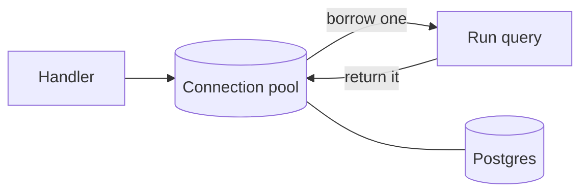
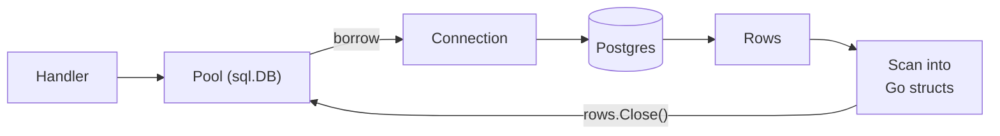
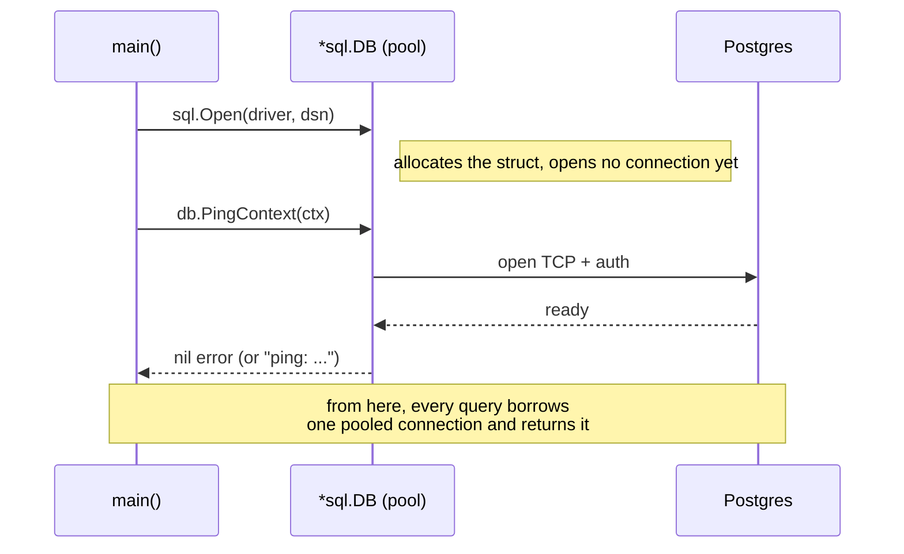
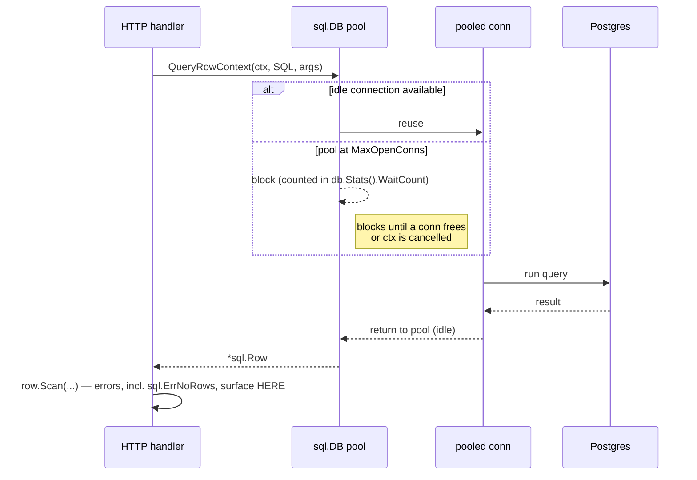
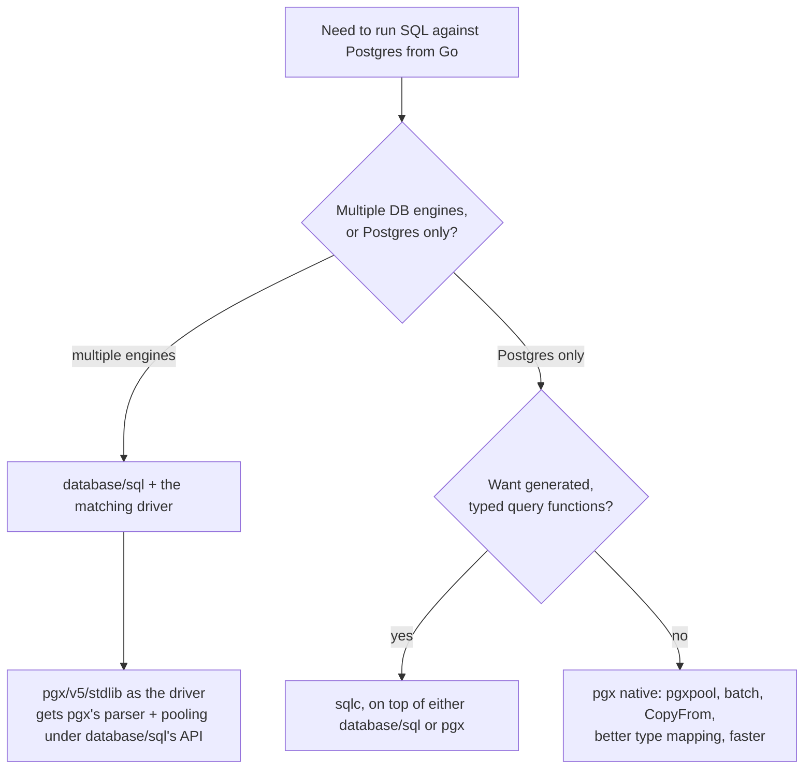
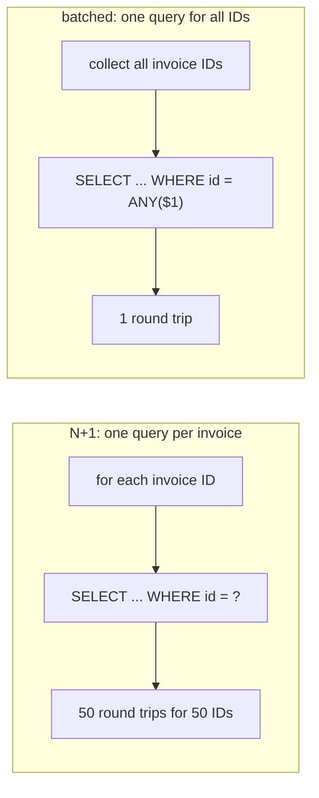

# Database Access (database-sql, pgx, sqlc)

> [!summary] TL;DR
> `database/sql` is Go's standard entry point to any relational database: it gives you a connection **pool**, not a connection, and a driver plugs into it underneath. For Postgres specifically, `pgx` is the faster, more complete alternative that can either replace `database/sql` entirely or plug into it as a driver. `sqlc` then generates typed Go functions from your SQL so you stop hand-writing `Scan` calls.

> [!abstract] Core idea
> - `sql.DB` is a pool of connections, not one connection — size it, don't just open it.
> - Errors from a row-returning query, including "no rows", only surface when you call `Scan`.
> - Every multi-row query needs `defer rows.Close()` and a `rows.Err()` check after the loop.
> - `pgx` talks Postgres's wire protocol directly and is faster and more feature-complete than `database/sql` + a generic driver; `sqlc` removes hand-written `Scan` calls on top of either.
> - N+1 queries are a Go-side problem: loop-and-query where one batched query would do.

## Start here: the basics 🟢

> [!info] How to read this note (pick your level)
> - 🟢 **New to this?** Read "From zero" below, then sections 1, 2 and the cheat sheet (10). Stop there, that is a full first pass.
> - 🟡 **Know the basics?** Add section 3 (how it works), 4 (worked example) and 5-6.
> - 🔴 **Interview / SDE-3 prep?** Add 7, 8 and 9. Headings are tagged 🟢🟡🔴 so you always know where you are.

> [!note] Before this note
> - [[Syntax, Types and Control Flow]]: you can read Go structs, pointers, loops and `if err != nil`.
> - [[Error Handling]]: errors are values you check, wrap with `%w`, and compare with `errors.Is`.
> - [[Context Package]]: a `ctx` carries a deadline, and a call that receives it stops when the deadline passes.

**From zero, in 60 seconds** 🟢

Your Go service needs to talk to a database. Opening a fresh connection for every request would be slow, like dialing a phone number from scratch for every sentence.

So Go gives you a **pool**: a box of already-open connections. Each query borrows one, uses it, and puts it back.



`database/sql` is the standard pool that works with any database. **pgx** is a faster Postgres-only alternative. **sqlc** reads your SQL files and writes the boring Go wrapper code for you.

The rest of this note is just these 4 questions:
1. How do you open and size the pool?
2. How does borrowing and returning a connection actually work?
3. How do you handle NULLs, timeouts and the classic N+1 mistake?
4. When do you pick pgx or sqlc over plain database/sql?

**The problem in one story.**
Your API saves invoices in Postgres.
Opening a new database connection for every request is slow.
So Go keeps a small set of open connections and lends them out.
You must return each one, read errors correctly, and avoid asking the database 100 times when once would do.

**Words you need first**

| Word | Plain meaning | Tiny example |
| --- | --- | --- |
| SQL | The language you use to ask a database for data | `SELECT * FROM invoices` |
| Connection | One open network link to the database | A TCP socket to port 5432 |
| Pool | A set of reusable open connections | `sql.DB` holding 10 connections |
| Query | One request sent to the database | `SELECT ... WHERE id = $1` |
| Row / Scan | One result record / copying its columns into Go variables | `rows.Scan(&id, &amount)` |
| Driver | Code that speaks one database's protocol | `pgx` for Postgres |
| `context.Context` | A value that carries a deadline or cancel signal | Stop the query after 2s |
| N+1 queries | One query for a list, then one more per item | 1 + 100 queries for 100 invoices |

| DSN | The connection string with host, port, user and database name | `postgres://app@db:5432/invoiceops` |
| NULL | "No value" in a database column, different from 0 or "" | `paid_at` is NULL until paid |
| `RETURNING` | A Postgres clause that sends back values from an `INSERT` or `UPDATE` | `RETURNING id, created_at` |
| Code generation | A tool writes Go code for you from another file | `sqlc generate` from `.sql` files |
| ORM | A library that maps tables to objects and writes SQL for you | GORM |

**Picture it**



**Analogy.** A library lends a fixed number of books. You borrow one, read it, and must return it, or the next reader waits.
Where it breaks: a library book does not time out by itself, but a query can be cancelled by its context deadline.

**How the rest of this note builds up**

- First, why a pool exists (section 1) and the pool mental model (section 2).
- Then opening the pool, borrowing connections, sizing knobs, NULLs, timeouts, and pgx vs `database/sql` vs sqlc (section 3).
- Then a worked repository example (section 4) and comparisons (section 5).
- Finally the SDE-3 deep dive: N+1 fixes, pool exhaustion, and production debugging (sections 6-8).

> [!tip] Remember
> `sql.DB` is a pool: size it, close every `rows`, check `rows.Err()`, and batch instead of looping queries.

## 1. Why it exists 🟢

InvoiceOps needs to read and write Postgres from Go: look up an invoice, list unpaid ones, mark one as paid. Go has no built-in ORM (object-relational mapper: a library that writes SQL for you from structs) and no single blessed driver.

`database/sql` is the standard library's answer: a generic `*sql.DB` type and `Rows`/`Row`/`Result` types that any database driver can implement, so the same calling code works against Postgres, MySQL, or SQLite by swapping the driver import and the connection string.

What `database/sql` does **not** do is manage a single connection per call. A naive read of `db.QueryRowContext(...)` looks like one call to one database — but `*sql.DB` silently opens, reuses, and closes a pool of underlying connections behind it.

Get the pool sizing wrong and the symptoms show up far from the code that caused them: requests blocked in `db.Stats().WaitDuration` (total time spent waiting for a free connection), or `FATAL: too many connections` while every Go profiler says the app is idle.

### A real-life example 🟢

When you open your order history in Swiggy, one Go service reads your last 20 orders from Postgres. It does not open a new database connection for you; it borrows one of maybe 20 already-open connections, runs one query, and hands the connection back in a few milliseconds. If the code asked for each order's restaurant name in a separate query (21 queries instead of 1 or 2), the page would get slower as your history grew. And if a query hung with no time limit, it would hold one of those 20 connections and slowly starve everyone else.

## 2. Mental model 🟢

Think of `*sql.DB` as a **pool manager**, not a cable to the database. Every query or exec:

1. borrows a connection from the pool (or opens a new one, or blocks waiting for one),
2. runs the query on it,
3. returns the connection to the pool.

Nothing hands you a numbered connection to hold onto across calls — unless you start a transaction, which pins exactly one connection until you commit or roll back (see [[Transactions and the Repository Pattern]]).

`pgx` and `sqlc` sit on either side of this pool:

- `pgx` replaces the *driver and the pool* with a Postgres-specific implementation (`pgxpool`) that skips the generic `database/sql` abstraction layer.
- `sqlc` replaces the *calling code*: you write SQL, it generates a Go method with the right argument and return types, so you never hand-write a `Scan(&a, &b, &c)` list that silently drifts from the `SELECT` column list.

## 3. How it works 🟡

🟢 → 🟡 You now know that `sql.DB` is a box of reusable connections: borrow, query, return. Next we open the box: when connections are really opened, how borrowing works under load, how to size the pool, how to handle NULLs and timeouts, and which library to pick.

### Opening the pool

**In plain words:** 'opening' the database does not connect to anything yet — it just sets up the box of connections; the first real query connects.

**Step by step:**
1. `sql.Open("pgx", dsn)` only checks the arguments and builds the pool object. No network call yet.
2. `db.PingContext(ctx)` opens one real connection and logs in to Postgres.
3. If the address or password is wrong, startup fails here with a clear error.
4. From now on, every query borrows a connection from the pool and returns it.



`sql.Open` only validates its arguments and builds the `*sql.DB` struct — it does not connect. Call `PingContext` once at startup so a bad DSN or an unreachable database fails fast, instead of surfacing as a mysterious timeout on the first real request.

### Borrowing and returning a connection

**Step by step:**
1. A handler calls `QueryRowContext(ctx, "SELECT ... WHERE id = $1", 42)`.
2. If an idle connection is free, the pool reuses it.
3. If all 10 allowed connections are busy, the call waits until one frees up or `ctx` runs out.
4. Postgres runs the query; the connection goes back to the pool.
5. Only when you call `row.Scan(...)` do you see an error, including "no rows found".



The handler never sees "connection #7". It sees a `*sql.Row`, and the underlying connection is already back in the pool by the time `Scan` runs (the driver streams the result first). This is why forgetting `rows.Close()` on a multi-row query is dangerous: the connection that query borrowed is never returned, so the pool slowly starves.

### Pool sizing knobs

**In plain words:** three dials decide how many connections exist, how many may sit idle, and how old one may get before it is thrown away.

**Step by step:**
1. Postgres allows `max_connections = 100`. You run 10 copies (pods) of your service.
2. Keep some for migrations and admin: about 85 left, so about 8 per pod.
3. Set `SetMaxOpenConns(8)` and `SetMaxIdleConns(8)` so connections are kept, not closed and reopened.
4. Set `SetConnMaxLifetime` shorter than any proxy's idle timeout, so dropped connections are replaced quietly.
5. Graph `db.Stats().WaitCount`; if it keeps climbing, the pool is too small.

| Knob | Go default | What it controls |
| --- | --- | --- |
| `SetMaxOpenConns(n)` | `0` (unlimited) | Hard cap on open connections, idle + in-use. Leaving this at the default lets a traffic spike open as many connections as Postgres allows, then fail with `too many connections`. |
| `SetMaxIdleConns(n)` | `2` | How many idle connections stay pooled instead of being closed right after use. Below `MaxOpenConns`, this causes connections to be opened and closed on every request burst. |
| `SetConnMaxLifetime(d)` | `0` (unlimited) | Forces a connection to close and reopen after `d`, even mid-use of the pool. Needed behind load balancers or proxies (PgBouncer, a popular Postgres connection pooler, or cloud LBs) that silently drop long-lived TCP connections. |
| `SetConnMaxIdleTime(d)` | `0` (unlimited) | Closes an idle connection after `d` of no use. Matters when the DB itself has no pooler in front and would otherwise hold connections open forever. |

Size `MaxOpenConns` against `max_connections` on the server, divided by however many replicas of your service share that server: a Postgres instance with `max_connections = 100` behind 10 pods leaves roughly 8-9 connections per pod once you reserve headroom for migrations and superuser access.

`db.Stats()` (`WaitCount`, `WaitDuration`, `InUse`, `Idle`) is the metric to graph to find out if the pool is actually too small.

### RETURNING and NULLs

**Step by step:**
1. Insert an invoice with `INSERT ... RETURNING id, created_at` and read both values with one `QueryRowContext(...).Scan(&id, &createdAt)`.
2. `paid_at` is NULL for an unpaid invoice. Scanning NULL into a plain `time.Time` fails.
3. Scan it into `sql.Null[time.Time]` instead; its `Valid` field says whether there was a value.
4. Or write `COALESCE(paid_at, '1970-01-01')` in SQL so NULL becomes a fixed placeholder date.

`ExecContext` only gives you `RowsAffected`; when you also need a value back from the write — a generated ID, a timestamp the database set — use `QueryRowContext` with Postgres's `RETURNING` clause instead of a separate `Exec` then `SELECT`:

```sql
INSERT INTO invoices (workspace_id, total_cents) VALUES ($1, $2) RETURNING id, created_at;
```

For nullable columns, three options exist: `sql.Null[T]` (generic, Go 1.22+, used in the worked example below), the older per-type wrappers (`sql.NullString`, `sql.NullInt64`, ...), or a plain `*T` pointer field.

A fourth option skips Go-side null handling entirely: `COALESCE(paid_at, '1970-01-01')` or `COALESCE(discount_cents, 0)` in the `SELECT` list converts `NULL` to a sentinel value (a fixed stand-in value that means "nothing here") in SQL, so the Go side can scan a non-nullable type — useful when the sentinel is unambiguous and simpler than threading `Valid` checks through calling code.

### Context timeouts

**Step by step:**
1. The handler makes `ctx, cancel := context.WithTimeout(r.Context(), 2*time.Second)`.
2. It runs the query with that `ctx`.
3. The query is stuck behind a lock for 2 seconds; the deadline passes.
4. The driver asks Postgres to cancel the query, the call returns an error, and the connection goes back to the pool.

Every `*Context` method takes a `context.Context`; a query only stops early if you pass one with a deadline or cancellation.

A context canceled by the caller, or timed out, aborts the query against Postgres (via the driver sending a cancel request), not just the Go-side wait.

Without a deadline, a slow query — a missing index, a lock wait — blocks that pooled connection, and therefore one slot of your pool, for as long as the query runs. See [[Context Package]] for how deadlines propagate.

### pgx vs database/sql vs sqlc

**In plain words:** three tools, one choice: the generic standard, the faster Postgres specialist, and the code generator that sits on top of either.

**Step by step:**
1. Need to support more than one database type? Use `database/sql` with a driver such as `pgx/v5/stdlib`.
2. Only Postgres, and you want speed, bulk loads and rich types? Use `pgx` native with `pgxpool`.
3. Either way, tired of hand-written `Scan` lists? Add `sqlc` on top: write SQL, get typed Go functions.



- **`database/sql` + a driver** (`pgx/v5/stdlib`, or historically `lib/pq`, which is in maintenance mode) gives you the generic interface. Swapping databases later only means swapping the driver import.
- **`pgx` native** (`pgxpool.Pool`, not `*sql.DB`) skips that generic layer: it understands Postgres's binary wire protocol (the exact byte format Postgres uses on the network), types (arrays, `numeric`, JSON/JSONB, ranges) without extra scanning code, batched queries (`pgx.Batch`), and bulk loads (`CopyFrom`, far faster than many `INSERT`s). You give up driver portability to get this.
- **`sqlc`** reads your schema and `.sql` query files and generates a Go function per query, with request and response structs whose field types already match the columns. You write SQL once; `sqlc generate` keeps the Go side honest when a column is added, renamed, or its type changes — a renamed column becomes a compile error in the generated code, not a silent `Scan` mismatch at runtime.

### N+1 queries

**In plain words:** the classic slowdown — one query for a list, then one more query per item in the list; fix it by asking for everything in one query.

**Step by step:**
1. Load 100 invoices with one query.
2. Bad version: loop over them and run one client query per invoice. That is 1 + 100 = 101 trips to the database.
3. Good version: collect the 100 client IDs, then run one query `WHERE id = ANY($1)`. That is 2 trips.
4. Or use one `JOIN` that returns invoices and clients together: 1 trip.



The pattern is Go-side, not SQL-side: a loop that calls a single-row query function once per item in a slice.

The fix is to collect the keys first and issue one query with `WHERE id = ANY($1)` (pgx, passing a slice directly) or a dynamic `IN (?, ?, ...)` list (`database/sql`, which has no native array binding).

When the loop was actually fetching a related table per row, a `JOIN` that pulls both tables in one query is often the better fix instead of two batched queries.

See [[N+1 Query Problem]] for the general pattern and its detection.

## 4. Worked example 🟡

### Whiteboard version

**In plain words:** the smallest wired repository: open the pool, size it, run one query.

The bare shape: open, ping, query one row, check the right error.

```go
db, err := sql.Open("pgx", dsn)
if err != nil {
    return err
}
if err := db.PingContext(ctx); err != nil {
    return err
}

var status string
err = db.QueryRowContext(ctx, `SELECT status FROM invoices WHERE id = $1`, id).Scan(&status)
if errors.Is(err, sql.ErrNoRows) {
    return ErrNotFound
}
```

**What this code does, in plain words:** `Open` creates and sizes the pool and pings the database. `InvoiceRepo` then has four methods: `Get` reads one invoice and turns "no rows" into `ErrNotFound`; `ListUnpaid` streams rows with `defer rows.Close()` and a final `rows.Err()` check; `MarkPaid` uses `RowsAffected` to know if anything changed; and `ListByIDs` fetches many invoices in one query to avoid N+1.

The full version below is the tested code: an `InvoiceRepo` with `Get`, a streaming `ListUnpaid`, `MarkPaid` using `RowsAffected`, and `ListByIDs` for the N+1 fix.

> [!info] Why these tests run on SQLite
> Postgres cannot run in this writing environment, so the tests below run against an in-memory SQLite database (`modernc.org/sqlite`, pure Go, no cgo). The repository code is written exactly as it would be for Postgres except for the placeholder style: SQLite and MySQL use `?`, while `pgx` and `lib/pq` use `$1, $2, ...`. Pick one style per repository and never mix dialects within it.

```go
package dbaccess

import (
	"context"
	"database/sql"
	"errors"
	"fmt"
	"time"
)

// ErrNotFound is the domain error the repository returns instead of
// leaking sql.ErrNoRows to callers.
var ErrNotFound = errors.New("invoice: not found")

// Invoice is the InvoiceOps row. Amount is in minor units (cents) to
// avoid floating point money.
type Invoice struct {
	ID          int64
	WorkspaceID int64
	Status      string
	AmountCents int64
	PaidAt      sql.Null[time.Time] // Go 1.22 generic null wrapper
}

// Open opens the pool (it does not connect yet) and sizes it, then
// proves the DB is reachable with PingContext. Call this once at
// startup, not per request.
func Open(ctx context.Context, driver, dsn string) (*sql.DB, error) {
	db, err := sql.Open(driver, dsn) // allocates the *sql.DB, makes no connection
	if err != nil {
		return nil, fmt.Errorf("open: %w", err)
	}

	// Cap pool size against the server's connection limit, divided by
	// however many app replicas share that server. A Postgres box with
	// max_connections=100 behind 10 pods should see MaxOpenConns≈8-9 per
	// pod, leaving headroom for superuser and migration connections.
	db.SetMaxOpenConns(20)
	db.SetMaxIdleConns(20) // keep it equal to MaxOpenConns so Go doesn't close and reopen idle conns
	db.SetConnMaxLifetime(30 * time.Minute) // recycle before an upstream proxy/firewall drops old conns
	db.SetConnMaxIdleTime(5 * time.Minute)  // close conns a pooler-less DB would otherwise hold open

	pingCtx, cancel := context.WithTimeout(ctx, 5*time.Second)
	defer cancel()
	if err := db.PingContext(pingCtx); err != nil {
		db.Close()
		return nil, fmt.Errorf("ping: %w", err)
	}
	return db, nil
}

// InvoiceRepo reads and writes invoices. It is built from an interface,
// DBTX, so the same code runs against *sql.DB or a *sql.Tx — see
// "Transactions and the Repository Pattern" for why that matters.
type InvoiceRepo struct {
	db DBTX
}

// DBTX is the subset of *sql.DB that *sql.Tx also implements.
type DBTX interface {
	ExecContext(ctx context.Context, query string, args ...any) (sql.Result, error)
	QueryContext(ctx context.Context, query string, args ...any) (*sql.Rows, error)
	QueryRowContext(ctx context.Context, query string, args ...any) *sql.Row
}

func NewInvoiceRepo(db DBTX) *InvoiceRepo { return &InvoiceRepo{db: db} }

// Get fetches one invoice. Scan is where sql.ErrNoRows and every other
// row-level error actually surfaces — QueryRowContext itself never
// returns an error for "no rows".
func (r *InvoiceRepo) Get(ctx context.Context, workspaceID, id int64) (Invoice, error) {
	ctx, cancel := context.WithTimeout(ctx, 3*time.Second)
	defer cancel()

	var inv Invoice
	err := r.db.QueryRowContext(ctx, `
		SELECT id, workspace_id, status, amount_cents, paid_at
		FROM invoices
		WHERE id = ? AND workspace_id = ?
	`, id, workspaceID).Scan(&inv.ID, &inv.WorkspaceID, &inv.Status, &inv.AmountCents, &inv.PaidAt)
	// Placeholder style is driver-specific: ? here for sqlite/MySQL,
	// $1, $2, ... for pgx and lib/pq. Pick one at the repo boundary and
	// never mix SQL dialects across repos.
	switch {
	case err == nil:
		return inv, nil
	case errors.Is(err, sql.ErrNoRows):
		return Invoice{}, ErrNotFound // translate the driver error at the edge
	default:
		return Invoice{}, fmt.Errorf("get invoice %d: %w", id, err)
	}
}

// ListUnpaid streams every unpaid invoice for a workspace. This is the
// shape every multi-row query needs: defer rows.Close before checking
// the loop error, and check rows.Err after the loop because a network
// error mid-stream surfaces there, not as an error from Scan.
func (r *InvoiceRepo) ListUnpaid(ctx context.Context, workspaceID int64) ([]Invoice, error) {
	rows, err := r.db.QueryContext(ctx, `
		SELECT id, workspace_id, status, amount_cents, paid_at
		FROM invoices
		WHERE workspace_id = ? AND status != 'paid'
		ORDER BY id
	`, workspaceID)
	if err != nil {
		return nil, fmt.Errorf("list unpaid: %w", err)
	}
	defer rows.Close() // must run even if Scan panics or returns early

	var out []Invoice
	for rows.Next() {
		var inv Invoice
		if err := rows.Scan(&inv.ID, &inv.WorkspaceID, &inv.Status, &inv.AmountCents, &inv.PaidAt); err != nil {
			return nil, fmt.Errorf("scan invoice: %w", err)
		}
		out = append(out, inv)
	}
	if err := rows.Err(); err != nil { // catches errors that happened during iteration, after the last Scan
		return nil, fmt.Errorf("list unpaid: %w", err)
	}
	return out, nil
}

// MarkPaid flips one invoice to paid and reports whether a row actually
// changed, using RowsAffected instead of assuming success.
func (r *InvoiceRepo) MarkPaid(ctx context.Context, id int64, paidAt time.Time) (bool, error) {
	res, err := r.db.ExecContext(ctx, `
		UPDATE invoices SET status = 'paid', paid_at = ? WHERE id = ? AND status != 'paid'
	`, paidAt, id)
	if err != nil {
		return false, fmt.Errorf("mark paid: %w", err)
	}
	n, err := res.RowsAffected()
	if err != nil {
		return false, fmt.Errorf("rows affected: %w", err)
	}
	return n > 0, nil
}

// ListByIDs loads many invoices in one round trip instead of one query
// per ID. This is the fix for the N+1 pattern: calling Get in a loop
// over, say, 50 line items sends 50 round trips; ListByIDs sends 1.
func (r *InvoiceRepo) ListByIDs(ctx context.Context, ids []int64) ([]Invoice, error) {
	if len(ids) == 0 {
		return nil, nil
	}
	placeholders := make([]any, len(ids))
	q := "SELECT id, workspace_id, status, amount_cents, paid_at FROM invoices WHERE id IN ("
	for i, id := range ids {
		if i > 0 {
			q += ", "
		}
		q += "?"
		placeholders[i] = id
	}
	q += ")"

	rows, err := r.db.QueryContext(ctx, q, placeholders...)
	if err != nil {
		return nil, fmt.Errorf("list by ids: %w", err)
	}
	defer rows.Close()

	var out []Invoice
	for rows.Next() {
		var inv Invoice
		if err := rows.Scan(&inv.ID, &inv.WorkspaceID, &inv.Status, &inv.AmountCents, &inv.PaidAt); err != nil {
			return nil, fmt.Errorf("scan invoice: %w", err)
		}
		out = append(out, inv)
	}
	return out, rows.Err()
}
```

Tests (`go test -race`, all passing on Go 1.24 against in-memory SQLite): `TestInvoiceRepo_Get`, `TestInvoiceRepo_Get_NotFound`, `TestInvoiceRepo_ListUnpaid` (asserts workspace isolation and ordering), `TestInvoiceRepo_MarkPaid` (asserts the second call reports `changed = false`), `TestInvoiceRepo_ListByIDs_FixesNPlus1`, `TestInvoiceRepo_ListByIDs_Empty`, and `TestOpen_PingFailsOnBadDSN`.

A `sqlc` query file for the same `Get` call, to contrast with the hand-written `Scan` above:

```sql
-- name: GetInvoice :one
SELECT id, workspace_id, status, amount_cents, paid_at
FROM invoices
WHERE id = $1 AND workspace_id = $2;
```

`sqlc generate` turns that into a `Queries.GetInvoice(ctx, GetInvoiceParams{...}) (Invoice, error)` with a generated `Invoice` struct whose field types already match the table's column types — no hand-maintained `Scan` list, and a column rename breaks the build instead of breaking at runtime.

## 5. Variants and comparison 🟡

The table below is drawn from each project's own documentation, not from running all five against one live Postgres instance side by side.

| Option | How it works | Use when | Cost |
| --- | --- | --- | --- |
| `database/sql` + `pgx/v5/stdlib` | Generic pool/Rows/Row API; pgx plugs in as the driver | You want driver portability, or you're migrating gradually off `lib/pq` | Extra abstraction layer; hand-written `Scan` |
| `pgx` native (`pgxpool`) | Postgres-only pool and types, no `database/sql` layer | Postgres-only service that wants speed, `CopyFrom`, batching, rich types | Locked to Postgres; its own pool API to learn |
| `sqlc` (on `database/sql` or `pgx`) | Generates typed functions from `.sql` files | You want compile-time safety on query shape with minimal runtime magic | A codegen step in the build; SQL must be written up front, not built dynamically |
| `sqlx` | Thin reflection-based helpers (`StructScan`) over `database/sql` | You want less `Scan` boilerplate without a codegen step | Reflection cost; struct tags can drift from columns silently |
| GORM / ent | Full ORM: migrations, associations, query builder | Rapid CRUD prototyping, or a team that wants an ORM's conventions | GORM: hidden N+1s from its lazy-loaded associations. ent: no lazy loading (a forgotten `.With<Edge>()` returns a zero value instead of a query), but still generates SQL that's hard to predict and tune |

## 6. Trade-offs and when not to use 🟡

- `pgx` native gives up database portability; if you genuinely expect to support MySQL or SQLite later, `database/sql` + a driver is the safer default even though it is slower.
- `sqlc` needs real `.sql` files it can parse against your schema at generate time — it is a poor fit for SQL assembled dynamically at runtime (dynamic `WHERE` clause builders, for example).
- `lib/pq` is in maintenance mode (no new features, security fixes only); do not choose it for new Postgres code — use `pgx/v5/stdlib` instead.
- A single, rarely-changing query set and a small team sometimes do better with raw `database/sql` and no codegen at all: one more build step is a real cost if the project is small.

### `database/sql` vs `pgx` vs `sqlc` 🟡

People often think these are three competitors. They are not all the same kind of thing:

| | `database/sql` | `pgx` | `sqlc` |
| --- | --- | --- | --- |
| What it is | Go's standard pool and query API | A Postgres driver and pool | A code generator |
| Works with | any database with a driver | Postgres only | either of the other two |
| You write | SQL plus `Scan` calls | SQL plus `Scan` calls | SQL only; Go is generated |
| Pick it for | portability | speed and Postgres features | type-safe queries |

### Common beginner mistakes 🟢

- Thinking `sql.Open` connects → a wrong password shows up only on the first request → call `PingContext` at startup.
- Forgetting `defer rows.Close()` → each leaked query keeps a connection forever and the pool runs dry → defer it right after the error check.
- Not checking `rows.Err()` after the loop → a network error mid-way looks like "fewer rows" → always check it.
- Leaving `MaxOpenConns` unlimited → a traffic spike crashes Postgres with "too many connections" → cap it per pod.
- Querying inside a loop → N+1 trips make pages slower as data grows → batch with `ANY($1)` or a `JOIN`.

## 7. In production 🔴

🟡 → 🔴 You can now open, size and use a pool safely, and choose between `database/sql`, `pgx` and `sqlc`. The advanced part is about what breaks under real load: exhausted pools, dropped connections, proxies in transaction mode, and how to read `db.Stats()` to see it coming.

- **Real systems:** pgx is used directly by CockroachDB's own tooling and widely in the Go Postgres ecosystem; sqlc is used by companies including Zapier and Sourcegraph for typed query layers; connection poolers like PgBouncer sit in front of either in transaction-pooling mode at scale.
- **Failure modes → fixes:**
  - `too many connections` under load → `MaxOpenConns` was left unlimited or set too high; cap it and watch `db.Stats()`.
  - Requests hang under load with no errors → the pool is exhausted and requests are queued in `WaitDuration`; raise `MaxOpenConns` (if the DB has headroom) or add a cache/read replica instead of just raising it blindly.
  - Connections silently drop after an LB's idle timeout → set `SetConnMaxLifetime` shorter than that timeout.
  - A query hangs forever → no context deadline was passed; always derive a bounded context for a query.
  - `rows.Close()` never called on an early `return` inside a loop → use `defer rows.Close()` immediately after the error check, not at the end of the function.
- **PgBouncer transaction-mode caveat** (from PgBouncer's and pgx's own documentation — not exercised against a live PgBouncer in this environment): in transaction pooling mode, a session-level feature — prepared statements across requests, advisory locks held outside a transaction, `SET` statements meant to persist — breaks, because each statement can land on a different physical Postgres connection. Disable protocol-level prepared statement caching in the driver when using PgBouncer in this mode (pgx: set `QueryExecMode` to `QueryExecModeSimpleProtocol`, or set `StatementCacheCapacity: 0` on the pool config).
- **What to monitor:** `db.Stats()` (`OpenConnections`, `InUse`, `Idle`, `WaitCount`, `WaitDuration`), Postgres's own `pg_stat_activity` connection count, query latency (p50/p99) per repository method, and the ratio of `WaitCount` to total queries as an early warning the pool is undersized.

## 8. Deep dive 🔴

- **Why `MaxIdleConns` defaults to 2.** As of Go 1.24's `database/sql` source, the unexported constant `defaultMaxIdleConns = 2` is what `maxIdleConnsLocked` falls back to when `SetMaxIdleConns` has never been called. With `MaxOpenConns` higher than that, a burst of concurrent requests opens new connections past 2, then closes most of them back down to 2 idle as soon as load drops — paying a fresh TCP + auth handshake on the next burst. Setting `MaxIdleConns` equal to `MaxOpenConns` avoids that churn at the cost of holding more idle connections open against the server.
- **Why `Scan` is where errors surface.** `QueryRowContext` always returns a non-nil `*sql.Row`; it defers both the query execution and any resulting error (including `sql.ErrNoRows`) until `Scan` is called. This lets the call be chained (`db.QueryRowContext(...).Scan(...)`) but means skipping `Scan` — easy to do in a test stub or a copy-pasted example — silently discards every possible error.
- **Prepared statements and `database/sql`.** `*sql.DB` does not keep one prepared statement per logical query by default; `Prepare` returns a `*sql.Stmt` that itself holds a small pool of underlying prepared statements across connections, re-preparing as needed when the pool rotates connections. `pgx` native mode prepares and caches by default differently (statement cache keyed by SQL text), which is part of why it conflicts with PgBouncer's transaction mode unless disabled.
- **`CopyFrom` versus batched `INSERT`.** pgx's `CopyFrom` uses Postgres's binary `COPY` protocol and is dramatically faster than even a multi-row `INSERT ... VALUES (...), (...), ...` for bulk loads (tens of thousands of rows), because it avoids per-row SQL parsing entirely. It has no equivalent in plain `database/sql`.
- **`sql.Null[T]` versus a pointer.** Go 1.22 added the generic `sql.Null[T]` (`Null[time.Time]`, `Null[int64]`, ...) as an alternative to `sql.NullTime`/`sql.NullInt64`/etc. and to `*T` fields. A pointer field also represents "nullable," but forces a heap allocation per nullable value and gives no compile-time guarantee the zero value means "absent" rather than "zero." `sql.Null[T]{V: zero, Valid: false}` is explicit either way.

## 9. Interview questions 🔴

> [!question]- Is `*sql.DB` a single database connection?
> No. It represents a pool of connections managed by the driver and the standard library together. A single call like `QueryRowContext` borrows one pooled connection for the duration of that call and returns it afterward; only starting a transaction pins one connection for longer.

> [!question]- Why does `QueryRowContext(...).Scan(...)` return `sql.ErrNoRows` from `Scan` and not from `QueryRowContext`?
> `QueryRowContext` always returns a non-nil `*sql.Row` so the call can be chained directly into `.Scan(...)`. It defers both running the query and reporting any error — including "zero rows" — until `Scan` actually tries to read a value. Skip the `Scan` call and that error, including a real connection failure, is silently lost.

> [!question]- What happens if you forget `rows.Close()` after a `QueryContext` loop?
> The underlying connection that query borrowed is never returned to the pool. Under load, connections leak out of the pool one query at a time until `MaxOpenConns` is exhausted and every other request blocks waiting for a connection that will never be freed. `defer rows.Close()` right after the error check avoids this even on an early return.

> [!question]- `MaxOpenConns` is unlimited by default. Why would you ever cap it lower than "as many as possible"?
> Because the database has its own `max_connections` limit shared across every replica of your service (and every other service talking to it). Leaving the cap unlimited lets one pod, under a traffic spike, open far more connections than its fair share, starving or crashing the database for everyone. Size it to the server's limit divided by your replica count, with headroom for migrations and admin access.

> [!question]- When would you reach for pgx native instead of `database/sql` + a driver?
> When the service only ever talks to Postgres and you want features `database/sql`'s generic interface doesn't expose well: `CopyFrom` for bulk loads, native array and JSONB type mapping without extra scan code, batched queries, and a pool (`pgxpool`) tuned specifically for Postgres. The cost is giving up driver portability.

> [!question]- What does `sqlc` actually generate, and what problem does it solve that `sqlx` doesn't?
> `sqlc` reads your `.sql` schema and query files at build time and generates a Go function and request/response structs per query, with field types inferred from the actual column types. `sqlx` instead helps you scan into structs you write by hand using reflection and struct tags, so a column rename or type change in the database is only caught by `sqlc` (a generation/compile failure), not by `sqlx` (a runtime scan failure or silent mismatch).

> [!question]- Trap: your service reads an invoice and then, in a loop, queries each of its 50 line items one at a time. What's wrong, and what's the fix?
> That is the N+1 pattern: 1 query for the invoice plus 50 more, one per line item, instead of 2 total. The fix is to collect the line-item IDs first and issue one batched query — `WHERE id = ANY($1)` with pgx (passing the ID slice directly) or a dynamic `IN (...)` list with `database/sql` — turning 51 round trips into 2.

## 10. Cheat sheet 🟢

- `sql.Open` never connects; call `PingContext` once at startup to fail fast.
- `*sql.DB` is a pool: size `MaxOpenConns` against the server's `max_connections` ÷ replica count; set `MaxIdleConns` equal to it to avoid churn (default is 2).
- Errors from a single-row query, including "not found," surface at `.Scan`, not at `QueryRowContext`.
- Every multi-row query: `defer rows.Close()` right after the error check, loop with `rows.Next()`/`Scan`, check `rows.Err()` after the loop.
- Use `RowsAffected()` to know whether an `UPDATE`/`DELETE` actually changed anything.
- Always pass a context with a deadline to query calls; an unbounded query holds a pooled connection for as long as it runs.
- `pgx/v5` is the modern Postgres driver; `lib/pq` is in maintenance mode.
- `sqlc` trades a codegen step for compile-time safety on query shape; reach for native `pgx` when you need `CopyFrom`, batching, or rich Postgres types and don't need portability.
- N+1 is fixed by collecting keys and batching the query, not by adding a cache on top of the loop.

## Self-check 🟢🟡

> [!question]- Is `sql.DB` one connection or many?
> A pool of many connections that queries borrow and return.

> [!question]- Does `sql.Open` connect to the database?
> No; it only builds the pool. `PingContext` makes the first real connection.

> [!question]- Where does `sql.ErrNoRows` show up?
> At `row.Scan(...)`, not at `QueryRowContext`.

> [!question]- 10 pods share a Postgres with `max_connections = 100`. Roughly what `MaxOpenConns` per pod?
> About 8-9, leaving headroom for migrations and admin access.

> [!question]- Why is a query with no context deadline dangerous for the pool?
> It holds a pooled connection for as long as it runs, so slow queries starve other requests.

> [!question]- What does `sqlc` give you that hand-written `Scan` does not?
> Generated typed functions, so a renamed or retyped column breaks the build instead of failing at runtime.

## Links 🟢

- **Before this:** [[Syntax, Types and Control Flow]], [[Error Handling]], [[Context Package]]
- **Next:** [[Transactions and the Repository Pattern]], [[Testing Go Services]]
- **Compare with:** [[Connection Pooling]] (pool theory shared across languages), [[N+1 Query Problem]] (the general pattern and its detection)

### Watch on YouTube

- [The Secret to Clean Go Database Code (SQLC Tutorial)](https://www.youtube.com/watch?v=iYFxgZkechE) · Andi Wibowo · sqlc typed-query generation walkthrough on top of pgx/database-sql
