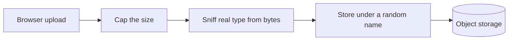
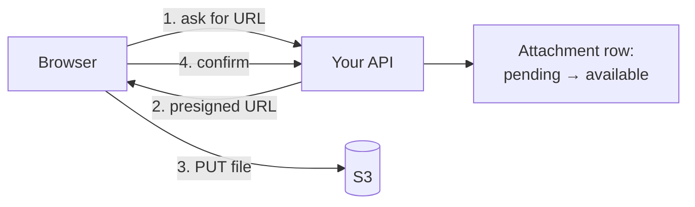
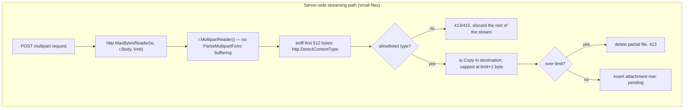
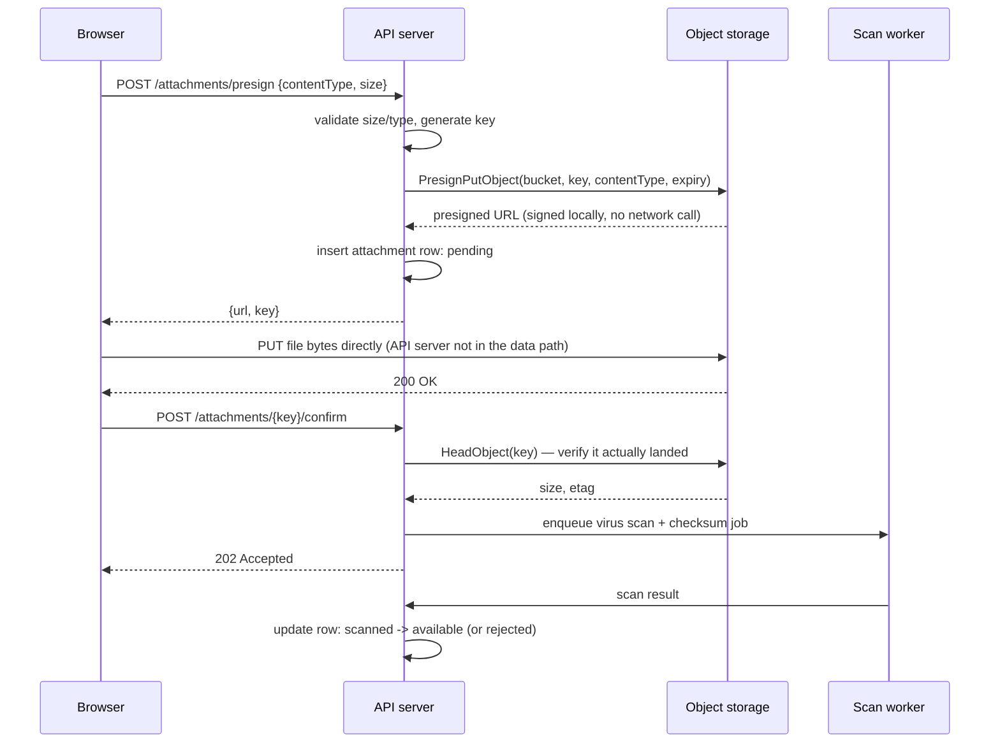
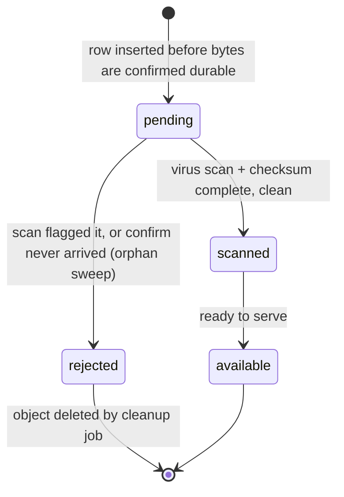

# File Uploads and Object Storage

> [!summary] TL;DR
> Never trust a client's filename, declared content type, or declared size: cap the request body with `http.MaxBytesReader`, stream the file straight to its destination instead of buffering it whole, sniff the real content type from the bytes, and store it under a random key. For anything but small files, skip the API server's bandwidth entirely and let the browser upload straight to object storage with a short-lived presigned URL.

> [!abstract] Core idea
> - Three client-controlled values are lies until checked: the **filename** (`"../../etc/passwd"` is a valid filename to send), the **declared `Content-Type`** header, and the **declared size**. Check all three from the bytes and the enforced limit, never from what the client claims.
> - `http.MaxBytesReader` plus streaming (`r.MultipartReader()` + `io.Copy`) means a 2 GB upload never sits fully in your server's RAM or a temp file it didn't ask for.
> - A **presigned URL** lets a browser `PUT` or `POST` a file straight to S3; your API server only issues the URL and later confirms the object landed. This is the production default for anything beyond a few megabytes — it removes your server from the data path entirely.
> - An attachment is a **row with a lifecycle** (`pending → scanned → available`), not just a file: the row exists before the bytes are durable and before a virus scan clears them, so a crash mid-upload or a flagged file is visible state, not a silent gap.

## Start here: the basics 🟢

> [!info] How to read this note (pick your level)
> - 🟢 **New to this?** Read "From zero" below, then sections 1, 2 and the cheat sheet (10). Stop there, that is a full first pass.
> - 🟡 **Know the basics?** Add section 3 (how it works), 4 (worked example) and 5-6.
> - 🔴 **Interview / SDE-3 prep?** Add 7, 8 and 9. Headings are tagged 🟢🟡🔴 so you always know where you are.

**From zero, in 60 seconds** 🟢

A user uploads a file to your service. Everything the user's browser tells you about that file can be a lie: its name, its type, its size.

A filename like `../../etc/passwd` is an attempt to escape your folder. A "picture" might really be a program. A "small" file might never stop arriving.



So: cap the size with a hard limit, read the real type from the first bytes, and store the file under a random key you chose, in **object storage** (a service like S3 that stores files by key).

For big files, do not let the bytes pass through your server at all: hand the browser a **presigned URL** — a short-lived permission slip to upload straight to storage.

The rest of this note is just these 3 questions:
1. How do you receive an upload safely (size cap, type sniff, random key)?
2. How do you stream a file without loading it all into memory?
3. When and how do you switch to presigned URLs?

**The problem in one story.**
A user attaches a PDF invoice to their account.
The file could be 2 KB or 2 GB, and its name or type could be a lie.
If your server loads the whole file into memory, a few big uploads crash it.
So you stream it, check it, and store it in object storage like S3, not on the server's disk.

**Words you need first**

| Word | Plain meaning | Tiny example |
| --- | --- | --- |
| Upload | Sending a file from a client to a server | Browser sends `invoice.pdf` |
| Multipart form | An HTTP body format that carries files and fields together | `Content-Type: multipart/form-data` |
| Stream | Process data piece by piece instead of all at once | `io.Copy` in 32 KB chunks |
| `Content-Type` | A header that claims what kind of data this is | `application/pdf` |
| Object storage | A service that stores files by key | S3 bucket `invoices/abc123` |
| Presigned URL | A time-limited link that lets a client upload straight to S3 | Valid for 15 minutes |
| Path traversal | Using `../` in a name to escape a folder | `../../etc/passwd` |

**Picture it**



**Analogy.** Instead of carrying a heavy parcel through your office, you give the courier a one-time pass to the warehouse.
Where it breaks: a pass for a warehouse is not a signed cryptographic URL that expires on its own.

**How the rest of this note builds up**

- First, why naive uploads fail (section 1) and the mental model (section 2).
- Then how size limits, streaming, content sniffing and presigned URLs work (section 3).
- Then a full worked example with an attachment lifecycle (section 4) and variants (section 5).
- Finally the SDE-3 deep dive: virus scanning, orphaned objects, and production concerns (sections 6-8).

> [!tip] Remember
> Never trust the client's name, type or size; stream with a limit, or let the client upload straight to S3.

### Whiteboard version

**In plain words:** the smallest safe upload handler — cap, sniff, random key, stream to storage.

The bare shape: accept one file, cap its size, write it to disk under a random name.

```go
func uploadHandler(w http.ResponseWriter, r *http.Request) {
    r.Body = http.MaxBytesReader(w, r.Body, 10<<20) // 10 MiB
    file, header, err := r.FormFile("file")
    if err != nil {
        http.Error(w, "bad upload", http.StatusBadRequest)
        return
    }
    defer file.Close()

    key := randomKey() + filepath.Ext(header.Filename) // filename is UNTRUSTED input
    dst, _ := os.Create("/uploads/" + key)
    defer dst.Close()
    io.Copy(dst, file)
}
```

This "works" on a demo but fails in production three separate ways:

1. `r.FormFile` calls `ParseMultipartForm` internally, which buffers up to `maxMemory` bytes of **every** part in RAM before spilling the rest to a temp file — not just this one field.
2. Nothing checks that the bytes are actually a file type you accept.
3. `os.Create("/uploads/" + key)` trusts that `key` never contains a path separator, which is fine here only because `randomKey()` is trusted, but the pattern itself has no sandbox.

The full version below fixes all three and adds the production path: presigned direct-to-S3 uploads.

## 1. Why it exists 🟢

InvoiceOps lets a user attach a PDF invoice, a payment receipt, or a scanned contract to a workspace. Each of those is a file an untrusted browser sends you, and "accept a file from the internet and write it to a disk or bucket you control" is one of the oldest paths to a compromised server if handled naively.

Three concrete failures show why each piece of this note earns its place:

- **No size cap, memory exhaustion.** A client claims `Content-Length: 500` but keeps streaming gigabytes after the headers. Without `http.MaxBytesReader`, `ParseMultipartForm` or a naive `io.Copy` reads until the client stops or the disk fills, and ten concurrent requests like this exhaust the server's memory or disk before any of them "complete" — a single unauthenticated endpoint becomes a denial-of-service lever.
- **Trusting the declared type, stored executable content served as itself.** A client uploads `invoice.pdf` with `Content-Type: application/pdf`, but the bytes are an HTML file with a `<script>` tag. If the server trusts the header (or the extension) and later serves the file back without `X-Content-Type-Options: nosniff`, a browser may sniff it as HTML and execute the script in your application's origin — a stored XSS attack delivered through the upload feature, not a comment field.
- **Filename as storage key, path traversal.** A client sets the multipart filename to `"../../../etc/cron.d/evil"`. A naive handler that does `os.Create(filepath.Join(uploadDir, header.Filename))` without validating the result can write outside `uploadDir` entirely. The fix in this note is simpler than validating every filename: never use the client's filename as a storage key at all.

## 2. Mental model 🟢

Treat every upload as **untrusted bytes of unknown size and unknown type**, and treat every stored file as **a database row with a lifecycle**, not just bytes sitting in a bucket:

- The **gate**: size limit, then sniffed content type against an allowlist, applied to the bytes as they stream past — never to a fully-buffered file, and never to what the client claims about itself.
- The **key**: a random, unguessable identifier the server generates, never the client's filename. The filename is kept only as metadata for display and the `Content-Disposition` header on download.
- The **row**: `pending` the instant the upload starts, `scanned` once a virus scanner has cleared it, `available` once it can be safely served — so "the file exists" and "the file is safe to serve" are two different, checkable facts.

## 3. How it works 🟡

Two upload paths exist side by side in a real service: small files proxied through your API, and large files uploaded directly to object storage via a presigned URL.





The attachment row's own lifecycle, independent of which upload path produced it:



A presigned PUT URL is not a password-protected link; it is a normal S3 request with its authorization baked into the query string (`X-Amz-Signature`, `X-Amz-Expires`, …), computed by signing locally with the server's credentials.

Anyone holding the URL before it expires can perform exactly the one operation it authorizes (e.g. `PutObject` on that one key, with that one `Content-Type`), which is why the expiry is short (minutes, not hours) and why `confirm` still calls `HeadObject` server-side rather than trusting the browser's say-so.

## 4. Worked example 🟡

The supporting types the handler below needs: the attachment's lifecycle status, the sentinel errors each failure mode returns, and the `Repo` interface a real implementation backs with the `attachments` table.

```go
// Status is the attachment row's lifecycle stage, stored as the status column.
type Status string

const (
	StatusPending   Status = "pending"
	StatusScanned   Status = "scanned"
	StatusAvailable Status = "available"
	StatusRejected  Status = "rejected"
)

var (
	ErrTypeNotAllowed = errors.New("content type not allowed")
	ErrImageTooLarge  = errors.New("image too large")
	ErrTooLarge       = errors.New("file too large")
)

// Repo persists one attachment row. SetStatus also carries the confirmed
// byte count, so the row's size is never left at the placeholder 0 that
// Insert wrote before the bytes were known to fit the limit.
type Repo interface {
	Insert(key, status, contentType string, size int64) error
	SetStatus(key, status string, size int64) error
}

// staticReader replays the 512 bytes SniffContentType already consumed, so
// SaveLocal below can stream the rest of the part without losing them.
type staticReader struct {
	data []byte
	pos  int
}

func (s *staticReader) Read(p []byte) (int, error) {
	if s.pos >= len(s.data) {
		return 0, io.EOF
	}
	n := copy(p, s.data[s.pos:])
	s.pos += n
	return n, nil
}

// extensionFor maps a sniffed, allowlisted content type to a storage-key
// suffix. It is only ever called after CheckAllowed passes, so the default
// case is unreachable in practice, not a silent data-loss path.
func extensionFor(contentType string) string {
	switch contentType {
	case "application/pdf":
		return ".pdf"
	case "image/png":
		return ".png"
	case "image/jpeg":
		return ".jpg"
	default:
		return ""
	}
}

func asMaxBytesError(err error, target **http.MaxBytesError) bool {
	return errors.As(err, target)
}
```

Size limits, content sniffing, and a decompression-bomb guard, all operating on bytes, never on client-supplied metadata:

```go
// MaxUploadBytes bounds one multipart file. Chosen for InvoiceOps attachments
// (PDFs, receipts, contract scans); raise per-route if a route needs more.
const MaxUploadBytes = 10 << 20 // 10 MiB

// MaxDecodedPixels guards against decompression bombs: a tiny PNG whose
// header claims a huge width/height would allocate gigabytes on full decode.
const MaxDecodedPixels = 40_000_000 // ~40 MP, e.g. 8000x5000

var allowedContentTypes = map[string]bool{
	"application/pdf": true,
	"image/png":       true,
	"image/jpeg":      true,
}

// SniffContentType reads up to 512 bytes to classify the file by its bytes,
// never by the client-supplied filename or Content-Type header: both are
// attacker-controlled. It rewinds the reader via a MultiReader so the
// caller can still copy the full stream afterward.
func SniffContentType(r io.Reader) (detected string, rewound io.Reader, err error) {
	buf := make([]byte, 512)
	n, err := io.ReadFull(r, buf)
	if err != nil && err != io.ErrUnexpectedEOF && err != io.EOF {
		return "", nil, err
	}
	buf = buf[:n]
	detected = http.DetectContentType(buf)
	for i, c := range detected {
		if c == ';' {
			detected = detected[:i]
			break
		}
	}
	return detected, io.MultiReader(&staticReader{data: buf}, r), nil
}

// CheckAllowed returns ErrTypeNotAllowed unless the sniffed type is on the
// allowlist. Checking an allowlist, not a denylist, is the point: a denylist
// must guess every dangerous type in advance, an allowlist only needs to
// name the types the business actually accepts.
func CheckAllowed(contentType string) error {
	if !allowedContentTypes[contentType] {
		return fmt.Errorf("%w: %s", ErrTypeNotAllowed, contentType)
	}
	return nil
}

// CheckImageDimensions decodes only the image header (image.DecodeConfig),
// never the pixel data, to reject a decompression bomb before it is fully
// decoded into memory. A tiny PNG can declare a width/height that would
// decode to gigabytes of pixel data; DecodeConfig reads only the header.
func CheckImageDimensions(r io.Reader) error {
	cfg, _, err := image.DecodeConfig(r)
	if err != nil {
		return fmt.Errorf("decode image header: %w", err)
	}
	if cfg.Width*cfg.Height > MaxDecodedPixels {
		return fmt.Errorf("%w: %dx%d", ErrImageTooLarge, cfg.Width, cfg.Height)
	}
	return nil
}

// NewStorageKey returns a random, unguessable storage key. Never use the
// client-supplied filename as a storage key: "../../etc/passwd" or
// "con" (a reserved Windows device name) are both valid "filenames" an
// attacker can submit, and two users uploading "invoice.pdf" the same
// second must not collide.
func NewStorageKey(ext string) (string, error) {
	b := make([]byte, 16)
	if _, err := rand.Read(b); err != nil {
		return "", err
	}
	return hex.EncodeToString(b) + ext, nil
}

// SaveLocal streams src to a file named by a random key under root, using
// os.Root (added in Go 1.24) so the write cannot escape root even if a key
// were ever attacker-influenced — os.Root resolves every path inside it and
// rejects symlinks or ".." components that would leave the sandbox.
func SaveLocal(root *os.Root, key string, src io.Reader, limit int64) (written int64, err error) {
	f, err := root.Create(key)
	if err != nil {
		return 0, err
	}
	defer f.Close()
	written, err = io.Copy(f, io.LimitReader(src, limit+1))
	if err != nil {
		return written, err
	}
	if written > limit {
		_ = root.Remove(key)
		return written, ErrTooLarge
	}
	return written, nil
}
```

The HTTP handler that streams a multipart file without buffering it, enforcing the size cap on the raw body before the multipart reader ever sees it:

```go
// StreamingUploadHandler reads one file from a multipart request without
// buffering it whole in memory: it uses r.MultipartReader() directly
// (never ParseMultipartForm, which spills to a temp file only after
// buffering maxMemory bytes in RAM first) and copies each part straight to
// its destination. http.MaxBytesReader on the body means a client that
// keeps sending past the limit gets its connection cut and a 413, rather
// than the server reading an unbounded body into memory or disk.
func StreamingUploadHandler(root *os.Root, repo Repo, maxSize int64) http.HandlerFunc {
	return func(w http.ResponseWriter, r *http.Request) {
		r.Body = http.MaxBytesReader(w, r.Body, maxSize)

		mr, err := r.MultipartReader()
		if err != nil {
			http.Error(w, "expected multipart/form-data", http.StatusBadRequest)
			return
		}

		part, err := mr.NextPart()
		if err == io.EOF || (part != nil && part.FormName() != "file") {
			http.Error(w, "missing file field", http.StatusBadRequest)
			return
		}
		if err != nil {
			http.Error(w, "malformed multipart body", http.StatusBadRequest)
			return
		}
		defer part.Close()

		detected, body, err := SniffContentType(part)
		if err != nil {
			http.Error(w, "could not read file", http.StatusBadRequest)
			return
		}
		if err := CheckAllowed(detected); err != nil {
			http.Error(w, err.Error(), http.StatusUnsupportedMediaType)
			return
		}

		ext := extensionFor(detected)
		key, err := NewStorageKey(ext)
		if err != nil {
			http.Error(w, "internal error", http.StatusInternalServerError)
			return
		}

		if err := repo.Insert(key, string(StatusPending), detected, 0); err != nil {
			http.Error(w, "internal error", http.StatusInternalServerError)
			return
		}

		written, err := SaveLocal(root, key, body, maxSize)
		if err != nil {
			_ = repo.SetStatus(key, string(StatusRejected), 0)
			if err == ErrTooLarge {
				http.Error(w, "file too large", http.StatusRequestEntityTooLarge)
				return
			}
			var maxErr *http.MaxBytesError
			if asMaxBytesError(err, &maxErr) {
				http.Error(w, "file too large", http.StatusRequestEntityTooLarge)
				return
			}
			http.Error(w, "upload failed", http.StatusInternalServerError)
			return
		}

		// A real handler enqueues an async virus-scan job here and leaves
		// the row at "pending" until the scanner marks it "scanned" then
		// "available"; this demo marks it available immediately, and
		// writes the confirmed byte count now that it's known.
		if err := repo.SetStatus(key, string(StatusAvailable), written); err != nil {
			http.Error(w, "internal error", http.StatusInternalServerError)
			return
		}

		w.WriteHeader(http.StatusCreated)
		fmt.Fprintf(w, `{"key":%q,"size":%d,"contentType":%q}`, key, written, detected)
	}
}

// DownloadHeaders sets the headers that keep a served attachment from being
// executed as HTML/script by a browser and from being guessed as a
// different type than it was stored as: X-Content-Type-Options stops MIME
// sniffing overriding Content-Type, and Content-Disposition: attachment
// stops the browser rendering the file inline even if it is an HTML upload.
func DownloadHeaders(w http.ResponseWriter, filename, contentType string) {
	w.Header().Set("Content-Type", contentType)
	w.Header().Set("X-Content-Type-Options", "nosniff")
	w.Header().Set("Content-Disposition", fmt.Sprintf("attachment; filename=%q", filepath.Base(filename)))
}
```

Presigned PUT, built with the real `aws-sdk-go-v2` client. Presigning computes a signature locally; it makes no network call, which is what makes it testable without a live S3 endpoint:

```go
// NewS3Client builds the client used for both presigning and the
// server-side multipart upload path (manager.Uploader wraps the same
// client). Presigning a URL is pure local computation — it signs a request
// that is never sent — so it needs no network access and can run in tests.
func NewS3Client(region, accessKey, secretKey string) *s3.Client {
	cfg := aws.Config{
		Region:      region,
		Credentials: credentials.NewStaticCredentialsProvider(accessKey, secretKey, ""),
	}
	return s3.NewFromConfig(cfg)
}

// PresignPut returns a URL the browser can PUT the file body to directly,
// bypassing the API server for the (often large) file bytes entirely. The
// server never sees the bytes; it only later confirms the object exists
// (HeadObject) before marking the attachment row "available". contentType
// is bound into the signature via Content-Type as a condition, so a client
// cannot swap in a different type after the URL was issued.
func PresignPut(ctx context.Context, client *s3.Client, bucket, key, contentType string, expires time.Duration) (string, error) {
	presigner := s3.NewPresignClient(client, s3.WithPresignExpires(expires))
	req, err := presigner.PresignPutObject(ctx, &s3.PutObjectInput{
		Bucket:      aws.String(bucket),
		Key:         aws.String(key),
		ContentType: aws.String(contentType),
	})
	if err != nil {
		return "", err
	}
	return req.URL, nil
}
```

Tests, including the two attacks described in "Why it exists" — a disguised script and an oversized body — and the presigned URL's signature content:

```go
func TestStreamingUploadHandler_RejectsDisallowedType(t *testing.T) {
	dir := t.TempDir()
	root, _ := os.OpenRoot(dir)
	defer root.Close()
	repo := newFakeRepo()

	// A script disguised with a .pdf filename: sniffing the bytes (not the
	// filename) must still classify this as plain text and reject it.
	body, contentType := multipartBody(t, "file", "evil.pdf", "application/pdf", []byte("<script>alert(1)</script>"))
	req := httptest.NewRequest(http.MethodPost, "/attachments", body)
	req.Header.Set("Content-Type", contentType)
	rec := httptest.NewRecorder()

	StreamingUploadHandler(root, repo, MaxUploadBytes)(rec, req)

	if rec.Code != http.StatusUnsupportedMediaType {
		t.Fatalf("status = %d, want 415; body = %s", rec.Code, rec.Body.String())
	}
}

func TestStreamingUploadHandler_RejectsOversizedBody(t *testing.T) {
	dir := t.TempDir()
	root, _ := os.OpenRoot(dir)
	defer root.Close()
	repo := newFakeRepo()

	const limit = 2048
	body, contentType := multipartBody(t, "file", "big.pdf", "application/pdf", pdfBytes(limit*2))
	req := httptest.NewRequest(http.MethodPost, "/attachments", body)
	req.Header.Set("Content-Type", contentType)
	rec := httptest.NewRecorder()

	StreamingUploadHandler(root, repo, limit)(rec, req)

	if rec.Code != http.StatusRequestEntityTooLarge {
		t.Fatalf("status = %d, want 413; body = %s", rec.Code, rec.Body.String())
	}
}

func TestCheckImageDimensions_RejectsDecompressionBomb(t *testing.T) {
	small := encodePNG(t, 100, 100)
	if err := CheckImageDimensions(bytes.NewReader(small)); err != nil {
		t.Fatalf("small image rejected: %v", err)
	}

	huge := encodePNG(t, 10000, 10000) // 100,000,000 px > MaxDecodedPixels
	if err := CheckImageDimensions(bytes.NewReader(huge)); err == nil {
		t.Fatal("huge image accepted, want ErrImageTooLarge")
	}
}

func TestPresignPut_SignsLocallyWithoutNetwork(t *testing.T) {
	client := NewS3Client("us-east-1", "AKIAFAKEEXAMPLE", "fakesecretkeyfakesecretkeyfakesecretkey")
	ctx, cancel := context.WithTimeout(context.Background(), 2*time.Second)
	defer cancel()

	url, err := PresignPut(ctx, client, "invoiceops-attachments", "abc123.pdf", "application/pdf", 15*time.Minute)
	if err != nil {
		t.Fatalf("PresignPut: %v", err)
	}
	for _, want := range []string{
		"invoiceops-attachments", "abc123.pdf", "X-Amz-Signature=", "X-Amz-Expires=900",
	} {
		if !strings.Contains(url, want) {
			t.Fatalf("presigned URL missing %q: %s", want, url)
		}
	}
}
```

**Measured:** built in a scratch module (`uploadsdemo`, Go 1.24.4, `github.com/aws/aws-sdk-go-v2/service/s3` v1.71.0) and run with `go vet` and `go test -race`.

All 4 tests shown above passed, including the disguised-script rejection (415), the oversized-body rejection (413), the decompression-bomb guard (100×100 PNG accepted, 10,000×10,000 PNG rejected), and the presigned URL containing a real `X-Amz-Signature` and a 900-second (`15m`) `X-Amz-Expires`, computed entirely offline.

The S3 calls in `TestPresignPut_SignsLocallyWithoutNetwork` are real `aws-sdk-go-v2` calls, but presigning is pure local computation — the test needs no live S3 endpoint or credentials.

## 5. Variants and comparison 🟡

| Approach | How it works | Use when | Cost |
| --- | --- | --- | --- |
| Proxy through the API server | Client uploads to your handler; handler streams to disk or storage | Small files (a few MB), or when the server must transform the file before storing it | Server bandwidth and goroutines are tied up for the whole upload duration |
| Presigned PUT | API issues a signed URL; browser `PUT`s straight to the bucket; API confirms after | Large files, the production default | An extra round trip to request the URL; server must still verify the object landed |
| Presigned POST | API issues a signed form (URL + fields) with conditions baked in (`content-length-range`, `Content-Type`, key prefix) | Browser `<form>` uploads where you need multiple enforced conditions, not just one PUT | More setup than PUT; still needs a confirm step |
| Resumable upload (S3 multipart, or tus) | File is split into parts uploaded independently and assembled server-side (or by the bucket) | Large files over unreliable connections, where a dropped connection shouldn't restart from byte 0 | More moving parts: part tracking, an abort/cleanup path for incomplete uploads |

## 6. Trade-offs and when not to use 🟡

- Streaming with `r.MultipartReader()` means you cannot read the same part twice or look ahead past what you've already consumed — if a later part's value changes how you'd handle an earlier one, buffer that specific field instead (not the whole request).
- A presigned URL moves the bandwidth cost off your server but adds a new failure mode: the browser can abandon the direct upload entirely, leaving an object with no confirmed row (the orphan sweep job exists specifically for this).
- Content sniffing with `http.DetectContentType` only recognizes a fixed set of common signatures; it is not a full-format validator. A byte-for-byte malformed PDF that happens to start with `%PDF-` still sniffs as `application/pdf`. If you must validate structure, parse the file with a real library after the sniff check passes, not instead of it.
- For an internal tool with a handful of trusted uploaders (not public internet users), the whiteboard version's simpler `ParseMultipartForm` path is genuinely fine — the hardening here earns its complexity specifically because the uploader is untrusted.

## 7. In production 🔴

- **Real systems:**
  - Most SaaS products with user-generated file uploads (Slack, Notion, GitHub issues) route large files through a presigned-URL pattern so their API tier never touches multi-megabyte payloads.
  - S3's own POST policy mechanism (`content-length-range`, `starts-with` on key and `Content-Type`) is the AWS-native version of "bind conditions into the signature so a client can't smuggle something the signer didn't intend."
  - tus (tus.io) is the open protocol several products (Vimeo, Cloudflare Stream) use for resumable uploads from flaky connections, built around `PATCH` requests that append to a partially-uploaded resource.
- **Failure modes → fixes:**
  - Browser uploads the object directly but never calls `/confirm` (tab closed, network dropped) → an orphan-sweep job lists objects older than N minutes with no matching `available`/`scanned` row and deletes them, plus an S3 Lifecycle rule that aborts incomplete multipart uploads after a few days regardless.
  - Virus scanner backs up under load, `pending` rows pile up → alert on the age of the oldest `pending` row (a staleness gauge), not just on scan failures; a growing backlog is itself the incident.
  - A legitimate large file gets rejected by a size limit sized for the common case → raise the limit per route/plan tier rather than globally, and switch that route to resumable/multipart uploads instead of a single raw `PUT`.
- **What to monitor:** upload success/failure rate and 413/415 rate (a sudden spike in either signals a client bug or a probing attacker), time from `pending` to `available`, orphaned-object count found per sweep, and virus-scan queue depth.

## 8. Deep dive 🔴

- **Why size the limit on the raw body, not after decoding.** `http.MaxBytesReader` wraps `r.Body` before anything else reads it, so it bounds the literal bytes on the wire — including multipart boundaries and headers, not just the file payload. A limit applied only after `ParseMultipartForm` has already let an unbounded body be read into memory defeats the purpose.
- **Why `os.Root` and not just `filepath.Clean` + a prefix check.** Go 1.24's `os.Root` opens a directory file descriptor once and resolves every subsequent path against it at the OS level, which also rejects a symlink inside the root that points outside it — a `filepath.Clean("../x")` style check only inspects the string, so a symlink planted by an earlier, now-deleted upload could still escape a string-based check.
- **Why `Content-Type` is a signing condition, not just a request header.** Binding `ContentType` into the presigned PUT means S3 itself rejects an upload whose actual `Content-Type` header differs from what was signed — a client can't request a URL for an image and then upload an HTML file under it, because the signature simply won't validate for the substituted header.
- **The pixel-count guard is not the only decompression-bomb vector.** `image.DecodeConfig` catches an oversized raster image cheaply, but a zip bomb or a PDF with deeply nested objects can exhaust memory the same way through a different decoder; any format you fully parse needs its own resource ceiling (a page/object count limit for PDFs, a decompressed-size cap for archives), not just this one check.
- **Checksums do two different jobs.** A SHA-256 computed during upload detects corruption in transit or at rest (compare it on download); it is not a substitute for a virus scan, which inspects content for known-malicious signatures. InvoiceOps computes both, independently, before a row moves past `scanned`.

## 9. Interview questions 🔴

> [!question]- Why check the content type from the file's bytes instead of the `Content-Type` header the client sent?
> The header is supplied by the client and is exactly as trustworthy as any other request header — an attacker sends whatever value helps their attack. `http.DetectContentType` sniffs the first 512 bytes against known signatures, which the client cannot talk its way around without actually changing the file's content.

> [!question]- Trap: if a file uploads successfully and the handler returns 200, is it safe to serve back to users?
> Not necessarily. "Uploaded successfully" only means the bytes landed within the size and type gate; it says nothing about whether a virus scan has cleared it. That's why the attachment row has a `pending → scanned → available` lifecycle — only `available` should ever be servable, and the handler returning 200/201 reflects "accepted for processing," not "safe to serve."

> [!question]- Why does a presigned URL need an expiry, and why short rather than long?
> The URL itself *is* the authorization — anyone holding it can perform the one signed operation until it expires. A short expiry (minutes) limits the damage if a URL leaks (browser history, a proxy log, a referrer header) to a small window, while still giving a normal upload enough time to complete.

> [!question]- Why use `r.MultipartReader()` instead of `r.ParseMultipartForm(maxMemory)`?
> `ParseMultipartForm` buffers up to `maxMemory` bytes of the *entire* form (not just one field) into RAM before spilling the rest to a temp file, and it parses every part before your handler sees any of them. `r.MultipartReader()` hands you parts one at a time as they arrive, so you can sniff, validate and stream each one without ever holding the whole file in memory.

> [!question]- A user reports their upload of a 50MB file fails with no error message in the UI. Where do you look first?
> Check the response status code the client actually received: a `413` from `http.MaxBytesReader` tripping the configured limit is the most likely cause for a file that large, and the fix is either raising the limit for that route or moving that upload path to presigned/resumable uploads instead of treating it as a bug in the handler logic.

> [!question]- Why does the storage key never reuse the client's filename, even sanitized?
> Two users can upload files named `invoice.pdf` in the same second, and a sanitized filename is still guessable, which matters if filenames are ever used to construct a URL. A random key sidesteps collisions and guessability entirely; the original filename is kept only as display metadata and reintroduced solely in the `Content-Disposition` header on download.

> [!question]- What does `HeadObject` after a presigned-PUT upload actually verify, and why is it necessary if the browser already got a 200 from S3?
> It independently confirms, from the server's own trusted call, that an object of the expected key actually exists (and reads its real size/etag) rather than trusting the browser's claim that the upload succeeded. A browser could report success after a network blip truncated the request, or simply lie; `HeadObject` is the server's own evidence before it marks the row `available` for anyone else to see.

## 10. Cheat sheet 🟢

- Cap the raw body with `http.MaxBytesReader` before anything parses it; a client that exceeds it gets cut off with a `*http.MaxBytesError` → 413.
- Stream with `r.MultipartReader()` + `io.Copy`; never `ParseMultipartForm` for anything you intend to stream, since it buffers the whole form first.
- Sniff the real type with `http.DetectContentType` on the first 512 bytes and check it against an allowlist — never trust the filename or the declared `Content-Type`.
- Guard image decode with `image.DecodeConfig` (header only) before any full decode, to catch decompression bombs.
- Storage keys are random, never the client's filename; use `os.Root` (Go 1.24) to sandbox local writes.
- Presigned PUT/POST moves large-file bandwidth off your API server; the server still confirms via `HeadObject` before trusting the upload.
- An attachment is `pending → scanned → available`, backed by a real row — not just bytes in a bucket.
- Serve downloads with `Content-Disposition: attachment` and `X-Content-Type-Options: nosniff`, and clean up orphans with a sweep job plus an S3 Lifecycle rule for incomplete multipart uploads.

## Links 🟢

- **Before this:** [[Building REST Endpoints]], [[Request Decoding, Validation and DTOs]]
- **Next:** [[Observability in Go Services]], [[Database Access (database-sql, pgx, sqlc)]]
- **Compare with:** [[File Upload Architecture]] (the architecture and tradeoffs this note implements in Go), [[Secrets Management]] (storing the S3/bucket credentials this note's client uses)

### Watch on YouTube

- [#76 Golang - Upload Files to S3 & Serve with Presigned URLs](https://www.youtube.com/watch?v=1p86t2RSHuU) · codeHeim · Go-specific walkthrough of streaming uploads and presigned URLs
- [A Guide to S3 Pre-Signed URLs: What They Are and How They Work](https://www.youtube.com/watch?v=ITSFLfqWy8o) · Forward Networks · short conceptual explainer of presigned URL mechanics
