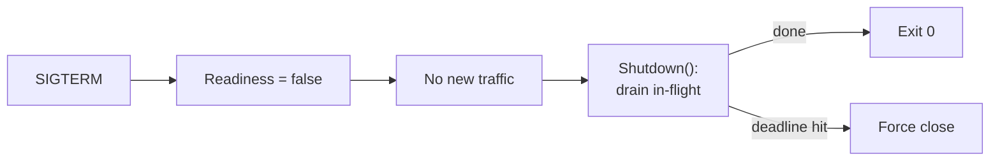
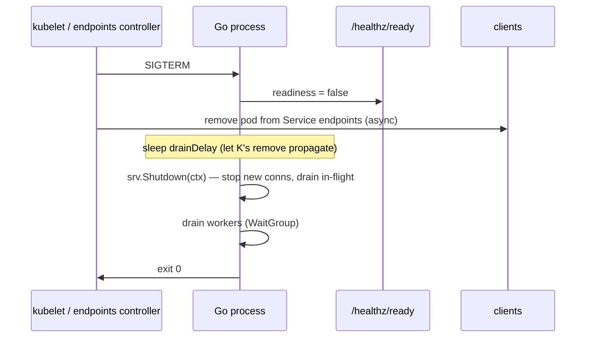
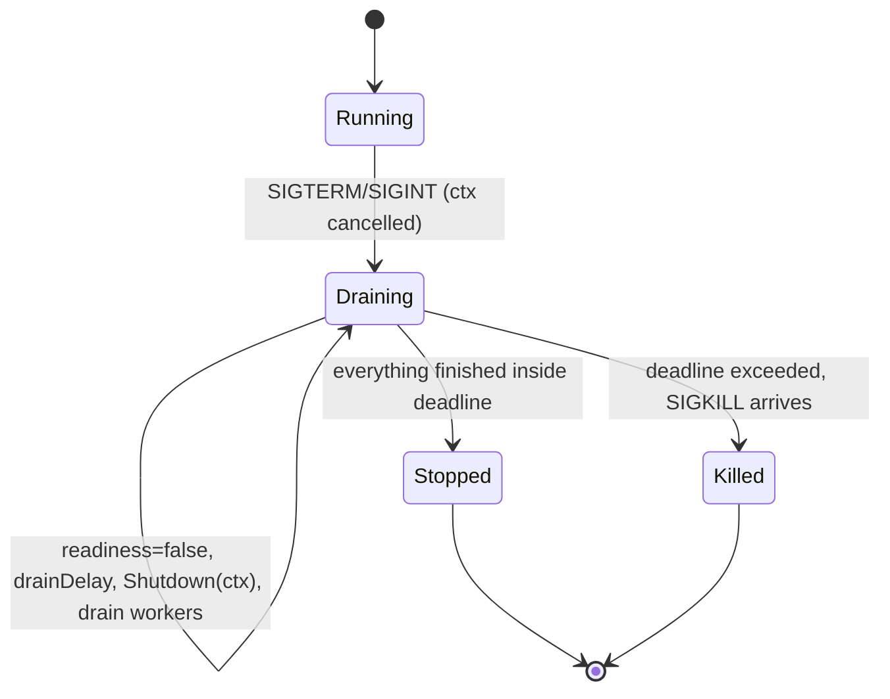

# Graceful Shutdown and Health Checks

> [!summary] TL;DR
> Graceful shutdown stops a Go service from dropping in-flight work when it is asked to stop: it flips readiness off first, waits for Kubernetes to notice, then drains HTTP requests and background jobs inside a deadline before exiting. Health checks are the three probes Kubernetes uses to decide whether a pod is alive, ready for traffic, or still starting up.

> [!abstract] Core idea
> - `signal.NotifyContext` turns SIGTERM/SIGINT into a cancelled `context.Context`; it cannot catch SIGKILL or a crash.
> - The moment shutdown starts, flip readiness to false *before* doing anything else, so new traffic stops arriving while the drain runs.
> - `main` must wait for `Server.Shutdown` to return, not for `ListenAndServe` — `ListenAndServe` returns `http.ErrServerClosed` the instant `Shutdown` is called, long before the drain finishes.
> - Liveness, readiness and startup are three different questions; answering the wrong one gets a healthy pod killed or a broken pod sent traffic.
> - Everything here is bounded by a deadline. A drain that can hang forever is worse than a hard kill.

## Start here: the basics 🟢

> [!info] How to read this note (pick your level)
> - 🟢 **New to this?** Read "From zero" below, then sections 1, 2 and the cheat sheet (10). Stop there, that is a full first pass.
> - 🟡 **Know the basics?** Add section 3 (how it works), 4 (worked example) and 5-6.
> - 🔴 **Interview / SDE-3 prep?** Add 7, 8 and 9. Headings are tagged 🟢🟡🔴 so you always know where you are.

**From zero, in 60 seconds** 🟢

Servers get restarted all the time — deploys, scaling, moving pods. A **graceful shutdown** means: when told to stop, finish the requests you are holding before you exit, instead of dropping them mid-way.

The order matters. First tell the load balancer "stop sending me new work" (flip **readiness** off). Then wait a moment. Then finish what is in flight. Then exit.


**Health checks** are the questions Kubernetes keeps asking a pod: are you alive at all (liveness)? ready for traffic (readiness)? still booting (startup)? Answering them wrong causes restart loops or dropped traffic.

The rest of this note is just these 3 questions:
1. Which signal means what, and how does Go catch it?
2. What is the exact shutdown order, and which ordering bug bites everyone?
3. What should each of the three probes actually check?

**The problem in one story.**
You deploy a new version of your API.
The old copy is told to stop while it is still answering requests.
If it just dies, users see errors mid-request.
A graceful shutdown stops new traffic first, finishes current work, then exits.

**Words you need first**

| Word | Plain meaning | Tiny example |
| --- | --- | --- |
| Signal | A short message the OS sends to a process | `SIGTERM` = please stop |
| `SIGKILL` | A stop that cannot be caught or delayed | `kill -9` |
| Drain | Let in-flight requests finish, accept no new ones | Wait for 3 open requests |
| `context.Context` | A value that tells code to stop or time out | Cancelled on `SIGTERM` |
| Health check / probe | An HTTP endpoint a platform calls to ask "are you OK?" | `GET /healthz` |
| Liveness | "Is the process stuck? Restart it if so." | Deadlocked server fails it |
| Readiness | "Should this copy get traffic right now?" | False during shutdown |
| Pod | Kubernetes' unit that runs your container | `invoice-api-7f9c` |

**Picture it**



**Analogy.** A shop at closing time flips the sign to "Closed", serves the people already inside, then locks up.
Where it breaks: a shop can wait for slow customers, but a server has a hard deadline before the platform sends `SIGKILL`.

**How the rest of this note builds up**

- First, why abrupt stops hurt (section 1) and the mental model (section 2).
- Then signals, the shutdown sequence, the `ListenAndServe`/`Shutdown` ordering bug, hijacked connections and gRPC (section 3).
- Then a full worked example with probes (section 4) and comparisons (section 5).
- Finally the SDE-3 deep dive: Kubernetes timing, probe mistakes and production failures (sections 6-8).

> [!tip] Remember
> On `SIGTERM`: fail readiness, drain with a deadline, wait for `Shutdown` to return, then exit.

### Whiteboard version

**In plain words:** the smallest server that shuts down clean.



The rest of this note fills in why each of those five lines exists, what breaks if you skip one, and the Go code that implements them.

## 1. Why it exists 🟢

A rolling deploy replaces pods constantly. Without graceful shutdown, every deploy drops whatever requests and jobs were in flight at that instant.

Concretely: InvoiceOps runs 6 replicas behind a Kubernetes Service. A deploy rolls one pod at a time. Kubernetes sends the old pod SIGTERM, and by default gives it `terminationGracePeriodSeconds: 30` before SIGKILL. In that window, three things are racing:

1. The **endpoint controller** removing the pod's IP from the Service's endpoint list, so kube-proxy stops sending it new connections — this is asynchronous and typically lands within a second or two, but is not instant.
2. The **process** itself, which gets SIGTERM at the same moment the termination sequence starts, not after step 1 finishes.
3. Whatever the process is doing right now: serving an HTTP request, running a background job, holding a websocket.

If the process exits immediately on SIGTERM, every request that was in flight gets a connection reset, and every job that was running gets abandoned mid-write. If it ignores SIGTERM entirely, it gets SIGKILL after 30 seconds with no chance to finish anything, and the kubelet logs a forced termination.

Graceful shutdown is the process cooperating with that race: stop taking new work immediately, keep doing old work for a bounded amount of time, then exit cleanly on its own before the kill signal arrives.

## 2. Mental model 🟢

Think of the pod as a restaurant closing for the night. Flipping the sign to "closed" (readiness → false) happens the instant the decision is made — no new customers are seated. Existing tables keep eating because they already ordered (in-flight requests drain).

The kitchen finishes the orders already on the pass (in-flight jobs finish) but refuses new ones.

Only once the last table pays the bill does staff lock the door and leave (process exits) — and if the night manager tells them a hard deadline, they will interrupt a half-finished order rather than stay past closing (shutdown deadline).

The crash case is different: it is the building catching fire. There is no graceful anything — the staff and customers leave however they can, and the only thing that saves the night is that every order was already written on a ticket (idempotent, at-least-once processing), not held only in a chef's head.

## 3. How it works 🟡

### Signals, and what each one means

**In plain words:** signals are the operating system's knock on the door — one means 'please finish up', one means 'you are gone right now' and cannot be caught.

| Signal | Who sends it | Catchable? | Meaning |
| --- | --- | --- | --- |
| `SIGTERM` | Kubernetes, `docker stop`, `systemctl stop` | yes | "please stop; you have `terminationGracePeriodSeconds`" |
| `SIGINT` | Ctrl-C in a terminal | yes | same intent, interactive |
| `SIGKILL` | Kubernetes after the grace period, OOM killer | no | immediate, unconditional process death |

`SIGKILL` and an OOM kill cannot be intercepted by any Go code — there is no handler, no deferred function, nothing. Graceful shutdown only ever covers the first two rows.

Surviving the third row is a different problem, solved by making every unit of work idempotent and safe to retry (link [[Idempotency and Idempotency Keys]]), not by code in this note.

### The shutdown sequence

**In plain words:** the fixed checklist a pod walks through between 'please stop' and exiting, and why readiness flips first.



Step by step, in the order it must happen:

1. **`signal.NotifyContext`** installs a handler for `SIGTERM` and `SIGINT` and hands back a `context.Context` that is cancelled on the first one. A second signal of the same kind restores the default behavior (immediate kill), so an operator who is impatient can still force an exit.
2. **Flip readiness to false immediately.** This is the step the old note for this topic never mentioned, and it is the one that matters most: if the HTTP server stops accepting connections before readiness goes false, clients that already resolved the pod's IP keep sending it requests that now fail, even though the pod looks "ready" to anyone still asking.
3. **`drainDelay`**: sleep a short, fixed window (1-5s is typical) so the asynchronous endpoint-removal in step 2 has time to actually propagate through kube-proxy before step 4 starts refusing connections outright. This closes the race between "readiness says no" and "the Service still has the old IP listed".
4. **`Server.Shutdown(ctx)`**: stops the listener (no new connections), closes idle keep-alive connections immediately, and waits for active requests to finish or for `ctx` to be done, whichever comes first.
5. **Drain the worker pool**: stop pulling new jobs, let in-flight jobs finish (bounded by the same deadline), and requeue or nack anything still waiting.
6. **Let `main` close shared resources last** — DB pool, Redis pool, any tracer — only after both the HTTP server and the workers have actually stopped using them.

### The ListenAndServe / Shutdown ordering bug

**In plain words:** a tiny race: if you call stop before the server fully started listening, the stop does nothing — the fix is in how the two are ordered.

The error that the old note's audit called out by name: `ListenAndServe` returns the instant `Shutdown` is called, with `http.ErrServerClosed`, not when the drain finishes. A `main` that does

```go
go srv.ListenAndServe()
<-ctx.Done()
os.Exit(0) // WRONG: exits before Shutdown has even been called
```

exits before any draining happens at all. The correct shape calls `Shutdown` from the goroutine that owns the ctx, and has `main` wait for that call — not for `ListenAndServe` — to return. The code in [4.

Worked example](#4-worked-example) does exactly this: `ListenAndServe` runs in its own goroutine and reports its *own* exit through a channel, while the main `Run` goroutine blocks on `ctx.Done()`, then calls `Shutdown`, then drains workers, then returns.

### Hijacked connections Shutdown does not drain

`Server.Shutdown` only tracks connections it manages as ordinary HTTP state. Three things slip past it:

- **Hijacked connections** (`http.Hijacker`, raw TCP taken over by a handler) are invisible to `Shutdown` once hijacked. Use `Server.RegisterOnShutdown` to register a callback that signals those connections to close themselves.
- **WebSocket connections** are typically hijacked or served over a long-lived HTTP/1.1 upgrade; `Shutdown` will not close them for you. Send a close frame (code 1001, "going away") from `RegisterOnShutdown` and give the peer a short window to ack it.
- **Server-Sent Events** streams are ordinary long-lived responses; `Shutdown` waits for them like any in-flight request, up to the deadline, then the deadline forcibly ends them. For a long SSE stream, close it deliberately inside the handler on `ctx.Done()` instead of relying on the outer deadline.

(Scaling these further than one process is [[Scaling WebSockets]]'s job; this note only covers shutting one process down cleanly.)

### gRPC's equivalent

A gRPC server has its own two-step version of the same idea: `GracefulStop()` stops accepting new RPCs and waits for existing ones to finish, with no deadline of its own — so wrap it in a `context.WithTimeout` and call the blunt `Stop()` if the deadline passes. (Full gRPC server setup is [[gRPC Services in Go]]'s job.)

## 4. Worked example 🟡

### Whiteboard version

The shape with everything else stripped away: wait for the signal, flip readiness, shut the server down, return.

```go
ctx, stop := signal.NotifyContext(context.Background(), syscall.SIGTERM, syscall.SIGINT)
defer stop()

go srv.ListenAndServe()
<-ctx.Done()

health.SetReady(false)
shutdownCtx, cancel := context.WithTimeout(context.Background(), 25*time.Second)
defer cancel()
srv.Shutdown(shutdownCtx)
```

The full version below adds what production needs: the `ListenAndServeTLS`/`ErrServerClosed` handling `main` must get right, a worker pool that drains instead of being killed mid-job, and the three probe endpoints. It compiles and passes `go vet` and `go test -race` on Go 1.24.4.

```go
// Package shutdowndemo is a trimmed InvoiceOps-style HTTP server used to
// demonstrate graceful shutdown with readiness and liveness probes.
package shutdowndemo

import (
	"context"
	"encoding/json"
	"errors"
	"log/slog"
	"net/http"
	"sync"
	"sync/atomic"
	"time"
)

// Health tracks the two probe states a Kubernetes pod is checked against.
// ready flips to false the instant shutdown begins, before anything else
// happens, so the endpoint controller stops sending new traffic.
type Health struct {
	ready atomic.Bool
}

func NewHealth() *Health {
	h := &Health{}
	h.ready.Store(true) // the service starts ready; flip it only on shutdown
	return h
}

// Liveness answers "is the process alive at all". It must never depend on
// downstream services: a flaky dependency should not get the pod killed.
func (h *Health) Liveness(w http.ResponseWriter, r *http.Request) {
	w.WriteHeader(http.StatusOK)
}

// Readiness answers "should traffic be routed here right now". It goes
// false immediately when shutdown starts, and can also go false if a
// dependency check fails while the pod is otherwise healthy.
func (h *Health) Readiness(w http.ResponseWriter, r *http.Request) {
	if !h.ready.Load() {
		w.WriteHeader(http.StatusServiceUnavailable)
		return
	}
	w.WriteHeader(http.StatusOK)
}

func (h *Health) SetReady(v bool) { h.ready.Store(v) }

// InvoiceStore is the minimal dependency the handler needs; a fake in
// tests, a real repository in production.
type InvoiceStore interface {
	Get(ctx context.Context, id string) (map[string]any, error)
}

// Server wires the HTTP surface, a background worker pool and health state
// into one unit that Run can start and Shutdown can drain.
type Server struct {
	httpSrv *http.Server
	health  *Health
	store   InvoiceStore

	jobs     chan string    // work handed to the worker pool
	workerWG sync.WaitGroup // tracks in-flight jobs during drain
	logger   *slog.Logger
}

func NewServer(addr string, store InvoiceStore, logger *slog.Logger) *Server {
	if logger == nil {
		logger = slog.Default()
	}
	s := &Server{
		health: NewHealth(),
		store:  store,
		jobs:   make(chan string, 64),
		logger: logger,
	}

	mux := http.NewServeMux()
	mux.HandleFunc("GET /healthz/live", s.health.Liveness)
	mux.HandleFunc("GET /healthz/ready", s.health.Readiness)
	mux.HandleFunc("GET /invoices/{id}", s.getInvoice)

	s.httpSrv = &http.Server{
		Addr:              addr,
		Handler:           mux,
		ReadHeaderTimeout: 5 * time.Second,
		ReadTimeout:       10 * time.Second,
		WriteTimeout:      15 * time.Second,
		IdleTimeout:       60 * time.Second,
	}
	return s
}

func (s *Server) getInvoice(w http.ResponseWriter, r *http.Request) {
	inv, err := s.store.Get(r.Context(), r.PathValue("id"))
	if err != nil {
		http.Error(w, "not found", http.StatusNotFound)
		return
	}
	w.Header().Set("Content-Type", "application/json")
	_ = json.NewEncoder(w).Encode(inv)
}

// Enqueue hands one job to the worker pool.
func (s *Server) Enqueue(job string) { s.jobs <- job }

// runWorker consumes jobs until the channel is closed or ctx is done,
// finishing whatever job it is holding before it exits.
func (s *Server) runWorker(ctx context.Context, process func(string)) {
	defer s.workerWG.Done()
	for {
		select {
		case job, ok := <-s.jobs:
			if !ok {
				return
			}
			process(job)
		case <-ctx.Done():
			return
		}
	}
}

// StartWorkers launches n workers and returns immediately; drainWorkers
// during shutdown waits for them.
func (s *Server) StartWorkers(ctx context.Context, n int, process func(string)) {
	for i := 0; i < n; i++ {
		s.workerWG.Add(1)
		go s.runWorker(ctx, process)
	}
}

// drainWorkers closes the job queue so no new work is taken, then waits
// for in-flight jobs to finish or for the deadline to pass.
func (s *Server) drainWorkers(ctx context.Context) {
	close(s.jobs)
	done := make(chan struct{})
	go func() {
		s.workerWG.Wait()
		close(done)
	}()
	select {
	case <-done:
	case <-ctx.Done():
		s.logger.Warn("worker drain deadline exceeded; abandoning in-flight jobs")
	}
}

// Run starts the HTTP server and blocks until ctx is cancelled (typically
// by signal.NotifyContext), then drains in this order: flip readiness
// false, let the endpoint-propagation delay pass, shut down the HTTP
// server, drain workers, and finally let the caller close DB/Redis pools.
//
// shutdownTimeout bounds the whole drain; drainDelay models the window
// Kubernetes needs to remove this pod from Service endpoints before new
// traffic truly stops arriving.
func (s *Server) Run(ctx context.Context, drainDelay, shutdownTimeout time.Duration) error {
	errCh := make(chan error, 1)
	go func() {
		s.logger.Info("listening", "addr", s.httpSrv.Addr)
		err := s.httpSrv.ListenAndServe()
		// ListenAndServe always returns a non-nil error; ErrServerClosed
		// means Shutdown was called and this is not a failure.
		if err != nil && !errors.Is(err, http.ErrServerClosed) {
			errCh <- err
			return
		}
		errCh <- nil
	}()

	select {
	case err := <-errCh:
		return err // the listener died on its own, e.g. bind failure
	case <-ctx.Done():
	}

	s.logger.Info("shutdown signal received")
	s.health.SetReady(false) // stop new traffic before anything else

	if drainDelay > 0 {
		time.Sleep(drainDelay)
	}

	shutdownCtx, cancel := context.WithTimeout(context.Background(), shutdownTimeout)
	defer cancel()

	if err := s.httpSrv.Shutdown(shutdownCtx); err != nil {
		s.logger.Error("http shutdown did not finish cleanly", "err", err)
		_ = s.httpSrv.Close()
	}

	s.drainWorkers(shutdownCtx)

	// main waits here for Run to return before closing DB/Redis pools;
	// Run itself never touches those pools so ownership stays with main.
	return <-errCh
}
```

`main` wires it to real signals — this part is illustrative, since a `main` package cannot be unit-tested the way the package above is:

```go
func main() {
	logger := slog.New(slog.NewTextHandler(os.Stdout, nil))

	// NotifyContext cancels ctx on the first SIGTERM or SIGINT and restores
	// the default signal behaviour, so a second signal kills the process
	// immediately instead of queuing behind a stuck drain.
	ctx, stop := signal.NotifyContext(context.Background(), syscall.SIGTERM, syscall.SIGINT)
	defer stop()

	srv := shutdowndemo.NewServer(":8080", invoiceRepo, logger)
	srv.StartWorkers(ctx, 4, processInvoiceJob)

	const (
		drainDelay      = 5 * time.Second  // let K8s endpoint removal land first
		shutdownTimeout = 25 * time.Second // stay under terminationGracePeriodSeconds (30s default)
	)

	if err := srv.Run(ctx, drainDelay, shutdownTimeout); err != nil {
		logger.Error("server exited with error", "err", err)
		os.Exit(1)
	}
	logger.Info("shutdown complete")
}
```

Three tests that prove the behaviour that matters, not just that the code runs (`go test -race`, all pass):

```go
// TestReadinessFlipsBeforeShutdownReturns proves the ordering the audit
// called out: readiness must go false before the server stops accepting
// new work, not after.
func TestReadinessFlipsBeforeShutdownReturns(t *testing.T) {
	srv := NewServer("127.0.0.1:0", fakeStore{}, testLogger())
	if !srv.health.ready.Load() {
		t.Fatal("server must start ready")
	}

	ctx, cancel := context.WithCancel(context.Background())
	runDone := make(chan error, 1)
	go func() { runDone <- srv.Run(ctx, 0, 2*time.Second) }()
	time.Sleep(50 * time.Millisecond) // let the listener goroutine start

	cancel()

	select {
	case err := <-runDone:
		if err != nil {
			t.Fatalf("Run returned error: %v", err)
		}
	case <-time.After(3 * time.Second):
		t.Fatal("Run did not return within the shutdown timeout")
	}

	if srv.health.ready.Load() {
		t.Fatal("readiness must be false once Run has stopped")
	}
}

// TestInFlightJobFinishesBeforeDrainReturns proves a job started before
// shutdown completes during drain instead of being abandoned mid-write.
func TestInFlightJobFinishesBeforeDrainReturns(t *testing.T) {
	srv := NewServer("127.0.0.1:0", fakeStore{}, testLogger())

	var processed atomic.Int32
	started := make(chan struct{})
	release := make(chan struct{})

	ctx, workerCancel := context.WithCancel(context.Background())
	defer workerCancel()
	srv.StartWorkers(ctx, 1, func(job string) {
		close(started)
		<-release // hold the job open until the test releases it
		processed.Add(1)
	})

	srv.Enqueue("invoice:1")
	<-started // the worker has picked up the job

	drainDone := make(chan struct{})
	go func() {
		srv.drainWorkers(context.Background()) // no deadline: must wait
		close(drainDone)
	}()

	select {
	case <-drainDone:
		t.Fatal("drain returned before the in-flight job finished")
	case <-time.After(100 * time.Millisecond):
		// expected: drain is still waiting on the held job
	}

	close(release)

	select {
	case <-drainDone:
	case <-time.After(2 * time.Second):
		t.Fatal("drain never returned after the job finished")
	}

	if processed.Load() != 1 {
		t.Fatalf("processed = %d, want 1", processed.Load())
	}
}

// TestDrainDeadlineAbandonsSlowJob proves drain does not hang forever: a
// job that outlives the shutdown deadline is abandoned, not awaited.
func TestDrainDeadlineAbandonsSlowJob(t *testing.T) {
	srv := NewServer("127.0.0.1:0", fakeStore{}, testLogger())

	block := make(chan struct{}) // never closed: the job never finishes
	ctx, workerCancel := context.WithCancel(context.Background())
	defer workerCancel()
	srv.StartWorkers(ctx, 1, func(job string) { <-block })
	srv.Enqueue("invoice:slow")
	time.Sleep(20 * time.Millisecond) // let the worker pick it up

	deadline, cancel := context.WithTimeout(context.Background(), 50*time.Millisecond)
	defer cancel()

	done := make(chan struct{})
	go func() {
		srv.drainWorkers(deadline)
		close(done)
	}()

	select {
	case <-done:
	case <-time.After(1 * time.Second):
		t.Fatal("drainWorkers ignored its deadline")
	}
}
```

**Measured:** all four tests in this package (the three above plus a readiness-endpoint check) pass under `go test -race` on Go 1.24.4, darwin/arm64, 2026-11-07.

## 5. Variants and comparison 🟡

| Probe | Question it answers | Must check dependencies? | Failure action |
| --- | --- | --- | --- |
| Liveness | Is the process stuck or deadlocked? | No — never. A down dependency is not a reason to kill this pod. | kubelet restarts the container |
| Readiness | Should traffic be routed here right now? | Yes, lightly — DB ping, not a full query | Pod removed from Service endpoints, left running |
| Startup | Has the process finished booting? | No — just "am I up yet" | Blocks liveness/readiness checks from running until it passes, so a slow-starting app isn't killed mid-boot |

| Shutdown approach | How it works | Use when | Cost |
| --- | --- | --- | --- |
| `Server.Close()` | Closes all listeners and active connections immediately | Never, in a graceful path — it's the hard stop `Shutdown` falls back to | Drops in-flight requests |
| `Server.Shutdown(ctx)` | Stops new conns, closes idle ones, waits for active ones up to `ctx`'s deadline | The default for HTTP servers | Needs `main` to wait for it, not for `ListenAndServe` |
| In-process worker drain (WaitGroup) | Close the job channel, wait with a deadline | Workers living in the same process as the API | Needs every worker loop to select on `ctx.Done()` too, or it never notices |
| `GracefulStop()` (gRPC) | Stop accepting RPCs, wait for existing ones, no built-in deadline | gRPC servers | Must be wrapped in your own timeout + `Stop()` fallback |

## 6. Trade-offs and when not to use 🟡

- A drain deadline that is too long just delays the inevitable `SIGKILL` once `terminationGracePeriodSeconds` passes — size `shutdownTimeout` comfortably under it (we used 25s against a 30s default above).
- A drain deadline that is too short abandons real work; size it against your slowest realistic request or job, not the typical one.
- `drainDelay` is pure latency added to every deploy and every restart. Too short and it does nothing useful; too long and rollouts get slower for no benefit. 1-5 seconds is typical; measure your own endpoint-propagation time rather than guessing.
- None of this helps with a crash or OOM kill. If idempotency and safe retries aren't already in place, graceful shutdown is solving the easy 95% of the problem and leaving the dangerous 5% untouched.

## 7. In production 🔴

- **Real systems:** every rolling Kubernetes deployment depends on this; Kubernetes' own docs explicitly describe the readiness-then-SIGTERM race this note's `drainDelay` closes. AWS ALB/ECS and Google Cloud Run have the equivalent "deregistration delay" / Cloud Run's own SIGTERM-then-grace-period contract.
- **Failure modes → fixes:**
	- Requests still land after the pod reports not-ready → add or increase `drainDelay`; check the Service's `publishNotReadyAddresses` is not set.
	- Shutdown regularly hits its deadline → the deadline is too short for real traffic, or a handler is doing unbounded work (a streaming export, a long DB query with no context deadline); fix the handler, don't just raise the timeout.
	- A worker holds a job past the deadline and gets abandoned mid-write → make each job's side effect idempotent so abandoning and retrying it is safe, rather than trying to make the deadline long enough for every job (link [[Idempotency and Idempotency Keys]]).
	- Pod killed by SIGKILL every deploy despite graceful code → `terminationGracePeriodSeconds` is shorter than `drainDelay + shutdownTimeout`; raise the pod spec's grace period or shrink the budget.
- **What to monitor:** time from SIGTERM to process exit (should sit comfortably under the grace period); count of requests that failed during a drain window; count of jobs abandoned by a deadline; readiness flips per deploy.

## 8. Deep dive 🔴

- **Why `main` must wait for `Shutdown`, concretely.** `http.Server.ListenAndServe` is documented to always return a non-nil error; the moment another goroutine calls `Shutdown`, the blocked `Accept` loop unblocks and `ListenAndServe` returns `http.ErrServerClosed` *immediately* — not once in-flight requests finish. The code above makes `errCh` carry that return value out, but the goroutine that decides the process is done is the one running `Run`, which explicitly calls `Shutdown` and only returns after `drainWorkers` too. If `main` instead did `go srv.ListenAndServe(); <-ctx.Done(); os.Exit(0)`, it would race itself: nothing stops `os.Exit` running before `Shutdown` is even called elsewhere, let alone before it finishes.
- **`RegisterOnShutdown` and hijacked connections.** `Server.Shutdown`'s own documentation says it does not attempt to close hijacked connections (raw TCP handed off via `http.Hijacker`, which is how the stdlib's own WebSocket upgrade works before handing control to a library). `RegisterOnShutdown(f)` runs `f` in its own goroutine as soon as `Shutdown` is called, specifically so that code can signal those connections directly — send a close frame, close a channel the connection's goroutine selects on — while the rest of `Shutdown` handles ordinary HTTP connections in parallel.
- **A second signal must escalate.** `signal.NotifyContext`'s context is cancelled only once — on the *first* matching signal — and after that it restores the default disposition for that signal number. In practice: the first `Ctrl-C` starts the graceful drain; a second one acts like no handler was ever installed and the process dies immediately. This matters operationally: an operator who sends one SIGTERM and watches nothing happen for 25 seconds has a working graceful shutdown, not a hang, but they can still force it if they need to.
- **`os.Exit` and `log.Fatal` skip every deferred function.** A `defer cancel()` or `defer db.Close()` anywhere up the call stack never runs if something downstream calls `os.Exit` directly. The worked example above calls `os.Exit(1)` only in `main`, after `Run` has already returned and done everything it owns — never from inside a handler or worker.

## 9. Interview questions 🔴

> [!question]- Why can't you catch `SIGKILL` and shut down gracefully anyway?
> `SIGKILL` is delivered by the kernel and terminates the process unconditionally; no signal handler, deferred function or goroutine ever runs for it. The only defence against a SIGKILL or OOM kill is making every unit of work safe to abandon and retry (idempotency), not catching the signal.

> [!question]- What's wrong with `go srv.ListenAndServe(); <-ctx.Done(); os.Exit(0)`?
> It never calls `Shutdown` at all, so it never drains anything — `os.Exit` runs the instant the context is cancelled, dropping every in-flight request and job exactly like a crash would, with no advantage over not having graceful shutdown code at all.

> [!question]- Why flip readiness to false before calling `Server.Shutdown`, instead of relying on `Shutdown` to stop new connections?
> Kubernetes' endpoint removal (which actually stops new traffic from arriving) is asynchronous and can lag the SIGTERM delivery by a second or more. Flipping readiness first, then waiting a short `drainDelay`, closes that race; `Shutdown` alone only stops the *listener* from accepting new TCP connections, it does nothing about a load balancer that still has this pod's IP listed.

> [!question]- Your readiness probe calls the database. Is that correct for liveness too?
> No. Liveness must never depend on anything outside the process — if the database is briefly slow, a liveness probe that pings it will get the pod restarted for a problem restarting the pod cannot fix. Readiness is allowed, even expected, to check a lightweight dependency signal, because its failure action (stop routing traffic here) is the correct response to a broken dependency.

> [!question]- A deploy still drops a handful of requests even with `Shutdown` and a `drainDelay` in place. What do you check first?
> Whether `terminationGracePeriodSeconds` is actually larger than `drainDelay + shutdownTimeout` — if the pod spec's grace period is shorter, SIGKILL arrives before the code's own deadline would have finished the drain on its own.

> [!question]- How do WebSocket connections interact with `Server.Shutdown`?
> They don't, by default — a hijacked or long-lived upgraded connection is invisible to `Shutdown`'s own bookkeeping. Use `RegisterOnShutdown` to run code that proactively sends a close frame and gives the peer a short window to disconnect; otherwise those connections only end when the deadline forcibly ends everything.

> [!question]- Trap: is "handle SIGTERM" the same thing as "graceful shutdown"?
> No. Handling the signal (not dying immediately) is necessary but not sufficient — a handler that just logs and exits is not graceful. Graceful shutdown specifically means: stop new work, finish old work within a deadline, then exit; skipping the "finish old work" step is the single most common incomplete implementation.

## 10. Cheat sheet 🟢

- `signal.NotifyContext(ctx, syscall.SIGTERM, syscall.SIGINT)` catches the two signals that can be caught; `SIGKILL` and crashes cannot be.
- Order: readiness=false → `drainDelay` → `Server.Shutdown(ctx)` → drain workers → exit.
- `main` waits for `Shutdown` to return, never for `ListenAndServe` — the latter returns the instant `Shutdown` is called.
- Liveness: never checks dependencies. Readiness: checks lightly, flips false the instant shutdown starts. Startup: gates the other two during a slow boot.
- `RegisterOnShutdown` closes what `Shutdown` can't see: hijacked connections, WebSockets.
- gRPC: `GracefulStop()` has no deadline of its own; wrap it with your own timeout and a `Stop()` fallback.
- Keep `shutdownTimeout` comfortably under the pod's `terminationGracePeriodSeconds`.

## Links 🟢

- **Before this:** [[HTTP Server Fundamentals (net-http)]], [[Context Package]]
- **Next:** [[Background Workers and Job Queues]], [[Observability in Go Services]]
- **Compare with:** [[Load Shedding and Graceful Degradation]] (rejecting work under overload, a different trigger than shutdown), [[Timeouts, Retries and Backoff]] (bounding the client side of a drained request)

### Watch on YouTube

- [Golang Microservices: Graceful Shutdown](https://www.youtube.com/watch?v=VXxe7-b5euo) · Mario Carrion · covers Go HTTP shutdown plus Kubernetes/deployment context
- [HTTP Server Graceful Shutdown with Error Groups](https://www.youtube.com/watch?v=S6QFZfCLMyo) · Code & Learn · hands-on code pattern for draining a server on signal
