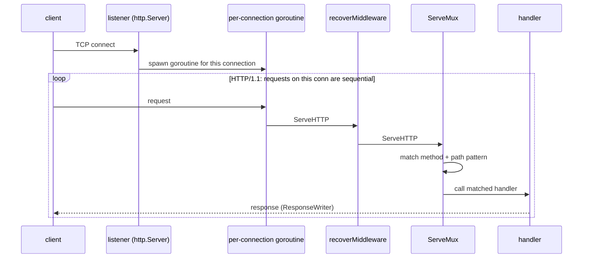
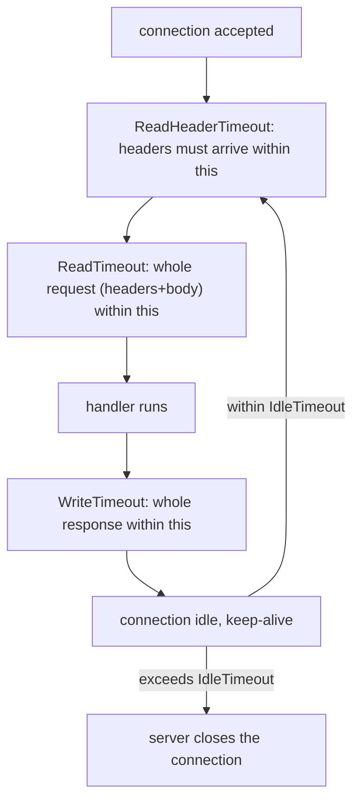

# HTTP Server Fundamentals (net-http)

> [!summary] TL;DR
> `net/http` serves an HTTP request by matching it against registered patterns on a `ServeMux`, then calling a function that writes a response through a `ResponseWriter`. Since Go 1.22 that matching understands the method and path wildcards directly, so the manual `if r.Method != "POST"` checks and regex routers that used to be necessary are not. An `http.Server` left with its zero-value timeouts will hang on a slow or hostile client forever; naming and setting those timeouts is not optional in production.

> [!abstract] Core idea
> - `http.Handler` is one method, `ServeHTTP(ResponseWriter, *Request)`; `http.HandlerFunc` adapts any matching plain function into one. Routers, middleware and handlers are all just values of this one interface.
> - Go 1.22's `ServeMux` patterns encode the method and path wildcards in the registration string itself: `"POST /invoices"`, `"GET /invoices/{id}"`, `"GET /files/{path...}"`, `"GET /{$}"`. A wrong method on a registered path gets an automatic 405 with an `Allow` header — no code required.
> - `http.Server`'s zero-value timeouts are "wait forever". `ReadHeaderTimeout`, `ReadTimeout`, `WriteTimeout` and `IdleTimeout` all need explicit values; skipping `ReadHeaderTimeout` specifically leaves the server open to a Slowloris attack.
> - `ResponseWriter` has ordering rules a compiler can't check: set headers before `WriteHeader`, call `WriteHeader` at most once, and an unwritten status defaults to 200 the instant anything is written.
> - One goroutine serves one HTTP/1.1 connection's requests sequentially; HTTP/2 hands each stream its own goroutine, so true request-level concurrency on one TCP connection is an HTTP/2 property, not an HTTP/1.1 one.

### Whiteboard version

The whole shape in six lines: register a pattern with a method, start a server with timeouts set, write a response.

```go
mux := http.NewServeMux()
mux.HandleFunc("GET /invoices/{id}", func(w http.ResponseWriter, r *http.Request) {
    id := r.PathValue("id")
    fmt.Fprintf(w, "invoice %s", id)
})

srv := &http.Server{Addr: ":8080", Handler: mux, ReadHeaderTimeout: 5 * time.Second}
srv.ListenAndServe()
```

Everything below fills in why each piece of that shape exists and what breaks when a piece is missing.

## 1. Why it exists

A Go process that wants to answer HTTP requests needs three things: something that decides which function handles a given method and path, something that calls that function with the right arguments, and something that enforces limits on misbehaving clients before a handler ever runs. `net/http` provides all three as small, composable pieces — `ServeMux` for routing, `http.Handler` for "a thing that can answer a request", and `http.Server` for the listener and its limits — rather than one framework object that owns everything.

Concretely: before Go 1.22, `net/http`'s router matched paths only (`"/invoices/"`), so every handler needed its own `if r.Method != http.MethodPost { http.Error(w, "method not allowed", 405) }` check, every path parameter needed manual string splitting or a third-party router, and it was easy to forget the check on one handler while remembering it on nine others. InvoiceOps' old HTTP note had exactly that bug: a hand-rolled method check that the ServeMux itself now does correctly, for free, as long as the registration says which method the pattern is for.

## 2. Mental model

A `ServeMux` is a filing clerk holding a stack of index cards, each one reading "if the request's method and path look like *this*, hand it to *that* function". The clerk checks cards in order of specificity — a card for `/invoices/{id}` beats a card for `/invoices/{path...}`, because the first is a more exact match — and if a path matches a card's path but not its method, the clerk doesn't say "no such card"; it says "that path exists, but not with that method", which is exactly what an HTTP 405 with an `Allow` header means.

An `http.Server` is the building the clerk works in. Its timeouts are the building's opening-hours policy: `ReadHeaderTimeout` is how long the door is held open for someone to finish stating their request before being turned away; `WriteTimeout` is how long the clerk will spend handing over an answer before giving up. Without a policy, one slow visitor can occupy the clerk's desk (and the goroutine behind it) forever.

## 3. How it works

### The `Handler` interface and the goroutine model

```go
type Handler interface {
    ServeHTTP(ResponseWriter, *Request)
}
```

Everything net/http serves is, underneath, a value satisfying this one method: a `ServeMux`, a middleware-wrapped handler, a plain handler function adapted with `http.HandlerFunc`. `http.HandlerFunc` is a defined function type that implements `Handler` by calling itself — the adapter that lets an ordinary `func(w, r)` be registered anywhere a `Handler` is expected.



`net/http` spawns one goroutine per accepted TCP connection. Over HTTP/1.1 without pipelining, requests on that one connection are handled one at a time, in order — a slow handler on request 1 delays request 2 on the *same* connection, but a browser or client opening several connections gets real concurrency across them. HTTP/2 changes this at the protocol level: multiple streams share one TCP connection, and `net/http`'s HTTP/2 support (automatic over TLS) gives each stream its own goroutine, so one slow request no longer head-of-line-blocks the others on that connection (full HTTP/2 and TLS setup is [[TLS, HTTPS and HTTP2 in Go Servers]]'s job).

### Go 1.22 ServeMux patterns

A pattern is `[METHOD ][HOST]/[PATH]`. Each part is optional except the path:

| Pattern | Matches |
| --- | --- |
| `"GET /invoices/{id}"` | GET only, path segment captured as `r.PathValue("id")` |
| `"POST /invoices"` | POST only, exact path |
| `"GET /invoices/{id}/exports/{path...}"` | GET, `{path...}` captures every remaining segment as one string |
| `"GET /{$}"` | GET, path must be exactly `/` — without `{$}`, a bare `"/"` pattern matches *every* unmatched path, since an unqualified trailing slash means "prefix match" |
| `"api.example.com/v1/invoices"` | a host-qualified pattern, for serving multiple hostnames off one mux |

Precedence is "the most specific pattern wins", not registration order: `/invoices/{id}` is preferred over `/invoices/{path...}` for a request that only the first can match exactly, because a literal segment is more specific than a wildcard, and a wildcard with no trailing `...` is more specific than one with it. Two patterns that could both match the same request with neither more specific than the other is a conflict the mux detects, and it panics at registration time (process startup), not silently at request time — a registration bug surfaces as a crash on boot, which is the earliest and cheapest place for it to surface.

A plain GET registration also matches `HEAD` automatically: net/http runs the same handler and then discards the body, so a handler doesn't special-case `HEAD` unless it specifically needs to skip work that only matters for the body (an expensive render, for instance).

### Automatic 405 with Allow, and why the old manual check was wrong

Register `"GET /invoices"` and `"POST /invoices"` on the same mux. A `DELETE /invoices` now gets a `405 Method Not Allowed` with an `Allow: GET, POST` header, generated by the mux itself — no handler code runs, and no handler needs to write:

```go
// Outdated since Go 1.22. The mux already does this correctly, and doing
// it again here means two different 405 code paths can disagree.
if r.Method != http.MethodPost {
    http.Error(w, "method not allowed", http.StatusMethodNotAllowed)
    return
}
```

This was the exact bug the audit found in the old note for this topic: a manual `r.Method` check, with no `Allow` header, contradicting a sibling note that already used the method-qualified pattern correctly. Registering the method in the pattern is both less code and more correct.

### `ResponseWriter` rules

Three rules, none enforced by the compiler:

1. **Set headers before calling `WriteHeader` or `Write`.** `w.Header().Set(...)` after either one is a no-op — the header map is only read once, at the moment the status line is actually sent.
2. **`WriteHeader` is called at most once.** A second call logs `http.Error: superfluous response.WriteHeader call` to stderr and is otherwise ignored; it is not an error the handler itself receives.
3. **An unwritten response defaults to `200 OK`.** The first `Write` call sends `200` automatically if `WriteHeader` was never called. This is convenient for the common case and a trap for the handler that writes a partial body, hits an error, and then tries to write a different status — the `200` (or whatever was written first) has already gone out.

`http.DetectContentType` is what fills in `Content-Type` when a handler never sets it — it sniffs up to the first 512 bytes of the body. That sniffing is a convenience, not something to depend on for anything security-sensitive: it has misclassified ambiguous payloads before, which is exactly why file-upload handling sniffs content type itself rather than trusting a client-sent header (link [[File Upload Architecture]]).

### Per-request body and time limits

`http.MaxBytesReader(w, r.Body, n)` wraps the request body so reading past `n` bytes returns an `*http.MaxBytesError` instead of continuing to buffer: without it, `json.NewDecoder(r.Body).Decode(&v)` will read as much as the client sends, and a multi-gigabyte body sent to a small JSON endpoint is a cheap way to exhaust memory one connection at a time.

`http.ResponseController` (Go 1.20) gives a single handler its own deadline, tighter or looser than the server-wide `ReadTimeout`/`WriteTimeout`: `rc := http.NewResponseController(w); rc.SetWriteDeadline(time.Now().Add(2*time.Second))` for an endpoint that must respond faster than the rest of the API. `http.TimeoutHandler(h, d, "timed out")` wraps a whole handler so a response that doesn't finish within `d` gets a `503` instead of running unbounded — useful as a blanket backstop around a handler whose own deadline handling can't be trusted yet.

### `http.Server` fields, with values and the failure each one prevents



| Field | Recommended value | What it's missing leaves open |
| --- | --- | --- |
| `ReadHeaderTimeout` | 5s | A client that sends one header byte every few seconds holds a connection, and the goroutine behind it, open indefinitely — Slowloris. The zero value is "no limit". |
| `ReadTimeout` | 10s | A slow body upload (headers done, body trickling) blocks that connection past its header deadline. |
| `WriteTimeout` | 15s | A slow or stalled client reader keeps the handler's response write blocked, and the handler's goroutine with it. |
| `IdleTimeout` | 60s | Keep-alive connections nobody closes accumulate without bound under enough distinct slow clients. |
| `MaxHeaderBytes` | `http.DefaultMaxHeaderBytes` (1 MiB) already applies at the zero value | Set explicitly only to document the limit; the stdlib default is already sane. |

`ReadHeaderTimeout` matters even when `ReadTimeout` is also set, because `ReadTimeout` only starts counting once reading begins in earnest — setting only `ReadTimeout` and leaving `ReadHeaderTimeout` at zero still leaves the header-read phase itself unbounded on some code paths, which is why the stdlib exposes it as its own field rather than folding it into `ReadTimeout`.

### `ListenAndServe` always returns an error

`srv.ListenAndServe()` (and `ListenAndServeTLS`) blocks until the server stops, then returns a non-nil error — there is no "clean" return value, only a reason it stopped. A listener that failed to bind the port returns that `bind` error. A server asked to stop gracefully via `Server.Shutdown` returns `http.ErrServerClosed`, which is not a failure and must be checked for and ignored rather than logged as one:

```go
if err := srv.ListenAndServe(); err != nil && !errors.Is(err, http.ErrServerClosed) {
    logger.Error("server stopped unexpectedly", "err", err)
}
```

Treating every non-nil return as a crash means a normal, intentional shutdown logs a scary error on every deploy. The full `Shutdown`/drain sequence, and why `main` must wait on `Shutdown` returning rather than on `ListenAndServe` returning, is [[Graceful Shutdown and Health Checks]]'s job.

### `DefaultServeMux` is a trap, not a convenience

`http.HandleFunc` (the package-level function, not a method on a mux you created) registers onto `http.DefaultServeMux`, a single mux shared by the whole process. Importing `net/http/pprof` anywhere in a binary's dependency graph registers `/debug/pprof/*` on that same default mux as an `init()` side effect — including transitively, through a dependency that imports it for its own reasons. A service that calls `http.ListenAndServe(addr, nil)` (passing `nil` for the handler means "use `DefaultServeMux`") can end up serving profiling and expvar endpoints on its public port with nobody having written a single line of code that looks like it did that. Always construct a mux with `http.NewServeMux()` and pass it explicitly.

### Thin handlers

A handler's job is five steps, each of which belongs to its own layer, not inline in the handler: decode the request → validate it → call a service method → map a domain error to an HTTP status → encode the response. The decode/validate/encode steps are [[Request Decoding, Validation and DTOs]]'s job in depth; the status-mapping step is [[Building REST Endpoints]]'s job. This note's handlers inline a simplified version of all five only because they exist to demonstrate routing and the server, not request handling in full.

### Routers beyond the stdlib

`chi` stays wire-compatible with `net/http` (its handlers are ordinary `http.Handler`s, its router just adds grouped middleware and more route-introspection than the stdlib mux offers) and is a reasonable choice once a service wants subrouters or named route groups the stdlib mux doesn't have. `gin` and `echo` bring their own non-`http.Handler` context type, trading stdlib compatibility for convenience methods. `fiber` is a different thing entirely: it's built on `fasthttp`, not `net/http`, so it is not compatible with any of the stdlib's `http.Handler`-based middleware, and migrating away from it later means rewriting the HTTP layer, not just swapping a router.

## 4. Worked example

A trimmed InvoiceOps HTTP server showing method+wildcard routing, every `http.Server` timeout, `MaxBytesReader`, and the `ResponseWriter` ordering rules enforced in one place. It compiles and passes `go vet` and `go test -race` on Go 1.24.4.

```go
// Package httpserver is a trimmed InvoiceOps-style HTTP server used to
// demonstrate Go 1.22 ServeMux routing, http.Server timeout configuration
// and the ResponseWriter rules that trip people up.
package httpserver

import (
	"encoding/json"
	"errors"
	"log/slog"
	"net/http"
	"time"
)

// Invoice is the minimal resource this demo server serves.
type Invoice struct {
	ID    string `json:"id"`
	Total int64  `json:"total_cents"`
}

// Store is the dependency the handlers need; a fake in tests, a real
// repository in production.
type Store interface {
	Get(id string) (Invoice, error)
	List() []Invoice
}

var ErrNotFound = errors.New("invoice not found")

// New builds the mux and wraps it in an http.Server with production
// timeout values. It never calls http.Handle on the package-level
// http.DefaultServeMux: that mux is shared process-wide, and importing
// net/http/pprof or expvar anywhere in the binary registers handlers on it
// as a side effect, silently exposing profiling or variable-dump endpoints
// on whatever port DefaultServeMux happens to be served from.
func New(addr string, store Store, logger *slog.Logger) *http.Server {
	if logger == nil {
		logger = slog.Default()
	}
	mux := http.NewServeMux()

	// Go 1.22 patterns: "METHOD /path/{wildcard}". A bare GET also matches
	// HEAD automatically; there is no separate HEAD registration to write.
	mux.HandleFunc("GET /invoices/{id}", getInvoice(store, logger))
	mux.HandleFunc("GET /invoices", listInvoices(store))
	mux.HandleFunc("POST /invoices", createInvoice(logger))

	// {path...} is a trailing wildcard that matches the rest of the path,
	// used here to serve pre-rendered PDF exports by arbitrary sub-path.
	mux.HandleFunc("GET /invoices/{id}/exports/{path...}", exportFile())

	// {$} anchors a pattern to match the path exactly, with nothing after
	// it — "/" alone would also match every unmatched path as a prefix.
	mux.HandleFunc("GET /{$}", rootHandler())

	mux.HandleFunc("GET /healthz/live", liveness)

	// Global middleware wraps the whole mux, not the other way around:
	// every request passes through it before the router even looks at
	// the method or path.
	handler := recoverMiddleware(logger)(mux)

	return &http.Server{
		Addr:    addr,
		Handler: handler,

		// Slowloris protection: caps the time allowed to read request
		// headers alone, before the handler or even routing runs. Without
		// it a client that trickles one header byte every few seconds can
		// hold a connection (and a goroutine) open indefinitely.
		ReadHeaderTimeout: 5 * time.Second,

		// Caps reading the full request, headers plus body.
		ReadTimeout: 10 * time.Second,

		// Caps writing the response, from the first byte of the response
		// header to the last byte of the body.
		WriteTimeout: 15 * time.Second,

		// Caps how long a keep-alive connection may sit idle between
		// requests before the server closes it.
		IdleTimeout: 60 * time.Second,

		// MaxHeaderBytes limits the total size of request headers; the
		// zero value falls back to net/http's own 1 MiB default
		// (http.DefaultMaxHeaderBytes), which is already a sane limit, so
		// this is set explicitly here only to document that fact.
		MaxHeaderBytes: http.DefaultMaxHeaderBytes,
	}
}

// maxInvoiceBody bounds a single request body; anything larger aborts the
// read with an error instead of letting an attacker stream gigabytes into
// json.Decoder and exhaust memory one connection at a time.
const maxInvoiceBody = 1 << 20 // 1 MiB

func getInvoice(store Store, logger *slog.Logger) http.HandlerFunc {
	return func(w http.ResponseWriter, r *http.Request) {
		id := r.PathValue("id") // Go 1.22: wildcard value, set by the router
		inv, err := store.Get(id)
		if err != nil {
			if errors.Is(err, ErrNotFound) {
				writeJSON(w, http.StatusNotFound, map[string]string{"error": "not found"})
				return
			}
			logger.Error("get invoice failed", "id", id, "err", err)
			writeJSON(w, http.StatusInternalServerError, map[string]string{"error": "internal error"})
			return
		}
		writeJSON(w, http.StatusOK, inv)
	}
}

func listInvoices(store Store) http.HandlerFunc {
	return func(w http.ResponseWriter, r *http.Request) {
		writeJSON(w, http.StatusOK, store.List())
	}
}

func createInvoice(logger *slog.Logger) http.HandlerFunc {
	return func(w http.ResponseWriter, r *http.Request) {
		// MaxBytesReader aborts the read (and the connection) once the
		// limit is exceeded, rather than letting an unbounded Decode call
		// buffer an attacker-sized body into memory.
		r.Body = http.MaxBytesReader(w, r.Body, maxInvoiceBody)

		var in Invoice
		if err := json.NewDecoder(r.Body).Decode(&in); err != nil {
			var maxErr *http.MaxBytesError
			if errors.As(err, &maxErr) {
				writeJSON(w, http.StatusRequestEntityTooLarge, map[string]string{"error": "body too large"})
				return
			}
			writeJSON(w, http.StatusBadRequest, map[string]string{"error": "invalid json"})
			return
		}
		writeJSON(w, http.StatusCreated, in)
	}
}

func exportFile() http.HandlerFunc {
	return func(w http.ResponseWriter, r *http.Request) {
		// r.PathValue("path") holds everything the {path...} wildcard
		// captured, e.g. "2026/invoice.pdf" for /invoices/1/exports/2026/invoice.pdf.
		writeJSON(w, http.StatusOK, map[string]string{"path": r.PathValue("path")})
	}
}

func rootHandler() http.HandlerFunc {
	return func(w http.ResponseWriter, r *http.Request) {
		writeJSON(w, http.StatusOK, map[string]string{"service": "invoiceops"})
	}
}

func liveness(w http.ResponseWriter, r *http.Request) {
	// No explicit WriteHeader call: an unwritten ResponseWriter defaults
	// to 200 on the first Write, which is exactly what a liveness probe
	// wants here. Relying on that default elsewhere, on a handler that
	// might also want to send an error status, is the gotcha — see "How
	// it works".
	w.Write([]byte("ok"))
}

// writeJSON is the one place in this package that writes a response, so the
// ordering rule (headers, then WriteHeader, then Write) and the "exactly
// once" rule are enforced in a single function instead of by convention
// across every handler.
func writeJSON(w http.ResponseWriter, status int, body any) {
	w.Header().Set("Content-Type", "application/json") // must come before WriteHeader
	w.WriteHeader(status)                               // sends the header; headers set after this are ignored
	_ = json.NewEncoder(w).Encode(body)                 // writes the body
}

// recoverMiddleware wraps the whole mux so a handler panic becomes a 500
// instead of crashing the request's goroutine silently. net/http's own
// server already recovers panics per-connection and logs them, but without
// this middleware the client only sees a dropped connection, not a clean
// JSON error, and nothing is logged with request context attached.
func recoverMiddleware(logger *slog.Logger) func(http.Handler) http.Handler {
	return func(next http.Handler) http.Handler {
		return http.HandlerFunc(func(w http.ResponseWriter, r *http.Request) {
			defer func() {
				if rec := recover(); rec != nil {
					logger.Error("panic recovered", "panic", rec, "path", r.URL.Path)
					// Only safe if nothing was written yet: WriteHeader
					// may only be called once, and calling it after a
					// prior Write has already sent 200 produces a
					// "superfluous response.WriteHeader call" warning and
					// a response body that is now invalid JSON.
					w.Header().Set("Content-Type", "application/json")
					w.WriteHeader(http.StatusInternalServerError)
					_ = json.NewEncoder(w).Encode(map[string]string{"error": "internal error"})
				}
			}()
			next.ServeHTTP(w, r)
		})
	}
}
```

Ten tests, each proving one specific behavior this note claims rather than just exercising the code (`go test -race`, all pass):

```go
package httpserver

import (
	"bytes"
	"encoding/json"
	"io"
	"log/slog"
	"net/http"
	"net/http/httptest"
	"strings"
	"testing"
)

type fakeStore struct {
	invoices map[string]Invoice
}

func (f fakeStore) Get(id string) (Invoice, error) {
	inv, ok := f.invoices[id]
	if !ok {
		return Invoice{}, ErrNotFound
	}
	return inv, nil
}

func (f fakeStore) List() []Invoice {
	out := make([]Invoice, 0, len(f.invoices))
	for _, inv := range f.invoices {
		out = append(out, inv)
	}
	return out
}

func testLogger() *slog.Logger {
	return slog.New(slog.NewTextHandler(io.Discard, nil))
}

func newTestServer() *httptest.Server {
	store := fakeStore{invoices: map[string]Invoice{"inv_1": {ID: "inv_1", Total: 1500}}}
	srv := New("127.0.0.1:0", store, testLogger())
	return httptest.NewServer(srv.Handler)
}

// TestMethodAndWildcardRouting proves the Go 1.22 ServeMux patterns route
// correctly: method-specific registration plus a {id} wildcard captured
// through r.PathValue.
func TestMethodAndWildcardRouting(t *testing.T) {
	ts := newTestServer()
	defer ts.Close()

	resp, err := http.Get(ts.URL + "/invoices/inv_1")
	if err != nil {
		t.Fatalf("GET failed: %v", err)
	}
	defer resp.Body.Close()
	if resp.StatusCode != http.StatusOK {
		t.Fatalf("status = %d, want 200", resp.StatusCode)
	}
	var inv Invoice
	if err := json.NewDecoder(resp.Body).Decode(&inv); err != nil {
		t.Fatalf("decode: %v", err)
	}
	if inv.ID != "inv_1" || inv.Total != 1500 {
		t.Errorf("got %+v, want {inv_1 1500}", inv)
	}
}

// TestAutomatic405WithAllowHeader proves the audit's central claim: since
// Go 1.22, registering "POST /invoices" makes ServeMux itself return 405
// with an Allow header for a GET-only route hit with the wrong method —
// no manual r.Method check is needed or should be written.
func TestAutomatic405WithAllowHeader(t *testing.T) {
	ts := newTestServer()
	defer ts.Close()

	req, _ := http.NewRequest(http.MethodDelete, ts.URL+"/invoices", nil)
	resp, err := http.DefaultClient.Do(req)
	if err != nil {
		t.Fatalf("DELETE failed: %v", err)
	}
	defer resp.Body.Close()

	if resp.StatusCode != http.StatusMethodNotAllowed {
		t.Fatalf("status = %d, want 405", resp.StatusCode)
	}
	allow := resp.Header.Get("Allow")
	if !strings.Contains(allow, "GET") || !strings.Contains(allow, "POST") {
		t.Errorf("Allow header = %q, want it to list GET and POST", allow)
	}
}

// TestGetAlsoMatchesHead proves a registered GET pattern automatically
// serves HEAD too (net/http strips the body but runs the same handler),
// with no separate registration required.
func TestGetAlsoMatchesHead(t *testing.T) {
	ts := newTestServer()
	defer ts.Close()

	req, _ := http.NewRequest(http.MethodHead, ts.URL+"/invoices/inv_1", nil)
	resp, err := http.DefaultClient.Do(req)
	if err != nil {
		t.Fatalf("HEAD failed: %v", err)
	}
	defer resp.Body.Close()
	if resp.StatusCode != http.StatusOK {
		t.Fatalf("status = %d, want 200", resp.StatusCode)
	}
	body, _ := io.ReadAll(resp.Body)
	if len(body) != 0 {
		t.Errorf("HEAD response had a body: %q", body)
	}
}

// TestTrailingWildcardCapturesRestOfPath proves {path...} captures every
// remaining path segment into one PathValue, used here for nested export
// paths.
func TestTrailingWildcardCapturesRestOfPath(t *testing.T) {
	ts := newTestServer()
	defer ts.Close()

	resp, err := http.Get(ts.URL + "/invoices/inv_1/exports/2026/invoice.pdf")
	if err != nil {
		t.Fatalf("GET failed: %v", err)
	}
	defer resp.Body.Close()
	var out map[string]string
	if err := json.NewDecoder(resp.Body).Decode(&out); err != nil {
		t.Fatalf("decode: %v", err)
	}
	if out["path"] != "2026/invoice.pdf" {
		t.Errorf("path = %q, want 2026/invoice.pdf", out["path"])
	}
}

// TestExactRootPatternDoesNotShadowOtherRoutes proves "/{$}" only matches
// the literal root path and does not swallow every unmatched path the way
// a bare "/" pattern would.
func TestExactRootPatternDoesNotShadowOtherRoutes(t *testing.T) {
	ts := newTestServer()
	defer ts.Close()

	resp, err := http.Get(ts.URL + "/invoices/does-not-exist")
	if err != nil {
		t.Fatalf("GET failed: %v", err)
	}
	defer resp.Body.Close()
	if resp.StatusCode != http.StatusNotFound {
		t.Fatalf("status = %d, want 404 (the invoice lookup's own not-found, not the root handler)", resp.StatusCode)
	}
}

// TestMaxBytesReaderRejectsOversizedBody proves createInvoice's body limit
// actually aborts a request larger than maxInvoiceBody instead of buffering
// it unbounded into json.Decoder.
func TestMaxBytesReaderRejectsOversizedBody(t *testing.T) {
	ts := newTestServer()
	defer ts.Close()

	oversized := bytes.Repeat([]byte("a"), maxInvoiceBody+1)
	body := `{"id":"` + string(oversized) + `"}`

	resp, err := http.Post(ts.URL+"/invoices", "application/json", strings.NewReader(body))
	if err != nil {
		t.Fatalf("POST failed: %v", err)
	}
	defer resp.Body.Close()
	if resp.StatusCode != http.StatusRequestEntityTooLarge {
		t.Fatalf("status = %d, want 413", resp.StatusCode)
	}
}

// TestWriteJSONSetsContentTypeBeforeStatus proves the ResponseWriter
// ordering rule writeJSON depends on: a header set after WriteHeader is
// silently ignored, so Content-Type must be set first.
func TestWriteJSONSetsContentTypeBeforeStatus(t *testing.T) {
	rec := httptest.NewRecorder()
	writeJSON(rec, http.StatusCreated, map[string]string{"ok": "true"})

	if rec.Code != http.StatusCreated {
		t.Errorf("status = %d, want 201", rec.Code)
	}
	if ct := rec.Header().Get("Content-Type"); ct != "application/json" {
		t.Errorf("Content-Type = %q, want application/json", ct)
	}
}

// TestImplicitStatusDefaultsTo200 proves the ResponseWriter gotcha: a
// handler that only calls Write, never WriteHeader, sends an implicit 200 —
// exactly what liveness depends on, and exactly the behavior that silently
// masks a forgotten error status elsewhere.
func TestImplicitStatusDefaultsTo200(t *testing.T) {
	rec := httptest.NewRecorder()
	liveness(rec, httptest.NewRequest(http.MethodGet, "/healthz/live", nil))

	if rec.Code != http.StatusOK {
		t.Errorf("implicit status = %d, want 200", rec.Code)
	}
	if rec.Body.String() != "ok" {
		t.Errorf("body = %q, want ok", rec.Body.String())
	}
}

// TestRecoverMiddlewareTurnsPanicInto500 proves the recover middleware
// converts a handler panic into a clean JSON 500 instead of the bare
// dropped-connection behavior net/http's own per-connection recovery gives
// a client with no middleware in place.
func TestRecoverMiddlewareTurnsPanicInto500(t *testing.T) {
	panicky := http.HandlerFunc(func(w http.ResponseWriter, r *http.Request) {
		panic("boom")
	})
	wrapped := recoverMiddleware(testLogger())(panicky)

	rec := httptest.NewRecorder()
	wrapped.ServeHTTP(rec, httptest.NewRequest(http.MethodGet, "/", nil))

	if rec.Code != http.StatusInternalServerError {
		t.Fatalf("status = %d, want 500", rec.Code)
	}
	var out map[string]string
	if err := json.NewDecoder(rec.Body).Decode(&out); err != nil {
		t.Fatalf("recovered response was not valid JSON: %v (body: %q)", err, rec.Body.String())
	}
	if out["error"] != "internal error" {
		t.Errorf("error = %q, want internal error", out["error"])
	}
}

// TestServerHasProductionTimeouts proves New sets every timeout field the
// audit called out as missing from the old note, rather than leaving the
// zero-value (no timeout at all).
func TestServerHasProductionTimeouts(t *testing.T) {
	srv := New("127.0.0.1:0", fakeStore{}, testLogger())

	if srv.ReadHeaderTimeout <= 0 {
		t.Error("ReadHeaderTimeout must be set: an unbounded value is Slowloris-vulnerable")
	}
	if srv.ReadTimeout <= 0 {
		t.Error("ReadTimeout must be set")
	}
	if srv.WriteTimeout <= 0 {
		t.Error("WriteTimeout must be set")
	}
	if srv.IdleTimeout <= 0 {
		t.Error("IdleTimeout must be set")
	}
}
```

**Measured:** all ten tests pass under `go test -race` on Go 1.24.4, darwin/arm64, 2026-11-07.

## 5. Variants and comparison

| Router | How it works | Use when | Cost |
| --- | --- | --- | --- |
| stdlib `http.ServeMux` (Go 1.22+) | Method + wildcard patterns built into the standard library | Default choice for a new service; zero dependencies, wire-compatible with every stdlib middleware | No built-in route groups or per-group middleware chaining |
| `chi` | Thin layer over `net/http`; handlers are ordinary `http.Handler`s | Want route groups, mounting sub-routers, or richer middleware chaining than the stdlib mux offers | One more dependency; otherwise near-zero cost, since it's stdlib-compatible |
| `gin` / `echo` | Own `Context` type wrapping request/response, convenience helpers (binding, rendering) | Team familiarity, or the convenience methods outweigh the stdlib-compatibility loss | Handlers are no longer plain `http.Handler`; stdlib middleware needs an adapter |
| `fiber` | Built on `fasthttp`, not `net/http` | Raw throughput is the dominant constraint and the ecosystem mismatch is acceptable | Incompatible with `net/http`'s `Handler`, `ResponseWriter` and most of its middleware ecosystem |

| `http.Server` field | What it bounds | Zero value means |
| --- | --- | --- |
| `ReadHeaderTimeout` | Time to read request headers | No limit (Slowloris-vulnerable) |
| `ReadTimeout` | Time to read the whole request | No limit |
| `WriteTimeout` | Time to write the whole response | No limit |
| `IdleTimeout` | Time a keep-alive connection may sit idle | Falls back to `ReadTimeout` if that's set, else no limit |

## 6. Trade-offs and when not to use

- The stdlib mux's pattern matching covers method, host and path wildcards, but has no built-in route groups, so a service with many nested route prefixes and shared per-group middleware will hand-roll that structure or reach for `chi`.
- A global `recoverMiddleware` adds a small amount of overhead (one `defer` per request) in exchange for turning every unhandled panic into a logged 500 instead of a silently dropped connection — worth it on every production handler, and arguably unnecessary on an internal tool where a crash is acceptable and visible immediately.
- `MaxBytesReader` on every body-reading endpoint means picking a limit per endpoint; too tight breaks a legitimate large payload (a bulk import), too loose doesn't actually protect anything. There's no single correct number — it has to match the endpoint's real traffic.
- Setting `ResponseController` deadlines per-handler only pays off for the one or two endpoints that genuinely need a different timeout than the server-wide default; doing it everywhere just duplicates the server's own `WriteTimeout` with extra code.

## 7. In production

- **Real systems:** nearly every Go HTTP service at scale (Google's own internal Go services, Cloudflare, HashiCorp's Go tooling) builds on `net/http` directly or on a thin wrapper like `chi`, specifically because stdlib compatibility means every middleware, every `httptest` helper and every profiling tool works without an adapter layer.
- **Failure modes → fixes:**
  - A deploy starts exposing `/debug/pprof/*` on the public port → some dependency imports `net/http/pprof` and the service calls `http.ListenAndServe(addr, nil)`, routing through `DefaultServeMux`; construct and pass an explicit `http.NewServeMux()` everywhere.
  - A handful of connections pile up and goroutine count climbs under a flood of slow clients → `ReadHeaderTimeout` (and usually `ReadTimeout`) was left at zero; set both.
  - A client gets `200 OK` with a truncated or corrupted JSON body after a late error → a handler wrote a success status, then hit an error and tried to write a different one; restructure the handler so all error checks happen before the first `Write`/`WriteHeader` call.
  - A route that should 404 for `DELETE` instead returns a generic error → the mux only knows about methods actually registered on that path; register the method explicitly (even just to return 405) rather than relying on routing to another handler.
- **What to monitor:** request duration histograms per route (catches a route silently exceeding its intended `WriteTimeout` budget); count of `413`s (body limit) and `405`s (method mismatches, often from stale clients) per route; goroutine count correlated with active connections, as an early signal of a timeout misconfiguration.

## 8. Deep dive

- **Pattern specificity, precisely.** The router prefers, in order: a pattern with a literal (non-wildcard) segment over one with a wildcard in the same position; among wildcard patterns, a single-segment `{id}` over a multi-segment `{path...}`; and a host-qualified pattern over a host-generic one. Two patterns that could both match some request and where neither is more specific than the other is flagged as a build-time conflict: `mux.Handle` panics the instant such a pair is registered, so the earliest possible point a routing ambiguity can be caught is process startup, not a request that happens to hit the ambiguous case in production.
- **Why `recoverMiddleware` still matters even though net/http recovers panics itself.** The stdlib's `(*conn).serve` already wraps each request's handler call in its own `recover`, logs the panic and stack to the server's `ErrorLog`, and closes the connection — the process does not crash. But the client sees nothing but a dropped connection (often surfacing as `EOF` or a reset), not an HTTP response at all, and the log entry has no request-scoped context (trace ID, path) unless the middleware adds it. The middleware exists to give the *client* a clean 500 and the *log* request context, not to prevent a process crash that stdlib already prevents.
- **`MaxBytesReader`'s effect on the connection, not just the read.** Once the limit is exceeded, `MaxBytesReader` doesn't just return an error from the next `Read` call — it also calls `w.(requestTooLarger).requestTooLarge()` internally (an unexported mechanism) to mark the response so the connection is closed after the handler returns, rather than kept alive for a client that may still be mid-stream of an oversized body. That's why an endpoint that uses `MaxBytesReader` and writes `413` can't simply keep serving more requests on the same connection as if nothing happened — net/http deliberately tears the connection down.
- **HTTP/2's effect on the "one goroutine, sequential requests" model.** HTTP/1.1 without pipelining (which virtually nothing enables) genuinely serializes requests per TCP connection, which is why browsers historically opened up to 6 parallel connections per host. HTTP/2 multiplexes many logical streams over one TCP connection and `net/http`'s HTTP/2 implementation (`golang.org/x/net/http2`, wired in automatically for TLS listeners) gives each stream independent handling, so a single slow request on one stream does not block others on the same connection — a structural difference, not just a performance tweak.

## 9. Interview questions

> [!question]- Why is `if r.Method != http.MethodPost { ... }` wrong to write in a Go 1.22+ handler?
> Because registering the pattern as `"POST /invoices"` already makes the `ServeMux` return `405 Method Not Allowed` with a correct `Allow` header for any other method on that path, before the handler ever runs. A manual check inside the handler duplicates that logic, usually without the `Allow` header, and can disagree with the mux's own decision if the two are ever out of sync.

> [!question]- What happens if you never call `WriteHeader` in a handler?
> The response implicitly sends `200 OK` the moment the first `Write` call happens. This is convenient for a handler whose only path is success, and a trap for a handler that writes part of a body, then discovers an error — the `200` has already gone out and can't be changed to a `4xx`/`5xx`.

> [!question]- What does leaving `http.Server{}`'s timeout fields at their zero value actually risk?
> Every one of `ReadHeaderTimeout`, `ReadTimeout` and `WriteTimeout` defaults to "no limit" at the zero value. A malicious or just very slow client can hold a connection, and the goroutine serving it, open indefinitely — `ReadHeaderTimeout` specifically is the field that stops a Slowloris-style attack, where headers trickle in one byte at a time.

> [!question]- Why does `net/http/pprof` being imported anywhere in a binary matter if your own code never touches it?
> Importing it runs an `init()` function that registers `/debug/pprof/*` handlers on the package-level `http.DefaultServeMux`. Any service that passes `nil` as the handler to `http.ListenAndServe` (meaning "use `DefaultServeMux`") now serves those endpoints on its own port, even though nothing in that service's own code called pprof — the import alone is enough.

> [!question]- `{path...}` vs `{id}`: what's the actual difference in what gets matched?
> `{id}` captures exactly one path segment. `{path...}` is a trailing wildcard that captures every remaining segment (including further slashes) as one string, and can only appear at the end of a pattern. `r.PathValue("path")` for `/exports/{path...}` matched against `/exports/2026/invoice.pdf` returns `"2026/invoice.pdf"`, not just `"2026"`.

> [!question]- Does one goroutine per connection mean one goroutine per request?
> Not necessarily. Over HTTP/1.1, one goroutine serves every request on that connection, sequentially — not one goroutine per request. Over HTTP/2, each stream (which is closer to "one logical request") does get independent handling by the server's HTTP/2 implementation, which is the structural reason HTTP/2 avoids head-of-line blocking at the request level that HTTP/1.1 doesn't.

> [!question]- Trap: if a handler panics, does the whole server crash?
> No — `net/http` recovers a panic per-connection on its own and logs it, so the process survives and other connections are unaffected. What the client sees without extra middleware is a dropped connection (often an `EOF`), not a clean error response; `recoverMiddleware` exists to turn that into an actual HTTP `500` with a body the client can parse, not to prevent a crash that was never going to happen anyway.

## 10. Cheat sheet

- `http.Handler` is one method, `ServeHTTP`; `http.HandlerFunc` adapts a plain function into one.
- Go 1.22 patterns: `"METHOD /path/{id}"`, `{path...}` for a trailing wildcard, `{$}` to anchor an exact path. Most-specific pattern wins; ambiguous pairs panic at registration.
- A wrong method on a registered path auto-returns 405 with `Allow`; never hand-roll that check.
- GET also serves HEAD automatically.
- Always construct `http.NewServeMux()` explicitly — never rely on `DefaultServeMux`, which `net/http/pprof`'s import alone can expose.
- Set `ReadHeaderTimeout`, `ReadTimeout`, `WriteTimeout`, `IdleTimeout` on every `http.Server`; the zero value is "no limit".
- `ResponseWriter`: set headers before `WriteHeader`; call `WriteHeader` once; an unwritten response implicitly sends 200 on the first `Write`.
- `http.MaxBytesReader` bounds request bodies; `http.ResponseController` and `http.TimeoutHandler` bound per-handler or whole-handler response time.
- One goroutine per HTTP/1.1 connection, requests sequential on it; HTTP/2 gives each stream its own handling.

## Links

- **Before this:** [[Backend Request Lifecycle and Layering]]
- **Next:** [[Building REST Endpoints]], [[Graceful Shutdown and Health Checks]]
- **Compare with:** [[TLS, HTTPS and HTTP2 in Go Servers]] (TLS termination and HTTP/2 negotiation for the server this note builds), [[REST and HTTP API Design]] (resource and status-code design, as opposed to this note's transport mechanics)
