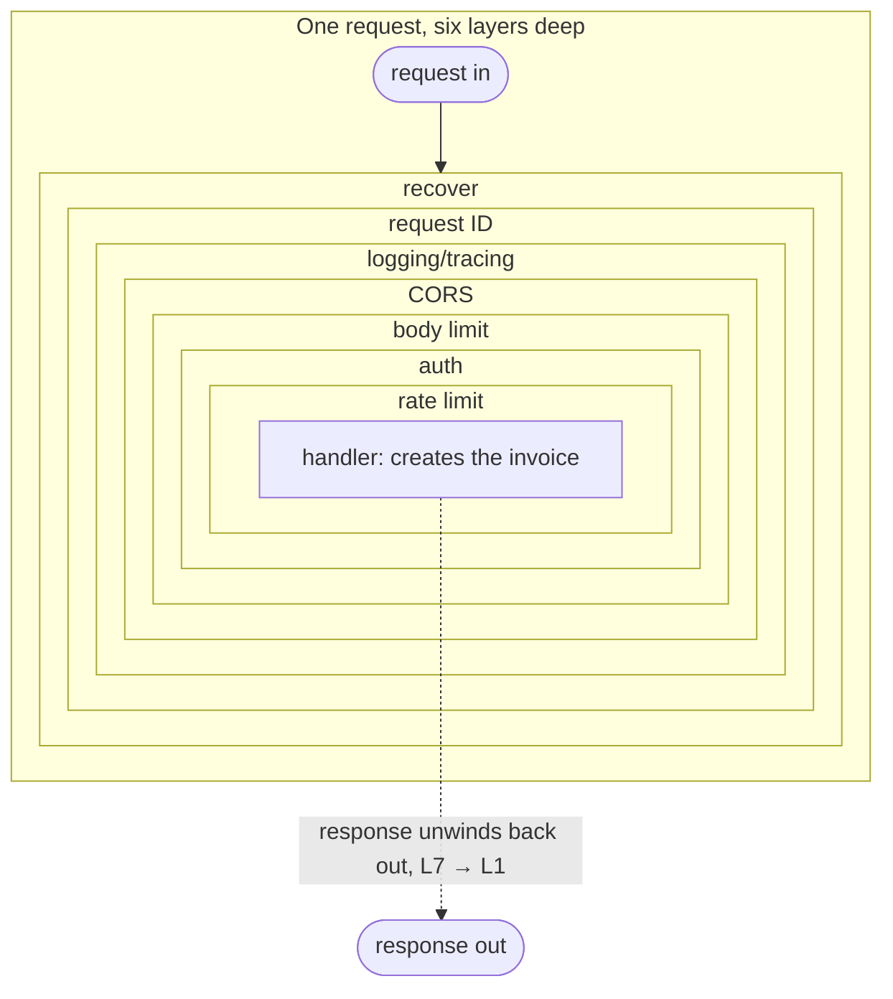
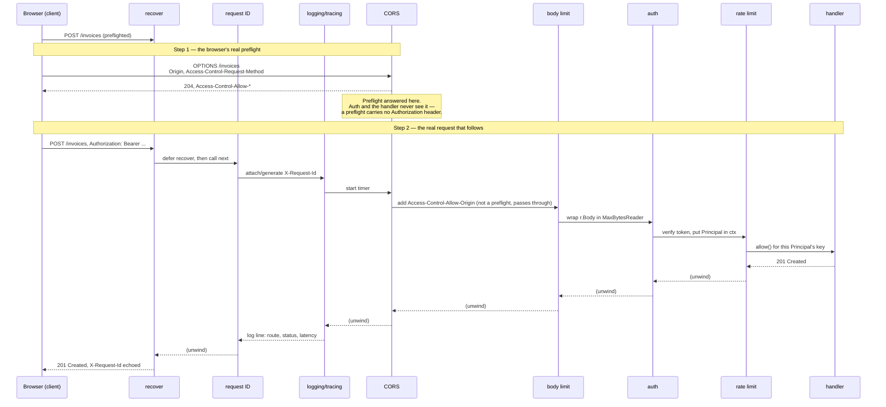

# Middleware

> [!summary] TL;DR
> Middleware is a function that wraps an `http.Handler` and returns a new `http.Handler`: it runs code before and/or after the handler it wraps, which is how a Go service applies the same cross-cutting behavior — recovery, request IDs, logging, CORS, auth, rate limiting — to every route without copying that code into every handler.

> [!abstract] Core idea
> - Middleware has one shape: `func(http.Handler) http.Handler`. A chain is just nesting these: `mw1(mw2(mw3(handler)))`.
> - Order matters and is not symmetric: the first middleware in the chain is the **outermost** — it sees the request first and the response last.
> - A canonical order exists for a reason: `recover → request ID → logging/tracing → CORS → body limit → auth → rate limit → routes`. Each step depends on something the step before it set up, or must run before a step it would otherwise break (CORS before auth, because a preflight carries no `Authorization` header).
> - The one genuinely hard part is capturing the response **status and whether anything was written yet** — `http.ResponseWriter` has no `Status()` method, so recovery and logging middleware have to wrap it themselves.

## 1. Why it exists

Every handler in InvoiceOps needs the same handful of things done around it: a panic must not take down the process, every request needs a correlation ID, every request needs an access-log line, `POST /invoices` needs the caller authenticated and rate-limited. Without middleware, that is five blocks of boilerplate pasted into the top of every handler function — and the moment one handler's copy drifts from the others (forgets the rate limit, logs before generating the request ID), the drift is a bug nobody notices until it matters.

[[Building REST Endpoints]] showed one handler done right. This note is about the thing that wraps **every** handler the same way: one small function type, a helper to chain several of them, and the specific middleware every production Go service ends up writing — recover, request ID, access logging, CORS, a body-size cap, auth, rate limiting, and timeouts.

## 2. Mental model

An onion. The request enters at the outside and has to pass through every layer to reach the handler at the core; the response leaves by passing back out through the same layers in reverse. Each layer can:

- do something before calling the next layer (generate a request ID, check a token),
- do something after the next layer returns (log the final status, recover a panic),
- or stop the chain entirely without calling the next layer at all (reject an unauthenticated request, answer a CORS preflight).

`http.Handler` is one method, `ServeHTTP(w, r)`. A middleware is nothing more than a function that builds a new `http.Handler` whose `ServeHTTP` calls the old one — the same shape as a decorator in any language (see [[Decorator and Middleware]] for the general pattern outside HTTP).

## 3. How it works



`Chain` builds exactly this nesting. The slice order is the layer order from the outside in:

```go
func Chain(h http.Handler, mw ...Middleware) http.Handler {
	for i := len(mw) - 1; i >= 0; i-- {
		h = mw[i](h)
	}
	return h
}

// Chain(handler, Recover(...), RequestID(), CORS(cfg)) builds
// Recover(RequestID()(CORS(cfg)(handler))) — Recover is outermost.
```

### Ordering, and why it is this order



Reading the order from outside in:

1. **recover** goes first (outermost) so it can catch a panic from *any* layer below it, not just the handler — including a bug in the auth or rate-limit middleware itself.
2. **request ID** goes next so every later log line, including panic logs, can carry it.
3. **logging/tracing** wraps everything from here down so its timer measures the real end-to-end latency, not just the handler's.
4. **CORS** runs before auth because a preflight `OPTIONS` request carries no `Authorization` header at all — if auth ran first, every preflight would fail authentication and the browser would never get to send the real request. CORS answers the preflight itself and stops the chain there.
5. **body limit** runs before auth and the handler so an oversized body is rejected before any work (including token verification against an attacker-controlled body) is spent on it.
6. **auth** attaches the `Principal` to the request context — see [[Authentication and Authorization in Go]] for the actual token verification; this note treats "a principal appears in context" as a given dependency.
7. **rate limit** runs after auth so it can key its bucket on the authenticated principal rather than only the client IP, which matters behind NAT or a shared corporate proxy.
8. **routes** (the stdlib `ServeMux` from [[HTTP Server Fundamentals (net-http)]]) runs last and picks the handler.

### Global vs per-route

Global middleware wraps the whole `ServeMux`, so it runs for every registered route, including `404`s the mux itself generates:

```go
handler := Chain(mux, Recover(logger, &panics), RequestID(), corsMW)
server := &http.Server{Handler: handler, /* ... */}
```

Per-route middleware wraps one handler before it is registered, so only that route gets it — the usual shape for "only `POST /invoices` is rate-limited, not `GET /healthz`":

```go
mux.Handle("POST /invoices", Chain(http.HandlerFunc(createInvoice), rl.Middleware()))
```

A sub-mux mounted with `http.StripPrefix` composes the same way: wrap the sub-mux once, mount it once, and every route under that prefix inherits the wrap —

```go
admin := http.NewServeMux()
admin.HandleFunc("GET /users", listUsers)
mux.Handle("/admin/", http.StripPrefix("/admin", Chain(admin, requireAdminRole)))
```

### The one hard part: capturing the response

`http.ResponseWriter` cannot tell a wrapping middleware what status code a handler sent, or even whether it has written anything yet — both are things recovery and logging middleware need to know, and neither is exposed by the interface. The fix is the same one pattern twice, at two different granularities:

- **[[Observability in Go Services]]** owns the full version: a `statusWriter` that records the exact status code and byte count for RED metrics and the access-log line, with an `Unwrap() http.ResponseWriter` method so `http.ResponseController` can still reach `Flush`/`Hijack` on the real writer through the wrapper (needed by a streaming handler further down the chain, e.g. SSE).
- **Recover** (below) only needs the narrower question "has *anything* been written yet", because that is the one fact that decides whether writing a clean `500` is still possible.

```go
type writeTracker struct {
	http.ResponseWriter
	wrote bool
}

func (w *writeTracker) WriteHeader(code int) { w.wrote = true; w.ResponseWriter.WriteHeader(code) }
func (w *writeTracker) Write(b []byte) (int, error) { w.wrote = true; return w.ResponseWriter.Write(b) }
func (w *writeTracker) Unwrap() http.ResponseWriter  { return w.ResponseWriter }
```

Both wrappers embed the real `ResponseWriter` and override only `WriteHeader`/`Write`, which is what makes `Unwrap` necessary in the first place: embedding hides the concrete type from anything doing a type assertion for `http.Flusher` or `http.Hijacker`, and `ResponseController` is the stdlib's sanctioned way to see through a chain of such wrappers.

## 4. Worked example

### Whiteboard version

The bare shape, no chain helper, no recovery, just "wrap a handler":

```go
func Logging(logger *log.Logger) func(http.Handler) http.Handler {
	return func(next http.Handler) http.Handler {
		return http.HandlerFunc(func(w http.ResponseWriter, r *http.Request) {
			start := time.Now()
			next.ServeHTTP(w, r)
			logger.Printf("%s %s %s", r.Method, r.URL.Path, time.Since(start))
		})
	}
}
```

The full version below adds the chain helper, correct panic recovery, request IDs, CORS with a working preflight, a body-size cap, per-principal rate limiting, and context deadlines — the InvoiceOps ordering example from the old notes, made to actually run.

Everything compiles and passes `go vet` and `go test -race` on Go 1.24.4.

```go
// Package middleware is the InvoiceOps middleware chain: the generic
// decorator shape plus the links every production handler sits behind.
package middleware

import (
	"context"
	"crypto/rand"
	"encoding/hex"
	"encoding/json"
	"log/slog"
	"net/http"
	"runtime/debug"
	"sync"
	"sync/atomic"
	"time"

	"golang.org/x/time/rate"
)

// Middleware is the one shape every entry in the chain has.
type Middleware func(http.Handler) http.Handler

// Chain applies mw to h so that mw[0] is the OUTERMOST wrapper.
func Chain(h http.Handler, mw ...Middleware) http.Handler {
	for i := len(mw) - 1; i >= 0; i-- {
		h = mw[i](h)
	}
	return h
}

// --- Recover ---

type writeTracker struct {
	http.ResponseWriter
	wrote bool
}

func (w *writeTracker) WriteHeader(code int) { w.wrote = true; w.ResponseWriter.WriteHeader(code) }
func (w *writeTracker) Write(b []byte) (int, error) {
	w.wrote = true
	return w.ResponseWriter.Write(b)
}
func (w *writeTracker) Unwrap() http.ResponseWriter { return w.ResponseWriter }

// Recover turns a handler panic into a logged, structured 500 instead of a
// dropped connection. panics counts recovered panics for a metric.
func Recover(logger *slog.Logger, panics *atomic.Int64) Middleware {
	return func(next http.Handler) http.Handler {
		return http.HandlerFunc(func(w http.ResponseWriter, r *http.Request) {
			tw := &writeTracker{ResponseWriter: w}
			defer func() {
				rec := recover()
				if rec == nil {
					return
				}
				if rec == http.ErrAbortHandler {
					// An intentional silent abort, not an error: re-panic
					// so net/http's own per-connection recovery closes the
					// connection without logging a stack trace.
					panic(rec)
				}
				panics.Add(1)
				logger.ErrorContext(r.Context(), "panic recovered",
					"panic", rec,
					"stack", string(debug.Stack()),
					"path", r.URL.Path,
					"request_id", RequestIDFromContext(r.Context()),
				)
				if tw.wrote {
					// A prior Write already sent a status and part of a
					// body. Calling WriteHeader again only produces a
					// "superfluous response.WriteHeader" log line and a
					// corrupted response; there is nothing clean left to
					// send, so stop.
					return
				}
				w.Header().Set("Content-Type", "application/json")
				w.WriteHeader(http.StatusInternalServerError)
				_ = json.NewEncoder(w).Encode(map[string]string{"error": "internal error"})
			}()
			next.ServeHTTP(tw, r)
		})
	}
}

// --- Request ID ---

type requestIDKey struct{}

const RequestIDHeader = "X-Request-Id"

// RequestID accepts an incoming X-Request-Id or generates one, stores it on
// the context under an unexported key type, and echoes it on the response.
func RequestID() Middleware {
	return func(next http.Handler) http.Handler {
		return http.HandlerFunc(func(w http.ResponseWriter, r *http.Request) {
			id := r.Header.Get(RequestIDHeader)
			if id == "" {
				id = newRequestID()
			}
			w.Header().Set(RequestIDHeader, id)
			ctx := context.WithValue(r.Context(), requestIDKey{}, id)
			next.ServeHTTP(w, r.WithContext(ctx))
		})
	}
}

func RequestIDFromContext(ctx context.Context) string {
	id, _ := ctx.Value(requestIDKey{}).(string)
	return id
}

func newRequestID() string {
	var b [16]byte
	_, _ = rand.Read(b[:])
	return hex.EncodeToString(b[:])
}

// --- CORS ---

type CORSConfig struct {
	AllowedOrigins []string
	Credentials    bool
}

func (c CORSConfig) allowed(origin string) bool {
	for _, o := range c.AllowedOrigins {
		if o == origin {
			return true
		}
	}
	return false
}

// CORS answers a browser preflight directly — it never reaches auth, rate
// limiting or the router — and adds Access-Control-Allow-* to the real
// request that follows. See the CORS and Same-Origin Policy note for why
// the browser sends a preflight at all.
func CORS(cfg CORSConfig) Middleware {
	return func(next http.Handler) http.Handler {
		return http.HandlerFunc(func(w http.ResponseWriter, r *http.Request) {
			origin := r.Header.Get("Origin")
			if origin != "" && cfg.allowed(origin) {
				w.Header().Set("Access-Control-Allow-Origin", origin)
				w.Header().Add("Vary", "Origin")
				if cfg.Credentials {
					w.Header().Set("Access-Control-Allow-Credentials", "true")
				}
			}
			if r.Method == http.MethodOptions && r.Header.Get("Access-Control-Request-Method") != "" {
				if origin != "" && cfg.allowed(origin) {
					w.Header().Set("Access-Control-Allow-Methods", "GET, POST, PATCH, DELETE")
					w.Header().Set("Access-Control-Allow-Headers", "Authorization, Content-Type, "+RequestIDHeader)
					w.Header().Set("Access-Control-Max-Age", "600")
				}
				w.WriteHeader(http.StatusNoContent)
				return
			}
			next.ServeHTTP(w, r)
		})
	}
}

// --- Body limit ---

func BodyLimit(maxBytes int64) Middleware {
	return func(next http.Handler) http.Handler {
		return http.HandlerFunc(func(w http.ResponseWriter, r *http.Request) {
			r.Body = http.MaxBytesReader(w, r.Body, maxBytes)
			next.ServeHTTP(w, r)
		})
	}
}

// --- Rate limiting ---

// Principal is a narrow local stand-in for the real one in Authentication
// and Authorization in Go, so this package has no import cycle on it.
type Principal struct{ Key string }

type principalKey struct{}

func PrincipalFromContext(ctx context.Context) (Principal, bool) {
	p, ok := ctx.Value(principalKey{}).(Principal)
	return p, ok
}

// WithPrincipal stands in for the real auth middleware in this note's
// examples and tests only.
func WithPrincipal(key string) Middleware {
	return func(next http.Handler) http.Handler {
		return http.HandlerFunc(func(w http.ResponseWriter, r *http.Request) {
			ctx := context.WithValue(r.Context(), principalKey{}, Principal{Key: key})
			next.ServeHTTP(w, r.WithContext(ctx))
		})
	}
}

type perKeyLimiter struct {
	limiter  *rate.Limiter
	lastSeen time.Time
}

// RateLimiter holds one token-bucket limiter per caller key. It only
// protects a single instance's memory: with several replicas behind a load
// balancer, each instance allows its own burst independently — see the
// Redis in Go note for the Lua-script token-bucket that makes the
// check-and-decrement atomic across instances.
type RateLimiter struct {
	mu       sync.Mutex
	limiters map[string]*perKeyLimiter
	r        rate.Limit
	burst    int
	idleTTL  time.Duration
}

func NewRateLimiter(r rate.Limit, burst int, idleTTL time.Duration) *RateLimiter {
	return &RateLimiter{limiters: make(map[string]*perKeyLimiter), r: r, burst: burst, idleTTL: idleTTL}
}

func (rl *RateLimiter) allow(key string, now time.Time) bool {
	rl.mu.Lock()
	defer rl.mu.Unlock()
	for k, l := range rl.limiters {
		if now.Sub(l.lastSeen) > rl.idleTTL {
			delete(rl.limiters, k)
		}
	}
	l, ok := rl.limiters[key]
	if !ok {
		l = &perKeyLimiter{limiter: rate.NewLimiter(rl.r, rl.burst)}
		rl.limiters[key] = l
	}
	l.lastSeen = now
	return l.limiter.Allow()
}

// Middleware rate-limits by the authenticated Principal's key when one is
// present, falling back to the remote address for unauthenticated routes.
func (rl *RateLimiter) Middleware() Middleware {
	return func(next http.Handler) http.Handler {
		return http.HandlerFunc(func(w http.ResponseWriter, r *http.Request) {
			key := r.RemoteAddr
			if p, ok := PrincipalFromContext(r.Context()); ok {
				key = p.Key
			}
			if !rl.allow(key, time.Now()) {
				w.Header().Set("Retry-After", "1")
				http.Error(w, "rate limit exceeded", http.StatusTooManyRequests)
				return
			}
			next.ServeHTTP(w, r)
		})
	}
}

// --- Timeout ---

// Timeout sets a context deadline and lets the chain run to completion.
// Unlike http.TimeoutHandler, it does not write a response itself when the
// deadline passes — it only makes ctx.Err() start returning
// context.DeadlineExceeded, which every downstream call that accepts a
// context (database/sql, pgx, an http.Client) already checks.
func Timeout(d time.Duration) Middleware {
	return func(next http.Handler) http.Handler {
		return http.HandlerFunc(func(w http.ResponseWriter, r *http.Request) {
			ctx, cancel := context.WithTimeout(r.Context(), d)
			defer cancel()
			next.ServeHTTP(w, r.WithContext(ctx))
		})
	}
}
```

Three of the tests, each isolating one middleware with `httptest` exactly as the audit asked — the rest (chain ordering, request ID, body limit, both rate-limiting cases, the timeout) follow the same one-middleware-at-a-time shape:

```go
func TestChain_OutermostRunsFirstOnTheWayInAndLastOnTheWayOut(t *testing.T) {
	var order []string
	mark := func(name string) Middleware {
		return func(next http.Handler) http.Handler {
			return http.HandlerFunc(func(w http.ResponseWriter, r *http.Request) {
				order = append(order, name+":in")
				next.ServeHTTP(w, r)
				order = append(order, name+":out")
			})
		}
	}
	h := http.HandlerFunc(func(w http.ResponseWriter, r *http.Request) {
		order = append(order, "handler")
	})

	chained := Chain(h, mark("recover"), mark("requestID"), mark("cors"))
	chained.ServeHTTP(httptest.NewRecorder(), httptest.NewRequest(http.MethodGet, "/", nil))

	want := []string{"recover:in", "requestID:in", "cors:in", "handler", "cors:out", "requestID:out", "recover:out"}
	// ... assert order == want (see the full test file)
}

func TestRecover_RePanicsErrAbortHandlerWithoutWritingOrCounting(t *testing.T) {
	h := http.HandlerFunc(func(w http.ResponseWriter, r *http.Request) {
		panic(http.ErrAbortHandler)
	})
	wrapped := Recover(testLogger(), &atomic.Int64{})(h)

	rePanicked := false
	func() {
		defer func() {
			if rec := recover(); rec != nil {
				rePanicked = true
				if rec != http.ErrAbortHandler {
					t.Fatalf("re-panicked with %v, want http.ErrAbortHandler", rec)
				}
			}
		}()
		wrapped.ServeHTTP(httptest.NewRecorder(), httptest.NewRequest(http.MethodGet, "/", nil))
	}()
	if !rePanicked {
		t.Fatal("expected http.ErrAbortHandler to propagate out of Recover, not be swallowed")
	}
}

func TestCORS_PreflightNeverReachesNext(t *testing.T) {
	reachedNext := false
	h := http.HandlerFunc(func(w http.ResponseWriter, r *http.Request) { reachedNext = true })
	wrapped := CORS(CORSConfig{AllowedOrigins: []string{"https://app.invoiceops.example"}, Credentials: true})(h)

	req := httptest.NewRequest(http.MethodOptions, "/invoices", nil)
	req.Header.Set("Origin", "https://app.invoiceops.example")
	req.Header.Set("Access-Control-Request-Method", "POST")

	rec := httptest.NewRecorder()
	wrapped.ServeHTTP(rec, req)

	if reachedNext {
		t.Fatal("preflight reached the handler; it must be answered by CORS alone")
	}
	if rec.Code != http.StatusNoContent {
		t.Fatalf("status = %d, want 204", rec.Code)
	}
}
```

**Measured:** `go test -race ./...` on this package (Go 1.24.4, `golang.org/x/time v0.8.0`): 12 test functions, all passed, covering chain ordering, all three `Recover` branches (clean panic, panic after a partial write, `ErrAbortHandler`), both `RequestID` branches, both `CORS` branches, the body limit, both rate-limit cases (burst-then-429, and two principals keyed separately), and the timeout's context deadline.

## 5. Variants and comparison

| Approach | How it works | Use when | Cost |
| --- | --- | --- | --- |
| Hand-rolled `func(http.Handler) http.Handler` chain (this note) | Plain closures, `Chain` nests them | Default for any `net/http`-based service; zero dependencies | You write `Chain`, ordering and the status-capture wrapper yourself (once) |
| `chi` middleware (`chi.Chain`, `chi/middleware`) | Same `func(http.Handler) http.Handler` shape, with a ready-made library of common ones | Already using `chi`'s router for route groups | One more dependency; the middleware themselves are stdlib-shaped so they port either way |
| gRPC interceptors | `grpc.UnaryServerInterceptor` / `StreamServerInterceptor`, chained by a different mechanism | A gRPC service needs the equivalent cross-cutting behavior | Not interchangeable with HTTP middleware — see [[gRPC Services in Go]] for the interceptor chain |
| `http.TimeoutHandler` | Starts the handler in a goroutine, writes a timeout response itself if it doesn't finish in time | A single endpoint needs a response to go out even if the handler never notices the deadline | The handler goroutine keeps running after the timeout fires — it just stops mattering to the client; can still leak work |
| Context-deadline middleware (`Timeout` above) | Sets `context.WithTimeout`, writes nothing itself | Propagating a deadline into database/HTTP calls the handler makes | Does nothing if the handler ignores `ctx.Err()` — Go cannot force a goroutine to stop |

## 6. Trade-offs and when not to use

- Middleware is for concerns that are the same on **every** request regardless of business logic. The moment a "middleware" starts branching on which resource is being modified, it has become business logic wearing a middleware costume — move it into the handler or service layer.
- A deep chain (eight-plus layers) adds one function call and one `defer` per layer per request. That overhead is real but tiny next to a database round trip; it is not where a slow endpoint's time goes.
- Context values are easy to overuse. A `Principal` or a request ID earns a ctx key because it is genuinely request-scoped and needed by unrelated layers; a handler's own business parameters should be plain function arguments, not smuggled through context.
- Per-route middleware composition (wrapping each handler individually) scales poorly past a handful of variations — at that point a router with built-in route groups (`chi`) usually reads cleaner than manually `Chain`-ing every registration.

## 7. In production

- **Real systems:** every Go HTTP framework and router (`chi`, `gin`, `echo`) is built around exactly this `func(http.Handler) http.Handler` shape or a close variant, because it composes with the stdlib's own `httptest`, `http.ResponseController` and reverse-proxy tooling without an adapter layer. Envoy and Nginx apply the same onion model as HTTP filters/modules outside the application process entirely.
- **Failure modes → fixes:**
  - A later middleware mutates `r.Context()` and an earlier one's closure still holds the old `*http.Request` → always call `next.ServeHTTP(w, r)` with the request you were just handed, and pass the new one forward with `r.WithContext(ctx)`, never a cached copy.
  - CORS and auth run in the wrong order → every preflight request gets a `401`, breaking the frontend in a way that looks like an auth bug. Fix the order, not the token logic.
  - Rate limiting keyed on IP behind NAT or a corporate proxy → one legitimate office locks itself out while a single attacker IP sails through a per-account-only limit; key on the authenticated principal once auth has run, and layer a coarser per-IP limit for unauthenticated routes like login.
  - Recovery middleware swallows the panic with no log → a silent, misleading response with no trace of why: this vault's audit of the old middleware note reproduced exactly this — a panic after a partial write came back as status `200` with a truncated body, and the only log output was the runtime's cryptic `superfluous response.WriteHeader` warning, not a panic log with a stack trace. Always log `debug.Stack()`, never just the recover value.
- **What to monitor:** the `panics` counter from `Recover` (any nonzero rate is a bug, not noise), `429` rate from `RateLimit` (separately for 401-adjacent abuse vs. legitimate traffic bursts), and CORS preflight failure rate (a spike usually means a frontend deploy added an origin nobody allow-listed yet).

## 8. Deep dive

- **Why `ErrAbortHandler` gets special treatment.** `net/http` defines `http.ErrAbortHandler` as a sentinel a handler can panic with to abort the response without the server logging a stack trace — used by `httputil.ReverseProxy` and some streaming code paths when the client has already gone away and there is nothing useful to report. A `Recover` middleware that treats every panic identically turns this intentional, silent abort into a noisy, wrong "panic recovered" log line; checking for this exact sentinel and re-panicking lets the per-connection recovery `net/http` already has do the (silent) right thing.
- **Why the wrapper needs `Unwrap()`, specifically.** `http.ResponseController` (added in Go 1.20) is the stdlib's answer to "how do I call `Flush`/`Hijack`/`SetReadDeadline` through a chain of middleware wrappers without every wrapper having to forward every optional interface by hand". It looks for an `Unwrap() http.ResponseWriter` method and walks the chain until it finds a writer that implements the method it needs. Skip `Unwrap` on a custom wrapper and an SSE handler three middleware layers down loses the ability to `Flush` after every event — a bug that only shows up under a load balancer that buffers without it, not in a quick local test.
- **Why `recover` only catches panics in the same goroutine.** If a handler starts its own goroutine (e.g. `go processAsync(data)`) and that goroutine panics, no middleware anywhere in the chain catches it — `recover` only works when called directly inside the deferred function of the panicking goroutine's own call stack. A background goroutine needs its own `recover`, independently.
- **Why the rate limiter sweeps instead of using a `time.Ticker` goroutine.** A background goroutine needs a shutdown signal (another lifecycle thing to wire into [[Graceful Shutdown and Health Checks]]) and adds a second place state can race. Sweeping expired entries inline, under the same lock `allow` already takes, costs one extra map iteration per call and needs no separate lifecycle — the right trade at the request volumes a single-instance limiter is appropriate for in the first place. Past that volume, the Redis-backed limiter in [[Redis in Go]] replaces the in-memory map entirely.
- **Per-route vs. global rate limiting during a webhook burst.** An InvoiceOps payment provider replaying 500 queued webhooks in ten seconds after an outage should not compete with `POST /invoices` for the same global bucket — keying by route pattern in addition to principal (or giving the webhook endpoint its own `RateLimiter` entirely) keeps one burst from starving unrelated traffic.

## 9. Interview questions

> [!question]- What is the type signature of HTTP middleware in Go, and why that shape?
> `func(http.Handler) http.Handler`. It takes the next handler and returns a new one, which is exactly what you need to run code before and/or after another handler, and it composes by nesting: `mw1(mw2(handler))`. Because the result is itself an `http.Handler`, middleware, routers and plain handlers are all interchangeable wherever an `http.Handler` is expected.

> [!question]- Why does CORS have to run before auth in the chain?
> A browser preflight (`OPTIONS` with `Access-Control-Request-Method`) carries no `Authorization` header — the browser hasn't sent the real request yet, just asked permission. If auth ran first, every preflight would fail authentication and the browser would never send the real request at all. CORS must answer the preflight and stop the chain there, before auth sees it.

> [!question]- Your recovery middleware logs "panic recovered" but the client got a `200` with a truncated JSON body. What happened?
> The handler already called `WriteHeader(200)` and wrote part of a body before it panicked. `http.ResponseWriter` can't un-send a status code, so attempting `WriteHeader(500)` at that point either errors or produces a client-visible second status glued onto the first response — garbage either way. The fix is a wrapper that remembers whether anything was written yet (see `writeTracker` above) and skips writing a clean `500` when it was — the best you can do at that point is log and stop.

> [!question]- `recover()` is in your outermost middleware. A handler spawns `go processAsync()` and that goroutine panics. Does your middleware catch it?
> No. `recover` only works when called directly in a deferred function on the same goroutine's call stack as the panic. A panic in a goroutine the handler started crashes the whole process regardless of how many middleware layers wrap the original request — that goroutine needs its own `recover`.

> [!question]- Why key your rate limiter on the authenticated principal instead of the client IP?
> IP-based limiting conflates every user behind the same NAT or corporate proxy into one bucket (locking out a whole office) and lets a botnet spread across many IPs evade a per-IP limit entirely. Keying on the authenticated principal (set by auth middleware earlier in the chain) limits the actual caller; routes with no principal yet (login) still need a per-IP fallback.

> [!question]- `http.TimeoutHandler` vs. a middleware that sets a context deadline: what's the actual difference?
> `http.TimeoutHandler` runs the handler in a separate goroutine and writes a timeout response itself if the handler hasn't finished — but the handler goroutine keeps running; nothing stops it, it just stops mattering to the client. A context-deadline middleware writes nothing itself; it only makes `ctx.Err()` start returning `context.DeadlineExceeded`, which `database/sql`, `pgx` and `http.Client` already check internally — so the deadline actually propagates into the work the handler is doing, at the cost of the handler needing to check `ctx.Err()` (or call something that already does) to stop promptly.

> [!question]- Trap: does wrapping a handler in `Recover` protect the whole server from a panic?
> Partially, and only per-goroutine. It protects every request that goes through that specific chain from that specific panic crashing the whole process — but `net/http` already recovers handler-goroutine panics per-connection on its own (the client just sees a dropped connection with no clean error, and the process survives either way). What `Recover` middleware actually adds is a *clean* JSON `500` instead of a dropped connection, a structured log with the stack trace, and a metric — not protection the server didn't already have at the process level.

## 10. Cheat sheet

- Middleware's type is `func(http.Handler) http.Handler`; a chain is nested closures, first-in is outermost.
- Canonical order: recover → request ID → logging/tracing → CORS → body limit → auth → rate limit → routes.
- CORS before auth: a preflight has no `Authorization` header.
- `http.ResponseWriter` has no `Status()` — wrap it (`WriteHeader`/`Write`/`Unwrap`) to know what was sent.
- Check for `http.ErrAbortHandler` in recovery and re-panic it; don't log it as a bug.
- `recover()` only works in the panicking goroutine — a spawned goroutine needs its own.
- Rate-limit by authenticated principal, not just IP, once auth has run.
- `http.TimeoutHandler` writes a response for you but doesn't stop the handler; a context deadline stops propagated work but writes nothing itself.
- Test each middleware alone with `httptest`, against a trivial `next` handler — not through the whole chain.

## Links
- **Before this:** [[HTTP Server Fundamentals (net-http)]], [[Building REST Endpoints]], [[Context Package]]
- **Next:** [[Authentication and Authorization in Go]], [[Observability in Go Services]], [[OpenAPI-First Development in Go]]
- **Compare with:** [[Decorator and Middleware]] (the general OOP pattern this is an instance of), [[Chain of Responsibility and Pipelines]] (the general chaining pattern), [[CORS and Same-Origin Policy]] (the browser-side protocol this note's CORS middleware implements)
