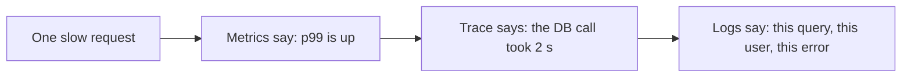
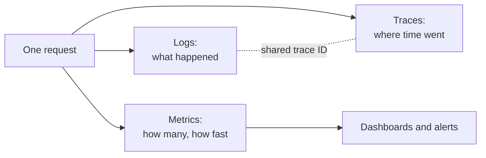
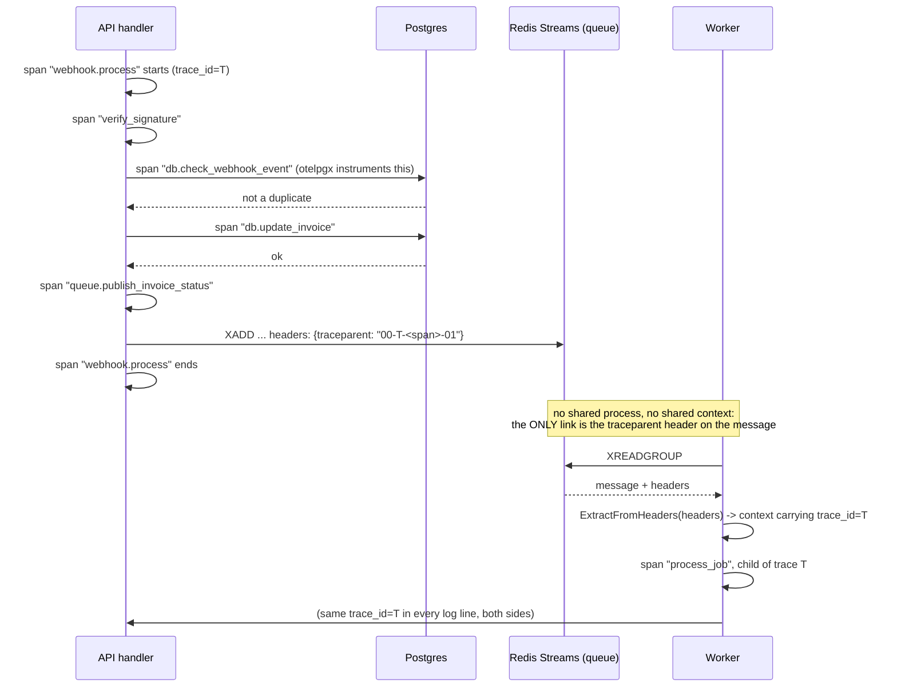
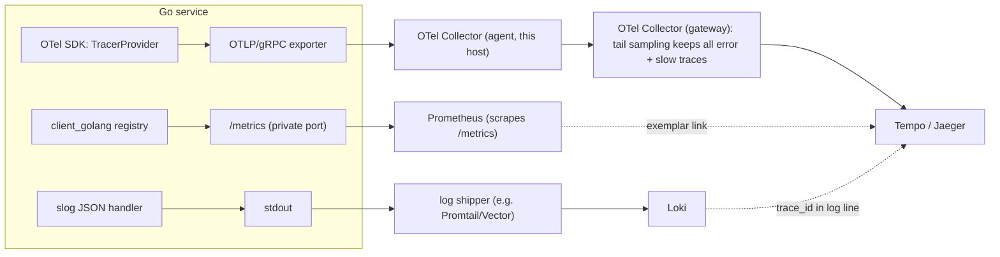

# Observability in Go Services

> [!summary] TL;DR
> Observability in a Go service is three correlated signals: structured JSON logs (`log/slog`) carrying a trace ID, low-cardinality Prometheus metrics (requests, latency, and your own domain counters), and OpenTelemetry traces that follow one request across HTTP, the database, a queue, and a background worker. The three only become one picture when the trace ID appears in the logs and the metrics' labels stay coarse enough to query at 3 a.m.

> [!abstract] Core idea
> - Logs answer "what happened on this one request." Metrics answer "how is the system behaving in aggregate, right now." Traces answer "where did the time go, across every service this one request touched." Each answers a question the other two cannot.
> - A metric's **label values must come from a closed, small set** (a route pattern, an HTTP method, a status class) — never from something that grows without bound (a user ID, a raw path, a trace ID). Prometheus stores one time series per unique label combination; an unbounded label is an unbounded memory leak with a delay.
> - A trace only stays one trace across a process boundary if its **context is explicitly carried**: HTTP and gRPC get this from `otelhttp`/`otelgrpc` automatically, but a message queue or background job needs the trace context injected into message headers by hand and extracted on the other side.
> - `log/slog`'s `LogValuer` interface is how you make a field unloggable by construction — a secret type that always renders as `[REDACTED]` cannot leak just because someone logged the struct that holds it.

## Start here: the basics 🟢

> [!info] How to read this note (pick your level)
> - 🟢 **New to this?** Read "From zero" below, then sections 1, 2 and the cheat sheet (10). Stop there, that is a full first pass.
> - 🟡 **Know the basics?** Add section 3 (how it works), 4 (worked example) and 5-6.
> - 🔴 **Interview / SDE-3 prep?** Add 7, 8 and 9. Headings are tagged 🟢🟡🔴 so you always know where you are.

**From zero, in 60 seconds** 🟢

It is 3 a.m. and your service is slow. **Observability** is everything you set up beforehand so you can find out why without guessing.

It is three kinds of signal. **Logs**: what happened on this one request. **Metrics**: counters and timings over all requests — how is the system doing overall. **Traces**: a timeline of one request as it hops across services — where did the time go.



The glue is the **trace ID**: a random ID stamped on the request at the door and carried everywhere, so the log lines and the trace for one request can be matched up.

The rest of this note is just these 4 questions:
1. How do you set up structured JSON logs with slog?
2. Which metrics does every service need, and what labels are safe?
3. How does a trace follow one request across HTTP, DB and a queue?
4. How do the three signals link into one picture?

**The problem in one story.**
A customer says "I paid, but my invoice still says pending."
Your request went through a web handler, a database, a queue and a background worker.
Without good records you are guessing which step broke.
Observability is leaving enough clues behind that you can find out without guessing.

**Words you need first**

| Word | Plain meaning | Tiny example |
| --- | --- | --- |
| Log | A written record of one event | `{"msg":"invoice paid","id":42}` |
| Structured log | A log as key-value fields, not free text | JSON lines from `log/slog` |
| Metric | A number tracked over time | Requests per second, p99 latency |
| Label | A tag that splits a metric into series | `method="POST"`, `status="5xx"` |
| Cardinality | How many distinct values a label can take | Status class: 5; user ID: millions |
| Trace | The path and timing of one request across services | HTTP 120 ms → DB 80 ms → queue 5 ms |
| Span | One timed step inside a trace | "SELECT invoice" took 80 ms |
| Trace ID | The ID shared by every span and log of one request | `4bf92f35...` |

**Picture it**



**Analogy.** A hospital: the patient's chart notes are logs, the ward's vital-sign monitors are metrics, and the patient's wristband ID that links every test result is the trace ID.
Where it breaks: a hospital never "runs out of memory" from too many wristband types, but a metric with an unbounded label really does.

**How the rest of this note builds up**

- First, the smallest whiteboard handler, then why each signal earns its place (section 1) and the mental model (section 2).
- Then how logs, metrics and traces are wired in Go (section 3).
- Then a full worked example: `slog`, Prometheus, OpenTelemetry across HTTP, DB and a queue (section 4).
- Finally the SDE-3 deep dive: trade-offs, production failures, cardinality and context propagation (sections 5-8).

> [!tip] Remember
> Logs say what, metrics say how much, traces say where; the trace ID ties them together.

### Whiteboard version

**In plain words:** the smallest wired trio — slog, one Prometheus histogram, one trace span.

The shape every handler needs before any of the wiring below: one log line per request, with a trace ID if one exists.

```go
func handler(w http.ResponseWriter, r *http.Request) {
    start := time.Now()
    // ... do the work ...
    slog.InfoContext(r.Context(), "request handled",
        "method", r.Method, "path", r.URL.Path, "elapsed", time.Since(start))
}
```

This gets the shape right but misses almost everything production needs:

- the path is unbounded cardinality for a metric (fine for a log, not for Prometheus),
- there's no status code,
- no metric is actually recorded,
- and `r.Context()` carries a trace ID only if something upstream put one there — which is the whole second half of this note.

## 1. Why it exists 🟢

InvoiceOps's payment webhook handler calls four things in sequence: verify the provider's signature, check for a duplicate event in Postgres, update the invoice, and publish a status change onto a queue a worker will pick up.

When a customer reports "my invoice says paid but the dashboard still shows pending," the question is **where**, in that chain, time or logic went wrong.

That chain spans an HTTP handler, a database query, and an asynchronous worker running in a different goroutine (or a different process entirely) minutes later.

Three concrete gaps show why each signal in this note earns its place:

- **Logs alone can't show where time went.** A log line says `"webhook processed", "elapsed", "1.8s"`. It does not say whether that 1.8 seconds was the signature check, a slow query, or the queue publish — distinguishing those requires spans around each step, not a single elapsed-time field.
- **An unbounded metric label silently grows until it pages someone.** A naive `requests_total{path="/invoices/482"}` counter creates a new time series per distinct invoice ID ever requested. At 50,000 invoices, that's 50,000 series for one counter, and Prometheus's memory grows with every new ID — a cardinality bug that looks fine in development and pages on-call in production, often attributed first to "a memory leak in the app."
- **A trace that stops at the queue boundary hides exactly the gap that matters.** If the HTTP handler's span ends when it publishes to the queue, and the worker that later processes the message starts an unrelated trace, you can never answer "how long between the webhook arriving and the worker actually updating the invoice" from traces alone — which is usually the first question asked when something looks delayed.

## 2. Mental model 🟢

Picture one webhook request as a relay race with four runners (steps), and three different instruments watching the whole race:

- A **stopwatch per step** (a span) — "how long did `db.update_invoice` take, on this specific request."
- A **tally board** (metrics) — "how many webhooks processed in the last minute, and what fraction were errors," aggregated across every request, with no memory of any individual one.
- A **race commentary transcript** (logs) — "at 14:02:03, event `evt_42`'s signature check passed; at 14:02:03.4, a duplicate was detected" — detailed, per-event, but not aggregated or graphed.

The thing that ties all three together for one specific race is the **trace ID**: stamp it into every log line and it becomes the join key between "here's the graph that shows an error spike" and "here are the exact log lines from one of those failing requests."

## 3. How it works 🟡

One webhook's trace, carried across every boundary it crosses — including the one boundary (the queue) that needs explicit propagation code, since only HTTP and gRPC get it automatically from instrumentation libraries:



The telemetry pipeline every signal ultimately flows through, so an app never talks to Grafana/Jaeger/Prometheus directly — it talks to one local Collector, which decides where things go:



## 4. Worked example 🟡

**Structured logging** with a trace-aware handler: it wraps any `slog.Handler` and stamps `trace_id`/`span_id` onto every record from an active span in the context, and a `LogValuer` type that makes a secret field unloggable by construction rather than by developer discipline:

```go
// traceHandler wraps any slog.Handler and injects the active span's
// trace_id and span_id as attributes, so a log line and the trace it
// happened inside can be joined in a log/trace explorer (e.g. Grafana's
// "Logs to Traces" or Loki+Tempo). It only has an effect when the context
// passed to InfoContext/ErrorContext/etc. carries a sampled span; a bare
// context.Background() logs with no trace fields, same as before.
type traceHandler struct {
	slog.Handler
}

func (h *traceHandler) Handle(ctx context.Context, r slog.Record) error {
	if sc := trace.SpanContextFromContext(ctx); sc.IsValid() {
		r.AddAttrs(
			slog.String("trace_id", sc.TraceID().String()),
			slog.String("span_id", sc.SpanID().String()),
		)
	}
	return h.Handler.Handle(ctx, r)
}

func (h *traceHandler) WithAttrs(attrs []slog.Attr) slog.Handler {
	return &traceHandler{Handler: h.Handler.WithAttrs(attrs)}
}

func (h *traceHandler) WithGroup(name string) slog.Handler {
	return &traceHandler{Handler: h.Handler.WithGroup(name)}
}

// NewLogger builds a JSON slog.Logger whose level can be changed at runtime
// through level (a *slog.LevelVar), e.g. from an admin endpoint during an
// incident, without restarting the process. w is os.Stdout in production;
// tests pass any io.Writer.
func NewLogger(w io.Writer, level *slog.LevelVar) *slog.Logger {
	h := slog.NewJSONHandler(w, &slog.HandlerOptions{Level: level})
	return slog.New(&traceHandler{Handler: h})
}

// RedactedString implements slog.LogValuer so a secret value never appears
// in a log line even if a developer logs the whole struct that holds it by
// mistake — slog calls LogValue() instead of reflecting the struct's
// fields, so there is no field name to forget to exclude.
type RedactedString string

func (RedactedString) LogValue() slog.Value {
	return slog.StringValue("[REDACTED]")
}

type WebhookSignature struct {
	Provider string
	EventID  string
	Secret   RedactedString
}

func (w WebhookSignature) LogValue() slog.Value {
	return slog.GroupValue(
		slog.String("provider", w.Provider),
		slog.String("event_id", w.EventID),
		slog.Any("secret", w.Secret),
	)
}
```

**RED metrics** (Rate, Errors, Duration) with intentionally coarse labels, plus a `ResponseWriter` wrapper that captures the status code while still letting a streaming handler `Flush` (needed for SSE; see [[Real-time APIs - WebSocket, SSE and Long Polling]]):

```go
// RED is the standard trio for a request-serving component: Rate, Errors,
// Duration. Labels stay low-cardinality on purpose: "route" is the
// *pattern* ("/invoices/{id}"), never the raw path ("/invoices/482"), and
// there is no label for user id or workspace id — those are high-
// cardinality and would make Prometheus's memory grow per unique value.
type RED struct {
	Requests *prometheus.CounterVec
	Duration *prometheus.HistogramVec
}

func NewRED(reg prometheus.Registerer, namespace string) *RED {
	r := &RED{
		Requests: prometheus.NewCounterVec(prometheus.CounterOpts{
			Namespace: namespace,
			Name:      "http_requests_total",
			Help:      "Total HTTP requests by route pattern, method and status class.",
		}, []string{"route", "method", "status"}),
		Duration: prometheus.NewHistogramVec(prometheus.HistogramOpts{
			Namespace: namespace,
			Name:      "http_request_duration_seconds",
			Help:      "HTTP request latency by route pattern and method.",
			Buckets:   prometheus.DefBuckets,
		}, []string{"route", "method"}),
	}
	reg.MustRegister(r.Requests, r.Duration)
	return r
}

// A production registry also carries the Go runtime's own collectors —
// collectors.NewGoCollector() (goroutine count, GC pause time, heap size)
// and collectors.NewProcessCollector() (open file descriptors, RSS, CPU
// time) — registered once alongside the RED metrics above, since a leak or
// a GC-pause spike shows up here before it shows up in any request metric:
//
//	reg.MustRegister(collectors.NewGoCollector(), collectors.NewProcessCollector(collectors.ProcessCollectorOpts{}))

type statusWriter struct {
	http.ResponseWriter
	status int
	bytes  int
}

func (w *statusWriter) WriteHeader(code int) {
	w.status = code
	w.ResponseWriter.WriteHeader(code)
}

func (w *statusWriter) Write(b []byte) (int, error) {
	if w.status == 0 {
		w.status = http.StatusOK
	}
	n, err := w.ResponseWriter.Write(b)
	w.bytes += n
	return n, err
}

// Unwrap lets http.ResponseController reach the real ResponseWriter through
// this wrapper, so a handler further down the chain can still call Flush
// or Hijack (e.g. for SSE) without the wrapper breaking the interface.
func (w *statusWriter) Unwrap() http.ResponseWriter { return w.ResponseWriter }

// InstrumentedHandler wraps next with RED metrics and an access-log line,
// keyed by routePattern (the caller passes the *pattern*, e.g. from Go
// 1.22+ ServeMux's r.Pattern, not the raw request path) so the metric
// cardinality stays bounded regardless of how many distinct IDs are
// requested.
func InstrumentedHandler(red *RED, logger Logger, routePattern string, next http.Handler) http.Handler {
	return http.HandlerFunc(func(w http.ResponseWriter, r *http.Request) {
		sw := &statusWriter{ResponseWriter: w}
		start := time.Now()

		next.ServeHTTP(sw, r)

		elapsed := time.Since(start)
		red.Requests.WithLabelValues(routePattern, r.Method, statusClass(sw.status)).Inc()
		red.Duration.WithLabelValues(routePattern, r.Method).Observe(elapsed.Seconds())
		logger.Log(r.Context(), routePattern, r.Method, sw.status, sw.bytes, elapsed)
	})
}

// statusClass buckets a status code to "2xx"/"4xx"/"5xx" rather than the
// exact code, which keeps the counter's cardinality bounded (3-5 classes
// instead of dozens of exact codes) while still separating client from
// server errors for alerting.
func statusClass(code int) string {
	if code == 0 {
		code = http.StatusOK
	}
	return strconv.Itoa(code/100) + "xx"
}

// Logger is the minimal access-logging seam InstrumentedHandler needs, so
// tests can assert on calls without depending on slog's text output.
type Logger interface {
	Log(ctx context.Context, route, method string, status, bytes int, elapsed time.Duration)
}

// SlogAccessLogger adapts *slog.Logger to Logger, using InfoContext so the
// traceHandler above can attach trace_id/span_id when the request context
// carries a sampled span.
type SlogAccessLogger struct {
	L *slog.Logger
}

func (s SlogAccessLogger) Log(ctx context.Context, route, method string, status, bytes int, elapsed time.Duration) {
	s.L.InfoContext(ctx, "http_request",
		slog.String("route", route), slog.String("method", method),
		slog.Int("status", status), slog.Int("bytes", bytes), slog.Duration("elapsed", elapsed))
}
```

**OpenTelemetry tracing**: building the `TracerProvider` with a resource, a `ParentBased(TraceIDRatioBased)` sampler, manual spans with `RecordError`/`SetStatus`, and the propagation functions a queue hop needs by hand:

```go
// NewTracerProvider builds the SDK TracerProvider every Go service needs
// exactly once at startup. sampleRatio is the fraction of *root* traces
// kept; ParentBased means a service that receives a request already marked
// sampled always honours that decision instead of re-sampling — sampling is
// decided once, at the edge, and propagated.
//
// exporter is injected so tests can pass an in-memory recorder instead of a
// real OTLP exporter; a real service passes an OTLP exporter dialed to its
// collector (otlptracegrpc.New or otlptracehttp.New).
func NewTracerProvider(serviceName, version string, sampleRatio float64, sp sdktrace.SpanProcessor) *sdktrace.TracerProvider {
	res := resource.NewWithAttributes(
		semconv.SchemaURL,
		semconv.ServiceName(serviceName),
		semconv.ServiceVersion(version),
	)
	return sdktrace.NewTracerProvider(
		sdktrace.WithResource(res),
		sdktrace.WithSampler(sdktrace.ParentBased(sdktrace.TraceIDRatioBased(sampleRatio))),
		sdktrace.WithSpanProcessor(sp),
	)
}

// Propagator is the W3C TraceContext + Baggage propagator InvoiceOps uses
// everywhere a trace crosses a process boundary: HTTP headers (otelhttp
// does this for you), and Kafka/Redis Streams message headers (you call
// this by hand, since there is no stdlib "message" to attach a header to).
var Propagator = propagation.NewCompositeTextMapPropagator(
	propagation.TraceContext{},
	propagation.Baggage{},
)

func InjectIntoHeaders(ctx context.Context, headers http.Header) {
	Propagator.Inject(ctx, propagation.HeaderCarrier(headers))
}

func ExtractFromHeaders(ctx context.Context, headers http.Header) context.Context {
	return Propagator.Extract(ctx, propagation.HeaderCarrier(headers))
}

// ProcessWebhook is InvoiceOps's real span tree for one Razorpay webhook:
// one parent span with a child span per step, so a slow step is visible
// instead of averaged into one opaque "handle webhook" duration.
func ProcessWebhook(ctx context.Context, tracer trace.Tracer, eventID string, verify, checkDup, updateInvoice, publish func(context.Context) error) error {
	ctx, span := tracer.Start(ctx, "webhook.process", trace.WithAttributes(
		attribute.String("webhook.event_id", eventID),
	))
	defer span.End()

	steps := []struct {
		name string
		fn   func(context.Context) error
	}{
		{"verify_signature", verify},
		{"db.check_webhook_event", checkDup},
		{"db.update_invoice", updateInvoice},
		{"queue.publish_invoice_status", publish},
	}
	for _, s := range steps {
		if err := runStep(ctx, tracer, s.name, s.fn); err != nil {
			span.RecordError(err)
			span.SetStatus(codes.Error, err.Error())
			return err
		}
	}
	span.SetStatus(codes.Ok, "")
	return nil
}

func runStep(ctx context.Context, tracer trace.Tracer, name string, fn func(context.Context) error) error {
	_, span := tracer.Start(ctx, name)
	defer span.End()
	if err := fn(ctx); err != nil {
		span.RecordError(err)
		span.SetStatus(codes.Error, err.Error())
		return err
	}
	return nil
}
```

The real production startup wiring — an OTLP/gRPC exporter to the local Collector, batched, with a `Shutdown` that must be called (deferred, or in a graceful-shutdown hook per [[Graceful Shutdown and Health Checks]]) so buffered spans flush instead of being dropped on exit:

```go
// StartProductionTracing is the real startup wiring: an OTLP/gRPC exporter
// pointed at the service's local OTel Collector sidecar or daemonset (never
// straight at a vendor backend — the collector batches, retries and can
// tail-sample before forwarding), wrapped in a BatchSpanProcessor so spans
// are sent in batches instead of one RPC per span.
func StartProductionTracing(ctx context.Context, collectorEndpoint, serviceName, version string, sampleRatio float64) (shutdown func(context.Context) error, err error) {
	exp, err := otlptracegrpc.New(ctx,
		otlptracegrpc.WithEndpoint(collectorEndpoint),
		otlptracegrpc.WithInsecure(), // mTLS to the collector in production; insecure only inside the cluster network
		otlptracegrpc.WithTimeout(5*time.Second),
	)
	if err != nil {
		return nil, err
	}

	bsp := sdktrace.NewBatchSpanProcessor(exp)
	tp := NewTracerProvider(serviceName, version, sampleRatio, bsp)

	return tp.Shutdown, nil
}
```

`StartProductionTracing` compiles against the real `otlptracegrpc` client and is covered by `go vet`, but — unlike the rest of this section — no test below calls it: doing so would need a live OTel Collector (or a fake gRPC server standing in for one) listening on `collectorEndpoint`, which this note doesn't stand up.

Treat it as reviewed for shape and API correctness, not as integration-tested; a real service should still smoke-test it once against its actual collector sidecar before relying on it.

Tests. The trace-context ones are the load-bearing proof for this note: that a log line picks up a real trace ID, that a secret never appears in a log line, and — the part that's easy to get wrong — that a trace survives a hop through a queue with no shared Go context at all:

```go
func TestTraceHandler_AddsTraceAndSpanID(t *testing.T) {
	recorder := tracetest.NewSpanRecorder()
	tp := sdktrace.NewTracerProvider(sdktrace.WithSpanProcessor(recorder), sdktrace.WithSampler(sdktrace.AlwaysSample()))
	defer tp.Shutdown(context.Background())
	tracer := tp.Tracer("test")

	var buf bytes.Buffer
	level := new(slog.LevelVar)
	logger := NewLogger(&buf, level)

	ctx, span := tracer.Start(context.Background(), "do-work")
	logger.InfoContext(ctx, "inside span")
	span.End()

	var line map[string]any
	if err := json.Unmarshal(buf.Bytes(), &line); err != nil {
		t.Fatalf("log line not JSON: %v (%s)", err, buf.String())
	}
	wantTraceID := span.SpanContext().TraceID().String()
	if line["trace_id"] != wantTraceID {
		t.Fatalf("trace_id = %v, want %v", line["trace_id"], wantTraceID)
	}
}

func TestLogValuer_RedactsSecret(t *testing.T) {
	var buf bytes.Buffer
	logger := slog.New(slog.NewJSONHandler(&buf, nil))

	sig := WebhookSignature{Provider: "razorpay", EventID: "evt_1", Secret: "whsec_live_abc123"}
	logger.Info("webhook received", slog.Any("signature", sig))

	out := buf.String()
	if strings.Contains(out, "whsec_live_abc123") {
		t.Fatalf("secret leaked into log line: %s", out)
	}
	if !strings.Contains(out, "REDACTED") {
		t.Fatalf("expected [REDACTED] marker, got: %s", out)
	}
}

func TestTraceContextPropagation_SurvivesAQueueHop(t *testing.T) {
	recorder := tracetest.NewSpanRecorder()
	tp := sdktrace.NewTracerProvider(sdktrace.WithSpanProcessor(recorder), sdktrace.WithSampler(sdktrace.AlwaysSample()))
	defer tp.Shutdown(context.Background())
	tracer := tp.Tracer("test")

	// Producer side: a span starts (e.g. inside the HTTP handler that
	// enqueues the job), and its context is injected into message headers.
	producerCtx, producerSpan := tracer.Start(context.Background(), "enqueue_job")
	headers := http.Header{}
	InjectIntoHeaders(producerCtx, headers)
	producerSpan.End()

	// Consumer side: a worker, in an unrelated goroutine with no shared
	// context, extracts the same trace from the headers it received on
	// the queue message and starts a child span.
	workerCtx := ExtractFromHeaders(context.Background(), headers)
	_, workerSpan := tracer.Start(workerCtx, "process_job")
	workerSpan.End()

	if got, want := workerSpan.SpanContext().TraceID(), producerSpan.SpanContext().TraceID(); got != want {
		t.Fatalf("worker span trace_id = %s, want producer's %s (propagation broke the trace)", got, want)
	}
}

func TestRED_RecordsRouteNotRawPath(t *testing.T) {
	reg := prometheus.NewRegistry()
	red := NewRED(reg, "invoiceops")
	logger := SlogAccessLogger{L: slog.New(slog.NewTextHandler(io.Discard, nil))}

	// Two different invoice IDs must collapse onto the SAME route-pattern
	// label; a per-ID label would make the metric's cardinality grow
	// without bound as invoices accumulate.
	h := InstrumentedHandler(red, logger, "/invoices/{id}", http.HandlerFunc(
		func(w http.ResponseWriter, r *http.Request) { w.WriteHeader(http.StatusOK) }))

	for _, path := range []string{"/invoices/101", "/invoices/9999"} {
		h.ServeHTTP(httptest.NewRecorder(), httptest.NewRequest(http.MethodGet, path, nil))
	}

	got := counterValue(t, red.Requests, map[string]string{
		"route": "/invoices/{id}", "method": "GET", "status": "2xx",
	})
	if got != 2 {
		t.Fatalf("requests_total{route=/invoices/{id}} = %v, want 2", got)
	}
}

// counterValue reads one label combination's current value out of a
// CounterVec by writing it to the protobuf Metric message client_golang
// uses internally — the same mechanism prometheus/testutil wraps.
func counterValue(t *testing.T, cv *prometheus.CounterVec, labels map[string]string) float64 {
	t.Helper()
	m := &dto.Metric{}
	if err := cv.With(labels).Write(m); err != nil {
		t.Fatalf("Write metric: %v", err)
	}
	return m.GetCounter().GetValue()
}
```

**Measured:** built in a scratch module (`obsdemo`, Go 1.24.4, `go.opentelemetry.io/otel` v1.32.0, `github.com/prometheus/client_golang` v1.20.5) and run with `go vet` and `go test -race`. All 4 tests shown above passed, including the queue-propagation test proving a worker's span, started from headers alone with no shared Go `context.Context`, lands on the same trace ID the HTTP handler started, and the RED-metrics test proving two distinct invoice IDs produce exactly one time series under the `{id}` route pattern, not two. `StartProductionTracing` is not among these four; see the note above its code.

## 5. Variants and comparison 🟡

| Approach | How it works | Use when | Cost |
| --- | --- | --- | --- |
| `log/slog` JSON handler | Structured key-value log lines to stdout, shipped by a sidecar/daemonset log agent | Every service, as the baseline signal | Cheap per line; expensive in aggregate if every line logs a full payload |
| Prometheus pull metrics | Service exposes `/metrics`; Prometheus scrapes it on an interval | Dashboards, alerting on rates and percentiles, RED/USE metrics | Only as fresh as the scrape interval; unsuitable for per-request detail |
| OpenTelemetry push traces | SDK batches spans, exports via OTLP to a Collector | Understanding one request's path across services, latency breakdown | Sampling is mandatory at scale — 100% tracing of a high-traffic service is rarely affordable |
| Exemplars | A histogram bucket carries a sample trace ID that landed in it | Jumping from "p99 latency spiked" directly to one representative trace | Requires both metrics and tracing wired to the same backend (e.g. Prometheus + Tempo) |
| Tail sampling at the Collector | Decide whether to keep a trace *after* seeing the whole thing (e.g. always keep errors and slow traces) | Keeping the traces that matter under a sampling budget, instead of a blind percentage | An extra Collector tier (gateway) that must buffer a whole trace before deciding |

## 6. Trade-offs and when not to use 🟡

- Tracing every request at 100% is rarely affordable once traffic is meaningful; `TraceIDRatioBased` sampling (or better, tail sampling at the Collector) trades completeness for cost — but pair it with "always keep errors and slow requests," or the traces you most want during an incident are exactly the ones most likely to have been dropped.
- A metric label is a one-way door: adding a new label value later is free, but adding a *new label* to an existing metric changes every existing time series' identity in Prometheus's storage, effectively starting the metric's history over. Decide your labels carefully up front.
- Manual span instrumentation (the `ProcessWebhook` pattern above) is worth the code only for the steps you'd actually want to see separately in a trace; wrapping every three-line helper function in its own span adds overhead and visual noise without adding insight.
- For a small internal tool with low traffic and one engineer on call, full OTel tracing is often more operational surface than it's worth; structured logs plus a handful of Prometheus counters frequently cover the real need.

## 7. In production 🔴

- **Real systems:** Google's SRE practice popularized the RED/USE framing this note's metrics follow. The OpenTelemetry project itself is the CNCF-governed merger of OpenTracing and OpenCensus, now the standard instrumentation layer most observability vendors (Grafana, Datadog, Honeycomb, Lightstep) ingest from. Grafana's stack (Loki for logs, Mimir/Prometheus for metrics, Tempo for traces) is a common fully open-source destination for exactly the three signals this note produces.
- **Failure modes → fixes:**
  - A new metric label value (e.g. a new route) silently explodes cardinality → alert on total active series count per metric name, not just on the metrics' values; a cardinality regression is itself an incident, caught before it pages someone for "Prometheus is out of memory."
  - `TracerProvider.Shutdown` never gets called before process exit → buffered spans in the `BatchSpanProcessor` are dropped, and a real incident's traces are simply missing after a deploy; wire `Shutdown` into the same graceful-shutdown sequence that drains in-flight HTTP requests.
  - A worker's trace is disconnected from the request that enqueued it → confirm the message headers actually carry `traceparent`; a queue client or library upgrade that silently strips custom headers is a common, quiet regression here.
  - High-cardinality or PII ends up in a span attribute or log field (a raw email address, a full request body) → treat span attributes and log fields with the same review bar as an API response: nothing goes in that you wouldn't put in an access log.
- **What to monitor:** RED metrics per route, Go runtime metrics (goroutine count, GC pause time) from `collectors.NewGoCollector()`, worker queue depth and oldest-job age (so a stuck worker shows up before its backlog becomes a customer-visible delay), retry count and dead-letter-queue size per job type (a job retrying forever and one failing once look identical in a plain success/failure rate), DB connection pool stats (`db.Stats()`), active time-series count per metric (a cardinality canary), and the Collector's own export success/failure rate (a telemetry pipeline that's silently failing to export is itself worth alerting on).

## 8. Deep dive 🔴

- **Why `ParentBased(TraceIDRatioBased(...))` and not `TraceIDRatioBased` alone.** `TraceIDRatioBased` decides sampling from the trace ID's bits, which is deterministic but re-evaluates at every service if applied directly. `ParentBased` makes a service that receives an already-sampled request always continue sampling it, and only applies the ratio decision at the *root* of a trace (where there's no parent to defer to) — so sampling is a single decision made once, at the edge of the system, that every downstream service simply honours.
- **Why metrics are pulled and traces are pushed.** Prometheus scraping a `/metrics` endpoint means the server stays alive and reachable on its own schedule, which keeps Prometheus itself simple (it controls the cadence) and makes "is this service even up" visible as a failed scrape. Traces are pushed because a span needs to leave the process promptly (batched, but not held indefinitely) to be useful during an incident — waiting for an external scraper to come get it would add unacceptable latency to seeing what's happening right now.
- **Exemplars are the bridge between the two push/pull worlds.** A histogram bucket can carry a small sample of trace IDs that landed in it, so a latency graph showing a p99 spike can link directly to one of the actual traces behind that spike — turning "metrics say something's slow" into "here's an example of the slow request" in one click, without separately correlating timestamps.
- **`db.Stats()` is the one `database/sql` metric that isn't automatic.** `otelsql`/`otelpgx` instrument individual queries as spans, but pool-level numbers (open connections, idle connections, wait count, wait duration) come from `sql.DB.Stats()` and must be polled and exported as gauges yourself — a connection pool silently exhausted under load is invisible to query-level tracing alone.
- **Tail sampling trades memory for completeness.** A Collector doing tail sampling must buffer every span of a trace until the trace completes (or times out) before deciding to keep or drop it, because "keep all error and slow traces" can only be evaluated once you've seen the whole trace. This is why tail sampling runs at a dedicated gateway tier with its own memory budget, not on every service's local agent-mode Collector.

## 9. Interview questions 🔴

> [!question]- Why can't a single "requests by path" counter use the raw URL path as a label?
> Prometheus allocates a new time series per unique label-value combination, and a raw path contains unbounded values (every invoice ID, every user ID that ever appears in a URL). The series count — and the memory it costs — grows without bound as new IDs appear. Use the route *pattern* (`/invoices/{id}`) as the label instead; it has a small, fixed number of values no matter how much data exists.

> [!question]- Trap: if a service exports Prometheus metrics and ships structured JSON logs, is it "observable"?
> Not necessarily in a way that helps during an incident. Metrics and logs answer different questions, and without a shared trace ID connecting them (and without traces showing where time went across a multi-step or multi-service request), an engineer debugging a specific slow request still has no way to go from "the graph shows a spike" to "here are the exact log lines and the exact span that was slow" for one concrete occurrence.

> [!question]- How does a trace survive a hop through a message queue, when the producer and consumer share no Go `context.Context`?
> The trace context (trace ID, parent span ID, sampling flag — the W3C `traceparent` format) is serialized into the message's own headers on the producer side (`propagation.Inject`) and deserialized back into a new context on the consumer side (`propagation.Extract`). The two processes never share memory; the header *is* the entire link between them.

> [!question]- Why does `log/slog`'s `LogValuer` interface matter for secrets, beyond "just don't log the secret"?
> `LogValuer` makes "don't log the secret" enforced by the type system rather than by every future call site remembering to be careful. If a secret value's type always renders as `[REDACTED]` via `LogValue()`, then even a developer who logs the entire containing struct — by mistake, or because a new field was added later and nobody updated a logging call site — cannot leak it, because slog calls `LogValue()` instead of reflecting the struct's fields directly.

> [!question]- What's the difference between `ParentBased(TraceIDRatioBased(0.1))` and just sampling 10% of spans independently at every service?
> `ParentBased` samples only at the root of a trace and every downstream service honours that one decision, producing complete traces for exactly 10% of requests. Independent per-service sampling at 10% each would produce *fragments*: a multi-service trace surviving intact through three hops at 10% each has roughly a 0.1% chance, so almost every "trace" you'd see would be a broken, partial one.

> [!question]- Why does `TracerProvider.Shutdown` need to be called explicitly, and what breaks if it isn't?
> The SDK's `BatchSpanProcessor` buffers finished spans and exports them in batches on a timer, for efficiency. If the process exits (including a graceful one) without calling `Shutdown`, whatever spans are still sitting in that buffer are dropped — which, unhelpfully, tends to include the very last requests before a deploy, exactly when something might be worth investigating.

## 10. Cheat sheet 🟢

- Logs = what happened on one request; metrics = aggregate rate/error/duration; traces = where time went across the whole request. Each answers a question the others can't.
- Metric labels come from a small, closed set (route pattern, method, status class) — never an ID, a raw path, or anything else unbounded.
- `ParentBased(TraceIDRatioBased(...))` samples once, at the root; every downstream service honours that decision rather than re-sampling.
- `otelhttp`/`otelgrpc` propagate trace context automatically; a queue or background job needs `propagation.Inject`/`Extract` on message headers by hand.
- `slog.LogValuer` makes a secret field unloggable by construction, not by every call site remembering to redact it.
- `db.Stats()`, worker queue depth, and oldest-job age need their own gauges — they are not automatic from query-level tracing.
- Always call `TracerProvider.Shutdown` before exit (wire it into graceful shutdown) or buffered spans from the last moments before exit are silently lost.
- Tail sampling at a Collector gateway can keep "all errors and slow requests" instead of a blind percentage, at the cost of buffering whole traces before deciding.

## Links 🟢

- **Before this:** [[Building REST Endpoints]], [[Receiving Webhooks Idempotently]]
- **Next:** [[Scheduled Jobs]], [[Graceful Shutdown and Health Checks]]
- **Compare with:** [[Observability Fundamentals]], [[Structured Logging]], [[Metrics and Prometheus]], [[Distributed Tracing with OpenTelemetry]] (the vendor/protocol-agnostic concepts this note instruments in Go)

### Watch on YouTube

- [Go's Built-in Package for Better Logging (using slog)](https://www.youtube.com/watch?v=_mqB7LLgwgs) · Better Stack · focused intro to structured logging with log/slog
- [Observability made painless: Go, Otel & LGTM stack - Haseeb Majid](https://www.youtube.com/watch?v=t3Xz-IrxNwk) · GopherCon UK · conference talk tying logs, metrics and traces together in Go
