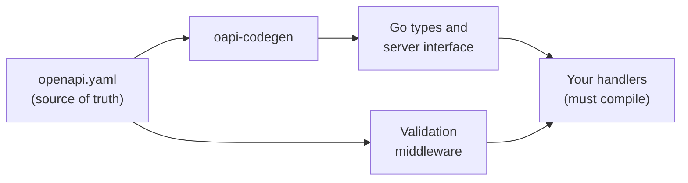
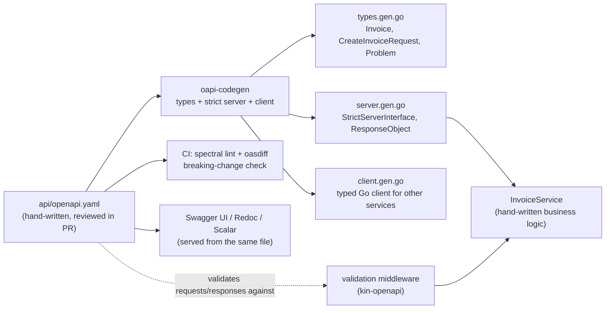
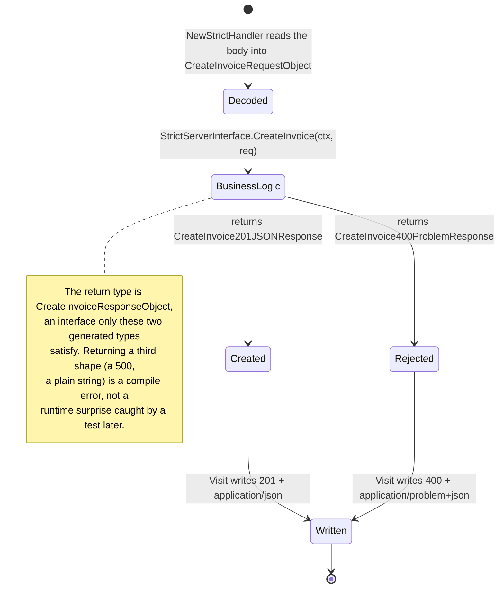
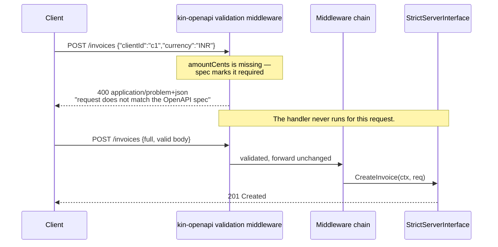

# OpenAPI-First Development in Go

> [!summary] TL;DR
> Spec-first means `api/openapi.yaml` is the source of truth: you write (or review) the contract before the handler, generate Go types and server scaffolding from it with `oapi-codegen`, and the compiler stops a handler from returning a shape the spec doesn't declare — instead of hand-writing handlers first and hoping the docs you write afterward still match.

> [!abstract] Core idea
> - **Spec-first** writes `openapi.yaml` before the handler and generates code from it; **code-first** writes Go first (handler or struct tags) and generates the spec from that. Spec-first is the only one of the two that can catch "the code no longer matches the contract" in CI, because the spec is the thing everything else is checked against.
> - `oapi-codegen`'s **strict server** mode generates one method per operation that takes a typed request object and returns a typed response object — a handler that tries to return a status the spec didn't declare for that operation does not compile.
> - **Request/response validation middleware** (`kin-openapi`) rejects a request that violates the spec — a missing required field, a value outside an enum — before your handler code ever sees it, and validates the response your handler sent against the same spec in tests.
> - This note is the Go implementation. [[API Contract Design and OpenAPI]] owns the contract concepts (what a good contract looks like, versioning, consumer-driven contracts); this note is what runs once you have one.

## Start here: the basics

**The problem in one story.**
The backend team and the frontend team agree on what `POST /invoices` sends and returns.
They write it in a wiki, then the backend renames a field and forgets the wiki.
The frontend breaks days later in QA.
OpenAPI-first makes one machine-readable file the agreement, and generates code from it so the two cannot quietly drift.

**Words you need first**

| Word | Plain meaning | Tiny example |
| --- | --- | --- |
| API | The set of requests a server accepts and what it returns | `GET /invoices/42` |
| Contract | The agreed shape of requests and responses | "`amount` is an integer, required" |
| OpenAPI | A standard YAML/JSON format for writing that contract | `api/openapi.yaml` |
| Schema | The description of one data shape inside the spec | `Invoice: {id, amount, status}` |
| Code generation | A tool writing Go code from the spec for you | `oapi-codegen` makes structs |
| Drift | Code and docs slowly disagreeing | Field renamed in code, not in docs |
| Validation | Checking data against the schema, rejecting bad input | Missing `amount` → `400` |

**Picture it**



**Analogy.** An architect's blueprint: builders work from it, inspectors check the building against it, and nobody draws the blueprint after the house is built.
Where it breaks: a blueprint cannot check that the plumbing actually works; the spec can say a token is required, but only your Go code can check the token is valid.

**How the rest of this note builds up**

- First, why spec-first exists and how it beats drift (section 1), then the mental model (section 2).
- Then how it works: OpenAPI versions, the spec file, `oapi-codegen` and strict servers (section 3).
- Then a full InvoiceOps worked example with validation middleware and tests (section 4).
- Finally the SDE-3 view: spec-first vs code-first, trade-offs, production failures and the deep dive (sections 5-8).

> [!tip] Remember
> Write the contract first, generate the code from it, and let the compiler and tests catch any mismatch.

## 1. Why it exists

A team writes `POST /invoices`, documents it in a wiki page, and ships it.

Three sprints later a field gets renamed in the handler but nobody updates the wiki page — the frontend, which was built against the wiki page, breaks in a way that only shows up in QA, three days before a release.

This is **drift**: the one thing a hand-maintained doc cannot prevent, because nothing forces it to stay in sync with the code that actually runs.

Spec-first does not eliminate the risk of drift by itself — a handwritten handler can still disagree with the spec it claims to implement. What it adds is two places that make disagreement visible before a release:

1. `oapi-codegen`'s generated types make a response shape that violates the spec a **compile error**.
2. A validation middleware (or a contract test) makes a request or response that violates the spec a **test failure**.

Code-first (generating the spec from annotations on the Go code, like `swaggo`) can't catch either failure mode, because the spec it produces is defined as whatever the code already does — there is nothing independent left to disagree with.

## 2. Mental model

Treat `openapi.yaml` the way you'd treat a database migration: it is checked into the repo, reviewed in the same PR as the handler that implements it, and nothing downstream (server code, client SDKs, docs site) is hand-maintained — all of it is generated from that one file.



Every box except `IMPL` (the business logic you actually write by hand) is either the spec itself or generated from it. The spec is upstream of the code, not the other way around.

## 3. How it works

### OpenAPI 3.0 vs 3.1

Most Go tooling (`oapi-codegen`, `kin-openapi`, Swagger UI) is most mature against **3.0.3**; this note and InvoiceOps use it.

**3.1.1** aligned the schema format fully with JSON Schema 2020-12 — the practical difference that bites most often is `nullable`: 3.0 has a `nullable: true` keyword on a schema, while 3.1 drops it in favor of `type: ["string", "null"]`, because 3.1's `type` keyword accepts an array the way JSON Schema's always has.

Pick 3.1 only once your whole toolchain (codegen, linter, docs renderer) confirms 3.1 support; mixing a 3.1 spec with a 3.0-only tool produces confusing validation errors that look like a spec bug but are really a version mismatch.

### A minimal spec

```yaml
openapi: 3.0.3
info:
  title: InvoiceOps API
  version: "1.0.0"
paths:
  /invoices:
    post:
      operationId: createInvoice
      security:
        - bearerAuth: []
      requestBody:
        required: true
        content:
          application/json:
            schema:
              $ref: '#/components/schemas/CreateInvoiceRequest'
      responses:
        '201':
          description: created
          content:
            application/json:
              schema:
                $ref: '#/components/schemas/Invoice'
        '400':
          description: validation error
          content:
            application/problem+json:
              schema:
                $ref: '#/components/schemas/Problem'
components:
  securitySchemes:
    bearerAuth:
      type: http
      scheme: bearer
      bearerFormat: JWT
  schemas:
    CreateInvoiceRequest:
      type: object
      required: [clientId, amountCents, currency]
      properties:
        clientId: { type: string, format: uuid }
        amountCents: { type: integer, minimum: 1 }
        currency: { type: string, enum: [INR, USD] }
    Invoice:
      type: object
      required: [id, clientId, amountCents, currency, status]
      properties:
        id: { type: string, format: uuid }
        clientId: { type: string, format: uuid }
        amountCents: { type: integer }
        currency: { type: string }
        status: { type: string, enum: [draft, sent, paid] }
    Problem:
      type: object
      required: [title, status]
      properties:
        title: { type: string }
        status: { type: integer }
        detail: { type: string }
```

Every piece has a job:

- `operationId` becomes the generated Go method name.
- `security` says this operation needs a bearer token (verifying that token is Go code — see [[Authentication and Authorization in Go]] — OpenAPI can only assert that *some* credential was presented, never that it was *valid*).
- `requestBody`/`responses` are what the strict server's types are generated from.
- `Problem` is this API's one error shape for every 4xx, following RFC 9457 (`application/problem+json`) instead of each endpoint inventing its own error JSON.

### oapi-codegen: the strict server

Run as a `go:generate` directive against the spec above:

```go
//go:generate go run github.com/oapi-codegen/oapi-codegen/v2/cmd/oapi-codegen@v2.4.1 -generate types,strict-server -package invoiceapi -o server.gen.go api/openapi.yaml
```

`go:generate` directives are not shell lines: each `//go:generate` comment is its own command.

A trailing `\` is passed through literally rather than continuing onto the next directive — two `//go:generate` lines for one invocation silently run as two broken commands.

Keep the real invocation on one line, or move the flags into an `oapi-codegen` config YAML and generate with `-config` if the line gets unwieldy.

it produces, for `createInvoice`, the equivalent of:

```go
type ServerInterface interface {
	CreateInvoice(w http.ResponseWriter, r *http.Request)
}

type CreateInvoiceRequestObject struct {
	Body *CreateInvoiceRequest
}

type CreateInvoiceResponseObject interface {
	VisitCreateInvoiceResponse(w http.ResponseWriter) error
}

type CreateInvoice201JSONResponse Invoice

func (r CreateInvoice201JSONResponse) VisitCreateInvoiceResponse(w http.ResponseWriter) error {
	w.Header().Set("Content-Type", "application/json")
	w.WriteHeader(http.StatusCreated)
	return json.NewEncoder(w).Encode(Invoice(r))
}

type CreateInvoice400ProblemResponse Problem
// ... its own VisitCreateInvoiceResponse, writing application/problem+json and r.Status

type StrictServerInterface interface {
	CreateInvoice(ctx context.Context, req CreateInvoiceRequestObject) (CreateInvoiceResponseObject, error)
}
```



The business value of this split: `StrictServerInterface.CreateInvoice` is a plain function from a typed request to a typed response — it never touches `http.ResponseWriter` directly, which is what makes it trivial to unit test without `httptest` at all, and impossible to forget to write a response or to accidentally write two.

### Request/response validation (kin-openapi)

Generated types stop a *handler* from returning the wrong shape; they do nothing about an incoming request that already violates the spec (a missing field, a value outside an enum) — that check runs as middleware, using `kin-openapi` to load the same spec and validate every request against it before the handler runs:



## 4. Worked example

### Whiteboard version

The bare idea: load the spec, find the matching route, validate the request against it.

```go
doc, _ := openapi3.NewLoader().LoadFromFile("api/openapi.yaml")
router, _ := legacyrouter.NewRouter(doc)
route, pathParams, _ := router.FindRoute(r)
err := openapi3filter.ValidateRequest(r.Context(), &openapi3filter.RequestValidationInput{
	Request: r, PathParams: pathParams, Route: route,
})
```

The full version below wires this into a real middleware (consuming and restoring the body, since validation reads it), implements the strict server, and tests both the "rejected before the handler runs" path and the "accepted, handler runs" path. It compiles and passes `go vet` and `go test -race` on Go 1.24.4, against `github.com/getkin/kin-openapi v0.131.0`.

The generated-shape types and server adapter (what the `//go:generate` directive above would produce — reproduced by hand here since running a downloaded generator binary is out of scope for this vault, but every line is real, compiled, tested Go):

```go
package invoiceapi

type CreateInvoiceRequest struct {
	ClientId    string `json:"clientId"`
	AmountCents int64  `json:"amountCents"`
	Currency    string `json:"currency"`
}

type Invoice struct {
	Id          string `json:"id"`
	ClientId    string `json:"clientId"`
	AmountCents int64  `json:"amountCents"`
	Currency    string `json:"currency"`
	Status      string `json:"status"`
}

type Problem struct {
	Title  string `json:"title"`
	Status int    `json:"status"`
	Detail string `json:"detail,omitempty"`
}
```

```go
import (
	"encoding/json"
	"net/http"
)

type ServerInterface interface {
	CreateInvoice(w http.ResponseWriter, r *http.Request)
}

func RegisterHandlers(mux *http.ServeMux, si ServerInterface) {
	mux.HandleFunc("POST /invoices", si.CreateInvoice)
}

type CreateInvoiceRequestObject struct{ Body *CreateInvoiceRequest }

type CreateInvoiceResponseObject interface {
	VisitCreateInvoiceResponse(w http.ResponseWriter) error
}

type CreateInvoice201JSONResponse Invoice

func (r CreateInvoice201JSONResponse) VisitCreateInvoiceResponse(w http.ResponseWriter) error {
	w.Header().Set("Content-Type", "application/json")
	w.WriteHeader(http.StatusCreated)
	return json.NewEncoder(w).Encode(Invoice(r))
}

type CreateInvoice400ProblemResponse Problem

func (r CreateInvoice400ProblemResponse) VisitCreateInvoiceResponse(w http.ResponseWriter) error {
	w.Header().Set("Content-Type", "application/problem+json")
	w.WriteHeader(r.Status)
	return json.NewEncoder(w).Encode(Problem(r))
}

type StrictServerInterface interface {
	CreateInvoice(ctx RequestContext, req CreateInvoiceRequestObject) (CreateInvoiceResponseObject, error)
}

// RequestContext is deliberately narrow here; the real oapi-codegen strict
// server passes context.Context and this note's auth stub threads the
// Principal the same way a hand-written handler would read it off
// r.Context() (see the Middleware note for the real auth middleware shape).
type RequestContext struct{ UserID string }

type strictHandler struct{ ssi StrictServerInterface }

func NewStrictHandler(ssi StrictServerInterface) ServerInterface {
	return &strictHandler{ssi: ssi}
}

func (h *strictHandler) CreateInvoice(w http.ResponseWriter, r *http.Request) {
	var body CreateInvoiceRequest
	if err := json.NewDecoder(r.Body).Decode(&body); err != nil {
		writeProblem(w, http.StatusBadRequest, "invalid JSON body")
		return
	}
	resp, err := h.ssi.CreateInvoice(RequestContext{}, CreateInvoiceRequestObject{Body: &body})
	if err != nil {
		writeProblem(w, http.StatusBadRequest, err.Error())
		return
	}
	_ = resp.VisitCreateInvoiceResponse(w)
}

func writeProblem(w http.ResponseWriter, status int, detail string) {
	w.Header().Set("Content-Type", "application/problem+json")
	w.WriteHeader(status)
	_ = json.NewEncoder(w).Encode(Problem{Title: http.StatusText(status), Status: status, Detail: detail})
}
```

The business logic implementing `StrictServerInterface` — no `http.ResponseWriter` anywhere in it:

```go
type InvoiceService struct{}

func (InvoiceService) CreateInvoice(ctx RequestContext, req CreateInvoiceRequestObject) (CreateInvoiceResponseObject, error) {
	if req.Body.AmountCents <= 0 {
		// The spec's minimum: 1 already rejects this at the HTTP edge; this
		// check is what stays true even if a future caller (a gRPC
		// endpoint, a queue consumer) invokes the service directly and
		// skips HTTP validation entirely.
		return CreateInvoice400ProblemResponse{Title: "Bad Request", Status: 400, Detail: "amountCents must be positive"}, nil
	}
	return CreateInvoice201JSONResponse{
		Id: newID(), ClientId: req.Body.ClientId,
		AmountCents: req.Body.AmountCents, Currency: req.Body.Currency, Status: "draft",
	}, nil
}
```

The validation middleware, using `kin-openapi`'s legacy router (no `gorilla/mux` dependency needed) to find the matching operation and validate the request against it:

```go
func NewValidationMiddleware(specYAML string) (func(http.Handler) http.Handler, error) {
	loader := openapi3.NewLoader()
	doc, err := loader.LoadFromData([]byte(specYAML))
	if err != nil {
		return nil, fmt.Errorf("parse openapi spec: %w", err)
	}
	if err := doc.Validate(context.Background()); err != nil {
		return nil, fmt.Errorf("invalid openapi spec: %w", err)
	}
	router, err := legacyrouter.NewRouter(doc)
	if err != nil {
		return nil, fmt.Errorf("build router: %w", err)
	}

	return func(next http.Handler) http.Handler {
		return http.HandlerFunc(func(w http.ResponseWriter, r *http.Request) {
			route, pathParams, err := router.FindRoute(r)
			if err != nil {
				next.ServeHTTP(w, r) // no matching operation: let the mux 404/405
				return
			}

			var bodyCopy bytes.Buffer
			if r.Body != nil {
				io.Copy(&bodyCopy, r.Body)
				r.Body = io.NopCloser(bytes.NewReader(bodyCopy.Bytes()))
			}

			input := &openapi3filter.RequestValidationInput{
				Request: r, PathParams: pathParams, Route: route,
				Options: &openapi3filter.Options{
					// OpenAPI can assert that SOME bearer token is present;
					// it has no opinion on whether that token is valid —
					// that remains Authentication and Authorization in Go's job.
					AuthenticationFunc: func(_ context.Context, ai *openapi3filter.AuthenticationInput) error {
						if r.Header.Get("Authorization") == "" {
							return fmt.Errorf("missing Authorization header for %q", ai.SecuritySchemeName)
						}
						return nil
					},
				},
			}
			if err := openapi3filter.ValidateRequest(r.Context(), input); err != nil {
				writeProblem(w, http.StatusBadRequest, "request does not match the OpenAPI spec: "+err.Error())
				return
			}
			r.Body = io.NopCloser(bytes.NewReader(bodyCopy.Bytes()))
			next.ServeHTTP(w, r)
		})
	}, nil
}
```

Four of the tests (the full set also covers an out-of-enum currency and the business-rule path called directly, bypassing HTTP):

```go
func TestCreateInvoice_ValidBodyReturns201WithGeneratedID(t *testing.T) {
	srv := newTestServer(t) // mounts the validation middleware around RegisterHandlers
	body := `{"clientId":"c1","amountCents":5000,"currency":"INR"}`
	req := httptest.NewRequest(http.MethodPost, "/invoices", strings.NewReader(body))
	req.Header.Set("Content-Type", "application/json")
	req.Header.Set("Authorization", "Bearer test-token")

	rec := httptest.NewRecorder()
	srv.ServeHTTP(rec, req)

	if rec.Code != http.StatusCreated {
		t.Fatalf("status = %d, want 201; body=%s", rec.Code, rec.Body.String())
	}
	var inv Invoice
	json.Unmarshal(rec.Body.Bytes(), &inv)
	if inv.Id == "" || inv.Status != "draft" {
		t.Fatalf("unexpected invoice: %+v", inv)
	}
}

func TestCreateInvoice_MissingBearerTokenIsRejected(t *testing.T) {
	srv := newTestServer(t)
	body := `{"clientId":"c1","amountCents":5000,"currency":"INR"}`
	req := httptest.NewRequest(http.MethodPost, "/invoices", strings.NewReader(body))
	req.Header.Set("Content-Type", "application/json") // no Authorization header

	rec := httptest.NewRecorder()
	srv.ServeHTTP(rec, req)

	if rec.Code != http.StatusBadRequest {
		t.Fatalf("status = %d, want 400 for a missing bearer token", rec.Code)
	}
}

func TestCreateInvoice_MissingRequiredFieldIsRejectedBeforeTheHandlerRuns(t *testing.T) {
	srv := newTestServer(t)
	// amountCents is missing entirely; the spec marks it required.
	body := `{"clientId":"c1","currency":"INR"}`
	req := httptest.NewRequest(http.MethodPost, "/invoices", strings.NewReader(body))
	req.Header.Set("Content-Type", "application/json")
	req.Header.Set("Authorization", "Bearer test-token")

	rec := httptest.NewRecorder()
	srv.ServeHTTP(rec, req)

	if rec.Code != http.StatusBadRequest {
		t.Fatalf("status = %d, want 400", rec.Code)
	}
	if ct := rec.Header().Get("Content-Type"); ct != "application/problem+json" {
		t.Fatalf("Content-Type = %q, want application/problem+json", ct)
	}
}

func TestSpecYAML_IsAValidOpenAPIDocument(t *testing.T) {
	if _, err := NewValidationMiddleware(SpecYAML); err != nil {
		t.Fatalf("the embedded spec does not parse/validate: %v", err)
	}
}
```

**Measured:** `go test -race ./...` (Go 1.24.4, `github.com/getkin/kin-openapi v0.131.0`): 6 test functions, all passed — a valid body (201, with a generated ID), a missing bearer token (400), a missing required field (400, `application/problem+json`), an out-of-enum currency (400), the business-rule rejection path called directly against `InvoiceService` (bypassing HTTP entirely, to prove the rule holds for a non-HTTP caller too), and the spec's own self-validation.

## 5. Variants and comparison

| Tool | Direction | How it works | Use when | Cost |
| --- | --- | --- | --- | --- |
| `oapi-codegen` | Spec-first | Generates types, a strict or non-strict `net/http`/`chi` server interface, and a typed client from `openapi.yaml` | Default choice for a Go REST service owning its own contract | One generation step in the build; the generated code must be regenerated (and reviewed) whenever the spec changes |
| `ogen` | Spec-first | Generates a full client+server with built-in validation and OpenTelemetry hooks baked into the generated code | Want validation and tracing without wiring a separate middleware | Heavier generated output; a different idiom than the stdlib-shaped `oapi-codegen` server |
| `swaggo` (`swag`) | Code-first | Reads `// @Summary`, `// @Param` comment annotations on handlers and emits Swagger 2.0 JSON | A small service where the team is more comfortable annotating code than maintaining YAML | Swagger 2.0 only (no 3.0/3.1 features like `oneOf` or `nullable`'s 3.1 form); the spec can only ever describe what the comments say, so it drifts the same way a hand-maintained wiki page does if a comment goes stale |
| `kin-openapi` (`openapi3filter`) | Either | Loads a spec and validates requests/responses against it at runtime | Request/response validation middleware, or validating fixtures in a test | Runtime cost of schema validation per request; worth it on write endpoints, often skipped on hot read paths that are already covered by generated types |
| `oasdiff` | Spec-first, CI | Diffs two versions of a spec and classifies each change as breaking or not | A CI gate that fails a PR removing a field or narrowing an enum without a version bump | Needs both the old and new spec available in CI (usually the base branch and the PR branch) |
| `schemathesis` | Spec-first, CI | Generates requests from the spec's schemas (property-based testing) and fires them at a running server, asserting every response matches the spec too | Contract testing that doesn't require hand-writing a case per field combination | A Python tool in a CI step, not a Go dependency — it drives the service as a black box over HTTP |

## 6. Trade-offs and when not to use

- Spec-first adds a step: the handler author has to write or extend the spec before a line of handler code compiles against it. On a one-person prototype with an API that will be thrown away in a week, that ceremony is not worth it — code-first or even no spec at all is the right call until the API stabilizes.
- Generated code is code you did not write and should not hand-edit — a manual tweak to `types.gen.go` disappears the next time someone regenerates it. Anything you need to customize belongs in a separate file (like `service.go` here) that imports the generated package, never inside the generated file itself.
- `kin-openapi` validation is a runtime cost per request (parsing the schema tree, walking it against the body) — real but usually small next to a database round trip; profile before assuming it matters.
- A spec that is reviewed but not actually generated from (the team edits `openapi.yaml` and the handler separately, by hand, "to match") gets every drift risk of a wiki page back, just in YAML instead of prose. The protection only exists if generation and validation are wired into the build, not optional steps a rushed PR can skip.

## 7. In production

- **Real systems:** Stripe, GitHub and Twilio all publish a maintained OpenAPI spec as their primary API contract and generate SDKs from it in multiple languages — the same spec-first idea InvoiceOps applies to its own internal Go service. `oapi-codegen` is used widely across the Go ecosystem specifically for the strict-server pattern this note covers.
- **Failure modes → fixes:**
  - A PR adds a required field to the spec without a default, breaking every existing client overnight → gate the spec diff in CI with `oasdiff breaking` and fail the PR; a new required field is almost always a breaking change unless the field is genuinely new in a new major version.
  - The validation middleware silently passes because the spec file it loaded is stale (the deploy picked up code but not the updated spec) → load the spec from the same build artifact as the binary (embed it with `//go:embed`), not a separately deployed file, so the two cannot drift at deploy time even if they drift in the repo briefly during a PR.
  - A handler's generated response type compiles but the *actual* JSON produced differs from the schema's `format` or `enum` (e.g. a `status` string the enum doesn't list) → `oapi-codegen`'s generated types don't validate outgoing values against `enum` by default; add a response-validation assertion in the handler's own test (`openapi3filter.ValidateResponse`) or run `schemathesis` in CI, which does check this.
  - Docs site (Swagger UI/Redoc/Scalar) goes stale because it's built from a copy of the spec checked in elsewhere → serve the docs site directly from the same `api/openapi.yaml` the server validates against, not a second copy.
- **What to monitor:** validation-middleware rejection rate by operation (a spike after a client deploy usually means the client is sending a shape the spec no longer allows, or never allowed), and `oasdiff`/CI spec-lint failure rate over time (a team that keeps needing to force-merge past a breaking-change gate has a process problem, not a tooling problem).

## 8. Deep dive

- **Why the strict server is worth the extra generated boilerplate.** The non-strict `ServerInterface` oapi-codegen can also generate hands you a plain `func(w http.ResponseWriter, r *http.Request)` per operation — exactly as easy to misuse as a hand-written handler, because nothing stops you from writing `w.WriteHeader(599)` or forgetting to write anything at all. The strict server's `xxxResponseObject` interface is implemented only by the types generated from that operation's actual declared responses, so returning an undeclared status is a compile error, and the `Visit` method being the only way to write a response makes "forgot to respond" and "responded twice" both structurally harder to do by accident.
- **Validating responses, not just requests.** `openapi3filter.ValidateResponse` exists alongside `ValidateRequest` and takes the same `Route`; the natural place for it is a test helper wrapped around `httptest.NewRecorder()`'s result, not production middleware — validating every outgoing response on the hot path doubles the per-request schema-validation cost for a guarantee the generated types already give you for free (a correctly-typed handler cannot produce a response shape the schema disagrees with, *except* for things schemas can express that Go's type system can't, like an `enum` or a numeric `minimum` — which is exactly the gap `ValidateResponse` in a test closes).
- **`$ref` and schema reuse.** A spec of any real size extracts shared pieces (`Problem`, a `PageInfo` wrapper, a shared `AuditFields` object) into `components/schemas` and references them with `$ref` everywhere they're used, the same "one concept, one definition" discipline this vault applies to notes — a schema inlined in five places drifts the same way five copy-pasted paragraphs do.
- **Generated TypeScript clients from the same spec.** `openapi-typescript` or `oapi-codegen`'s own TypeScript-generator ecosystem equivalent can consume the exact same `openapi.yaml` InvoiceOps's Go server validates against, so the frontend's request/response types come from the same source of truth as the backend's — the structural reason a frontend and a backend built against the same spec cannot silently disagree about a field's name or type the way two independently-maintained hand-written clients can.

## 9. Interview questions

> [!question]- Spec-first vs. code-first: what's the actual difference, and which prevents drift?
> Spec-first writes `openapi.yaml` first and generates Go types/server code from it; code-first (like `swaggo`'s annotations) writes Go first and generates the spec from what the code already does. Only spec-first can catch "the code disagrees with the contract" as a distinct failure, because the spec is reviewed and versioned independently of the implementation. Code-first's spec is definitionally always in sync with the code, because it's derived from the code — it just can't tell you the code itself is wrong.

> [!question]- What does `oapi-codegen`'s strict server actually buy you over a handwritten handler?
> It replaces `func(w http.ResponseWriter, r *http.Request)` with a typed method `(ctx, TypedRequest) (TypedResponse, error)`, where `TypedResponse` is an interface only the operation's own declared response types implement. A handler cannot compile if it tries to return a status or body shape the spec didn't declare for that operation — the mistake becomes a build failure instead of a runtime bug a test has to catch.

> [!question]- What can an OpenAPI `security` scheme actually verify, and what does it leave to your own code?
> It can only assert that *some* credential of the declared type was presented — a bearer token exists, an API key header is set. It has no way to verify that token is valid (correct signature, not expired, right issuer): that remains entirely the job of your own auth middleware. Treat `security` in the spec as documentation of what's required plus a cheap "is it even present" check, not a replacement for real verification.

> [!question]- Why does validating a request against the spec need the request body read twice?
> `openapi3filter.ValidateRequest` reads `r.Body` to check it against the schema, which drains the `io.Reader`. Anything downstream (your handler, or `json.Decode` in a non-strict server) that tries to read the body afterward gets `io.EOF`. The fix is for the validation middleware to buffer the body into memory first, validate a copy, and reset `r.Body` to a fresh reader over the buffered bytes before calling `next`.

> [!question]- Your CI has a breaking-change check (`oasdiff`) on the spec. A PR adds a new field to a response object. Does it fail?
> No — adding an optional field to a response is additive, not breaking: existing clients that don't know about the field simply ignore it. `oasdiff` flags things like removing a field, narrowing a type, adding a new *required* request field, or removing an enum value — changes an existing client's assumptions can no longer survive.

> [!question]- Trap: if `oapi-codegen` generates types from the spec, do you still need a validation middleware?
> Yes — and this is the distinction the strict server's safety is often mistaken for covering. Generated types guarantee your *handler's own output* matches a declared shape; they say nothing about an *incoming* request, which arrives as raw JSON over the wire and has to be checked against `required` fields, `enum` values and numeric bounds before it's even safe to decode into the typed struct. That check is exactly what the `kin-openapi` validation middleware does, and skipping it means a malformed request only fails once your handler's own (duplicated, hand-written) validation catches it — or doesn't.

## 10. Cheat sheet

- Spec-first: write `openapi.yaml`, generate Go from it. Code-first: write Go, generate the spec. Only spec-first catches code-vs-contract drift.
- 3.0 is still the most-supported version across Go tooling; 3.1 aligns with JSON Schema 2020-12 (`nullable: true` becomes `type: ["x", "null"]`).
- `oapi-codegen`'s strict server: one typed method per operation, response shape enforced by the compiler via a per-operation `ResponseObject` interface.
- `kin-openapi` (`openapi3filter`) validates requests (and, in tests, responses) against the same spec at runtime — buffer the body before validating, since validation consumes it.
- OpenAPI `security` only proves a credential was present, never that it's valid — real verification is still your auth middleware's job.
- Use `application/problem+json` (RFC 9457) as the one error shape for every operation instead of inventing a new error JSON per endpoint.
- `oasdiff` in CI blocks breaking spec changes (removed field, narrowed enum, new required field) before they ship.
- Serve docs (Swagger UI/Redoc/Scalar) from the exact spec file the server validates against — never a separately maintained copy.

## Links
- **Before this:** [[API Contract Design and OpenAPI]], [[Building REST Endpoints]], [[Request Decoding, Validation and DTOs]]
- **Next:** [[Testing Go Services]], [[Middleware]]
- **Compare with:** [[REST and HTTP API Design]] (the design decisions a spec encodes), [[gRPC]] (protobuf as the equivalent spec-first contract for RPC instead of REST)

### Watch on YouTube

- [Codegen a Go Fiber app with OpenAPI](https://www.youtube.com/watch?v=WkarI2eOzK4) · Duane Bester · shows spec-first codegen with oapi-codegen in practice
- [Practical OpenAPI in Go](https://www.youtube.com/watch?v=87au30fl5e4) · package main · broader walkthrough of designing and consuming an OpenAPI spec in Go
