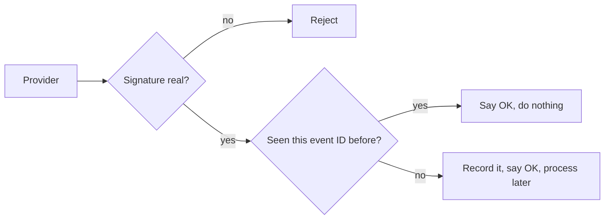
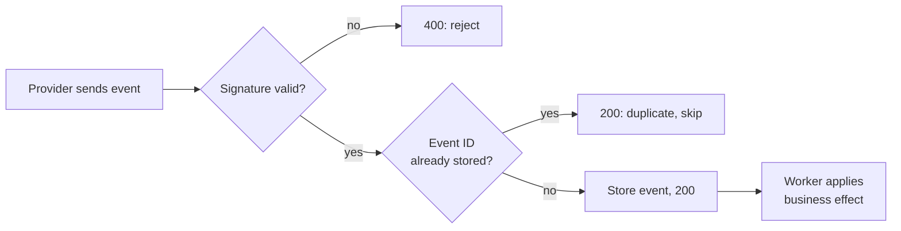
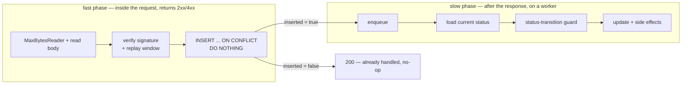
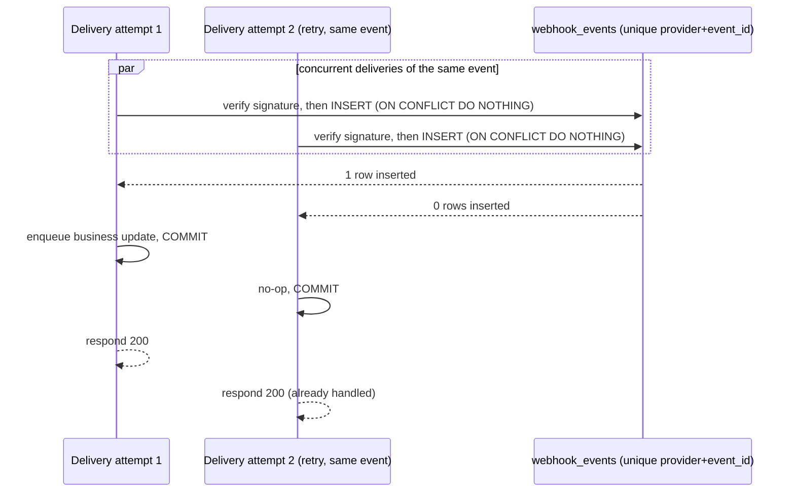
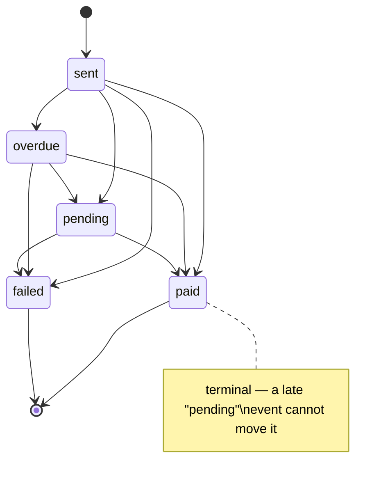

# Receiving Webhooks Idempotently

> [!summary] TL;DR
> A Go webhook handler must do four things in order: read a size-capped raw body, verify its HMAC signature in constant time within a replay window, deduplicate on `(provider, event_id)` with a database constraint (not an in-memory check), and acknowledge `2xx` before the slow business logic runs — so the same delivery, retried or duplicated, never has an effect more than once.

> [!abstract] Core idea
> - Verify the signature over the **raw bytes** of the body, before JSON-decoding it, using `hmac.Equal` — never `==` or `bytes.Equal`, which both leak timing information.
> - A unique index on `(provider, event_id)` plus `INSERT ... ON CONFLICT DO NOTHING` makes "have we seen this event?" atomic; a `SELECT` followed by an `INSERT` in two steps is a race that lets two concurrent retries both go through.
> - Acknowledge fast, process after: store the event and return `200` immediately, then apply the business effect from a worker, so a slow downstream call never causes the provider to time out and retry a delivery that actually succeeded.
> - Classic mistake: treating "duplicate" and "invalid" the same way. A duplicate is success (ack, skip); a bad signature is a client error; your own failure to process is the only case that should make the provider retry.

## Start here: the basics 🟢

> [!info] How to read this note (pick your level)
> - 🟢 **New to this?** Read "From zero" below, then sections 1, 2 and the cheat sheet (10). Stop there, that is a full first pass.
> - 🟡 **Know the basics?** Add section 3 (how it works), 4 (worked example) and 5-6.
> - 🔴 **Interview / SDE-3 prep?** Add 7, 8 and 9. Headings are tagged 🟢🟡🔴 so you always know where you are.

> [!note] Before this note
> - [[Webhooks - Sending and Receiving]]: a provider calls your URL with a POST when something happens, and retries if you do not answer 2xx.
> - [[Idempotency and Idempotency Keys]]: doing the same action twice must have the same effect as doing it once, usually by remembering a unique key.
> - [[Error Handling]]: Go errors are values you check, wrap and compare with `errors.Is`.

**From zero, in 60 seconds** 🟢

A **webhook** is a phone call in reverse: instead of you asking the payment provider "anything new?", the provider calls your server when something happens — "invoice 42 just got paid".

Two problems come with that. Anyone on the internet can also call that URL, so you must check the message really came from the provider (a secret stamp called an **HMAC signature**). And providers re-send messages when they are unsure you got them, so the same event can arrive twice.



Handling the same message twice must change nothing. That property is called **idempotency**, and you get it by remembering every event ID in the database.

The rest of this note is just these 4 questions:
1. How do you verify the signature safely (raw bytes, constant time)?
2. How do you deduplicate so a repeat delivery is a no-op?
3. Why answer OK first and do the slow work after?
4. What about events that arrive out of order?

**The problem in one story.**
A payment company tells your server "invoice 42 was paid" by calling your URL.
The network hiccups, they never hear back, so they send the same message again.
If your code emails a receipt and credits the ledger each time, the customer gets two receipts and you count the money twice.
An idempotent webhook handler does the work once, however many copies arrive.

**Words you need first**

| Word | Plain meaning | Tiny example |
| --- | --- | --- |
| Webhook | A server calling *your* URL to tell you something happened | Stripe POSTs `invoice.paid` to `/webhooks/stripe` |
| Retry | Sending the same message again after no success reply | Provider re-sends after a timeout |
| Idempotent | Doing it twice has the same effect as doing it once | Setting status to `paid` twice |
| Event ID | The provider's unique ID for one event | `evt_1Nq...` |
| HMAC signature | A hash of the body made with a shared secret, proving who sent it | `Stripe-Signature: t=...,v1=...` |
| Unique constraint | A database rule that rejects a second row with the same key | `UNIQUE (provider, event_id)` |
| `2xx` / `4xx` / `5xx` | Success / your-request-is-bad / server-failed status codes | `200`, `400`, `500` |

| Raw body | The exact bytes the provider sent, before any JSON decoding | `io.ReadAll(r.Body)` |
| Constant-time compare | A comparison that takes the same time whether it matches or not | `hmac.Equal(a, b)` |
| Replay window | How old a signed message may be before it is rejected | 5 minutes |
| `ON CONFLICT DO NOTHING` | Postgres: if this key already exists, skip the insert without an error | second copy of `evt_42` inserts 0 rows |
| Outbox | A table row written in the same transaction, picked up later by a worker | "mark invoice 42 paid" |
| State machine | Fixed states and the allowed moves between them | `pending → paid`, never `paid → pending` |

**Picture it**



**Analogy.** A bank teller stamping each cheque number in a ledger: a second copy of cheque #1001 is recognized and not cashed again.
Where it breaks: a teller handles one cheque at a time, but two webhook retries can arrive in the same millisecond, so the "seen it?" check must be atomic in the database.

**How the rest of this note builds up**

- First, why retries make duplicates unavoidable (section 1) and the mental model (section 2).
- Then how it works: raw body, size cap, signature check, replay window, atomic dedupe, response codes (section 3).
- Then a full Go worked example with tests (section 4).
- Finally the SDE-3 deep dive: outbox hand-off, out-of-order events, trade-offs and production failures (sections 5-8).

> [!tip] Remember
> Verify the signature, record the event ID atomically, answer fast, and treat a duplicate as success.

## 1. Why it exists 🟢

InvoiceOps's payment provider calls `POST /webhooks/stripe` when an invoice is paid.

The network between the provider and InvoiceOps is not reliable: the provider's retry policy assumes it is not, and will re-send the same event if it does not see a `2xx` within its timeout (Stripe's default webhook timeout is seconds, not minutes), or if its own queue redelivers after a transient failure on its side.

If the handler updates the invoice to `paid` and sends a receipt email on every delivery it receives, a retried delivery of an event InvoiceOps already processed sends a second receipt email.

Worse, it re-runs any side effect that was not itself idempotent (crediting a ledger twice is a real-money bug, not a cosmetic one).

The handler has to tell "an event I have not seen" from "a retry of an event I have already fully handled" — and it has to do that correctly even when two retries of the same event arrive within milliseconds of each other, racing each other through the handler concurrently.

A second, unrelated failure mode: anyone who finds the endpoint URL can `POST` a forged "invoice.paid" body to it. Without a signature check, that forged request marks a real invoice paid. The fix for both problems is the same shape of code: verify first, then deduplicate, then process once.

### A real-life example 🟢

When you pay a Swiggy order by UPI, the payment gateway tells Swiggy's server "payment captured" with a webhook. On a bad network moment, the gateway does not get Swiggy's reply in time and sends the same message again a minute later. Swiggy's server checks the signature, sees it already stored that event ID, answers "OK" and does nothing more. So your order is confirmed once, and you are charged and notified once.

## 2. Mental model 🟢

Treat the handler as two phases that must not share a transaction or a timeout budget:

1. **The fast phase**, inside the HTTP request: gate the body size, verify the signature and replay window, and try to insert the event id. This phase only ever touches one small table and must finish in milliseconds.
2. **The slow phase**, after the response has already been sent: load the business record, apply the status change if it is still valid to apply, write it, and trigger any side effects.



The provider only ever sees the fast phase's outcome. Everything in the slow phase happens on InvoiceOps's own clock, so a slow email provider or a Postgres hiccup there can never make the webhook delivery itself look like a failure to the sender.

## 3. How it works 🟡

🟢 → 🟡 You now know the four steps: check the signature, remember the event ID, answer fast, do the slow work later. Next we open the box: how to check the signature safely, how to read the body, how the database makes the "seen it?" check race-free, why the hand-off needs an outbox, and what to do with events that arrive out of order.

### Signature verification: raw bytes, constant time, a replay window

**In plain words:** check the secret stamp on the exact bytes that arrived, using a comparison that takes the same time whether it matches or not, and reject stamps that are too old.

**Step by step:**
1. Stripe sends header `Stripe-Signature: t=1732150000,v1=ab12...` and a body.
2. Rebuild the signed text: `"1732150000" + "." + <raw body bytes>`.
3. Compute HMAC-SHA256 of it with the shared secret.
4. Compare with `v1` using `hmac.Equal`. No match → 400.
5. If `t` is more than 5 minutes away from now → reject as a replay.

```go
func verifySignatureWB(secret []byte, timestamp string, body []byte, sigHex string) bool {
	mac := hmac.New(sha256.New, secret)
	mac.Write([]byte(timestamp))
	mac.Write([]byte("."))
	mac.Write(body)
	want := mac.Sum(nil)
	got, err := hex.DecodeString(sigHex)
	if err != nil {
		return false
	}
	return hmac.Equal(want, got)
}
```

Two details separate this from most tutorial code:

- **`hmac.Equal`, never `==` or `bytes.Equal`.** Both of those compare byte-by-byte and return at the first mismatch, so the time taken to reject a guess leaks how many leading bytes it got right. `hmac.Equal` always compares the full length in constant time.
- **The signature covers `timestamp + "." + body`, not just `body`.** Binding the timestamp into the MAC is what makes the next check meaningful: without it, an attacker who captures one valid, old request can replay it with a forged fresh timestamp and the signature would still check out.

The replay window rejects anything too old (a captured request replayed later) or implausibly in the future (clock skew: two machines' clocks disagreeing):

```go
func VerifyStripeStyle(header string, body []byte, secrets [][]byte, tolerance time.Duration, now time.Time) error {
	ts, sig, err := parseStripeHeader(header) // "t=<unix>,v1=<hex>,v1=<hex>..."
	if err != nil {
		return fmt.Errorf("%w: %v", ErrBadSignature, err)
	}
	age := now.Sub(time.Unix(ts, 0))
	if age < -tolerance || age > tolerance {
		return fmt.Errorf("%w: event time is %s from now (tolerance %s)", ErrReplay, age, tolerance)
	}
	tsStr := strconv.FormatInt(ts, 10)
	for _, secret := range secrets {
		if verifySignatureWB(secret, tsStr, body, sig) {
			return nil
		}
	}
	return ErrBadSignature
}
```

Checking against a **slice** of secrets, not one, is what makes secret rotation possible without downtime: during a rotation window the provider is told the new secret while the handler still accepts signatures made with the old one, until every in-flight delivery signed with the old secret has drained.

Not every provider's scheme has this shape.

Razorpay's `X-Razorpay-Signature` is a single hex HMAC-SHA256 over the raw body with no timestamp bound into it at all, so there is no signed freshness window to check the way Stripe's is checked above.

Razorpay's own guidance leans on the `x-razorpay-event-id` header for deduplication instead of a timestamp check (see the dedupe section below).

If you still want a staleness check, the payload's own `created_at` field is the only candidate, but — unlike Stripe's `t=` value — it is not itself covered by the signature, so treat it as a best-effort sanity check against badly delayed delivery, not a security control an attacker can't forge:

```go
func VerifyRazorpayStyle(sigHex string, body []byte, secrets [][]byte) error {
	if sigHex == "" {
		return ErrBadSignature
	}
	got, err := hex.DecodeString(sigHex)
	if err != nil {
		return ErrBadSignature
	}
	for _, secret := range secrets {
		mac := hmac.New(sha256.New, secret)
		mac.Write(body)
		if hmac.Equal(mac.Sum(nil), got) {
			return nil
		}
	}
	return ErrBadSignature
}
```

The shared rule, regardless of scheme: verify against the **exact bytes** the provider signed. Re-serializing the JSON (even with the same field values) changes whitespace and key order and breaks the signature, so the raw body must be read once, verified, and only then decoded.

### Reading the body safely

**Step by step:**
1. Wrap the body with a 64 KiB cap.
2. Read all of it into `body` once.
3. If it is bigger than 64 KiB, stop with 413 before any other check runs.
4. Use these same bytes for the signature check, then for JSON decoding.

```go
r.Body = http.MaxBytesReader(w, r.Body, maxBodyBytes) // e.g. 64 KiB
body, err := io.ReadAll(r.Body)
if err != nil {
	http.Error(w, "payload too large or unreadable", http.StatusRequestEntityTooLarge)
	return
}
```

`MaxBytesReader` makes `io.ReadAll` return an error once the limit is crossed, instead of letting an unauthenticated caller push an arbitrarily large body into memory before any check has run.

The cap is set once, comfortably above the provider's real payload size, and it runs before the signature check — size limiting an endpoint has to come first, because nothing past it should run at all on an oversized request.

### Deduplicating atomically

**In plain words:** let the database be the memory — a uniqueness rule on (provider, event ID) means the second insert of the same event simply fails, no race possible.

**Step by step:**
1. Two copies of `evt_42` arrive within 1 ms and run at the same time.
2. Both run `INSERT INTO webhook_events (provider, event_id) VALUES ('stripe','evt_42') ON CONFLICT DO NOTHING`.
3. The unique index lets only one insert write a row; it reports 1 row, the other reports 0.
4. The one with 1 row goes on to queue the business update. The one with 0 rows answers 200 and stops.

```sql
CREATE UNIQUE INDEX webhook_events_provider_event_id_key
  ON webhook_events (provider, event_id);

INSERT INTO webhook_events (provider, event_id, payload, received_at)
VALUES ($1, $2, $3, now())
ON CONFLICT (provider, event_id) DO NOTHING;
```

This is the fix for the race the older version of this note's source material had.

It checked "does this event id exist?" with a `SELECT` *before* starting a transaction, so two concurrent retries of the same delivery could both pass that check before either one committed its insert, and both would go on to apply the business update.

`INSERT ... ON CONFLICT DO NOTHING` makes the check and the write one atomic statement: exactly one of two concurrent inserts for the same key reports a row written (`RowsAffected() == 1`); the other reports zero, and only the caller that got a row written goes on to enqueue the business update.



### Ack fast, then process

**In plain words:** answer 'got it' within seconds and do the real work in the background — a slow answer makes the provider re-send, which creates the very duplicates you are defending against.

**Step by step:**
1. The event is new, so the insert wrote a row.
2. Hand the work ("mark invoice 42 paid, send receipt") to a worker.
3. Answer 200 right away, in a few milliseconds.
4. The worker does the slow work afterwards; a slow email service can no longer make the provider retry.

The handler writes the `200` the instant the insert tells it this is a new event, and hands the actual business effect to a worker instead of running it inline:

```go
inserted, err := store.InsertEvent(r.Context(), "stripe", evt.ID, body)
if err != nil {
	http.Error(w, "storage error", http.StatusInternalServerError)
	return
}
if !inserted {
	w.WriteHeader(http.StatusOK) // duplicate: ack, do nothing
	return
}
h.jobs <- job{eventID: evt.ID, invoiceID: evt.Data.Object.InvoiceID, amount: evt.Data.Object.AmountPaid, target: StatusPaid}
w.WriteHeader(http.StatusOK) // ack before the status update runs
```

Response-code policy follows directly from what each outcome means to the *provider*, not from how InvoiceOps feels about the event:

- `2xx` for "processed" and for "duplicate, already processed" alike (both mean "do not retry").
- `4xx` for a bad signature or malformed body (retrying an unfixable request wastes both sides' time).
- `5xx` reserved for InvoiceOps's own failure to even store the event, which is the one case where the provider retrying is exactly the right behaviour.

### Why the hand-off to the worker needs an outbox, not just a channel

**Step by step:**
1. In one transaction: insert `evt_42` into `webhook_events` and insert an outbox row "set invoice 42 to paid".
2. Commit, answer 200.
3. A relay claims undispatched outbox rows with `FOR UPDATE SKIP LOCKED` and applies them.
4. If the process crashes after step 2, the outbox row is still there, so the payment update is not lost.

The `h.jobs <- job{...}` send shown above is the simplest version of "hand off to a worker," and it has a real gap: `job` only lives in process memory.

If the process is killed between the `INSERT ... ON CONFLICT` commit (which already marked this event as seen) and a worker actually draining that job off the channel, the business effect — marking the invoice paid — never happens, and nothing will ever retry it.

The event row says "already handled," so a provider retry of the same delivery is acknowledged and dropped as a duplicate before it reaches the business logic again. That is a real, permanent loss of a payment update, not a latency blip.

The fix is the same one duplicate inserts already lean on: make the hand-off part of the same durable write instead of a separate in-memory step.

An **outbox** table (see [[Transactional Outbox and CDC]]) holds the row `(event_id, invoice_id, target_status, amount, dispatched_at)`, written in the *same* transaction as the `INSERT ... ON CONFLICT` into `webhook_events`.

A separate relay — a goroutine in this same process, or a standalone poller — claims undispatched rows with the identical `FOR UPDATE SKIP LOCKED` pattern used for scheduled jobs (see [[Scheduled Jobs]]) and only marks a row dispatched after the downstream effect (the invoice update, an email send, a WebSocket push) has actually been applied or durably queued.

A process crash now loses nothing: the outbox row is still sitting there, undispatched, waiting for any replica's relay to pick it up on its next pass.

An in-memory channel is an acceptable simplification for a demo or a single-instance service where "the handler process and the worker are the same process and never crash between insert and dispatch" is an assumption you have actually decided to accept — it is not a substitute for an outbox in anything that has to not lose a payment update.

### Out-of-order events

**In plain words:** 'paid' can arrive before 'sent'; trust the state machine and the event's own timestamps, not the arrival order.

**Step by step:**
1. `payment.paid` arrives first; the invoice moves `pending → paid`.
2. A delayed `payment.pending` arrives second.
3. The guard asks: is `paid → pending` an allowed move? No, `paid` is final.
4. The event is logged and dropped, and the provider still gets 200, because it was received fine; it is just stale.

At-least-once, unordered delivery means a late "payment.pending" can arrive *after* "payment.paid" already landed, if the pending notification was merely delayed in transit rather than actually happening later.

Applying every event's status verbatim would let that late arrival un-pay a paid invoice. The fix is a transition guard, not a timestamp comparison (timestamps from different events can themselves arrive out of the order they were generated):

```go
var allowedFrom = map[InvoiceStatus]map[InvoiceStatus]bool{
	StatusPending: {StatusSent: true, StatusOverdue: true},
	StatusPaid:    {StatusSent: true, StatusOverdue: true, StatusPending: true},
	StatusFailed:  {StatusSent: true, StatusOverdue: true, StatusPending: true},
}

func ApplyStatus(current, target InvoiceStatus) (next InvoiceStatus, applied bool) {
	if current == StatusPaid || current == StatusFailed {
		return current, false // terminal: no later event may move it
	}
	allowed, ok := allowedFrom[target]
	if !ok || !allowed[current] {
		return current, false
	}
	return target, true
}
```

A rejected transition is not an error the handler reports back to the provider — the event was successfully received and understood, it is just stale. It is logged and dropped, and the delivery is still acknowledged with `200`.



Partial payments get the same treatment as a different kind of guard: InvoiceOps does not support partial settlement, so an `invoice.paid` event whose amount does not match the invoice total is rejected before the status transition even runs, rather than silently marked paid:

```go
func ValidateAmount(invoiceTotalMinor, eventAmountMinor int64) error {
	if eventAmountMinor != invoiceTotalMinor {
		return fmt.Errorf("webhook: event amount %d does not match invoice total %d", eventAmountMinor, invoiceTotalMinor)
	}
	return nil
}
```

## 4. Worked example 🟡

### Whiteboard version

The shape without any of the hardening: decode the body, extract a signature header, compare it, apply the event. It has no size cap, no constant-time compare, no replay window and no dedupe — every one of those gaps is a real, separately exploitable bug, not a simplification. The sections above exist because this version is not safe to ship.

### Production version

**What this code does, in plain words:** the handler caps and reads the body, checks the signature against each allowed secret, inserts the event ID into the store, and answers 200 for new and duplicate events alike; only new events are passed to the worker, which applies the amount check and the status guard.

The full handler, with an in-memory `EventStore` standing in for the Postgres table above (Postgres is not available in this environment; the fake enforces the same "first insert for a key wins" rule a unique index does, under a mutex, so the concurrency test below exercises the real race):

```go
type EventStore interface {
	InsertEvent(ctx context.Context, provider, eventID string, payload []byte) (inserted bool, err error)
}

type Handler struct {
	Secrets     [][]byte
	Tolerance   time.Duration
	Store       EventStore
	Invoices    InvoiceRepo
	Log         *slog.Logger
	Now         func() time.Time
	OnProcessed func(eventID string) // nil in production; lets tests await the async phase
	jobs        chan job
}

func (h *Handler) ServeHTTP(w http.ResponseWriter, r *http.Request) {
	r.Body = http.MaxBytesReader(w, r.Body, maxBodyBytes)
	body, err := io.ReadAll(r.Body)
	if err != nil {
		http.Error(w, "payload too large or unreadable", http.StatusRequestEntityTooLarge)
		return
	}
	if err := VerifyStripeStyle(r.Header.Get("Stripe-Signature"), body, h.Secrets, h.Tolerance, h.Now()); err != nil {
		http.Error(w, "signature verification failed", http.StatusBadRequest)
		return
	}
	var evt StripeEvent
	if err := json.Unmarshal(body, &evt); err != nil || evt.ID == "" {
		http.Error(w, "malformed event", http.StatusBadRequest)
		return
	}
	inserted, err := h.Store.InsertEvent(r.Context(), "stripe", evt.ID, body)
	if err != nil {
		http.Error(w, "storage error", http.StatusInternalServerError)
		return
	}
	if !inserted {
		w.WriteHeader(http.StatusOK)
		return
	}
	target, ok := map[string]InvoiceStatus{
		"invoice.paid":            StatusPaid,
		"invoice.payment_failed":  StatusFailed,
		"invoice.payment_pending": StatusPending,
	}[evt.Type]
	if ok {
		h.jobs <- job{evt.ID, evt.Data.Object.InvoiceID, evt.Data.Object.AmountPaid, target}
	}
	w.WriteHeader(http.StatusOK)
}

func (h *Handler) process(j job) {
	current, total, err := h.Invoices.Get(context.Background(), j.invoiceID)
	if err != nil {
		h.Log.Error("load invoice failed", "event_id", j.eventID, "err", err)
		return
	}
	if j.target == StatusPaid {
		if err := ValidateAmount(total, j.amount); err != nil {
			h.Log.Error("amount mismatch", "event_id", j.eventID, "err", err)
			return
		}
	}
	next, applied := ApplyStatus(current, j.target)
	if !applied {
		h.Log.Info("transition ignored (stale or terminal)", "event_id", j.eventID, "from", current, "to", j.target)
		return
	}
	if err := h.Invoices.UpdateStatus(context.Background(), j.invoiceID, next); err != nil {
		h.Log.Error("update failed", "event_id", j.eventID, "err", err)
	}
}
```

**What this code does, in plain words:** the tests sign events with a test secret and check that a tampered body fails verification, a duplicate delivery is acknowledged without reprocessing, a late `pending` cannot undo `paid`, and 10 goroutines sending the same event cause exactly one update.

Tests, run with `go test -race`, each proving one claim from the sections above:

```go
func TestVerifyStripeStyle_TamperedBodyFails(t *testing.T) {
	secret := []byte("whsec_test")
	now := time.Now()
	body := paidEvent("evt_1", "inv_1", 10000, now)
	header := stripeHeader(secret, now, body)
	tampered := bytes.Replace(body, []byte("10000"), []byte("1"), 1)
	if err := VerifyStripeStyle(header, tampered, [][]byte{secret}, 5*time.Minute, now); err == nil {
		t.Fatal("expected tampered body to fail signature verification")
	}
}

func TestHandler_DuplicateDeliveryAcksWithoutReprocessing(t *testing.T) {
	// ... sends the same signed event twice, then flips the invoice to
	// "failed" between the two deliveries to make a wrongly-reprocessed
	// duplicate observable ...
	rr1 := send() // 200, processed
	waitProcessed(t, processed, "evt_dup")
	_ = invoices.UpdateStatus(context.Background(), "inv_1", StatusFailed)
	rr2 := send() // 200 again, but must NOT reprocess
	if rr2.Code != http.StatusOK {
		t.Fatalf("duplicate delivery status = %d, want 200 (ack, not reject)", rr2.Code)
	}
	select {
	case ev := <-processed:
		t.Fatalf("duplicate delivery was processed again (event %q)", ev)
	case <-time.After(100 * time.Millisecond):
	}
}

func TestHandler_ConcurrentDuplicateDeliveriesProcessExactlyOnce(t *testing.T) {
	// 10 goroutines POST the identical signed event at once.
	// All 10 responses must be 200; the business effect must run exactly once.
	// ...
	if got := atomic.LoadInt32(&processedCount); got != 1 {
		t.Fatalf("processed %d times across %d concurrent identical deliveries, want exactly 1", got, concurrency)
	}
}

func TestHandler_OutOfOrderPendingAfterPaidIsIgnored(t *testing.T) {
	// send "paid" first, wait for it to apply, then send a "pending" event
	// whose own Created timestamp is earlier than "paid"'s
	// ...
	status, _, _ := invoices.Get(context.Background(), "inv_ooo")
	if status != StatusPaid {
		t.Fatalf("invoice status = %q, want paid (late pending must not downgrade it)", status)
	}
}
```

All of the above pass, including a full concurrent-delivery test (`TestHandler_ConcurrentDuplicateDeliveriesProcessExactlyOnce`, 10 goroutines posting the same signed event) and a bad-signature rejection test under `go test -race`.

## 5. Variants and comparison 🟡

| Scheme | Replay protection | Dedupe key | Use when |
| --- | --- | --- | --- |
| Stripe-style (`t=...,v1=...`) | Timestamp bound into the MAC, header-level tolerance window | `event.id` from the JSON body | A provider that signs its own timestamp; the strongest default |
| Razorpay-style (`X-Razorpay-Signature`) | None at the HTTP layer; check the event's own `created_at` field after verifying | `x-razorpay-event-id` header or the event id in the body | A provider whose signature scheme has no timestamp of its own |
| GitHub-style (`X-Hub-Signature-256`) | None; GitHub does not redeliver automatically on failure, so replay risk is mostly "someone replays a captured request" | `X-GitHub-Delivery` (unchanged across any manual redelivery) | A provider with no automatic retries, so dedupe mainly guards manual redelivery and testing |
| Standard Webhooks spec (`webhook-id`, `webhook-timestamp`, `webhook-signature`) | Timestamp header, checked the same way as Stripe's | `webhook-id` | A provider implementing the open standard directly |

## 6. Trade-offs and when not to use 🟡

- A unique-index dedupe table grows forever unless it is pruned; keep only as long as the provider's own retry window can plausibly still redeliver (a few days), then delete or partition old rows.
- Processing on a worker after acking means a true processing failure is invisible to the provider — it already got its `200`. This has to be covered by your own retry mechanism (a dead-letter queue or a reconciliation job that polls the provider for events it believes it sent but your side never shows as applied), not by hoping the provider resends.
- A replay-window check adds a hard requirement that the server's clock be reasonably correct (NTP-synced); a server with multi-minute clock drift will reject genuinely fresh events.
- For an internal, trusted caller (not a public internet-facing webhook), full HMAC verification can be overkill compared to mTLS or a network-level allowlist — see [[Secure Coding for Go Services]] for the broader menu of service-to-service auth options.

### Duplicate vs invalid vs failed 🟡

These three are often answered with the same status code, which is wrong:

| Case | What it means | Answer |
| --- | --- | --- |
| Duplicate | We already stored this event ID | 200, do nothing |
| Invalid | Bad signature, too old, or broken JSON | 400, provider should not retry |
| Our failure | We could not even store the event | 500, provider should retry |

### Common beginner mistakes 🟢

- Decoding the JSON, then re-encoding it to check the signature → whitespace and key order change and the check fails → verify the raw bytes.
- Comparing signatures with `==` → timing leaks how much of a guess is right → use `hmac.Equal`.
- Checking "seen it?" with a `SELECT` and then `INSERT` → two retries both pass → use a unique index with `ON CONFLICT DO NOTHING`.
- Doing the slow work before answering → the provider times out and retries → answer 200 first, process on a worker.
- Returning 500 for a duplicate → the provider keeps retrying forever → treat a duplicate as success.

## 7. In production 🔴

🟡 → 🔴 You can now receive webhooks safely and process each event exactly once. The advanced part covers what happens in live systems: secret rotations, backed-up workers, replayed old requests, and why you still need a reconciliation job for events that never arrive.

- **Real systems:** Stripe, GitHub, Razorpay and the Standard Webhooks spec all converge on "HMAC over the raw body, event id for dedupe, ack fast" as the shape, differing mainly in header names and whether a timestamp is bound into the signature.
- **Failure modes → fixes:**
  - Two retries of one delivery race through the handler concurrently → resolved by `ON CONFLICT DO NOTHING`'s atomicity, not by an in-memory map or a mutex (which do not survive a restart or work across replicas).
  - A secret rotation locks out every in-flight old-secret-signed delivery → accept both the old and new secret for the rotation window, and only remove the old one once the provider confirms the new one is fully in use.
  - The worker queue backs up and the slow phase falls behind the fast phase → with an outbox-backed hand-off, the event is already durably stored *and* the effect is queued durably, so this is a latency problem, not a correctness one; monitor queue depth (see [[Background Workers and Job Queues]]) rather than panicking about it as data loss. With a bare in-memory channel instead of an outbox, a backed-up queue is still only a latency problem, but a crash while the channel holds unclaimed jobs is a real, silent loss — which is exactly why production code needs the outbox, not the channel alone (see above).
  - A forged request with a stolen-but-expired signature is replayed → the tolerance window rejects it once its timestamp ages out, even if the signature itself is otherwise valid for a secret that was never rotated.
- **What to monitor:** signature-verification failure rate (a sudden spike can mean a secret rotation went wrong, or an attack); duplicate-event rate (expected to be nonzero — providers do retry — but a sustained spike means your "ack fast" path is too slow and the provider is timing out); time from receipt to processed; count of transitions rejected by the state-machine guard (a rising rate can mean the provider is sending more out-of-order than expected, or that your terminal-state logic is wrong).

## 8. Deep dive 🔴

- **Why the fast/slow split must not share a database transaction.** If the status update ran inside the same transaction as the `INSERT ... ON CONFLICT`, any slowness in that update (a lock wait on the invoice row, a slow trigger) delays the `COMMIT` the provider is implicitly waiting on for its response. Splitting them means the fast phase's transaction can commit (and the `200` go out) independently of how long the slow phase takes.
- **Why reconciliation still matters even with perfect webhook handling.** A provider can simply fail to send an event (an outage on its side before it ever reaches you), and no amount of correct handling on the receiving end fixes an event that never arrived. Production systems pair webhooks with a periodic job (see [[Scheduled Jobs]]) that polls the provider's "list events since X" API and reconciles any gap — webhooks are the fast path, not the only path.
- **Outbound webhooks are the mirror image, owned elsewhere.** Signing a payload to send, retrying with backoff, a per-endpoint dead-letter queue, and guarding against SSRF when the destination URL is customer-supplied are all sender-side concerns, covered in [[Webhooks - Sending and Receiving]]; this note only covers receiving.
- **The amount guard is a narrow example of a wider rule.** Trusting a webhook's payload for anything beyond "something happened, go check" is risky: the safest handlers treat the event as a cue to re-fetch the authoritative state from the provider's API rather than trusting every field in the payload. InvoiceOps's amount check here is a middle ground, chosen because re-fetching on every event would undo most of the latency benefit webhooks exist for.

## 9. Interview questions 🔴

> [!question]- Why `hmac.Equal` instead of `==` or `bytes.Equal` to compare a signature?
> Both `==` and `bytes.Equal` return as soon as they find a mismatching byte, so the time taken to reject a guess leaks how many leading bytes were correct — an attacker can recover the signature byte by byte through timing. `hmac.Equal` always compares the full length, in constant time, regardless of where the first difference is.

> [!question]- Trap: a webhook handler checks `SELECT 1 FROM webhook_events WHERE event_id = $1`, and only inserts if that returns no rows. What's the bug?
> That is two separate round-trips with a race between them: two concurrent deliveries of the same event can both see "not found" before either one's insert commits, so both proceed to apply the business update. `INSERT ... ON CONFLICT (event_id) DO NOTHING` makes the check and the write one atomic statement, so only one of two racing inserts ever reports a row written.

> [!question]- Why acknowledge before processing, rather than process and then acknowledge?
> The provider is waiting on the response with its own short timeout (seconds, for most providers). Processing inline risks that timeout firing on correctly-processed-but-slow requests, which the provider then retries — creating duplicates of an event that already succeeded. Acking first, from a point where the event is already durably stored, decouples the provider's timeout from however long the actual business logic takes.

> [!question]- A duplicate delivery and a forged delivery are both "not processed again." Why does the handler return `200` for one and `400` for the other?
> The status code is a signal to the *sender* about what to do next. A duplicate means "I already have this, stop retrying" — `2xx`. A bad signature means "this request is not valid as sent; retrying it unchanged will not help" — `4xx`. Returning the same code for both would make the provider either retry a forgery forever or stop retrying a legitimate event it thinks failed.

> [!question]- An `invoice.paid` event arrives for an invoice that's already `paid`. What should happen?
> Nothing, and the delivery should still be acknowledged with `200`. The event was understood and handled correctly — "already paid" is the expected steady state after the first delivery processed it — it is not an error to report back to the provider.

> [!question]- Why can't you rely on an event's own timestamp to detect out-of-order delivery?
> Events are generated at different times at the source but can arrive in any order over the network, and clocks between systems are never perfectly synced. A state-machine guard (what transitions are legal from the invoice's *current* stored status) is robust to arrival order; a timestamp comparison is not, because you cannot trust that the timestamps you're comparing were even generated in the order you received them.

> [!question]- Your secret rotation window has ended. What breaks if you remove the old secret too early?
> Any delivery still in flight — or any retry of a delivery the provider queued before it switched to the new secret — fails signature verification and is rejected as a forged request, even though it is entirely legitimate. Remove an old secret only after confirming (via provider dashboard or logs) that no deliveries signed with it are still arriving.

## 10. Cheat sheet 🟢

- Cap the body with `http.MaxBytesReader` before reading it; verify the signature over the **raw** bytes, before decoding JSON.
- `hmac.Equal`, never `==`/`bytes.Equal`, for the comparison.
- Bind a timestamp into the signed data (or check one in the payload) and enforce a replay-tolerance window.
- Dedupe with a unique `(provider, event_id)` index and `INSERT ... ON CONFLICT DO NOTHING`, never a prior `SELECT`.
- Ack `2xx` the moment the event is durably stored; do the business update on a worker, handed off through an outbox row written in the same transaction, not a bare in-memory channel.
- `2xx` = processed or duplicate; `4xx` = bad signature/malformed; `5xx` = only your own failure to store the event.
- Guard status transitions with a state machine, not with timestamps; make terminal states (`paid`, `failed`) reject any further transition.
- Pair webhooks with a reconciliation job: a provider that never sends an event is a gap no amount of correct handling closes.

## Self-check 🟢🟡

> [!question]- Why must the signature be checked on the raw body?
> The provider signed those exact bytes; decoding and re-encoding changes them.

> [!question]- What status do you return for a duplicate event?
> 200, because it was already handled and the provider should stop retrying.

> [!question]- Which Go function compares signatures safely?
> `hmac.Equal`.

> [!question]- Why is `SELECT` then `INSERT` not safe for dedupe?
> Two concurrent retries can both see "not found" before either inserts.

> [!question]- Why is a timestamp inside the signed data important?
> It lets you reject old captured requests, because the attacker cannot change the timestamp without breaking the signature.

> [!question]- Why hand off to the worker through an outbox and not a channel?
> A crash after commit would lose the channel job, while the event is already marked as seen; the outbox row survives.

## Links 🟢

- **Before this:** [[Webhooks - Sending and Receiving]], [[Idempotency and Idempotency Keys]]
- **Next:** [[File Uploads and Object Storage]], [[Observability in Go Services]]
- **Compare with:** [[Scheduled Jobs]] (the reconciliation job that backstops missed webhooks), [[Background Workers and Job Queues]] (where the slow phase actually runs), [[Transactional Outbox and CDC]] (the crash-safe hand-off from fast phase to slow phase), [[Secure Coding for Go Services]]

### Watch on YouTube

- [Implementing Signature Verification for Webhooks (GitHub HMAC verification)](https://www.youtube.com/watch?v=I2ZYUulreI4) · Hookdeck · walkthrough of HMAC signature verification for inbound webhooks
- [Handling Webhook Requests - Advanced Integration](https://www.youtube.com/watch?v=reTc0t0rnTo) · Prismatic · covers idempotency/dedup handling alongside signature checks
