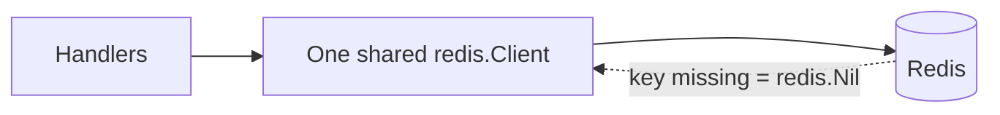
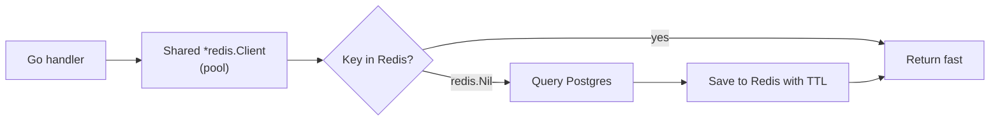
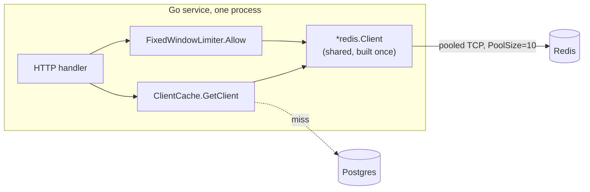
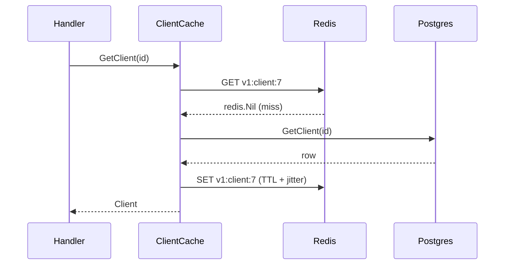
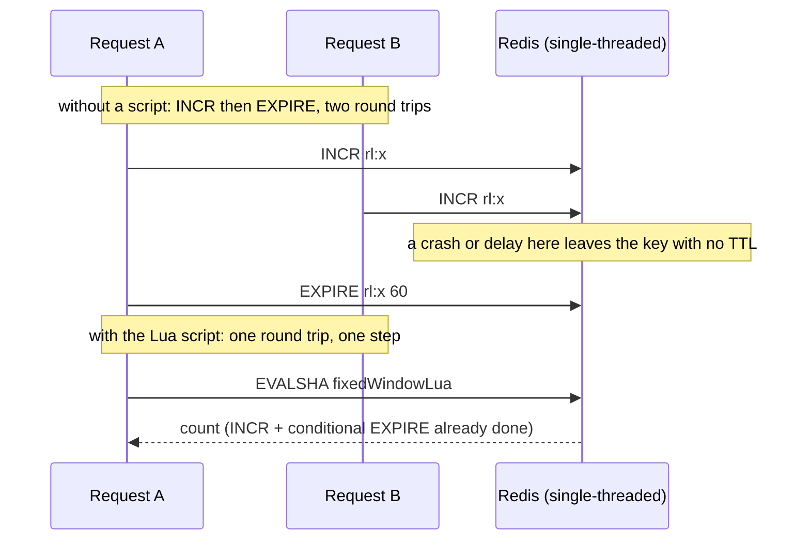

# Redis in Go

> [!summary] TL;DR
> A Go service talks to Redis through one shared `*redis.Client` (go-redis v9), passed in through every repository's constructor like any other dependency. The patterns — what to cache, how to lock, how to queue — live in `08 Caching & Redis`; this note is the Go-specific wiring: client lifecycle, `redis.Nil` handling, an atomic Lua-scripted counter, and what to decide before you let anything depend on Redis being up.

> [!abstract] Core idea
> - One `*redis.Client` per process, built once at startup with explicit pool size and timeouts, shared by every repository — never one client per request.
> - `redis.Nil` is not an error, it is Redis's "key does not exist": a cache-aside read must branch on it, not log it as a failure.
> - A read-then-write against Redis (`INCR` then `EXPIRE`, or "check the lock token then delete it") is not atomic unless it runs as one Lua script. Two round trips leave a window where a crash, a retry, or another goroutine changes the answer.
> - Classic mistake: letting a cache or a rate limiter make Redis a single point of failure for a request that would have worked fine without it.

## Start here: the basics 🟢

> [!info] How to read this note (pick your level)
> - 🟢 **New to this?** Read "From zero" below, then sections 1, 2 and the cheat sheet (10). Stop there, that is a full first pass.
> - 🟡 **Know the basics?** Add section 3 (how it works), 4 (worked example) and 5-6.
> - 🔴 **Interview / SDE-3 prep?** Add 7, 8 and 9. Headings are tagged 🟢🟡🔴 so you always know where you are.

**From zero, in 60 seconds** 🟢

**Redis** is a tiny, very fast database that keeps everything in memory. Services use it for things that must be quick and may be forgotten: caches, counters, rate limits, locks.

In Go you make one Redis client at startup and share it everywhere, just like the database pool.



One quirk trips everyone: when a key does not exist, Redis does not return an error-error — it returns a special value (`redis.Nil`) meaning "miss". Treating a miss as a failure breaks caching.

The rest of this note is just these 4 questions:
1. How do you build and share the one client?
2. How do you tell a cache miss from a real failure?
3. How does the atomic Lua rate limiter work?
4. What should still work when Redis is down?

**The problem in one story.**
Your dashboard runs the same heavy database query hundreds of times a second.
Most of those users want data that has not changed in the last second.
Redis is a fast in-memory store you keep next to the database, so you can save that answer, count login attempts, or hold a lock.
This note is about using it safely from Go.

**Words you need first**

| Word | Plain meaning | Tiny example |
| --- | --- | --- |
| Redis | An in-memory key-value server, very fast | `SET user:1 "Asha"` |
| Key / value | A name and the data stored under it | `dash:ws42` → JSON summary |
| TTL | Time-to-live: how long until a key deletes itself | `EXPIRE key 60` |
| Cache | A quick copy of slow data | Dashboard summary saved for 30 s |
| Connection pool | A set of reusable open connections | go-redis keeps 10 ready |
| Atomic | Happens as one step, nothing can sneak in between | A Lua script running `INCR` + `EXPIRE` |
| Lua script | A small program Redis runs as one atomic command | `EVAL "..." 1 key` |
| `redis.Nil` | go-redis's signal that a key does not exist | Cache miss on `GET` |

**Picture it**



**Analogy.** A sticky note on your monitor with a phone number you look up often, instead of opening the phone book every time.
Where it breaks: a sticky note never vanishes mid-sentence, but Redis can be slow or down, and your service must decide what to do then.

**How the rest of this note builds up**

- First, why a Go service needs Redis and the broken two-command rate limiter (section 1), then the mental model of atomicity (section 2).
- Then how it works: one client, `redis.Nil`, Lua scripts, timeouts (section 3).
- Then a worked example with cache-aside, an atomic counter and tests (section 4).
- Finally the SDE-3 deep dive: variants, trade-offs, Redis as a single point of failure, and production failures (sections 5-8).

> [!tip] Remember
> One shared client, treat `redis.Nil` as a miss, and do read-then-write in one Lua script.

## 1. Why it exists 🟢

InvoiceOps's dashboard handler does one `SELECT` across workspaces, clients and invoices to build a summary.

Illustrative numbers for a workspace with 50,000 invoices: **p50 around 40 ms, p99 around 180 ms** (assumed for the story, not measured; measure your own).

At 200 requests/second from a handful of busy workspaces refreshing their dashboard every few seconds, that is 200 of those queries per second landing on the primary, most of them asking for data that changed a second ago.

The question this note answers is not "should InvoiceOps cache this" — [[Caching Patterns]] already covers cache-aside — but **how a Go service wires a Redis dependency so that caching, rate limiting and locking survive contact with concurrency and failure**:

- who owns the client,
- what happens when two goroutines race the same key,
- and what happens to the request when Redis itself is slow or down.

A second, sharper problem: InvoiceOps's login endpoint needs a rate limit. The obvious first draft is:

```text
n = INCR(rate:login:{ip})
if n == 1: EXPIRE(rate:login:{ip}, 60)
if n > 5: reject
```

The first request from an IP runs `INCR` and gets `n == 1`. Now picture a crash, a timeout or a dropped connection *between* that `INCR` and the `EXPIRE`.

The key now has a count but no TTL: it never expires, and once the count passes 5 that IP is rate-limited forever. This is not a hypothetical; it is the default behavior of two separate commands against a service that has no idea they were meant to be one unit.

## 2. Mental model 🟢

Treat Redis exactly like Postgres: a remote dependency with a connection pool, a context on every call, and a failure mode the service must have an opinion about.

The difference that matters for Go code is **atomicity across two commands**. Postgres gives you `BEGIN; ...; COMMIT`. Redis gives you three ways to get the same guarantee for a handful of commands:

- `MULTI`/`EXEC` (queues commands, but can't branch on a value it just read),
- `WATCH` (optimistic, retries under contention),
- or a **Lua script** (the one Redis command that runs several steps with no other client's command in between).

For anything that reads a value and then decides what to write based on it — a rate limiter, a lock release — the script is the standard answer.



## 3. How it works 🟡

### The client as a shared dependency

**In plain words:** build the client once in main and pass it in through constructors, the same way the database pool travels.

Build one `*redis.Client` in `main`, next to the `*pgxpool.Pool`, and inject it the same way (see [[Service Project Layout and Wiring]]). The options that matter:

- **`PoolSize`** bounds how many sockets the process can hold open to Redis at once. go-redis v9's default is `10 * GOMAXPROCS`; set it explicitly so a code review can see the number instead of inheriting whatever the host happens to report as CPU count.
- **`DialTimeout`, `ReadTimeout`, `WriteTimeout`** bound how long one command can stall a goroutine. Set them well under your handler's own deadline (milliseconds, not the driver's multi-second defaults), or a wedged Redis silently turns into a wedged API.
- **`MaxRetries`** (default 3) makes go-redis retry a command after a network or timeout error. It does not know which commands are safe to repeat: a retried `INCR` or script whose first attempt actually reached the server runs twice. Keep it low, and make anything non-idempotent tolerate a replay.
- **A `context.Context` on every call.** The per-call `ctx` carries the request deadline and cancellation into the command; the timeouts above are only the backstop.

### `redis.Nil` is the miss, not the failure

**In plain words:** 'the key is not there' is normal life for a cache; only network and server errors are real failures, and the code must split the two.

Every `Get` that finds nothing returns `redis.Nil` as the error. Code that does `if err != nil { return err }` without checking `errors.Is(err, redis.Nil)` first turns every cache miss into a 500.



### Cache-aside: the wiring, not the pattern

The pattern itself — check, miss, fill, invalidate — is [[Caching Patterns]]'s job, with the full `singleflight`-coalesced version. The part that is specific to writing it into a real Go service:

- **Fail-open vs fail-closed.** When `Get` returns a non-`Nil` error (a timeout, a connection refused), a cache almost always fails *open*: skip Redis, read the database, the request is just slower. A rate limiter or a lock usually fails the other way — more on that below.
- **Versioned keys.** Prefix the key with a schema version (`v1:client:7`). Bumping it on a deploy that changes the cached shape is cheaper and safer than trying to make `UnmarshalJSON` tolerate every past shape forever.
- **Delete on write, never update.** `UpdateClientEmail` writes to Postgres, then **deletes** the cache key — it never writes the new value into Redis directly. A crash between the two leaves a miss (safe) instead of a stale hit (not safe), and it means the cache never needs to agree with the database's exact serialization.

### The Lua rate limiter

**In plain words:** a few lines of script run inside Redis itself, so 'read the counter, check it, bump it' happens as one uninterruptible step.

A fixed-window limiter needs exactly the atomicity problem from Section 1 solved: increment and set-expiry-only-once, as one step. `redis.NewScript` loads the script once; go-redis sends `EVALSHA` and transparently falls back to `EVAL` the first time the server hasn't cached it.



The algorithms themselves — fixed window vs sliding window vs token bucket/GCRA, and the distributed design questions (which key, which failure mode) — are [[Rate Limiting - Algorithms and Distributed Design]]'s canonical home, including a token-bucket Lua script and an HTTP middleware.

This note's script is the simpler fixed-window form, shown for the atomicity lesson above; wire whichever algorithm the limiter needs the same way.

### Lock caveats

[[Redis Use Cases]] has the full `SET NX PX` + Lua-compare-and-delete lock, its test, and the Redlock debate. The two caveats worth repeating here because they bite in service code specifically:

- A Redis lock is a **lease with a timer**, not a mutex. If the critical section can run longer than the lease TTL — a slow downstream call, a GC pause, a stalled goroutine scheduler — a second caller acquires the lock while the first still believes it holds it. Size the TTL to the work, and treat the lock as an efficiency device (avoid duplicate work) rather than a correctness guarantee, unless it carries a fencing token the protected resource checks.
- Release and renew must both be **token-checked Lua scripts**, never a bare `DEL` or `PEXPIRE`. A plain `DEL` after your lease already expired deletes whoever holds it now.

### Quick reference for the patterns this note does not re-derive

Each of these has a full treatment in the linked note. Here is the Go-specific one-liner:

- **Stampede protection.** Wrap the miss path in `golang.org/x/sync/singleflight` (`g.Do(key, load)`) so 100 concurrent misses for one key become one database query. Cache a short-lived "not found" marker (negative caching, 30 to 60 seconds) so a flood of lookups for ids that do not exist cannot bypass the cache.
- **Sliding window and token bucket.** A sliding window uses a `ZSET` (`ZADD` now, `ZREMRANGEBYSCORE` old, `ZCARD`) inside one Lua script. GCRA / token bucket needs one key and one script; `github.com/go-redis/redis_rate` ships a ready one. Choose the key by who you want to limit: IP for anonymous traffic, user id or API key once authenticated.
- **Do not rate-limit signed webhooks.** A payment provider's webhook endpoint (`rate:webhook:{provider}`) must not return 429 to legitimate events. Verify the signature first and process idempotently; apply rate limits to unauthenticated traffic such as login.
- **Lock.** `SET key token NX PX ttl` to acquire, a token-checked Lua `DEL` to release. Redlock is debated: a single-node lock plus a fencing token the resource checks is the defensible design (see [[Distributed Locks and Fencing Tokens]]).
- **Queues.** `LMOVE`/`BLMOVE` from a ready list to a processing list for a reliable List queue; Streams consumer groups (`XADD`, `XREADGROUP`, `XACK`, `XAUTOCLAIM` to re-deliver a crashed consumer's pending entries, `MAXLEN` to bound size); Pub/Sub is at-most-once, fine for WebSocket fan-out and wrong for jobs.
- **Pipelines and transactions.** `rdb.Pipeline()` batches round trips without atomicity; `rdb.TxPipeline()` wraps the batch in `MULTI`/`EXEC`.
- **Cluster.** A multi-key script or transaction needs every key in one hash slot: use a hash tag such as `{workspace:7}:...` (the limiter above already tags `{key}`).
- **Tests.** `miniredis` (used below) covers commands and Lua; it is not real Redis, so use testcontainers for anything that depends on exact server behavior (Streams edge cases, cluster, eviction).

### What this note does not re-derive

The full queue, pipelining and Cluster treatments already have a canonical home:

- queue semantics in [[Redis as a Queue - Lists, Streams and Pub-Sub]] (patterns) and [[Background Workers and Job Queues]] (the Go worker side);
- the full distributed-lock code and the Redlock debate in [[Redis Use Cases]];
- cache stampede protection in [[Cache Failure Modes - Stampede, Avalanche, Penetration, Hot and Big Keys]].

Link to them instead of re-explaining them.

## 4. Worked example 🟡

### Whiteboard version

**In plain words:** client construction plus one cache-aside read, minimal.

The bare shape of cache-aside and the atomic counter, no pooling, no tests:

```go
package wb

import "context"

type Store interface {
	Get(ctx context.Context, key string) (string, bool, error)
	SetAtomicCounter(ctx context.Context, key string, limit int) (int64, error)
}

func cacheAsideGet(ctx context.Context, s Store, repoLoad func() (string, error), key string) (string, error) {
	if v, ok, err := s.Get(ctx, key); err == nil && ok {
		return v, nil
	}
	return repoLoad()
}
```

The full version below wires a real `*redis.Client`: pool and timeouts, `redis.Nil` handling, the cache-aside wrapper with fail-open/fail-closed, and the Lua-scripted fixed-window limiter. It compiles and passes `go vet` and `go test -race` on Go 1.24.4 with go-redis v9.7.0, tested against `miniredis` v2.40.0 — Redis itself is replaced by that in-process fake in every test.

**The client:**

```go
package redisgo

import (
	"context"
	"time"

	"github.com/redis/go-redis/v9"
)

// NewClient builds the go-redis v9 client a production service wires once at
// startup and shares through every repository. The pool and timeout numbers
// are the knobs that matter in an incident: PoolSize caps how many sockets
// the service can hold open to Redis; the three timeouts bound how long a
// single command can stall a goroutine waiting on a slow or wedged Redis.
func NewClient(addr string) *redis.Client {
	return redis.NewClient(&redis.Options{
		Addr: addr,

		PoolSize:     10, // per process; go-redis default is 10 * GOMAXPROCS
		MinIdleConns: 2,  // keep a few warm so a burst doesn't pay connect cost

		DialTimeout:  2 * time.Second,
		ReadTimeout:  200 * time.Millisecond,
		WriteTimeout: 200 * time.Millisecond,

		MaxRetries: 2, // go-redis retries on network errors, even for non-idempotent commands
	})
}

// Ping is the health check a readiness probe calls. It must carry its own
// short deadline: a hung Redis must not hang the whole /readyz handler.
func Ping(ctx context.Context, rdb *redis.Client) error {
	ctx, cancel := context.WithTimeout(ctx, 300*time.Millisecond)
	defer cancel()
	return rdb.Ping(ctx).Err()
}
```

**Cache-aside, wired with fail-open/fail-closed and delete-on-write:**

```go
package redisgo

import (
	"context"
	"encoding/json"
	"errors"
	"fmt"
	"math/rand/v2"
	"time"

	"github.com/redis/go-redis/v9"
)

type Client struct {
	ID    int64  `json:"id"`
	Name  string `json:"name"`
	Email string `json:"email"`
}

// ClientRepo is the uncached source of truth. A real one wraps pgxpool
// (see "Database Access" in this folder).
type ClientRepo interface {
	GetClient(ctx context.Context, id int64) (Client, error)
	UpdateClientEmail(ctx context.Context, id int64, email string) error
}

// cacheSchemaV is bumped whenever the Client struct's JSON shape changes, so
// a rolling deploy never lets an old version decode a new field into zero
// values or a new version choke on a field it no longer expects.
const cacheSchemaV = 1

func clientKey(id int64) string {
	return fmt.Sprintf("v%d:client:%d", cacheSchemaV, id)
}

// FailMode says what a cache-aside wrapper does when Redis itself is down.
type FailMode int

const (
	// FailOpen skips the cache and reads the database. Right for read paths:
	// Redis being down degrades latency, not correctness.
	FailOpen FailMode = iota
	// FailClosed returns the Redis error. Right when a miss would be unsafe,
	// for example a rate limiter or a lock.
	FailClosed
)

// ClientCache is the cache-aside wrapper: callers only ever see the methods
// of ClientRepo. They never know whether the answer came from Redis or
// Postgres.
type ClientCache struct {
	rdb  *redis.Client
	repo ClientRepo
	ttl  time.Duration
	mode FailMode
}

func NewClientCache(rdb *redis.Client, repo ClientRepo, ttl time.Duration, mode FailMode) *ClientCache {
	return &ClientCache{rdb: rdb, repo: repo, ttl: ttl, mode: mode}
}

// GetClient is cache-aside: check Redis, fall back to the repo on a miss,
// fill the cache, return. Every TTL gets up to 10% jitter so a batch of keys
// written together does not expire together and stampede the database.
func (c *ClientCache) GetClient(ctx context.Context, id int64) (Client, error) {
	key := clientKey(id)

	raw, err := c.rdb.Get(ctx, key).Bytes()
	switch {
	case err == nil:
		var cl Client
		if jerr := json.Unmarshal(raw, &cl); jerr == nil {
			return cl, nil
		}
		// A value that no longer decodes (schema drift that skipped the
		// version bump) is treated as a miss, not a fatal error.
	case errors.Is(err, redis.Nil):
		// genuine cache miss: fall through to the repo
	default:
		if c.mode == FailClosed {
			return Client{}, fmt.Errorf("cache: %w", err)
		}
		// FailOpen: Redis is unavailable, read the database directly
	}

	cl, err := c.repo.GetClient(ctx, id)
	if err != nil {
		return Client{}, err
	}

	if body, jerr := json.Marshal(cl); jerr == nil {
		ttl := c.ttl + time.Duration(rand.IntN(int(c.ttl/10)+1))
		// Best-effort: a failed Set must never turn a successful read into
		// an error. The next reader just misses and refills.
		_ = c.rdb.Set(ctx, key, body, ttl).Err()
	}
	return cl, nil
}

// UpdateClientEmail writes through to the database, then deletes the cache
// entry — it never writes the new value into Redis itself. Deleting (not
// updating) means a crash between the DB commit and the cache write leaves
// a miss, which is safe, instead of a stale hit, which is not.
func (c *ClientCache) UpdateClientEmail(ctx context.Context, id int64, email string) error {
	if err := c.repo.UpdateClientEmail(ctx, id, email); err != nil {
		return err
	}
	if err := c.rdb.Del(ctx, clientKey(id)).Err(); err != nil {
		// The DB write already committed. Losing the invalidation means stale
		// reads until the TTL expires. The wrapped error lets the caller log
		// it and still report the update as successful: the TTL is the
		// backstop.
		return fmt.Errorf("cache invalidation failed, stale until TTL: %w", err)
	}
	return nil
}
```

**The atomic fixed-window limiter:**

```go
package redisgo

import (
	"context"
	"fmt"
	"time"

	"github.com/redis/go-redis/v9"
)

// fixedWindowLua increments a per-window counter and sets its expiry in one
// atomic step. Two separate commands (INCR then EXPIRE) would let a crash,
// a network blip, or just two goroutines interleave between them: the key
// can survive with no TTL (a permanent counter) or reset before the window
// is actually up. KEYS[1] is the window key, ARGV[1] the limit, ARGV[2] the
// window length in seconds. Returns the post-increment count.
const fixedWindowLua = `
local count = redis.call("INCR", KEYS[1])
if count == 1 then
    redis.call("EXPIRE", KEYS[1], ARGV[2])
end
return count
`

var fixedWindowScript = redis.NewScript(fixedWindowLua)

// FixedWindowLimiter rate-limits by a caller-supplied key (IP, user id, or
// API key — the caller decides). The algorithm itself (fixed vs sliding
// window vs token bucket vs GCRA, and the distributed design) is covered in
// the Rate Limiting note; this is the Go wiring: one script call per
// request, run against a shared Redis so every instance of the service
// agrees on the count.
type FixedWindowLimiter struct {
	rdb    redis.Scripter
	limit  int64
	window time.Duration
	now    func() time.Time // injectable so tests do not straddle a window boundary
}

// NewFixedWindowLimiter rounds a window under one second up to one second,
// because the window key and EXPIRE both work in whole seconds.
func NewFixedWindowLimiter(rdb redis.Scripter, limit int64, window time.Duration) *FixedWindowLimiter {
	if window < time.Second {
		window = time.Second
	}
	return &FixedWindowLimiter{rdb: rdb, limit: limit, window: window, now: time.Now}
}

// Allow runs the script and reports whether this request is within the
// limit for key's current window.
func (l *FixedWindowLimiter) Allow(ctx context.Context, key string) (bool, error) {
	windowKey := fmt.Sprintf("rl:fw:{%s}:%d", key, l.now().Unix()/int64(l.window.Seconds()))
	n, err := fixedWindowScript.Run(ctx, l.rdb, []string{windowKey}, l.limit, int64(l.window.Seconds())).Int64()
	if err != nil {
		return false, fmt.Errorf("rate limit script: %w", err)
	}
	return n <= l.limit, nil
}
```

**Tests** (Redis replaced by `miniredis` throughout):

```go
package redisgo

import (
	"context"
	"errors"
	"testing"
	"time"

	"github.com/alicebob/miniredis/v2"
	"github.com/redis/go-redis/v9"
)

func newTestClient(t *testing.T) *redis.Client {
	t.Helper()
	mr := miniredis.RunT(t)
	return redis.NewClient(&redis.Options{Addr: mr.Addr()})
}

type fakeClientRepo struct {
	calls int
	rows  map[int64]Client
}

func (f *fakeClientRepo) GetClient(_ context.Context, id int64) (Client, error) {
	f.calls++
	cl, ok := f.rows[id]
	if !ok {
		return Client{}, errors.New("not found")
	}
	return cl, nil
}

func (f *fakeClientRepo) UpdateClientEmail(_ context.Context, id int64, email string) error {
	cl, ok := f.rows[id]
	if !ok {
		return errors.New("not found")
	}
	cl.Email = email
	f.rows[id] = cl
	return nil
}

func TestClientCache_MissThenHit(t *testing.T) {
	rdb := newTestClient(t)
	repo := &fakeClientRepo{rows: map[int64]Client{7: {ID: 7, Name: "Acme", Email: "a@acme.test"}}}
	cache := NewClientCache(rdb, repo, time.Minute, FailOpen)
	ctx := context.Background()

	got, err := cache.GetClient(ctx, 7)
	if err != nil || got.Name != "Acme" {
		t.Fatalf("first GetClient: %v, %+v", err, got)
	}
	if repo.calls != 1 {
		t.Fatalf("want 1 repo call on a miss, got %d", repo.calls)
	}

	got, err = cache.GetClient(ctx, 7)
	if err != nil || got.Name != "Acme" {
		t.Fatalf("second GetClient: %v, %+v", err, got)
	}
	if repo.calls != 1 {
		t.Fatalf("want the repo untouched on a hit, got %d calls", repo.calls)
	}
}

func TestClientCache_UpdateInvalidatesInsteadOfOverwriting(t *testing.T) {
	rdb := newTestClient(t)
	repo := &fakeClientRepo{rows: map[int64]Client{7: {ID: 7, Name: "Acme", Email: "old@acme.test"}}}
	cache := NewClientCache(rdb, repo, time.Minute, FailOpen)
	ctx := context.Background()

	if _, err := cache.GetClient(ctx, 7); err != nil { // warm the cache
		t.Fatalf("warm: %v", err)
	}
	if err := cache.UpdateClientEmail(ctx, 7, "new@acme.test"); err != nil {
		t.Fatalf("UpdateClientEmail: %v", err)
	}
	if n, _ := rdb.Exists(ctx, clientKey(7)).Result(); n != 0 {
		t.Fatalf("expected the cache entry to be deleted after a write, Exists=%d", n)
	}

	got, err := cache.GetClient(ctx, 7)
	if err != nil || got.Email != "new@acme.test" {
		t.Fatalf("GetClient after update: %v, %+v", err, got)
	}
	if repo.calls != 2 { // one warm miss + one refill after invalidation
		t.Fatalf("want 2 repo calls, got %d", repo.calls)
	}
}

func TestClientCache_FailClosedReturnsErrorWhenRedisIsDown(t *testing.T) {
	mr := miniredis.NewMiniRedis()
	if err := mr.Start(); err != nil {
		t.Fatal(err)
	}
	rdb := redis.NewClient(&redis.Options{Addr: mr.Addr()})
	repo := &fakeClientRepo{rows: map[int64]Client{7: {ID: 7, Name: "Acme"}}}
	cache := NewClientCache(rdb, repo, time.Minute, FailClosed)
	ctx := context.Background()

	mr.Close() // simulate Redis being unreachable

	if _, err := cache.GetClient(ctx, 7); err == nil {
		t.Fatal("FailClosed: want an error when Redis is down, got nil")
	}
	if repo.calls != 0 {
		t.Fatalf("FailClosed must not fall back to the repo, got %d calls", repo.calls)
	}
}

func TestFixedWindowLimiter_AllowsUpToLimitThenBlocks(t *testing.T) {
	rdb := newTestClient(t)
	l := NewFixedWindowLimiter(rdb, 3, time.Minute)
	l.now = func() time.Time { return time.Unix(1_700_000_010, 0) } // fixed clock: no window rollover mid-test
	ctx := context.Background()

	for i := 0; i < 3; i++ {
		ok, err := l.Allow(ctx, "user:1")
		if err != nil || !ok {
			t.Fatalf("request %d: want allowed, got ok=%v err=%v", i, ok, err)
		}
	}
	ok, err := l.Allow(ctx, "user:1")
	if err != nil {
		t.Fatalf("4th request: %v", err)
	}
	if ok {
		t.Fatal("4th request: want blocked, got allowed")
	}

	ok, err = l.Allow(ctx, "user:2") // a different key gets its own counter
	if err != nil || !ok {
		t.Fatalf("different key: want allowed, got ok=%v err=%v", ok, err)
	}
}

func TestFixedWindowLimiter_CountersExpireWithTheWindow(t *testing.T) {
	rdb := newTestClient(t)
	l := NewFixedWindowLimiter(rdb, 1, time.Second)
	ctx := context.Background()

	ok, err := l.Allow(ctx, "ip:9")
	if err != nil || !ok {
		t.Fatalf("first request: ok=%v err=%v", ok, err)
	}
	keys, err := rdb.Keys(ctx, "rl:fw:{ip:9}:*").Result()
	if err != nil || len(keys) != 1 {
		t.Fatalf("want exactly one window key, got %v (err=%v)", keys, err)
	}
	ttl, err := rdb.TTL(ctx, keys[0]).Result()
	if err != nil {
		t.Fatalf("TTL: %v", err)
	}
	if ttl <= 0 || ttl > time.Second {
		t.Fatalf("want a TTL in (0, 1s], got %v", ttl)
	}
}
```

**Measured:** `go vet ./...` clean; `go test -race ./...` — 5 tests, all passed, 1.9 s total (Go 1.24.4, go-redis v9.7.0, miniredis v2.40.0, Apple Silicon, 2026-11-07).

## 5. Variants and comparison 🟡

| Decision | Options | Use when | Cost |
| --- | --- | --- | --- |
| Cache failure mode | Fail-open / fail-closed | Open: any read path. Closed: a lock, or a limiter where "fail open" means "no limit at all" | Fail-closed couples your uptime to Redis's |
| Rate-limit atomicity | Two commands / `MULTI` / Lua script | Lua for anything that reads-then-decides; `MULTI` only for independent writes | A script blocks the single Redis thread for its duration — keep it short |
| Invalidation | Delete / update-in-place | Delete, almost always | Update-in-place risks the cache and DB disagreeing forever if one write is lost |
| Where to rate-limit | In-process `x/time/rate` / Redis + Lua | In-process for a single instance or a soft per-instance cap; Redis when every instance must agree on one global count | Redis adds one round trip per request |

## 6. Trade-offs and when not to use 🟡

- A cache-aside wrapper adds a dependency and a class of bugs (stale reads, schema drift) to a read that might have been fast enough against Postgres alone. Measure before adding it.
- Fail-closed on a cache turns Redis into a second production database you must keep as available as the first — only do that where a miss would be unsafe, not merely slower.
- A single Redis instance is a single point of failure for every service that depends on it; [[Redis Replication, Sentinel and Cluster]] covers the failover story this note assumes someone else owns.
- For a lock, Postgres `SELECT ... FOR UPDATE SKIP LOCKED` or a plain row lock beats a Redis lock whenever the protected work is already a database transaction — no second system to keep consistent with the first.

## 7. In production 🔴

- **Real systems:** go-redis is the Redis project's officially supported Go client; `hibiken/asynq` and the Sidekiq/BullMQ queue ecosystem build on the same Redis atomic-script primitives shown here; Stripe has published a write-up of its Redis-backed rate limiters.
- **Failure modes → fixes:**
  - A slow Redis stalls every handler that calls it synchronously → short `ReadTimeout`/`WriteTimeout`, and fail-open on the cache path so a stall degrades latency, not availability.
  - A cache-aside write updates Redis instead of deleting it, and a lost delete leaves a permanently stale value → always delete, add a safety-net TTL even on "cached forever" keys.
  - A rate limiter's Lua script grows to do real work (not just count) and becomes the slowest command on the server → keep scripts to a handful of commands; move real work out of Redis entirely.
- **What to monitor:** pool `IdleConns`/`TotalConns` vs `PoolSize` (saturation), command latency (`cmd_duration` or your own middleware timing), cache hit ratio per key prefix, rate-limiter reject rate per key, `redis.Nil` rate (a sudden jump signals something is evicting or expiring keys you didn't expect to lose).

## 8. Deep dive 🔴

- **Why `INCR` then `EXPIRE` is genuinely unsafe, not just untidy.** Redis commands are each atomic, but *two* commands from the same client are two separate round trips, and nothing stops another client's command from running between them, or the client itself from crashing between them. `EXPIRE key seconds NX` (since Redis 7.0, "set the TTL only if the key has none") narrows the window to a single command and is a reasonable alternative to a script for this specific case — but a token bucket or anything that reads a value and computes a decision from it still needs the script, because `NX`/`XX` flags can't express "subtract if there's enough, otherwise don't."
- **Pool sizing in numbers.** `PoolSize: 10` with `ReadTimeout: 200ms` means at most 10 commands in flight per process. Throughput is roughly `PoolSize / latency`: at 1 ms per command that is about 10,000 commands/second, so the pool is rarely the bottleneck for cache reads on a same-AZ Redis. If Redis slows to the full 200 ms timeout, the same pool carries only `10 / 0.2 s = 50` commands/second and callers queue for a connection (`PoolTimeout`, default `ReadTimeout + 1s`). That bounded queue is what you want: requests wait briefly instead of opening unbounded new connections.
- **`EVALSHA` and script caching.** `redis.NewScript` doesn't send the script body on every call: it computes the SHA1 once, and `Run` tries `EVALSHA` first. A Redis restart flushes the script cache, so go-redis automatically falls back to `EVAL` (sending the full body) on a `NOSCRIPT` error and re-caches it — this is built into `redis.Script.Run`, not something application code has to handle.
- **Versioned keys across a rolling deploy.** During a deploy, old and new code run side by side for the length of the rollout. If the new code changes `Client`'s JSON shape without bumping `cacheSchemaV`, the old code can read a value the new code wrote and either silently drop new fields or fail to decode — bumping the version prefix means the two populations simply use different keys and never collide.

## 9. Interview questions 🔴

> [!question]- Why is `INCR` followed by `EXPIRE` not safe for a rate limiter?
> They are two separate round trips. A crash, a delay or another client's command between them can leave the key with a count but no TTL, so it never resets — or, under `NX`-less `EXPIRE`, reset the TTL every time and never actually expire on schedule. Make it one atomic unit: a Lua script, or `EXPIRE ... NX` for the specific "set a TTL only once" case.

> [!question]- What does `redis.Nil` mean, and what happens if you treat it like any other error?
> It is go-redis's way of reporting "the key does not exist" from `GET`. Treating it like a real error turns every legitimate cache miss into a 500 response; cache-aside code must check `errors.Is(err, redis.Nil)` first and fall through to the database.

> [!question]- Trap: your cache-aside `Update` writes the new value straight into Redis to "keep it warm." What can go wrong?
> If the database write commits but the Redis write is lost (crash, timeout, a retry that double-applies), the cache can end up holding a value that never matches the database, with no path back to consistency except the TTL. Deleting the key instead means the worst case is a miss — always safe — never a silent, permanent mismatch.

> [!question]- When should a cache fail open, and when should it fail closed?
> Fail open (skip Redis, hit the database) for ordinary reads: Redis being down should make the service slower, not down. Fail closed when a miss would be unsafe to treat as "allow" — a rate limiter that fails open when Redis is down simply stops limiting anything, and a lock that fails open lets two workers run at once.

> [!question]- How does go-redis avoid sending the full Lua script body on every call?
> `redis.NewScript` wraps the script text; `Run` sends `EVALSHA` with the script's SHA1 first, which Redis has cached from the first `EVAL`. If Redis returns `NOSCRIPT` (for example after a restart flushed the cache), go-redis automatically retries with a full `EVAL` and the script is cached again.

> [!question]- Your service has 10 API instances and needs one global rate limit. Why can't `golang.org/x/time/rate` do this alone?
> `x/time/rate` keeps its bucket in process memory. Ten instances each enforcing "100 requests/second" independently allow up to 1,000 requests/second in aggregate, not 100. A shared counter needs a shared store every instance talks to — Redis, with the increment-and-check as one atomic script so two instances never race the same window.

> [!question]- What is the actual difference between a Redis lock and a database row lock, for a Go service that already uses Postgres?
> A Postgres row lock (or `SELECT ... FOR UPDATE`) is held inside a transaction the database itself enforces and releases automatically on commit, rollback, or the connection dying. A Redis lock is a value with a TTL that the *client* is trusted to respect and release correctly — it is a lease, not an enforced lock, so it needs its own token-checked release script and a TTL sized to the work.

## 10. Cheat sheet 🟢

- One `*redis.Client`, built once, explicit `PoolSize` and sub-second timeouts; share it like the Postgres pool.
- `errors.Is(err, redis.Nil)` on every `Get`: that is the miss, not a failure.
- Cache-aside writes: delete on write, never update-in-place; version the key prefix.
- `INCR` + `EXPIRE` as two commands races; use a Lua script (or `EXPIRE ... NX`) for anything atomic.
- Fail-open for caches, fail-closed for anything where a miss means "no limit, no lock."
- Lock release and renewal are token-checked Lua scripts, never a bare `DEL`/`PEXPIRE`.
- Queues, Cluster hash tags and the full lock/Redlock story live in 08/09/11 — link them, don't re-derive them.

## Links 🟢

- **Before this:** [[Redis Hands-on Setup with Go]], [[Caching Patterns]]
- **Next:** [[Background Workers and Job Queues]], [[Rate Limiting - Algorithms and Distributed Design]]
- **Compare with:** [[Redis Use Cases]] (the patterns this note's code wires into a service), [[Distributed Locks and Fencing Tokens]] (the full lock story), [[Database Access (database-sql, pgx, sqlc)]] (the same client-as-shared-dependency shape for Postgres)

### Watch on YouTube

- [Beginner's Guide to Redis with Go!](https://www.youtube.com/watch?v=1C3Ym_JjkMw) · TutorialEdge · intro to connecting and using go-redis client
- [Building a REST API in Go – Part 7: Redis for Caching](https://www.youtube.com/watch?v=CnamhxiYtGo) · DrSimple · wiring a shared redis client into a real Go service for caching
