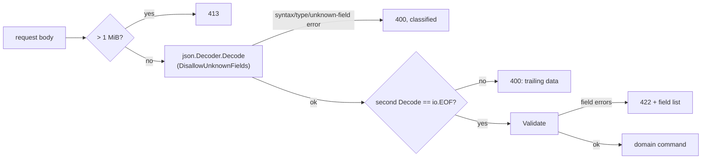
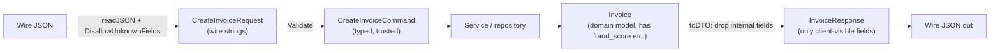

# Request Decoding, Validation and DTOs

> [!summary] TL;DR
> A request DTO is a struct that exists only to receive JSON bytes safely; `readJSON` gates that process with a body-size limit, `DisallowUnknownFields`, and a trailing-data check, and a separate `Validate` step turns the DTO into a domain command the service layer actually trusts.

> [!abstract] Core idea
> - `encoding/json` is more permissive than most people expect: keys match case-insensitively, duplicate keys let the last one win, and unknown fields are silently dropped unless you ask otherwise.
> - A request DTO, a domain command/model, and a response DTO are three different types, even when their fields look identical today — they change for different reasons.
> - `DisallowUnknownFields` plus `MaxBytesReader` plus a trailing-data check close the three gaps that let a malformed or malicious body reach business logic.
> - Validation collects every broken field at once; it never stops at the first error.

## 1. Why it exists

Take `CreateInvoiceRequest{ClientID, DueDate, Items}` decoded straight into a type that also happens to have a `Status` field, because someone reused the domain `Invoice` struct for both the wire format and the database row. A client sends `{"client_id": "c_1", "due_date": "2026-12-01", "items": [...], "status": "paid"}`. With plain `json.Unmarshal`, that body sets `Status` to `"paid"` on a brand-new invoice before any validation runs — a mass-assignment bug that lets a client mark its own invoice paid for free. The fix is not "add more validation" after the fact; it's that `status` should never have been a field the decoder could reach, because the request DTO should never have had it.

A second, quieter failure: `{"STATUS":"paid"}` sets a field tagged `json:"status"` anyway, because `encoding/json` matches keys case-insensitively when no exact match exists. And `{"status":"draft","status":"paid"}` sets it to `"paid"`, because with duplicate keys the last one silently wins. Neither of these is a bug in your code — they are `encoding/json`'s documented, default behavior, and a handler that doesn't know about them will ship surprises.

## 2. Mental model

Decoding is a sequence of gates the request body passes through before any of it is trusted, and each gate can only make the data more restricted, never add information back:

```text
raw bytes → size gate → parse (decode gate) → shape gate (unknown fields, trailing data) → validate gate → domain command
```

A request DTO is the type that exists only between "parsed" and "validated". Once validation succeeds, the DTO's job is done — the rest of the service never sees it again, only the domain command.

## 3. How it works

### The gates, as code



### `readJSON`: the size, decode and shape gates

```go
const maxRequestBody = 1 << 20 // 1 MiB

func readJSON(w http.ResponseWriter, r *http.Request, dst any) error {
    // MaxBytesReader makes the *next* Read past the limit fail, and also
    // caps how much the server will read if the client lies about
    // Content-Length. Without it a client can stream gigabytes into a
    // handler that assumes small request bodies.
    r.Body = http.MaxBytesReader(w, r.Body, maxRequestBody)

    dec := json.NewDecoder(r.Body)
    dec.DisallowUnknownFields() // a client-sent "status" or "user_id" the
    // struct doesn't declare becomes a 400, not a silently dropped field.

    if err := dec.Decode(dst); err != nil {
        return classifyDecodeErr(err)
    }

    // A second Decode call must hit io.EOF. If it returns anything else,
    // the body held more than one JSON value, e.g. `{}{}` or trailing
    // garbage after the object, and json.Decoder would otherwise ignore it.
    if err := dec.Decode(&struct{}{}); err != io.EOF {
        return &DecodeError{Status: http.StatusBadRequest, Msg: "body must contain exactly one JSON value"}
    }
    return nil
}
```

### Classifying the error, instead of returning one generic 400

```go
func classifyDecodeErr(err error) error {
    var maxErr *http.MaxBytesError
    var syn *json.SyntaxError
    var utErr *json.UnmarshalTypeError

    switch {
    case errors.As(err, &maxErr):
        return &DecodeError{Status: http.StatusRequestEntityTooLarge,
            Msg: fmt.Sprintf("request body must not exceed %d bytes", maxErr.Limit)}
    case errors.Is(err, io.EOF):
        return &DecodeError{Status: http.StatusBadRequest, Msg: "request body must not be empty"}
    case errors.As(err, &syn):
        return &DecodeError{Status: http.StatusBadRequest,
            Msg: fmt.Sprintf("malformed JSON at byte offset %d", syn.Offset)}
    case errors.As(err, &utErr):
        return &DecodeError{Status: http.StatusBadRequest,
            Msg: fmt.Sprintf("field %q: expected %s, got %s", utErr.Field, utErr.Type, utErr.Value)}
    case strings.Contains(err.Error(), "unknown field"):
        return &DecodeError{Status: http.StatusBadRequest, Msg: err.Error()}
    default:
        return &DecodeError{Status: http.StatusBadRequest, Msg: "invalid request body"}
    }
}
```

`json.SyntaxError.Offset` and `json.UnmarshalTypeError.Field` let the response tell a client *where* it went wrong — "malformed JSON at byte 47" or `"field \"total\": expected number, got string"` — instead of a bare "bad request".

### `encoding/json` gotchas that make the gates necessary

| Behavior | What happens without a gate | Documented since |
|---|---|---|
| Case-insensitive key matching | `{"STATUS":"paid"}` sets a field tagged `json:"status"` | always (encoding/json) |
| Duplicate keys | `{"status":"draft","status":"paid"}` → last one wins silently | always |
| Unknown fields ignored | a client can send `status`, `user_id`, any field, and it's silently dropped unless `DisallowUnknownFields` is set | always; opt-in since Go 1.5 |
| Numbers into `any` become `float64` | a 19-digit ID loses precision unless the decoder uses `UseNumber()` | always |
| Missing vs zero vs `null` | a plain `string`/`int` field can't tell "absent" from "sent as zero value"; only a pointer or `omitzero` (1.24) check can | Go 1.24 added `omitzero` |
| `time.Time` fields expect RFC 3339 | `{"due_date":"2026-11-07"}` (a date with no time component) fails to decode into a `time.Time` field with a parse error, not a zero value — this is why the worked example below keeps `DueDate` as a wire `string` and parses it by hand with `time.Parse("2006-01-02", ...)` | always |
| HTML characters are escaped by default | `json.Marshal`/`json.NewEncoder` turn `<`, `>` and `&` into `<`, `>`, `&` in every string field, even ones with nothing to do with HTML; a non-browser consumer that should see the literal characters needs `Encoder.SetEscapeHTML(false)` | always; opt-out since the package's start |

```go
// Measured (Go 1.24.4): both of the first two rows reproduce exactly as
// described, with no special configuration.
type statusHolder struct{ Status string `json:"status"` }

// json.Unmarshal([]byte(`{"STATUS":"paid"}`), &s)       -> s.Status == "paid"
// json.Unmarshal([]byte(`{"status":"draft","status":"paid"}`), &s) -> s.Status == "paid"
```

### `json/v2` (experimental, Go 1.25)

Go 1.25 ships an experimental `encoding/json/v2` (behind `GOEXPERIMENT=jsonv2`) that is case-sensitive by default and rejects duplicate object keys outright, closing the first two gotchas at the decoder level instead of needing `DisallowUnknownFields` plus manual case-sensitivity checks. It is not yet the default decoder as of Go 1.24, so `readJSON` above still has to guard against both.

### DTO vs domain model vs response DTO



```go
// CreateInvoiceRequest is the wire shape: strings in, because clients send
// JSON numbers and dates as text and the DTO's job is only to carry bytes.
// It is never passed to the service layer directly.
type CreateInvoiceRequest struct {
    ClientID string                     `json:"client_id"`
    DueDate  string                     `json:"due_date"` // "2026-12-01", parsed below
    Items    []CreateInvoiceItemRequest `json:"items"`
    // Status, WorkspaceID and other server-owned fields are deliberately
    // absent: DisallowUnknownFields turns a client that sends them into a
    // 400, instead of silently letting mass assignment through.
}

type CreateInvoiceItemRequest struct {
    Description string `json:"description"`
    // Cents, not a float: money is never float64 (binary floats cannot
    // represent 0.10 exactly; see the worked example).
    UnitPriceCents int64 `json:"unit_price_cents"`
    Quantity       int   `json:"quantity"`
}

// CreateInvoiceCommand is the domain model the service layer accepts: typed,
// validated, and already converted out of wire strings. The handler's only
// job is turning one of these into the other.
type CreateInvoiceCommand struct {
    ClientID string
    DueDate  time.Time
    Items    []InvoiceItem
}

// InvoiceResponse is the outbound DTO: only what the client is allowed to
// see. It has its own struct so that adding an internal field to the domain
// model (an audit column, a feature flag) can never leak to the wire by
// accident the way it would if handlers encoded the domain model directly.
type InvoiceResponse struct {
    ID    string `json:"id"`
    Total int64  `json:"total"`
}
```

The three types look similar today. They diverge the moment the database needs a column the client should never see (a `fraud_score`), or the wire format needs to change shape (a nested `address` object) without touching the domain model's Go-native `time.Time`. Keeping them separate from the start is cheaper than splitting them apart under pressure later.

### PATCH: telling absent from null

`*string` on a PATCH request distinguishes "the client didn't mention this field" (`nil`) from "the client wants to clear it" (non-nil pointer to `""`). A plain `string` field cannot make that distinction — it would be the zero value either way. The alternative at larger scale is JSON Merge Patch (RFC 7396): the whole body is a partial document and any key present, even with value `null`, means "set this field to null".

## 4. Worked example

### Whiteboard version

The bare idea, no classification, no size limit — this is *not* what should ship, but it is the shape every real `readJSON` builds on:

```go
func readJSONNaive(r *http.Request, dst any) error {
    dec := json.NewDecoder(r.Body)
    dec.DisallowUnknownFields()
    return dec.Decode(dst)
}
```

The full version adds the size gate, the trailing-data check and error classification; it is exactly what the tests below run against.

**Validation collecting every error, not just the first:**

```go
func (req CreateInvoiceRequest) Validate() (CreateInvoiceCommand, error) {
    var errs ValidationErrors
    cmd := CreateInvoiceCommand{ClientID: strings.TrimSpace(req.ClientID)}

    if cmd.ClientID == "" {
        errs = append(errs, FieldError{"client_id", "required"})
    }

    if req.DueDate == "" {
        errs = append(errs, FieldError{"due_date", "required"})
    } else if due, err := time.Parse("2006-01-02", req.DueDate); err != nil {
        errs = append(errs, FieldError{"due_date", "must be YYYY-MM-DD"})
    } else {
        cmd.DueDate = due
    }

    if len(req.Items) == 0 {
        errs = append(errs, FieldError{"items", "at least one item is required"})
    }
    seen := make(map[string]bool)
    for i, item := range req.Items {
        desc := strings.TrimSpace(item.Description)
        field := fmt.Sprintf("items[%d]", i)
        if desc == "" {
            errs = append(errs, FieldError{field + ".description", "required"})
        }
        if seen[desc] {
            errs = append(errs, FieldError{field + ".description", "duplicate line item"})
        }
        seen[desc] = true
        if item.UnitPriceCents <= 0 {
            errs = append(errs, FieldError{field + ".unit_price_cents", "must be positive"})
        }
        if item.Quantity <= 0 {
            errs = append(errs, FieldError{field + ".quantity", "must be positive"})
        }
        cmd.Items = append(cmd.Items, InvoiceItem{
            Description: desc, UnitPriceCents: item.UnitPriceCents, Quantity: item.Quantity,
        })
    }

    if len(errs) > 0 {
        return CreateInvoiceCommand{}, errs
    }
    return cmd, nil
}

// DecodeAndValidate is the handler-facing entry point: gate, decode,
// convert, validate, in that order, so no invalid byte ever reaches the
// service layer.
func DecodeAndValidate(w http.ResponseWriter, r *http.Request) (CreateInvoiceCommand, error) {
    var req CreateInvoiceRequest
    if err := readJSON(w, r, &req); err != nil {
        return CreateInvoiceCommand{}, err
    }
    return req.Validate()
}
```

Tests, covering the gates in order plus the documented `encoding/json` gotchas:

```go
func TestReadJSON_RejectsUnknownFields(t *testing.T) {
    // "status" is server-owned and absent from CreateInvoiceRequest: a
    // client trying mass assignment gets a 400, not a silently accepted
    // write to a field it should never control.
    _, err := doDecode(t, `{"client_id":"c_1","due_date":"2026-12-01","status":"paid",
        "items":[{"description":"x","unit_price_cents":100,"quantity":1}]}`)
    var de *DecodeError
    if !errors.As(err, &de) || de.Status != http.StatusBadRequest {
        t.Fatalf("got %v, want a 400 for an unknown field", err)
    }
}

func TestReadJSON_RejectsTrailingData(t *testing.T) {
    _, err := doDecode(t, `{"client_id":"c_1","due_date":"2026-12-01","items":[{"description":"x","unit_price_cents":100,"quantity":1}]}{}`)
    var de *DecodeError
    if !errors.As(err, &de) || de.Msg != "body must contain exactly one JSON value" {
        t.Fatalf("got %v, want the trailing-data DecodeError", err)
    }
}

func TestReadJSON_BodyOverLimit_Returns413(t *testing.T) {
    huge := `{"client_id":"` + strings.Repeat("a", maxRequestBody+1) + `"}`
    _, err := doDecode(t, huge)
    var de *DecodeError
    if !errors.As(err, &de) || de.Status != http.StatusRequestEntityTooLarge {
        t.Fatalf("got %v, want 413", err)
    }
}

func TestValidate_CollectsEveryFieldError_NotJustTheFirst(t *testing.T) {
    _, err := doDecode(t, `{"client_id":"","due_date":"","items":[]}`)
    ve, ok := err.(ValidationErrors)
    if !ok {
        t.Fatalf("got %T, want ValidationErrors", err)
    }
    if len(ve) != 3 {
        t.Fatalf("got %d field errors, want 3 (client_id, due_date, items): %v", len(ve), ve)
    }
}

func TestGotcha_KeyMatchingIsCaseInsensitive(t *testing.T) {
    var s statusHolder
    if err := json.Unmarshal([]byte(`{"STATUS":"paid"}`), &s); err != nil {
        t.Fatalf("unmarshal: %v", err)
    }
    if s.Status != "paid" {
        t.Fatalf("got %q; encoding/json matches keys case-insensitively when no exact match exists", s.Status)
    }
}

func TestGotcha_DuplicateKeys_LastOneWins(t *testing.T) {
    var s statusHolder
    if err := json.Unmarshal([]byte(`{"status":"draft","status":"paid"}`), &s); err != nil {
        t.Fatalf("unmarshal: %v", err)
    }
    if s.Status != "paid" {
        t.Fatalf("got %q, want the last key's value \"paid\"", s.Status)
    }
}

func TestGotcha_NumbersInAny_AreFloat64UnlessUseNumber(t *testing.T) {
    var v any
    _ = json.Unmarshal([]byte(`{"n": 9007199254740993}`), &v)
    if _, ok := v.(map[string]any)["n"].(float64); !ok {
        t.Fatalf("decoding into any should give float64 for a bare number by default")
    }

    dec := json.NewDecoder(strings.NewReader(`{"n": 9007199254740993}`))
    dec.UseNumber()
    var v2 map[string]any
    _ = dec.Decode(&v2)
    if _, ok := v2["n"].(json.Number); !ok {
        t.Fatalf("UseNumber should decode the same field as json.Number, preserving exact precision")
    }
}
```

**Measured (Go 1.24.4, `go test -race`, 2026-11-07):** all 6 tests shown above pass, including the three gotcha tests run against the real `encoding/json` package (not a mock); `go vet ./...` reports no issues.

## 5. Variants and comparison

| Option | How it works | Use when | Cost |
|---|---|---|---|
| Hand-written `Validate() error` | plain Go code, as above | most services; full control over multi-field and cross-field rules | you write and test every rule yourself |
| `go-playground/validator` struct tags | `validate:"required,min=1"` tags, reflection-driven | many simple per-field rules, want less boilerplate | reflection cost; cross-field and conditional rules get awkward in tags |
| Hand-written + a thin tag layer | hand code for cross-field/business rules, tags for simple per-field checks | teams that want tag convenience without losing custom rule clarity | two validation styles to keep consistent |
| `json/v2` strict mode (Go 1.25, experimental) | case-sensitive keys, duplicate-key rejection built into the decoder | once stable: removes the need for manual case/duplicate gotcha handling | experimental; not the default decoder yet |

## 6. Trade-offs and when not to use

- `DisallowUnknownFields` breaks forward compatibility in one direction: an older client (or an API gateway) that adds a field the server doesn't know about yet gets a `400` instead of the field being ignored. For a public API with independently-versioned clients, weigh that against the mass-assignment risk it closes.
- Collecting every validation error costs a little more code than "return on the first error", but for any form a human fills in, round-tripping error-by-error is worse UX than seeing every problem in one response.
- A tiny internal service with one trusted caller (another of your own services, not a browser) can skip the size gate and strict JSON rules if both ends are versioned together — the risk `DisallowUnknownFields` and `MaxBytesReader` guard against mostly comes from untrusted or independently-deployed clients.
- Hand-written `Validate()` doesn't scale well past a few dozen fields across many DTOs; at that point the boilerplate `go-playground/validator` removes starts to outweigh the tag-syntax awkwardness.

## 7. In production

- **Real systems:** Stripe's and GitHub's APIs reject unknown fields on write endpoints and return field-level error arrays, the same shape this note's `ValidationErrors` produces. The "DTO separate from domain model separate from response shape" split is the standard shape of any Go service built with a hexagonal/ports-and-adapters layering.
- **Failure modes → fixes:**
  - A domain model reused as the request DTO lets a client set a field nobody meant to expose (the `status` example in section 1) → give every write endpoint its own request DTO, even when it currently matches the domain model field-for-field.
  - `MaxBytesReader` missing → a client (or an attacker) streams an unbounded body and the handler blocks on `Decode` until it runs out of memory or the connection times out → always wrap `r.Body` before the first `Decode`.
  - `UnmarshalTypeError`/`SyntaxError` not classified → every bad request looks like a generic `400` with no actionable message → classify by type and return the field/offset.
  - Fuzzing turns up a panic in a hand-written `Validate()` that indexes into `req.Items[0]` without checking length → always check `len(...)` before indexing a client-supplied slice.
- **What to monitor:** rate of `400`s by classified reason (unknown field vs syntax vs type vs trailing data) — a spike after a client deploy usually means a new client version sends a field the server hasn't added yet; rate of `422`s by field, which doubles as a product signal for which input is hardest for users to get right.

## 8. Deep dive

- **Why the trailing-data check matters even though `Decode` "succeeded".** `json.Decoder.Decode` reads exactly one JSON value and stops; it does not consider leftover bytes an error by itself. A body like `{"client_id":"c_1"}{"client_id":"c_2"}` decodes the first object successfully and silently ignores the second — a smuggled second value an unaware reverse proxy or logging pipeline might still see and act on. The second `Decode(&struct{}{})` call forces the decoder to look again; getting `io.EOF` is the only way to confirm nothing is left.
- **Fuzzing the decoder.** `go test -fuzz=FuzzReadJSON` with a seed corpus of valid and edge-case bodies (empty object, deeply nested arrays, very large numbers, invalid UTF-8) finds panics a handwritten test suite won't think to write; `DisallowUnknownFields` combined with deeply nested unknown objects is a classic case worth fuzzing specifically.
- **Why money is `int64` minor units, never `float64`.** IEEE 754 double precision cannot represent most decimal fractions (including `0.10`) exactly; summing enough float-encoded cents produces off-by-one-cent totals that show up as real accounting discrepancies. `int64` cents (or `int64` plus a currency code) has no such rounding step.
- **`omitempty` vs `omitzero` (Go 1.24).** `omitempty` on a `time.Time` or a struct never omits it, because a zero-value struct still isn't considered "empty" by the tag's old definition (it only recognizes empty strings, 0, nil, and empty collections/maps). Go 1.24's `omitzero` omits a field whenever it equals its type's zero value, covering structs like `time.Time{}` that `omitempty` could not.

## 9. Interview questions

> [!question]- Why does `DisallowUnknownFields` matter even when every field the client might send maliciously already has a Go field, just one the DTO doesn't declare?
> Because that's exactly the mass-assignment case: the DTO's job is to declare the *allowed* input surface. A domain field like `Status` that exists on some other struct the client doesn't know about is irrelevant — what matters is whether the *decode target* declares the field. If it doesn't, `DisallowUnknownFields` turns the client's attempt into a `400` instead of a silently ignored (or worse, silently applied) write.

> [!question]- What three things does a bare `json.Unmarshal(body, &dst)` get wrong that a hardened `readJSON` fixes?
> It has no size limit (unbounded body can exhaust memory), it accepts unknown fields silently (mass-assignment risk), and a single `Decode` call doesn't notice trailing data after the first JSON value. `readJSON` adds `MaxBytesReader`, `DisallowUnknownFields`, and a second `Decode` call checked for `io.EOF`.

> [!question]- Trap: a teammate says validating a `*string` PATCH field for `nil` is enough to support "clear this field to empty". Why isn't it?
> A `*string` pointer tells you the client *sent* the field at all — `nil` means absent, non-nil means present. But non-nil doesn't distinguish "set it to `""`" from "set it to `"draft"`"; that distinction is just the pointed-to value, which plain validation already handles. The actual trap is the reverse: using a non-pointer `string` field, where there is no way to tell "the client didn't mention `status`" from "the client explicitly sent `status: ""`" — both decode to the zero value.

> [!question]- Why validate client-side DTO fields (`ClientID`, `DueDate` as strings) separately from a domain command's typed fields (`time.Time`)?
> Because the DTO's job is purely to describe what a client is allowed to send over the wire, in wire-friendly types (strings, since JSON has no date type). The domain command is what the rest of the service actually computes with, in the types that make that computation correct (a parsed `time.Time`, not a string someone has to re-parse at every call site). Collapsing them means either the DTO carries a `time.Time` tag that fights `encoding/json`'s date format assumptions, or the domain logic has to defensively re-validate a string everywhere it's used.

> [!question]- Why collect every validation error instead of returning on the first one?
> A client filling out a form (or calling the API from a UI) benefits from seeing every problem in one response instead of fixing one field, resubmitting, and discovering the next error. The cost is just continuing the loop instead of returning early — there's no correctness reason to stop at the first failure unless a later check depends on an earlier field being valid.

> [!question]- Why is `encoding/json`'s case-insensitive key matching "by design" rather than a bug, and what's the practical risk?
> It exists so that `json:"Name"` on a Go-convention PascalCase-tagged field still matches a lowerCamelCase or UPPERCASE wire key from a client that doesn't share Go's naming convention. The practical risk is that it is too forgiving for security-sensitive fields: a filter that checks `req.Status == ""` to decide "the client didn't ask to set a reserved field" can be bypassed by a client sending `"STATUS"` instead of `"status"` if the field was ever reachable by the decoder — another reason the DTO should never declare reserved fields at all.

## 10. Cheat sheet

- `readJSON` = `MaxBytesReader` + `DisallowUnknownFields` + a second `Decode` checked for `io.EOF` (rejects oversized, unknown-field, and trailing-data bodies).
- `encoding/json` defaults: case-insensitive keys, last-duplicate-wins, unknown fields silently dropped, numbers into `any` become `float64` unless `UseNumber()`.
- Classify decode errors by type (`http.MaxBytesError`, `json.SyntaxError`, `json.UnmarshalTypeError`) instead of returning one generic `400`.
- Three separate types: request DTO (wire strings in) → domain command (validated, typed) → response DTO (only what the client may see).
- A pointer field (or JSON Merge Patch) is the only way to tell "absent" from "explicitly zero/null" on a `PATCH`.
- Validation collects every field error in one pass; it never stops at the first.
- Money is `int64` minor units plus a currency code, never `float64`.
- `omitzero` (Go 1.24) omits any zero-value field, including structs like `time.Time{}` that `omitempty` could not.

## Links

- **Before this:** [[Building REST Endpoints]]
- **Next:** [[Middleware]]
- **Compare with:** [[Error Handling]] (the same classify-then-map pattern, one layer up), [[API Error Handling]] (the design-level error contract these DTOs feed)
