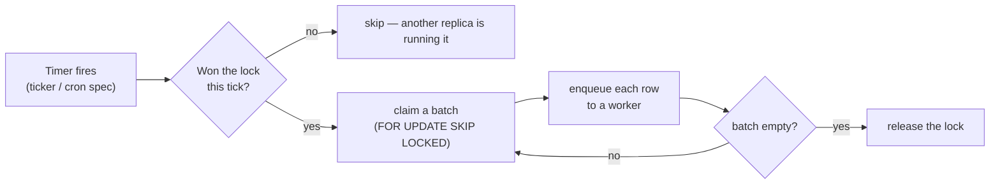
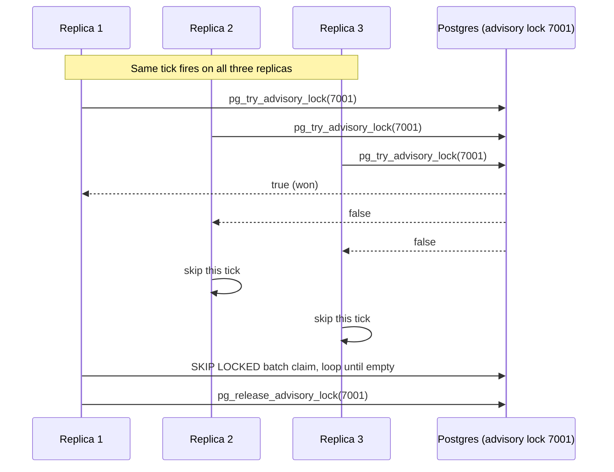
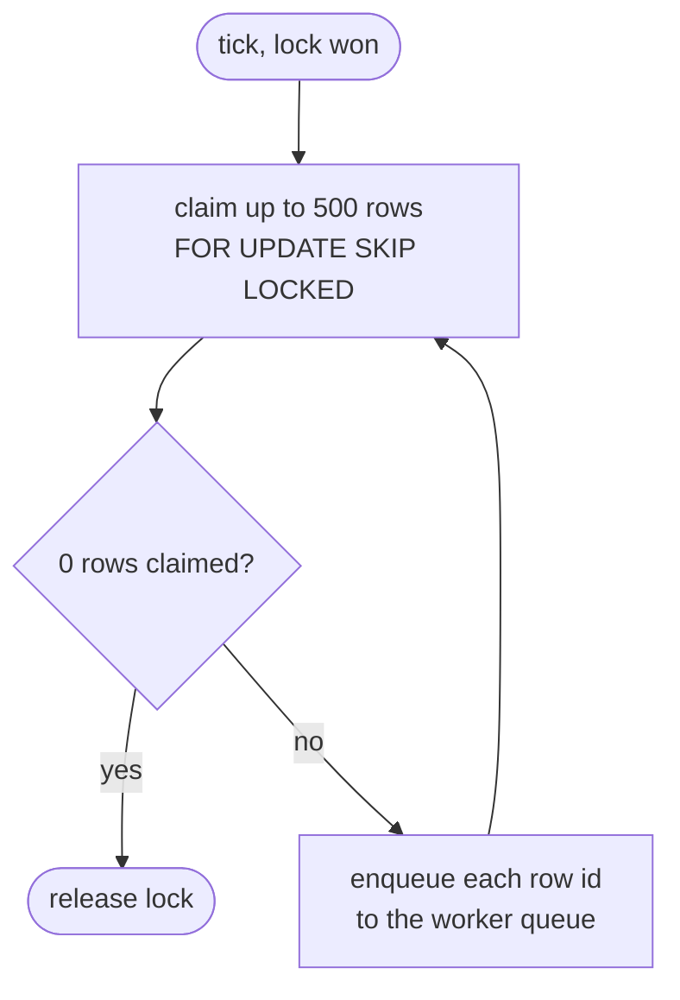

# Scheduled Jobs

> [!summary] TL;DR
> A scheduled job in a Go service is a timer loop (`time.Ticker` or `robfig/cron`) wired to a handler that must run safely even though the service itself runs as N identical replicas: it needs a lock so only one replica fires per tick, and a batch query written so re-running it after a crash does nothing twice.

> [!abstract] Core idea
> - A bare `time.Ticker` loop drops ticks when a run is slower than the interval, because the ticker channel buffers exactly one pending tick.
> - "Run once" across replicas is a locking problem, not a scheduling problem: a Postgres advisory lock, a Redis `SET NX PX` lock with a fencing token, or a Kubernetes `Lease` all give one winner per tick.
> - The job's own SQL should be idempotent and resumable on its own (`FOR UPDATE SKIP LOCKED`, looping until a batch is empty), so a crash mid-run is a non-event rather than an incident.
> - Classic mistake: doing the work inside the scheduler goroutine instead of enqueuing it, which lets one slow dependency stall every future tick.

## 1. Why it exists

InvoiceOps runs 4 replicas of its API behind a load balancer. One of its jobs marks an invoice `overdue` once its `due_date` has passed and queues a reminder email. If each replica runs `time.NewTicker(time.Minute)` and fires the same query, every tick becomes 4 identical `UPDATE` statements racing each other, and a customer who has one invoice due gets 4 reminder emails instead of one.

The naive fix — "just run it on one replica" — breaks the moment that replica restarts during a deploy: now nothing runs the job until someone remembers to redeploy its replacement with the right flag. The job needs to run on *some* replica, every tick, without a human picking which one.

A second problem is independent of replica count: if the overdue scan takes 90 seconds on a 2-million-row table and the tick interval is 60 seconds, what happens to the tick that arrives while the first scan is still running? A bare ticker loop answers this by accident, not by design — and the accidental answer (explained below) is "that tick is silently thrown away."

## 2. Mental model

Separate two questions that a tutorial usually blurs together:

1. **When does the job want to run?** — a schedule: "every minute," "`0 */15 * * * *`," "every day at 02:00 UTC."
2. **Which process actually runs it this time?** — coordination: exactly one of N replicas, decided fresh (or re-affirmed) every tick.

A scheduled job is the product of these two, plus a third piece that has nothing to do with timing at all: **the job's own query must tolerate being re-run**, because "exactly one replica per tick" and "exactly one successful run, ever, with no partial side effects" are different guarantees, and only a crash-safe query gives you the second one.



## 3. How it works

### The bare ticker, and why it drops ticks

```go
func RunTicker(ctx context.Context, interval time.Duration, run func(context.Context)) {
	t := time.NewTicker(interval)
	defer t.Stop()
	for {
		select {
		case <-ctx.Done():
			return
		case <-t.C:
			run(ctx)
		}
	}
}
```

`time.Ticker`'s channel `t.C` holds at most one pending tick: buffered with capacity 1 for modules whose `go.mod` declares a Go version before 1.23, and unbuffered (capacity 0) since Go 1.23 for modules that declare `go 1.23` or later. Either way, delivering a tick is a non-blocking send: if `run` is still executing when the *next* tick would fire, the loop is blocked inside `run`, not reading `t.C`, so the runtime's attempt to deliver that tick finds no ready receiver and simply drops it instead of blocking. The loop never sees two ticks queued up and never "catches up"; it simply runs less often than the interval whenever a run overruns it. A test pins this down for the fixed version below.

> [!warning] Since Go 1.23
> Before Go 1.23, a `Timer` or `Ticker` that was never `Stop`ped could not be garbage-collected: its internal channel held a live reference that kept the whole timer alive, so code that created one per request without stopping it leaked timer state for the life of the process. Since Go 1.23 the runtime can collect an unreachable, unstopped `Timer`/`Ticker`. That is a safety net for a bug, not a reason to skip `Stop`: an unstopped ticker still fires into a channel nothing reads until it is collected, wasting a goroutine wake-up every interval.
>
> The same release also changed `t.C` itself from a buffered channel (capacity 1) to an unbuffered one (capacity 0), for a module that declares `go 1.23` or later — specifically so `Stop` and `Reset` can guarantee no stale tick is left sitting in the channel afterward. The drop-ticks behaviour above is unchanged by this (a non-blocking send with no ready receiver still drops the tick either way), but code that calls `len(t.C)` or `cap(t.C)` to probe for a pending tick sees a different number depending on the module's declared Go version, and this note's Go 1.24 module is on the new, unbuffered side.

### Never overlapping, and saying so

The fix is not a bigger buffer; it is refusing to start a second run while one is in flight, and logging when a tick is skipped instead of hiding it:

```go
func RunTickerSkipIfBusy(ctx context.Context, interval time.Duration, log *slog.Logger, run func(context.Context)) {
	t := time.NewTicker(interval)
	defer t.Stop()
	busy := false
	done := make(chan struct{}, 1)
	for {
		select {
		case <-ctx.Done():
			return
		case <-done:
			busy = false
		case <-t.C:
			if busy {
				log.Warn("tick skipped: previous run still in progress")
				continue
			}
			busy = true
			go func() {
				run(ctx)
				done <- struct{}{}
			}()
		}
	}
}
```

`robfig/cron` v3 gives the same behaviour as a library, plus real cron expressions and a timezone:

```go
c := cron.New(
	cron.WithLocation(time.UTC),
	cron.WithChain(
		cron.Recover(cron.DefaultLogger), // a panic in one run doesn't kill the scheduler
		cron.SkipIfStillRunning(cron.DefaultLogger),
	),
)
_, _ = c.AddFunc("@every 1m", tick) // or "0 */15 * * * *" (seconds field included) to align to the clock
c.Start()
```

- `cron.WithLocation(time.UTC)` matters: a spec evaluated in a local zone with DST hits a one-hour gap or a repeated hour twice a year (`2:30 AM` either does not exist or happens twice). Running in UTC removes the ambiguity entirely.
- `cron.SkipIfStillRunning` is the library version of `RunTickerSkipIfBusy` above; `cron.DelayIfStillRunning` is the alternative when you would rather queue one pending run than drop it, at the cost of runs bunching up after a slow one.
- A cron spec (`0 */15 * * * *`) fires at wall-clock marks; `@every 15m` fires 15 minutes after the *previous fire*, so a slow run pushes every later tick back. Pick the spec form when "every 15 minutes on the dot" matters for a report or an SLA.

### Running once across N replicas

Coordination needs one more piece than the in-process loop: a lock that is visible to every replica. This note uses a Postgres advisory lock because InvoiceOps already runs on Postgres and the lock needs no new table, no TTL, and no extra infrastructure — it lives on a session and is released automatically if that session (connection) closes, even on a hard crash.

```go
type Locker interface {
	TryAcquire(ctx context.Context, key int64) (release func(), ok bool, err error)
}
```

In production this is one line of SQL issued on a held connection (not one borrowed per call from a pool, since the lock is tied to the session):

```sql
SELECT pg_try_advisory_lock($1);   -- non-blocking: returns false if another session holds it
-- ... do the work ...
SELECT pg_release_advisory_lock($1);
```



Redis is the alternative when the service already depends on Redis more than Postgres: `SET lock:overdue-scan <token> NX PX 30000` acquires a lock that expires on its own if the holder dies, and release must be a Lua script that checks the token before deleting the key (`DEL` alone can delete a lock a *different* holder has since acquired, if this holder's TTL already expired under GC pressure). That token is a **fencing token**: a monotonically increasing number a holder must present with its writes, so a stale holder that wakes up after a long GC pause cannot clobber work the real current holder already did — see [[Distributed Locks and Fencing Tokens]] for why `SET NX` alone is not sufficient on its own. A Kubernetes `Lease` object gives a third option, used when the service already runs client-go leader election for other reasons (see [[Leader Election]]): only the elected leader pod runs any of its in-process schedulers at all.

### Idempotent, resumable batches

The lock answers "who runs this tick," not "what if the run itself dies halfway through 2 million rows." That is a query design question:

```sql
UPDATE invoices SET status = 'overdue'
WHERE id IN (
  SELECT id FROM invoices
  WHERE status = 'sent' AND due_date < now()
  LIMIT 500
  FOR UPDATE SKIP LOCKED
)
RETURNING id;
```

`FOR UPDATE SKIP LOCKED` lets several callers run this exact query concurrently (two replicas that both briefly believed they held the lock during a lock handoff, or two worker goroutines draining the backlog) and each walks away with a **disjoint** batch: a row another caller's transaction already locked is invisible to this one, not blocked behind it. Looping "claim up to 500, enqueue them, claim again" until a claim returns zero rows drains however large the backlog is — including the backlog built up during an outage — without the scheduler ever doing more than one batch's worth of work per loop iteration, so a mid-loop crash only ever loses the batch in flight, not the whole scan.



The work itself — sending the reminder email — is handed to a worker rather than done inline inside this loop (see [[Background Workers and Job Queues]]). That keeps a slow email provider from holding the advisory lock open and starving every other replica's tick in the meantime.

### Graceful shutdown mid-batch

A deploy or a pod eviction can send `SIGTERM` while a replica is partway through the claim-enqueue-claim loop. The loop in `ScanOverdue` already checks `ctx.Err()` at the top of every iteration, so a cancelled context (wired to the process's shutdown signal, the same one that drains in-flight HTTP requests — see [[Graceful Shutdown and Health Checks]]) stops the loop after the batch already claimed finishes enqueuing, not mid-batch: a `SKIP LOCKED` claim is a single statement, so it either commits a whole batch or none of it, and cancellation is only ever observed between batches, never inside one. Two consequences follow from this: the advisory lock's `release()` still runs (it is a `defer`, not conditional on how the loop exited), so the next replica up can claim the lock immediately instead of waiting for a lease to expire; and any rows already claimed and hand-off to the worker channel in `enqueue` are the caller's responsibility to drain before the process exits, the same shutdown-ordering question every worker pool has (see [[Background Workers and Job Queues]]) — a scheduler that stops claiming new batches but abandons a channel full of already-claimed work on exit has only moved the dropped-work problem, not fixed it.

## 4. Worked example

### Whiteboard version

The bare ticker loop from above is the whole idea in eight lines: wait for a tick or cancellation, run the job. Its known gap — dropped ticks under a slow run — is exactly what the production version below exists to fix, not an oversight to copy.

### Production version

`Locker` and the SKIP LOCKED store are faked in-process below because Postgres cannot run in this environment; the fakes reproduce the exact semantics the real SQL gives (one non-blocking holder per key; a row claimed by one caller invisible to a concurrent caller), so the tests below exercise the real race the production code must survive.

```go
type fakeLocker struct {
	mu     sync.Mutex
	locked map[int64]bool
}

func (f *fakeLocker) TryAcquire(_ context.Context, key int64) (func(), bool, error) {
	f.mu.Lock()
	defer f.mu.Unlock()
	if f.locked[key] {
		return nil, false, nil
	}
	f.locked[key] = true
	release := func() {
		f.mu.Lock()
		defer f.mu.Unlock()
		delete(f.locked, key)
	}
	return release, true, nil
}

func RunIfLocked(ctx context.Context, l Locker, key int64, fn func(context.Context) error) (ran bool, err error) {
	release, ok, err := l.TryAcquire(ctx, key)
	if err != nil {
		return false, err
	}
	if !ok {
		return false, nil
	}
	defer release()
	return true, fn(ctx)
}
```

```go
type Store interface {
	ClaimOverdueBatch(ctx context.Context, now time.Time, limit int) ([]int64, error)
}

func ScanOverdue(ctx context.Context, store Store, now time.Time, batchSize int, enqueue func(invoiceID int64)) (total int, err error) {
	for {
		if err := ctx.Err(); err != nil {
			return total, err
		}
		ids, err := store.ClaimOverdueBatch(ctx, now, batchSize)
		if err != nil {
			return total, err
		}
		if len(ids) == 0 {
			return total, nil
		}
		for _, id := range ids {
			enqueue(id)
		}
		total += len(ids)
	}
}
```

Wired together with `robfig/cron`:

```go
func NewOverdueScanner(log *slog.Logger, store Store, locker Locker, enqueue func(int64)) *cron.Cron {
	c := cron.New(
		cron.WithLocation(time.UTC),
		cron.WithChain(
			cron.Recover(cron.DefaultLogger),
			cron.SkipIfStillRunning(cron.DefaultLogger),
		),
	)
	_, _ = c.AddFunc("@every 1m", func() {
		ctx, cancel := context.WithTimeout(context.Background(), 30*time.Second)
		defer cancel()
		ran, err := RunIfLocked(ctx, locker, lockKeyOverdueScanner, func(ctx context.Context) error {
			total, scanErr := ScanOverdue(ctx, store, time.Now().UTC(), 500, enqueue)
			log.Info("overdue scan batch", "claimed", total, "err", scanErr)
			return scanErr
		})
		if err != nil {
			log.Error("overdue scan failed", "err", err)
		} else if !ran {
			log.Debug("overdue scan skipped: another replica holds the lock")
		}
	})
	return c
}
```

Three tests that each prove one specific claim, run with `go test -race`:

```go
// 5 "replicas" race the same advisory-lock key on one tick; exactly one runs.
func TestRunIfLocked_OnlyOneReplicaRuns(t *testing.T) {
	locker := newFakeLocker()
	var ran int32
	var wg sync.WaitGroup
	start := make(chan struct{})
	for i := 0; i < 5; i++ {
		wg.Add(1)
		go func() {
			defer wg.Done()
			<-start
			_, _ = RunIfLocked(context.Background(), locker, 7001, func(context.Context) error {
				atomic.AddInt32(&ran, 1)
				time.Sleep(5 * time.Millisecond)
				return nil
			})
		}()
	}
	close(start)
	wg.Wait()
	if got := atomic.LoadInt32(&ran); got != 1 {
		t.Fatalf("ran = %d replicas, want exactly 1", got)
	}
}
```

```go
// 4 concurrent scanners (modelling SKIP LOCKED) partition 1000 overdue rows
// with no overlap and none left behind.
func TestScanOverdue_ClaimsEveryRowExactlyOnce(t *testing.T) {
	store := newFakeStore(seedInvoices(1000))
	seen := make(map[int64]int)
	var mu sync.Mutex
	var wg sync.WaitGroup
	for w := 0; w < 4; w++ {
		wg.Add(1)
		go func() {
			defer wg.Done()
			enqueue := func(id int64) { mu.Lock(); seen[id]++; mu.Unlock() }
			_, _ = ScanOverdue(context.Background(), store, time.Now(), 37, enqueue)
		}()
	}
	wg.Wait()
	for id, n := range seen {
		if n != 1 {
			t.Fatalf("invoice %d claimed %d times, want exactly 1", id, n)
		}
	}
}
```

```go
// The fixed scheduler never runs two instances of run() at once, even when
// run() is slower than the tick interval; the bare RunTicker from the
// whiteboard version is not held to this bar on purpose.
func TestRunTickerSkipIfBusy_NeverOverlaps(t *testing.T) {
	var inFlight, maxSeen int32
	run := func(context.Context) {
		n := atomic.AddInt32(&inFlight, 1)
		for {
			old := atomic.LoadInt32(&maxSeen)
			if n <= old || atomic.CompareAndSwapInt32(&maxSeen, old, n) {
				break
			}
		}
		time.Sleep(15 * time.Millisecond) // slower than the 5ms tick below
		atomic.AddInt32(&inFlight, -1)
	}
	ctx, cancel := context.WithTimeout(context.Background(), 70*time.Millisecond)
	defer cancel()
	RunTickerSkipIfBusy(ctx, 5*time.Millisecond, discardLogger(), run)
	if got := atomic.LoadInt32(&maxSeen); got > 1 {
		t.Fatalf("max concurrent runs = %d, want at most 1", got)
	}
}
```

All three pass under `go test -race`, along with a fourth test (`TestRunTicker_DropsTicksWhenSlow`) that pins the bare ticker's dropped-tick behaviour described in section 3, so the note's central claim is checked, not asserted.

## 5. Variants and comparison

| Option | How it works | Use when | Cost |
| --- | --- | --- | --- |
| In-process ticker/cron, single replica | One process owns the timer; nothing else runs it | Dev, or a genuinely single-instance service | No redundancy: the job stops if that process is down |
| In-process + Postgres advisory lock | Every replica ticks; `pg_try_advisory_lock` picks one winner | Already on Postgres; want zero new infrastructure | Holds one connection out of the pool per lock for the run's duration |
| In-process + Redis `SET NX PX` + fencing token | Every replica ticks; Redis key with TTL is the lock | Already on Redis; want sub-second lock acquisition | Needs a token-checked release (Lua script) to be correct under GC pauses |
| Kubernetes `Lease` leader election (client-go) | One pod holds a Lease; only the leader starts its in-process schedulers | Already running leader election for other reasons | Couples every scheduled job's uptime to leader-renewal cadence |
| Kubernetes `CronJob` | The kubelet starts a fresh Pod per scheduled tick | Per-tick isolation, independent resource limits, or a separate image | Pod cold-start latency per tick; `concurrencyPolicy` must be set explicitly (`Allow` is the default and the usual mistake), and `startingDeadlineSeconds` / `backoffLimit` need setting too, or a missed tick (control plane was down) or a failing Pod retries or is skipped in ways the defaults rarely match what you want |
| DB-backed scheduler (river, asynq's periodic jobs) | A schedule row turns into a queued job the worker pool picks up | Want the job queue's own retry/visibility machinery for scheduled work too | Adds a dependency on that queue library and its schema |

## 6. Trade-offs and when not to use

- A tick fires only approximately on time: lock-acquisition latency and clock drift between replicas both add jitter on top of the nominal interval. Nothing here is a real-time scheduler.
- Coordination (locks, leases) is an extra moving part. For a job where running twice is harmless and cheap (recomputing a cache that is already idempotent, say), it can be simpler to let every replica run it and accept the duplicate work.
- `cron.DelayIfStillRunning` trades dropped runs for a growing backlog: if a job is reliably slower than its own interval, that backlog never drains and memory for queued closures grows without bound. `SkipIfStillRunning` is the safer default; fix the real problem (the job is too slow for its interval) rather than queuing around it.
- Kubernetes `CronJob` is the wrong tool for anything sub-minute: Pod scheduling and image pull overhead alone can exceed the interval.

## 7. In production

- **Real systems:** Kubernetes `CronJob` for batch and reporting jobs; `robfig/cron` is the de facto standard in-process scheduler for Go services; river and asynq both ship a periodic-job feature on top of their durable queues; AWS EventBridge Scheduler and GCP Cloud Scheduler for schedules that should survive the whole fleet being down.
- **Failure modes → fixes:**
  - The lock holder's process is killed mid-batch → a Postgres advisory lock releases the instant its connection closes, so the very next tick on another replica just resumes the `SKIP LOCKED` loop; nothing needs manual unsticking.
  - A Redis-based lock's holder pauses (GC, CPU starvation) past its TTL, a second replica acquires the lock, and the first replica wakes up and writes anyway → this is exactly what a fencing token prevents; without one, this is a real bug, not a hypothetical.
  - DST transition causes a 2 AM job to run twice or not at all → always schedule in UTC.
  - The scheduler itself was down for 6 hours → do not try to "fire 360 missed one-minute ticks"; the `WHERE due_date < now()` batch query above naturally catches up everything that became due during the outage on its next real tick.
  - Deploy sends `SIGTERM` mid-scan → the batch loop only checks for cancellation between `SKIP LOCKED` claims, so the in-flight batch finishes and the lock is released via `defer`, same as a clean exit; the backlog just resumes on the next tick (see [[Graceful Shutdown and Health Checks]] for the request-side half of the same shutdown).
  - Every replica's ticker fires at `:00` exactly → add jitter (`time.Sleep(rand.N(sleepWindow))` before the first tick, or stagger `AddFunc` schedules per replica) so a fleet of 50 replicas does not all hit the database in the same 100ms window.
- **What to monitor:** a `last_success_timestamp` gauge per job, alerting if it goes stale past (interval × 2) — a "dead man's switch" that fires on silence, not on an explicit error; run duration; rows processed per run; a counter of `SkipIfStillRunning` skips (a rising rate means the job is now too slow for its interval); lock-acquisition failures (expected under normal multi-replica operation, but a useful signal if a single replica suddenly never wins).

## 8. Deep dive

- **Go 1.23's timer GC change, precisely.** Before 1.23, the runtime kept a `Timer`/`Ticker` reachable (via its internal heap entry holding a reference back to it) for as long as it had not fired and not been stopped, even if the Go value itself had no other references. A service that created a short-lived `time.After` or an unstopped `Ticker` per request leaked that structure until the process restarted. Go 1.23 changed the internal representation so an unreferenced, unstopped timer becomes collectible like any other garbage. This is documented, not a workaround for calling `Stop`: you should still stop a `Ticker` you are done with, both to release its slot in the runtime's timer heap promptly and because an un-stopped ticker keeps firing into a channel nothing drains until it is finally collected.
- **Why `pg_try_advisory_lock` and not a plain row lock via `SELECT ... FOR UPDATE`.** An advisory lock has no backing row to conflict with concurrent DML on the real table, costs one function call instead of a row round-trip, and is explicitly meant for exactly this "coordinate app logic, not data" use. It is scoped to the session (connection), so the connection holding it must not be returned to a pool mid-lock — a reason some teams prefer `pg_advisory_xact_lock`, the transaction-scoped variant that releases automatically at `COMMIT`/`ROLLBACK` with no explicit release call to forget.
- **Fencing tokens in one sentence.** Every successful lock acquisition returns a strictly increasing number; the protected resource (here, the `invoices` table through a trigger or an application check) rejects any write tagged with a token lower than the highest it has already accepted. This is what stops the "replica 1 paused for 40 seconds, woke up after replica 2 already took over and ran, and then replica 1's stale write lands anyway" failure mode that a lock with only a TTL cannot prevent on its own — see [[Distributed Locks and Fencing Tokens]] for the full argument and a Go implementation.
- **Catch-up policy is a product decision, not just an engineering one.** "Send a due-soon reminder" should usually *not* catch up after a long outage (a reminder for a date that already passed is worse than no reminder). "Mark invoices overdue" and "reconcile payments" should always catch up, because skipping them leaves the data wrong. Decide this per job, and encode it in the batch query's `WHERE` clause (by due date, not by "how many ticks did we miss"), not in scheduler configuration.

## 9. Interview questions

> [!question]- Why does a `time.Ticker` silently drop ticks instead of queuing them?
> Its channel is buffered to hold exactly one pending tick. If the consumer is still inside a run when the next tick fires, that tick overwrites the one not yet read; the channel never holds more than one, so ticks that arrive during a slow run are lost, not queued.

> [!question]- Trap: a teammate proposes "just run the scheduled job on only one replica, picked by its pod ordinal." What's wrong with this?
> It works until that specific replica restarts during a deploy or crashes: nothing else is configured to pick up the job, so it silently stops running with no error anywhere. Coordination needs to be dynamic (a lock any replica can win) so the job survives any single replica's failure, not static configuration pinned to one instance.

> [!question]- Why use `FOR UPDATE SKIP LOCKED` instead of a plain `SELECT` followed by an `UPDATE`?
> A separate check-then-update has a race: two concurrent callers can both pass the `SELECT` before either commits its `UPDATE`, so both act on the same rows. `SKIP LOCKED` makes the claim atomic and makes a row already locked by another in-flight transaction invisible to this one, so concurrent callers partition the work instead of racing over it.

> [!question]- What does a fencing token solve that a Redis `SET key value NX PX 30000` lock alone does not?
> The TTL alone only bounds how long a lock is held, not whether the holder is still alive and correct; a holder that pauses past the TTL can wake up and write after a second holder has already taken over. A fencing token lets the protected resource reject that stale write by comparing token versions, which a bare lock has no way to do.

> [!question]- The scheduler was down for 6 hours. Do you replay the 360 missed one-minute ticks when it comes back?
> No — query for what is actually due now (`WHERE due_date < now()`), not for how many ticks were missed. A batch query written this way naturally catches up everything that became due during the outage on its very next real tick, with no special replay logic and no risk of re-sending something already handled.

> [!question]- Why does `cron.WithLocation(time.UTC)` matter for a schedule like `0 30 2 * * *`?
> In a timezone with DST, 2:30 AM either does not exist (spring forward) or happens twice (fall back) one day a year. Evaluating the spec in UTC removes the ambiguity; convert to a local time only for display, never for deciding when to fire.

> [!question]- When would you reach for a Kubernetes `CronJob` instead of an in-process scheduler?
> When the job needs isolation the main service doesn't — its own image, its own resource limits, or a workload that would otherwise compete with request-serving goroutines for CPU — and when its interval is comfortably above a minute, since each tick pays Pod scheduling and (absent image caching) pull latency that an in-process timer never does.

## 10. Cheat sheet

- A bare `time.Ticker` drops a tick if the previous run is still executing when the next one fires; its channel buffers only 1.
- Fix overlap with `SkipIfStillRunning` (drop) or `DelayIfStillRunning` (queue one) — `robfig/cron v3`'s `WithChain`.
- "Run once across replicas" = a lock, not a scheduling feature: Postgres `pg_try_advisory_lock`, Redis `SET NX PX` + fencing token, or a Kubernetes `Lease`.
- Make the batch query itself crash-safe: `WHERE ... FOR UPDATE SKIP LOCKED LIMIT n`, looped until empty.
- Enqueue the actual work; never do it inline inside the locked scheduler loop.
- Schedule in UTC always; add jitter to avoid every replica hitting the DB at `:00`.
- Catch-up policy is per job: query by due date for anything that must eventually happen; never for "best effort, now stale" notifications.
- Monitor a staleness gauge (`last_success_timestamp`), not just error counts — a scheduler that silently stopped firing produces no errors at all.

## Links

- **Before this:** [[Context Package]], [[Background Workers and Job Queues]]
- **Next:** [[Receiving Webhooks Idempotently]], [[Observability in Go Services]]
- **Compare with:** [[Scheduled Jobs - Cron to Durable Schedulers]] (the broker/queue-level view of durable scheduling), [[Distributed Locks and Fencing Tokens]], [[Leader Election]], [[Kubernetes Fundamentals]], [[Graceful Shutdown and Health Checks]]
