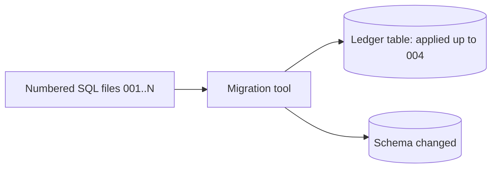
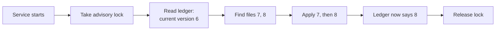
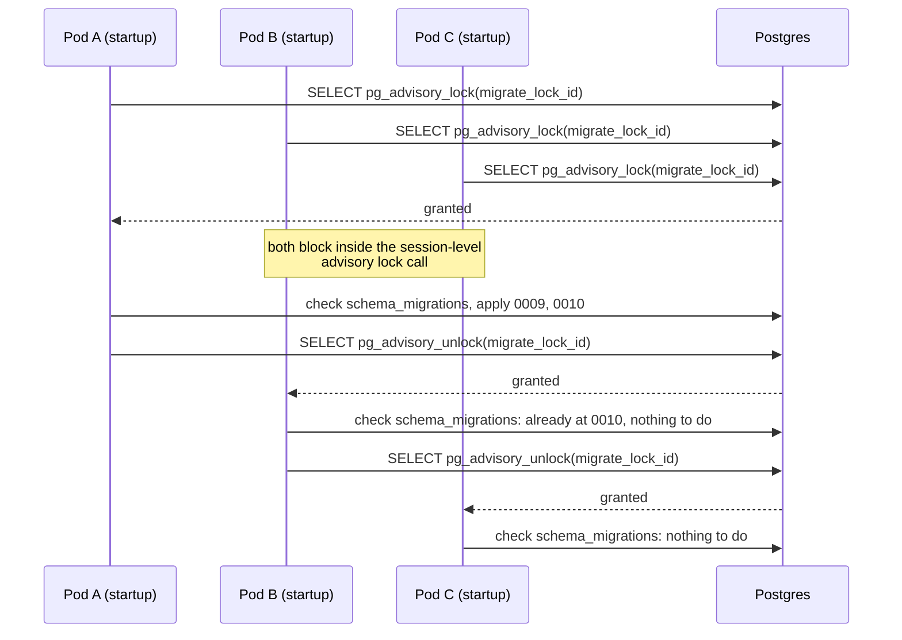
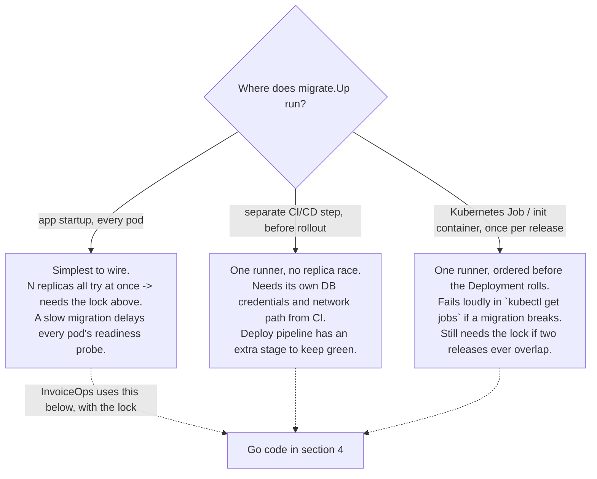

# Schema Migrations in Go Services

> [!summary] TL;DR
> A schema migration is a small, numbered, version-controlled file that changes the database schema exactly once, in order, and is recorded in a ledger table so the next deploy knows what's already applied.
>
> In a Go service that means picking a library (`golang-migrate` or `goose`), embedding the migration files in the binary, running them from one place only, and making sure two replicas starting at the same moment don't both try to apply the same migration.

> [!abstract] Core idea
> - Migrations are files, not ad-hoc `psql` commands: `0007_add_status.up.sql` / `0007_add_status.down.sql`, applied in order, never edited once applied.
> - A `schema_migrations` table is the ledger: which version is current, and a `dirty` flag if a migration died halfway.
> - Running them must be serialized across replicas — a Postgres session advisory lock is the usual fix, and the two mainstream libraries differ on whether you get it for free.
> - The actual zero-downtime technique — expand, migrate, contract — is schema theory, not a Go concern; see [[Zero-Downtime Schema Migrations]] for the lock mechanics and the deploy-safety rules this note assumes.
> - Classic mistake: `CREATE INDEX CONCURRENTLY` inside goose's default transaction wrapper. Postgres rejects it outright.

## Start here: the basics 🟢

> [!info] How to read this note (pick your level)
> - 🟢 **New to this?** Read "From zero" below, then sections 1, 2 and the cheat sheet (10). Stop there, that is a full first pass.
> - 🟡 **Know the basics?** Add section 3 (how it works), 4 (worked example) and 5-6.
> - 🔴 **Interview / SDE-3 prep?** Add 7, 8 and 9. Headings are tagged 🟢🟡🔴 so you always know where you are.

**From zero, in 60 seconds** 🟢

Your code changes; the database's table shapes (the **schema**) must change with it. A **migration** is a small numbered file that makes one such change: "003: add column due_date".

Migrations run in order, exactly once each. A ledger table in the database records which numbers already ran, so a new deploy knows where to pick up.



Two copies of your service starting at once must not both run migration 005 — so the tool takes a database lock first.

The rest of this note is just these 3 questions:
1. How do the ledger and the "dirty" flag work?
2. How does locking stop two replicas migrating at once?
3. Where should migrations run — app startup, a job, or CI?

**The problem in one story.**
Your app saves invoices in a database table.
Next week you need a new `status` column.
You could type the change by hand on each server, but you would forget one, or run it twice.
Migrations write each change down as a numbered file, and the database remembers which files it already ran.

**Words you need first**

| Word | Plain meaning | Tiny example |
| --- | --- | --- |
| Schema | The shape of the database: tables, columns, indexes | Table `invoices` with column `amount` |
| Migration | One numbered file that changes the schema once | `0007_add_status.up.sql` |
| Up / down | Apply the change / undo the change | `ADD COLUMN` vs `DROP COLUMN` |
| Ledger table | A table recording which migrations ran | `schema_migrations` with `version = 7` |
| Dirty flag | Marker saying a migration died halfway | `dirty = true` blocks further runs |
| Transaction | A group of SQL steps that all succeed or all roll back | `BEGIN ... COMMIT` |
| Advisory lock | A Postgres lock on a number, not a row, used to coordinate apps | `pg_advisory_lock(42)` |
| Replica | One of several identical copies of the service | 3 pods starting at once |

**Picture it**



**Analogy.** Migrations are like a numbered recipe log for a renovation: step 7 is "add a window", and you tick each step off so the next builder never repeats it.
Where it breaks: a half-built window is visible in a house; a half-applied migration is only visible through the `dirty` flag, so you must check it.

**How the rest of this note builds up**

- First, why hand-run schema changes fail (section 1) and the mental model of numbered files plus a ledger (section 2).
- Then how it works: the dirty flag, locking across replicas, and where to run migrations (section 3).
- Then a Go worked example with `golang-migrate` and `goose`, and a comparison of tools (sections 4-5).
- Finally the SDE-3 deep dive: trade-offs, production incidents, and the `CREATE INDEX CONCURRENTLY` transaction trap (sections 6-8).

> [!tip] Remember
> Numbered files, applied once, in order, recorded in a ledger, by one replica at a time.

## 1. Why it exists 🟢

InvoiceOps runs behind a rolling deploy with 3 replicas. A release adds a `status_new` column, backfills it from the old `status` column, and later drops the old one — three migrations shipped across three deploys. Two things go wrong without a plan for *how Go runs these files*:

1. **The race.** Kubernetes starts all 3 new pods close together.

   If each pod's startup code runs "apply any pending migrations" with no coordination, migration `0009` can execute three times concurrently — fine for an idempotent `CREATE TABLE IF NOT EXISTS`, but `ALTER TABLE invoices ADD COLUMN status_new text` run twice concurrently either errors (`column already exists`, if both start before either commits its catalog change) or, worse, wastes a stale connection holding a lock the other pod is also waiting for.
2. **The DDL that can't be wrapped.** The backfill migration also wants to index the new column: `CREATE INDEX CONCURRENTLY idx_invoices_status_new ON invoices(status_new)`. Postgres 17 refuses this statement inside a transaction block with `ERROR: CREATE INDEX CONCURRENTLY cannot run inside a transaction block`.

   Both `golang-migrate` and `goose` wrap each file in a transaction by default, so this migration fails outright unless the tool is told not to wrap it.

A Go service's job is to run the right files, in order, exactly once per environment, with the locking and transaction-wrapping handled correctly — not to invent the expand/contract plan itself.

## 2. Mental model 🟢

Think of migrations as **commits for the schema**: each one is a small, reviewed, ordered diff, applied once, never rewritten after it ships.

The `schema_migrations` table is `git log --oneline` for the database — one row saying which commit (version) is currently checked out, plus a `dirty` bit that means "a commit started applying and didn't finish; the tree is in an unknown state, go look by hand before continuing."

The one thing version control doesn't need and migrations do: **mutual exclusion**. Two developers can `git push` into a feature branch without stepping on each other because branches don't clash. Two replicas racing to `ALTER TABLE` the same table at once absolutely clash, so running migrations needs a lock that git commits don't.

## 3. How it works 🟡

### The ledger and the dirty flag

**In plain words:** the ledger is the database's own diary of applied migrations; the dirty flag means one died halfway and a human must look before anything else runs.

Both libraries create a tracking table on first run (`schema_migrations` for golang-migrate, `goose_db_version` for goose) holding the current version and a `dirty` boolean. Before each migration: mark dirty. Run the file. On success: record the new version, clear dirty.

If the process dies mid-file — OOM-killed, deploy rolled back, the pod evicted — the row is left with `dirty = true`, and the tool refuses to run anything else until a human runs `migrate force <version>` (or goose's equivalent) after checking by hand whether the DDL actually landed.

### Locking across replicas

**In plain words:** take one named database lock before migrating, so the second replica waits or skips instead of colliding.



`golang-migrate`'s Postgres driver takes a **session-level** `pg_advisory_lock` automatically, on a dedicated connection, before touching `schema_migrations` — every caller gets this for free.

`goose`'s Provider API makes the same Postgres session lock available through `lock.NewPostgresSessionLocker()`, but only if you pass it in with `goose.WithSessionLocker(...)`; leave it out and two replicas really do race.

This is the single most important difference between the two libraries for a multi-replica Go service.

### Where to run them

**In plain words:** three places to trigger migrations, from cozy (app startup) to disciplined (a separate deploy step), and when each is fine.



Running at app startup is the easiest to wire — one function call, no extra pipeline stage — and it's fine *as long as the lock is on*, because the lock turns "N replicas race" into "N replicas queue, and all but one find nothing to do."

The trade-off is that a slow migration (a big `ALTER` that isn't instant, or a backfill someone forgot to split out) now sits on every pod's startup path and delays its readiness probe — see [[Graceful Shutdown and Health Checks]] for how a slow startup interacts with Kubernetes probes.

A CI step or a one-shot Kubernetes `Job` / init container avoids that by running the migration exactly once, before any new pod is scheduled, independent of replica count; the cost is a pipeline stage with its own credentials and failure mode to watch.

For a long-running batched backfill in particular, prefer a one-shot job (or a [[Scheduled Jobs|background job]]), not the request path or the startup path — see the batching code below.

## 4. Worked example 🟡

### Whiteboard version

**In plain words:** two migration files, the embed, and the run-at-startup call.

The bare idea, with no transaction wrapping, no locking and no embedding — just "open a migrate instance pointed at a folder of SQL files, run it up":

```go
package wb

import (
	"github.com/golang-migrate/migrate/v4"
	_ "github.com/golang-migrate/migrate/v4/database/postgres"
	_ "github.com/golang-migrate/migrate/v4/source/file"
)

func RunUp(dsn string) error {
	m, err := migrate.New("file://migrations", dsn)
	if err != nil {
		return err
	}
	return m.Up()
}
```

The full version below embeds the files in the binary instead of reading them off disk (so the compiled service and its schema can never drift apart), reuses an already-open `*sql.DB`, and comes with two small, independently tested pieces of Go logic: a migration-file linter and a batched-backfill helper.

**Embedded migrations, run from an already-open connection.** It compiles and passes `go vet` on Go 1.24.4.

```go
package migrations

import (
	"database/sql"
	"embed"
	"errors"
	"fmt"

	"github.com/golang-migrate/migrate/v4"
	"github.com/golang-migrate/migrate/v4/database/postgres"
	"github.com/golang-migrate/migrate/v4/source/iofs"
	_ "github.com/jackc/pgx/v5/stdlib" // registers the "pgx" database/sql driver
)

//go:embed sqlfiles/*.sql
var sqlFiles embed.FS

// Run applies every pending up migration embedded in the binary. It is
// called once from cmd/migrate/main.go (a separate CI step or init
// container — see "Where to run them" above), never from a request
// handler's hot path.
//
// db is an already-open *sql.DB using the pgx stdlib driver. golang-migrate
// takes its own lock (pg_advisory_lock under the hood) before touching the
// schema_migrations table, so two replicas starting at once serialize
// instead of racing.
func Run(db *sql.DB) error {
	src, err := iofs.New(sqlFiles, "sqlfiles")
	if err != nil {
		return fmt.Errorf("open embedded migrations: %w", err)
	}
	driver, err := postgres.WithInstance(db, &postgres.Config{})
	if err != nil {
		return fmt.Errorf("postgres driver: %w", err)
	}
	m, err := migrate.NewWithInstance("iofs", src, "postgres", driver)
	if err != nil {
		return fmt.Errorf("build migrator: %w", err)
	}
	if err := m.Up(); err != nil && !errors.Is(err, migrate.ErrNoChange) {
		// A prior run that died mid-migration leaves the "dirty" flag set
		// in schema_migrations; migrate.Up refuses to proceed until a
		// human runs `migrate force <version>` after checking the schema.
		return fmt.Errorf("apply migrations: %w", err)
	}
	return nil
}
```

`sqlfiles/0001_init.up.sql` and its paired `.down.sql` live next to this file and get compiled into the binary by `//go:embed` — there is no separate migrations directory to ship or to lose track of in a container image.

**A migration-file lint check.** The real mistake from "Why it exists": `CREATE INDEX CONCURRENTLY` inside goose's default transaction wrapper. This function catches it in a unit test, before the file ever reaches a database:

```go
package migrations

import (
	"fmt"
	"regexp"
	"strings"
)

// concurrentIndexRE matches CREATE INDEX CONCURRENTLY / CREATE UNIQUE INDEX
// CONCURRENTLY, case-insensitively, allowing the usual whitespace variations.
var concurrentIndexRE = regexp.MustCompile(`(?i)create\s+(unique\s+)?index\s+concurrently`)

// ValidateMigrationFile catches the one mistake that breaks a migration at
// deploy time instead of at review time: CREATE INDEX CONCURRENTLY cannot run
// inside a transaction, but goose wraps every migration in one by default.
// A file that uses CONCURRENTLY must opt out with "-- +goose NO TRANSACTION"
// on its own line before the first statement.
func ValidateMigrationFile(name, body string) error {
	if !concurrentIndexRE.MatchString(body) {
		return nil
	}
	for _, line := range strings.Split(body, "\n") {
		if strings.TrimSpace(line) == "-- +goose NO TRANSACTION" {
			return nil
		}
	}
	return fmt.Errorf("%s: uses CREATE INDEX CONCURRENTLY but is missing the"+
		" \"-- +goose NO TRANSACTION\" directive, so goose will run it inside a"+
		" transaction and Postgres will reject it", name)
}
```

```go
func TestValidateMigrationFile(t *testing.T) {
	cases := []struct {
		name    string
		body    string
		wantErr bool
	}{
		{"plain statement, no concurrently",
			"ALTER TABLE invoices ADD COLUMN status_new text;", false},
		{"concurrently with the directive",
			"-- +goose NO TRANSACTION\n" +
				"CREATE INDEX CONCURRENTLY idx_invoices_status ON invoices(status);", false},
		{"concurrently missing the directive",
			"CREATE INDEX CONCURRENTLY idx_invoices_status ON invoices(status);", true},
		{"unique concurrently missing the directive",
			"CREATE UNIQUE INDEX CONCURRENTLY idx_webhook_event ON webhook_events(provider, event_id);", true},
	}
	for _, tc := range cases {
		t.Run(tc.name, func(t *testing.T) {
			t.Parallel()
			err := ValidateMigrationFile("0007_add_status.up.sql", tc.body)
			if (err != nil) != tc.wantErr {
				t.Fatalf("ValidateMigrationFile() error = %v, wantErr %v", err, tc.wantErr)
			}
		})
	}
}
```

That last case is exactly the index the old notes were right to keep: `webhook_events(provider, event_id) unique` is the constraint that makes webhook idempotency work (see [[Receiving Webhooks Idempotently]]) — and it's large enough on a busy table that you'd want `CONCURRENTLY` for it in production, which is precisely where this check earns its keep.

**A batched backfill helper.** The data-migration half of expand/migrate/contract: move data into the new column a few hundred rows at a time instead of one giant `UPDATE`, so the migration never holds a long transaction or a long table scan against a live table.

```go
package migrations

import (
	"context"
	"fmt"
)

// BatchFunc runs one batch of a data migration (for example "UPDATE invoices
// SET status_new = status WHERE id IN (SELECT id FROM invoices WHERE
// status_new IS NULL LIMIT 500)" — Postgres's UPDATE has no LIMIT clause of
// its own, so the batch has to be selected in a subquery) and reports how
// many rows it touched.
type BatchFunc func(ctx context.Context) (rowsAffected int, err error)

// BackfillInBatches calls run repeatedly until it reports zero rows
// affected, so a data migration never holds one giant transaction or one
// long-running statement against a live table. It returns the total rows
// migrated, or the first error (the caller decides whether to resume from
// here, since each batch already committed independently).
func BackfillInBatches(ctx context.Context, run BatchFunc, batchLimit int) (total int, err error) {
	if batchLimit <= 0 {
		return 0, fmt.Errorf("batchLimit must be positive, got %d", batchLimit)
	}
	for {
		select {
		case <-ctx.Done():
			return total, ctx.Err()
		default:
		}
		n, err := run(ctx)
		if err != nil {
			return total, fmt.Errorf("backfill batch after %d rows: %w", total, err)
		}
		total += n
		if n < batchLimit {
			// A short batch means the WHERE clause found nothing left.
			return total, nil
		}
	}
}
```

```go
func TestBackfillInBatches_StopsWhenShortBatchSeen(t *testing.T) {
	t.Parallel()
	// Simulates 1237 rows left to migrate, 500 per batch: three full
	// batches of 500 and a final short batch of 237 that signals "done".
	remaining := 1237
	const limit = 500
	calls := 0
	run := func(_ context.Context) (int, error) {
		calls++
		n := min(limit, remaining)
		remaining -= n
		return n, nil
	}
	total, err := BackfillInBatches(context.Background(), run, limit)
	if err != nil {
		t.Fatalf("unexpected error: %v", err)
	}
	if total != 1237 {
		t.Fatalf("total = %d, want 1237", total)
	}
	if calls != 3 {
		t.Fatalf("calls = %d, want 3 (500 + 500 + 237)", calls)
	}
}
```

(Three more tests ship with this function in the test file: it propagates an error from `run` with `errors.Is`, it respects an already-cancelled context without calling `run` at all, and it rejects a non-positive `batchLimit`. All four tests and the four `ValidateMigrationFile` subtests pass under `go test -race` on Go 1.24.4.)

**Go-code migrations in goose**, for the rare case where SQL alone can't express the logic (reading an old JSON blob, deriving new typed columns, calling the batcher above):

```go
package migrations

import (
	"context"
	"database/sql"

	"github.com/pressly/goose/v3"
)

func upBackfillInvoiceStatus(ctx context.Context, tx *sql.Tx) error {
	_, err := BackfillInBatches(ctx, func(ctx context.Context) (int, error) {
		// Postgres's UPDATE has no LIMIT clause (that's MySQL); the batch of
		// rows has to be chosen with a subquery instead.
		res, err := tx.ExecContext(ctx, `
			UPDATE invoices SET status_new = status
			WHERE id IN (
				SELECT id FROM invoices
				WHERE status_new IS NULL
				LIMIT 500
			)`)
		if err != nil {
			return 0, err
		}
		n, err := res.RowsAffected()
		return int(n), err
	}, 500)
	return err
}

func downBackfillInvoiceStatus(_ context.Context, tx *sql.Tx) error {
	_, err := tx.Exec(`UPDATE invoices SET status_new = NULL`)
	return err
}

func init() {
	goose.AddMigrationContext(upBackfillInvoiceStatus, downBackfillInvoiceStatus)
}
```

Note the shape: a goose Go migration receives an already-open `*sql.Tx`, which means `BackfillInBatches`' loop here runs *inside goose's transaction wrapper* rather than committing batch by batch — fine for a few hundred rows, wrong for millions.

A backfill that needs true per-batch commits belongs in its own one-shot job (see "Where to run them"), not inside a goose migration at all.

CI testing these migrations is `go test -tags=integration` against a disposable Postgres container, running up → down → up and asserting the schema matches at each step — see [[Testing Go Services]] for the testcontainers setup this reuses.

## 5. Variants and comparison 🟡

| Tool            | Migration format               | Locking across replicas                              | Zero-tx DDL (`CONCURRENTLY`)                | Best fit |
| ---------------- | ------------------------------ | ----------------------------------------------------- | -------------------------------------------- | -------- |
| `golang-migrate` | SQL files (`up`/`down` pairs)   | **Automatic**: session `pg_advisory_lock` on every run | N/A — each statement runs in its own implicit transaction per file; no wrapper to opt out of | Go services with SQL-only migrations; the default in this vault |
| `goose`          | SQL files, or Go functions      | **Opt-in**: `goose.WithSessionLocker(lock.NewPostgresSessionLocker())` | `-- +goose NO TRANSACTION` directive at the top of the file | Migrations that need Go logic (reading/writing via application code, not just SQL) |
| Atlas            | Declarative desired-state schema; generates versioned migrations | Depends on the runner wrapping Atlas's CLI/API | Atlas can generate `CONCURRENTLY` and flags destructive changes in CI lint | Teams who want schema drift caught in review, not at deploy |
| `tern`           | SQL files, numbered             | No built-in distributed lock; wrap it yourself         | Plain SQL files, no transaction wrapper by default | Small pgx-only shops who want the thinnest possible tool |

## 6. Trade-offs and when not to use 🟡

- Startup-time migrations are simple to wire but couple deploy speed to migration speed, and a long migration delays every pod's readiness probe — see "Where to run them" above.
- `goose`'s Go-migration escape hatch is powerful but couples your schema history to your binary's compiled code: a Go migration from two years ago has to keep compiling against today's dependencies forever, unlike a SQL file that never changes meaning.
- Declarative tools (Atlas) remove hand-written `up`/`down` pairs but hide the exact DDL that will run until you generate and read the plan — don't skip reading it.
- For a single-instance hobby service with no rolling deploys, a locking strategy is overhead you don't need; a single `migrate up` on deploy is enough.

## 7. In production 🔴

- **Real systems:** golang-migrate and goose are the two most common migration runners in Go services; Atlas is increasingly used specifically for its CI-time lint step that flags locking or destructive DDL before merge.
- **Failure modes → fixes:**
	- A pod dies mid-migration, leaving `dirty = true` → nothing else can migrate until a human checks the actual schema and runs `migrate force <version>` (or goose's `up-to` after manual cleanup).
	- Two replicas race because the lock was never configured (goose without `WithSessionLocker`) → both apply the same `ALTER TABLE`, and the loser gets a catalog error or, worse, a duplicate index under a generated name.
	- `CREATE INDEX CONCURRENTLY` inside goose's default transaction → immediate Postgres error at migration time; caught earlier by `ValidateMigrationFile` in CI, before it ever reaches a database.
	- A backfill migration runs as part of app startup and takes 10 minutes → every pod's startup probe times out and Kubernetes kills and restarts it, forever. Move it to a one-shot job instead.
- **What to monitor:** migration duration per deploy, `schema_migrations.dirty`, and (for a long backfill job) rows migrated per minute and time-to-completion.

## 8. Deep dive 🔴

- **Why golang-migrate's lock is automatic and goose's isn't.** golang-migrate's `Postgres` driver calls `Lock()`/`Unlock()` internally around every `Up`/`Down`/`Steps` call — there is no option to skip it. goose's `Provider` API was built to support multiple databases and multiple lock strategies (or none), so locking is a `SessionLocker` you opt into; the historical `goose.Up(db, dir)` package-level functions some older code still uses don't take a locker at all.

  If you adopt goose for a multi-replica service, `WithSessionLocker` is not optional.
- **Advisory lock IDs are a shared namespace.** `pg_advisory_lock(id)` takes a single `bigint`; golang-migrate and goose each pick their own default ID, so running both tools against one database (rare, but happens during a tool migration) doesn't serialize against each other — only against instances of the same tool. Don't rely on advisory locks to coordinate two different tools.
- **MySQL has no equivalent advisory lock with the same semantics** (`GET_LOCK()` exists but behaves differently under connection pooling), and MySQL DDL implicitly commits any open transaction — a reason both tools treat Postgres as the well-trodden path and MySQL users read their driver's docs more carefully before assuming transactional DDL.
- **Rollback strategy.** `down` migrations exist for emergencies, but in practice "roll forward" (ship a new migration that fixes the mistake) is almost always safer once the `up` migration has touched production data — a `down` migration that drops a column nobody backed up is a second way to lose data, not a safety net.

## 9. Interview questions 🔴

> [!question]- Two pods start at the same moment and both try to run pending migrations. What stops them from applying the same migration twice?
> A Postgres session-level advisory lock. `golang-migrate` takes it automatically before touching `schema_migrations`; `goose`'s `Provider` API only takes it if you pass `WithSessionLocker(lock.NewPostgresSessionLocker())` — leaving that out is the single easiest way to get a race in production.

> [!question]- Why does `CREATE INDEX CONCURRENTLY` fail inside a goose migration by default?
> Goose wraps each migration file in a transaction unless told otherwise, and Postgres refuses to run `CREATE INDEX CONCURRENTLY` inside any transaction block. The fix is the `-- +goose NO TRANSACTION` directive on its own line at the top of the file.

> [!question]- A migration died halfway through a deploy. What state is the database in, and what do you do?
> The tracking table (`schema_migrations` or `goose_db_version`) is left with its `dirty` flag set at that version. Neither tool will run anything else until you manually inspect the schema to see how far the DDL actually got, fix any inconsistency by hand, and then force the version forward (`migrate force <version>`) so the tool's ledger matches reality.

> [!question]- Where should migrations run: app startup, a CI step, or a Kubernetes Job?
> Any of the three is fine as long as locking is on; the difference is blast radius and latency. Startup is simplest but couples migration speed to every pod's readiness probe. A CI step or init-container Job runs the migration exactly once, decoupled from replica count, at the cost of an extra pipeline stage to maintain.

> [!question]- Trap: is `goose.Up(db, "migrations")` (the package-level function) safe to call from three replicas at once?
> No — only the newer `Provider` API with an explicit `WithSessionLocker` locks. The older package-level `goose.Up` helper functions don't take a locker argument at all, so calling them from every replica's startup code races exactly like having no migration coordination.

> [!question]- Why does a batched backfill use `LIMIT 500` in a loop instead of one `UPDATE ... WHERE status_new IS NULL`?
> One unbounded `UPDATE` across 20 million rows holds its row locks and its place in the WAL for as long as it runs, blocking other writers to those rows and growing replication lag. Batches of a few hundred rows each commit (and release their locks) independently, so the backfill coexists with live traffic.

> [!question]- What does `sqlfiles/*.sql` with `//go:embed` buy you over reading migration files off disk at runtime?
> The compiled binary and its schema history can never drift apart — there's no separate migrations directory to forget to copy into a container image, and `go build` fails loudly if the embed path is wrong, instead of the service silently finding zero migrations at startup.

## 10. Cheat sheet 🟢

- Migrations are ordered, one-way files (`NNNN_name.up.sql` / `.down.sql`), never edited once applied.
- `schema_migrations` (or `goose_db_version`) is the ledger; `dirty = true` means a migration died mid-run — fix by hand, then force the version.
- `golang-migrate` locks automatically (`pg_advisory_lock`); `goose`'s `Provider` API needs `WithSessionLocker` explicitly, and its old package-level functions never lock at all.
- `-- +goose NO TRANSACTION` is required before any `CREATE INDEX CONCURRENTLY` statement.
- Run migrations at startup (simplest, couples to pod readiness), a CI step, or a one-shot K8s Job (decoupled, extra pipeline stage) — all three need the lock.
- Batch a data backfill (`LIMIT 500`, loop until a short batch) instead of one giant `UPDATE`; put a long-running one in its own job, not inside the migration transaction.
- `//go:embed` the SQL files so the binary and the schema history ship together.
- The zero-downtime technique itself — expand, migrate, contract — is [[Zero-Downtime Schema Migrations]], not this note.

## Links 🟢

- **Before this:** [[Database Access (database-sql, pgx, sqlc)]], [[Zero-Downtime Schema Migrations]]
- **Next:** [[Testing Go Services]] (testcontainers for up → down → up CI checks), [[Transactions and the Repository Pattern]]
- **Compare with:** [[Scheduled Jobs]] (the same advisory-lock trick, used to serialize a cron-style job instead of a migration run)

### Watch on YouTube

- [How to create database migrations using golang-migrate](https://www.youtube.com/watch?v=N6aozCr4kr0) · Muzafar Ali · hands-on golang-migrate CLI + library walkthrough
- [Go Database Migrations with Goose and PostgreSQL](https://www.youtube.com/watch?v=fA8QK69zwlw) · BugBytes · goose-based migrations tutorial, the note's other library
