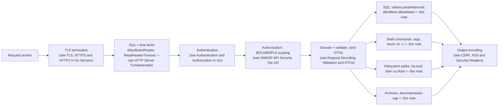
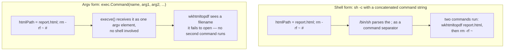

# Secure Coding for Go Services

> [!summary] TL;DR
> [[OWASP API Security Top 10]] names the vulnerability classes; this note is the Go-specific implementation layer underneath it. Several items already have a full, tested treatment elsewhere in this vault — BOLA/BOPLA in [[OWASP API Security Top 10]] itself, mass assignment and body limits in [[Request Decoding, Validation and DTOs]], SSRF in [[Calling External APIs]], path-sandboxing with `os.Root` in [[File Uploads and Object Storage]], webhook signatures in [[Receiving Webhooks Idempotently]], XSS escaping in [[CSRF, XSS and Security Headers]] — and this note links to each rather than repeating them. What it covers directly, because nothing else does: SQL identifier allowlisting (values are parameterized; column names cannot be), running external commands without a shell, the lexical `filepath.IsLocal` check that runs *before* any filesystem call, Go 1.24's `crypto/rand.Text` and AES-GCM for data at rest, a decompression-bomb guard for uploaded archives, constant-time secret comparison, keeping secrets out of logs, and the `govulncheck`/`gosec` checks that gate all of it in CI.

> [!abstract] Core idea
> - Every item on the OWASP list reduces to the same question in Go terms: does untrusted data ever reach a shell, a query string, a filesystem call, or a template as unparsed structure, instead of as a typed, validated value?
> - SQL values are solved by placeholders (`$1`, `$2`); SQL **identifiers** (a column name, a sort direction) are not — the only correct fix is an allowlist, because there is no bind-parameter syntax for "this part of the query text."
> - `exec.Command(name, args...)` never involves a shell; building a command string and handing it to `sh -c` always does, and that one design choice is the entire difference between immune and injectable.
> - `filepath.IsLocal` (Go 1.20) is a cheap, purely lexical check — not a symlink-aware one. `os.Root` (Go 1.24, see [[File Uploads and Object Storage]]) is the syscall-level check that closes the gap a lexical check leaves open.
> - Classic mistake: assuming `govulncheck` passing means "no known vulnerable dependencies." It specifically means "no known vulnerable function in a dependency that this binary's call graph can actually reach" — a vulnerable function your code never calls does not fail the build.

## 1. Why it exists

InvoiceOps ships a bulk-import feature: an admin uploads a `.zip` of CSV invoice batches, picks a column to sort the import summary by, and the system renders that summary to PDF by shelling out to an external renderer. One feature, four different places untrusted input can reach something dangerous if it is handled the generic way instead of the Go-specific way:

1. **The sort column.** `fmt.Sprintf("SELECT * FROM invoices ORDER BY %s", r.URL.Query().Get("sort"))` looks like the same kind of injection risk as an unparameterized `WHERE` clause — but it cannot be fixed the same way. `database/sql`'s placeholders bind **values**, not **identifiers**; there is no `$1` for a column name. A request for `sort=amount); DROP TABLE invoices;--` reaches the database verbatim if the only defense attempted is string formatting.
2. **The PDF render step.** A handler that builds `"wkhtmltopdf --quiet " + htmlPath + " " + outPath` and runs it via `sh -c` hands an attacker who controls any part of that string a second command, joined with `;`, `&&`, or a backtick substitution — the same class of bug as the SQL case, one layer lower, in the shell instead of the database.
3. **A "download the original CSV" link** built from a client-supplied filename. `../../etc/passwd` or a symlink planted by an earlier upload can walk outside the intended directory if the only check is a passing glance at the string.
4. **The uploaded `.zip` itself.** A decompression bomb — a small file that expands enormously once decompressed — can exhaust memory or disk during extraction, long before any CSV parsing logic runs. **Measured** (this note's own test, `archive/zip`, a single repeated-byte entry, Go 1.24, 2026-11-07): 5,242,880 decompressed bytes compressed down to 5,250 bytes on disk — a ~999:1 ratio from the most naive possible payload; a deliberately adversarial stream (structured to maximize DEFLATE's back-reference compression) can do dramatically better than that.

Each of these has a narrow, specific Go fix — not "be more careful," but a specific function or pattern that removes the category of bug entirely.

## 2. Mental model

Treat every value that crossed the network — a query parameter, a form field, an uploaded file's contents or name, a response from a URL a user configured — as adversarial input until it has passed through exactly one narrow, typed gate meant for its destination: an allowlist for anything that becomes SQL or shell text, an argv slice for anything that becomes a command, a lexical-then-syscall check for anything that becomes a filesystem path, authenticated encryption for anything written to disk that must stay confidential. String concatenation, a shell, or an un-capped decoder are never that gate — each is a way for input to carry its own structure past the destination's rules instead of being treated as inert data.

## 3. How it works

### The request trust boundary, control by control



Everything left of "this note" in the diagram already has its own full treatment elsewhere in the vault; this note is the set of boxes marked above, each one a place where parameterization — the usual SQL-injection fix — structurally cannot apply, so a different, specific control takes its place.

### SQL: why `ORDER BY` cannot use a placeholder

```go
// Both of these run against the same *sql.DB. Only one is safe.
db.QueryContext(ctx, "SELECT * FROM invoices WHERE status = $1", status) // OK: value
db.QueryContext(ctx, "SELECT * FROM invoices ORDER BY "+sortCol)         // NOT OK: identifier
```

A placeholder tells the driver "substitute this value, quoted and escaped, at execution time" — it works because the database can tell a value apart from the query's own grammar. A column name or `ASC`/`DESC` keyword is part of the grammar itself; there is no protocol-level way to say "insert this identifier safely," because identifiers aren't values the wire protocol has a slot for. [[Building REST Endpoints]] already shows this exact allowlist pattern for a `WHERE`-clause filter value (`allowedStatusFilter`); the function below applies the same idea to the one place a value-allowlist isn't the whole story — a sort column feeds directly into the query text, not into a bind parameter, even once it's been validated.

### `os/exec`: argv vs. a shell string



`exec.Command`/`exec.CommandContext` call `execve` (or the platform equivalent) directly with an argument vector — there is no intermediate shell to hand metacharacters to, ever, regardless of what bytes any argument contains. The moment code builds a string and passes it to `sh -c` (or shells out via `os/exec` with `"sh", "-c", cmdString"`), every shell metacharacter in that string is live again. Two residual risks remain even with argv: a user-controlled value starting with `-` can be read by the child as an option (use the tool's `--` end-of-options marker where it supports one, or only pass server-generated paths), and `exec.Command` resolves a bare name through `PATH`, so call a tool by absolute path in hardened containers (Go refuses to run a binary found via the current directory and returns `exec.ErrDot`).

## 4. Worked example

### Whiteboard version

The four vulnerable one-liners, for reference — none of these are ever acceptable, shown only so the fixed versions below are legible by contrast:

```go
// Vulnerable: identifier injection — a value allowlist does not cover this.
db.Query("SELECT * FROM invoices ORDER BY " + r.URL.Query().Get("sort"))

// Vulnerable: command injection — any shell metacharacter in htmlPath runs.
exec.Command("sh", "-c", "wkhtmltopdf "+htmlPath+" "+outPath)

// Vulnerable: path traversal — no check before the join.
os.Open(filepath.Join(uploadDir, r.URL.Query().Get("file")))

// Vulnerable: unbounded decompression — entry.Open() read with io.ReadAll,
// no cap, trusting the header's declared UncompressedSize64.
io.ReadAll(entry) // entry is a *zip.File opened with .Open()
```

The full version below fixes each one. It compiles and passes `go vet` and `go test -race` on Go 1.24.4.

### SQL identifier allowlist

```go
package securecoding

import "fmt"

// sortColumns is the allowlist of columns InvoiceOps' /invoices endpoint
// accepts a sort on. The database/sql driver parameterizes values, not
// identifiers — a column or direction cannot be a bind parameter, so the
// only safe way to accept a user-chosen ORDER BY is to map it through an
// allowlist like this one before building the query string.
var sortColumns = map[string]string{
	"created_at": "created_at",
	"amount":     "amount_cents",
	"due_date":   "due_date",
	"status":     "status",
}

// ValidateSort maps a user-supplied sort column and direction to the
// literal SQL identifiers safe to interpolate into an ORDER BY clause.
// Anything not on the allowlist is rejected outright rather than escaped,
// because escaping an identifier is not a solved problem the way escaping
// a value is.
func ValidateSort(column, direction string) (col, dir string, err error) {
	col, ok := sortColumns[column]
	if !ok {
		return "", "", fmt.Errorf("sort column %q is not allowed", column)
	}
	switch direction {
	case "asc", "":
		dir = "ASC"
	case "desc":
		dir = "DESC"
	default:
		return "", "", fmt.Errorf("sort direction %q is not allowed", direction)
	}
	return col, dir, nil
}

// BuildOrderByClause returns a literal ORDER BY clause built only from
// ValidateSort's output, never from the raw request values. Every other
// part of the query (the WHERE values) still goes through a parameterized
// $1, $2, ... placeholder, exactly as any other pgx query would.
func BuildOrderByClause(column, direction string) (string, error) {
	col, dir, err := ValidateSort(column, direction)
	if err != nil {
		return "", err
	}
	return fmt.Sprintf("ORDER BY %s %s", col, dir), nil
}
```

```go
// TestValidateSortRejectsInjection is the test that proves the point of
// this function: a column name that is actually a SQL injection payload
// must be rejected, not interpolated.
func TestValidateSortRejectsInjection(t *testing.T) {
	injections := []string{
		"amount; DROP TABLE invoices;--",
		"amount_cents) UNION SELECT password FROM users--",
		"created_at ASC; SELECT pg_sleep(5)",
	}
	for _, col := range injections {
		if _, _, err := ValidateSort(col, "asc"); err == nil {
			t.Errorf("ValidateSort(%q): want error, got nil — this would have reached the query string", col)
		}
	}
	if _, _, err := ValidateSort("amount", "asc; DROP TABLE invoices"); err == nil {
		t.Error("ValidateSort with an injected direction: want error, got nil")
	}
}
```

### Running an external command without a shell

```go
package securecoding

import (
	"bytes"
	"context"
	"fmt"
	"os/exec"
	"time"
)

// runArgv runs name with args as an argv-based command — no shell is ever
// involved. exec.CommandContext's first argument is the program to exec
// directly; every element after it is passed to that program as one
// literal argument, with no shell metacharacter (;, |, &&, $(), a
// backtick, >) ever interpreted. A value containing "; rm -rf ~" is just
// one argument's literal bytes here, never a second command.
// (Argument injection is a separate risk: a value that starts with "-" can
// still be parsed as a flag by the child program, so pass only paths the
// service generated itself, or prefix relative ones with "./".)
func runArgv(ctx context.Context, timeout time.Duration, name string, args ...string) ([]byte, error) {
	ctx, cancel := context.WithTimeout(ctx, timeout)
	defer cancel()

	cmd := exec.CommandContext(ctx, name, args...)
	var stdout, stderr bytes.Buffer
	cmd.Stdout = &stdout
	cmd.Stderr = &stderr
	if err := cmd.Run(); err != nil {
		return nil, fmt.Errorf("run %s: %w (stderr: %s)", name, err, stderr.String())
	}
	return stdout.Bytes(), nil
}

// RenderInvoicePDF converts an invoice's HTML to PDF by invoking an
// external renderer with an explicit argv built from InvoiceOps' own
// generated paths, not raw user input — but the argv form matters
// regardless of where the paths come from, because it is what removes
// shell interpretation as a possibility at all.
func RenderInvoicePDF(ctx context.Context, htmlPath, outPath string) error {
	_, err := runArgv(ctx, 30*time.Second, "wkhtmltopdf", "--quiet", htmlPath, outPath)
	return err
}
```

```go
// TestRunArgvPassesMetacharactersLiterally proves the point of this whole
// file: a string containing shell metacharacters, passed as one argv
// element, reaches the child process as literal bytes — nothing after
// the ";" runs as a second command, because there is no shell parsing it.
func TestRunArgvPassesMetacharactersLiterally(t *testing.T) {
	payload := "report.html; rm -rf ~ #"
	out, err := runArgv(context.Background(), 5*time.Second, "echo", "-n", payload)
	if err != nil {
		t.Fatalf("unexpected error: %v", err)
	}
	got := string(out)
	if got != payload {
		t.Fatalf("runArgv echoed %q, want the literal payload %q unchanged", got, payload)
	}
}
```

### Path traversal: the lexical first check

```go
package securecoding

import (
	"fmt"
	"path/filepath"
)

// SafeJoin joins a trusted base directory with a user-supplied relative
// path, refusing anything that would escape base — "../../etc/passwd",
// an absolute path, or (on Windows) a path carrying its own volume name.
//
// filepath.IsLocal (added in Go 1.20) is the check that matters: it
// reports whether a path, taken as a single lexical unit, stays within
// the directory it would be joined to. It is purely lexical — no
// filesystem access, no symlink resolution — which is exactly why it is
// the first, cheap check to run before any Open call, not a replacement
// for one. A symlink planted inside the base directory that points back
// out of it passes this check and still escapes; os.Root (Go 1.24, see
// the File Uploads and Object Storage note) is the syscall-level check
// that closes that gap.
func SafeJoin(base, userPath string) (string, error) {
	if !filepath.IsLocal(userPath) {
		return "", fmt.Errorf("path %q escapes its base directory", userPath)
	}
	return filepath.Join(base, userPath), nil
}
```

```go
func TestSafeJoin(t *testing.T) {
	cases := []struct {
		userPath string
		wantErr  bool
	}{
		{"invoices/2026-11.pdf", false},
		{"../../etc/passwd", true},
		{"../secret.env", true},
		{"/etc/passwd", true}, // absolute path
	}
	for _, c := range cases {
		_, err := SafeJoin("/data/invoiceops", c.userPath)
		if c.wantErr && err == nil {
			t.Errorf("SafeJoin(%q): want error, got nil", c.userPath)
		}
		if !c.wantErr && err != nil {
			t.Errorf("SafeJoin(%q): unexpected error: %v", c.userPath, err)
		}
	}
}
```

### Closing the symlink gap with `os.Root`

```go
package securecoding

import (
	"fmt"
	"io"
	"os"
)

// ReadInRoot reads name from inside dir using os.Root (Go 1.24). Every
// component is resolved relative to an open directory handle, so "../" and
// symlinks that point outside dir are refused.
func ReadInRoot(dir, name string, max int64) ([]byte, error) {
	root, err := os.OpenRoot(dir)
	if err != nil {
		return nil, fmt.Errorf("open root: %w", err)
	}
	defer root.Close()
	f, err := root.Open(name)
	if err != nil {
		return nil, fmt.Errorf("open %q in root: %w", name, err)
	}
	defer f.Close()
	return io.ReadAll(io.LimitReader(f, max))
}
```

```go
// A symlink inside the base that points outside passes IsLocal, but os.Root refuses it.
func TestReadInRootBlocksSymlinkEscape(t *testing.T) {
	base, outside := t.TempDir(), t.TempDir()
	if err := os.WriteFile(filepath.Join(outside, "secret.txt"), []byte("top secret"), 0o600); err != nil {
		t.Fatal(err)
	}
	if err := os.WriteFile(filepath.Join(base, "ok.txt"), []byte("fine"), 0o600); err != nil {
		t.Fatal(err)
	}
	if err := os.Symlink(outside, filepath.Join(base, "link")); err != nil {
		t.Fatal(err)
	}

	if _, err := SafeJoin(base, "link/secret.txt"); err != nil {
		t.Fatalf("IsLocal should accept the lexically local path: %v", err)
	}
	if got, err := ReadInRoot(base, "ok.txt", 1<<10); err != nil || string(got) != "fine" {
		t.Fatalf("ok.txt: %q, %v", got, err)
	}
	if got, err := ReadInRoot(base, "link/secret.txt", 1<<10); err == nil {
		t.Fatalf("symlink escape succeeded, read %q", got)
	}
	if _, err := ReadInRoot(base, "../x", 1<<10); err == nil {
		t.Fatal("../ escape succeeded")
	}
}
```

Do not use a string-prefix check (`strings.HasPrefix(filepath.Clean(p), base)`) as a substitute: `/data/invoiceops-evil` has the prefix `/data/invoiceops`, and the check is lexical, so symlinks defeat it too.

### A decompression-bomb guard for uploaded archives

```go
package securecoding

import (
	"archive/zip"
	"fmt"
	"io"
)

// ErrDecompressionBomb is returned when an archive entry's decompressed
// size would exceed the configured cap.
var ErrDecompressionBomb = fmt.Errorf("archive entry exceeds the decompressed-size limit")

// ExtractZipEntry reads one entry from an already-opened *zip.Reader,
// capping how many decompressed bytes it will produce. A zip entry
// declares its own uncompressed size in its header (r.UncompressedSize64),
// but that field is attacker-controlled metadata, not a guarantee — the
// only trustworthy limit is one enforced while actually reading the
// decompressed stream. io.LimitReader does exactly that: it stops pulling
// bytes out of the decompressor the moment the cap is hit, regardless of
// what the entry's own header claims or how small the compressed bytes on
// disk are.
func ExtractZipEntry(entry *zip.File, maxBytes int64) ([]byte, error) {
	rc, err := entry.Open()
	if err != nil {
		return nil, fmt.Errorf("open entry %q: %w", entry.Name, err)
	}
	defer rc.Close()

	limited := io.LimitReader(rc, maxBytes+1)
	data, err := io.ReadAll(limited)
	if err != nil {
		return nil, fmt.Errorf("read entry %q: %w", entry.Name, err)
	}
	if int64(len(data)) > maxBytes {
		return nil, fmt.Errorf("%w: %q", ErrDecompressionBomb, entry.Name)
	}
	return data, nil
}
```

```go
// Test helpers: build an in-memory zip and open its first entry.
func buildTestZip(t *testing.T, name, content string) []byte {
	t.Helper()
	var buf bytes.Buffer
	zw := zip.NewWriter(&buf)
	w, err := zw.Create(name)
	if err != nil {
		t.Fatal(err)
	}
	if _, err := w.Write([]byte(content)); err != nil {
		t.Fatal(err)
	}
	if err := zw.Close(); err != nil {
		t.Fatal(err)
	}
	return buf.Bytes()
}

func openFirstEntry(t *testing.T, zipBytes []byte) *zip.File {
	t.Helper()
	zr, err := zip.NewReader(bytes.NewReader(zipBytes), int64(len(zipBytes)))
	if err != nil {
		t.Fatal(err)
	}
	return zr.File[0]
}

// TestExtractZipEntryRejectsDecompressionBomb builds a highly repetitive
// 5 MiB entry (which DEFLATE compresses to a few kilobytes on disk) and
// proves the cap stops the read mid-decompression, regardless of how
// small the compressed bytes are.
func TestExtractZipEntryRejectsDecompressionBomb(t *testing.T) {
	const decompressedSize = 5 << 20 // 5 MiB of a single repeated byte
	huge := strings.Repeat("A", decompressedSize)
	zipBytes := buildTestZip(t, "payload.bin", huge)

	if len(zipBytes) >= decompressedSize/100 {
		t.Fatalf("test setup bug: compressed zip is %d bytes, want it far smaller than the %d-byte payload to prove the ratio", len(zipBytes), decompressedSize)
	}

	entry := openFirstEntry(t, zipBytes)
	_, err := ExtractZipEntry(entry, 1<<20) // 1 MiB cap, well under the 5 MiB payload
	if err == nil {
		t.Fatal("ExtractZipEntry: want an error for an entry over the cap, got nil")
	}
	if !errors.Is(err, ErrDecompressionBomb) {
		t.Errorf("err = %v, want it to wrap ErrDecompressionBomb", err)
	}
}
```

Two more rules for archives. Cap the **number of entries** and the **total** decompressed bytes across the whole archive, not only per entry. And never use `entry.Name` as a path: a name like `../../etc/cron.d/x` is the "zip slip" attack. Run it through `filepath.IsLocal` (or extract through an `os.Root`), or better, store the bytes under a name the service generates. Since Go 1.20, setting `GODEBUG=zipinsecurepath=0` makes `zip.NewReader` return `zip.ErrInsecurePath` for such names, but it is off by default, so check each name yourself.

### Modern crypto/rand: one-time codes and encryption at rest

```go
package securecoding

import (
	"crypto/aes"
	"crypto/cipher"
	"crypto/rand"
	"fmt"
)

// NewOneTimeCode returns a random one-time code (a password-reset code, an
// email-verification code) using crypto/rand.Text (Go 1.24): 26 characters
// from the standard RFC 4648 base32 alphabet (upper-case A-Z and 2-7), at
// least 128 bits of randomness per the stdlib's own documented guarantee,
// safe to put in a URL or read aloud. It is crypto/rand underneath — the
// same source NewAESKey below uses — wrapped so call sites never have to
// pick an alphabet or encoding themselves. math/rand and math/rand/v2 must
// never generate a value like this: both are deterministic from a seed,
// so their output is predictable to anyone who can guess or brute-force
// it, which a security code cannot be.
func NewOneTimeCode() string {
	return rand.Text()
}

// NewAESKey generates a 256-bit AES key from crypto/rand, the only
// acceptable randomness source for key material.
func NewAESKey() ([]byte, error) {
	key := make([]byte, 32) // AES-256
	if _, err := rand.Read(key); err != nil {
		return nil, fmt.Errorf("generate key: %w", err)
	}
	return key, nil
}

// Encrypt seals plaintext with AES-256-GCM: authenticated encryption, so
// tampering with the ciphertext is detected at decrypt time instead of
// silently producing corrupted plaintext (the failure mode of an
// unauthenticated mode like plain AES-CBC). The nonce is generated fresh
// per call and prefixed to the returned ciphertext — GCM's security
// guarantee depends entirely on never reusing a nonce with the same key,
// so the nonce must travel with the ciphertext, never be reused, and
// never be derived from anything predictable. The last argument to Seal is
// "additional data" (nil here); pass something like the record ID there to
// bind a ciphertext to the row it belongs to, so it cannot be copied to
// another row.
func Encrypt(key, plaintext []byte) ([]byte, error) {
	block, err := aes.NewCipher(key)
	if err != nil {
		return nil, fmt.Errorf("new cipher: %w", err)
	}
	gcm, err := cipher.NewGCM(block)
	if err != nil {
		return nil, fmt.Errorf("new gcm: %w", err)
	}
	nonce := make([]byte, gcm.NonceSize())
	if _, err := rand.Read(nonce); err != nil {
		return nil, fmt.Errorf("generate nonce: %w", err)
	}
	return gcm.Seal(nonce, nonce, plaintext, nil), nil
}

// Decrypt reverses Encrypt. It returns an error, not corrupted plaintext,
// if the ciphertext was tampered with or encrypted under a different key
// — GCM's authentication tag makes that check part of decryption itself.
func Decrypt(key, ciphertext []byte) ([]byte, error) {
	block, err := aes.NewCipher(key)
	if err != nil {
		return nil, fmt.Errorf("new cipher: %w", err)
	}
	gcm, err := cipher.NewGCM(block)
	if err != nil {
		return nil, fmt.Errorf("new gcm: %w", err)
	}
	if len(ciphertext) < gcm.NonceSize() {
		return nil, fmt.Errorf("ciphertext shorter than nonce size")
	}
	nonce, data := ciphertext[:gcm.NonceSize()], ciphertext[gcm.NonceSize():]
	plaintext, err := gcm.Open(nil, nonce, data, nil)
	if err != nil {
		return nil, fmt.Errorf("decrypt: authentication failed: %w", err)
	}
	return plaintext, nil
}
```

```go
func TestDecryptRejectsTamperedCiphertext(t *testing.T) {
	key, err := NewAESKey()
	if err != nil {
		t.Fatalf("unexpected error: %v", err)
	}
	ciphertext, err := Encrypt(key, []byte("sensitive"))
	if err != nil {
		t.Fatalf("unexpected error: %v", err)
	}

	tampered := append([]byte(nil), ciphertext...)
	tampered[len(tampered)-1] ^= 0xFF // flip a bit in the authentication tag

	if _, err := Decrypt(key, tampered); err == nil {
		t.Fatal("Decrypt: want an authentication error for tampered ciphertext, got nil")
	}
}
```

### Constant-time comparison and log redaction

```go
package securecoding

import (
	"crypto/hmac"
	"crypto/sha256"
	"crypto/subtle"
	"log/slog"
)

// TokenEqual compares a presented secret (an API key, a reset token) with the
// stored one in constant time. Hashing both sides first gives equal-length
// inputs, so ConstantTimeCompare's early exit on a length mismatch cannot
// leak the stored value's length. Never use == or bytes.Equal here: they
// stop at the first differing byte, so response time leaks how much matched.
func TokenEqual(presented, stored string) bool {
	a := sha256.Sum256([]byte(presented))
	b := sha256.Sum256([]byte(stored))
	return subtle.ConstantTimeCompare(a[:], b[:]) == 1
}

// VerifyHMAC checks a raw MAC over msg (a webhook body, for example).
// hmac.Equal is constant time.
func VerifyHMAC(secret, msg, gotMAC []byte) bool {
	m := hmac.New(sha256.New, secret)
	m.Write(msg)
	return hmac.Equal(m.Sum(nil), gotMAC)
}

// Secret wraps a sensitive string so it never reaches a log line by accident:
// slog calls LogValue instead of printing the underlying value.
type Secret string

func (Secret) LogValue() slog.Value { return slog.StringValue("[REDACTED]") }
```

```go
func TestTokenEqual(t *testing.T) {
	if !TokenEqual("s3cret", "s3cret") || TokenEqual("s3cret", "s3cre") || TokenEqual("", "x") {
		t.Fatal("TokenEqual wrong")
	}
}

func TestSecretIsRedactedInLogs(t *testing.T) {
	var buf bytes.Buffer
	logger := slog.New(slog.NewTextHandler(&buf, nil))
	logger.Info("login", "api_key", Secret("sk_live_abc123"))
	if strings.Contains(buf.String(), "sk_live_abc123") || !strings.Contains(buf.String(), "[REDACTED]") {
		t.Fatalf("log leaked or missed redaction: %s", buf.String())
	}
}
```

**Measured:** the test files for the snippets above (SQL sort, argv execution, `IsLocal` plus `os.Root`, zip guard, crypto and constant-time compare, log redaction) pass under `go vet` and `go test -race` on Go 1.24.4, darwin/arm64, 2026-11-07, in under 2 seconds total — 12 tests, including the decompression-ratio assertion above.

## 5. Variants and comparison

| OWASP API Security Top 10 (2023) item | Go-specific control | Owned by |
| --- | --- | --- |
| API1 Broken Object Level Authorization | Scope every query by the caller's own identity | [[OWASP API Security Top 10]], [[Authentication and Authorization in Go]] |
| API2 Broken Authentication | Verified JWTs/sessions, rate-limited login | [[Authentication and Authorization in Go]] |
| API3 Broken Object Property Level Authorization (mass assignment) | DTOs with `DisallowUnknownFields`, role-scoped response fields | [[Request Decoding, Validation and DTOs]], [[OWASP API Security Top 10]] |
| API4 Unrestricted Resource Consumption | `MaxBytesReader`, `ReadHeaderTimeout`, page/size caps, a decompression-bomb guard | [[Request Decoding, Validation and DTOs]], [[HTTP Server Fundamentals (net-http)]], **this note** |
| API5 Broken Function Level Authorization | Role checks on every handler, not just sensitive-looking ones | [[Authentication and Authorization in Go]] |
| API6 Unrestricted Access to Sensitive Business Flows | Rate limiting, bot/abuse detection | [[API Abuse and Bot Protection]] |
| API7 Server Side Request Forgery | URL allowlist + `Dialer.Control` blocking private/loopback/link-local ranges (it sees the resolved IP of every dial, including redirect hops, so DNS rebinding and redirects cannot slip past a check made only on the hostname) | [[Calling External APIs]] |
| API8 Security Misconfiguration | Security headers, TLS config, least-privilege defaults | [[CSRF, XSS and Security Headers]], [[TLS, HTTPS and HTTP2 in Go Servers]] |
| API9 Improper Inventory Management | API versioning, deprecation policy | [[OpenAPI-First Development in Go]] |
| API10 Unsafe Consumption of APIs | Validate and bound third-party responses the same as any other input | [[Calling External APIs]] |
| *(cross-cutting)* SQL injection via identifiers | ORDER BY / sort-column allowlist | **this note** |
| *(cross-cutting)* Command injection | `exec.Command` argv, never a shell string | **this note** |
| *(cross-cutting)* Path traversal | `filepath.IsLocal` (lexical) then `os.Root` (syscall) | **this note**, [[File Uploads and Object Storage]] |
| *(cross-cutting)* XSS | `html/template`'s contextual escaping | [[CSRF, XSS and Security Headers]] |
| *(cross-cutting)* CSRF | `SameSite` cookies, `http.CrossOriginProtection` (Go 1.25) | [[CSRF, XSS and Security Headers]] |

Smaller controls from the same audit, each with a one-line Go answer:

- **Resource limits:** `http.MaxBytesReader` on every body, `http.Server.ReadHeaderTimeout` (Slowloris), page-size caps, and a decoder that rejects unknown fields (`DisallowUnknownFields`); see [[HTTP Server Fundamentals (net-http)]] and [[Request Decoding, Validation and DTOs]]. `regexp` is RE2 and linear-time, so it is not a ReDoS risk.
- **XSS:** use `html/template`, which escapes by context; `text/template` does no escaping and must never render HTML.
- **Cookie-authenticated browsers:** `SameSite` cookies, plus `http.CrossOriginProtection` (Go 1.25) for CSRF; see [[CSRF, XSS and Security Headers]], which also covers HSTS, `nosniff` and CSP.
- **TLS:** keep `MinVersion` at `tls.VersionTLS12` or higher and never set `InsecureSkipVerify`; see [[TLS, HTTPS and HTTP2 in Go Servers]].
- **Supply chain:** commit `go.sum` and keep the default `GOSUMDB` verification on, pin tools with the `go.mod` `tool` directive (Go 1.24), and automate updates with Renovate or Dependabot.

> [!warning] Interview trap
> `govulncheck` passing does not mean the project has zero vulnerable dependencies — it means zero vulnerable *functions the binary's own call graph can reach*. It performs reachability analysis: it builds a call graph from `main` outward and checks whether any function with a known advisory is actually called, directly or transitively. A vulnerable function in an imported package that the code never calls does not fail the check — which is also exactly why upgrading the dependency is still the right fix the moment that code path does start getting used.

## 6. Trade-offs and when not to use

- An identifier allowlist needs a code change every time a new sortable column ships — more maintenance than a value placeholder, but there is no safer alternative for identifiers, so the cost is unavoidable, not optional.
- Avoiding a shell entirely means losing shell conveniences (globbing, pipes, `&&` chaining) at the call site; where those are genuinely needed, build the pipeline in Go (`io.Pipe`, multiple `exec.Cmd`s) rather than reaching for `sh -c`.
- `filepath.IsLocal` alone is not strong enough for any path where an attacker could have planted a symlink inside the base directory; pair it with `os.Root` wherever that is possible (exactly [[File Uploads and Object Storage]]'s situation).
- AES-GCM key management (rotation, where the key itself lives) is a real operational cost on top of the cipher code; [[Secrets Management]] is where that key's own lifecycle belongs, not this note.
- `gosec` produces real false positives (flagging `#nosec`-worthy patterns like a hardcoded non-secret constant or a deliberately weak hash used for a cache key, not a credential); a blanket "fix every finding" policy trains a team to silence the tool instead of reading it — require a one-line justification on every suppression instead.

## 7. In production

- **Real systems:** the Go vulnerability database (`vuln.go.dev`) that powers `govulncheck` is maintained by the Go security team specifically to support this reachability-based workflow; `gosec` is maintained under the `securego` GitHub organization and ships as a `golangci-lint` linter as well as a standalone binary; OWASP's own API Security Top 10 project collects real incident categories (the BOLA, SSRF and mass-assignment entries are each backed by named public breaches in OWASP's own write-up).
- **Failure modes → fixes:**
  - A sort parameter reaches the database as raw text because a developer added a new column and forgot the allowlist → fail closed: an unrecognized column is a `400`, never a passthrough default.
  - A CI pipeline's `govulncheck` step is green despite a known-vulnerable dependency → check whether the vulnerable function is actually reachable yet; if a new feature is about to start calling it, update the dependency before merging, don't wait for the scanner to turn red.
  - `gosec` findings pile up unreviewed in a dashboard nobody reads → gate the CI pipeline on new findings specifically (a baseline diff), not on the total count, so the signal doesn't drown in historical noise.
  - A decrypted-at-rest field comes back as garbage after a key rotation → the old ciphertext was encrypted under the previous key; keep the previous key available for decryption until every existing ciphertext has been re-encrypted under the new one, the same overlap-window pattern [[Service-to-Service Auth - API Keys, HMAC, mTLS]] uses for API key rotation.
- **What to monitor:** `govulncheck`/`gosec` CI job pass rate and new-finding count per PR (see [[CI-CD Pipelines (GitHub Actions for Go)]] for exactly where these gates sit in the pipeline); `400` rate on sort/filter parameters (a spike suggests either an attack attempt or a client bug); archive-extraction rejections (`ErrDecompressionBomb`) as a signal of either a malicious upload or a misbehaving integration partner.

## 8. Deep dive

- **How `govulncheck`'s reachability analysis actually works.** It builds a static call graph starting from the binary's `main` (or, for a library, its exported API) and checks, function by function, whether any function named in a Go vulnerability database entry is present in that graph. This is strictly more precise than a naive "is a vulnerable module version in `go.sum`" check (what most non-Go dependency scanners do), because `go.sum` lists every transitive dependency regardless of whether any of it is actually imported by the code paths that run, let alone called. The trade-off: it only analyzes what it can see statically, so a vulnerable function reached only through `reflect`, a plugin, or a dynamically-dispatched interface it cannot resolve may be under-reported — reachability analysis is a sharper signal than a bill-of-materials match, not an absolute guarantee.
- **What `gosec` actually checks, by rule family.** Its rules fall into a few families worth knowing by shape rather than by ID: pattern checks that flag a non-constant value reaching a sensitive call (`G107` — HTTP request made with a variable URL, close to the SSRF case; `G304` — file path from a variable passed to `os.Open`, close to the path-traversal case; newer releases add real taint analysis for some rules); weak-crypto checks (`G401`/`G402`/`G501` — MD5, SHA1, `DES`, or a `tls.Config` with an insecure minimum version); and unchecked-error checks (`G104`). A finding on code this note's functions guard against is exactly the signal `gosec` is for — it is a static approximation of the same questions this note answers by construction.
- **Why GCM's nonce, not the key, is the thing that must never repeat.** AES-GCM's confidentiality and authenticity guarantees both depend on the keystream being unique per (key, nonce) pair. Reusing a nonce under the same key lets an attacker XOR two ciphertexts together to cancel the keystream and recover the XOR of the two plaintexts — and, for GCM specifically, can also recover the authentication key, letting the attacker forge valid tags for arbitrary messages. A 96-bit random nonce (what `cipher.NewGCM` uses by default, as generated above) keeps collision probability negligible as long as the number of messages encrypted under one key stays well below roughly 2^32 — past that volume, derive a per-message key (HKDF from a master key plus a counter) instead of relying on randomness alone.
- **RE2 and why Go's regexp package cannot be made to hang on adversarial input.** `regexp` compiles patterns into an RE2-style automaton guaranteeing linear time in input length regardless of the pattern — unlike backtracking engines (PCRE-style, found in many other languages' standard libraries), where a pattern like `(a+)+$` can take exponential time on a crafted input (a classic ReDoS). This is a property of the package itself, not something a Go service has to opt into or verify per-regex — the one caveat is that `regexp` does not support backreferences or lookahead precisely because supporting them would require abandoning the linear-time guarantee.

## 9. Interview questions

> [!question]- Why can a `WHERE` clause value be parameterized but an `ORDER BY` column cannot?
> A placeholder works because the database driver can distinguish a *value* from the query's own grammar at the wire-protocol level and substitute it safely. A column name or sort direction is part of the query's grammar itself — there is no bind-parameter mechanism for "insert this identifier here." The only correct fix is to map the user's input through an allowlist to a known-safe literal before building the query string.

> [!question]- Why does `exec.Command("wkhtmltopdf", "--quiet", htmlPath, outPath)` avoid injection that `exec.Command("sh", "-c", "wkhtmltopdf --quiet "+htmlPath+" "+outPath)` doesn't, even though both eventually run the same program?
> The first form calls `execve` directly with an argument vector — each argument is passed as literal bytes to the target program, with no shell ever parsing them. The second form hands a shell a single string to parse, and every metacharacter in `htmlPath` (`;`, `|`, `&&`, a backtick) is live the moment that parsing happens, regardless of what `wkhtmltopdf` itself does with its own arguments.

> [!question]- Does `filepath.IsLocal` fully stop path traversal on its own?
> No — that's the trap. It's a purely lexical check: it looks at the path string and never touches the filesystem, so a symlink planted inside the base directory that points back outside it passes the check and still escapes when the path is actually opened. `os.Root` (Go 1.24) closes that gap by resolving every path against an open directory file descriptor at the syscall level, which is why [[File Uploads and Object Storage]] uses it for writes that must not escape, and why this note's `SafeJoin` is explicitly framed as the cheap first check, not the complete answer.

> [!question]- What does Go 1.24's `crypto/rand.Text` add over generating random bytes and hex-encoding them by hand?
> Nothing cryptographically new — both ultimately pull from the OS's CSPRNG. What it removes is the chance of a subtly wrong hand-rolled version: picking `math/rand` by mistake, an alphabet with ambiguous characters, or an encoding that isn't URL-safe. It standardizes on RFC 4648 base32 with at least 128 bits of randomness, which is enough entropy for any one-time code or token without a developer having to re-derive that number themselves.

> [!question]- Why must an AES-GCM nonce never repeat under the same key, and what's the actual consequence if it does?
> GCM's security proof depends on each (key, nonce) pair producing a unique keystream. Reusing a nonce lets an attacker XOR the two resulting ciphertexts to cancel the keystream and recover the XOR of the two plaintexts, and for GCM specifically can also expose the authentication key, letting the attacker forge valid tags on messages of their own choosing. Generating a fresh random 96-bit nonce per call, as shown above, keeps the collision probability negligible unless a single key is reused across an enormous number of messages.

> [!question]- Does `govulncheck` passing mean there are no vulnerable dependencies in the project?
> No — that's the trap. It means no function flagged in the Go vulnerability database is reachable from the binary's own call graph. A vulnerable function in an imported package the code never actually calls does not fail the check. The dependency should still be upgraded on its own schedule; `govulncheck` is a prioritization signal (is this one urgent, right now) not a complete absence-of-risk guarantee.

> [!question]- Why does a decompression-bomb guard need to cap bytes read from the decompressor, rather than trusting the zip entry's declared uncompressed size?
> Because that declared size is attacker-controlled metadata in the file's own header, not a property the reading code can verify independently of actually decompressing the data. `io.LimitReader` wrapped around the entry's decompressing reader enforces the real limit on the real byte stream as it comes out, regardless of what the header claims or how small the compressed file is on disk.

## 10. Cheat sheet

- SQL values → placeholders (`$1`). SQL identifiers (`ORDER BY` column/direction) → an allowlist; there is no placeholder for identifiers.
- Run external commands with `exec.Command(name, args...)`; never build a string and hand it to `sh -c`.
- `filepath.IsLocal` is a cheap lexical check, not a symlink-safe one — pair it with `os.Root` whenever the base directory could contain an attacker-influenced entry.
- Cap decompressed bytes read from an archive entry with `io.LimitReader`; never trust the entry header's declared uncompressed size.
- `crypto/rand.Text()` (Go 1.24) for one-time codes and tokens; AES-256-GCM for data encrypted at rest; never `math/rand`/`math/rand/v2` for either.
- `govulncheck` is reachability-based: it fails the build only for a *called* vulnerable function, not every vulnerable dependency in `go.sum`.
- Compare secrets with `subtle.ConstantTimeCompare` or `hmac.Equal`, never `==`; wrap secrets in a `slog.LogValuer` so they cannot be logged.
- `gosec` catches the static shape of these bugs (variable URLs and paths, weak crypto, unchecked errors) as a second, automated layer behind code review.
- Most of the OWASP API Security Top 10 is already fully covered elsewhere in this vault — check the table in section 5 before writing a new fix for BOLA, mass assignment, SSRF, or XSS.

## Links

- **Before this:** [[OWASP API Security Top 10]], [[Request Decoding, Validation and DTOs]], [[Containerizing Go Services]]
- **Next:** [[gRPC Services in Go]]
- **Compare with:** [[Calling External APIs]] (SSRF), [[File Uploads and Object Storage]] (path sandboxing with `os.Root`), [[Receiving Webhooks Idempotently]] (HMAC signature verification), [[CSRF, XSS and Security Headers]] (XSS, CSRF, security headers), [[CI-CD Pipelines (GitHub Actions for Go)]] (where `govulncheck` runs in the pipeline)
