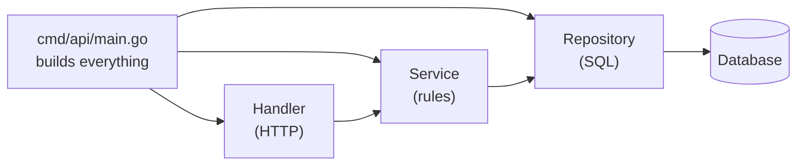
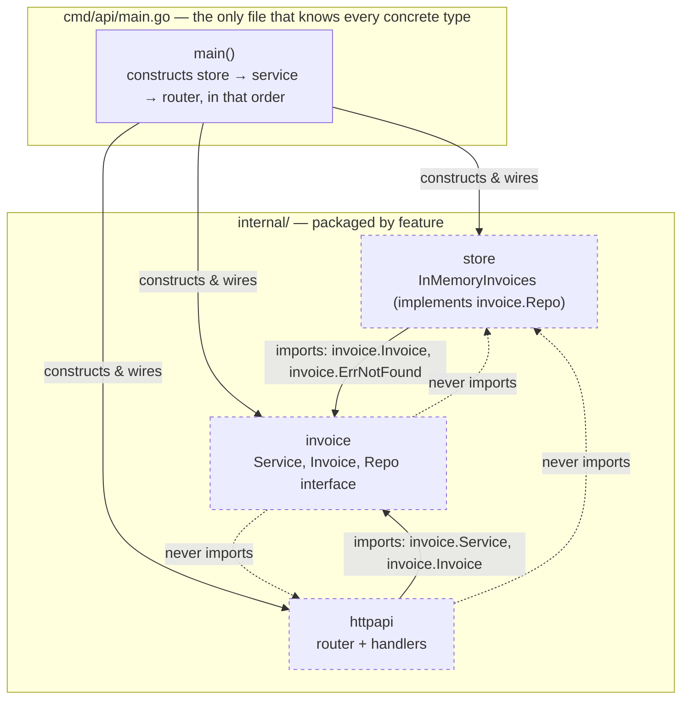
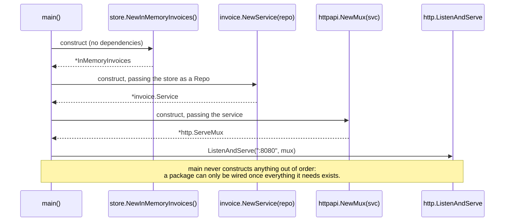

# Service Project Layout and Wiring

> [!summary] TL;DR
> A Go service's folder layout exists to make one thing obvious at a glance: which packages are allowed to import which other packages. `cmd/<app>/main.go` is the only file that knows every concrete type; it constructs them in order and wires them together.
>
> Everything under `internal/` is split by feature, not by generic layer-name folders, and the import direction only ever points one way: handler → service → repository.

> [!abstract] Core idea
> - `cmd/<binary-name>/main.go` constructs every concrete dependency and wires it together ("manual DI"); it is the one file allowed to know all the concrete types.
> - `internal/` packages are organized by feature (`invoice`, `payment`) first, and by layer only inside a feature if needed — not `internal/controllers`, `internal/models`.
> - The consumer of a dependency declares the interface it needs; the implementer satisfies it structurally. This keeps the import arrow pointing one way: handler → service → repository, never back.
> - There is no official or required Go project layout. `golang-standards/project-layout` is a popular community repo, not a Go team document; `go.dev/doc/modules/layout` is the only layout guidance the Go team actually publishes, and it says: keep it as flat as the project allows.
> - A `util`/`common`/`helpers` package is where unrelated code goes to avoid being organized. It usually means a type or function hasn't found its real feature package yet.

## Start here: the basics

**The problem in one story.**
A new teammate opens your Go service for the first time.
They see folders called `utils`, `models` and `controllers`, and every folder imports every other.
Changing one file breaks three others they never looked at.
A good layout lets them see, from folder names alone, what depends on what.

**Words you need first**

| Word | Plain meaning | Tiny example |
| --- | --- | --- |
| Package | A Go folder of code with one name | `package invoice` |
| Import | One package using code from another | `import "myapp/internal/invoice"` |
| `cmd/` | Folder holding each runnable program's `main` | `cmd/api/main.go` |
| `internal/` | Folder Go only lets your own module import | `internal/payment` |
| Interface | A list of methods; any type with them fits | `type Store interface { Get(id) }` |
| Dependency injection (DI) | Passing a part in, instead of the code building it | `NewService(repo)` |
| Layer | A role in a request: handler, service, repository | Handler reads HTTP, repo talks SQL |

**Picture it**



**Analogy.** `main.go` is the stage manager who places every actor and prop before the show; the actors only talk to the person next in line.
Where it breaks: a stage manager can improvise mid-show, but Go wiring is fixed at startup and compile time.

**How the rest of this note builds up**

- First, why layout matters (section 1) and the "imports point one way" mental model (section 2).
- Then how it works: `cmd/`, `internal/`, feature packages and consumer-side interfaces (section 3).
- Then a full worked example wiring an invoice service by hand, and a comparison of layouts and DI tools (sections 4-5).
- Finally the SDE-3 deep dive: trade-offs, production habits, import cycles and why `util` packages rot (sections 6-8).

> [!tip] Remember
> Only `main.go` knows every concrete type; every other import arrow points one way: handler → service → repository.

## 1. Why it exists

A four-person team builds InvoiceOps for six months without a layout convention.

By month three, `internal/utils` has 40 unrelated functions (money formatting, slug generation, a retry helper, three different "parse date" functions), nobody can tell by looking at an import whether `payment` is allowed to import `invoice` or the other way around, and a new hire spends their first day asking "where would `MarkInvoicePaid` go?" because three different folders look plausible.

The fix is not a bigger framework.

It's naming the two decisions that actually matter and writing them down once: **what goes in a package** (one feature, not one generic layer-name) and **which way an import is allowed to point** (always toward the thing being used, never back).

Once those two rules are fixed, "where does `MarkInvoicePaid` go" has exactly one answer: in the `invoice` package, because that's the feature it belongs to, regardless of whether it's "business logic" or "a handler."

## 2. Mental model

Picture the service as a one-way street map, not a layer cake. `cmd/api` is the entrance; it's the only building allowed to walk into every other building and introduce them to each other.

Every other building (`internal/invoice`, `internal/httpapi`, `internal/store`) only knows the buildings it directly needs, and only through a door it defined itself (an interface) — it never has the address of a building's internals.

`internal/invoice` defines the door shape it needs ("something with `Get` and `Save`"); `internal/store` builds a thing matching that door shape without `invoice` ever being told the full blueprint of `store`. That's dependency inversion by construction, not by a generic rule: the consumer owns the interface.

## 3. How it works



The dashed arrows are the rule that actually matters: **`httpapi` never imports `store`, and `invoice` never imports `httpapi` or `store`.** `invoice` only exports a `Repo` interface; `store` is the only package that imports `invoice` *and* implements that interface, and it does so without `invoice` ever importing `store` back.

That is what "no cycles" means in practice, and it's also what the Go compiler enforces for you: an actual import cycle between `invoice` and `store` is a compile error, not a style complaint.

Startup order matters because each constructor call below needs the previous one's return value as its argument — this is what "manual DI" means in practice:



**The layout in full:**

```text
invoiceops/
  cmd/
    api/
      main.go          # builds the store, the service, the router, starts the server
  internal/
    invoice/
      invoice.go       # Invoice type, Repo interface, Service (business rules)
      invoice_test.go
    httpapi/
      httpapi.go       # ServeMux, handlers: decode/encode + call one service method
      httpapi_test.go
    store/
      store.go         # concrete Repo implementation (pgx-backed in production)
    config/
      config.go        # env/flag parsing — covered in the configuration note
  migrations/
    0001_create_invoices.sql
  api/
    openapi.yaml        # the contract this service implements
  deploy/
    Dockerfile
    docker-compose.yaml
  go.mod
  go.sum
```

- **`cmd/<binary>/main.go`.** One subfolder per binary your module produces. InvoiceOps might ship `cmd/api` (the HTTP server), `cmd/worker` (background jobs), and `cmd/migrate` (a migration runner), all sharing the same `internal/` packages.

  `main.go` is intentionally thin: it has no business logic, just constructor calls in dependency order, followed by `http.ListenAndServe` or equivalent. This is "manual DI": no container, no struct tags, no reflection — just calling `NewService(repo)` with an already-built `repo`.
- **`internal/` by feature, not by layer.** `internal/invoice`, not `internal/models` + `internal/services` + `internal/controllers`. A layer-named folder structure forces you to open three folders to understand one feature, and invites a `common`/`shared` fourth folder the moment two features need the same helper.

  A feature package can still have layer-shaped files inside it (`invoice.go` for the service, `invoice_handler.go` for HTTP glue) if the feature is big enough to need the split — the point is the top-level folder name is a noun from the business, not a generic architecture word.
- **Why `internal/`.** Since Go 1.4, any package under a path containing an `internal/` segment can only be imported by code rooted at the parent of that `internal` directory.

  `invoiceops/internal/invoice` can be imported by anything under `invoiceops/`, but never by a different module, even one written by the same team. This is the enforced version of "these are our implementation details, not a public API" — enforced by the compiler, not a comment.
- **The consumer owns the interface.** `invoice.Repo` is declared in the `invoice` package, next to the `Service` that uses it — not in `store`, and not in a generic `internal/interfaces` package.

  `store.InMemoryInvoices` satisfies `invoice.Repo` structurally: nothing in `store.go` says `var _ invoice.Repo = (*InMemoryInvoices)(nil)` is required, Go checks the method set at the point `main.go` passes a `*store.InMemoryInvoices` into `invoice.NewService`.

  This is why the import arrow only ever points from `store` to `invoice`, never back: `invoice` doesn't need to know `store` exists.
- **Manual DI vs `wire`/`fx`.** For a service with a dozen or so dependencies, writing the constructor calls by hand in `main.go` (manual DI, shown above) is the simplest option and the easiest to read top to bottom.

  `google/wire` generates the same wiring code at build time from a set of "provider" functions you declare — useful once wiring by hand becomes long and repetitive, but it adds a code-generation step and its own vocabulary.

  `uber-go/fx` goes further: a runtime DI framework with lifecycle hooks, useful for large service meshes with many related services, but overkill for one InvoiceOps-sized binary. Start with manual DI; reach for `wire` when `main.go` becomes genuinely hard to read, not before.
- **`golang-standards/project-layout` is not official.** It's a popular community repository, and parts of it (a top-level `pkg/`, `api/`, `build/`) get cargo-culted into services that don't need them.

  The Go team's own layout guidance is at `go.dev/doc/modules/layout`, and it is intentionally minimal: one module per repository is fine, `cmd/` for binaries and `internal/` for private packages are the only structural conventions it actually recommends, and it explicitly says smaller projects don't need `pkg/` at all.
- **Avoid `pkg/` cargo cult.** A top-level `pkg/` folder only earns its place when a package inside it is meant to be imported by other modules/teams (a genuinely public API) — not as a default home for "code that isn't `cmd/` or `internal/`." If nothing outside this repository imports it, it belongs under `internal/`, where the compiler enforces that nobody else can.
- **Avoid `util`/`common`/`helpers`.** These names describe nothing about what the package does, so anything can get dumped there, and they become the one package every other package imports — which is itself a layering smell.

  When you're tempted to add to `internal/util`, ask which feature the function actually belongs to; a date-parsing helper used only by `invoice` belongs in `invoice`, even if it feels generic.

## 4. Worked example

### Whiteboard version

The shape without the production concerns: one feature package holding its own interface, and `main` wiring a concrete type into it.

```go
// internal/invoice/invoice.go
type Repo interface {
    Get(ctx context.Context, id string) (*Invoice, error)
}

type Service struct{ repo Repo }

func NewService(repo Repo) *Service { return &Service{repo: repo} }

// cmd/api/main.go
svc := invoice.NewService(store.NewInMemoryInvoices())
```

The full version below is a real three-package InvoiceOps slice: `internal/invoice` (the feature), `internal/store` (an implementation of its `Repo`), and `internal/httpapi` (the HTTP glue), wired from `cmd/api/main.go`. It compiles and passes `go vet` and `go test -race` on Go 1.24.4.

**`internal/invoice/invoice.go`** — the feature package. It declares the interface it needs, next to the service that needs it:

```go
package invoice

import (
    "context"
    "errors"
    "fmt"
)

var ErrNotFound = errors.New("invoice not found")

type Invoice struct {
    ID          string
    CustomerID  string
    AmountMinor int64
    Status      string // "open" | "paid" | "void"
}

// Repo is declared here, next to the code that consumes it, not in the
// store package that will implement it. The consumer defines the
// interface it needs; store.InMemoryInvoices satisfies it structurally.
type Repo interface {
    Get(ctx context.Context, id string) (*Invoice, error)
    Save(ctx context.Context, inv *Invoice) error
}

// Service holds business logic. It is built with its dependency already
// resolved (constructor injection): nothing in this package reaches
// into a global registry to find its repo.
type Service struct {
    repo Repo
}

func NewService(repo Repo) *Service {
    return &Service{repo: repo}
}

func (s *Service) MarkPaid(ctx context.Context, id string) (*Invoice, error) {
    inv, err := s.repo.Get(ctx, id)
    if err != nil {
        return nil, fmt.Errorf("mark paid: %w", err)
    }
    if inv.Status == "void" {
        return nil, fmt.Errorf("mark paid: invoice %s is void", id)
    }
    inv.Status = "paid"
    if err := s.repo.Save(ctx, inv); err != nil {
        return nil, fmt.Errorf("mark paid: save: %w", err)
    }
    return inv, nil
}
```

**`internal/store/store.go`** — imports `invoice` for its types; `invoice` never imports `store` back:

```go
package store

import (
    "context"
    "fmt"
    "sync"

    "invoiceops/internal/invoice"
)

// InMemoryInvoices is a placeholder for a pgx-backed implementation.
// It satisfies invoice.Repo structurally: nothing here imports an
// interface type, Go just checks the method set at the call site.
type InMemoryInvoices struct {
    mu   sync.Mutex
    byID map[string]*invoice.Invoice
}

func NewInMemoryInvoices() *InMemoryInvoices {
    return &InMemoryInvoices{byID: make(map[string]*invoice.Invoice)}
}

func (s *InMemoryInvoices) Get(_ context.Context, id string) (*invoice.Invoice, error) {
    s.mu.Lock()
    defer s.mu.Unlock()
    inv, ok := s.byID[id]
    if !ok {
        return nil, invoice.ErrNotFound
    }
    return inv, nil
}

func (s *InMemoryInvoices) Save(_ context.Context, inv *invoice.Invoice) error {
    s.mu.Lock()
    defer s.mu.Unlock()
    if inv == nil {
        return fmt.Errorf("save: nil invoice")
    }
    s.byID[inv.ID] = inv
    return nil
}
```

**`internal/httpapi/httpapi.go`** — imports `invoice` for its `Service`; never imports `store`:

```go
package httpapi

import (
    "encoding/json"
    "errors"
    "net/http"

    "invoiceops/internal/invoice"
)

func NewMux(invoices *invoice.Service) *http.ServeMux {
    mux := http.NewServeMux()
    mux.HandleFunc("POST /invoices/{id}/pay", markPaidHandler(invoices))
    return mux
}

func markPaidHandler(svc *invoice.Service) http.HandlerFunc {
    return func(w http.ResponseWriter, r *http.Request) {
        id := r.PathValue("id") // net/http 1.22 method+wildcard pattern
        inv, err := svc.MarkPaid(r.Context(), id)
        if errors.Is(err, invoice.ErrNotFound) {
            http.Error(w, "invoice not found", http.StatusNotFound)
            return
        }
        if err != nil {
            http.Error(w, err.Error(), http.StatusBadRequest)
            return
        }
        w.Header().Set("Content-Type", "application/json")
        _ = json.NewEncoder(w).Encode(inv)
    }
}
```

**`cmd/api/main.go`** — the only file that knows every concrete type, wiring them in dependency order:

```go
package main

import (
    "log"
    "net/http"

    "invoiceops/internal/httpapi"
    "invoiceops/internal/invoice"
    "invoiceops/internal/store"
)

func main() {
    invoices := store.NewInMemoryInvoices() // swap for a pgx-backed store later
    svc := invoice.NewService(invoices)
    mux := httpapi.NewMux(svc)

    log.Fatal(http.ListenAndServe(":8080", mux))
}
```

Tests, each living next to the package it tests — `invoice_test.go` fakes `Repo` itself, it does not import `store`:

```go
// internal/invoice/invoice_test.go
type memRepo struct{ byID map[string]*Invoice }

func (m *memRepo) Get(_ context.Context, id string) (*Invoice, error) {
    inv, ok := m.byID[id]
    if !ok {
        return nil, ErrNotFound
    }
    return inv, nil
}
func (m *memRepo) Save(_ context.Context, inv *Invoice) error {
    m.byID[inv.ID] = inv
    return nil
}

func TestMarkPaid_VoidInvoiceRejected(t *testing.T) {
    repo := &memRepo{byID: map[string]*Invoice{"inv_1": {ID: "inv_1", Status: "void"}}}
    svc := NewService(repo)

    if _, err := svc.MarkPaid(context.Background(), "inv_1"); err == nil {
        t.Fatal("MarkPaid on a void invoice: want error, got nil")
    }
}

func TestMarkPaid_NotFound(t *testing.T) {
    repo := &memRepo{byID: map[string]*Invoice{}}
    svc := NewService(repo)

    if _, err := svc.MarkPaid(context.Background(), "missing"); err == nil {
        t.Fatal("MarkPaid on a missing invoice: want error, got nil")
    }
}

func TestMarkPaid_Success(t *testing.T) {
    repo := &memRepo{byID: map[string]*Invoice{"inv_1": {ID: "inv_1", Status: "open"}}}
    svc := NewService(repo)

    inv, err := svc.MarkPaid(context.Background(), "inv_1")
    if err != nil {
        t.Fatalf("MarkPaid: %v", err)
    }
    if inv.Status != "paid" {
        t.Fatalf("Status = %q, want paid", inv.Status)
    }
}
```

```go
// internal/httpapi/httpapi_test.go — a stub satisfying invoice.Repo, no real store
type stubRepo struct {
    inv *invoice.Invoice
    err error
}

func (s *stubRepo) Get(_ context.Context, id string) (*invoice.Invoice, error) {
    if s.err != nil {
        return nil, s.err
    }
    return s.inv, nil
}

func (s *stubRepo) Save(_ context.Context, inv *invoice.Invoice) error {
    s.inv = inv
    return nil
}

func TestMarkPaidHandler_Success(t *testing.T) {
    repo := &stubRepo{inv: &invoice.Invoice{ID: "inv_1", Status: "open"}}
    mux := NewMux(invoice.NewService(repo))
    req := httptest.NewRequest(http.MethodPost, "/invoices/inv_1/pay", nil)
    rec := httptest.NewRecorder()

    mux.ServeHTTP(rec, req)

    if rec.Code != http.StatusOK {
        t.Fatalf("status = %d, want %d, body=%s", rec.Code, http.StatusOK, rec.Body.String())
    }
    if repo.inv.Status != "paid" {
        t.Fatalf("Status = %q, want paid", repo.inv.Status)
    }
}

func TestMarkPaidHandler_NotFoundMapsTo404(t *testing.T) {
    repo := &stubRepo{err: invoice.ErrNotFound}
    mux := NewMux(invoice.NewService(repo))
    req := httptest.NewRequest(http.MethodPost, "/invoices/missing/pay", nil)
    rec := httptest.NewRecorder()

    mux.ServeHTTP(rec, req)

    if rec.Code != http.StatusNotFound {
        t.Fatalf("status = %d, want %d, body=%s", rec.Code, http.StatusNotFound, rec.Body.String())
    }
}
```

**Measured** (Go 1.24.4, `go build ./... && go vet ./... && go test -race ./...`, 2026-11-07): the module builds, `go vet` is clean, and 5 tests pass across `internal/invoice` (3: mark paid, void rejected, not found) and `internal/httpapi` (2: not found maps to 404, success marks paid and returns 200).

`cmd/api` has no test files — it is wiring only, exercised indirectly by the package tests above; `go build` is its correctness check.

## 5. Variants and comparison

| Layout style | How it works | Use when | Cost |
| --- | --- | --- | --- |
| Feature-packaged `internal/` (this note) | One folder per business capability; each can hold its own layers | Default for most services, including InvoiceOps-sized ones | A feature package can grow large; split further by sub-feature if it does |
| Layer-packaged (`controllers/`, `services/`, `models/`) | One folder per generic architecture layer, features scattered across all three | Teams coming from Rails/Express/Spring conventions, early prototypes | Understanding one feature means opening three folders; invites a shared/common folder |
| `golang-standards/project-layout` | A large prescriptive top-level set of folders (`api/`, `build/`, `configs/`, `deployments/`, `pkg/`, `scripts/`, `test/`, …) | Large multi-binary projects that genuinely need most of those folders | Most of the folders sit empty in a single-service repo; not Go-team-endorsed |
| Monorepo, one module per service | Every service is its own Go module in a subdirectory, no shared `internal/` | Independently versioned/deployed services with little shared code | Shared code needs its own published module instead of a free `internal/` import |
| Single flat package (`main` only) | Everything in `package main`, no `internal/` split at all | A prototype or a script-sized tool, not a service with multiple binaries | No enforced boundaries; every function can call every other function |

## 6. Trade-offs and when not to use

- A one-file prototype does not need `cmd/`, `internal/`, and three packages — that structure earns its cost once there's more than one binary, or once a package needs an interface to be testable in isolation.
- Splitting by feature too early, before you know the feature boundaries, can produce packages that constantly import each other; it's fine to start with fewer, larger packages and split later once an import cycle or an oversized file forces the question.
- `internal/` visibility is enforced by the compiler, which is good for discipline but means genuinely sharing a package across two separate repositories requires actually publishing it (a real module), not just renaming the folder.
- Manual DI in `main.go` degrades once a service has 30+ dependencies with branching construction logic (different wiring per environment); that's the point to evaluate `wire`, not before.

## 7. In production

- **Real systems:** this is the layout Ardan Labs' Go service training teaches and the shape most production Go HTTP services converge on; `go.dev/doc/modules/layout` documents the same two conventions (`cmd/`, `internal/`) as the only ones the Go team itself recommends.
- **Failure modes → fixes:**
  - An import cycle appears between two feature packages → one of them is reaching for a type it shouldn't need directly; extract a small interface in the consumer, or pull the shared type into a third package both can import (not `common` — name it for what it actually is, e.g. `money`).
  - `internal/util` keeps growing → audit it during a sprint, move each function into the one feature package that actually calls it; what's left after that pass is usually small enough to not need a package at all.
  - A new binary (`cmd/worker`) duplicates service construction logic already in `cmd/api/main.go` → extract a small `wireService()` helper function shared by both `main.go` files, still outside any DI framework.
  - `go vet` or a linter flags an accidental public symbol inside `internal/` with no callers → it's dead code or should be lowercase (unexported); `internal/`'s compiler-enforced boundary doesn't prevent accidental over-exporting within the module.
- **What to monitor:** this is a design-time concern more than a runtime one; the closest production signal is build time and the output of `go mod why`/`go list -deps` drifting toward packages importing things they shouldn't — worth a periodic `go vet` and import-graph review, not a dashboard metric.

## 8. Deep dive

- **Why structural typing makes this layout possible.** Because Go interfaces are satisfied implicitly, `store.InMemoryInvoices` needs zero knowledge of `invoice.Repo` beyond happening to implement the same method set.

  This is what lets the import arrow point only one way (`store → invoice`): if Go required explicit `implements` declarations (as Java does), `invoice` would need to know about every implementation, or implementations would need to import an interface-only package, either of which pulls the dependency graph back toward a cycle.

  See [[Interfaces]] for the full mechanics of structural typing and method sets.
- **`internal/` is a path rule, not a folder name convention.** The rule (since Go 1.4) is: a package whose import path contains a directory segment literally named `internal` can only be imported by packages rooted at the parent of that `internal` directory.

  `invoiceops/internal/invoice/sub` is just as restricted as `invoiceops/internal/invoice`; nesting features inside `internal/` as deep as you like doesn't loosen the rule.
- **Why `cmd/<binary>/main.go`, not a single top-level `main.go`.** `invoiceops/cmd/api`, `invoiceops/cmd/worker` and `invoiceops/cmd/migrate` each become `package main` in their own directory, producing three separate binaries (`go build ./cmd/...` builds all of them) that still share every `internal/` package.

  A single top-level `main.go` can only ever be one binary, which forces unrelated commands (an HTTP server and a one-off migration runner) into the same process or into separate repositories.
- **Where `api/`, `migrations/` and `deploy/` sit relative to `internal/`.** None of them are Go packages — `api/openapi.yaml` is read by codegen tooling or served as documentation (see [[API Contract Design and OpenAPI]]), `migrations/*.sql` is read by a migration tool (see [[Schema Migrations in Go Services]]), and `deploy/` holds the Dockerfile and any compose/manifest files a deploy pipeline reads — none of them are imported by any Go code.

  Keeping them as top-level non-Go folders, siblings to `cmd/` and `internal/`, signals that clearly. The contents of `deploy/` and how it's built and shipped are their own topic, out of scope here.
- **Multiple binaries sharing `internal/` is the main reason `internal/` outlives `pkg/` cargo-culting.** A `pkg/` folder modeled on `golang-standards/project-layout` implies "code other repositories can import," which almost no InvoiceOps-sized service actually has; `internal/` shared across `cmd/api` and `cmd/worker` covers the real requirement (shared code, multiple binaries, same module) without promising a public API nobody asked for.

## 9. Interview questions

> [!question]- Why does `cmd/api/main.go` construct the store before the service, and the service before the router?
> Because each later construction needs the earlier one as an argument: `invoice.NewService` takes a `Repo`, and `httpapi.NewMux` takes the `*invoice.Service`. This is manual dependency injection — plain constructor calls in dependency order, no container or reflection involved.

> [!question]- Your repository package needs a type defined in your service package, and your service package needs an interface the repository implements. How do you avoid a circular import?
> Declare the interface in the service package (the consumer), not in the repository package. The repository package imports the service package for the shared type and implements the interface structurally; the service package never imports the repository package, so the import only ever points one way.

> [!question]- What's wrong with a layout of `internal/controllers`, `internal/services`, `internal/models`?
> Nothing is wrong technically — Go doesn't care — but understanding or changing one feature means opening three folders instead of one, and the structure invites a fourth `common`/`shared` folder the moment two features need the same type. Feature-first packaging (`internal/invoice`) keeps one capability's code together.

> [!question]- Is `golang-standards/project-layout` the official Go project structure?
> No. It's a popular community repository, not a Go team standard. The Go team's own guidance, at `go.dev/doc/modules/layout`, only recommends `cmd/` for binaries and `internal/` for private packages, and says smaller projects don't need more than that.

> [!question]- When would you reach for `google/wire` or `uber-go/fx` instead of writing the wiring by hand?
> When `main.go`'s hand-written constructor calls become long and repetitive enough that wiring mistakes are easy to make, typically once a service has many dependencies with layered construction.
>
> `wire` generates the same manual-DI code at build time from declared providers; `fx` is a heavier runtime framework with lifecycle hooks, suited to larger service meshes. Neither is needed for a service the size of InvoiceOps.

> [!question]- Trap: a teammate adds a `FormatInvoiceNumber` helper to `internal/util` because "it doesn't belong to any one feature." What's the problem with that reasoning, and where should it go?
> Almost every function belongs to some feature if you ask which feature calls it; `FormatInvoiceNumber` is used by `invoice`, so it belongs in the `invoice` package even though it feels like a generic string helper.
>
> `util`/`common` packages grow because "doesn't belong to any one feature" is treated as a destination instead of a sign to look harder at who actually calls the function.

## 10. Cheat sheet

- `cmd/<binary>/main.go`: the only file that knows every concrete type; constructs dependencies in order and wires them together.
- `internal/` packaged by feature (`invoice`, `payment`), not by generic layer name (`controllers`, `models`).
- The consumer declares the interface it needs; the implementer satisfies it structurally — this is what keeps imports pointing one way.
- Import direction: handler → service → repository, never back; an actual cycle is a Go compile error.
- `internal/` is compiler-enforced since Go 1.4: only code rooted at its parent path can import it.
- No official Go project layout exists beyond `cmd/` + `internal/`; `golang-standards/project-layout` is a popular community convention, not a standard.
- Avoid `util`/`common`: ask which feature a function actually belongs to instead.
- Start with manual DI in `main.go`; reach for `wire`/`fx` only once that becomes genuinely hard to read.

## Links

- **Before this:** [[Backend Request Lifecycle and Layering]], [[Packages, Modules and Dependency Management]]
- **Next:** [[Configuration and Secrets]], [[HTTP Server Fundamentals (net-http)]]
- **Compare with:** [[Interfaces]] (the structural typing this layout depends on), [[Database Access (database-sql, pgx, sqlc)]] (what the `store` package looks like in production)

### Watch on YouTube

- [How to structure your Go projects](https://www.youtube.com/watch?v=WNI8uKBE-zs) · sigfault · focused explainer on internal/ layout and import direction
