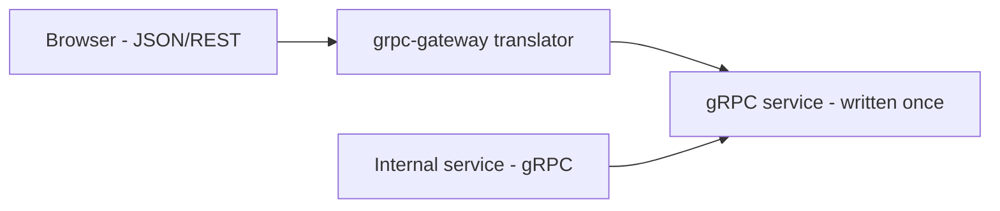
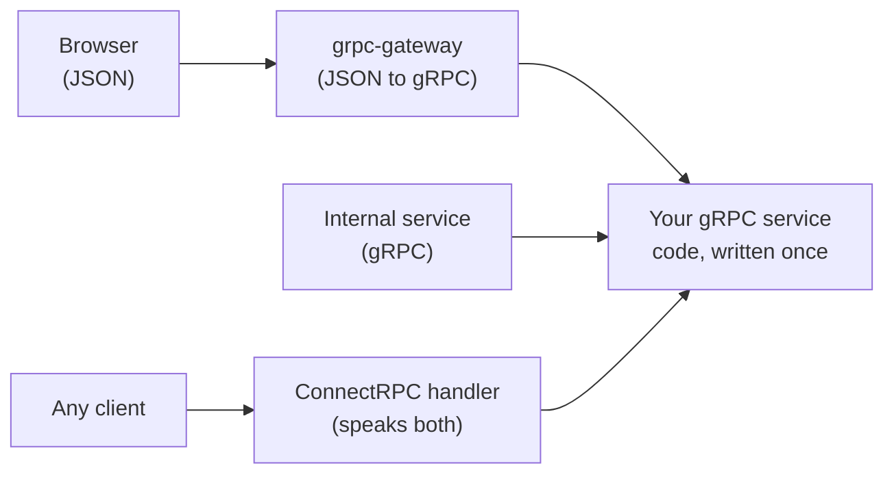
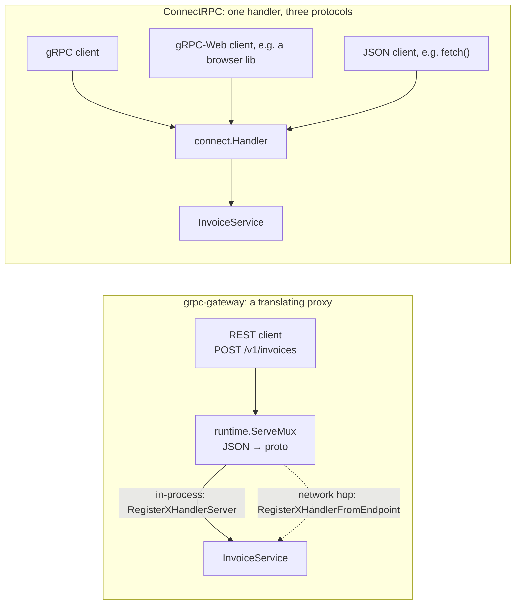
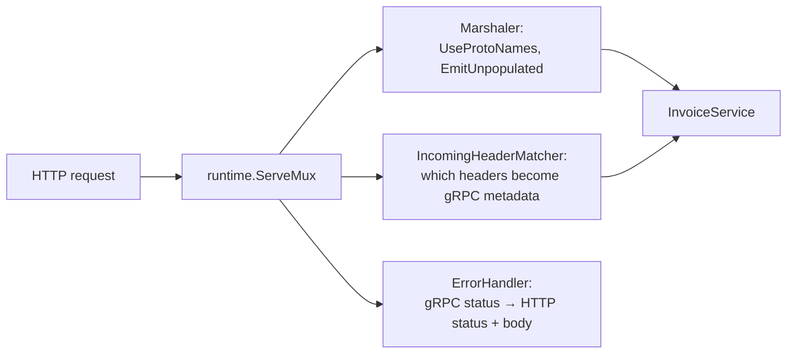

# Serving REST and gRPC Together

> [!summary] TL;DR
> A production Go backend usually needs both a gRPC API for internal services and a JSON/REST API for browsers and third parties.
>
> **grpc-gateway** generates a reverse-proxy layer that translates REST+JSON into gRPC calls against the same service code, so you write and test the RPC once.
>
> **ConnectRPC** is the newer alternative: one handler natively speaks gRPC, gRPC-Web and a plain JSON/HTTP protocol, with no translation layer at all.

> [!abstract] Core idea
> - Define the service once in a `.proto` file; annotate each RPC with `google.api.http` to say which REST path and method map to it.
> - grpc-gateway's generated code turns an incoming REST request into the matching gRPC request message, calls the gRPC service, and turns the response back into JSON.
> - Register the generated gateway against the gRPC server either in-process (`RegisterXHandlerServer`, no network hop) or over the network (`RegisterXHandlerFromEndpoint`, works across processes and supports streaming).
> - ConnectRPC skips the translation: its generated handler accepts gRPC, gRPC-Web, or Connect's own JSON-over-HTTP protocol on the same `net/http` handler, using the same `.proto`.
> - Serve REST and gRPC on one port with `cmux` (or h2c for both over HTTP/2), or keep two ports. Two ports is simpler and is the default; one port is for platforms that only expose one.

## Start here: the basics 🟢

> [!info] How to read this note (pick your level)
> - 🟢 **New to this?** Read "From zero" below, then sections 1, 2 and the cheat sheet (10). Stop there, that is a full first pass.
> - 🟡 **Know the basics?** Add section 3 (how it works), 4 (worked example) and 5-6.
> - 🔴 **Interview / SDE-3 prep?** Add 7, 8 and 9. Headings are tagged 🟢🟡🔴 so you always know where you are.

> [!note] Before this note
> - [[gRPC Services in Go]]: how a gRPC service is defined in a `.proto` file, generated into Go, and served by `grpc.NewServer`.
> - [[Building REST Endpoints]]: what a JSON REST endpoint looks like and how errors become HTTP status codes.
> - [[gRPC]]: gRPC sends typed binary messages over HTTP/2 and has its own error codes like `NotFound`.

**From zero, in 60 seconds** 🟢

Inside your company, services talk **gRPC**: a fast, typed protocol generated from `.proto` contract files. But browsers and third parties want plain JSON over REST.

Writing every endpoint twice would be silly. **grpc-gateway** generates a translator: it accepts REST+JSON, converts each call into the matching gRPC call, and converts the answer back.



You write and test the logic once, in the gRPC service; the REST face is generated from annotations in the same `.proto` file.

The rest of this note is just these 4 questions:
1. How does the codegen pipeline produce the gateway?
2. How do gRPC status codes map to HTTP status codes?
3. One port or two — how do both protocols get served?
4. When is ConnectRPC or plain REST the better choice?

**The problem in one story.**
Your invoice service is called by two kinds of clients.
Other backend services want fast, typed gRPC calls.
A browser and a partner company want plain JSON over HTTP.
You do not want to write and test every endpoint twice.
So you describe the API once, and let a tool serve it both ways.

**Words you need first**

| Word | Plain meaning | Tiny example |
| --- | --- | --- |
| REST / JSON API | HTTP URLs and methods carrying JSON text | `GET /v1/invoices/42` |
| gRPC | A fast RPC system using binary Protobuf over HTTP/2 | `GetInvoice(GetInvoiceRequest)` |
| Protobuf (`.proto`) | A file describing messages and services | `message Invoice { int64 id = 1; }` |
| Code generation | A tool writing Go code from the `.proto` | `buf generate` |
| Reverse proxy | A server that receives a request and forwards it on | grpc-gateway turns JSON into gRPC |
| HTTP/2 | Newer HTTP that sends many requests on one connection | gRPC needs it |
| Port | A numbered door on a server for network traffic | `:8080` for REST, `:9090` for gRPC |

| grpc-gateway | A generated translator that turns REST+JSON calls into gRPC calls | `GET /v1/invoices/42` → `GetInvoice(id=42)` |
| ConnectRPC | A library whose one handler speaks gRPC, gRPC-Web and plain JSON | `curl -d '{"id":42}' .../GetInvoice` |
| gRPC-Web | A browser-friendly variant of gRPC | a web page calling the service with a JS client |
| Metadata | gRPC's version of HTTP headers | `authorization`, `x-tenant-id` |
| `cmux` | A library that lets two protocols share one port by peeking at each new connection | gRPC and REST both on `:8080` |

**Picture it**



**Analogy.** grpc-gateway is a translator at the front desk who turns English questions into the office's own language; ConnectRPC is an office where staff already speak both.
Where it breaks: a translator can relay a long conversation easily, but streaming through the gateway is limited and awkward.

**How the rest of this note builds up**

- First, why one API needs two faces (section 1) and the mental model of one `.proto`, many protocols (section 2).
- Then how it works: the codegen pipeline, gateway options, in-process vs network registration, error mapping, ConnectRPC, and one port vs two (section 3).
- Then a full Go worked example and a comparison of approaches (sections 4-5).
- Finally the SDE-3 deep dive: trade-offs, production concerns and streaming limits (sections 6-8).

> [!tip] Remember
> Write the RPC once in `.proto`; let generated code serve JSON and gRPC from the same handler.

## 1. Why it exists 🟢

InvoiceOps' internal services call each other over gRPC: compact binary encoding, generated client stubs (ready-made Go functions that call the remote service), deadlines and streaming built in (see [[gRPC Services in Go]]).

But the billing dashboard is a browser, and browsers cannot easily speak gRPC — it's framed over HTTP/2 in a way `fetch` doesn't expose, and gRPC-Web needs a client library and a translating proxy of its own.

Partners who want to poll an invoice's status from a cron job want a `curl`-able REST endpoint, not a `.proto` file and a generated client.

The naive fix is to hand-write a second REST API that calls the same business logic, in parallel with the gRPC one.

Now every new field, every new error case, and every new endpoint is written and tested twice, and the two APIs drift: the REST handler forgets a validation the gRPC handler has, or returns a different error shape for the same failure.

grpc-gateway and ConnectRPC remove the duplication by generating the REST (or Connect-JSON) layer from the same `.proto` that defines the gRPC service. One implementation of `InvoiceService`, two protocols on the wire.

### A real-life example 🟢

A payments company like Razorpay may run dozens of internal services that talk to each other over gRPC because it is fast and typed. Its merchants, though, call public REST endpoints with `curl` or any language. Instead of writing every endpoint twice, the team describes each call once in a `.proto` file, marks which REST path it should answer to, and generates the REST layer. A new field added to the proto shows up in both the gRPC API and the JSON API at the same time.

## 2. Mental model 🟢

Picture the gRPC service as the only thing that actually runs business logic. grpc-gateway sits in front of it as a **translator**: it reads an HTTP request, builds the equivalent protobuf request message from the URL path, query string and JSON body, calls the gRPC method (in-process or over the network), and serializes the protobuf response back to JSON.

ConnectRPC is not a translator in front of a gRPC server — it is a different front door on the *same* generated server code. The handler you register detects the incoming protocol (from the `Content-Type` header) and speaks gRPC, gRPC-Web or Connect's JSON protocol back, without an intermediate hop.

### Whiteboard version

**In plain words:** proto in, gateway out, one RPC served both ways, minimal.



Both sides generate code from the same `invoice.proto`. The difference is whether there is a second serialization step (grpc-gateway: JSON ⇄ an actual gRPC call) or none (ConnectRPC: one handler dispatches by content type).

## 3. How it works 🟡

🟢 → 🟡 You now know the idea: describe the API once in `.proto`, then either generate a REST translator (grpc-gateway) or use a handler that speaks both (ConnectRPC). Next we open the box: the code generation steps, the gateway settings, two ways to connect it, error mapping, ConnectRPC, ports, and streaming limits.

### Codegen pipeline

**In plain words:** one buf command reads the .proto file and writes three things: the types, the gRPC service, and the REST translator.

**Step by step:**
1. Write `rpc GetInvoice(...)` in `invoice.proto` and add `option (google.api.http) = { get: "/v1/invoices/{id}" }`.
2. Run the generator with four plugins.
3. You get `invoice.pb.go` (message types), `invoice_grpc.pb.go` (gRPC server and client), `invoice.pb.gw.go` (the REST translator) and an OpenAPI file.
4. You write only `InvoiceService`'s methods; everything else is generated.

A `.proto` file with an `option (google.api.http)` on each RPC:

```proto
syntax = "proto3";
package invoiceops.v1;
option go_package = "gogwy/invoicepb";

import "google/api/annotations.proto";

service InvoiceService {
  rpc GetInvoice(GetInvoiceRequest) returns (Invoice) {
    option (google.api.http) = { get: "/v1/invoices/{id}" };
  }
  rpc CreateInvoice(CreateInvoiceRequest) returns (Invoice) {
    option (google.api.http) = { post: "/v1/invoices", body: "*" };
  }
}
```

`{id}` binds the path segment to the `id` field of `GetInvoiceRequest`; `body: "*"` means the whole JSON body maps onto `CreateInvoiceRequest`. `additional_bindings` lets one RPC answer more than one REST path (for example, both `/v1/invoices/{id}` and a legacy `/v1/invoice?id=...`).

Four plugins turn this into Go:

```bash
protoc -I. -Igoogleapis \
  --go_out=. --go_opt=paths=source_relative \
  --go-grpc_out=. --go-grpc_opt=paths=source_relative \
  --grpc-gateway_out=. --grpc-gateway_opt=paths=source_relative \
  --openapiv2_out=. \
  invoicepb/invoice.proto
```

- `protoc-gen-go` / `protoc-gen-go-grpc`: the message types and the gRPC client/server interfaces (see [[gRPC Services in Go]]).
- `protoc-gen-grpc-gateway`: `invoice.pb.gw.go`, the REST↔proto translation.
- `protoc-gen-openapiv2`: an OpenAPI v2 document generated from the same annotations — the gateway's public contract, publishable alongside [[API Contract Design and OpenAPI]].

`google/api/annotations.proto` and `google/api/http.proto` are not bundled with grpc-gateway's Go module; they come from the `googleapis` repository and must be on `protoc`'s include path (`-Igoogleapis` above).

### What the generated gateway file contains

**In plain words:** for each RPC the generator writes small functions that read the URL, query and body into the request message, then call the service.

`invoice.pb.gw.go` defines, per RPC, a `request_InvoiceService_GetInvoice_0` function (used over the network hop) and a `local_request_InvoiceService_GetInvoice_0` function (used in-process), plus a `RegisterInvoiceServiceHandler*` family:

```go
func request_InvoiceService_GetInvoice_0(ctx context.Context, marshaler runtime.Marshaler,
	client InvoiceServiceClient, req *http.Request, pathParams map[string]string,
) (proto.Message, runtime.ServerMetadata, error) {
	var protoReq GetInvoiceRequest
	val, ok := pathParams["id"]
	if !ok {
		return nil, runtime.ServerMetadata{}, status.Errorf(codes.InvalidArgument, "missing parameter %s", "id")
	}
	protoReq.Id, _ = runtime.String(val)
	msg, err := client.GetInvoice(ctx, &protoReq)
	return msg, runtime.ServerMetadata{}, err
}
```

This is why a path parameter that doesn't type-check (a non-numeric `{id}` bound to an `int64` field, for example) comes back as `codes.InvalidArgument` before your handler ever runs.

### `runtime.NewServeMux` options

**Step by step:**
1. Create the gateway mux with `runtime.NewServeMux(...)`.
2. Set the JSON options: keep proto field names (`amount_cents`) and include empty fields.
3. Say which HTTP headers pass through to the service as gRPC metadata.
4. Install your own error handler so errors match the rest of your REST API.



- `UseProtoNames: true` emits `amount_cents` (the proto field name) instead of protojson's default camelCase `amountCents` — pick one and keep it, since clients depend on the shape.
- `EmitUnpopulated: true` includes zero-value fields (`"status": ""`) instead of omitting them, which matters when a client needs to tell "field present and empty" from "field absent."
- `WithIncomingHeaderMatcher` controls which HTTP headers become gRPC metadata. The default only forwards headers already prefixed `Grpc-Metadata-` and a small allowlist; anything else needs an explicit matcher, which is also where you decide whether `Authorization` is forwarded as metadata for the service to re-check, or consumed and verified at the gateway.

### In-process vs network-hop registration

**In plain words:** the translator can call the service through memory (same process) or over the network (separate pods) — one line decides, with different failure behavior.

**Step by step:**
1. In-process: `RegisterInvoiceServiceHandlerServer(ctx, mux, srv)` calls your Go service value directly. No network, but no streaming.
2. Network hop: `RegisterInvoiceServiceHandlerFromEndpoint(ctx, mux, "localhost:9090", opts)` dials the real gRPC server.
3. A REST call now becomes a real gRPC call, so streaming works (as JSON lines), at the cost of one extra hop.

| | `RegisterXHandlerServer` (in-process) | `RegisterXHandlerFromEndpoint` (network hop) |
|---|---|---|
| How it reaches the service | Calls the Go `InvoiceServiceServer` value directly | Dials the gRPC server as a real `grpc.ClientConn` |
| Processes | Gateway and gRPC server in one binary | Can be separate processes, even separate languages |
| Streaming | **Not supported** — registration succeeds, but every request to a streaming method fails with `codes.Unimplemented` ("streaming calls are not yet supported in the in-process transport") | Supported: streams become newline-delimited JSON |
| Network round trip per request | None | One (localhost, but real) |
| When to use | A single Go binary that wants one listener's simplicity without losing in-process speed | Gateway as its own deployable, or the gRPC server already runs elsewhere |

### Status and error mapping

**In plain words:** gRPC's error codes and HTTP's status codes are different alphabets; a fixed table translates one to the other so clients see sensible errors.

**Step by step:**
1. The service returns `status.Error(codes.NotFound, "invoice 42 not found")`.
2. The gateway's error handler reads the code.
3. `NotFound` becomes HTTP 404, `InvalidArgument` 400, `Unauthenticated` 401.
4. The body is written as JSON, in your own shape if you set `WithErrorHandler`.

A gRPC `status.Error` crosses the gateway and becomes an HTTP status via `runtime.HTTPStatusFromCode` (`NotFound` → 404, `InvalidArgument` → 400, `Unauthenticated` → 401, …) and a default JSON error body.

Override both with `runtime.WithErrorHandler` when the API needs its own error shape or a status mapping the defaults get wrong for your domain — for example, treating `codes.AlreadyExists` as 200 for an idempotent create instead of the default 409.

### ConnectRPC

**Step by step:**
1. Generate with `protoc-gen-connect-go` from the same proto; no HTTP annotations needed.
2. `NewInvoiceServiceHandler(server)` returns a path and one `http.Handler`.
3. Mount it on a normal `http.ServeMux`.
4. A gRPC client, a gRPC-Web browser client, and a plain `curl` with JSON all reach the same method; the handler picks the protocol from `Content-Type`.

`protoc-gen-connect-go` generates a handler and a client from the same `.proto`, no HTTP annotations required:

```go
path, handler := invoicepbconnect.NewInvoiceServiceHandler(&connectInvoiceServer{store: store})
mux := http.NewServeMux()
mux.Handle(path, handler) // mounted at /invoiceops.v1.InvoiceService/
```

One `http.Handler` now serves:
- gRPC (binary protobuf, `Content-Type: application/grpc`) — compatible with any gRPC client, including grpc-go's. gRPC requires HTTP/2, so a plain `http.Server` needs TLS or h2c (`h2c.NewHandler`; h2c means HTTP/2 without encryption) for native gRPC clients and for bidirectional streaming; the Connect protocol also works over HTTP/1.1.
- gRPC-Web — so a browser can talk to it with a gRPC-Web JS client, no separate Envoy proxy.
- Connect's own protocol — JSON or protobuf over plain HTTP/1.1 or HTTP/2, callable from `curl` or `fetch` with no client library at all.

There is no second serialization pass and no annotation to keep in sync with the handler, at the cost of a response shape that is Connect's own JSON mapping of the proto message (close to grpc-gateway's, but a separate implementation) rather than a hand-specified REST path per RPC.

### Serving on one port vs two

**In plain words:** both protocols can share one port by sniffing each connection, or keep two ports and stay simple — the trade is ops convenience vs moving parts.

**Step by step:**
1. Default: gRPC on `:9090`, REST on `:8080`, two simple servers.
2. If the platform allows only one port, `cmux` listens on `:8080`.
3. For each new connection it peeks at the first bytes: HTTP/2 with `application/grpc` goes to the gRPC server.
4. Everything else goes to the REST gateway.

Two ports — gRPC on `:9090`, the gateway's REST handler on `:8080` — is the simpler default: each is a plain `http.Server` or `grpc.Server`, independently health-checked, independently scaled in front of its own load-balancer listener.

Sharing one port needs `cmux`, which peeks at each new connection's opening bytes and routes it: gRPC's HTTP/2 connection preface and `content-type: application/grpc` go to the `grpc.Server`, everything else to the gateway's `http.Handler`.

`h2c` (`golang.org/x/net/http2/h2c`) lets the gateway accept HTTP/2 without TLS in development; terminate real TLS in front of both in production (see [[TLS, HTTPS and HTTP2 in Go Servers]]).

A cmux-free alternative is to put one `http.Handler` behind h2c (or TLS) that checks `r.ProtoMajor == 2 && strings.HasPrefix(r.Header.Get("Content-Type"), "application/grpc")` and calls `grpcServer.ServeHTTP` for gRPC, the gateway otherwise; grpc-go documents `ServeHTTP` as experimental and slower than `Serve`, so the dedicated listener stays preferable.

### Limits of streaming over the gateway

**Step by step:**
1. A server-streaming RPC sends invoice updates one by one.
2. Through the network-hop gateway, each update becomes one JSON object on its own line in a single long HTTP response.
3. Client-streaming and two-way streams barely work over this path, and browsers cannot reliably stream a request body.
4. So for live browser updates, use WebSockets or SSE instead.

A gRPC server-streaming RPC routed through the network-hop gateway becomes a stream of newline-delimited JSON objects on one long-lived HTTP response — there is no HTTP/2 push (server-initiated sends) or WebSocket involved, just one response body that never ends until the stream does.

grpc-gateway v2 can also accept a client-streaming request as a stream of JSON objects in the request body (and bidirectional streams in a limited form), but browsers' `fetch` cannot reliably stream a request body and nothing reconnects or resumes for you, so treat those as awkward.

Expose client-streaming and bidirectional RPCs over gRPC (or Connect) directly, or redesign the client-facing surface around [[Real-time APIs - WebSocket, SSE and Long Polling]] (see [[WebSockets and SSE in Go]]).

### When not to bother

A small internal system with one Go client and one Go server has no browser or third party to serve JSON to — skip the gateway and ConnectRPC entirely and call the gRPC client directly.

Add the translation layer only once something outside the gRPC world (a browser, a partner's HTTP client, a `curl` health check a non-Go team wants) needs to reach the same service.

## 4. Worked example 🟡

### Whiteboard version

The annotation plus the minimum gateway wiring, with nothing else:

```proto
rpc GetInvoice(GetInvoiceRequest) returns (Invoice) {
  option (google.api.http) = { get: "/v1/invoices/{id}" };
}
```

```go
mux := runtime.NewServeMux()
_ = invoicepb.RegisterInvoiceServiceHandlerServer(context.Background(), mux, srv)
http.ListenAndServe(":8080", mux)
```

The full version below adds custom error mapping, header forwarding, the two registration paths, one-port serving with `cmux`, and a ConnectRPC handler on the same service — tested on Go 1.24 with `grpc-gateway v2.22.0`, `grpc-go v1.68.1` and `connectrpc.com/connect v1.18.1`.

**The service implementation**, satisfying `invoicepb.InvoiceServiceServer`.

**What this code does, in plain words:** `invoiceServer` stores invoices in memory; `CreateInvoice` checks `customer_id` and returns `InvalidArgument` if it is missing, and `GetInvoice` returns `NotFound` for an unknown ID.

```go
// invoiceStore is the in-memory backend. gRPC and the gateway serve requests
// concurrently, so every access takes the mutex (a bare map would be a data
// race under go test -race). A real service would call a repository instead.
type invoiceStore struct {
	mu   sync.Mutex
	byID map[string]*invoicepb.Invoice
}

func newInvoiceStore() *invoiceStore {
	return &invoiceStore{byID: make(map[string]*invoicepb.Invoice)}
}

func (s *invoiceStore) get(id string) (*invoicepb.Invoice, bool) {
	s.mu.Lock()
	defer s.mu.Unlock()
	inv, ok := s.byID[id]
	return inv, ok
}

func (s *invoiceStore) create(inv *invoicepb.Invoice) *invoicepb.Invoice {
	s.mu.Lock()
	defer s.mu.Unlock()
	inv.Id = fmt.Sprintf("inv_%d", len(s.byID)+1)
	s.byID[inv.Id] = inv
	return inv
}

// ErrNotFound is the domain error for a missing invoice id.
var ErrNotFound = errors.New("invoice not found")

// invoiceServer implements invoicepb.InvoiceServiceServer.
// It embeds UnimplementedInvoiceServiceServer by value (not pointer) so the
// server satisfies the interface even if a future proto change adds a method
// this code hasn't implemented yet: that call fails at runtime with
// Unimplemented instead of failing to compile.
type invoiceServer struct {
	invoicepb.UnimplementedInvoiceServiceServer
	store *invoiceStore
}

func (s *invoiceServer) GetInvoice(ctx context.Context, req *invoicepb.GetInvoiceRequest) (*invoicepb.Invoice, error) {
	if req.GetId() == "" {
		return nil, status.Error(codes.InvalidArgument, "id is required")
	}
	inv, ok := s.store.get(req.GetId())
	if !ok {
		// A domain error becomes a gRPC status here, at the service boundary,
		// never inside the repository layer.
		return nil, status.Error(codes.NotFound, fmt.Sprintf("invoice %q: %v", req.GetId(), ErrNotFound))
	}
	return inv, nil
}

func (s *invoiceServer) CreateInvoice(ctx context.Context, req *invoicepb.CreateInvoiceRequest) (*invoicepb.Invoice, error) {
	if req.GetCustomerId() == "" {
		return nil, status.Error(codes.InvalidArgument, "customer_id is required")
	}
	if req.GetAmountCents() <= 0 {
		return nil, status.Error(codes.InvalidArgument, "amount_cents must be positive")
	}
	inv := s.store.create(&invoicepb.Invoice{
		CustomerId: req.GetCustomerId(), AmountCents: req.GetAmountCents(),
		Currency: req.GetCurrency(), Status: "pending",
	})
	return inv, nil
}

// newGRPCServer builds the gRPC server alone, so the network-hop test and
// ServeOnePort can use it without the gateway.
func newGRPCServer(store *invoiceStore) *grpc.Server {
	s := grpc.NewServer()
	invoicepb.RegisterInvoiceServiceServer(s, &invoiceServer{store: store})
	return s
}
```

**Custom error mapping and marshaling options:**

**What this code does, in plain words:** `newGatewayMux` builds the gateway mux with proto field names, empty fields included, a header matcher, and `customErrorHandler`, which turns gRPC codes into HTTP statuses and your own JSON error body.

```go
// httpStatus maps a gRPC code to the HTTP status grpc-gateway should send.
// The default mapping (codes.NotFound -> 404, codes.InvalidArgument -> 400, ...)
// is usually right; override it only for codes your API treats specially.
func httpStatus(c codes.Code) int {
	switch c {
	case codes.NotFound:
		return http.StatusNotFound
	case codes.InvalidArgument:
		return http.StatusBadRequest
	case codes.AlreadyExists:
		return http.StatusConflict
	case codes.PermissionDenied:
		return http.StatusForbidden
	case codes.Unauthenticated:
		return http.StatusUnauthorized
	case codes.ResourceExhausted:
		return http.StatusTooManyRequests
	default:
		return runtime.HTTPStatusFromCode(c)
	}
}

// customErrorHandler replaces grpc-gateway's default JSON error body with a
// smaller shape and makes sure httpStatus (not the library default) decides
// the status code.
func customErrorHandler(ctx context.Context, mux *runtime.ServeMux, marshaler runtime.Marshaler, w http.ResponseWriter, r *http.Request, err error) {
	s := status.Convert(err)
	w.Header().Set("Content-Type", marshaler.ContentType(nil))
	w.WriteHeader(httpStatus(s.Code()))
	// json.Marshal, not %q: Go string quoting is not valid JSON for every input.
	body, _ := json.Marshal(map[string]string{"error": s.Message(), "code": s.Code().String()})
	_, _ = w.Write(body)
}

// newGatewayMux builds the runtime.ServeMux with the marshaling options this
// API contract needs: field names as they appear in the .proto (UseProtoNames)
// instead of camelCase, and unpopulated (zero-value) fields included, since an
// invoice with status: "" is a real, meaningful response, not a missing field.
func newGatewayMux() *runtime.ServeMux {
	return runtime.NewServeMux(
		runtime.WithMarshalerOption(runtime.MIMEWildcard, &runtime.HTTPBodyMarshaler{
			Marshaler: &runtime.JSONPb{
				MarshalOptions: protojson.MarshalOptions{
					UseProtoNames:   true, // "amount_cents", not "amountCents"
					EmitUnpopulated: true, // status: "" still appears in the body
				},
			},
		}),
		runtime.WithErrorHandler(customErrorHandler),
		runtime.WithIncomingHeaderMatcher(headerMatcher),
	)
}

// headerMatcher lets the client-supplied X-Request-Id header through to gRPC
// metadata as "x-request-id" (grpc-gateway's default only forwards headers it
// already knows, under a "grpcgateway-" prefix).
func headerMatcher(key string) (string, bool) {
	if key == "X-Request-Id" {
		return "x-request-id", true
	}
	return runtime.DefaultHeaderMatcher(key)
}
```

**Both registration paths:**

**What this code does, in plain words:** `inProcessGatewayHandler` wires the gateway straight to the Go service value; `networkHopGatewayHandler` dials the gRPC server and wires the gateway to that connection.

```go
// inProcessGatewayHandler wires the REST gateway directly to the Go server
// value with RegisterInvoiceServiceHandlerServer: no network hop, no second
// listener, and the gateway call never leaves the process. The trade-off is
// that it only works for unary RPCs — a streaming method registered this way
// answers every request with codes.Unimplemented, because there is no
// stream to multiplex over HTTP.
func inProcessGatewayHandler(store *invoiceStore) (http.Handler, error) {
	mux := newGatewayMux()
	srv := &invoiceServer{store: store}
	if err := invoicepb.RegisterInvoiceServiceHandlerServer(context.Background(), mux, srv); err != nil {
		return nil, err
	}
	return mux, nil
}

// networkHopGatewayHandler is the other registration path:
// RegisterInvoiceServiceHandlerFromEndpoint dials the gRPC server over the
// network and the gateway talks to it like any other gRPC client. This path
// supports server streaming and works when the gateway and the gRPC server
// are different processes or different languages.
func networkHopGatewayHandler(ctx context.Context, grpcAddr string) (http.Handler, error) {
	mux := newGatewayMux()
	opts := []grpc.DialOption{grpc.WithTransportCredentials(insecure.NewCredentials())}
	if err := invoicepb.RegisterInvoiceServiceHandlerFromEndpoint(ctx, mux, grpcAddr, opts); err != nil {
		return nil, err
	}
	return mux, nil
}
```

**Serving both on one port with cmux:**

**What this code does, in plain words:** `ServeOnePort` opens one listener, lets `cmux` send gRPC connections to the gRPC server and everything else to the HTTP gateway, and runs both.

```go
// ServeOnePort runs the gRPC server and the REST gateway behind a single
// listener, splitting connections by content type with cmux: a gRPC call
// arrives as HTTP/2 with the "application/grpc" content-type, so cmux's
// HTTP2HeaderField matcher routes it to grpcServer and everything else to
// the gateway's http.Handler.
//
// The two-port alternative (grpcServer on :9090, gatewayHandler on :8080,
// no cmux) is simpler to reason about and is the default recommendation
// unless a single exposed port is a hard requirement.
func ServeOnePort(lis net.Listener, grpcServer *grpc.Server, gatewayHandler http.Handler) error {
	m := cmux.New(lis)
	grpcL := m.MatchWithWriters(cmux.HTTP2MatchHeaderFieldSendSettings("content-type", "application/grpc"))
	httpL := m.Match(cmux.Any())

	// h2c lets the gateway accept HTTP/2 without TLS in dev; terminate real
	// TLS in front of this in production.
	h2s := &http2.Server{}
	gatewaySrv := &http.Server{Handler: h2c.NewHandler(gatewayHandler, h2s)}

	errCh := make(chan error, 3)
	go func() { errCh <- grpcServer.Serve(grpcL) }()
	go func() { errCh <- gatewaySrv.Serve(httpL) }()
	go func() { errCh <- m.Serve() }()
	return <-errCh
}
```

**Tests** (`go test -race`, real listeners, no mocked transport):

**What this code does, in plain words:** the tests create then fetch an invoice through the in-process gateway, check a missing invoice gives 404, call through the network-hop gateway, and send both REST and gRPC traffic to one `cmux` port.

```go
func TestInProcessGateway_CreateThenGet(t *testing.T) {
	store := newInvoiceStore()
	h, err := inProcessGatewayHandler(store)
	if err != nil {
		t.Fatalf("inProcessGatewayHandler: %v", err)
	}
	srv := httptest.NewServer(h)
	defer srv.Close()

	body := `{"customer_id":"cust_1","amount_cents":2500,"currency":"INR"}`
	resp, err := http.Post(srv.URL+"/v1/invoices", "application/json", strings.NewReader(body))
	if err != nil {
		t.Fatalf("POST /v1/invoices: %v", err)
	}
	defer resp.Body.Close()
	if resp.StatusCode != http.StatusOK {
		t.Fatalf("POST status = %d, want 200", resp.StatusCode)
	}
	var created struct {
		ID         string `json:"id"`
		AmountCent string `json:"amount_cents"` // protojson renders int64 as a JSON string
		Status     string `json:"status"`
	}
	if err := json.NewDecoder(resp.Body).Decode(&created); err != nil {
		t.Fatalf("decode create response: %v", err)
	}
	if created.ID == "" || created.AmountCent != "2500" || created.Status != "pending" {
		t.Fatalf("unexpected created invoice: %+v", created)
	}
}

func TestInProcessGateway_NotFoundMapsTo404(t *testing.T) {
	store := newInvoiceStore()
	h, _ := inProcessGatewayHandler(store)
	srv := httptest.NewServer(h)
	defer srv.Close()

	resp, err := http.Get(srv.URL + "/v1/invoices/does-not-exist")
	if err != nil {
		t.Fatalf("GET: %v", err)
	}
	defer resp.Body.Close()
	if resp.StatusCode != http.StatusNotFound {
		t.Fatalf("status = %d, want 404 (custom error handler must map codes.NotFound)", resp.StatusCode)
	}
}

// TestNetworkHopGateway proves RegisterInvoiceServiceHandlerFromEndpoint
// reaches a gRPC server over a real TCP listener, not just in-process.
func TestNetworkHopGateway(t *testing.T) {
	store := newInvoiceStore()
	grpcServer := newGRPCServer(store)
	lis, err := net.Listen("tcp", "127.0.0.1:0")
	if err != nil {
		t.Fatalf("listen: %v", err)
	}
	go func() { _ = grpcServer.Serve(lis) }()
	defer grpcServer.Stop()

	ctx, cancel := context.WithTimeout(context.Background(), 5*time.Second)
	defer cancel()
	h, err := networkHopGatewayHandler(ctx, lis.Addr().String())
	if err != nil {
		t.Fatalf("networkHopGatewayHandler: %v", err)
	}
	srv := httptest.NewServer(h)
	defer srv.Close()

	resp, err := http.Post(srv.URL+"/v1/invoices", "application/json",
		strings.NewReader(`{"customer_id":"cust_2","amount_cents":500,"currency":"USD"}`))
	if err != nil {
		t.Fatalf("POST over the network hop: %v", err)
	}
	defer resp.Body.Close()
	if resp.StatusCode != http.StatusOK {
		t.Fatalf("status = %d", resp.StatusCode)
	}
}
```

```go
// TestServeOnePort proves one listener answers a native gRPC call and a REST
// call: cmux routes the first by its application/grpc content type.
func TestServeOnePort(t *testing.T) {
	store := newInvoiceStore()
	gw, err := inProcessGatewayHandler(store)
	if err != nil {
		t.Fatal(err)
	}
	lis, err := net.Listen("tcp", "127.0.0.1:0")
	if err != nil {
		t.Fatal(err)
	}
	go func() { _ = ServeOnePort(lis, newGRPCServer(store), gw) }()
	defer lis.Close()

	conn, err := grpc.NewClient(lis.Addr().String(), grpc.WithTransportCredentials(insecure.NewCredentials()))
	if err != nil {
		t.Fatal(err)
	}
	defer conn.Close()
	ctx, cancel := context.WithTimeout(context.Background(), 5*time.Second)
	defer cancel()
	inv, err := invoicepb.NewInvoiceServiceClient(conn).CreateInvoice(ctx,
		&invoicepb.CreateInvoiceRequest{CustomerId: "c1", AmountCents: 100})
	if err != nil {
		t.Fatalf("gRPC call on the shared port: %v", err)
	}

	resp, err := http.Get("http://" + lis.Addr().String() + "/v1/invoices/" + inv.GetId())
	if err != nil {
		t.Fatalf("REST call on the shared port: %v", err)
	}
	defer resp.Body.Close()
	if resp.StatusCode != http.StatusOK {
		t.Fatalf("REST status = %d, want 200", resp.StatusCode)
	}
}
```

**ConnectRPC serving the same proto, no HTTP annotations:**

**What this code does, in plain words:** `connectInvoiceServer` implements the same two methods with Connect's request and response wrappers; the test calls it with plain JSON and with the Connect protocol on one handler.

```go
// connectInvoiceServer implements invoicepbconnect.InvoiceServiceHandler. A real
// service would share one implementation with invoiceServer instead of
// repeating the two methods.
type connectInvoiceServer struct {
	invoicepbconnect.UnimplementedInvoiceServiceHandler
	store *invoiceStore
}

func (s *connectInvoiceServer) GetInvoice(ctx context.Context, req *connect.Request[invoicepb.GetInvoiceRequest]) (*connect.Response[invoicepb.Invoice], error) {
	inv, ok := s.store.get(req.Msg.GetId())
	if !ok {
		return nil, connect.NewError(connect.CodeNotFound, ErrNotFound)
	}
	return connect.NewResponse(inv), nil
}

func (s *connectInvoiceServer) CreateInvoice(ctx context.Context, req *connect.Request[invoicepb.CreateInvoiceRequest]) (*connect.Response[invoicepb.Invoice], error) {
	if req.Msg.GetCustomerId() == "" {
		return nil, connect.NewError(connect.CodeInvalidArgument, errors.New("customer_id is required"))
	}
	inv := s.store.create(&invoicepb.Invoice{
		CustomerId: req.Msg.GetCustomerId(), AmountCents: req.Msg.GetAmountCents(), Status: "pending",
	})
	return connect.NewResponse(inv), nil
}

func TestConnectHandler_ServesJSONAndConnectProtocol(t *testing.T) {
	store := newInvoiceStore()
	path, handler := invoicepbconnect.NewInvoiceServiceHandler(&connectInvoiceServer{store: store})
	mux := http.NewServeMux()
	mux.Handle(path, handler)
	srv := httptest.NewServer(mux)
	defer srv.Close()

	client := invoicepbconnect.NewInvoiceServiceClient(http.DefaultClient, srv.URL)
	resp, err := client.CreateInvoice(context.Background(), connect.NewRequest(&invoicepb.CreateInvoiceRequest{
		CustomerId: "cust_connect", AmountCents: 750,
	}))
	if err != nil {
		t.Fatalf("CreateInvoice over Connect: %v", err)
	}
	if resp.Msg.GetStatus() != "pending" {
		t.Fatalf("status = %q, want pending", resp.Msg.GetStatus())
	}

	_, err = client.GetInvoice(context.Background(), connect.NewRequest(&invoicepb.GetInvoiceRequest{Id: "missing"}))
	if connect.CodeOf(err) != connect.CodeNotFound {
		t.Fatalf("CodeOf(err) = %v, want CodeNotFound", connect.CodeOf(err))
	}
}
```

**Measured:** the tests above (`TestInProcessGateway_CreateThenGet`, `TestInProcessGateway_NotFoundMapsTo404`, `TestInProcessGateway_InvalidArgumentMapsTo400` (same pattern as the 404 test, posting a body without `customer_id`, not shown), `TestNetworkHopGateway`, `TestServeOnePort` and the Connect test) pass with `go test -race ./...` on Go 1.24.4, `grpc-gateway v2.22.0`, `grpc-go v1.68.1`, `connectrpc.com/connect v1.18.1` (2026-11-07), run twice with no flakes.

`go vet ./...` is clean. The note shows only the hand-written code; the generated `invoicepb` package is not reproduced.

## 5. Variants and comparison 🟡

| Approach | How it works | Use when | Cost |
| --- | --- | --- | --- |
| grpc-gateway, in-process | `RegisterXHandlerServer` calls the Go server value directly | One Go binary, unary RPCs only, want REST without a second listener | Unary only (streaming methods return `Unimplemented`); tied to one process |
| grpc-gateway, network hop | `RegisterXHandlerFromEndpoint` dials a real `grpc.ClientConn` | Gateway deployed separately, or need streaming translated to JSON lines | One more network hop per request |
| ConnectRPC | One handler speaks gRPC, gRPC-Web and Connect-JSON | Want browsers and gRPC clients on the same handler with the least codegen surface | Response JSON shape is Connect's own, not a hand-specified REST path |
| gRPC-Web + Envoy | A separate Envoy proxy translates gRPC-Web frames to gRPC | Already running Envoy as the ingress; want gRPC-Web specifically, not a REST contract | An extra proxy hop and config surface |
| Hand-written parallel REST API | A second set of handlers calling the same service layer | Tiny surface, or REST and gRPC genuinely diverge in shape | Duplicated validation and error mapping; the two drift over time |

## 6. Trade-offs and when not to use 🟡

- grpc-gateway adds a real translation layer: JSON parsing, proto marshaling, and (for the network hop) an extra gRPC call per request. For a latency-sensitive internal path, call gRPC directly.
- The REST surface is *derived* from the proto; a REST API with its own independent evolution (different pagination style, different versioning scheme per resource) fights the annotations instead of being served by them.
- ConnectRPC's JSON shape is close to, but not identical to, what you'd hand-design as a REST API — field names and error bodies follow Connect's conventions, not a bespoke style guide.
- Streaming RPCs translate poorly to REST (server streaming becomes JSON lines; client and bidirectional streams are awkward); don't try to force a server-streaming method through grpc-gateway for a browser that actually wants a WebSocket or SSE connection (see [[WebSockets and SSE in Go]]).
- One more moving part (the gateway, or `cmux`) is one more thing to operate, monitor and keep version-pinned alongside the gRPC server.

### grpc-gateway vs ConnectRPC 🟡

| | grpc-gateway | ConnectRPC |
| --- | --- | --- |
| How it works | translates REST+JSON into a gRPC call | one handler speaks gRPC, gRPC-Web and Connect JSON |
| REST paths | you choose them with `google.api.http` | fixed form `/package.Service/Method` |
| Extra layer | yes, a translation step | no |
| Good for | a hand-shaped public REST API | browsers and gRPC clients on one handler |

### Common beginner mistakes 🟢

- Hand-writing a second REST API next to the gRPC one → the two drift apart → generate the REST layer from the same proto.
- Registering a streaming service in-process → every streaming call returns `Unimplemented` at runtime → use the network-hop registration.
- Keeping the default error handler → REST errors look different from the rest of your API → set `WithErrorHandler` early.
- Assuming every HTTP header reaches the gRPC handler → the default allowlist drops most → configure `IncomingHeaderMatcher`.
- Sharing one port with `cmux` when two would do → one more moving part to debug → use two ports unless the platform forces one.

## 7. In production 🔴

🟡 → 🔴 You can now serve one service as both gRPC and REST. The advanced part covers running it: error shapes, streaming surprises after a deploy, missing headers, `cmux` edge cases, and why in-process registration cannot stream.

- **Real systems:** Google's own APIs are the origin of `google.api.http` annotations and grpc-gateway's design. Many Kubernetes-adjacent and cloud-native projects (etcd's gRPC gateway) ship a REST surface this way. ConnectRPC is built by Buf and is aimed at APIs that must be callable from both `curl`/browsers and native gRPC clients.
- **Failure modes → fixes:**
  - REST clients get a confusing error because the gateway's default error body doesn't match the rest of the REST API → install `WithErrorHandler` early, before the first non-trivial endpoint ships.
  - A streaming RPC is added to a service already registered in-process → the REST route exists but every call returns `Unimplemented` (HTTP 501) at request time, not at startup, so a deploy looks healthy; switch that service's registration to the network-hop path, or keep streaming RPCs on a different, gRPC-only service.
  - A header the REST API depends on (an internal auth header, a tenant ID) silently never reaches the gRPC handler → check `IncomingHeaderMatcher`; the default allowlist is stricter than people expect.
  - `cmux`'s content-type sniffing picks wrong for an edge case (an HTTP/2 client that isn't gRPC but doesn't send a recognizable preface) → prefer two ports unless one port is a hard requirement.
- **What to monitor:** gateway request latency *and* the underlying gRPC call latency, separately, so the translation overhead is visible; error-code distribution at the gateway (a spike in `Internal` usually means a new domain error isn't mapped); OpenAPI doc drift if it's generated in CI but the proto changes without regenerating it.

## 8. Deep dive 🔴

- **Why in-process registration can't stream.** `RegisterXHandlerServer` calls your `InvoiceServiceServer` methods as plain Go function calls. A unary RPC is one call, one return value — trivially translatable to one HTTP response.

  A streaming RPC's `grpc.ServerStream` has no plain-function equivalent in this path; the generated in-process code does not try to build one and simply returns `codes.Unimplemented`.

  The network-hop path has a real gRPC client stream to read from and write JSON lines to, which is why it can translate streams.
- **The OpenAPI document is generated, not hand-written.** `protoc-gen-openapiv2` turns the same `google.api.http` annotations into an OpenAPI v2 (Swagger) document.

  This is a real asset — publish it as the gateway's public contract per [[API Contract Design and OpenAPI]] — but it inherits the proto's naming and nesting, so a REST API that needs to look hand-designed (concise URLs, resource-oriented naming distinct from the proto's field names) needs its annotations written with that target shape in mind from the start, not left to whatever's convenient in the `.proto`.
- **Content-type sniffing in cmux.** `cmux.HTTP2MatchHeaderFieldSendSettings` doesn't just check `Content-Type: application/grpc` on the first request; it inspects the HTTP/2 connection preface and the first HEADERS frame, because by the time a `Content-Type` header value matters, cmux already needs to know whether to hand the raw bytes to the gRPC server (which expects to run its own HTTP/2 framing) or the `net/http` server.

  This is also why cmux needs HTTP/2-aware matchers at all, rather than just sniffing the first bytes of an HTTP/1.1 request line.
- **gRPC-Web vs ConnectRPC's gRPC-Web support.** Classic gRPC-Web needs a separate translating proxy (Envoy, or the `grpcweb` wrapper around a grpc-go server) because gRPC-Web's wire format differs from both HTTP/2 gRPC and REST/JSON.

  ConnectRPC's generated handler detects gRPC-Web's `Content-Type: application/grpc-web` directly and speaks it natively — one less proxy to deploy, at the cost of depending on `connectrpc.com/connect` instead of grpc-go's own ecosystem for that path.

## 9. Interview questions 🔴

> [!question]- What's the actual difference between grpc-gateway and ConnectRPC?
> grpc-gateway puts a translating reverse proxy in front of a real gRPC server: REST/JSON in, gRPC call out, JSON back. ConnectRPC's generated handler natively understands gRPC, gRPC-Web and its own JSON protocol on one `net/http.Handler` — there's no second protocol being translated into a first one.

> [!question]- Why can't you register a streaming RPC with `RegisterXHandlerServer`?
> That function calls your gRPC service's methods as plain Go functions, in-process. A streaming RPC has no plain-function shape to call — it needs a real stream, which only exists with an actual gRPC client connection.
>
> The generated code does not panic: it registers a handler that returns `codes.Unimplemented` ("streaming calls are not yet supported in the in-process transport") on every request, so the failure shows up at request time. Use `RegisterXHandlerFromEndpoint` for streaming methods.

> [!question]- A REST client reports a 500 where you expected a 404. What do you check first?
> Whether `WithErrorHandler` is installed and whether the domain error on the gRPC side is actually wrapped in `status.Error(codes.NotFound, ...)` rather than returned as a bare Go error. A bare error (not a `status.Status`) reaches the gateway as `codes.Unknown`, which maps to 500.

> [!question]- Trap: your REST API needs a URL structure the proto's field names don't match. Do you redesign the proto?
> No — redesigning the wire message to fit a REST URL couples your internal gRPC contract to an external API's naming, which is backwards.
>
> Either accept the REST surface the annotations naturally produce, or put a thin hand-written REST layer in front that calls the gRPC client itself for the handful of endpoints that genuinely need bespoke shaping, rather than forcing every RPC through the gateway.

> [!question]- When would you choose two ports over one?
> By default. Two ports need no `cmux`, no content-type sniffing edge cases, and let gRPC and REST scale, health-check and rate-limit independently behind different load-balancer listeners. Pick one port only when the deployment platform genuinely allows exactly one exposed port per service.

> [!question]- Does the gateway see every header the REST client sends?
> No. `IncomingHeaderMatcher` defaults to forwarding only a small allowlist (plus anything already prefixed for gRPC metadata) as gRPC metadata. A custom header your service depends on needs an explicit matcher, or it silently never reaches the gRPC handler.

## 10. Cheat sheet 🟢

- One `.proto`, `google.api.http` annotations, four plugins: `protoc-gen-go`, `protoc-gen-go-grpc`, `protoc-gen-grpc-gateway`, `protoc-gen-openapiv2`.
- `RegisterXHandlerServer` = in-process, unary only (streaming methods return `Unimplemented`). `RegisterXHandlerFromEndpoint` = network hop, streaming OK.
- `UseProtoNames` + `EmitUnpopulated` on the marshaler keep JSON field names and zero-value fields predictable.
- Install `WithErrorHandler` early; the default error body rarely matches a hand-designed REST API's style.
- `IncomingHeaderMatcher` decides which HTTP headers reach gRPC as metadata — check it before assuming a header "just works."
- ConnectRPC = one handler, three protocols (gRPC, gRPC-Web, Connect-JSON), no translation layer.
- Two ports is the default; one port needs `cmux` plus h2c and buys you a single exposed port.
- Streaming RPCs only translate to awkward JSON-lines over the network-hop path (client and bidi streams barely) — don't force them through the gateway for browsers.

## Self-check 🟢🟡

> [!question]- What does grpc-gateway do?
> It turns a REST+JSON request into the matching gRPC call and turns the answer back into JSON.

> [!question]- Where do you say which REST path maps to an RPC?
> In the `.proto` file, with `option (google.api.http)`.

> [!question]- What does gRPC `NotFound` become at the gateway?
> HTTP 404.

> [!question]- Why can the in-process gateway not stream?
> It calls the Go service as a plain function; there is no stream object to read from, so streaming methods return `Unimplemented`.

> [!question]- How is ConnectRPC different from grpc-gateway?
> One handler speaks gRPC, gRPC-Web and JSON directly, with no translation step.

> [!question]- Why are two ports the default instead of one?
> Two plain servers are simpler to run and check; one port needs `cmux` and extra care.

## Links 🟢

- **Before this:** [[gRPC Services in Go]], [[Building REST Endpoints]], [[gRPC]]
- **Next:** [[gRPC Streaming in Go]], [[WebSockets and SSE in Go]]
- **Compare with:** [[API Contract Design and OpenAPI]] (the generated OpenAPI document as the gateway's public contract), [[REST and HTTP API Design]] (hand-designed REST, for when the gateway's derived shape doesn't fit)

### Watch on YouTube

- [GopherCon UK 2019: Johan Brandhorst - Writing REST Services for the gRPC curious](https://www.youtube.com/watch?v=Pq1paKC-fXk) · GopherCon UK · conference talk on grpc-gateway from its core contributor
- [(Backend #43) gRPC gateway: write code once, serve both gRPC & HTTP requests](https://www.youtube.com/watch?v=3FfDH3d0aHs) · TECH SCHOOL · step-by-step grpc-gateway implementation walkthrough
