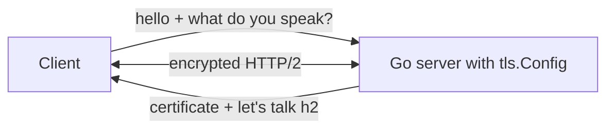
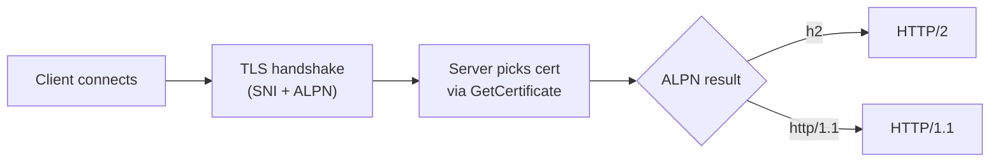
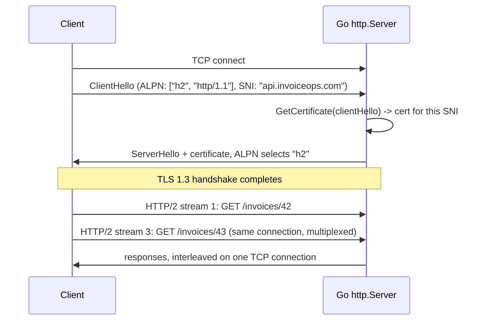
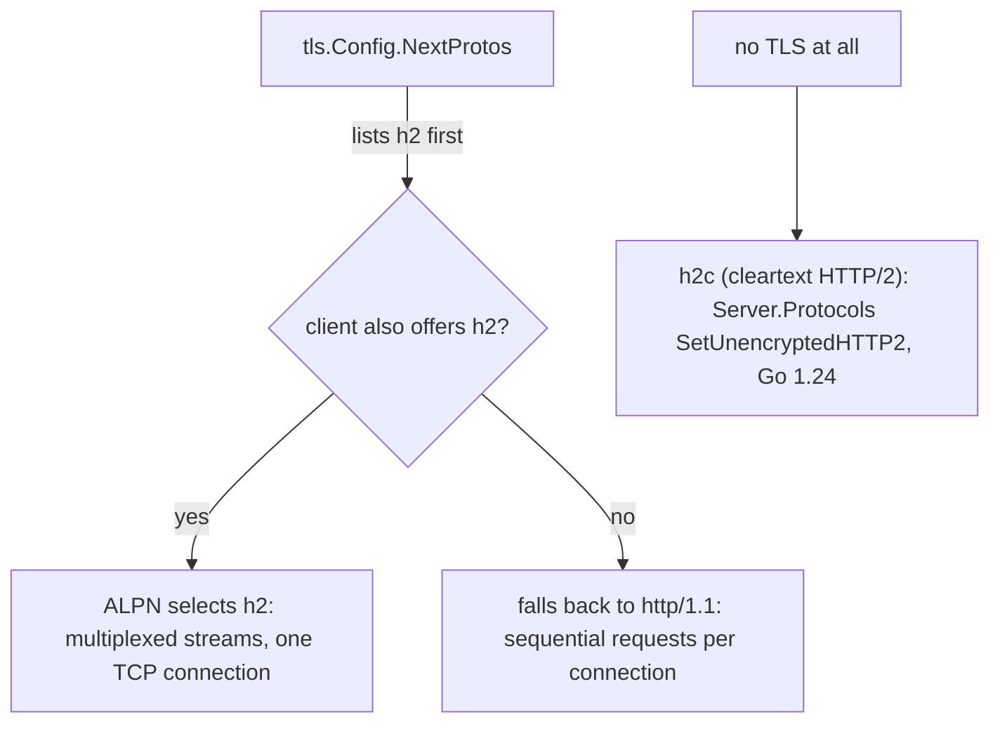
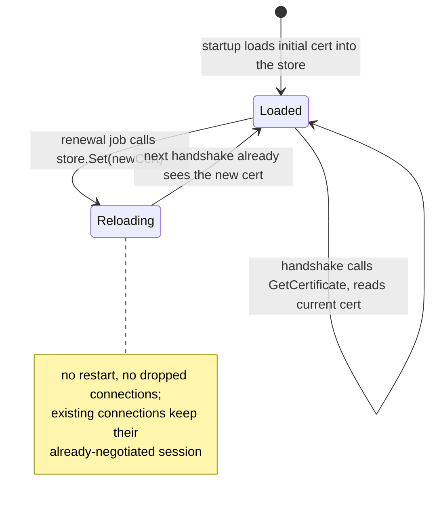

# TLS, HTTPS and HTTP2 in Go Servers

> [!summary] TL;DR
> A Go `http.Server` gets HTTPS from a `tls.Config` and gets HTTP/2 automatically through ALPN the moment that config lists `"h2"` in `NextProtos` — no separate HTTP/2 server code is needed. The Go-specific work is building that `tls.Config` correctly: a safe minimum version, a certificate source that can be reloaded without restarting the listener, and (for internal traffic) mutual TLS.

> [!abstract] Core idea
> - HTTP/2 over TLS is negotiated during the handshake via ALPN; a Go server gets it for free by listing `"h2"` before `"http/1.1"` in `tls.Config.NextProtos`.
> - `GetCertificate` is a function, not a static field — call it on every handshake to support hot reload (ACME renewal, a rotated secret) with zero downtime and no restart.
> - `ListenAndServeTLS` only accepts file paths; `ServeTLS` (or `TLSConfig` + `ListenAndServe`) is what you need for certificates built or stored anywhere else.
> - mTLS is `ClientAuth: RequireAndVerifyClientCert` plus a `ClientCAs` pool — it is Go's generic service-to-service auth primitive, not just a browser feature.
> - What TLS version and cipher theory actually mean is [[TLS and HTTPS]]'s job; this note only covers the Go server code that configures them.

## Start here: the basics 🟢

> [!info] How to read this note (pick your level)
> - 🟢 **New to this?** Read "From zero" below, then sections 1, 2 and the cheat sheet (10). Stop there, that is a full first pass.
> - 🟡 **Know the basics?** Add section 3 (how it works), 4 (worked example) and 5-6.
> - 🔴 **Interview / SDE-3 prep?** Add 7, 8 and 9. Headings are tagged 🟢🟡🔴 so you always know where you are.

**From zero, in 60 seconds** 🟢

Plain HTTP is a postcard: anyone along the way can read or change it. **TLS** wraps the connection in encryption, which is what the S in HTTPS means.

To prove who it is, the server shows a **certificate**: an ID card signed by an authority the browser already trusts.



Nice bonus: during that handshake the two sides also agree on the protocol (**ALPN**). If your Go server lists "h2", it speaks HTTP/2 automatically — no extra server code.

The Go work is building one `tls.Config` correctly: minimum version, certificates that can be swapped without a restart, and, between your own services, both sides showing certificates (mTLS).

The rest of this note is just these 4 questions:
1. What goes in a safe tls.Config, and how does ALPN give you HTTP/2?
2. How do you hot-reload certificates without dropping the listener?
3. What does mTLS add for service-to-service traffic?
4. Where should TLS terminate — the load balancer or your pod?

**The problem in one story.**
A customer opens your invoice site on café Wi-Fi.
Without encryption, anyone on that Wi-Fi can read their login and invoices.
HTTPS wraps every request in TLS, so only your server can read it.
Your Go server must also prove it is really your site, using a certificate, and swap that certificate when it expires without going offline.

**Words you need first**

| Word | Plain meaning | Tiny example |
| --- | --- | --- |
| TLS | The encryption layer under HTTPS | TLS 1.3 handshake |
| HTTPS | HTTP sent inside TLS | `https://api.invoiceops.com` |
| Certificate | A signed file proving a server owns a domain | Issued by Let's Encrypt |
| Handshake | The opening exchange that agrees keys and checks the certificate | ClientHello, ServerHello |
| SNI | The domain name the client asks for at the start | `api.invoiceops.com` |
| ALPN | The handshake field choosing which protocol to speak | `"h2"` or `"http/1.1"` |
| HTTP/2 | HTTP that sends many requests at once on one connection | Multiplexed streams |
| mTLS | Both sides show certificates, not just the server | Service-to-service auth |

**Picture it**



**Analogy.** TLS is a sealed envelope plus an ID card: the card (certificate) proves who you are, the seal keeps the letter private.
Where it breaks: a real ID card does not get replaced every 90 days while you keep talking; a Go server must hot-swap certificates mid-traffic.

**How the rest of this note builds up**

- First, why HTTPS matters for a Go service (section 1) and the mental model (section 2).
- Then how it works: HTTP/2 via ALPN, h2c, reloadable certificates, mTLS, termination topologies, redirects/HSTS and client-side TLS (section 3).
- Then a full Go worked example and a comparison of certificate sources (sections 4-5).
- Finally the SDE-3 deep dive: trade-offs, production rotation and handshake internals (sections 6-8).

> [!tip] Remember
> One `tls.Config` gives HTTPS, HTTP/2 via ALPN, and hot-reloadable certificates through `GetCertificate`.

### Whiteboard version

**In plain words:** the smallest HTTPS server with a safe config and h2 on.



## 1. Why it exists 🟢

InvoiceOps terminates TLS at the application (not always at a load balancer) because some deployments put the Go binary directly behind a cloud provider's TCP passthrough load balancer, and because internal service-to-service calls use mutual TLS for identity, not a shared secret.

Two things go wrong if a Go backend engineer treats TLS as "someone else's job" even when a load balancer does front it:

1. **Certificate rotation.** A certificate loaded once at startup (`ListenAndServeTLS("server.crt", "server.key")`) means every renewal needs a process restart, which for `terminationGracePeriodSeconds: 30` and thousands of long-lived connections is a real, visible blip. ACME-issued certs commonly renew every 60-90 days; a service running for months needs to reload without restarting.
2. **mTLS as internal auth.** Once a service mesh or direct service-to-service calls need to prove identity without a shared API key, mTLS is the standard mechanism, and it is configured the same way as a public HTTPS listener — just with `ClientAuth` turned on.

## 2. Mental model 🟢

A `tls.Config` is a policy document the Go runtime consults at three moments: when choosing which certificate to show (`GetCertificate`, called fresh per handshake — never cached by Go itself), when deciding the lowest protocol version it will accept (`MinVersion`), and when agreeing with the client on an application protocol (`NextProtos`, via ALPN).

None of these are "set once and the runtime remembers" — they are read live on every new TLS handshake, which is exactly what makes hot reload possible: swap what `GetCertificate` returns, and the *next* handshake sees the new certificate, with existing connections on the old one left alone until they naturally close.

## 3. How it works 🟡

### HTTP/2 is ALPN, not a separate server

**In plain words:** HTTP/2 is not switched on by new code; it is negotiated inside the TLS handshake, so the whole feature is one string in a list.

HTTP/2 over TLS needs no HTTP/2-specific server code in the stdlib path: `net/http`'s TLS listener already negotiates it automatically whenever the `tls.Config` lists `"h2"` in `NextProtos` and the client supports it. The handler function, the `ServeMux`, the middleware chain — all identical code serves both HTTP/1.1 and HTTP/2 clients; the protocol choice is purely a transport-layer decision.



Disabling HTTP/2 deliberately (rare — usually only to debug a transport-layer issue) is done by setting `Server.TLSNextProto` to a non-nil, empty map, which tells the stdlib not to register its own `"h2"` handler.

### Cleartext HTTP/2 (h2c)

HTTP/2 without TLS exists for internal traffic where the TLS handshake cost isn't worth paying (a load balancer that already terminated TLS, talking to the backend over a private network).

Since Go 1.24, `http.Protocols` and `Server.Protocols.SetUnencryptedHTTP2(true)` enable it directly in the stdlib; before 1.24, the same thing needed `golang.org/x/net/http2/h2c` as a handler wrapper. gRPC over h2c between internal services is the most common place this shows up (link [[gRPC Services in Go]]).

### Certificate sources: a hot-reloadable store

**In plain words:** certificates expire and get renewed; load them through a small lookup function so a new file on disk takes effect without restarting the server.

`ListenAndServeTLS(certFile, keyFile)` only ever reads those two files once, at startup. Anything that needs to change the certificate later — ACME renewal, a secret manager rotating a cert, blue-green cutover to a new CA — needs `tls.Config.GetCertificate` instead: a function called on every handshake, which can read from a `sync.RWMutex`-guarded store, a channel-fed cache, or `autocert.Manager.GetCertificate` for Let's Encrypt.

A `tls.Certificate` built from a PEM file (or `tls.X509KeyPair`) expects the leaf certificate first, followed by any intermediates in order up to (but not including) a CA the client already trusts — a chain with the order reversed, or a missing intermediate, is the single most common "works on my machine, fails for real clients" certificate bug, because browsers and curl often cache or ship the intermediate separately while a bare Go `tls.Dial` does not.

The leaf's `DNSNames` (and `IPAddresses` for an IP-addressed backend) are its Subject Alternative Names, the field TLS clients actually check the hostname against; a `CommonName` alone is not trusted by modern clients.

For local development, `mkcert` creates a local CA, installs it in the OS/browser trust store, and issues leaf certificates against it, so the same code path that will run against a real CA in production also runs correctly on a laptop with no "accept the warning" step.



### mTLS: the Go-generic service-to-service pattern

**In plain words:** normal TLS checks only the server's ID; mutual TLS makes the client show an ID too, so each service knows exactly who called.

Requiring and verifying a client certificate is `ClientAuth: tls.RequireAndVerifyClientCert` plus a `ClientCAs` pool containing whatever CA signed the calling services' certificates.

The verified chain is available on the connection as `r.TLS.VerifiedChains`, and the client's certificate subject (often a SPIFFE ID in `URIs`, or a `CommonName`) becomes the caller's identity — the same job an API key or JWT does for external clients, but anchored in the TLS handshake itself rather than an application-layer header that a handler could forget to check.

### Termination topologies

**In plain words:** three places the encryption can end — at the edge, at the pod, or re-started between them — each trading convenience for how far secrets travel bare.

| Topology | Who terminates TLS | What the Go server sees | When to use |
| --- | --- | --- | --- |
| Edge-terminated | Load balancer / ingress | Plain HTTP; caller identity from `X-Forwarded-*` headers (only trust these from a known proxy) | Public internet traffic, simplest operationally |
| Re-encrypt | LB terminates public TLS, opens a *new* TLS connection to the pod | TLS again, usually with a cluster-internal cert | Compliance requiring encryption on both hops |
| Passthrough + mTLS | LB forwards raw TCP; the Go process terminates TLS itself | The real client TLS handshake, including client certs | Internal service mesh identity, or clients needing true end-to-end TLS |

### Redirecting plain HTTP to HTTPS, and HSTS

A Go service that accepts HTTP at all (rather than relying entirely on the load balancer to refuse it) needs a second, plain `http.Server` listening on `:80` whose only handler redirects every request to the `https://` equivalent with `http.StatusMovedPermanently` or `http.StatusPermanentRedirect`.

That redirect alone does not stop a downgrade attack on the *next* visit, because the browser has to be redirected once before it learns HTTPS is required — `Strict-Transport-Security` (HSTS) closes that gap: a response header such as `Strict-Transport-Security: max-age=63072000; includeSubDomains`, set on the HTTPS handler, tells the browser to refuse plain HTTP to this host entirely for the next two years, without a server round trip.

Set it only on responses actually served over HTTPS, and only once the certificate chain is trusted in production — an HSTS header sent during testing against a self-signed cert can lock a browser out of the real host later.

### Client-side TLS: the mistake that defeats the whole chapter

Everything above protects a Go process acting as a **server**.

A Go process calling another service over HTTPS has its own `tls.Config`, and one setting undoes every certificate check this note describes: `InsecureSkipVerify: true` accepts any certificate from any host, silently turning off the verification that makes TLS meaningful at all — it belongs only in a throwaway local test, never in code that reaches a real network.

The correct knob for "I need to trust a private or internal CA" is `RootCAs`, a `*x509.CertPool` built from that CA's certificate, left on an otherwise default `tls.Config`.

For debugging a handshake that is failing for reasons that are not obvious from the error alone, `tls.Config.KeyLogWriter` (pointed at a file via the `SSLKEYLOGFILE` convention) lets Wireshark decrypt a capture of the same connection — a diagnostic tool, never something left wired up in a binary that ships.

## 4. Worked example 🟡

### Whiteboard version

The minimum that gets HTTPS and automatic HTTP/2 running, with a static certificate:

```go
cfg := &tls.Config{
    MinVersion: tls.VersionTLS12,
    NextProtos: []string{"h2", "http/1.1"},
}
srv := &http.Server{Addr: ":8443", Handler: mux, TLSConfig: cfg}
err := srv.ListenAndServeTLS("server.crt", "server.key")
if err != nil && !errors.Is(err, http.ErrServerClosed) {
    log.Fatal(err)
}
```

The full version below replaces the static file pair with a reloadable `CertStore`, adds mTLS as an option, and proves ALPN and hot reload with real TLS handshakes in tests rather than asserting it as a claim. It compiles and passes `go vet` and `go test -race` on Go 1.24.4.

```go
// Package tlsdemo shows a minimal InvoiceOps-style HTTPS server: a
// tls.Config with sane defaults, ALPN-negotiated HTTP/2, and a GetCertificate
// hook for hot cert reload — all testable with an in-memory certificate.
package tlsdemo

import (
	"crypto/ecdsa"
	"crypto/elliptic"
	"crypto/rand"
	"crypto/tls"
	"crypto/x509"
	"crypto/x509/pkix"
	"encoding/pem"
	"errors"
	"fmt"
	"math/big"
	"net/http"
	"sync"
	"time"
)

// CertStore holds the currently active certificate and supports hot
// reload: GetCertificate reads it on every handshake, so rotating the
// cert never requires restarting the listener.
type CertStore struct {
	mu   sync.RWMutex
	cert *tls.Certificate
}

func (s *CertStore) GetCertificate(*tls.ClientHelloInfo) (*tls.Certificate, error) {
	s.mu.RLock()
	defer s.mu.RUnlock()
	if s.cert == nil {
		return nil, errors.New("no certificate loaded")
	}
	return s.cert, nil
}

func (s *CertStore) Set(cert *tls.Certificate) {
	s.mu.Lock()
	defer s.mu.Unlock()
	s.cert = cert
}

// NewServerTLSConfig returns the tls.Config an InvoiceOps-style server
// should ship with: TLS 1.2 floor (Go's own default since 1.22), the
// certificate served from a hot-reloadable store, and HTTP/2 negotiated
// automatically through ALPN because NextProtos lists "h2" before "http/1.1".
func NewServerTLSConfig(store *CertStore) *tls.Config {
	return &tls.Config{
		MinVersion:     tls.VersionTLS12,
		GetCertificate: store.GetCertificate,
		NextProtos:     []string{"h2", "http/1.1"},
	}
}

// NewMTLSConfig extends the base config to require and verify a client
// certificate signed by one of the given CAs — the service-to-service
// pattern for internal traffic that should never reach a human's browser.
func NewMTLSConfig(store *CertStore, clientCAs *x509.CertPool) *tls.Config {
	cfg := NewServerTLSConfig(store)
	cfg.ClientAuth = tls.RequireAndVerifyClientCert
	cfg.ClientCAs = clientCAs
	return cfg
}

// NewServer builds an http.Server with the timeouts and TLSConfig set
// up front, so ServeTLS (not ListenAndServeTLS, which only accepts file
// paths) can be driven from certificates built in memory or in tests.
func NewServer(addr string, handler http.Handler, tlsCfg *tls.Config) *http.Server {
	return &http.Server{
		Addr:              addr,
		Handler:           handler,
		TLSConfig:         tlsCfg,
		ReadHeaderTimeout: 5 * time.Second,
		ReadTimeout:       10 * time.Second,
		WriteTimeout:      15 * time.Second,
		IdleTimeout:       60 * time.Second,
	}
}

// ProtoHandler reports which ALPN protocol negotiated the connection, so
// a test (or an operator) can confirm HTTP/2 was actually selected rather
// than assumed.
func ProtoHandler(w http.ResponseWriter, r *http.Request) {
	fmt.Fprintf(w, "proto=%s tls=%v", r.Proto, r.TLS != nil)
}

// GenerateSelfSigned builds a throwaway EC certificate for the given
// hosts, the same shape mkcert produces for local development. It exists
// only for tests in this package; production code never calls it.
func GenerateSelfSigned(hosts ...string) (tls.Certificate, error) {
	priv, err := ecdsa.GenerateKey(elliptic.P256(), rand.Reader)
	if err != nil {
		return tls.Certificate{}, err
	}

	template := x509.Certificate{
		SerialNumber: big.NewInt(1),
		Subject:      pkix.Name{CommonName: hosts[0]},
		NotBefore:    time.Now().Add(-time.Hour),
		NotAfter:     time.Now().Add(24 * time.Hour),
		KeyUsage:     x509.KeyUsageDigitalSignature | x509.KeyUsageCertSign,
		ExtKeyUsage:  []x509.ExtKeyUsage{x509.ExtKeyUsageServerAuth},
		IsCA:         true, // self-signed leaf acting as its own root for the test
		DNSNames:     hosts,
	}

	der, err := x509.CreateCertificate(rand.Reader, &template, &template, &priv.PublicKey, priv)
	if err != nil {
		return tls.Certificate{}, err
	}

	certPEM := pem.EncodeToMemory(&pem.Block{Type: "CERTIFICATE", Bytes: der})
	keyDER, err := x509.MarshalECPrivateKey(priv)
	if err != nil {
		return tls.Certificate{}, err
	}
	keyPEM := pem.EncodeToMemory(&pem.Block{Type: "EC PRIVATE KEY", Bytes: keyDER})

	return tls.X509KeyPair(certPEM, keyPEM)
}
```

Three tests that prove the behaviour, not just that the code compiles (`go test -race`, all pass):

```go
// TestALPNNegotiatesHTTP2 proves the claim the audit flagged as
// unexplained: HTTP/2 is selected automatically over TLS via ALPN, with
// no extra server code beyond listing "h2" ahead of "http/1.1".
func TestALPNNegotiatesHTTP2(t *testing.T) {
	h := newTLSHarness(t, http.HandlerFunc(ProtoHandler), false, nil)
	cert, _ := h.store.GetCertificate(nil)

	resp, err := client(cert.Leaf).Get(h.srv.URL)
	if err != nil {
		t.Fatalf("GET: %v", err)
	}
	defer resp.Body.Close()

	if resp.ProtoMajor != 2 {
		t.Fatalf("ProtoMajor = %d, want 2 (ALPN should have negotiated h2)", resp.ProtoMajor)
	}
}

// TestHotCertReload proves GetCertificate is consulted on every
// handshake: a brand-new connection after store.Set sees the new
// certificate, with the listener never restarted.
func TestHotCertReload(t *testing.T) {
	h := newTLSHarness(t, http.HandlerFunc(ProtoHandler), false, nil)
	firstCert, _ := h.store.GetCertificate(nil)
	c := client(firstCert.Leaf)

	resp, err := c.Get(h.srv.URL)
	if err != nil {
		t.Fatalf("first connection should trust the original cert: %v", err)
	}
	resp.Body.Close()

	// Rotate the certificate without touching the listener or the client.
	second, err := GenerateSelfSigned("127.0.0.1", "localhost")
	if err != nil {
		t.Fatalf("GenerateSelfSigned: %v", err)
	}
	h.store.Set(&second)

	// Force a fresh dial so this request performs a brand-new handshake
	// instead of reusing the idle keep-alive connection from above.
	c.Transport.(*http.Transport).CloseIdleConnections()

	// This client still only trusts the FIRST cert. A new connection must
	// now fail verification, because the server presents the SECOND cert.
	resp, err = c.Get(h.srv.URL)
	if err == nil {
		resp.Body.Close()
		t.Fatal("expected a new connection to be served the rotated cert and fail old-cert verification")
	}
	if !strings.Contains(err.Error(), "certificate") && !strings.Contains(err.Error(), "x509") {
		t.Fatalf("expected a certificate verification error, got: %v", err)
	}

	// A client that trusts the SECOND cert must succeed against the same
	// still-running listener, proving the reload is real, not a fluke.
	resp, err = client(second.Leaf).Get(h.srv.URL)
	if err != nil {
		t.Fatalf("a client trusting the rotated cert should succeed: %v", err)
	}
	resp.Body.Close()
}

// TestMTLSRejectsClientWithoutCert proves RequireAndVerifyClientCert
// actually rejects an anonymous client, not just a misconfigured one.
func TestMTLSRejectsClientWithoutCert(t *testing.T) {
	clientCAs := x509.NewCertPool() // empty: no client cert could ever verify
	h := newTLSHarness(t, http.HandlerFunc(ProtoHandler), true, clientCAs)
	cert, _ := h.store.GetCertificate(nil)

	_, err := client(cert.Leaf).Get(h.srv.URL)
	if err == nil {
		t.Fatal("expected the handshake to fail: server requires a client certificate")
	}
}
```

The test harness (`newTLSHarness`, `client`) drives `httptest.Server` with our own `tls.Config` instead of its built-in certificate. Getting this right surfaced three sharp edges in `crypto/tls`, `net/http` and `net/http/httptest` worth knowing even outside a test:

- `httptest.Server.StartTLS` always seeds `TLS.Certificates` with its own built-in localhost certificate when the caller's list is empty, purely so it has something to parse for `Server.Certificate()`. It does not remove a configured `GetCertificate`.
- `crypto/tls`'s internal `getCertificate` only calls a configured `GetCertificate` when `len(Certificates) == 0` **or** the `ClientHello` carries SNI.

  A client dialing a bare IP address (exactly what `httptest` listens on) sends no SNI by default, so without an explicit `ServerName` on the client's `tls.Config`, the server silently falls back to `Certificates[0]` and `GetCertificate` is never consulted — a reload bug that only shows up when a client connects by IP instead of hostname.

  The harness sets `ServerName: "localhost"` on every test client specifically to avoid this.
- Listing `"h2"` in `NextProtos` is not enough to actually serve HTTP/2 through `httptest.Server`: `StartTLS` wraps the listener and calls the plain `Serve`, not `ServeTLS`, so the automatic HTTP/2 wiring that `ServeTLS`/`ListenAndServeTLS` normally does for you never runs — the harness has to call `http2.ConfigureServer(srv.Config, &http2.Server{})` itself (`golang.org/x/net/http2`) before `StartTLS`.

  The client side has the identical trap in reverse: a `*http.Transport` with a non-nil `TLSClientConfig` does not get HTTP/2 wired up automatically either (the stdlib only does that when `TLSClientConfig`, `Dial` and `DialContext` are all left nil), so the harness also calls `http2.ConfigureTransport` on every test client.

  Skip either call and `TestALPNNegotiatesHTTP2` fails with `ProtoMajor == 1`, with nothing else in the config or the error log pointing at why: the handshake succeeds, the response comes back, it is just plain HTTP/1.1 over TLS instead of HTTP/2.

**Measured:** all three tests in this package pass under `go test -race` on Go 1.24.4, darwin/arm64, 2026-11-07.

## 5. Variants and comparison 🟡

| Option | How it works | Use when | Cost |
| --- | --- | --- | --- |
| `ListenAndServeTLS(cert, key)` | Reads two files once at startup | A static cert that never rotates without a restart | Simplest; no hot reload |
| `TLSConfig.GetCertificate` + `ServeTLS`/`ListenAndServe` | Function called per handshake | ACME renewal, secret-manager rotation, any cert source that isn't two static files | One more moving part (the store), but zero-downtime rotation |
| `autocert.Manager` | `GetCertificate` backed by Let's Encrypt, auto-renews | Public internet-facing services wanting free, automatic certs | Needs a reachable HTTP-01 or TLS-ALPN-01 challenge path |
| mTLS (`RequireAndVerifyClientCert`) | Client presents a cert the server verifies against `ClientCAs` | Internal service-to-service identity | Every caller needs a provisioned cert and a rotation story of its own |
| h2c (`Server.Protocols.SetUnencryptedHTTP2`) | HTTP/2 framing with no TLS at all | Internal traffic behind a TLS-terminating proxy, where handshake cost isn't worth it twice | No transport encryption; only ever on a trusted network |
| HTTP/3 (`quic-go`) | HTTP semantics over QUIC (UDP), not TCP+TLS at all | Lossy networks, mobile clients, avoiding TCP head-of-line blocking | Not in the stdlib — needs the third-party `quic-go`/`quic-go/http3` module; most services stop at HTTP/2 |

## 6. Trade-offs and when not to use 🟡

- Terminating TLS in the application adds CPU cost (handshakes, especially under high connection churn) that a dedicated load balancer or sidecar proxy can offload instead — pick edge termination when there is no internal-identity requirement forcing passthrough.
- `GetCertificate` being called on *every* handshake means it must be cheap and safe to call concurrently (an `RWMutex`-guarded read, as above) — doing I/O inside it (fetching from a secrets API per handshake) turns every new connection into a dependency on that API's latency.
- mTLS pushes certificate provisioning and rotation onto every calling service, not just this one — worthwhile for a handful of trusted internal callers, often excessive for a public API where a token-based scheme is simpler to operate (link [[Secure Coding for Go Services]]).
- `h2c` has no confidentiality at all; using it across anything but a network you already trust defeats the purpose of using HTTP/2's framing benefits in the first place.

## 7. In production 🔴

- **Real systems:** Caddy and Envoy both default to `GetCertificate`-equivalent dynamic certificate resolution for exactly the hot-reload reason above; `golang.org/x/crypto/acme/autocert` is the standard library-adjacent way Go services self-manage Let's Encrypt certs; Istio and Linkerd issue and rotate per-pod mTLS certificates automatically as the default service-mesh identity mechanism.
- **Failure modes → fixes:**
	- A renewed certificate never takes effect → check the reload path actually calls `store.Set` and that `GetCertificate` reads the same store, not a stale copy captured by value.
	- mTLS clients get rejected after a CA rotation → `ClientCAs` needs the new CA added before old client certs stop being accepted by callers still presenting them; roll CAs with an overlap window, never a hard cutover.
	- A client reports `tls: handshake failure` only when connecting by IP, never by hostname → almost always the SNI issue from the deep dive below: `GetCertificate` silently isn't being called.
	- Certificates expire unnoticed → alert on days-to-expiry, not just failed handshakes; a renewal job failing silently for weeks is a common real incident.
- **What to monitor:** days until certificate expiry (per certificate, since a hot-reloadable store can hold more than one over its lifetime), handshake failure rate and reason (expired, unknown CA, no client cert), ALPN protocol distribution (h2 vs http/1.1) per endpoint, mTLS verification failure rate.

## 8. Deep dive 🔴

- **Why SNI changes which code path runs.** `crypto/tls`'s `Config.getCertificate` (unexported, but documented behaviourally) only calls a configured `GetCertificate` when `len(c.Certificates) == 0` **or** the `ClientHello`'s `ServerName` is non-empty.

  A server with both a static fallback certificate *and* a `GetCertificate` hook will skip the hook entirely for any client that connects without sending SNI — which includes clients that dial a bare IP address rather than a hostname, and some older or minimal TLS clients.

  This is not a hypothetical: it is the exact bug this note's own test harness had to work around (see the Worked Example) to make `TestHotCertReload` actually exercise the reload path instead of silently passing against a cached default.
- **Go's TLS version floor.** Since Go 1.22, a server's default minimum TLS version is 1.2 (verified via the `tls10server` GODEBUG knob existing specifically to let operators opt back into the old 1.0 floor during a migration, which confirms 1.2 is the new default).

  TLS 1.3's cipher suites are not configurable at all in `crypto/tls` — Go picks them, by design, to avoid the historical mistake of letting operators disable AEAD ciphers into a worse configuration.
- **Session resumption and reload interaction.** Go's client-side `tls.Config.ClientSessionCache`, when set, can resume a previous TLS session without re-presenting or re-verifying the server's certificate at all.

  A reload test (or a production rollout) that doesn't account for this can appear to show stale certificates "still working" past their rotation — not because the server served the old cert, but because the client's resumed session never asked it to prove its identity again.

  The worked example above has no `ClientSessionCache` configured on its test clients specifically so every connection performs a full handshake.
- **Post-quantum key exchange.** Since Go 1.24, the TLS 1.3 client and server negotiate a hybrid X25519MLKEM768 key exchange by default when both peers support it, alongside classical X25519 — a server-side config change is not required to benefit from this, but any code that pins an exact cipher/group list should verify it doesn't accidentally exclude the hybrid group.
- **mTLS identity extraction.** After a successful mTLS handshake, `r.TLS.VerifiedChains[0][0]` is the leaf certificate Go already verified against `ClientCAs`; pulling a caller's identity from its `Subject.CommonName` or a SPIFFE URI in `URIs` is a server-side decision, not something `crypto/tls` does for you — the middleware that stores this identity in `r.Context()` for handlers to read is the same shape as [[Authentication and Authorization in Go]]'s token-based middleware, just fed by the TLS layer instead of a header.

## 9. Interview questions 🔴

> [!question]- How does a Go server decide between HTTP/1.1 and HTTP/2 for an incoming TLS connection?
> Through ALPN, during the TLS handshake itself: the client lists protocols it supports in its `ClientHello`, the server's `tls.Config.NextProtos` lists what it is willing to speak, and whichever protocol appears in both — in our config, `"h2"` is listed first — gets selected before a single HTTP byte is exchanged.
>
> No separate HTTP/2 server or handler code is involved; the same `http.Server` and handler serve both.

> [!question]- Why use `GetCertificate` instead of just setting `Certificates` directly?
> `Certificates` is read once, at the moment a handshake needs it, from whatever static value it holds — rotating the certificate means mutating that field in a way every in-flight and future handshake sees safely, which `GetCertificate` (a function, naturally callable behind a mutex) makes straightforward and `Certificates` does not.
>
> It is also the only option when the certificate source is dynamic in the first place, like `autocert.Manager` fetching from Let's Encrypt.

> [!question]- A certificate reload doesn't seem to take effect, but only for clients connecting by raw IP address. What's the likely cause?
> SNI. `crypto/tls` only calls a configured `GetCertificate` when there are zero static `Certificates` configured, or the client's `ClientHello` carries a non-empty `ServerName`. A client connecting by bare IP typically sends no SNI, so if any static fallback certificate is also configured, the server silently serves that stale one instead of calling `GetCertificate` at all.

> [!question]- What is the actual difference between mTLS and a service presenting an API key over HTTPS?
> With HTTPS alone, only the server proves its identity to the client; the client's identity (if any) is asserted by it, through a bearer token the server must trust was transmitted and stored safely.
>
> With mTLS, the client also presents a certificate during the handshake itself, which the server cryptographically verifies against a trusted CA before a single request is processed — identity is proven at the transport layer, not asserted in an application-layer header that a handler could simply forget to check.

> [!question]- Trap: does terminating TLS at a load balancer mean a Go backend engineer never needs to think about `tls.Config`?
> No.
>
> Even with edge termination, internal re-encryption hops, mTLS between services, and any passthrough deployment (some cloud TCP load balancers, or a service mesh sidecar expecting the backend to terminate TLS itself) still put a real `tls.Config` in the Go service's own code — "someone else terminates it" is true for some topologies and false for others, and assuming it without checking the actual deployment is the trap.

> [!question]- Why does `h2c` exist, and why is it dangerous to use carelessly?
> It lets two peers speak HTTP/2's multiplexed, binary framing without paying for a TLS handshake, which matters for internal traffic where a proxy already terminated TLS once.
>
> It is dangerous used carelessly because it provides zero confidentiality or integrity — anyone who can observe or tamper with that network segment can read or alter every request, so it belongs only behind a boundary already trusted for plaintext traffic, never across anything resembling the public internet.

> [!question]- Your test calls `GetCertificate` directly and gets back a certificate, so you assume the live TLS handshake is using it too. What could make that assumption wrong?
> A static `Certificates` list still configured alongside it, combined with a client connecting without SNI — in that specific combination `crypto/tls` serves `Certificates[0]` and never calls `GetCertificate` for that handshake at all, even though calling the function directly in a test always invokes it correctly.

## 10. Cheat sheet 🟢

- `NextProtos: []string{"h2", "http/1.1"}` on `tls.Config` is the entire HTTP/2-over-TLS story; ALPN does the rest during the handshake.
- `GetCertificate` is called per handshake — put a mutex-guarded store behind it for zero-downtime rotation; `ListenAndServeTLS` only reads two files once.
- `GetCertificate` is skipped when static `Certificates` are also set **and** the client sent no SNI — a real, documented `crypto/tls` behaviour, not a bug.
- `ServeTLS`, not `ListenAndServeTLS`, when certificates don't live as two files on disk.
- mTLS = `ClientAuth: RequireAndVerifyClientCert` + `ClientCAs`; identity comes from `r.TLS.VerifiedChains`, not a header.
- `h2c` (Go 1.24: `Server.Protocols.SetUnencryptedHTTP2`) is HTTP/2 framing with zero encryption — trusted internal networks only.
- Go's TLS 1.3 cipher suites are not configurable by design; only `MinVersion`/`MaxVersion` and `CurvePreferences` are yours to set.
- Redirect `:80` to `https://` and set `Strict-Transport-Security` on the HTTPS responses — the redirect alone doesn't stop a downgrade on the browser's next visit, HSTS does.
- Client-side `tls.Config.InsecureSkipVerify` turns off certificate verification entirely; use `RootCAs` to trust a private CA instead, never this.
- `httptest.Server` needs `http2.ConfigureServer` (server) and `http2.ConfigureTransport` (client) to actually negotiate HTTP/2 in a test — `NextProtos: []string{"h2", ...}` alone is not enough once `Serve` bypasses `ServeTLS`'s automatic setup.
- HTTP/3 is not in the stdlib; `quic-go` is the usual third-party choice when TCP head-of-line blocking is the actual problem.
- Protocol and version theory (what TLS 1.3 actually negotiates, why HTTP/2 multiplexes) lives in [[TLS and HTTPS]] and [[HTTP-1.1 vs HTTP-2 vs HTTP-3]]; this note is the Go server code on top of that theory.

## Links 🟢

- **Before this:** [[HTTP Server Fundamentals (net-http)]], [[TLS and HTTPS]], [[HTTP-1.1 vs HTTP-2 vs HTTP-3]]
- **Next:** [[gRPC Services in Go]], [[Secure Coding for Go Services]]
- **Compare with:** [[Load Balancing]] (where TLS terminates relative to this server), [[Graceful Shutdown and Health Checks]] (draining the same server this config secures)

### Watch on YouTube

- [Golang basic HTTP2 demo in 5 min (Hello world)](https://www.youtube.com/watch?v=kty6QMQFqSM) · Shenouda Fawzy · 5-min visual intro to HTTP/2 in a Go server
- [Setup HTTPS with SSL and Golang](https://www.youtube.com/watch?v=ELvFy_vIYHU) · Juan Nadal · practical TLS/HTTPS setup for a Go http.Server
