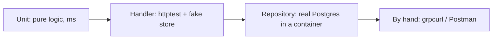
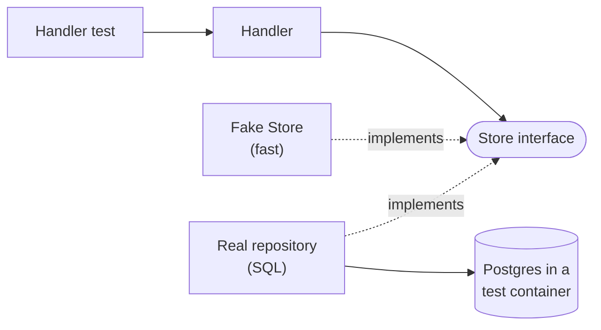
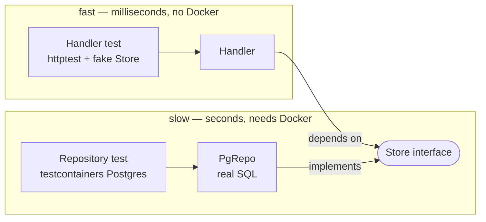
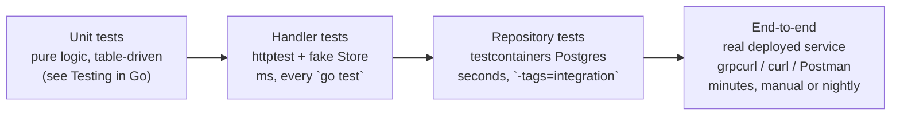
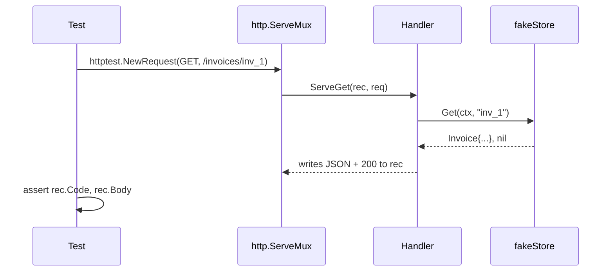

# Testing Go Services

> [!summary] TL;DR
> A Go backend service's tests stack in layers: unit tests against pure logic, **handler tests** that drive an `http.Handler` through `httptest` with a fake store (no network, no database), and **repository tests** that run real SQL against a real, disposable Postgres container via `testcontainers-go` (slow, but the only thing that catches a wrong query).
>
> `grpcurl` and Postman sit outside Go entirely, for poking at a running server by hand.

> [!abstract] Core idea
> - A handler test needs only `httptest` and a fake implementing the handler's `Store` interface — no database, no network, runs in milliseconds.
> - A repository test needs a real database, because that's the only way to catch a wrong SQL query, a wrong index assumption, or a driver type-mapping bug. `testcontainers-go` starts and tears down a real, disposable Postgres container per test run.
> - The split is the interface boundary itself: the handler depends on `Store`, never on `*pgxpool.Pool`, so the same production code gets a fake in one test file and a real database in another.
> - Table-driven unit tests, fakes vs. mocks in general, and gRPC's own in-process `bufconn` tests are owned by other notes — this one only covers the httptest/testcontainers split and where `grpcurl` fits.
> - Classic mistake: asserting on a handler's exact JSON string byte-for-byte, so a harmless field-order change breaks every test.

## Start here: the basics 🟢

> [!info] How to read this note (pick your level)
> - 🟢 **New to this?** Read "From zero" below, then sections 1, 2 and the cheat sheet (10). Stop there, that is a full first pass.
> - 🟡 **Know the basics?** Add section 3 (how it works), 4 (worked example) and 5-6.
> - 🔴 **Interview / SDE-3 prep?** Add 7, 8 and 9. Headings are tagged 🟢🟡🔴 so you always know where you are.

> [!note] Before this note
> - [[Backend Request Lifecycle and Layering]]: the handler talks HTTP, and the repository talks SQL; they meet at an interface.
> - [[Transactions and the Repository Pattern]]: a repository is a small interface (`Get`, `Save`) with a real SQL version behind it.

**From zero, in 60 seconds** 🟢

Tests for a backend stack up in layers, from fast and narrow to slow and honest.

**Unit tests** check pure logic with no wires attached. **Handler tests** drive your HTTP handlers through `httptest` — a fake in-memory server — with a fake store standing in for the database. **Repository tests** run your real SQL against a real, throwaway Postgres started in a container just for the test.



Why bother with the slow layer? Because only a real database catches a wrong query. A fake store happily accepts SQL that Postgres would reject.

The rest of this note is just these 3 questions:
1. What belongs in each of the four layers?
2. How do you test a handler without a network or a database?
3. How does testcontainers give each test run a clean real Postgres?

**The problem in one story.**
Your web server shows an invoice when someone asks for it.
You change one line and want to know, in seconds, that nothing broke.
Starting the whole server and a real database for every check is slow.
So you test the "answer the request" part with a fake database, and the "talk to the database" part against a real one.

**Words you need first**

| Word | Plain meaning | Tiny example |
| --- | --- | --- |
| Test | Code that runs your code and checks the result | `go test ./...` |
| Handler | The Go function that answers one HTTP request | `GET /invoices/42` returns JSON |
| Interface | A list of methods; any type with them fits | `Store` with `GetInvoice` |
| Fake | A hand-written stand-in that returns canned answers | A `Store` that always says "not found" |
| Repository | The code that runs SQL against the database | `PgRepo.GetInvoice` |
| Container | A small, throwaway machine image run by Docker | A Postgres that lives only during the test |
| `httptest` | Go package that fakes requests and records responses | `httptest.NewRecorder()` |

| Seam | The interface line where you can swap a real part for a fake | `Store` between handler and SQL |
| testcontainers | A Go library that starts a real database in Docker for one test run | `postgres:17-alpine` |
| Build tag | A label that includes a test file only when asked | `go test -tags=integration` |
| `t.Cleanup` | Registers code to run when a test ends, even if it fails | stop the container |
| `grpcurl` | A command-line tool to call a running gRPC server by hand | `grpcurl ... list` |

**Picture it**



**Analogy.** A driving instructor first practices with a student in an empty parking lot (fake store), then on a real road (real database).
Where it breaks: a parking lot never surprises you, so it can never catch the real-road bugs; only the real-database test catches a wrong SQL query.

**How the rest of this note builds up**

- First, why handler bugs and query bugs need different tests (section 1) and the `Store` seam (section 2).
- Then the four test layers, handler tests with `httptest`, and repository tests with testcontainers (section 3).
- Then the full InvoiceOps worked example plus `grpcurl`/Postman for manual checks (section 4).
- Finally the SDE-3 deep dive: fakes vs mocks, `t.Cleanup`, container reuse and `bufconn` (sections 5-8).

> [!tip] Remember
> Fake the database to test handlers fast; use a real throwaway database to test the SQL.

## 1. Why it exists 🟢

InvoiceOps has an HTTP handler that reads an invoice from Postgres and returns it as JSON. Two different things can be wrong with it:

1. **The handler logic.** Does `GET /invoices/missing-id` return `404`, not `500`? Does a store error get mapped to a generic "internal error" message instead of leaking `connection reset by peer` to the client? This has nothing to do with SQL — it's `if err != nil` branches in Go.
2. **The query.** Does `SELECT id, amount_minor, currency, status, created_at FROM invoices WHERE id = $1` actually return the right row, with the right types, against a real Postgres column set? A handler test with a fake store can't catch a typo in a column name or a `NUMERIC` column that doesn't `Scan` into an `int64` the way you assumed.

Testing both the same way is either slow (every handler test spins up Postgres) or blind (every test uses a fake and a wrong SQL query ships to production untested). The fix is to test them separately, at the layer where each kind of bug actually lives.

### A real-life example 🟢

A team at Swiggy changing how the "order details" API shows a cancelled order wants feedback in seconds, not minutes. Handler tests with a fake store run hundreds of cases in under a second on every save. But a renamed column in the SQL would sail through those tests, so a second set of tests runs the real queries against a fresh Postgres in Docker on every pull request. Finally, an engineer pokes the staging server by hand with `curl` or `grpcurl` before a big release.

## 2. Mental model 🟢

The `Store` interface InvoiceOps's handler depends on (see [[Transactions and the Repository Pattern]] for the same idea applied to repositories sharing a transaction) is the **seam**: everything on the handler side of it gets tested with a fake, everything on the database side of it gets tested against a real Postgres. Neither test needs to know the other exists.



Everything above the interface (`H`, the handler test) runs on every `go test ./...` in a few milliseconds. Everything below it (`PgRepo`, the repository test) needs a real database, so it runs separately — tagged, or in CI only — and is the one place a schema change or a bad query gets caught before a user does.

## 3. How it works 🟡

🟢 → 🟡 You now know the split: fake the database for fast handler tests, use a real throwaway database for SQL tests. Next we open the box: the four test layers, exactly how a handler test runs in memory, and how a repository test gets its own Postgres.

### The four layers

**In plain words:** a pyramid of trust vs speed — many fast narrow tests at the bottom, a few slow honest ones on top.

**Step by step:**
1. Unit tests: check pure functions like "total = sum of line items". Microseconds.
2. Handler tests: send a fake request to the handler with a fake store. Milliseconds.
3. Repository tests: run the real SQL against Postgres in a container. Seconds.
4. End-to-end/manual: call the deployed service with `curl` or `grpcurl`. Minutes.



Each layer up the chain is slower and catches a different class of bug: logic bugs, then wiring/serialization bugs, then SQL/schema bugs, then "does the whole deployed thing actually work" bugs.

[[Testing in Go]] owns the first layer (table-driven tests, fakes vs. mocks as a general Go topic, `t.Parallel`, golden files); this note picks up where a request or a query enters the picture.

### Handler tests: httptest + a fake Store

**In plain words:** call the handler as if over HTTP, but in memory: build a request, record the response, swap the database for a hand-written fake.

**Step by step:**
1. Build a fake store whose `Get` returns `Invoice{ID: "inv_1", Amount: 50000}`.
2. Build the handler with that fake and register it on a `ServeMux`.
3. `req := httptest.NewRequest("GET", "/invoices/inv_1", nil)` and `rec := httptest.NewRecorder()`.
4. `mux.ServeHTTP(rec, req)`, then check `rec.Code == 200` and the JSON body.
5. Another case: the fake returns "not found", and you check for 404.

`httptest.NewRequest` builds an `*http.Request` with no real socket, and `httptest.NewRecorder` is an `http.ResponseWriter` that just records what got written — so a handler test calls the handler directly, in-process, with no network stack involved at all.

The fake `Store` is a struct with one function field per method, which makes each test case's expectation a one-line closure instead of a mocking-library DSL:



### Repository tests: a real, disposable Postgres

**In plain words:** the test itself starts a fresh Postgres container, runs the migrations, runs your queries, and throws the whole database away after.

**Step by step:**
1. The test (only built with `-tags=integration`) asks testcontainers for a `postgres:17-alpine` container.
2. It waits until Postgres is ready and gets a connection string.
3. It creates the tables (or runs the real migrations) and builds `PgRepo`.
4. It inserts an invoice, calls `Get` and `MarkPaid`, and checks the results.
5. `t.Cleanup` stops and removes the container, pass or fail.

`testcontainers-go`'s `modules/postgres` helper starts a real `postgres:17-alpine` container, waits for it to report ready, and hands back a connection string — then `t.Cleanup` tears the container down whether the test passes or fails.

The test applies the schema itself (or runs the actual migration files from [[Schema Migrations in Go Services]]) so it exercises the exact SQL the production code runs, against the exact engine version production uses.

## 4. Worked example 🟡

### Whiteboard version

**In plain words:** one handler test and one repository test, minimal.

The bare idea for a handler test: no table, one case, enough to see the shape.

```go
package wb

import (
	"context"
	"net/http"
	"net/http/httptest"
	"testing"
)

type fakeStore struct {
	get func(ctx context.Context, id string) (string, error)
}

func TestHandlerReturns404ForMissingInvoice(t *testing.T) {
	store := fakeStore{get: func(context.Context, string) (string, error) {
		return "", errNotFound
	}}
	h := &Handler{Store: store}
	req := httptest.NewRequest(http.MethodGet, "/invoices/missing", nil)
	rec := httptest.NewRecorder()

	h.ServeGet(rec, req)

	if rec.Code != http.StatusNotFound {
		t.Fatalf("status = %d, want 404", rec.Code)
	}
}
```

The full version below is the real InvoiceOps slice: the `Store` interface, the handler, a hand-written fake, and a testcontainers-backed repository test.

Everything compiles and passes `go vet` and `go test -race` on Go 1.24.4; the repository test was go-vet-checked and compiles under its build tag but was **not executed in this environment** — this sandbox has no Docker daemon, and `testcontainers-go` needs one to start the Postgres container.

Run it locally or in CI before trusting it as a passing suite.

**What this code does, in plain words (for the blocks below):** `Store` has two methods, `Get` and `MarkPaid`. The `Handler` has `ServeGet` and `ServeMarkPaid`, which call the store and map "not found" to 404. The handler test uses a `fakeStore` built from function fields. `PgRepo` runs the real SQL, and `TestPgRepo_GetAndMarkPaid` checks it against a container started by `newTestPool`.

**The seam — `Store`, defined where the handler consumes it:**

```go
package invoice

import (
	"context"
	"errors"
	"time"
)

type Invoice struct {
	ID       string    `json:"id"`
	Amount   int64     `json:"amount_minor"`
	Currency string    `json:"currency"`
	Status   string    `json:"status"`
	Created  time.Time `json:"created_at"`
}

var ErrNotFound = errors.New("invoice not found")

// Store is the handler's only dependency. It is defined on the consumer
// side so a handler test can implement it as a fake with no Postgres in
// sight, and the repository test below can implement it against a real
// database.
type Store interface {
	Get(ctx context.Context, id string) (Invoice, error)
	MarkPaid(ctx context.Context, id string) error
}
```

**The handler:**

```go
package invoice

import (
	"encoding/json"
	"errors"
	"net/http"
)

type Handler struct {
	Store Store
}

// ServeGet handles GET /invoices/{id} (id taken from r.PathValue, Go 1.22+).
func (h *Handler) ServeGet(w http.ResponseWriter, r *http.Request) {
	id := r.PathValue("id")
	inv, err := h.Store.Get(r.Context(), id)
	switch {
	case errors.Is(err, ErrNotFound):
		http.Error(w, "invoice not found", http.StatusNotFound)
		return
	case err != nil:
		http.Error(w, "internal error", http.StatusInternalServerError)
		return
	}
	w.Header().Set("Content-Type", "application/json")
	json.NewEncoder(w).Encode(inv)
}

func (h *Handler) ServeMarkPaid(w http.ResponseWriter, r *http.Request) {
	id := r.PathValue("id")
	err := h.Store.MarkPaid(r.Context(), id)
	switch {
	case errors.Is(err, ErrNotFound):
		http.Error(w, "invoice not found", http.StatusNotFound)
		return
	case err != nil:
		http.Error(w, "internal error", http.StatusInternalServerError)
		return
	}
	w.WriteHeader(http.StatusNoContent)
}
```

**The handler test**, table-driven, asserting status and body rather than reaching into internals:

```go
package invoice

import (
	"context"
	"errors"
	"net/http"
	"net/http/httptest"
	"testing"
)

// fakeStore is a hand-written fake, not a generated mock: there are two
// methods, so writing it out is less code than wiring a mocking library,
// and the test below reads top to bottom without a .EXPECT() DSL.
type fakeStore struct {
	get      func(ctx context.Context, id string) (Invoice, error)
	markPaid func(ctx context.Context, id string) error
}

func (f fakeStore) Get(ctx context.Context, id string) (Invoice, error) {
	return f.get(ctx, id)
}

func (f fakeStore) MarkPaid(ctx context.Context, id string) error {
	return f.markPaid(ctx, id)
}

func TestHandler_ServeGet(t *testing.T) {
	t.Parallel()
	cases := []struct {
		name       string
		id         string
		store      fakeStore
		wantStatus int
		wantBody   string
	}{
		{
			name: "found",
			id:   "inv_1",
			store: fakeStore{get: func(_ context.Context, id string) (Invoice, error) {
				return Invoice{ID: id, Amount: 1500, Currency: "USD", Status: "pending"}, nil
			}},
			wantStatus: http.StatusOK,
			wantBody:   `{"id":"inv_1","amount_minor":1500,"currency":"USD","status":"pending","created_at":"0001-01-01T00:00:00Z"}` + "\n",
		},
		{
			name: "not found",
			id:   "inv_missing",
			store: fakeStore{get: func(context.Context, string) (Invoice, error) {
				return Invoice{}, ErrNotFound
			}},
			wantStatus: http.StatusNotFound,
			wantBody:   "invoice not found\n",
		},
		{
			name: "store error maps to 500, not leaked to the client",
			id:   "inv_2",
			store: fakeStore{get: func(context.Context, string) (Invoice, error) {
				return Invoice{}, errors.New("connection reset by peer")
			}},
			wantStatus: http.StatusInternalServerError,
			wantBody:   "internal error\n",
		},
	}
	for _, tc := range cases {
		t.Run(tc.name, func(t *testing.T) {
			t.Parallel()
			h := &Handler{Store: tc.store}
			mux := http.NewServeMux()
			mux.HandleFunc("GET /invoices/{id}", h.ServeGet)
			req := httptest.NewRequest(http.MethodGet, "/invoices/"+tc.id, nil)
			rec := httptest.NewRecorder()
			mux.ServeHTTP(rec, req)
			if rec.Code != tc.wantStatus {
				t.Fatalf("status = %d, want %d", rec.Code, tc.wantStatus)
			}
			if rec.Body.String() != tc.wantBody {
				t.Fatalf("body = %q, want %q", rec.Body.String(), tc.wantBody)
			}
		})
	}
}
```

Note the third case: the test asserts the client sees the generic `"internal error"` string, never the raw `"connection reset by peer"` — a handler test is exactly where you catch an internal error accidentally leaking into an API response.

**The repository**, implementing the same `Store` interface against real Postgres:

```go
package invoice

import (
	"context"
	"errors"

	"github.com/jackc/pgx/v5"
	"github.com/jackc/pgx/v5/pgxpool"
)

type PgRepo struct {
	pool *pgxpool.Pool
}

func NewPgRepo(pool *pgxpool.Pool) *PgRepo {
	return &PgRepo{pool: pool}
}

func (r *PgRepo) Get(ctx context.Context, id string) (Invoice, error) {
	var inv Invoice
	err := r.pool.QueryRow(ctx,
		`SELECT id, amount_minor, currency, status, created_at
		 FROM invoices WHERE id = $1`, id,
	).Scan(&inv.ID, &inv.Amount, &inv.Currency, &inv.Status, &inv.Created)
	if errors.Is(err, pgx.ErrNoRows) {
		return Invoice{}, ErrNotFound
	}
	if err != nil {
		return Invoice{}, err
	}
	return inv, nil
}

func (r *PgRepo) MarkPaid(ctx context.Context, id string) error {
	tag, err := r.pool.Exec(ctx,
		`UPDATE invoices SET status = 'paid' WHERE id = $1 AND status = 'pending'`, id)
	if err != nil {
		return err
	}
	if tag.RowsAffected() == 0 {
		return ErrNotFound
	}
	return nil
}
```

**The repository test**, gated behind a build tag so an ordinary `go test ./...` never needs Docker:

```go
//go:build integration

// This file only builds and runs with `go test -tags=integration ./...`.
// It was written and go-vet-checked in this environment, but it was NOT
// executed here: this sandbox has no Docker daemon, and testcontainers-go
// needs one to start the Postgres container. Run it locally or in CI,
// where Docker is available, before trusting it as a passing suite.
package invoice

import (
	"context"
	"testing"
	"time"

	"github.com/jackc/pgx/v5/pgxpool"
	"github.com/testcontainers/testcontainers-go"
	"github.com/testcontainers/testcontainers-go/modules/postgres"
	"github.com/testcontainers/testcontainers-go/wait"
)

func newTestPool(t *testing.T) *pgxpool.Pool {
	t.Helper()
	ctx := context.Background()
	ctr, err := postgres.Run(ctx, "postgres:17-alpine",
		postgres.WithDatabase("invoiceops_test"),
		postgres.WithUsername("test"),
		postgres.WithPassword("test"),
		testcontainers.WithWaitStrategy(
			wait.ForLog("database system is ready to accept connections").
				WithOccurrence(2).WithStartupTimeout(30*time.Second)),
	)
	if err != nil {
		t.Fatalf("start postgres container: %v", err)
	}
	t.Cleanup(func() {
		if err := ctr.Terminate(context.Background()); err != nil {
			t.Logf("terminate container: %v", err)
		}
	})

	dsn, err := ctr.ConnectionString(ctx, "sslmode=disable")
	if err != nil {
		t.Fatalf("connection string: %v", err)
	}
	pool, err := pgxpool.New(ctx, dsn)
	if err != nil {
		t.Fatalf("open pool: %v", err)
	}
	t.Cleanup(pool.Close)

	const schema = `
		CREATE TABLE invoices (
			id           text PRIMARY KEY,
			amount_minor bigint NOT NULL,
			currency     text NOT NULL,
			status       text NOT NULL DEFAULT 'pending',
			created_at   timestamptz NOT NULL DEFAULT now()
		);`
	if _, err := pool.Exec(ctx, schema); err != nil {
		t.Fatalf("apply schema: %v", err)
	}
	return pool
}

func TestPgRepo_GetAndMarkPaid(t *testing.T) {
	pool := newTestPool(t)
	repo := NewPgRepo(pool)
	ctx := context.Background()

	_, err := pool.Exec(ctx,
		`INSERT INTO invoices (id, amount_minor, currency) VALUES ($1, $2, $3)`,
		"inv_1", 1500, "USD")
	if err != nil {
		t.Fatalf("seed row: %v", err)
	}

	inv, err := repo.Get(ctx, "inv_1")
	if err != nil {
		t.Fatalf("Get: %v", err)
	}
	if inv.Status != "pending" {
		t.Fatalf("status = %q, want pending", inv.Status)
	}

	if err := repo.MarkPaid(ctx, "inv_1"); err != nil {
		t.Fatalf("MarkPaid: %v", err)
	}

	inv, err = repo.Get(ctx, "inv_1")
	if err != nil {
		t.Fatalf("Get after MarkPaid: %v", err)
	}
	if inv.Status != "paid" {
		t.Fatalf("status = %q, want paid", inv.Status)
	}

	// Marking an already-paid invoice paid again is a no-op update (zero
	// rows match status = 'pending'), which the repository reports as
	// ErrNotFound so the handler returns 404 instead of a silent success.
	if err := repo.MarkPaid(ctx, "inv_1"); err == nil {
		t.Fatal("MarkPaid on an already-paid invoice: want an error, got nil")
	}
	if _, err := repo.Get(ctx, "no_such_id"); err != ErrNotFound {
		t.Fatalf("Get on missing id: err = %v, want ErrNotFound", err)
	}
}
```

### Testing gRPC and exploring by hand

**Step by step:**
1. For gRPC code tests, use `bufconn` (an in-memory listener) instead of a real port, as shown in [[gRPC Services in Go]].
2. For a running server, `grpcurl -plaintext localhost:50051 list` shows its services.
3. Then call one method with JSON input to check it answers.
4. Keep these manual checks out of CI; they need a live server.

A gRPC service's in-process equivalent of `httptest` is `bufconn` — an in-memory `net.Listener` that lets a real server and a real client talk with no TCP port and no network flakiness.

It's the same idea as the handler test above, one layer down the stack, and it already has a full worked example in [[gRPC Services in Go]] — this note doesn't repeat it.

For manually exploring or smoke-testing a *running* server (local dev, staging, an incident), `grpcurl` uses server reflection to call any RPC without a local `.proto` copy:

```bash
$ grpcurl -plaintext localhost:50051 list
invoice.v1.InvoiceService

$ grpcurl -plaintext -d '{"id": "inv_1"}' \
    localhost:50051 invoice.v1.InvoiceService/GetInvoice
```

Postman does the same thing over the same reflection mechanism, with a GUI.

Neither is a `go test` replacement — they call a server that's already running, so they belong in the "end-to-end / manual" layer of the diagram in section 3, not in CI as a correctness gate.

The full command set, plus the production warning about leaving reflection on, is in [[gRPC Services in Go]]'s "Testing" section.

## 5. Variants and comparison 🟡

| Layer | Tool | Needs | Speed | Catches |
| --- | --- | --- | --- | --- |
| Unit | table-driven `go test`, fakes | nothing | microseconds–ms | logic bugs in pure functions |
| Handler | `httptest` + fake `Store` | nothing | milliseconds | routing, status codes, error-to-response mapping, serialization |
| Repository (SQL) | `testcontainers-go` + real Postgres | Docker | seconds (container start) | wrong SQL, wrong types, wrong constraints, wrong isolation assumptions |
| gRPC (in-process) | `bufconn` | nothing | milliseconds | the same class of bug as handler tests, one transport down — see [[gRPC Services in Go]] |
| Manual / exploratory | `grpcurl`, Postman | a running server | seconds, by hand | "does the deployed thing actually answer", ad hoc |
| End-to-end | real deployed service, real client | a real environment | minutes | everything wired together, including infra |

## 6. Trade-offs and when not to use 🟡

- A testcontainers-backed repository suite is the right tool for SQL correctness, but every test run pays the container-startup cost (roughly 1–3 seconds for Postgres to report ready) — run it with `-tags=integration` in CI, not on every local `go test ./...` a developer runs while iterating.
- A hand-written fake only encodes the behavior you told it to; it won't catch a case the real store handles differently that you didn't think to simulate. That gap is exactly what the repository test layer exists to close — the two are complementary, not substitutes for each other.
- Asserting a handler's exact JSON byte-for-byte (as the example above does) is brittle the moment a field is added; for a response with many optional fields, decode the body back into a struct and compare fields instead.
- `grpcurl`/Postman require reflection to be enabled on the target server. That's a reasonable default in dev and staging, and a deliberate choice (usually: off, or protected) in production — see [[gRPC Services in Go]].

### Fake vs mock 🟡

| | Fake (this note) | Mock (generated) |
| --- | --- | --- |
| What it is | a small hand-written type with simple behaviour | generated code that records and checks calls |
| Example | `fakeStore{get: func(...) {...}}` | `mockStore.EXPECT().Get("inv_1")` |
| Good for | small interfaces, 1-3 methods | large interfaces, many call checks |
| Cost | write it yourself | a code generation step and its own syntax |

### Common beginner mistakes 🟢

- Testing SQL only through fakes → a broken query ships → add repository tests against a real Postgres.
- Starting a database in every handler test → the suite becomes slow → fake the `Store` for handler tests.
- Using `defer` to stop the test container inside a helper → a `t.Fatal` skips it and containers pile up → use `t.Cleanup`.
- Comparing the whole JSON string byte for byte → adding a field breaks every test → decode and compare fields.
- Running parallel DB tests against one shared database → flaky results → give each test its own database or schema.

## 7. In production 🔴

🟡 → 🔴 You can now test handlers fast and SQL honestly. The advanced part covers running these suites at scale: slow CI, leftover containers, flaky shared databases, and why recorders, fakes and `bufconn` behave the way they do.

- **Real systems:** testcontainers (and its Go port specifically) is the standard way Go services get a real Postgres/MySQL/Redis into CI without a shared, stateful test database; `httptest` has been the standard for Go HTTP handler tests since before Go 1.0 modules existed.
- **Failure modes → fixes:**
	- Repository tests run on every PR and CI slows to a crawl → run them in parallel per package (each gets its own container) and reserve the full suite for merge-to-main if PR latency matters more than full coverage.
	- A repository test leaves a container running after a crash → always register cleanup with `t.Cleanup`, never a bare `defer`, so a `t.Fatal` from a nested helper still tears the container down; testcontainers' own reaper (Ryuk) is a second safety net in CI.
	- A flaky repository test because two parallel tests share one container's database → give each test its own database name or schema inside the shared container, or don't run DB tests with `t.Parallel()` against a container started once for the whole package.
- **What to monitor:** CI time spent in the integration-tagged suite specifically, so it's visible when it starts dominating the pipeline.

## 8. Deep dive 🔴

- **Why a struct-of-funcs fake instead of a generated mock.** `go.uber.org/mock` or `mockery` pay off once an interface has many methods and many tests need different combinations of expectations recorded and verified.
  - For `Store`'s two methods, a struct literal per test case is less code, no code-generation step, and the compiler catches a method-signature mismatch immediately — there's no rule that says a backend service must use a mocking library.
- **`httptest.NewRecorder` is not a real `ResponseWriter`.** It never returns `http.ErrBodyNotAllowed`‑style write errors from a closed connection, and it never evaluates HTTP/2 push or streaming trailers — both of which matter if the handler under test relies on partial writes or trailers.
  - For a handler that does something transport-specific, pair the recorder test with a full `httptest.NewServer` (a real listening socket) as a second check.
- **Why `t.Cleanup`, not `defer`, for container teardown.** A `t.Helper()` function that calls `t.Fatalf` inside `newTestPool` stops that function immediately — a `defer` registered *after* the fatal call never runs, but cleanup registered with `t.Cleanup` *before* the point of failure still executes when the test function unwinds, because `t.Cleanup` callbacks run regardless of how the test ends.
- **Container reuse vs. a fresh container per test.** testcontainers-go supports a "reuse" mode that keeps one container alive across test runs during local development (faster iteration), at the cost of state leaking between runs if a test forgets to clean up its own rows.
  - CI should default to a fresh container per run for reproducibility; local dev can opt into reuse for speed.
- **`bufconn` versus a real listening port for gRPC.** `bufconn.Listen` never touches the OS network stack, so there's no port to collide with another test running in parallel and no OS-level TCP handshake latency — the same reason `httptest.NewRecorder` is faster than `httptest.NewServer`. See [[gRPC Services in Go]] for the full setup.

## 9. Interview questions 🔴

> [!question]- Why does a handler test use a fake `Store` instead of a real database?
> The handler's own logic — status codes, error-to-response mapping, serialization — has nothing to do with SQL. A fake lets that test run in milliseconds with no external dependency, and isolates handler bugs from database bugs instead of conflating the two in one slow test.

> [!question]- What does a repository test catch that a handler test with a fake cannot?
> A wrong SQL query, a column-name typo, a type that doesn't `Scan` the way you assumed, or a constraint violation you didn't expect — anything that depends on the real database engine's actual behavior rather than on the `Store` interface's contract.

> [!question]- Why gate the testcontainers-based repository test behind a build tag instead of just letting `go test ./...` run it?
> So a developer without Docker running, or CI's fast unit-test stage, isn't forced to start a container just to compile-check the rest of the package. `-tags=integration` makes the slow, Docker-dependent suite opt-in, run explicitly in CI or by a developer who has Docker available.

> [!question]- Trap: if `go vet` and the handler tests pass, is the invoice feature done?
> No. `go vet` only type-checks and `go test` here only ran the fake-backed handler tests — the actual SQL in `PgRepo` has not been exercised at all. Without running the testcontainers-gated repository test (with Docker available), a wrong column name or type mismatch in the real query would ship untested.

> [!question]- Why use a hand-written `fakeStore` struct instead of `go.uber.org/mock`?
> For a two-method interface, a struct of function fields is less code, needs no code generation, and the compiler flags a signature mismatch immediately. A mocking library earns its cost once an interface is large enough, or enough tests need call-count or argument-matching assertions, that hand-writing every case becomes repetitive.

> [!question]- What is `grpcurl` for, and why doesn't it belong in a `go test` suite?
> It calls RPCs on an already-running server from the command line, using server reflection to discover the schema — useful for manual exploration, smoke tests, and incident debugging. It exercises a live, deployed process, not the compiled package under test, so it's an end-to-end/manual tool, not a `go test` replacement for correctness.

## 10. Cheat sheet 🟢

- Handler tests: `httptest.NewRequest` + `httptest.NewRecorder`, no network, assert status code and body.
- Fake the `Store` interface with a struct of function fields for 1–3 methods; reach for a mocking library once that gets repetitive.
- Repository tests: `testcontainers-go` starts a real, disposable Postgres; `t.Cleanup` (not `defer`) tears it down even on `t.Fatal`.
- Gate repository tests behind a build tag (`-tags=integration`) so plain `go test ./...` never needs Docker.
- `bufconn` is the gRPC equivalent of `httptest` — in-process, no port, no flakiness (full example in [[gRPC Services in Go]]).
- `grpcurl`/Postman call a *running* server via reflection — manual/E2E tooling, not a correctness gate in CI.
- Table-driven unit tests, fakes vs. mocks in general, and golden files are [[Testing in Go]]'s territory, not this note's.

## Self-check 🟢🟡

> [!question]- What does `httptest.NewRecorder` do?
> It acts as a `ResponseWriter` that records the status, headers and body the handler wrote.

> [!question]- Do handler tests need a database?
> No; they use a fake `Store`.

> [!question]- What tool starts a real Postgres for repository tests?
> `testcontainers-go`.

> [!question]- Why put repository tests behind a build tag?
> So plain `go test ./...` stays fast and does not need Docker.

> [!question]- Why `t.Cleanup` instead of `defer` for the container?
> Cleanup still runs if a helper calls `t.Fatal`; a later `defer` would never be registered.

> [!question]- If all handler tests pass, can a wrong SQL query still ship?
> Yes; only the repository tests against a real database exercise the SQL.

## Links 🟢

- **Before this:** [[Backend Request Lifecycle and Layering]], [[Transactions and the Repository Pattern]], [[Testing in Go]]
- **Next:** [[Schema Migrations in Go Services]] (testcontainers reused for up → down → up CI checks), [[gRPC Services in Go]] (bufconn and grpcurl in full)
- **Compare with:** [[Testing Strategy and the Test Pyramid]], [[Unit, Integration and E2E Tests]], [[Test Doubles and Mocking in Go]]

### Watch on YouTube

- [Getting Started with Testcontainers for Go](https://www.youtube.com/watch?v=PbV31aE-asU) · AtomicJar · official intro to real-Postgres repository tests via testcontainers-go
- [#53 Golang - API Testing in Go with net/http/httptest](https://www.youtube.com/watch?v=Wpv2-GpTeQE) · codeHeim · handler testing with httptest, no network/db
