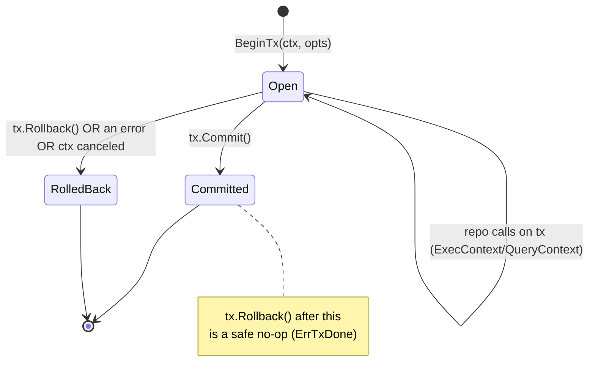
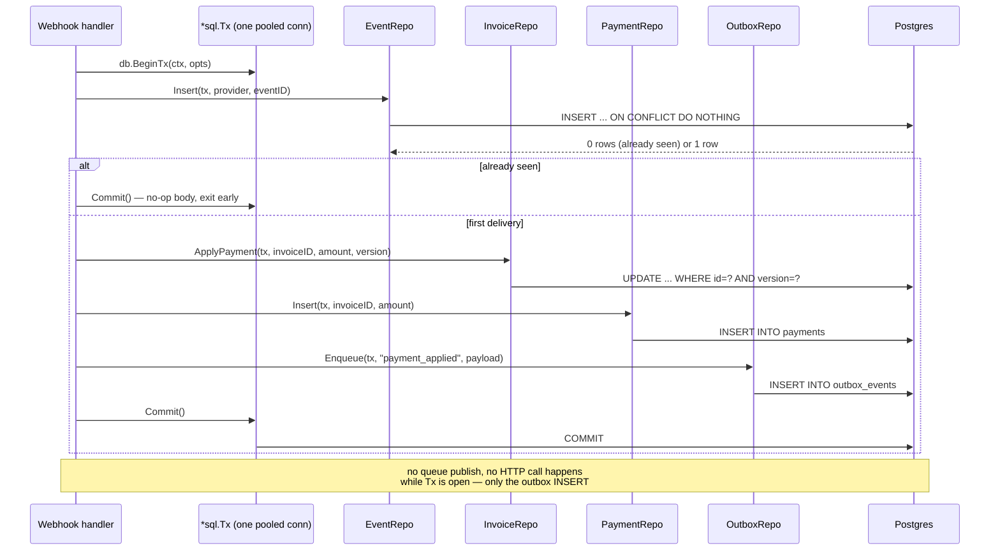
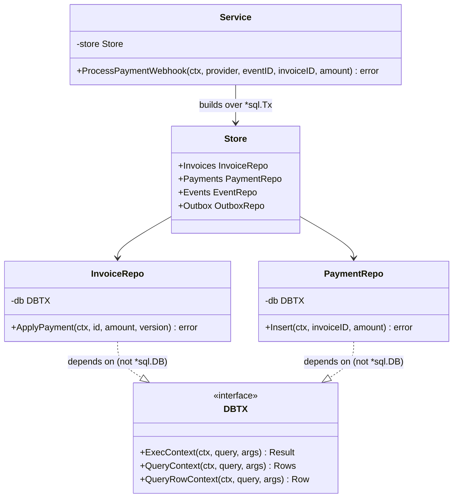
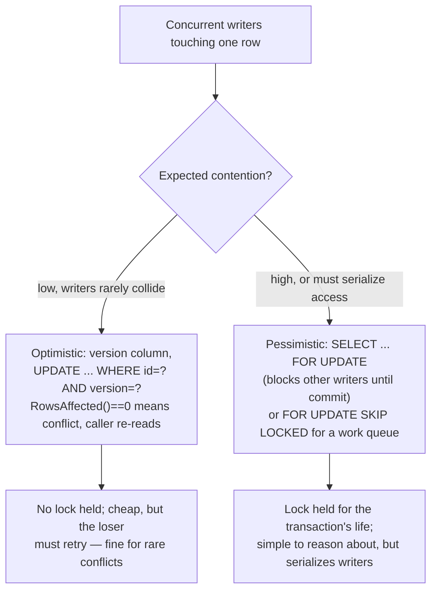

# Transactions and the Repository Pattern

> [!summary] TL;DR
> A database transaction makes a group of writes succeed or fail together. In Go, that means opening one `*sql.Tx` and handing it — not a fresh `*sql.DB` — to every repository call that must share it, then committing once at the end. The repository pattern is how you keep that SQL out of business logic: repositories take an interface both `*sql.DB` and `*sql.Tx` satisfy, so the same repository code runs standalone or inside a shared transaction.

> [!abstract] Core idea
> - `defer tx.Rollback()` right after `BeginTx` is always safe: it is a no-op once `Commit` has already succeeded.
> - A transaction pins one physical connection for its whole life — it is not safe to use from two goroutines at once, and it holds that connection hostage if left open too long.
> - Repositories built on a shared `DBTX` interface (`*sql.DB` and `*sql.Tx` both satisfy it) let one function share a transaction across several repositories without any of them knowing whether they're in one.
> - Never make a network call — a queue publish, an HTTP request — while a transaction is open. Write an outbox row instead, and publish it after commit.
> - Optimistic locking (a version column) and row locks (`SELECT ... FOR UPDATE`) solve the same problem — a concurrent writer — at different costs.

## 1. Why it exists

InvoiceOps processes a payment webhook: record the webhook event, apply the payment amount to the invoice, insert a payment row, and queue a notification — four writes that must all happen or none of them should. If the invoice update succeeds but the payment row insert fails and nobody rolls back the invoice update, the invoice now shows paid with no record of why.

A transaction is Postgres's mechanism for this: `BEGIN`, a sequence of statements, then `COMMIT` or `ROLLBACK`. In Go, `*sql.Tx` represents that open transaction, and because it wraps one borrowed connection from the pool, every statement in it has to go through that same `*sql.Tx` value — not back through `*sql.DB`, which would run on a different, unrelated connection and see none of the uncommitted work.

The repository pattern solves a separate but related problem: without it, the webhook handler ends up full of raw SQL, and that SQL gets copy-pasted into the next handler that also needs an invoice. A repository hides the SQL behind `repo.ApplyPayment(ctx, id, amount)`; the question this note answers is how several repositories agree to share one transaction instead of each opening its own.

## 2. Mental model

A transaction is a **tab you open at a bar**: everything ordered against that tab is provisional until you either `COMMIT` (pay and keep it) or `ROLLBACK` (walk away, nothing happened). `*sql.Tx` is that tab, and it is tied to one specific seat at the bar — one connection. You cannot hand half the tab to someone at another seat and expect it to apply to your order.

The repository pattern is a **job ticket that doesn't care which tab it's billed to**. A repository method takes a `DBTX` — "something that can run a query" — and the caller decides whether that's the bar's shared register (`*sql.DB`, no transaction) or one specific open tab (`*sql.Tx`, inside `WithTx`). The repository's code never changes either way.

## 3. How it works

### The transaction lifecycle



`defer tx.Rollback()` placed immediately after a successful `BeginTx` covers every exit path: an early `return err`, a panic that unwinds through the defer, or simply reaching `tx.Commit()` — at which point the deferred `Rollback` call still runs, finds the transaction already finished, and does nothing.

### Sharing one transaction across repositories



Every repository in this diagram is handed the **same** `*sql.Tx` value, cast through the shared `DBTX` interface. None of them opens its own transaction or its own connection.

### Who depends on whom



Neither `InvoiceRepo` nor `PaymentRepo` imports `*sql.DB` or `*sql.Tx` directly — they depend on the `DBTX` interface, so `Service` is free to construct `Store` over a plain `*sql.DB` for a read-only call or over a `*sql.Tx` inside `WithTx` for a write that must share a transaction, without either repository's code changing.

### `DBTX` and the `WithTx` helper

```go
// DBTX is satisfied by both *sql.DB and *sql.Tx. Every repository is
// built from this interface, not from *sql.DB directly, so the exact
// same repository code runs standalone or inside a shared transaction.
type DBTX interface {
	ExecContext(ctx context.Context, query string, args ...any) (sql.Result, error)
	QueryContext(ctx context.Context, query string, args ...any) (*sql.Rows, error)
	QueryRowContext(ctx context.Context, query string, args ...any) *sql.Row
}

// WithTx runs fn inside a transaction opened with opts. It commits on a
// nil return and rolls back on any error or panic.
func WithTx(ctx context.Context, db *sql.DB, opts *sql.TxOptions, fn func(tx *sql.Tx) error) error {
	tx, err := db.BeginTx(ctx, opts)
	if err != nil {
		return fmt.Errorf("begin tx: %w", err)
	}
	defer tx.Rollback() //nolint:errcheck // no-op after Commit; rolls back on panic/error paths

	if err := fn(tx); err != nil {
		return err
	}
	if err := tx.Commit(); err != nil {
		return fmt.Errorf("commit: %w", err)
	}
	return nil
}
```

A `Store` groups every repository a use case needs and is built from one `DBTX`, so `NewStore(db)` (no transaction) and `NewStore(tx)` (inside `WithTx`) are the same call with a different argument — this is the "unit of work": one object that represents everything a single business operation touches, committed or rolled back as one.

`DBTX` is declared next to the repositories here for brevity, but the idiomatic Go placement is on the consumer side: the package that *calls* a repository defines the narrow interface it actually needs (here, three methods), and the repository's constructor simply accepts that interface — it never imports `*sql.DB` or `*sql.Tx` to declare it. SQL stays inside repositories; the business rule of *which* repositories a use case needs, and whether they share a transaction, stays in the service layer. See [[Interfaces]] for why small, consumer-defined interfaces beat one shared "repository interface" package.

`BeginTx`'s second argument, `*sql.TxOptions`, sets the isolation level (`sql.LevelDefault`, `sql.LevelRepeatableRead`, `sql.LevelSerializable`, ...) and `ReadOnly: true`. A read-only transaction lets Postgres apply some internal optimizations and documents intent, but `database/sql` does not enforce it client-side — a write statement inside a `ReadOnly: true` transaction fails at the server, not at the Go call site.

Three hazards `BeginTx` and `*sql.Tx` carry that are easy to miss:

- **A transaction pins one connection.** Calling `tx.ExecContext` and `tx.QueryContext` from two goroutines at once is a data race on that connection — `*sql.Tx` methods are not safe for concurrent use the way `*sql.DB`'s are.
- **`BeginTx`'s context cancels the whole transaction.** If the `ctx` passed to `BeginTx` is canceled or times out, the transaction is rolled back automatically — even if you never call `Rollback` yourself. A context that outlives the handler (for example, from a background goroutine) is needed for any work meant to outlive the request.
- **`idle_in_transaction_session_timeout`** (Postgres server setting) exists because a transaction left open — forgotten commit, a bug, a hung call — holds its locks and its connection indefinitely. Set it so a leaked transaction is killed by the server, not just hoped away.

### Row locks vs optimistic locking



- **`SELECT ... FOR UPDATE`** locks the selected rows until the transaction ends, so any other transaction's `UPDATE` or `FOR UPDATE` on the same rows blocks until this one commits or rolls back.
- **`FOR UPDATE SKIP LOCKED`** is the shape behind a Postgres-backed work queue: several workers each run `SELECT ... FOR UPDATE SKIP LOCKED LIMIT 1`, and a row already locked by another worker is silently skipped instead of blocking.
- **`FOR UPDATE NOWAIT`** fails immediately with an error instead of blocking, when blocking at all is unacceptable.
- **Optimistic locking** (used in the worked example below) never takes a row lock. It reads a `version` column, then writes with `WHERE id = ? AND version = ?`; if another transaction committed a change in between, `RowsAffected()` comes back `0` and the caller knows to re-read and retry — see [[Locking - Optimistic vs Pessimistic]] for the general trade-off.

### The outbox pattern, and why step 5 cannot be "publish to the queue"

The old note's webhook steps put "enqueue follow-up job or outbox event" inside the transaction, as if a queue publish and an outbox insert were interchangeable. They are not: publishing to Kafka, SQS, or Redis from inside a database transaction is a **dual write** — the message can go out and then the transaction rolls back, or the transaction can commit and the publish call can fail or the process can crash before it runs. Either way, the queue and the database disagree about what happened, and no retry of "just the publish" fixes a case where the whole process died.

The fix is to never call the queue from inside the transaction at all: insert a plain row into an `outbox_events` table, in the same transaction and therefore the same commit, as the business data. A separate relay — a poller, or Postgres logical replication reading the WAL (CDC) — reads unpublished rows after commit and publishes them, marking each row published only once the publish call itself succeeds.

### Retrying on serialization failure

Under `SERIALIZABLE` or `REPEATABLE READ` isolation, Postgres can abort a transaction at commit time with SQLSTATE `40001` (serialization failure) purely because of a conflict with a concurrent transaction — not because anything was wrong with the SQL. `40P01` (deadlock detected) is the analogous case for two transactions waiting on each other's locks. Both are meant to be retried: wrap the whole transaction body in a retry loop with a short backoff, and only retry these two codes — a unique-constraint violation or a syntax error retried in a loop just repeats the same failure forever.

## 4. Worked example

### Whiteboard version

The bare shape of "share one tx, roll back by default, commit once":

```go
err := WithTx(ctx, db, nil, func(tx *sql.Tx) error {
    if err := invoices.ApplyPayment(ctx, tx, id, amount, version); err != nil {
        return err // defer tx.Rollback() undoes the ApplyPayment above
    }
    return payments.Insert(ctx, tx, id, amount)
})
```

The full version below is the tested InvoiceOps payment webhook: idempotent via a unique `(provider, event_id)` constraint, applies payment with optimistic locking, and enqueues an outbox row instead of publishing directly.

> [!info] Why these tests run on SQLite
> Postgres cannot run in this writing environment, so the tests run against an in-memory SQLite database (`modernc.org/sqlite`). The SQL is written to also be valid PostgreSQL 17 aside from placeholder style (`?` here vs `$1, $2, ...`); the retry example's error classifier checks SQLite's "database is locked" text, where production code against Postgres checks SQLSTATE `40001`/`40P01` instead (shown as a comment).

```go
package txrepo

import (
	"context"
	"database/sql"
	"errors"
	"fmt"
	"strings"
	"time"
)

// DBTX is satisfied by both *sql.DB and *sql.Tx. Every repository is
// built from this interface, not from *sql.DB directly, so the exact
// same repository code runs standalone or inside a shared transaction.
type DBTX interface {
	ExecContext(ctx context.Context, query string, args ...any) (sql.Result, error)
	QueryContext(ctx context.Context, query string, args ...any) (*sql.Rows, error)
	QueryRowContext(ctx context.Context, query string, args ...any) *sql.Row
}

// WithTx runs fn inside a transaction opened with opts. It commits on a
// nil return and rolls back on any error or panic.
//
// defer tx.Rollback() is safe to leave in place even after a successful
// Commit: database/sql defines Rollback as a no-op (it returns the
// sentinel sql.ErrTxDone) once the tx is already committed, so the
// deferred call here never undoes a successful commit.
func WithTx(ctx context.Context, db *sql.DB, opts *sql.TxOptions, fn func(tx *sql.Tx) error) error {
	tx, err := db.BeginTx(ctx, opts)
	if err != nil {
		return fmt.Errorf("begin tx: %w", err)
	}
	defer tx.Rollback() //nolint:errcheck // no-op after Commit; rolls back on panic/error paths

	if err := fn(tx); err != nil {
		return err // tx.Rollback() runs via defer
	}
	if err := tx.Commit(); err != nil {
		return fmt.Errorf("commit: %w", err)
	}
	return nil
}

// Store is the unit of work: one *sql.DB (or, mid-transaction, one
// *sql.Tx) shared by every repository that a use case touches. Callers
// never juggle separate repo structs with separate connections.
type Store struct {
	Invoices InvoiceRepo
	Payments PaymentRepo
	Events   EventRepo
	Outbox   OutboxRepo
}

// NewStore builds a Store over any DBTX — a *sql.DB for ordinary reads,
// or a *sql.Tx inside WithTx.
func NewStore(db DBTX) Store {
	return Store{
		Invoices: InvoiceRepo{db: db},
		Payments: PaymentRepo{db: db},
		Events:   EventRepo{db: db},
		Outbox:   OutboxRepo{db: db},
	}
}

type InvoiceRepo struct{ db DBTX }

// ErrVersionConflict means the row changed between read and write:
// optimistic-locking's equivalent of a failed compare-and-swap.
var ErrVersionConflict = errors.New("invoice: version conflict")

// ApplyPayment adds amountCents to paid_cents using a version column
// instead of a row lock: the UPDATE only succeeds if the version still
// matches what the caller last read. If another transaction committed
// first, version has moved on, RowsAffected is 0, and the caller
// retries with a fresh read instead of silently overwriting a change
// it never saw.
func (r InvoiceRepo) ApplyPayment(ctx context.Context, invoiceID int64, amountCents int64, expectVersion int64) error {
	res, err := r.db.ExecContext(ctx, `
		UPDATE invoices
		SET paid_cents = paid_cents + ?,
		    status = CASE WHEN paid_cents + ? >= total_cents THEN 'paid' ELSE status END,
		    version = version + 1
		WHERE id = ? AND version = ?
	`, amountCents, amountCents, invoiceID, expectVersion)
	if err != nil {
		return fmt.Errorf("apply payment: %w", err)
	}
	n, err := res.RowsAffected()
	if err != nil {
		return fmt.Errorf("rows affected: %w", err)
	}
	if n == 0 {
		return ErrVersionConflict
	}
	return nil
}

// CurrentVersion reads the version a caller must pass back to ApplyPayment.
func (r InvoiceRepo) CurrentVersion(ctx context.Context, invoiceID int64) (int64, error) {
	var v int64
	err := r.db.QueryRowContext(ctx, `SELECT version FROM invoices WHERE id = ?`, invoiceID).Scan(&v)
	return v, err
}

type PaymentRepo struct{ db DBTX }

func (r PaymentRepo) Insert(ctx context.Context, invoiceID int64, amountCents int64) error {
	_, err := r.db.ExecContext(ctx, `
		INSERT INTO payments (invoice_id, amount_cents) VALUES (?, ?)
	`, invoiceID, amountCents)
	return err
}

// EventRepo gives webhook processing its idempotency: provider+event_id
// is UNIQUE, so a redelivered webhook hits ON CONFLICT DO NOTHING and
// Insert reports "already seen" instead of erroring.
type EventRepo struct{ db DBTX }

// Insert reports whether this is the first time the event was seen.
func (r EventRepo) Insert(ctx context.Context, provider, eventID string) (firstTime bool, err error) {
	res, err := r.db.ExecContext(ctx, `
		INSERT INTO webhook_events (provider, event_id) VALUES (?, ?)
		ON CONFLICT (provider, event_id) DO NOTHING
	`, provider, eventID)
	if err != nil {
		return false, fmt.Errorf("insert webhook event: %w", err)
	}
	n, err := res.RowsAffected()
	if err != nil {
		return false, fmt.Errorf("rows affected: %w", err)
	}
	return n > 0, nil
}

// OutboxRepo is the only "side effect" allowed inside the transaction.
// No message broker call ever happens while a tx is open — a row goes
// into outbox_events in the same commit as the business data, and a
// separate relay (see PublishPending) reads and publishes it afterward.
// That turns "write to two systems" into "write to one system, twice
// read from it," which is crash-safe.
type OutboxRepo struct{ db DBTX }

func (r OutboxRepo) Enqueue(ctx context.Context, eventType string, payload string) error {
	_, err := r.db.ExecContext(ctx, `
		INSERT INTO outbox_events (event_type, payload, published) VALUES (?, ?, 0)
	`, eventType, payload)
	return err
}

// PublishPending is the relay: it runs outside any business
// transaction, on its own schedule (poller or CDC), and marks rows
// published only after the publish call succeeds.
func (r OutboxRepo) PublishPending(ctx context.Context, publish func(eventType, payload string) error) (int, error) {
	rows, err := r.db.QueryContext(ctx, `SELECT id, event_type, payload FROM outbox_events WHERE published = 0 ORDER BY id`)
	if err != nil {
		return 0, fmt.Errorf("select pending outbox: %w", err)
	}
	type row struct {
		id        int64
		eventType string
		payload   string
	}
	var pending []row
	for rows.Next() {
		var rr row
		if err := rows.Scan(&rr.id, &rr.eventType, &rr.payload); err != nil {
			rows.Close()
			return 0, fmt.Errorf("scan outbox row: %w", err)
		}
		pending = append(pending, rr)
	}
	if err := rows.Err(); err != nil {
		rows.Close()
		return 0, err
	}
	rows.Close()

	published := 0
	for _, rr := range pending {
		if err := publish(rr.eventType, rr.payload); err != nil {
			return published, fmt.Errorf("publish outbox row %d: %w", rr.id, err)
		}
		if _, err := r.db.ExecContext(ctx, `UPDATE outbox_events SET published = 1 WHERE id = ?`, rr.id); err != nil {
			return published, fmt.Errorf("mark outbox row %d published: %w", rr.id, err)
		}
		published++
	}
	return published, nil
}

// ProcessPaymentWebhook is the InvoiceOps use case: one webhook delivery
// becomes one short transaction that (1) de-duplicates by event id,
// (2) applies the payment with optimistic locking, (3) records the
// payment row, and (4) enqueues an outbox event — then returns, letting
// the relay publish after commit.
func ProcessPaymentWebhook(ctx context.Context, db *sql.DB, provider, eventID string, invoiceID, amountCents int64) error {
	return WithTx(ctx, db, &sql.TxOptions{Isolation: sql.LevelDefault}, func(tx *sql.Tx) error {
		store := NewStore(tx)

		first, err := store.Events.Insert(ctx, provider, eventID)
		if err != nil {
			return err
		}
		if !first {
			return nil // already processed this exact webhook delivery; commit the no-op tx and return
		}

		version, err := store.Invoices.CurrentVersion(ctx, invoiceID)
		if err != nil {
			return fmt.Errorf("read invoice version: %w", err)
		}
		if err := store.Invoices.ApplyPayment(ctx, invoiceID, amountCents, version); err != nil {
			return err // includes ErrVersionConflict, handled by RetryTx below
		}
		if err := store.Payments.Insert(ctx, invoiceID, amountCents); err != nil {
			return err
		}
		return store.Outbox.Enqueue(ctx, "invoice.payment_applied", fmt.Sprintf(`{"invoice_id":%d}`, invoiceID))
	})
}

// retryableSQLiteError reports whether SQLite's "database is locked" /
// "database is busy" errors should be retried. On Postgres the
// equivalent check is on the SQLSTATE codes 40001 (serialization
// failure) and 40P01 (deadlock detected), typically read from a
// *pgconn.PgError via errors.As:
//
//	var pgErr *pgconn.PgError
//	if errors.As(err, &pgErr) {
//	    return pgErr.Code == "40001" || pgErr.Code == "40P01"
//	}
func retryableSQLiteError(err error) bool {
	if err == nil {
		return false
	}
	msg := err.Error()
	return strings.Contains(msg, "database is locked") || strings.Contains(msg, "SQLITE_BUSY")
}

// RetryTx retries fn a bounded number of times on a retryable
// error, with a short backoff. Non-retryable errors (ErrVersionConflict
// included, by design — the caller re-reads and decides, it does not
// blindly retry a business conflict) return immediately.
func RetryTx(ctx context.Context, attempts int, isRetryable func(error) bool, fn func() error) error {
	var err error
	for i := 0; i < attempts; i++ {
		err = fn()
		if err == nil {
			return nil
		}
		if !isRetryable(err) {
			return err
		}
		select {
		case <-time.After(time.Duration(i+1) * 5 * time.Millisecond):
		case <-ctx.Done():
			return ctx.Err()
		}
	}
	return fmt.Errorf("gave up after %d attempts: %w", attempts, err)
}
```

Tests (`go test -race`, all passing on Go 1.24 against in-memory SQLite):

- `TestWithTx_CommitsOnSuccess` / `TestWithTx_RollsBackOnError` — proves the commit/rollback contract directly.
- `TestProcessPaymentWebhook_Idempotent` — delivers the same webhook twice and asserts the invoice is only charged once, with exactly one `payments` row and one `outbox_events` row.
- `TestOutbox_PublishPending` — asserts a published row is never republished on a second poll.
- `TestInvoiceRepo_ApplyPayment_VersionConflict` — a stale version returns `ErrVersionConflict` and leaves the row untouched.
- `TestRetryTx_RetriesRetryableThenSucceeds` / `TestRetryTx_StopsOnNonRetryableError` — the retry loop retries a transient error and gives up immediately on a business one.
- `TestConcurrentApplyPayment_OnlyOneWinnerPerVersion` — 8 goroutines race `ApplyPayment` from the same starting version; exactly one wins and the other 7 get `ErrVersionConflict`, proving the version check is a real compare-and-swap under `go test -race`.

## 5. Variants and comparison

| Option | How it works | Use when | Cost |
| --- | --- | --- | --- |
| `DBTX` interface + `WithTx` helper | Repositories take an interface both `*sql.DB`/`*sql.Tx` satisfy; a helper opens/commits/rolls back | The general default for any Go service with more than one repository | A small interface to define once; no magic |
| sqlc's generated `WithTx` | sqlc generates a `Queries` struct with a `WithTx(tx) *Queries` method | Already using sqlc; want the same pattern without hand-writing the interface | Tied to sqlc's generated API shape |
| Service-layer transaction script | The service function itself calls `tx.ExecContext` directly, no repository layer | A very small service, or a single-table CRUD app | SQL and business logic mixed in one function; harder to test or reuse |
| ORM-managed transaction (GORM `.Transaction(...)`) | The ORM opens and manages the transaction, you pass a callback | Already committed to an ORM across the codebase | Less control over isolation level and retry behavior; the ORM's own abstractions leak into error handling |

## 6. Trade-offs and when not to use

- A transaction that spans an entire request, including slow calls to other services, holds one pooled connection — and often row locks — for the whole time. Keep transactions short: only the database writes that must be atomic, nothing else.
- Optimistic locking pushes the retry burden to the caller. For a hot row with constant contention, the version check fails so often that `SELECT ... FOR UPDATE` (serializing writers but succeeding on the first try) can be the simpler, faster choice in practice — measure instead of assuming optimistic is always cheaper.
- The outbox pattern adds a table, a relay process, and eventual consistency between "committed" and "published." For a system that can tolerate an at-least-once publish with no ordering guarantee and doesn't need the commit and the publish to be atomic, publishing directly after commit (accepting the small window where the publish can fail and nothing retries it) is sometimes an acceptable, simpler trade.
- A single-statement write never needs a transaction at all — `*sql.DB` already runs one statement atomically. Wrapping it in `BeginTx`/`Commit` only adds overhead.

## 7. In production

- **Real systems:** the outbox pattern is the standard fix for the dual-write problem in event-driven services (documented extensively by Chris Richardson's microservices.io patterns and implemented via Debezium-style CDC in production Kafka pipelines); sqlc's generated `WithTx` method is the same `DBTX`-interface idea shipped as codegen; payment processors (Stripe's own webhook-handling guidance) specifically recommend a unique event-id constraint for webhook idempotency.
- **Failure modes → fixes:**
  - A goroutine started from inside a transaction's callback and left running after the function returns → the transaction's connection can be reused or closed under it; never let a transaction's lifetime be shorter than a goroutine using it.
  - A network call to a payment gateway placed inside the transaction → classic dual write; move it to an outbox row plus a relay, or call it before `BeginTx` and record the result inside the transaction.
  - Long-running transaction holding a row lock blocks unrelated requests → add `idle_in_transaction_session_timeout` and a statement timeout, and keep transactions to milliseconds where possible.
  - Retrying every database error, including constraint violations, in a loop → check the actual SQLSTATE/error and only retry `40001`/`40P01`-class errors.
- **What to monitor:** transaction duration (p50/p99), `pg_stat_activity.state = 'idle in transaction'` count and age, lock wait time, outbox table backlog (`published = 0` row count and oldest row age), and the ratio of version conflicts to total writes per hot row.

## 8. Deep dive

- **Why `defer tx.Rollback()` is always safe.** `database/sql`'s `Tx.Rollback` is documented to return `sql.ErrTxDone` if the transaction has already been committed or rolled back, rather than erroring or re-rolling-back. The deferred call's return value is simply discarded (hence the `//nolint:errcheck`), which is correct here specifically because that one error value is defined to be harmless.
- **Isolation levels change what "version conflict" even means.** Under Postgres's default `READ COMMITTED`, an `UPDATE ... WHERE version = ?` can still race correctly because each statement sees a fresh snapshot — this is why the optimistic check above works without raising the isolation level. Under `SERIALIZABLE`, Postgres instead detects a much broader class of conflicts automatically and aborts the whole transaction with `40001`, which is why serializable code needs the retry loop even without a manual version column. See [[Isolation Levels and MVCC]] for what each level actually guarantees.
- **`SKIP LOCKED` as a job queue is a distinct technique from both locks shown above.** It does not wait for a lock and does not detect conflict after the fact; it simply excludes already-locked rows from the result set, which is precisely the shape multiple worker processes need to each grab a different pending job without coordinating out-of-band.
- **The unit-of-work pattern versus "just pass `*sql.Tx` everywhere."** `Store` exists so a use-case function writes `store.Invoices.ApplyPayment(...)` instead of threading a raw `*sql.Tx` through every call, and so the exact same function signature works whether or not a transaction is active — a repository method never has an `if tx != nil` branch; it always just has a `DBTX`.
- **Savepoints** (`SAVEPOINT`, `ROLLBACK TO SAVEPOINT`) give a transaction a partial rollback point for isolated recoverable sub-steps — useful when one step in a larger transaction (for example, an optional enrichment call that itself hits the database) is allowed to fail without discarding everything already done. `database/sql` has no direct savepoint API; it requires running the `SAVEPOINT ...` SQL text through the same `*sql.Tx`.

## 9. Interview questions

> [!question]- Why is `defer tx.Rollback()` placed right after `BeginTx`, not after the last statement?
> So it covers every exit path — an early `return err`, a panic, or reaching `Commit()` successfully — with one line. It is safe after a successful commit because `Tx.Rollback` is documented to return `sql.ErrTxDone` (a no-op signal) once the transaction is already finished, rather than erroring or undoing the commit.

> [!question]- Why can't two repositories each open their own transaction and expect to see each other's uncommitted writes?
> A transaction is tied to one specific borrowed connection, and Postgres's default isolation (`READ COMMITTED`) only lets a transaction see *committed* data from other transactions. Two separate `BeginTx` calls are two separate transactions on two separate connections; neither sees the other's writes until one of them commits — which defeats the point of doing them together. They must share the same `*sql.Tx`.

> [!question]- Trap: a webhook handler inserts a payment row, updates the invoice, and publishes a "payment applied" event to Kafka — all inside one `BeginTx`/`Commit` block. What's wrong?
> The Kafka publish is a network call made while a database transaction is open: a dual write. If the publish succeeds and the transaction then rolls back, a message went out for something that never happened. If the transaction commits and the process crashes before the publish runs, the event is lost with no way to know it was missed. The fix is the outbox pattern: insert an outbox row in the same transaction, and publish it afterward from a separate relay.

> [!question]- What's the difference between optimistic locking and `SELECT ... FOR UPDATE`, and when would you pick one over the other?
> Optimistic locking (a version column, `UPDATE ... WHERE id=? AND version=?`) takes no lock; a conflicting concurrent write is detected after the fact via `RowsAffected() == 0`, and the loser retries. `SELECT ... FOR UPDATE` takes a real row lock for the transaction's duration, so a conflicting writer simply blocks until the first one commits. Optimistic locking is cheaper under low contention; row locks are simpler to reason about and avoid wasted retries under high contention on the same row.

> [!question]- What does SQLSTATE `40001` mean, and what should a Go service do when it sees it?
> It is Postgres's "serialization failure" code: under `SERIALIZABLE` (or sometimes `REPEATABLE READ`) isolation, the database itself detected that this transaction's view of the data conflicted with a concurrently committed transaction, and aborted it — not because of a bug in the SQL. The service should retry the entire transaction from the start, typically with a short backoff, the same way it would retry `40P01` (deadlock detected).

> [!question]- Why does a repository take a `DBTX` interface instead of a concrete `*sql.DB`?
> Because `*sql.Tx` has the same `ExecContext`/`QueryContext`/`QueryRowContext` method set as `*sql.DB` but is not the same type, and a repository needs to run identically whether it's operating standalone or inside someone else's shared transaction. Defining a small interface both types satisfy lets the caller decide which one to pass without the repository code changing at all.

> [!question]- Trap: your retry loop around a transaction retries on *any* error it gets back. What goes wrong, and how do you fix it?
> A non-transient error — a unique constraint violation, a foreign key violation, a syntax error, this note's own `ErrVersionConflict` business conflict — will fail identically on every retry, so the loop just burns attempts and delays the real response. Classify errors first: only retry Postgres SQLSTATE `40001`/`40P01` (or, in this note's SQLite test environment, "database is locked"/"database is busy"), and return everything else immediately.

## 10. Cheat sheet

- `defer tx.Rollback()` immediately after `BeginTx`; it's a safe no-op after a successful `Commit`.
- A transaction pins one connection: don't use it from two goroutines, and don't hold it open across a slow or external call.
- Repositories take a `DBTX` interface (`*sql.DB` and `*sql.Tx` both satisfy it) so the same code runs with or without a shared transaction.
- Never call a queue, cache invalidation, or external API while a transaction is open — write an outbox row instead and publish after commit.
- Optimistic locking: `UPDATE ... WHERE id=? AND version=?`, `RowsAffected()==0` means conflict, caller re-reads and retries.
- `SELECT ... FOR UPDATE` locks rows until commit; `... SKIP LOCKED` turns that into a job-queue pattern; `... NOWAIT` fails fast instead of blocking.
- Retry only SQLSTATE `40001` (serialization failure) and `40P01` (deadlock) — never retry a business error like a conflict or a constraint violation.
- A unique constraint on `(provider, event_id)` with `ON CONFLICT DO NOTHING` is the simplest correct webhook idempotency check.

## Links

- **Before this:** [[Database Access (database-sql, pgx, sqlc)]], [[Transactions and ACID]]
- **Next:** [[Schema Migrations in Go Services]], [[Testing Go Services]]
- **Compare with:** [[Isolation Levels and MVCC]] (what READ COMMITTED vs SERIALIZABLE actually guarantee), [[Locking - Optimistic vs Pessimistic]] (the general trade-off), [[Interfaces]] (consumer-side interfaces like `DBTX`)
