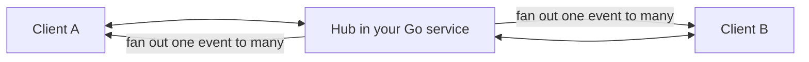
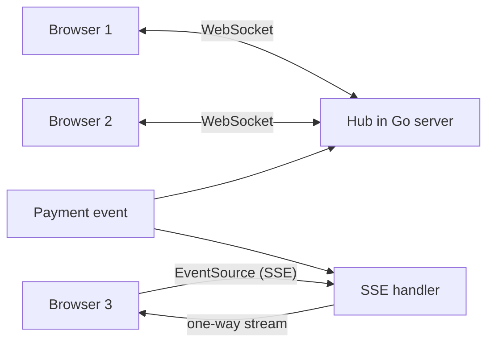
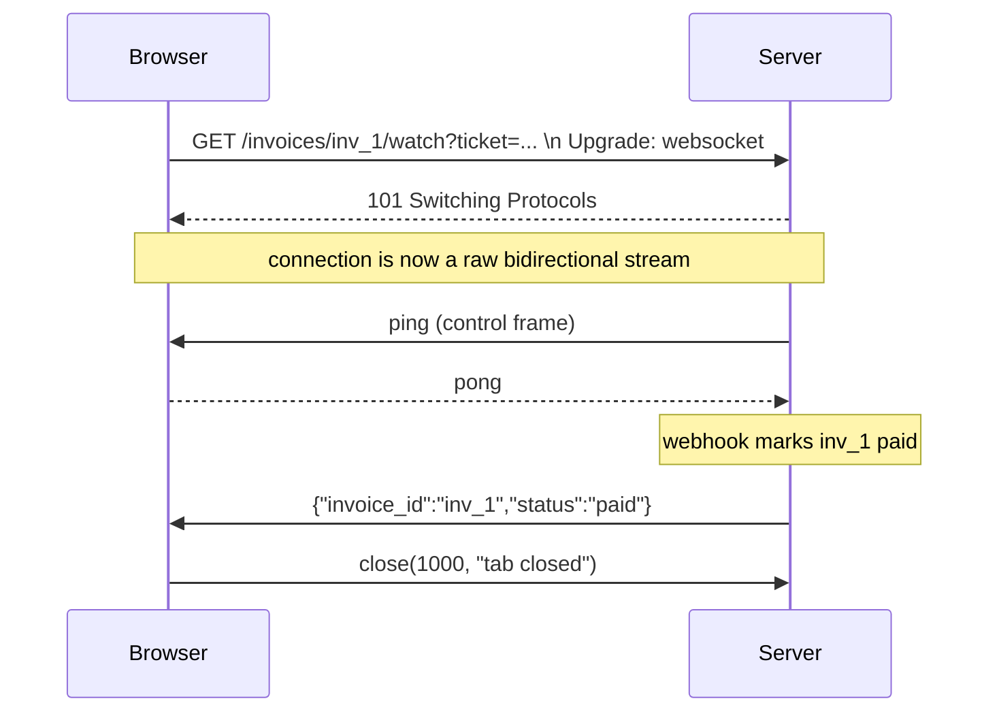
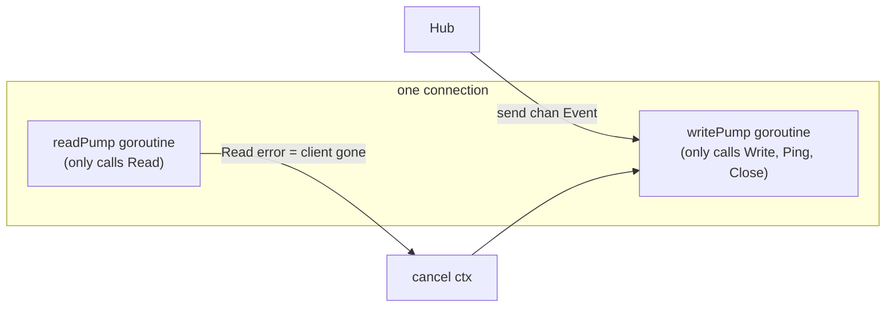
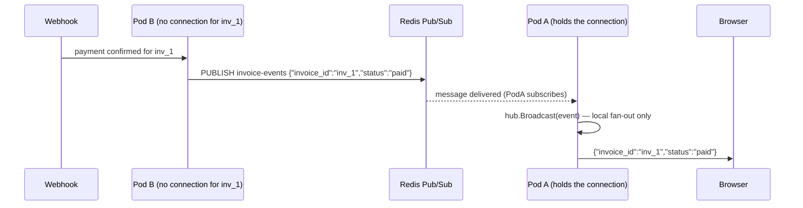

# WebSockets and SSE in Go

> [!summary] TL;DR
> A WebSocket is one long-lived, bidirectional TCP connection per client, upgraded from an HTTP request; a Go service that wants to push updates to many clients needs exactly one goroutine reading and one writing per connection, and a **hub** that fans events out to the right connections without blocking on slow ones.
>
> Server-Sent Events (SSE) is the one-way alternative: plain HTTP, a response that never ends, and the browser's `EventSource` handles reconnection for you.

> [!abstract] Core idea
> - A WebSocket starts as a normal HTTP request (`GET` with `Upgrade: websocket`) and becomes a raw, full-duplex TCP stream once accepted — HTTP's request/response model stops applying after that.
> - Exactly one goroutine may read a connection and exactly one may write it at a time; a **hub** (register/unregister/broadcast over channels) owns the set of connections and talks to each one through a per-client buffered channel, so no connection's write blocks another's.
> - Liveness is `ping`/`pong`: the server (or client) sends a ping control frame, expects a pong within a deadline, and closes the connection if it doesn't arrive — this is how a dead TCP connection with no FIN packet gets noticed.
> - SSE needs none of this: it's one `http.Flusher`-driven response stream, auto-reconnecting `EventSource` on the client, and a `Last-Event-ID` header for resuming after a drop.
> - Browsers cannot set an `Authorization` header on a WebSocket handshake or an `EventSource` request — auth goes through a cookie or a short-lived, single-use ticket fetched over a normal authenticated REST call first.

## Start here: the basics 🟢

> [!info] How to read this note (pick your level)
> - 🟢 **New to this?** Read "From zero" below, then sections 1, 2 and the cheat sheet (10). Stop there, that is a full first pass.
> - 🟡 **Know the basics?** Add section 3 (how it works), 4 (worked example) and 5-6.
> - 🔴 **Interview / SDE-3 prep?** Add 7, 8 and 9. Headings are tagged 🟢🟡🔴 so you always know where you are.

> [!note] Before this note
> - [[HTTP Server Fundamentals (net-http)]]: a Go handler gets a request and writes a response; each connection runs on its own goroutine.
> - [[Middleware]]: auth and logging wrap handlers before they run, including the WebSocket upgrade handler.
> - [[Real-time APIs - WebSocket, SSE and Long Polling]]: the three ways a server can push updates, and when each fits.

**From zero, in 60 seconds** 🟢

Normal HTTP is ask-then-answer: the server can never speak first. But a chat app or a live dashboard needs the server to push.

A **WebSocket** is an HTTP request that upgrades into an open two-way phone line that stays connected. **SSE** (Server-Sent Events) is the simpler cousin: a one-way line where only the server talks, over plain HTTP.



In Go, each connection gets exactly two goroutines — one reading, one writing — and a **hub** in the middle decides which event goes to which connections, without letting one slow client jam everyone.

The rest of this note is just these 4 questions:
1. How does the upgrade work, and who may connect (origin checks)?
2. Why one reader and one writer goroutine per connection?
3. How does the hub fan out without blocking on slow clients?
4. When is SSE the better, simpler answer?

**The problem in one story.**
You open a page showing an invoice as "pending".
When the payment lands, you want the page to flip to "paid" by itself, without refreshing.
Normal HTTP only answers when the browser asks.
WebSockets and SSE keep a connection open so the server can push updates.

**Words you need first**

| Word | Plain meaning | Tiny example |
| --- | --- | --- |
| HTTP request/response | Browser asks once, server answers once, done | `GET /invoices/42` |
| Push | Server sends data without being asked | "invoice 42 is now paid" |
| WebSocket | An HTTP request upgraded into a two-way open pipe | Chat messages both ways |
| SSE (Server-Sent Events) | A long HTTP response the server keeps writing to | Live price ticker |
| Goroutine | A cheap Go function running concurrently | `go readPump(conn)` |
| Channel | A Go pipe for passing values between goroutines | `send chan []byte` |
| Ping/pong | Tiny "are you alive?" messages | Close if no pong in 60s |
| Hub | One goroutine that tracks all connected clients | Broadcasts to everyone watching invoice 42 |

| Upgrade | Turning one HTTP request into a WebSocket connection | `101 Switching Protocols` |
| Origin check | Making sure the page opening the socket is from your own site | reject `evil.example` |
| Slow consumer | A client that reads too slowly to keep up | its mailbox fills, so it is dropped |
| Fan-out | Sending one event to many listeners, even across servers | Redis Pub/Sub to every pod |

**Picture it**



**Analogy.** A WebSocket is a phone call: both sides can talk any time. SSE is a radio broadcast: you just listen.
Where it breaks: a phone call notices hang-ups, but a dead TCP connection can stay "open" silently, which is why ping/pong exists.

**How the rest of this note builds up**

- First, why polling falls short (section 1) and the hub mental model (section 2).
- Then the handshake, auth, origin checks, read/write pumps and ping/pong (section 3).
- Then multi-pod fan-out, load balancer timeouts, shutdown, capacity and SSE (section 3), and the full worked example (section 4).
- Finally the SDE-3 deep dive: slow consumers, compression, proxies and scale limits (sections 5-8).

> [!tip] Remember
> WebSocket for two-way talk, SSE for one-way updates; one reader and one writer per connection, and pings to detect the dead.

## 1. Why it exists 🟢

InvoiceOps' billing dashboard shows an invoice's status live: `pending → paid` the moment a webhook confirms payment (see [[Receiving Webhooks Idempotently]]), with no page reload and no 2-second polling loop hammering the API.

Polling every 2 seconds from 10,000 open dashboard tabs is 5,000 requests per second that are almost always "nothing changed" — wasted connections, wasted database reads, and still up to 2 seconds of lag on the one request that *did* change something.

A WebSocket (or SSE) connection flips this: the server pushes exactly one message, exactly when the status actually changes, to exactly the clients watching that invoice.

The cost is holding one long-lived connection open per client instead of reusing a connection pool for one request at a time — which is precisely the cost that makes a naive implementation fall over past a few thousand concurrent users if nothing manages the connections deliberately.

### A real-life example 🟢

On Zomato's order-tracking screen, the rider's position and "order picked up" appear without you refreshing. The app keeps one connection open, and the server pushes each update down it. If your phone goes into a tunnel, the connection drops and the app reconnects, asking for anything it missed. Since only the server talks in that screen, a one-way stream like SSE is enough; a chat with the rider needs two-way WebSockets.

## 2. Mental model 🟢

An HTTP request/response is a brief conversation: ask, answer, hang up. A WebSocket is a phone call that stays open: after the initial handshake, either side can speak at any time, and the line stays connected until someone hangs up.

A **hub** is the switchboard operator for all those open calls.

It doesn't talk on any one line itself — it just knows which caller is on which line, and when told "tell everyone watching invoice 42," it hands that message to each of their lines.

If someone's line is tied up (their reader is slow, their network is bad), the operator doesn't wait on them — a slow caller gets disconnected instead of putting the whole switchboard on hold.

SSE is a one-way phone call where only the server talks: the browser's `EventSource` just keeps a line open and listens, and if the call drops, it calls back on its own.

### Whiteboard version

**In plain words:** one upgraded connection with its two pumps, minimal.



## 3. How it works 🟡

🟢 → 🟡 You now know the shapes: an open two-way pipe (WebSocket) or a never-ending response (SSE), with a hub that knows who is listening. Next we open the box: the upgrade and auth, the two pump goroutines, per-client mailboxes, keep-alive pings, the hub, scaling across servers, shutdown and SSE.

### Handshake, upgrade and auth

The browser's `new WebSocket(url)` sends a `GET` with `Connection: Upgrade`, `Upgrade: websocket`, and a `Sec-WebSocket-Key`; a successful server responds `101 Switching Protocols` with the matching `Sec-WebSocket-Accept`, and the TCP connection is now a WebSocket, not HTTP.

Crucially, the browser's `WebSocket` constructor **cannot set custom headers**, so an `Authorization: Bearer ...` header is not available at handshake time. Two real options:

1. **A cookie**, if the WebSocket's origin matches the API's and the session is cookie-based — the browser attaches cookies to the handshake request automatically.
2. **A short-lived, single-use ticket**: the page calls a normal authenticated REST endpoint first (`POST /tickets`, protected by the usual session or bearer auth), gets back a ticket good for a few seconds, and opens the WebSocket as `GET /invoices/42/watch?ticket=abc123`.
   - The ticket is consumed on first use, so it is useless even if it leaks into an access log or a browser history entry.

### Origin checks and cross-site WebSocket hijacking

Without an origin check, any page on any origin can run `new WebSocket("wss://api.example.com/watch")` from the victim's browser, and if auth is cookie-based, that connection rides the victim's session cookie exactly like a CSRF attack rides it on a plain HTTP request — this is **cross-site WebSocket hijacking**.

`coder/websocket`'s `Accept` rejects a cross-origin handshake by default (only the same host is accepted) and takes an `OriginPatterns` allowlist of extra origins to permit; setting `InsecureSkipVerify: true`, the library's explicit escape hatch, disables the check entirely — never do that if the handshake auth is a cookie.

`gorilla/websocket` works the same way through `Upgrader.CheckOrigin`: the default accepts only same-origin requests, and a `CheckOrigin` that returns `true` is the classic hijacking bug.

### readPump/writePump goroutines; the single-writer rule

**In plain words:** two workers per phone line — one only listens, one only speaks — because the connection breaks if two goroutines write at once.

**Step by step:**
1. After the upgrade, start `readPump` and `writePump` goroutines for this client.
2. `readPump` only reads messages and pongs; on error it unregisters the client.
3. `writePump` is the only goroutine that writes: it sends messages from the client's `send` channel and pings on a timer.
4. Nobody else writes to the connection, so two writes never collide.

Every WebSocket library — `coder/websocket` and `gorilla/websocket` alike — allows **exactly one goroutine to read and one to write at a time** per connection. Two goroutines calling `Write` concurrently corrupt the frame stream (interleaved bytes from two messages look like one malformed message to the other side). The standard shape is two goroutines per connection:



`readPump` exists even for a read-only client (InvoiceOps' dashboard never sends anything but close frames) because `Read` is also how you notice the client disconnected, and how the read deadline gets enforced.

### A buffered send channel per client; a slow-consumer policy

**In plain words:** each client gets a small mailbox; if the mailbox is full the client is too slow, and you drop them rather than let them stall the hub.

**Step by step:**
1. Each client has `send := make(chan []byte, 16)`.
2. The hub tries to put an event in it without waiting.
3. If the mailbox is full, the client is too slow: close it and remove it.
4. Everyone else keeps getting updates on time.

The hub never calls `conn.Write` itself — it hands an event to the client's buffered `chan Event`, and only that client's `writePump` goroutine reads from it and writes to the socket.

If the channel is full (the client's `writePump` is stuck — a slow network, a browser tab that's been backgrounded and throttled), the hub does not block: it drops that one client with a policy close frame instead of stalling every other client waiting behind it in the same broadcast loop.

### Ping/pong, read deadlines and a pong handler; write deadlines; SetReadLimit

`coder/websocket`'s API is **context-based**, not deadline-based: `conn.Read(ctx)` and `conn.Write(ctx, ...)` take a `context.Context`, and a `context.WithTimeout` around each call is the read/write deadline.

There is no separate "pong handler" to register — incoming pings are answered automatically, and the server's own liveness probe is calling `conn.Ping(ctx)`, which blocks until the matching pong arrives or `ctx` expires.

Control frames are only processed while some goroutine is inside `conn.Read`, so a connection with a ping loop must also have a read loop running, even if the client never sends data.

Also note that when the context passed to `Read` or `Write` expires, `coder/websocket` closes the whole connection: a per-read timeout is not an idle timer. Liveness therefore comes from the failing `Ping`, not from a short `Read` timeout.

`conn.SetReadLimit(n)` caps a single message's size so one client can't force unbounded memory growth with a giant frame.

### Hub pattern (register/unregister/broadcast) vs a mutex-protected map

**In plain words:** the hub is a switchboard goroutine that owns the client list, so joins, leaves and broadcasts never race.

**Step by step:**
1. A new client sends itself on the `register` channel; the hub adds it to its map.
2. A closing client sends itself on `unregister`; the hub removes it.
3. "invoice 42 paid" arrives on `broadcast`; the hub sends it to clients watching invoice 42.
4. Only the hub goroutine touches the map, so there are no races.

A `sync.Mutex`-guarded `map[string]*Client` works, but every register, unregister and broadcast then competes for the same lock, and it's easy to hold the lock while writing to a socket (blocking every other map access on a slow network write).

Routing all three operations through channels into one hub goroutine (the actor pattern) keeps the "who is connected" state single-threaded by construction — only the loop in `Hub.Run` ever mutates the map — and the small mutex in the code below exists only so other goroutines (`Shutdown`, the SSE subscribe calls, tests) can read or add to that state safely.

### Multi-instance fan-out via Redis Pub/Sub or NATS; presence

With more than one pod, a client watching invoice 42 might be connected to pod A while the webhook that marks it paid lands on pod B.

Pod B's hub has no in-memory connection to push to — it must publish `{"invoice_id":"42","status":"paid"}` to a shared channel (Redis Pub/Sub, or NATS) that every pod subscribes to, and each pod's hub re-broadcasts to its own local connections only.



Presence (which invoice each pod currently has watchers for) is the same problem in reverse: a pod can publish "watching inv_1" / "stopped watching inv_1" to the bus, or subscribe to everything and filter locally, trading message volume for simplicity.

### LB idle timeouts vs ping interval

A load balancer silently drops idle TCP connections after its own timeout — an AWS Application Load Balancer defaults to 60 seconds.

A WebSocket with no traffic for a minute looks idle to the LB even though both ends think it's fine, and the LB's drop often isn't a clean close frame — the next write just fails.

The fix is to **ping more often than the LB's idle timeout**: a 30-second ping interval keeps traffic flowing well inside a 60-second LB timeout.

### Shutdown: close frames, reconnection, resuming

`http.Server.Shutdown` waits for active handlers to return and stops accepting new connections — but a WebSocket connection is **hijacked** out of `net/http`'s bookkeeping once `Accept` succeeds, so `Shutdown` does not know about it and will not wait for it or close it (see [[Graceful Shutdown and Health Checks]]).

On `SIGTERM`, the service must walk its own hub and send a `1001` ("going away") close frame to every connection itself, so the browser's `onclose` fires with a code that means "reconnect," rather than the browser seeing a reset connection and guessing.

The client then reconnects elsewhere with backoff and jitter (see [[Timeouts, Retries and Backoff]]) and, for SSE, resumes from `Last-Event-ID`.

### Capacity: connections, fd limits, 1M-connection libraries

Each connection costs at minimum two goroutines (read + write pumps) plus their stacks, plus the per-client send buffer, plus one file descriptor.

At a few KB of goroutine stack each, 100,000 connections is a few hundred MB just in pump goroutines — real, but survivable on a modern pod.

Past roughly a million connections per host, the OS file-descriptor limit and epoll/kqueue scheduling overhead dominate, which is why extreme-scale WebSocket fleets (chat platforms, trading venues) often use an event-loop-per-core design closer to nginx's rather than a goroutine pair per connection.

In Go that means epoll-based libraries such as `gobwas/ws` with a poller, or `lesismal/nbio`, which park idle connections in the kernel instead of holding two goroutine stacks each; reach for them only after measuring.

Raise the file-descriptor limit (`ulimit -n`, the container `nofile` limit) well above the expected connection count.

### SSE for one-way updates

**In plain words:** when the server only pushes and never listens, a never-ending plain HTTP response does the job and the browser even reconnects by itself.

**Step by step:**
1. The handler sets `Content-Type: text/event-stream` and keeps the response open.
2. For each event it writes `id: 17` and `data: {...}` lines, then flushes.
3. If the connection drops, the browser reconnects and sends `Last-Event-ID: 17`.
4. The server replays events after 17, then continues live.

SSE is `Content-Type: text/event-stream`, a response that's flushed after every event instead of ending, and a wire format the browser's `EventSource` parses itself:

```text
id: 42
data: {"invoice_id":"inv_1","status":"paid"}

```

Each event is `data: ...` lines (JSON on one line here) ending in a blank line; an optional `id:` line lets `EventSource` remember where it got to and resend it as the `Last-Event-ID` request header on reconnect, so a replay handler can skip events the client already saw.

`EventSource` reconnects automatically on any drop — the server doesn't implement reconnection logic at all, only replay.

Go's `net/http` handler needs `http.ResponseController.Flush()` (Go 1.20+) after every event; without it, the response sits in a buffer and the browser sees nothing until the handler returns (which, for a stream meant to run for minutes, defeats the entire point).

`http.ResponseController` reaches `Flush` (and `SetWriteDeadline`) through any middleware wrapping the `ResponseWriter`, which a direct type assertion to `http.Flusher` would break the moment something wraps it. A wrapper must implement `Unwrap() http.ResponseWriter` for this to work; without it `Flush` returns `http.ErrNotSupported`.

The server's `WriteTimeout` also applies to a never-ending stream, so call `rc.SetWriteDeadline(time.Time{})` (or extend it per event) on SSE routes.

Send a comment line (`: keepalive`) every 15-30 seconds so proxies and load balancers do not close the stream as idle; `EventSource` ignores lines starting with `:`.

### Tests with httptest and a client library; goroutine-leak tests

`httptest.NewServer` plus the real `coder/websocket` client (`websocket.Dial`) exercises the full accept → hub → broadcast → read path over a real TCP loopback connection — not a hand-rolled fake.

A connection that should have closed but didn't leaves its pump goroutines running; `go test -race` won't catch that on its own, so production test suites for this code typically add `goleak.VerifyNone(t)` at the end of each test (not shown below, to keep this module's only dependency `coder/websocket`) to fail loudly on a leaked pump goroutine.

## 4. Worked example 🟡

### Whiteboard version

The bare mechanism: accept, one event, one message back.

```go
conn, err := websocket.Accept(w, r, nil)
if err != nil {
    return
}
defer conn.CloseNow()
_ = conn.Write(r.Context(), websocket.MessageText, []byte(`{"status":"paid"}`))
```

The full version below adds the hub, ticket auth, origin checks, ping/pong, slow-consumer handling, shutdown, and SSE — tested on Go 1.24 with `coder/websocket v1.8.12`.

**Events and the hub's connection bookkeeping:**

```go
// Event is one status-change notification, e.g. {"invoice_id":"inv_1","status":"paid"}.
type Event struct {
	InvoiceID string `json:"invoice_id"`
	Status    string `json:"status"`
}

// client is one accepted connection. send is the per-client outbound
// buffer: the hub never blocks on a slow client, and never writes to the
// connection itself (only writePump does, to keep a single writer goroutine
// per connection, which the coder/websocket docs require).
type client struct {
	conn      *websocket.Conn
	invoiceID string
	send      chan Event
}

// Hub owns the set of connected clients, keyed by which invoice they watch.
// Register, unregister and broadcast all go through channels into one Run
// goroutine (the actor loop). The mutex is still needed because Shutdown,
// the SSE subscribe calls and tests touch the same maps from other goroutines.
type Hub struct {
	register   chan *client
	unregister chan *client
	broadcast  chan Event

	mu      sync.Mutex // guards clients and sseSubs
	clients map[string]map[*client]bool
	sseSubs map[string]map[chan Event]bool
}

func NewHub() *Hub {
	return &Hub{
		register:   make(chan *client),
		unregister: make(chan *client),
		broadcast:  make(chan Event),
		clients:    make(map[string]map[*client]bool),
		sseSubs:    make(map[string]map[chan Event]bool),
	}
}

// subscribeSSE registers a buffered channel for SSEHandler to read from. SSE
// subscribers bypass register/unregister (they are not WebSocket clients) but
// share the broadcast fan-out and the same mutex.
func (h *Hub) subscribeSSE(invoiceID string) chan Event {
	ch := make(chan Event, 16)
	h.mu.Lock()
	if h.sseSubs[invoiceID] == nil {
		h.sseSubs[invoiceID] = make(map[chan Event]bool)
	}
	h.sseSubs[invoiceID][ch] = true
	h.mu.Unlock()
	return ch
}

func (h *Hub) unsubscribeSSE(invoiceID string, ch chan Event) {
	h.mu.Lock()
	defer h.mu.Unlock()
	if set, ok := h.sseSubs[invoiceID]; ok {
		if _, ok := set[ch]; ok {
			delete(set, ch)
			close(ch)
			if len(set) == 0 {
				delete(h.sseSubs, invoiceID)
			}
		}
	}
}

// Run drives the hub until ctx is cancelled. Call it once, in its own goroutine.
func (h *Hub) Run(ctx context.Context) {
	for {
		select {
		case <-ctx.Done():
			return
		case c := <-h.register:
			h.mu.Lock()
			if h.clients[c.invoiceID] == nil {
				h.clients[c.invoiceID] = make(map[*client]bool)
			}
			h.clients[c.invoiceID][c] = true
			h.mu.Unlock()
		case c := <-h.unregister:
			h.mu.Lock()
			h.removeLocked(c)
			h.mu.Unlock()
		case ev := <-h.broadcast:
			h.mu.Lock()
			for c := range h.clients[ev.InvoiceID] {
				select {
				case c.send <- ev:
				default:
					// Slow-consumer policy: drop the client instead of
					// blocking the hub or growing its buffer without end.
					// Closing the conn (in a goroutine, since Close waits
					// for the peer's close frame) also ends readPump.
					h.removeLocked(c)
					go c.conn.Close(websocket.StatusPolicyViolation, "slow consumer")
				}
			}
			for ch := range h.sseSubs[ev.InvoiceID] {
				select {
				case ch <- ev:
				default: // same policy: a stalled SSE reader does not block the hub
				}
			}
			h.mu.Unlock()
		}
	}
}

// Broadcast is safe to call from any goroutine, e.g. an HTTP handler or a
// Redis Pub/Sub subscriber on another pod's event.
// It blocks until Run receives the event, so Run must be running.
func (h *Hub) Broadcast(ev Event) { h.broadcast <- ev }

// removeLocked drops c from the hub and closes its send channel exactly once
// (a second call finds nothing and returns). The caller must hold h.mu.
func (h *Hub) removeLocked(c *client) {
	set, ok := h.clients[c.invoiceID]
	if !ok {
		return
	}
	if _, ok := set[c]; !ok {
		return
	}
	delete(set, c)
	close(c.send)
	if len(set) == 0 {
		delete(h.clients, c.invoiceID)
	}
}
```

**readPump / writePump, ping and the single-writer rule:**

```go
// clientConfig bundles the tunables the pumps need, so tests can shrink them.
type clientConfig struct {
	pingInterval time.Duration // keep well under the load balancer's idle timeout
	sendBuffer   int
	maxMessage   int64
}

func defaultClientConfig() clientConfig {
	return clientConfig{pingInterval: 30 * time.Second, sendBuffer: 16, maxMessage: 8 * 1024}
}

// ServeClient accepts one WebSocket connection, registers it with the hub,
// and blocks until the connection closes. Call it from an http.HandlerFunc.
func ServeClient(ctx context.Context, hub *Hub, conn *websocket.Conn, invoiceID string, cfg clientConfig) {
	conn.SetReadLimit(cfg.maxMessage)
	c := &client{conn: conn, invoiceID: invoiceID, send: make(chan Event, cfg.sendBuffer)}

	hub.register <- c
	defer func() {
		select {
		case hub.unregister <- c:
		case <-time.After(time.Second):
		}
	}()

	// readPump's exit (browser closed, read deadline hit, protocol error)
	// must also stop writePump, so wrap ctx and cancel it when readPump
	// returns; otherwise writePump would keep pinging a dead connection
	// until its own ctx (the request context) ends.
	pumpCtx, cancelPumps := context.WithCancel(ctx)
	defer cancelPumps()

	done := make(chan struct{})
	go func() {
		defer close(done)
		defer cancelPumps()
		readPump(pumpCtx, conn)
	}()
	writePump(pumpCtx, conn, c, cfg)
	<-done
}

// readPump is the one goroutine allowed to call conn.Read. InvoiceOps
// clients are read-only (status pushes only), so this pump exists to:
//  1. detect the browser closing the tab (Read returns an error), and
//  2. keep control frames flowing: coder/websocket answers the browser's
//     pings and delivers pongs for our Ping only while a Read is active.
//
// It deliberately uses no per-read timeout: an expired Read context closes
// the connection, and a read-only client legitimately sends nothing for
// minutes. Half-open connections are caught by writePump's failing Ping.
// coder/websocket has no separate "pong handler" to register, unlike
// gorilla/websocket.
func readPump(ctx context.Context, conn *websocket.Conn) {
	for {
		if _, _, err := conn.Read(ctx); err != nil {
			return // browser closed, ctx cancelled, or a protocol error
		}
	}
}

// writePump is the only goroutine allowed to call conn.Write or conn.Ping;
// coder/websocket's docs require exactly one concurrent reader and one
// concurrent writer per connection, same rule as gorilla/websocket.
func writePump(ctx context.Context, conn *websocket.Conn, c *client, cfg clientConfig) {
	ticker := time.NewTicker(cfg.pingInterval)
	defer ticker.Stop()
	for {
		select {
		case <-ctx.Done():
			_ = conn.Close(websocket.StatusGoingAway, "server shutting down")
			return
		case ev, ok := <-c.send:
			if !ok { // hub closed send: this client was unregistered
				_ = conn.Close(websocket.StatusNormalClosure, "")
				return
			}
			wctx, cancel := context.WithTimeout(ctx, 5*time.Second)
			err := wsjson.Write(wctx, conn, ev)
			cancel()
			if err != nil {
				return
			}
		case <-ticker.C:
			pctx, cancel := context.WithTimeout(ctx, 5*time.Second)
			err := conn.Ping(pctx) // blocks until the pong arrives or pctx expires
			cancel()
			if err != nil {
				slog.Warn("ws ping failed, closing", "err", err)
				return
			}
		}
	}
}
```

**The HTTP handler: ticket auth, origin allowlist, and shutdown:**

```go
// TicketStore issues and consumes one-time, short-lived tickets so the
// browser's WebSocket client (which cannot set an Authorization header)
// can still authenticate.
type TicketStore interface {
	Consume(ticket string) (userID string, ok bool)
}

func WSHandler(hub *Hub, tickets TicketStore, originPatterns []string) http.HandlerFunc {
	return func(w http.ResponseWriter, r *http.Request) {
		ticket := r.URL.Query().Get("ticket")
		if ticket == "" {
			http.Error(w, "missing ticket", http.StatusUnauthorized)
			return
		}
		if _, ok := tickets.Consume(ticket); !ok {
			http.Error(w, "invalid or expired ticket", http.StatusUnauthorized)
			return
		}
		invoiceID := r.PathValue("id")

		conn, err := websocket.Accept(w, r, &websocket.AcceptOptions{
			// Cross-site WebSocket hijacking: without this, any page on any
			// origin can open a WebSocket here and ride the browser's cookies.
			OriginPatterns: originPatterns,
		})
		if err != nil {
			return // Accept already wrote the HTTP error response
		}

		ctx, cancel := context.WithCancel(r.Context())
		defer cancel()
		ServeClient(ctx, hub, conn, invoiceID, defaultClientConfig())
	}
}

// Shutdown closes every tracked connection with a 1001 "going away" close
// frame so clients reconnect with backoff instead of seeing a reset
// connection. http.Server.Shutdown does not know about hijacked connections,
// so call this from the same signal handler that calls Server.Shutdown.
func (h *Hub) Shutdown(ctx context.Context) {
	h.mu.Lock()
	var toClose []*client
	for _, set := range h.clients {
		for c := range set {
			toClose = append(toClose, c)
		}
	}
	h.mu.Unlock()
	for _, c := range toClose {
		_ = c.conn.Close(websocket.StatusGoingAway, "server shutting down")
	}
	select {
	case <-ctx.Done():
	case <-time.After(200 * time.Millisecond):
	}
}
```

**SSE handler with replay via Last-Event-ID:**

```go
// EventLog lets the handler replay events a reconnecting client missed.
type EventLog interface {
	// Since returns every event with id > afterID, in order, for invoiceID.
	Since(invoiceID string, afterID int64) []LoggedEvent
}

// LoggedEvent is an Event tagged with a monotonic, per-invoice id.
type LoggedEvent struct {
	ID    int64
	Event Event
}

func SSEHandler(hub *Hub, logEvents EventLog) http.HandlerFunc {
	return func(w http.ResponseWriter, r *http.Request) {
		invoiceID := r.PathValue("id")

		w.Header().Set("Content-Type", "text/event-stream")
		w.Header().Set("Cache-Control", "no-cache")
		w.Header().Set("Connection", "keep-alive") // HTTP/1.1 only; Go drops it on HTTP/2
		w.Header().Set("X-Accel-Buffering", "no") // disable nginx response buffering
		w.WriteHeader(http.StatusOK)

		// http.ResponseController is the Go 1.20+ way to reach Flush through
		// any middleware that wraps the ResponseWriter.
		rc := http.NewResponseController(w)
		if err := rc.Flush(); err != nil {
			return // this ResponseWriter cannot stream
		}

		// Subscribe BEFORE replaying so an event that lands between the log
		// read and the subscription is not lost. The price is that it can be
		// delivered twice (replayed and live), so consumers must be
		// idempotent or dedupe on the id. In production the broadcast carries
		// the LoggedEvent, so live events get an id too; here live events have
		// none, which keeps the demo short.
		sub := hub.subscribeSSE(invoiceID)
		defer hub.unsubscribeSSE(invoiceID, sub)

		var lastID int64
		if v := r.Header.Get("Last-Event-ID"); v != "" {
			if n, err := strconv.ParseInt(v, 10, 64); err == nil {
				lastID = n
			}
		}
		for _, missed := range logEvents.Since(invoiceID, lastID) {
			if !writeSSEEvent(w, rc, missed.ID, missed.Event) {
				return
			}
		}

		// A comment line is ignored by EventSource but stops proxies and load
		// balancers from closing the stream as idle.
		keepalive := time.NewTicker(15 * time.Second)
		defer keepalive.Stop()

		ctx := r.Context()
		for {
			select {
			case <-ctx.Done(): // browser closed the tab, or Shutdown cancelled it
				return
			case <-keepalive.C:
				if _, err := fmt.Fprint(w, ": keepalive\n\n"); err != nil || rc.Flush() != nil {
					return
				}
			case ev, open := <-sub:
				if !open {
					return
				}
				if !writeSSEEvent(w, rc, 0, ev) {
					return
				}
			}
		}
	}
}

// writeSSEEvent writes one "data: ..." frame (with an optional "id:" line)
// and flushes it immediately.
func writeSSEEvent(w http.ResponseWriter, rc *http.ResponseController, id int64, ev Event) bool {
	payload, err := json.Marshal(ev)
	if err != nil {
		return false
	}
	if id > 0 {
		if _, err := fmt.Fprintf(w, "id: %d\n", id); err != nil {
			return false
		}
	}
	if _, err := fmt.Fprintf(w, "data: %s\n\n", payload); err != nil {
		return false
	}
	return rc.Flush() == nil
}
```

**Tests** (`go test -race`, real connections over `httptest.NewServer`):

```go
func TestHub_BroadcastReachesOnlyMatchingInvoice(t *testing.T) {
	hub := NewHub()
	ctx, cancel := context.WithCancel(context.Background())
	defer cancel()
	go hub.Run(ctx)

	mux, tickets := newTestMux(hub)
	srv := httptest.NewServer(mux)
	defer srv.Close()

	tickets.Issue("t1", "user-1")
	tickets.Issue("t2", "user-2")
	wsURL := "ws" + strings.TrimPrefix(srv.URL, "http")

	connA, _, err := websocket.Dial(ctx, wsURL+"/invoices/inv_1/watch?ticket=t1", nil)
	if err != nil {
		t.Fatalf("dial A: %v", err)
	}
	defer connA.Close(websocket.StatusNormalClosure, "")

	connB, _, err := websocket.Dial(ctx, wsURL+"/invoices/inv_2/watch?ticket=t2", nil)
	if err != nil {
		t.Fatalf("dial B: %v", err)
	}
	defer connB.Close(websocket.StatusNormalClosure, "")

	time.Sleep(50 * time.Millisecond) // let both registrations reach the hub
	hub.Broadcast(Event{InvoiceID: "inv_1", Status: "paid"})

	readCtx, readCancel := context.WithTimeout(ctx, 2*time.Second)
	defer readCancel()
	var got Event
	if err := wsjson.Read(readCtx, connA, &got); err != nil {
		t.Fatalf("client A should have received the event: %v", err)
	}
	if got.Status != "paid" || got.InvoiceID != "inv_1" {
		t.Fatalf("unexpected event: %+v", got)
	}

	shortCtx, shortCancel := context.WithTimeout(ctx, 200*time.Millisecond)
	defer shortCancel()
	var notGot Event
	if err := wsjson.Read(shortCtx, connB, &notGot); err == nil {
		t.Fatalf("client B should not have received inv_1's event, got %+v", notGot)
	}
}

func TestHub_UnregisterOnClientClose(t *testing.T) {
	hub := NewHub()
	ctx, cancel := context.WithCancel(context.Background())
	defer cancel()
	go hub.Run(ctx)

	mux, tickets := newTestMux(hub)
	srv := httptest.NewServer(mux)
	defer srv.Close()
	tickets.Issue("t1", "user-1")

	wsURL := "ws" + strings.TrimPrefix(srv.URL, "http")
	conn, _, err := websocket.Dial(ctx, wsURL+"/invoices/inv_1/watch?ticket=t1", nil)
	if err != nil {
		t.Fatalf("dial: %v", err)
	}
	time.Sleep(50 * time.Millisecond)

	conn.Close(websocket.StatusNormalClosure, "bye")
	time.Sleep(100 * time.Millisecond)

	hub.mu.Lock()
	_, stillThere := hub.clients["inv_1"]
	hub.mu.Unlock()
	if stillThere {
		t.Fatalf("hub still tracks inv_1 after its only client closed")
	}
}

// TestHub_SlowConsumerIsDropped registers a client whose send buffer holds one
// event and that nobody drains: a later broadcast must drop it, not block.
func TestHub_SlowConsumerIsDropped(t *testing.T) {
	hub := NewHub()
	ctx, cancel := context.WithCancel(context.Background())
	defer cancel()
	go hub.Run(ctx)

	accepted := make(chan struct{})
	mux := http.NewServeMux()
	mux.HandleFunc("GET /w", func(w http.ResponseWriter, r *http.Request) {
		conn, err := websocket.Accept(w, r, nil)
		if err != nil {
			return
		}
		hub.register <- &client{conn: conn, invoiceID: "x", send: make(chan Event, 1)}
		close(accepted)
		conn.Read(r.Context()) // keep the handler (and the hijacked conn) alive
	})
	srv := httptest.NewServer(mux)
	defer srv.Close()

	cc, _, err := websocket.Dial(ctx, "ws"+strings.TrimPrefix(srv.URL, "http")+"/w", nil)
	if err != nil {
		t.Fatalf("dial: %v", err)
	}
	defer cc.CloseNow()
	<-accepted
	for i := 0; i < 3; i++ {
		hub.Broadcast(Event{InvoiceID: "x", Status: "paid"})
	}
	hub.mu.Lock()
	n := len(hub.clients["x"])
	hub.mu.Unlock()
	if n != 0 {
		t.Fatalf("slow client still registered: %d", n)
	}
	if _, _, err := cc.Read(ctx); websocket.CloseStatus(err) != websocket.StatusPolicyViolation {
		t.Fatalf("close status = %v, want policy violation (%v)", websocket.CloseStatus(err), err)
	}
}

// TestServeClient_SurvivesIdleLongerThanPing checks the connection is not
// killed by a read timeout when the client sends nothing.
func TestServeClient_SurvivesIdleLongerThanPing(t *testing.T) {
	hub := NewHub()
	ctx, cancel := context.WithCancel(context.Background())
	defer cancel()
	go hub.Run(ctx)

	mux := http.NewServeMux()
	mux.HandleFunc("GET /w/{id}", func(w http.ResponseWriter, r *http.Request) {
		conn, err := websocket.Accept(w, r, nil)
		if err != nil {
			return
		}
		ServeClient(r.Context(), hub, conn, r.PathValue("id"),
			clientConfig{pingInterval: 100 * time.Millisecond, sendBuffer: 4, maxMessage: 1024})
	})
	srv := httptest.NewServer(mux)
	defer srv.Close()

	c, _, err := websocket.Dial(ctx, "ws"+strings.TrimPrefix(srv.URL, "http")+"/w/x", nil)
	if err != nil {
		t.Fatalf("dial: %v", err)
	}
	defer c.CloseNow()
	go func() { // a real client reads, which is also what answers the server's pings
		for {
			if _, _, err := c.Read(ctx); err != nil {
				return
			}
		}
	}()
	time.Sleep(1200 * time.Millisecond) // many ping intervals with no data
	hub.mu.Lock()
	n := len(hub.clients["x"])
	hub.mu.Unlock()
	if n != 1 {
		t.Fatalf("client was dropped while idle: %d registered", n)
	}
}

func TestSSEHandler_RepliesMissedEventsThenLive(t *testing.T) {
	hub := NewHub()
	ctx, cancel := context.WithCancel(context.Background())
	defer cancel()
	go hub.Run(ctx)

	events := newMemEventLog()
	events.Append(Event{InvoiceID: "inv_1", Status: "pending"})

	mux := http.NewServeMux()
	mux.HandleFunc("GET /invoices/{id}/events", SSEHandler(hub, events))
	srv := httptest.NewServer(mux)
	defer srv.Close()

	req, _ := http.NewRequest(http.MethodGet, srv.URL+"/invoices/inv_1/events", nil)
	req.Header.Set("Last-Event-ID", "0")
	resp, err := http.DefaultClient.Do(req)
	if err != nil {
		t.Fatalf("GET /events: %v", err)
	}
	defer resp.Body.Close()

	reader := bufio.NewReader(resp.Body)
	line1, _ := reader.ReadString('\n')
	if !strings.HasPrefix(line1, "id: 1") {
		t.Fatalf("first line = %q, want the replayed event's id", line1)
	}

	go func() {
		time.Sleep(20 * time.Millisecond)
		hub.Broadcast(Event{InvoiceID: "inv_1", Status: "paid"})
	}()
	for {
		line, err := reader.ReadString('\n')
		if err != nil {
			t.Fatalf("read live event: %v", err)
		}
		if strings.HasPrefix(line, "data:") && strings.Contains(line, "paid") {
			break
		}
	}
}
```

**Measured:** `TestHub_BroadcastReachesOnlyMatchingInvoice`, `TestHub_UnregisterOnClientClose`, `TestHub_SlowConsumerIsDropped`, `TestServeClient_SurvivesIdleLongerThanPing`, `TestWSHandler_RejectsMissingOrBadTicket` (a plain GET without a ticket, expecting 401; not shown) and `TestSSEHandler_RepliesMissedEventsThenLive` all pass with `go test -race ./...` on Go 1.24.4, `coder/websocket v1.8.12` (2026-11-07), run three times in a row with no flakes.

`TestServeClient_SurvivesIdleLongerThanPing` failed against an earlier version of `readPump` that used a per-read timeout, which is why the pump above has none. `newTestMux` and the in-memory ticket and event-log helpers the tests use are plain mutex-guarded maps, not shown.

`go vet ./...` is clean.

## 5. Variants and comparison 🟡

| Option | How it works | Use when | Cost |
| --- | --- | --- | --- |
| WebSocket (`coder/websocket`) | Full-duplex TCP after an HTTP upgrade; ctx-based read/write deadlines | Bidirectional traffic: chat, collaborative editing, anything the client also sends | Two pump goroutines and a send buffer per connection; ping/pong to manage |
| WebSocket (`gorilla/websocket`) | Same protocol; deadline-based API (`SetReadDeadline`, `SetPongHandler`) instead of ctx | An existing codebase already standardized on gorilla; it was archived in 2022 and later revived at a maintenance-only pace, so new projects usually pick `coder/websocket` | Same operational cost as coder/websocket; API feels older |
| Server-Sent Events | One HTTP response, never closed, flushed per event; `EventSource` auto-reconnects | One-way server→client updates only; want plain HTTP semantics, proxy/CDN friendliness | No client→server messages on the same stream; HTTP/1.1 browser connection-per-origin limits apply without HTTP/2 |
| Long polling | Client requests, server holds the request open until there's an update or a timeout, client immediately re-requests | Need to work through infrastructure that actively breaks long-lived connections | Highest latency and request overhead of the three; mostly legacy today |
| gRPC server streaming | One RPC, server `Send`s repeatedly on the open stream | Client is already a gRPC/Connect consumer, not a browser | Not directly reachable from a browser without gRPC-Web or ConnectRPC (see [[Serving REST and gRPC Together]]) |

## 6. Trade-offs and when not to use 🟡

- A WebSocket needs a hub, ping/pong, origin checks and multi-instance fan-out just to be correct — real complexity, not boilerplate. If updates are one-way, SSE buys the same user-facing effect with a fraction of the code.
- SSE's "browser connections per origin" limit on HTTP/1.1 (historically 6) can starve a page opening several SSE streams to the same origin; HTTP/2 multiplexes many streams over one connection and removes this limit, so serve SSE over HTTP/2 whenever it is in play.
- Neither works well for data where losing an update is unacceptable and the client might be offline for a long time — reach for a durable queue and a sync-on-reconnect protocol instead of either.
- A WebSocket connection pinned to one pod means that pod's death briefly drops every connection it held; the client's reconnect-with-backoff absorbs this, but it is a real, user-visible blip, unlike a stateless REST request that a load balancer can retry transparently.

### WebSocket vs SSE 🟡

| | WebSocket | SSE |
| --- | --- | --- |
| Direction | both ways | server to browser only |
| Transport | upgraded connection, its own frames | a normal long HTTP response |
| Reconnect | you write it | built into the browser |
| Good for | chat, collaborative editing | live status, dashboards, feeds |

### Common beginner mistakes 🟢

- Writing to one connection from several goroutines → corrupted frames or panics → let only `writePump` write.
- Blocking the hub on a slow client → everyone stalls → drop clients whose mailbox is full.
- Skipping the origin check → another site can open sockets with the user's cookies → check `Origin`.
- No pings or read deadlines → dead connections pile up → ping regularly and set deadlines.
- Using WebSockets for one-way updates → extra code for nothing → use SSE.

## 7. In production 🔴

🟡 → 🔴 You can now build a live-update server with WebSockets or SSE. The advanced part covers running many thousands of connections: load balancer timeouts, file limits, cross-server fan-out, deploys that drop every socket, and goroutine leaks.

- **Real systems:** Slack and Discord's real-time message delivery is WebSocket-based with a presence and fan-out layer much like the hub here, scaled out. Dashboards and status pages commonly use SSE for one-way status ticks because it is plain HTTP and passes through more corporate proxies than raw WebSockets do.
- **Failure modes → fixes:**
  - A load balancer silently drops idle connections → ping more often than the LB's idle timeout (see "LB idle timeouts" above).
  - One slow client stalls the whole broadcast loop → per-client buffered channel plus a drop-on-full policy, never a blocking send from the hub.
  - `Shutdown` doesn't close WebSocket connections → close them explicitly from the same signal handler, with a real close code.
  - A payment webhook landing on a pod with no local connection for that invoice → Redis Pub/Sub or NATS fan-out across pods.
  - Reconnect storms (every client reconnects at the same instant after a deploy) → backoff with jitter on the client, and stagger pod restarts.
- **What to monitor:** open connection count per pod, ping failures per minute (a leading indicator of network trouble before full disconnects), send-channel-full drops per minute (a signal of either an overloaded pod or an undersized buffer), and p99 time from event generated to event delivered.

## 8. Deep dive 🔴

- **Why ctx-based deadlines (coder/websocket) instead of `SetReadDeadline`/`SetPongHandler` (gorilla/websocket).** gorilla's API predates Go's `context.Context` becoming the standard cancellation idiom; it sets a deadline directly on the underlying `net.Conn` and calls a registered callback when a pong frame arrives.
  - coder/websocket instead threads a `context.Context` through every blocking call, so a single `ctx` (the request's, or a `WithTimeout` wrapper) cancels a `Read` or `Write` the same way it would cancel a database query or an outbound HTTP call elsewhere in the same request — one cancellation idiom across the whole service instead of two.
- **Why the hub is a single goroutine instead of a sharded or lock-free design.** A million-connection system eventually shards its hub (by invoice ID hash, say) so one goroutine isn't a bottleneck for every register/unregister/broadcast.
  - For the connection counts most services actually reach (tens of thousands per pod), one hub goroutine processing channel sends is not the bottleneck — the network and the per-client write deadlines are — so sharding before it's needed adds complexity (cross-shard broadcasts, rebalancing on invoice-ID changes) the system doesn't yet pay for in bottlenecked throughput.
- **SSE's buffering problem is often not Go's.** A correctly-flushed `http.ResponseWriter` can still appear to buffer if an intermediate reverse proxy (nginx by default) buffers upstream responses before sending them to the client.
  - `X-Accel-Buffering: no` disables nginx's buffering specifically, and any CDN or proxy in the path needs the equivalent setting, or SSE silently degrades into "deliver everything at once when the connection finally closes."
- **Compression and WebSockets.** `permessage-deflate` (RFC 7692) compresses WebSocket frames, which libraries including coder/websocket support, but it reintroduces exactly the kind of state (a compression context carried across messages) that makes horizontal scaling and connection migration harder.
  - A CRIME/BREACH-style side channel exists in principle when compressing attacker-influenced and secret data on the same stream — treat it as an optimization to measure, not a default to flip on.

## 9. Interview questions 🔴

> [!question]- Why does a WebSocket handler need two goroutines, not one?
> Reading detects the client disconnecting (and enforces the read deadline); writing sends pushed events and periodic pings. Both block independently, and every library in common use forbids concurrent writes from more than one goroutine — so one goroutine owns reads, a different one owns writes, coordinated by a shared cancellation signal.

> [!question]- How do you authenticate a WebSocket handshake if the browser can't set an Authorization header?
> Either rely on cookies the browser attaches automatically (if the WebSocket's origin matches the API's session), or mint a short-lived, single-use ticket over a normal authenticated REST call first, then pass it as a query parameter on the WebSocket URL. The ticket is consumed on first use so a leaked URL in a log is harmless.

> [!question]- Trap: your service passes `CheckOrigin`/`OriginPatterns` as always-allow "to make the WebSocket work in dev." What's wrong?
> If the handshake's auth relies on a cookie, always-allow origin checking lets any page on any site open a WebSocket to your API and ride the victim's session — cross-site WebSocket hijacking, the WebSocket analogue of CSRF. Allow specific origins, or use a non-cookie auth (a ticket) if cross-origin access is genuinely needed.

> [!question]- A client is connected but its send buffer keeps filling up. What should the hub do?
> Not block. Drop that one client — close its connection with a policy violation code — instead of letting a full channel stall the broadcast loop for every other client watching the same event.

> [!question]- Why doesn't `http.Server.Shutdown` close open WebSocket connections?
> A WebSocket connection is hijacked out of `net/http`'s request-tracking the moment the handshake completes; `Shutdown` only waits for and closes connections it still manages. The service must track its own open connections (the hub does this) and close them itself, typically in the same signal handler that calls `Shutdown`.

> [!question]- When would you pick SSE over a WebSocket, and what does it cost you?
> When updates only ever flow server → client. SSE needs no hub-side ping/pong management, works over plain HTTP so it passes through more infrastructure unmodified, and gets free auto-reconnect plus resumption from the browser's `EventSource`. It costs you any ability for the client to send messages back on the same connection — that needs a separate request.

> [!question]- How does a client resume an SSE stream after a dropped connection without missing events?
> The server tags each event with an `id:` line; `EventSource` remembers the last one it saw and automatically resends it as the `Last-Event-ID` request header on reconnect. The handler looks that id up in a server-side event log and replays everything after it before resuming the live stream.

## 10. Cheat sheet 🟢

- One goroutine reads, one writes, per connection — no exceptions, in any WebSocket library.
- Browsers can't set WebSocket handshake headers: auth via cookie or a short-lived, single-use ticket.
- `OriginPatterns` (or an equivalent allowlist) is mandatory when auth is cookie-based, or you've built cross-site WebSocket hijacking.
- Hub = register/unregister/broadcast over channels; per-client buffered send channel; drop, don't block, on a full buffer.
- Ping more often than your load balancer's idle timeout (ALB default: 60s).
- `http.Server.Shutdown` does not close hijacked WebSocket connections — close them yourself with a 1001 close frame.
- SSE = `http.ResponseController.Flush()` per event, `id:` + `Last-Event-ID` for resumable replay, `EventSource` handles reconnection.
- Multi-pod fan-out needs a shared bus (Redis Pub/Sub, NATS) — a hub only knows about its own pod's connections.

## Self-check 🟢🟡

> [!question]- What is the main difference between WebSocket and SSE?
> WebSocket is two-way; SSE is one-way from server to browser.

> [!question]- Why is there exactly one writer goroutine per connection?
> Concurrent writes to one WebSocket connection are not safe.

> [!question]- What does the hub own?
> The set of connected clients; only it changes that set.

> [!question]- What happens to a client whose send channel is full?
> It is dropped so it cannot slow everyone else.

> [!question]- How does an SSE client catch up after reconnecting?
> The browser sends `Last-Event-ID`, and the server replays events after it.

> [!question]- Why does a second server need Redis Pub/Sub or NATS?
> A user's socket lives on one pod; the event may happen on another, so it must be fanned out to all pods.

## Links 🟢

- **Before this:** [[HTTP Server Fundamentals (net-http)]], [[Middleware]], [[Real-time APIs - WebSocket, SSE and Long Polling]]
- **Next:** [[Observability in Go Services]], [[Graceful Shutdown and Health Checks]]
- **Compare with:** [[Serving REST and gRPC Together]] (gRPC server streaming as a non-browser alternative), [[Authentication and Authorization in Go]] (the ticket pattern vs normal session auth)

### Watch on YouTube

- [Build a Golang Chat Application Using Websockets](https://www.youtube.com/watch?v=y036l6pvVEs) · Esoteric Tech · hands-on hub/broadcast pattern via a chat app build
- [Understanding websockets in Go by building a simple chat app](https://www.youtube.com/watch?v=t2hZULLsWfw) · Go code snippets · simple, focused walkthrough of Go websocket fundamentals
