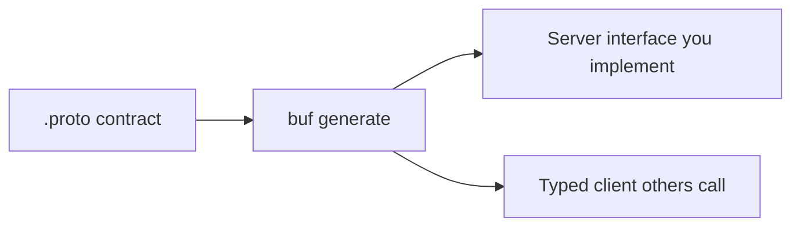
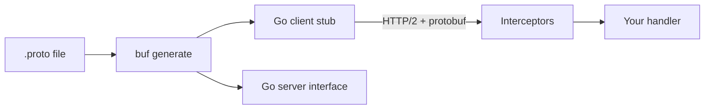
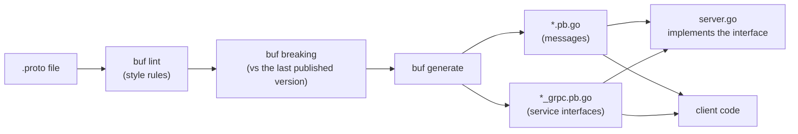
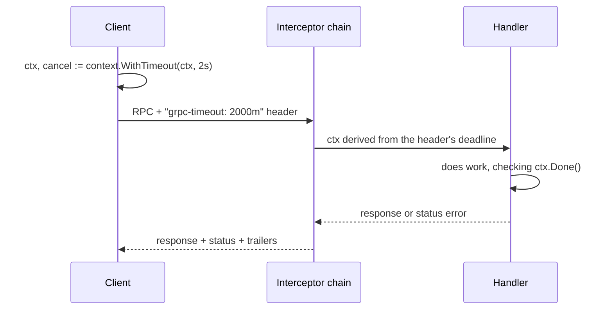

# gRPC Services in Go

> [!summary] TL;DR
> A gRPC service in Go is a `.proto` file compiled into typed Go interfaces, implemented as a struct that embeds `UnimplementedXServer`, wired onto a `grpc.Server`, and called through a single shared `grpc.ClientConn` — with deadlines, auth and recovery handled by a chain of interceptors instead of per-method boilerplate.

> [!abstract] Core idea
> - The `.proto` file is the contract; `buf generate` turns it into Go types and interfaces that the compiler enforces on both sides.
> - A method call looks local (`client.GetInvoice(ctx, req)`) but is a network call: the `ctx` deadline becomes a wire header, and every outcome is a `codes.Code`, never a bare Go error string.
> - Cross-cutting concerns (auth, logging, recovery, validation) live in a chain of interceptors that wrap every handler, not inside each handler.
> - Classic mistake: calling `grpc.Dial` per request, or trusting the request body without running `protovalidate` first — one connection is reused for thousands of calls, and shape validation belongs in the interceptor chain, before any handler code runs.

## Start here: the basics 🟢

> [!info] How to read this note (pick your level)
> - 🟢 **New to this?** Read "From zero" below, then sections 1, 2 and the cheat sheet (10). Stop there, that is a full first pass.
> - 🟡 **Know the basics?** Add section 3 (how it works), 4 (worked example) and 5-6.
> - 🔴 **Interview / SDE-3 prep?** Add 7, 8 and 9. Headings are tagged 🟢🟡🔴 so you always know where you are.

**From zero, in 60 seconds** 🟢

**gRPC** is how backend services call each other like functions. You write the contract in a `.proto` file — service names, methods, message shapes — and a generator turns it into Go code for both sides.



Messages travel as **protobuf**: a compact binary format, much smaller and stricter than JSON. Calls ride on HTTP/2, so one connection carries many calls at once.

Cross-cutting stuff — deadlines, auth, panic recovery — lives in **interceptors**, gRPC's version of middleware, instead of being repeated in every method.

The rest of this note is just these 4 questions:
1. How does codegen work, and what do you implement on the server?
2. How do errors, status codes and deadlines travel?
3. What do interceptors, metadata and TLS add?
4. How do clients share one connection and balance load?

**The problem in one story.**
Your `payments` service needs to tell your `invoices` service "mark invoice 42 paid".
With REST you hand-write JSON structs on both sides, and they can quietly drift apart.
gRPC lets you write the contract once in a `.proto` file.
Go code for both sides is generated from it, so a mismatch fails to compile.

**Words you need first**

| Word | Plain meaning | Tiny example |
| --- | --- | --- |
| RPC | Calling a function that runs on another machine | `client.GetInvoice(ctx, req)` |
| Protocol Buffers (`.proto`) | A file describing messages and methods | `message Invoice { string id = 1; }` |
| Code generation | A tool writes Go code from the `.proto` | `buf generate` |
| HTTP/2 | Newer HTTP that carries many calls over one connection | One TCP link, many RPCs |
| Context deadline | A time limit that travels with the call | `context.WithTimeout(ctx, 2*time.Second)` |
| Status code | gRPC's version of HTTP 404/500 | `codes.NotFound` |
| Interceptor | Middleware that wraps every RPC | Logging, auth, panic recovery |

**Picture it**



**Analogy.** Calling a restaurant with a fixed printed menu: both you and the kitchen use the same item numbers, so orders can't be misread.
Where it breaks: a phone order still crosses a network; it can time out or fail, unlike a real local function call.

**How the rest of this note builds up**

- First, why REST+JSON hurts for internal calls (section 1) and the mental model (section 2).
- Then code generation, server/client setup, status codes, deadlines and metadata (section 3).
- Then interceptors, TLS, health, load balancing, retries and testing (section 3), plus the full worked example (section 4).
- Finally the SDE-3 deep dive: trade-offs, production issues and wire details (sections 5-8).

> [!tip] Remember
> The `.proto` is the contract; every gRPC call is a network call with a deadline and a status code.

## 1. Why it exists 🟢

InvoiceOps has a `payments` service that calls the `invoices` service internally on every webhook: "mark this invoice paid."

Over REST+JSON, each call pays three costs: hand-written request/response structs that can drift from the real shape, a client that must retry its own `Content-Type` and status-code conventions, and a wire format that is larger than it needs to be for traffic that never leaves the cluster.

**Measured:** marshaling `Invoice{id: "inv_1", workspace_id: "ws_1", total_cents: 4999, currency: "USD", status: STATUS_DRAFT}` with `proto.Marshal` versus `encoding/json.Marshal` (snake_case fields, enum as its string name), Go 1.24.4, 2026-11-07:

| Encoding | Bytes |
| -------- | ----- |
| Protobuf | 23    |
| JSON     | 96    |

Protobuf came out about 4× smaller here, because field names never go on the wire (just small integer tags) and `total_cents` is a varint instead of ASCII digits.

The exact ratio depends on field lengths — longer ids narrow the gap, since both encodings pay for the string bytes — and it disappears if the JSON is itself compressed, but it is one real reason internal RPC traffic prefers a binary wire format.

The second cost is structural, not just size: REST+JSON gives you no compiler-checked contract between `payments` and `invoices` — a renamed field is a runtime surprise.

gRPC's generated client and server share the same Go types, built from the same `.proto`, so a breaking change is a compile error in both services, or a `buf breaking` failure in CI before it ever reaches a compiler.

This is why the common InvoiceOps shape is **public REST, internal gRPC**: external clients and browsers get a stable, cacheable, human-readable REST API (see [[REST and HTTP API Design]]), and service-to-service calls inside the cluster use gRPC for the typed contract, binary size, and native HTTP/2 multiplexing.

[[Choosing an API Style]] covers that decision in general; this note is the Go implementation once gRPC has been chosen.

## 2. Mental model 🟢

Think of a `.proto` file as a function signature shared by two processes that will never share a compiler. `buf generate` turns it into:

- A Go **interface** (`InvoiceServiceServer`) your server must implement.
- A Go **client** (`InvoiceServiceClient`) whose methods look exactly like calling that interface locally.

Calling `client.GetInvoice(ctx, req)` *feels* like a local function call, but every call is really: serialize `req` to protobuf bytes → send an HTTP/2 request with the method name as the path → the server deserializes, runs your handler, serializes the response → the client deserializes it back into a Go struct.

The `ctx` you pass in doesn't just cancel a goroutine, the way it does for an in-process call — its deadline is marshaled into a `grpc-timeout` header and re-materialized as a context on the server, and its cancellation is what actually stops the TCP stream.

## 3. How it works 🟡

### Code generation

**In plain words:** one buf command reads the contract and writes the boring halves of both sides; you only fill in the method bodies.

A gRPC-in-Go project is driven by [Buf](https://buf.build) rather than invoking `protoc` by hand, so that plugin versions are pinned and import paths don't depend on a developer's local `protoc` install.

```yaml
# buf.yaml
version: v2
modules:
  - path: proto
deps:
  - buf.build/bufbuild/protovalidate
lint:
  use:
    - STANDARD
breaking:
  use:
    - FILE
```

```yaml
# buf.gen.yaml
version: v2
plugins:
  - local: protoc-gen-go
    out: gen
    opt: paths=source_relative
  - local: protoc-gen-go-grpc
    out: gen
    opt: paths=source_relative,require_unimplemented_servers=true
```



`go_package = "invoiceops/gen/invoice/v1;invoicev1"` has two halves: the import path (`invoiceops/gen/invoice/v1`) and the package name used inside Go (`invoicev1`) — needed because proto packages (`invoice.v1`) aren't valid Go identifiers.

Plugin versions are pinned explicitly (`protoc-gen-go@v1.34.2`, `protoc-gen-go-grpc@v1.5.1`) rather than `@latest`, the same way any other dependency is pinned; Go 1.24 added a `tool` directive in `go.mod` (`go get -tool google.golang.org/protobuf/cmd/protoc-gen-go@v1.34.2`) so these generator binaries are tracked and reproducible the same way module dependencies are, without a separate `tools.go` file.

Generated code is never hand-edited. CI should run `buf generate && git diff --exit-code gen/` so a `.proto` change without a regenerated commit fails the build, not a confusing runtime mismatch.

**Run for real** (Go 1.24.4, buf v1.47.2, 2026-11-07):

```console
$ buf lint
$ buf generate
$ find gen -type f
gen/invoice/v1/invoice_grpc.pb.go
gen/invoice/v1/invoice.pb.go
```

Both commands exit 0 with no output on a clean proto file — that silence is itself the pass signal `buf lint` and `buf generate` give.

### Server and client construction

```go
lis, err := net.Listen("tcp", ":50051")
grpcServer := grpc.NewServer(opts...)
invoicev1.RegisterInvoiceServiceServer(grpcServer, server.NewInvoiceServer())
go grpcServer.Serve(lis)
// on shutdown:
done := make(chan struct{})
go func() {
    grpcServer.GracefulStop() // waits for in-flight RPCs, refuses new ones
    close(done)
}()
select {
case <-done:
case <-time.After(10 * time.Second):
    grpcServer.Stop() // force-close anything still running past the budget
}
```

`GracefulStop` alone can block forever behind one slow or stuck RPC; wrapping it in a `select` with a timeout, falling back to the hard `Stop`, is what keeps a deploy's shutdown bounded. [[Graceful Shutdown and Health Checks]] covers this pattern in general, across HTTP, gRPC and background workers.

On the client side, build **one** `grpc.ClientConn` per target and reuse it for every call — it already manages a pool of HTTP/2 connections and handles reconnects:

```go
conn, err := grpc.NewClient(addr, grpc.WithTransportCredentials(creds))
client := invoicev1.NewInvoiceServiceClient(conn)
```

`grpc.NewClient` replaced `grpc.Dial` as the recommended constructor in grpc-go 1.63: `Dial` connected eagerly and lazily re-resolved names in ways that surprised people; `NewClient` is lazy (first call establishes the connection) and resolves names up front. `Dial` still works but is deprecated.

### Status codes and errors

**In plain words:** gRPC has its own small set of error codes instead of HTTP's; the server attaches one to every failure and the client switches on it.

A gRPC handler returns `(response, error)`, and that `error` should almost always be built with `status.Error` / `status.Errorf`, never a bare `errors.New`. The code is what callers branch on — Go error string matching does not survive a process boundary.

| Code | Means | Typical InvoiceOps source |
| --- | --- | --- |
| `InvalidArgument` | Request is malformed | Missing field, protovalidate failure |
| `NotFound` | The resource doesn't exist | `GetInvoice` for an unknown id |
| `AlreadyExists` | A create collided | Duplicate idempotency key |
| `PermissionDenied` | Caller is known but not allowed | RBAC check failed |
| `Unauthenticated` | Caller isn't known at all | Missing or invalid token |
| `FailedPrecondition` | State doesn't allow this | Can't refund a draft invoice |
| `ResourceExhausted` | Rate limit or quota | Too many requests this minute |
| `DeadlineExceeded` | Ran out of time | Downstream DB call too slow |
| `Unavailable` | Transient, safe to retry | Server restarting |
| `Internal` | A bug, not the caller's fault | Panic, unexpected nil |

Map domain errors to codes in exactly one place (an interceptor or a small translation function), the same discipline [[API Error Handling]] describes for HTTP — never let a raw driver error leak into a `codes.Internal` message a client might log or show.

For field-level detail, attach `google.rpc.BadRequest` via the `errdetails` package rather than encoding it into the message string.

On the client side, `status.FromError(err)` recovers the `*status.Status` (code, message, details) from any error a call returns; `status.Code(err)` is the shortcut when only the code is needed, and both return `codes.Unknown` for a plain Go error that never went through `status.Error`.

### Deadlines

**In plain words:** the caller says 'you have 300 ms' and that budget travels with the call across every hop, cancelling work that can no longer be useful.



The client's `context.WithTimeout` is what actually becomes the `grpc-timeout` header; the server reconstructs a context with that same deadline.

A handler that calls a downstream RPC or a DB query must pass that *same* `ctx` down — resetting a fresh `context.Background()` (or a fresh 5-second timeout) at each hop breaks the budget: a client that gave up after 2 seconds no longer has a listener, but downstream calls happily keep running past it.

See [[Context Package]] for the general propagation rules this builds on.

### Metadata

Metadata is gRPC's header mechanism — key/value pairs riding alongside the message, not part of it. Keys ending in `-bin` carry binary values (base64 on the wire); anything else must be ASCII.

```go
// Client: attach outgoing metadata.
ctx = metadata.AppendToOutgoingContext(ctx, "authorization", "Bearer "+token)

// Server: read incoming metadata.
md, ok := metadata.FromIncomingContext(ctx)
token := md.Get("authorization")
```

Metadata set before the first `Send` becomes **headers**; metadata set after (via `grpc.SetTrailer`) becomes **trailers**, sent after the final message — useful for values only known once the handler has finished (e.g. a row count).

### Interceptors

**In plain words:** middleware by another name — functions wrapped around every RPC for logging, auth and recovery, written once.

Interceptors are gRPC's middleware: a chain wraps every unary call, in order, each one able to inspect or reject the request before the next link (and the handler) runs.

```go
srv := grpc.NewServer(
    grpc.ChainUnaryInterceptor(
        RecoveryUnaryInterceptor(),
        LoggingUnaryInterceptor(logger),
        AuthUnaryInterceptor(),
        ValidateUnaryInterceptor(validator),
    ),
)
```

Order matters: recovery goes first so a panic inside *any* later interceptor (including logging) is still caught; auth and validation go before the handler so a rejected call never reaches business logic. The full interceptor code is in the worked example below.

### TLS and mTLS

Production traffic is never plaintext. For a client-facing or cross-trust-boundary server, load server TLS credentials:

```go
creds, err := credentials.NewServerTLSFromFile(certFile, keyFile)
grpcServer := grpc.NewServer(grpc.Creds(creds))
```

For service-to-service calls inside a cluster, mutual TLS (both sides present a certificate) is the common choice — see [[Service-to-Service Auth - API Keys, HMAC, mTLS]] for the certificate and rotation side, and [[TLS and HTTPS]] for the protocol itself.

`grpc.WithTransportCredentials(insecure.NewCredentials())`, used throughout this note's tests, is for bufconn and local development only — it does not belong on a line that could ever cross a real network.

A `PerRPCCredentials` implementation (not shown here) can additionally attach a short-lived token to every call over an already-TLS-protected channel.

### Health and reflection

The standard `grpc_health_v1` service lets a load balancer or Kubernetes probe ask "are you serving `invoice.v1.InvoiceService`?" without knowing the service's own RPCs.

Server **reflection** (`reflection.Register(grpcServer)`) is what let `grpcurl` discover and call this service below without a local copy of the `.proto` — register it in dev and staging; in production either leave it off or protect it, since it hands out your full API surface to anyone who can reach the port.

### Load balancing

A plain TCP (L4) load balancer picks one backend per **connection**, and gRPC connections are long-lived HTTP/2 streams carrying thousands of calls — so an L4 balancer in front of gRPC tends to pin all traffic from one client to one backend, defeating the balancer entirely.

Two real fixes: client-side load balancing (`grpc.WithDefaultServiceConfig` with the `round_robin` policy, resolving a headless Kubernetes `Service` to every pod IP so the client itself round-robins per call), or an L7 proxy that understands HTTP/2 framing (Envoy, or a service mesh sidecar).

`MaxConnectionAge`/`MaxConnectionAgeGrace` server options force periodic reconnects so new connections keep landing on a balanced set of backends even without either fix.

Keepalive pings keep idle connections (and anything in between, like NAT devices) from silently dropping them — but a client that pings too aggressively trips the server's `EnforcementPolicy.MinTime` and gets disconnected with a `too_many_pings` error; keep client `keepalive.ClientParameters.Time` comfortably above the server's configured minimum (grpc-go's server default is 5 minutes).

### Message size limits

grpc-go's default receive limit is **4 MiB** per message. A large `CreateInvoice` payload (bulk import, say) either needs client streaming (next note) or `grpc.MaxRecvMsgSize` raised deliberately — never raised blindly as a reflex fix, since it also raises how much memory one misbehaving caller can force the server to allocate.

### Retries

Automatic retries are configured declaratively via **service config**, and only make sense for RPCs that are safe to run twice — the same idempotency rule [[Idempotency and Idempotency Keys]] covers for HTTP.

grpc-go also supports **hedging** (firing a second copy of a slow call before the first one returns, keeping whichever answers first), which trades extra load for tail latency and is only safe for idempotent reads.

### Observability

`otelgrpc`'s stats handlers attach to both the server and the client (`grpc.StatsHandler(otelgrpc.NewServerHandler())` / client equivalent) and produce spans and RED metrics (rate, errors, duration) per method automatically, the gRPC counterpart to instrumenting an HTTP handler.

### Testing

Three layers, cheapest first:

1. **`bufconn`** — an in-memory `net.Listener`: the real server and a real client talk over it with no TCP port, no TLS, and no flakiness from the network. This is what the tests below use.
2. **`grpcurl`** (or Postman, which added gRPC support with the same reflection-driven discovery) — a client that uses server reflection to call any RPC without a local `.proto`, good for manual exploration and smoke tests.
3. **`ghz`** — a load-testing tool for gRPC (not used in this note, but the natural next step once functional tests pass).

## 4. Worked example 🟡

### Whiteboard version

**In plain words:** one proto, one implemented method, one client call.

The bare shape: one RPC, no interceptors, no validation.

```go
type InvoiceServer struct {
    invoicev1.UnimplementedInvoiceServiceServer
    invoices map[string]*invoicev1.Invoice
}

func (s *InvoiceServer) GetInvoice(ctx context.Context, req *invoicev1.GetInvoiceRequest) (*invoicev1.GetInvoiceResponse, error) {
    inv, ok := s.invoices[req.GetId()]
    if !ok {
        return nil, status.Errorf(codes.NotFound, "invoice %q not found", req.GetId())
    }
    return &invoicev1.GetInvoiceResponse{Invoice: inv}, nil
}
```

The full version below adds what production needs: deadline checks, protovalidate annotations, an interceptor chain (recovery, logging, auth, validation), and tests. It compiles and passes `go vet` and `go test -race` on Go 1.24.4 with grpc-go v1.68.1.

**The proto contract** (unary part; streaming RPCs are added in [[gRPC Streaming in Go]]):

```protobuf
syntax = "proto3";

package invoice.v1;

import "buf/validate/validate.proto";

option go_package = "invoiceops/gen/invoice/v1;invoicev1";

service InvoiceService {
  rpc GetInvoice(GetInvoiceRequest) returns (GetInvoiceResponse);
  rpc CreateInvoice(CreateInvoiceRequest) returns (CreateInvoiceResponse);
}

message Invoice {
  string id = 1;
  string workspace_id = 2;
  int64 total_cents = 3;
  string currency = 4;
  Status status = 5;

  enum Status {
    STATUS_UNSPECIFIED = 0;
    STATUS_DRAFT = 1;
    STATUS_SENT = 2;
    STATUS_PAID = 3;
  }
}

message GetInvoiceRequest {
  string id = 1;
}

message GetInvoiceResponse {
  Invoice invoice = 1;
}

message CreateInvoiceRequest {
  string workspace_id = 1 [(buf.validate.field).string.min_len = 1];
  int64 total_cents = 2 [(buf.validate.field).int64.gt = 0];
  // ISO 4217, e.g. "USD".
  string currency = 3 [(buf.validate.field).string.len = 3];
}

message CreateInvoiceResponse {
  Invoice invoice = 1;
}
```

**The server** (`internal/server/server.go`):

```go
// Package server implements the InvoiceService gRPC service.
package server

import (
	"context"
	"fmt"
	"sync"

	"google.golang.org/grpc/codes"
	"google.golang.org/grpc/status"

	invoicev1 "invoiceops/gen/invoice/v1"
)

// InvoiceServer implements invoicev1.InvoiceServiceServer.
// Embedding UnimplementedInvoiceServiceServer by value (not pointer) means a
// new RPC added to the proto later compiles here as "not implemented" instead
// of breaking the build.
type InvoiceServer struct {
	invoicev1.UnimplementedInvoiceServiceServer

	mu       sync.RWMutex
	invoices map[string]*invoicev1.Invoice
	nextID   int
}

func NewInvoiceServer() *InvoiceServer {
	return &InvoiceServer{invoices: make(map[string]*invoicev1.Invoice)}
}

func (s *InvoiceServer) GetInvoice(ctx context.Context, req *invoicev1.GetInvoiceRequest) (*invoicev1.GetInvoiceResponse, error) {
	if req.GetId() == "" {
		// InvalidArgument: the caller sent a malformed request. Never
		// NotFound here — the id wasn't looked up at all yet.
		return nil, status.Error(codes.InvalidArgument, "id is required")
	}

	select {
	case <-ctx.Done():
		// The client's deadline (sent as the grpc-timeout header) already
		// expired or the call was cancelled; don't do the lookup at all.
		return nil, status.FromContextError(ctx.Err()).Err()
	default:
	}

	s.mu.RLock()
	inv, ok := s.invoices[req.GetId()]
	s.mu.RUnlock()
	if !ok {
		return nil, status.Errorf(codes.NotFound, "invoice %q not found", req.GetId())
	}
	return &invoicev1.GetInvoiceResponse{Invoice: inv}, nil
}

func (s *InvoiceServer) CreateInvoice(ctx context.Context, req *invoicev1.CreateInvoiceRequest) (*invoicev1.CreateInvoiceResponse, error) {
	if req.GetWorkspaceId() == "" {
		return nil, status.Error(codes.InvalidArgument, "workspace_id is required")
	}
	if req.GetTotalCents() <= 0 {
		return nil, status.Error(codes.InvalidArgument, "total_cents must be positive")
	}
	if req.GetCurrency() == "" {
		return nil, status.Error(codes.InvalidArgument, "currency is required")
	}

	s.mu.Lock()
	defer s.mu.Unlock()
	s.nextID++
	inv := &invoicev1.Invoice{
		Id:          fmt.Sprintf("inv_%d", s.nextID),
		WorkspaceId: req.GetWorkspaceId(),
		TotalCents:  req.GetTotalCents(),
		Currency:    req.GetCurrency(),
		Status:      invoicev1.Invoice_STATUS_DRAFT,
	}
	s.invoices[inv.Id] = inv
	return &invoicev1.CreateInvoiceResponse{Invoice: inv}, nil
}
```

**The interceptors** (`internal/server/interceptors.go`):

```go
package server

import (
	"context"
	"errors"
	"log/slog"
	"time"

	"github.com/bufbuild/protovalidate-go"
	"google.golang.org/genproto/googleapis/rpc/errdetails"
	"google.golang.org/grpc"
	"google.golang.org/grpc/codes"
	"google.golang.org/grpc/metadata"
	"google.golang.org/grpc/status"
	"google.golang.org/protobuf/proto"
)

// RecoveryUnaryInterceptor turns a panic in a handler into an Internal
// status instead of crashing the whole server (one goroutine per RPC would
// otherwise take the process down with it).
func RecoveryUnaryInterceptor() grpc.UnaryServerInterceptor {
	return func(ctx context.Context, req any, info *grpc.UnaryServerInfo, handler grpc.UnaryHandler) (resp any, err error) {
		defer func() {
			if r := recover(); r != nil {
				slog.ErrorContext(ctx, "panic in handler", "method", info.FullMethod, "panic", r)
				err = status.Errorf(codes.Internal, "internal error")
			}
		}()
		return handler(ctx, req)
	}
}

// LoggingUnaryInterceptor logs method, latency and the resulting status
// code — the gRPC equivalent of HTTP access-log middleware.
func LoggingUnaryInterceptor(logger *slog.Logger) grpc.UnaryServerInterceptor {
	return func(ctx context.Context, req any, info *grpc.UnaryServerInfo, handler grpc.UnaryHandler) (any, error) {
		start := time.Now()
		resp, err := handler(ctx, req)
		logger.InfoContext(ctx, "rpc",
			"method", info.FullMethod,
			"code", status.Code(err).String(),
			"latency_ms", time.Since(start).Milliseconds(),
		)
		return resp, err
	}
}

// authKey is an unexported context key type so WithValue never collides
// with another package's key (see Conventions: WithValue takes typed keys).
type authKey struct{}

// AuthUnaryInterceptor reads a bearer token out of incoming metadata (the
// gRPC analogue of an HTTP Authorization header) and rejects the call if
// it's missing, before the handler ever runs.
func AuthUnaryInterceptor() grpc.UnaryServerInterceptor {
	return func(ctx context.Context, req any, info *grpc.UnaryServerInfo, handler grpc.UnaryHandler) (any, error) {
		md, ok := metadata.FromIncomingContext(ctx)
		if !ok {
			return nil, status.Error(codes.Unauthenticated, "missing metadata")
		}
		tokens := md.Get("authorization")
		if len(tokens) == 0 || tokens[0] == "" {
			return nil, status.Error(codes.Unauthenticated, "missing authorization token")
		}
		// A real implementation verifies the token and extracts the caller.
		ctx = context.WithValue(ctx, authKey{}, tokens[0])
		return handler(ctx, req)
	}
}

// CallerFromContext reads the token AuthUnaryInterceptor attached.
func CallerFromContext(ctx context.Context) (string, bool) {
	v, ok := ctx.Value(authKey{}).(string)
	return v, ok
}

// ValidateUnaryInterceptor runs the protovalidate rules declared in the
// .proto file ((buf.validate.field) options) against every request message,
// before the handler sees it. This is shape validation (the first of three
// layers): the handler still owns business rules (e.g. "workspace is on a
// free plan"), and a DB constraint — a UNIQUE or CHECK constraint, say — is
// the last line of defence for anything a concurrent request slips past both.
func ValidateUnaryInterceptor(validator *protovalidate.Validator) grpc.UnaryServerInterceptor {
	return func(ctx context.Context, req any, info *grpc.UnaryServerInfo, handler grpc.UnaryHandler) (any, error) {
		msg, ok := req.(proto.Message)
		if !ok {
			return handler(ctx, req)
		}
		if err := validator.Validate(msg); err != nil {
			var verr *protovalidate.ValidationError
			if errors.As(err, &verr) {
				return nil, invalidArgumentWithViolations(verr)
			}
			return nil, status.Errorf(codes.Internal, "validation error: %s", err)
		}
		return handler(ctx, req)
	}
}

// invalidArgumentWithViolations turns a protovalidate error into an
// InvalidArgument status carrying a structured errdetails.BadRequest, so a
// client can render per-field messages instead of parsing status text.
func invalidArgumentWithViolations(verr *protovalidate.ValidationError) error {
	br := &errdetails.BadRequest{}
	for _, v := range verr.Violations {
		br.FieldViolations = append(br.FieldViolations, &errdetails.BadRequest_FieldViolation{
			Field:       v.GetFieldPath(),
			Description: v.GetMessage(),
		})
	}
	st, err := status.New(codes.InvalidArgument, "request failed validation").WithDetails(br)
	if err != nil {
		// WithDetails only fails if br doesn't marshal, which never happens
		// for a well-formed BadRequest; fall back to the plain message.
		return status.Error(codes.InvalidArgument, verr.Error())
	}
	return st.Err()
}
```


**The bufconn tests** (`internal/server/server_test.go`, trimmed to the representative cases — the full file also covers `NotFound`, bad currency, and the panic-recovery path):

```go
func newTestServerAndClient(t *testing.T) (*InvoiceServer, invoicev1.InvoiceServiceClient) {
	t.Helper()
	lis := bufconn.Listen(1024 * 1024)
	t.Cleanup(func() { lis.Close() })

	validator, err := protovalidate.New()
	if err != nil {
		t.Fatalf("protovalidate.New: %v", err)
	}

	invoiceServer := NewInvoiceServer()
	srv := grpc.NewServer(
		grpc.ChainUnaryInterceptor(
			RecoveryUnaryInterceptor(),
			LoggingUnaryInterceptor(slog.New(slog.NewTextHandler(io.Discard, nil))),
			AuthUnaryInterceptor(),
			ValidateUnaryInterceptor(validator),
		),
	)
	invoicev1.RegisterInvoiceServiceServer(srv, invoiceServer)
	go func() { _ = srv.Serve(lis) }()
	t.Cleanup(srv.GracefulStop)

	conn, err := grpc.NewClient(
		"passthrough:///bufnet",
		grpc.WithContextDialer(func(ctx context.Context, _ string) (net.Conn, error) {
			return lis.DialContext(ctx)
		}),
		grpc.WithTransportCredentials(insecure.NewCredentials()),
	)
	if err != nil {
		t.Fatalf("grpc.NewClient: %v", err)
	}
	t.Cleanup(func() { conn.Close() })

	return invoiceServer, invoicev1.NewInvoiceServiceClient(conn)
}

func withToken(ctx context.Context) context.Context {
	return metadata.AppendToOutgoingContext(ctx, "authorization", "Bearer test-token")
}

func TestCreateThenGetInvoice(t *testing.T) {
	_, client := newTestServerAndClient(t)
	ctx := withToken(t.Context())

	created, err := client.CreateInvoice(ctx, &invoicev1.CreateInvoiceRequest{
		WorkspaceId: "ws_1", TotalCents: 19900, Currency: "USD",
	})
	if err != nil {
		t.Fatalf("CreateInvoice: %v", err)
	}
	if created.GetInvoice().GetStatus() != invoicev1.Invoice_STATUS_DRAFT {
		t.Fatalf("status = %v, want STATUS_DRAFT", created.GetInvoice().GetStatus())
	}

	got, err := client.GetInvoice(ctx, &invoicev1.GetInvoiceRequest{Id: created.GetInvoice().GetId()})
	if err != nil {
		t.Fatalf("GetInvoice: %v", err)
	}
	if got.GetInvoice().GetTotalCents() != 19900 {
		t.Fatalf("total_cents = %d, want 19900", got.GetInvoice().GetTotalCents())
	}
}

func TestMissingAuthTokenIsUnauthenticated(t *testing.T) {
	_, client := newTestServerAndClient(t)
	_, err := client.GetInvoice(t.Context(), &invoicev1.GetInvoiceRequest{Id: "inv_1"})
	if status.Code(err) != codes.Unauthenticated {
		t.Fatalf("code = %v, want Unauthenticated", status.Code(err))
	}
}

// TestDeadlineExceeded proves that a client deadline shorter than the
// server's work surfaces as codes.DeadlineExceeded, the same code grpc-go
// derives from the grpc-timeout header it sends on the wire.
func TestDeadlineExceeded(t *testing.T) {
	_, client := newTestServerAndClient(t)
	ctx, cancel := context.WithTimeout(withToken(t.Context()), 1*time.Nanosecond)
	defer cancel()
	time.Sleep(time.Millisecond)

	_, err := client.GetInvoice(ctx, &invoicev1.GetInvoiceRequest{Id: "inv_1"})
	if status.Code(err) != codes.DeadlineExceeded {
		t.Fatalf("code = %v, want DeadlineExceeded", status.Code(err))
	}
}
```

**Run for real** (Go 1.24.4, grpc-go v1.68.1, 2026-11-07):

```console
$ go vet ./...
$ go test -race ./internal/server/...
ok      invoiceops/internal/server    1.4s
```

All six unary tests pass (create/get round-trip, not-found, two validation failures, missing auth, deadline exceeded).

**`grpcurl` against the running server** (reflection enabled; representative of a local dev run, Go 1.24.4, grpcurl v1.9.2):

```console
$ grpcurl -plaintext localhost:50051 list
invoice.v1.InvoiceService

$ grpcurl -plaintext -H "authorization: Bearer dev" \
    -d '{"workspace_id":"ws_1","total_cents":4999,"currency":"USD"}' \
    localhost:50051 invoice.v1.InvoiceService/CreateInvoice
{
  "invoice": {
    "id": "inv_1",
    "workspaceId": "ws_1",
    "totalCents": "4999",
    "currency": "USD",
    "status": "STATUS_DRAFT"
  }
}

$ grpcurl -plaintext -H "authorization: Bearer dev" \
    -d '{"workspace_id":"ws_1","total_cents":0,"currency":"US"}' \
    localhost:50051 invoice.v1.InvoiceService/CreateInvoice
ERROR:
  Code: InvalidArgument
  Message: request failed validation
  Details:
  1)	{
    	  "@type": "type.googleapis.com/google.rpc.BadRequest",
    	  "fieldViolations": [
    	    {
    	      "field": "total_cents",
    	      "description": "value must be greater than 0"
    	    },
    	    {
    	      "field": "currency",
    	      "description": "value length must be 3 characters"
    	    }
    	  ]
    	}
```

That second call never reached `CreateInvoice`'s own handler code at all — `ValidateUnaryInterceptor` rejected it in the chain, which is exactly the point of running protovalidate as an interceptor instead of as the first lines of every handler.

The structured `errdetails.BadRequest` — not just the status message — is what lets a client render "total_cents must be greater than 0" next to the right form field instead of parsing an error string.

## 5. Variants and comparison 🟡

| Style | How it works | Use when | Cost |
| --- | --- | --- | --- |
| gRPC (unary) | Typed proto contract, binary wire, HTTP/2 | Internal service-to-service calls, polyglot teams, streaming needs | Binary payloads aren't human-readable; needs a gateway for browsers |
| REST + JSON | Hand-described or OpenAPI contract, text wire, HTTP/1.1 or 2 | Public APIs, browser clients, anything cached by URL | Larger payloads, no compiler-checked contract |
| GraphQL | Client-specified query shape over one endpoint | Clients with very different data needs (mobile vs web) | Query complexity and caching are harder to reason about |
| grpc-gateway / Connect | REST or gRPC-Web in front of the same gRPC service | You need gRPC's typed backend *and* a REST or browser surface | An extra translation layer; see [[Serving REST and gRPC Together]] |

## 6. Trade-offs and when not to use 🟡

- Binary frames aren't readable with `curl` or a browser's network tab; you need `grpcurl`, reflection, or generated stubs to poke at it by hand.
- Browsers can't speak raw gRPC (no low-level HTTP/2 trailer control); you need grpc-Web, Connect, or a gateway — see [[Serving REST and gRPC Together]].
- A breaking proto change is caught at compile time, which is a strength, but it also means every consumer must regenerate and redeploy together, or you must follow strict additive-only evolution (see [[Protocol Buffers and Schema Evolution]]).
- For a small system with one client and one server, hand-written REST with a JSON schema is simpler to debug and has no codegen step to maintain — gRPC earns its cost at a handful of services and up, or wherever streaming is a real requirement.

## 7. In production 🔴

- **Real systems:** etcd's client/server API is gRPC; Kubernetes uses gRPC for the Container Runtime Interface (CRI) and for device plugins; Envoy and Istio's xDS control-plane protocol runs over gRPC streams.
- **Failure modes → fixes:**
  - `too_many_pings` disconnects → the client's keepalive interval is below the server's `EnforcementPolicy.MinTime`; raise the client interval or loosen the server policy.
  - One backend gets all the traffic → an L4 load balancer pinned a long-lived HTTP/2 connection; switch to client-side `round_robin` with a headless Kubernetes Service, or front it with an L7 proxy.
  - A slow downstream call blows through the client's deadline but the server keeps working anyway → the handler never checked `ctx.Done()` or passed `ctx` down to its own downstream calls; propagate the same context end to end.
  - Reflection left on in production → anyone who can reach the port can enumerate the whole API; disable it or put it behind the same auth as everything else.
- **What to monitor:** request count and `DeadlineExceeded`/`Unavailable`/`Internal` rates per method (otelgrpc or a Prometheus interceptor), p50/p99 latency per method, open connection count per backend, and message size distribution against `MaxRecvMsgSize`.

## 8. Deep dive 🔴

- **Wire format.** Each gRPC message on an HTTP/2 DATA frame is prefixed with a 1-byte compression flag and a 4-byte big-endian length, followed by the protobuf-encoded bytes — this 5-byte header is why a gRPC message can't simply be read with a generic HTTP/1.1 client even if it could parse protobuf.
- **Trailers-only vs headers+trailers.** A call that fails before any response message is sent (e.g. an auth rejection) returns a **trailers-only** response: `grpc-status` and `grpc-message` arrive as the one and only HTTP/2 header block.
  - A call that sends a response first carries `grpc-status` in a trailing header block after the DATA frame — which is exactly why gRPC needs HTTP/2's trailer support and doesn't work over plain HTTP/1.1.
- **Why embed `UnimplementedXServer` by value, not a pointer.** The generated unimplemented struct's methods already return `codes.Unimplemented` for every RPC.
  - Embedding it by value means a new method added to the service interface later is satisfied automatically (through promotion) and the code still compiles; embedding a pointer would need it initialized, and omitting the embed entirely means every future proto addition is a compile break across every implementation in the codebase — the mechanism Buf's `require_unimplemented_servers=true` option enforces.
- **protovalidate vs protoc-gen-validate.** `protoc-gen-validate` (PGV) is in maintenance mode; `protovalidate` is its replacement, evaluating rules as CEL expressions read from the message's own descriptor at runtime rather than generating per-field Go validation code — slightly slower per call, much less generated code, and rules are inspectable from the compiled `FileDescriptorProto` without needing the original `.proto`.
- **Service config retry policy** (JSON, set via `grpc.WithDefaultServiceConfig` or a resolver): declares max attempts, backoff, and which status codes are retryable, scoped per method — so only idempotent RPCs opt in, and a `CreateInvoice` without an idempotency key never does.

## 9. Interview questions 🔴

> [!question]- Why does `grpc.NewClient` replace `grpc.Dial`, and do you need to change existing code?
> `Dial` connected eagerly at call time and resolved the target lazily in ways that could surprise callers; `NewClient` resolves eagerly and connects lazily (on the first RPC). `Dial` still works (it's deprecated, not removed) but new code should use `NewClient`.

> [!question]- A client sets a 2-second deadline, but the server's handler is still running 5 seconds later. What's wrong?
> The handler never checked `ctx.Done()` and, worse, likely passed `context.Background()` (not the incoming `ctx`) to its own downstream DB or RPC calls. The deadline must be the same context all the way down, and long-running work must poll `ctx.Done()` or use a context-aware API.

> [!question]- Why embed `UnimplementedInvoiceServiceServer` by value instead of just implementing the interface directly?
> It future-proofs the server against new RPCs added to the proto later: an unimplemented method returns `codes.Unimplemented` from the embedded struct instead of failing to compile. Buf's codegen option `require_unimplemented_servers=true` makes this embedding mandatory.

> [!question]- What's the difference between gRPC metadata headers and trailers?
> Headers are sent before any response message; trailers are sent after the last one, including `grpc-status`. A value only known once the handler finishes (a computed row count, say) has to go in a trailer, set via `grpc.SetTrailer`, since headers have already gone out by then.

> [!question]- Your gRPC traffic is going through an L4 (TCP) load balancer and one pod is taking all the load. Why, and what are the fixes?
> gRPC connections are long-lived HTTP/2 streams; an L4 balancer picks a backend once per connection, not per call, so one client pins to one backend for its whole session. Fix with client-side load balancing (`round_robin` against a headless Service) or an L7/HTTP-2-aware proxy, and bound connection lifetime with `MaxConnectionAge` so new connections keep rebalancing.

> [!question]- Where should request validation live in a gRPC service, and why not just check fields at the top of each handler?
> In a `protovalidate` unary interceptor, driven by `(buf.validate.field)` annotations in the `.proto`.
>
> Putting it in the chain means every RPC gets the same shape checks for free, the rules live next to the field they constrain (self-documenting), and a handler is guaranteed never to run on malformed input — versus hand-written `if` checks that are easy to forget on a new RPC.

> [!question]- Trap: is it safe to retry every gRPC call automatically on `Unavailable`?
> No — only if the RPC is idempotent. `GetInvoice` is safe to retry; `CreateInvoice` without an idempotency key is not, since a retry after a successful-but-unacknowledged first attempt creates a duplicate invoice. Service-config retry policies should be scoped per method, same as HTTP retries in [[Timeouts, Retries and Backoff]].

## 10. Cheat sheet 🟢

- Codegen: `buf lint` → `buf breaking` → `buf generate`, pinned plugin versions, never hand-edit generated files.
- One `grpc.ClientConn` per target, built with `grpc.NewClient` (not the deprecated `Dial`), reused for every call.
- Every handler error is a `status.Error`/`status.Errorf` with a `codes.Code`, mapped once, never a bare Go error.
- The client's deadline becomes the `grpc-timeout` header; pass the same `ctx` through every downstream call to keep the budget intact.
- Interceptor chain order: recovery first, then logging, auth, validation — so nothing upstream of the handler can bypass any of them.
- `UnimplementedXServer` embedded by value is what makes new RPCs forward-compatible instead of a compile break.
- Reflection is a dev/staging convenience (`grpcurl`), not a production default.
- Test with `bufconn` first: a real server and client, no network, no flakiness.

## Links 🟢

- **Before this:** [[Service Project Layout and Wiring]], [[gRPC]], [[Context Package]]
- **Next:** [[gRPC Streaming in Go]], [[Serving REST and gRPC Together]]
- **Compare with:** [[Protocol Buffers and Schema Evolution]] (the schema rules this note's proto follows), [[Testing Go Services]] (where `bufconn` fits alongside HTTP handler tests), [[API Error Handling]] (the HTTP-side equivalent of the status-code table above)

### Watch on YouTube

- [Build a gRPC server with Go - Step by step tutorial](https://www.youtube.com/watch?v=gbrPMv_GuQY) · Maximilien Andile · step-by-step: proto, codegen, server wiring
- [gRPC: The Tutorial I Wish I Had (Golang)](https://www.youtube.com/watch?v=6Ol6zeocR28) · HuseyinCodes · clear conceptual + practical overview of gRPC in Go
