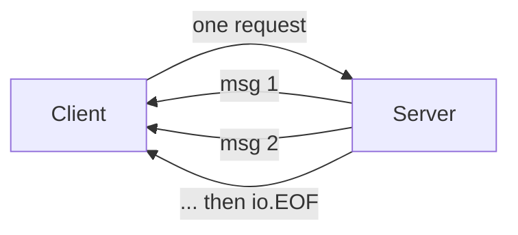
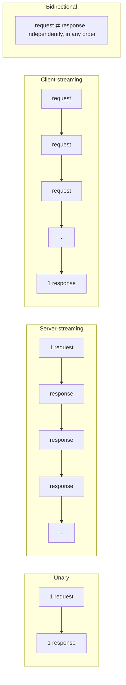
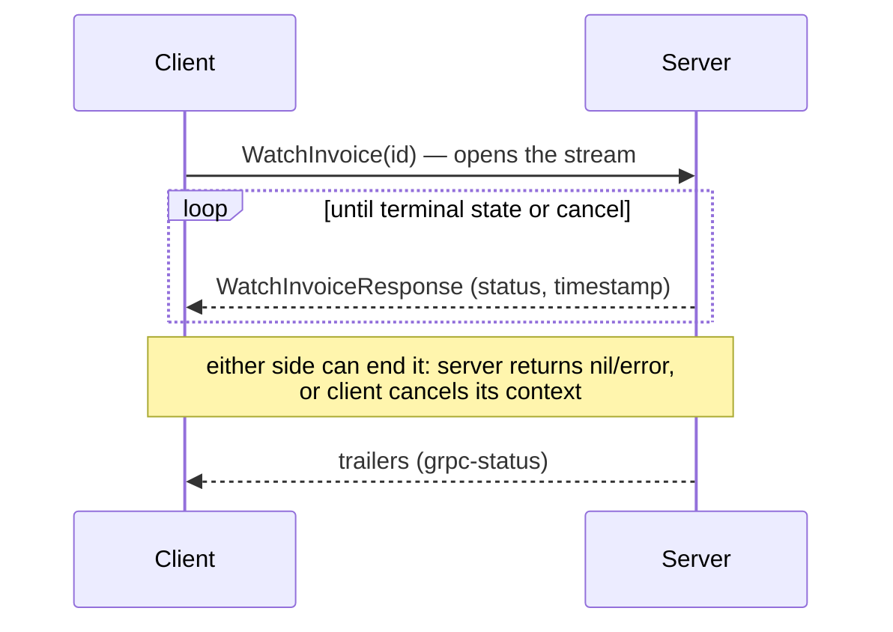
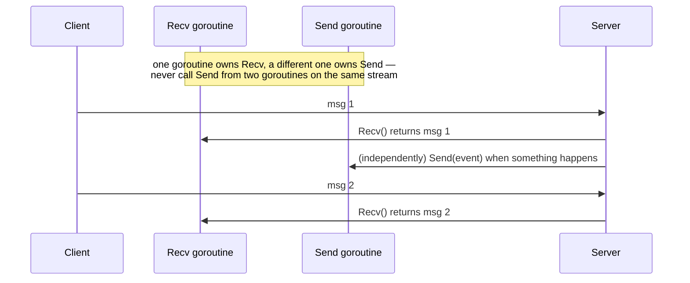

# gRPC Streaming in Go

> [!summary] TL;DR
> gRPC streaming lets a single RPC carry many messages instead of one, in three shapes: server-streaming (one request, many responses), client-streaming (many requests, one response), and bidirectional (both sides send independently) — all built on one long-lived HTTP/2 stream per RPC.

> [!abstract] Core idea
> - A stream is driven by `Send`/`Recv` pairs instead of a single return value; the client or server signals "no more messages" by closing its send side, which the other side observes as `io.EOF`.
> - A blocking `Send` *is* the backpressure mechanism: HTTP/2 flow control stalls it the moment the receiver falls behind, with no extra code needed.
> - Exactly one goroutine may call `Send` on a given stream at a time; concurrent `Send`s on the same stream are a data race gRPC itself doesn't protect you from.
> - Classic mistake: never draining a client-streaming RPC to `io.EOF`, or never cancelling a server-streaming RPC's context — both leak the underlying HTTP/2 stream and the goroutine serving it.

## Start here: the basics

**The problem in one story.**
A client wants every invoice created today, which might be a million rows.
One giant response would use huge memory on both sides.
With a gRPC stream, the server sends invoices one by one over one call.
The client handles each as it arrives, and the server slows down if the client falls behind.

**Words you need first**

| Word | Plain meaning | Tiny example |
| --- | --- | --- |
| Unary RPC | One request in, one response out | `GetInvoice` |
| Stream | Many messages over one RPC call | `ListInvoices` sending rows one by one |
| `Send` / `Recv` | Write one message / read one message on a stream | `stream.Send(inv)` |
| `io.EOF` | The "no more messages" signal | Loop ends when `Recv` returns it |
| Backpressure | Slowing the sender when the receiver is behind | `Send` blocks until there is room |
| Goroutine | A cheap Go function running concurrently | One reading, one writing |
| Context cancel | Telling the other side "stop, I'm done" | `cancel()` ends the stream |

**Picture it**



**Analogy.** A conveyor belt instead of a delivery truck: items arrive one at a time, and the belt pauses when the worker at the end is full.
Where it breaks: a belt has no "error halfway through"; a stream can fail mid-way, so the client must handle partial results.

**How the rest of this note builds up**

- First, why one big response fails (section 1) and the Send/Recv mental model (section 2).
- Then server-streaming, client-streaming and bidirectional streams, plus draining and closing (section 3).
- Then flow control, ordering, mid-stream errors, load balancing and interceptors (section 3), plus the worked example (section 4).
- Finally the SDE-3 deep dive: choosing streaming vs pagination vs WebSocket and leak traps (sections 5-8).

> [!tip] Remember
> A stream is a loop of Send/Recv ending in `io.EOF`; a blocking `Send` is your backpressure, and one goroutine sends at a time.

## 1. Why it exists

InvoiceOps' dashboard wants to show an invoice's status live — draft → sent → paid — without the browser's tab polling `GetInvoice` every second. A unary RPC can't do this: each call is one request, one response, done.

Polling every second from every open tab also means the server re-runs the same lookup for clients who are, most of the time, waiting for nothing to have changed.

A **server-streaming** RPC flips the model: the client asks once ("tell me about invoice X"), and the server pushes an event every time something is worth saying, for as long as the client stays connected.

The same shape, run in reverse, is **client-streaming**: an accountant uploading a CSV of a thousand invoices sends them as a stream of small messages instead of one request built from the whole file in memory, and gets one summary back when done.

**Bidirectional** streaming combines both, used here for a live support-chat widget where either side can speak first.

All three reuse the same HTTP/2 connection and the same deadline/metadata/interceptor machinery from [[gRPC Services in Go]] — streaming is a different method shape, not a different protocol.

## 2. Mental model

A unary RPC is a function call: one argument in, one result out. A stream is a **channel bolted onto an RPC**: instead of `return value, err`, you get `Send(msg) error` and `Recv() (msg, error)`, called as many times as there are messages, on either side, independently.



The one invariant across all three: **closing your send side tells the other end you're done sending**, and the other end learns this as `io.EOF` from `Recv`. Nothing else signals "no more messages" — a stream that is never explicitly closed stays open until the deadline or an error ends it.

## 3. How it works

### Server-streaming

```go
func (s *InvoiceServer) WatchInvoice(req *invoicev1.WatchInvoiceRequest, stream invoicev1.InvoiceService_WatchInvoiceServer) error {
    ctx := stream.Context()
    for {
        select {
        case <-ctx.Done():
            return status.FromContextError(ctx.Err()).Err()
        case <-ticker.C:
            if err := stream.Send(event); err != nil {
                return err
            }
        }
    }
}
```

Two things make this safe to run for minutes or hours: the `select` watches `stream.Context().Done()` on every iteration (the client cancelling, disconnecting, or hitting its deadline all surface here), and every `Send` error is checked and returned — a `Send` failure means the stream is already broken, and looping past it just burns CPU pushing into a dead connection.



### Client-streaming

```go
func (s *InvoiceServer) ImportInvoices(stream invoicev1.InvoiceService_ImportInvoicesServer) error {
    var summary invoicev1.ImportInvoicesResponse
    for {
        req, err := stream.Recv()
        if err == io.EOF {
            return stream.SendAndClose(&summary)
        }
        if err != nil {
            return err
        }
        // ... process req, update summary ...
    }
}
```

`Recv` returning `io.EOF` is not an error here — it is the client's `CloseSend()` arriving, the expected way this loop ends. `SendAndClose` is the client-streaming equivalent of a unary `return`: it sends the one response and closes the server's side of the stream in a single call.

### Bidirectional streaming

```go
func (s *InvoiceServer) Chat(stream invoicev1.InvoiceService_ChatServer) error {
    for {
        msg, err := stream.Recv()
        if err == io.EOF {
            return nil
        }
        if err != nil {
            return err
        }
        if err := stream.Send(reply); err != nil {
            return err
        }
    }
}
```

This server happens to reply once per received message, on the same goroutine — a valid pattern when replies are always a direct response to an inbound message.

The moment a stream needs to **push** data unprompted (a server-initiated notification mid-chat, say), `Recv` and `Send` need separate goroutines, because `Recv` blocks waiting for the next inbound message and would otherwise starve any unprompted `Send`:



The one rule that matters for correctness, not just style: **a given stream's `Send` must only ever be called from one goroutine at a time.**

`Recv` has the same rule on the read side. gRPC does not serialize concurrent `Send` calls for you — it's a data race, the same class of bug as two goroutines writing one `map` without a mutex.

### Client side: draining and closing

The client has its own obligations, symmetric to the server's:

- **Server-streaming client:** call `stream.Recv()` in a loop until `io.EOF` (success) or a non-nil error (the terminal status). Stopping early without cancelling the context leaves the server-side goroutine blocked on `Send` until its own deadline.
- **Client-streaming client:** call `stream.Send()` for each message, then `stream.CloseSend()` once, then read the single response with `CloseAndRecv()`.
- **Bidirectional client:** call `stream.CloseSend()` once done sending (same as client-streaming), and keep calling `Recv()` until `io.EOF`.
- **Always:** cancel the stream's context (`defer cancel()`) when you're done with it, even after a clean `io.EOF` — a context that's still live keeps bookkeeping alive on both ends until it's garbage collected.

### Generic stream types

Since protoc-gen-go-grpc v1.5.1, the generated service interface uses Go generics instead of one hand-named interface per RPC:

```go
// From the generated invoice_grpc.pb.go for this note's proto:
WatchInvoice(*WatchInvoiceRequest, grpc.ServerStreamingServer[WatchInvoiceResponse]) error
ImportInvoices(grpc.ClientStreamingServer[ImportInvoicesRequest, ImportInvoicesResponse]) error
Chat(grpc.BidiStreamingServer[ChatRequest, ChatResponse]) error
```

`grpc.ServerStreamingServer[T]`, `grpc.ClientStreamingServer[Req, Res]` and `grpc.BidiStreamingServer[Req, Res]` are generic interfaces grpc-go itself defines; the generated per-RPC interface names (`InvoiceService_WatchInvoiceServer`, etc.) are now just type aliases to these generic types. The practical effect is that `Send`/`Recv` are type-checked against the exact message types at compile time with less generated boilerplate than the pre-generics (pointer-receiver, one-struct-per-stream) code older codegen produced.

### Flow control and backpressure

HTTP/2 gives every stream a **flow-control window**: a budget of bytes the sender is allowed to have in flight before the receiver acknowledges them (a `WINDOW_UPDATE` frame).

When `WatchInvoice` calls `stream.Send` faster than the client reads, the window fills up and `Send` **blocks** until the client catches up — this is backpressure, and it costs no extra code: a slow consumer simply makes the producer wait, the same way an unbuffered channel does between two goroutines.

The default window and the connection's bandwidth-delay product (BDP) together bound how much data can sit "in the pipe" before this kicks in; grpc-go's BDP estimator grows the window over a connection's lifetime if the link can sustain more throughput.

See [[Backpressure and Flow Control]] for the general pattern this is one instance of.

### Ordering

gRPC guarantees messages on **one stream** arrive in the order they were sent. It guarantees nothing across streams — two separate `WatchInvoice` calls for the same invoice have no ordering relationship to each other, even on the same connection.

### Errors mid-stream

A streaming RPC's final outcome is still one `codes.Code`, delivered as a trailer after the last message — a stream that sent 500 events successfully and then hit a DB error ends with `codes.Internal` in the trailer, not a special "partial success" code.

Design around this by making events **idempotent to reprocess** and, for consumer-resumable streams, including a position or version the client can hand back on reconnect (a resume token) so a dropped connection doesn't mean starting over from the beginning.

### Streams, load balancing and keepalive

A streaming RPC can run for minutes, which makes the long-lived-connection load-balancing problem from [[gRPC Services in Go]] sharper: a client that opened a `WatchInvoice` stream an hour ago is still pinned to whatever backend it originally reached.

`MaxConnectionAge`/`MaxConnectionAgeGrace` server options force the *connection* to recycle periodically — existing streams on it get `GOAWAY`'d gracefully, and a well-behaved client reconnects (with backoff) and re-opens the stream against a freshly load-balanced backend.

Keepalive pings matter even more here: an idle period in a chat stream, or a `WatchInvoice` stream between infrequent status changes, is exactly when an idle-connection-killing NAT or proxy would otherwise silently drop the stream without either side noticing until the next write fails.

### Stream interceptors

Unary interceptors wrap a `(ctx, req) → (resp, err)` function; a **stream interceptor** instead wraps the `grpc.ServerStream` itself, letting you intercept every `Send`/`Recv` on it:

```go
func LoggingStreamInterceptor(logger *slog.Logger) grpc.StreamServerInterceptor {
    return func(srv any, ss grpc.ServerStream, info *grpc.StreamServerInfo, handler grpc.StreamHandler) error {
        start := time.Now()
        err := handler(srv, ss)
        logger.Info("stream rpc", "method", info.FullMethod, "duration", time.Since(start), "code", status.Code(err))
        return err
    }
}
```

Registered via `grpc.ChainStreamInterceptor(...)`, the same way unary ones are chained.

### Choosing streaming vs pagination vs WebSocket

See the comparison table in section 5 — the short version: streaming for server-push or large-batch upload *within your own service mesh*, pagination for simple "give me page N" reads a client controls, and WebSocket/SSE when the other end of the connection is a browser.

## 4. Worked example

### Whiteboard version

The smallest server-streaming handler: push three events, ignore cancellation.

```go
func (s *InvoiceServer) WatchInvoice(req *invoicev1.WatchInvoiceRequest, stream invoicev1.InvoiceService_WatchInvoiceServer) error {
    for i := 0; i < 3; i++ {
        if err := stream.Send(&invoicev1.WatchInvoiceResponse{InvoiceId: req.GetId()}); err != nil {
            return err
        }
    }
    return nil
}
```

The full version below adds what production needs: a ticker loop that stops on a terminal state or client cancellation, a client-streaming import, and a bidirectional chat — built on the same `InvoiceServer` and proto from [[gRPC Services in Go]]. It compiles and passes `go vet` and `go test -race` on Go 1.24.4 with grpc-go v1.68.1.

**The streaming RPCs added to the proto:**

```protobuf
service InvoiceService {
  rpc GetInvoice(GetInvoiceRequest) returns (GetInvoiceResponse);
  rpc CreateInvoice(CreateInvoiceRequest) returns (CreateInvoiceResponse);

  // WatchInvoice server-streams every status change until the client
  // cancels or the invoice reaches a terminal state.
  rpc WatchInvoice(WatchInvoiceRequest) returns (stream WatchInvoiceResponse);
  // ImportInvoices client-streams a batch of invoices and returns one
  // summary once the client closes the send side.
  rpc ImportInvoices(stream ImportInvoicesRequest) returns (ImportInvoicesResponse);
  // Chat is a bidirectional stream used by the InvoiceOps support widget:
  // either side may send at any time, independently of the other.
  rpc Chat(stream ChatRequest) returns (stream ChatResponse);
}

message WatchInvoiceRequest {
  string id = 1 [(buf.validate.field).string.min_len = 1];
}

message WatchInvoiceResponse {
  string invoice_id = 1;
  Invoice.Status status = 2;
  int64 at_unix_ms = 3;
}

message ImportInvoicesRequest {
  string workspace_id = 1 [(buf.validate.field).string.min_len = 1];
  int64 total_cents = 2 [(buf.validate.field).int64.gt = 0];
  string currency = 3 [(buf.validate.field).string.len = 3];
}

message ImportInvoicesResponse {
  int32 imported = 1;
  int32 failed = 2;
}

message ChatRequest {
  string from = 1;
  string body = 2;
}

message ChatResponse {
  string from = 1;
  string body = 2;
}
```

**The server** (`internal/server/streaming.go`):

```go
package server

import (
	"fmt"
	"io"
	"time"

	"google.golang.org/grpc/codes"
	"google.golang.org/grpc/status"

	invoicev1 "invoiceops/gen/invoice/v1"
)

// WatchInvoice is a server-streaming RPC: one request, many responses.
// It pushes a status event every tick until the invoice reaches a terminal
// state (STATUS_PAID) or the client cancels — checked via stream.Context().
func (s *InvoiceServer) WatchInvoice(req *invoicev1.WatchInvoiceRequest, stream invoicev1.InvoiceService_WatchInvoiceServer) error {
	ctx := stream.Context()

	s.mu.RLock()
	inv, ok := s.invoices[req.GetId()]
	s.mu.RUnlock()
	if !ok {
		return status.Errorf(codes.NotFound, "invoice %q not found", req.GetId())
	}

	ticker := time.NewTicker(10 * time.Millisecond)
	defer ticker.Stop()

	for {
		select {
		case <-ctx.Done():
			// The client cancelled, disconnected, or its deadline passed.
			// Returning (not panicking) here is what lets the handler
			// goroutine and ticker clean up.
			return status.FromContextError(ctx.Err()).Err()
		case <-ticker.C:
			s.mu.RLock()
			st := inv.GetStatus()
			s.mu.RUnlock()

			event := &invoicev1.WatchInvoiceResponse{
				InvoiceId: inv.GetId(),
				Status:    st,
				AtUnixMs:  time.Now().UnixMilli(),
			}
			// Send can block: a slow client (or a congested network) leaves
			// data sitting in HTTP/2 flow-control windows, which is this
			// RPC's backpressure — the server simply stops racing ahead.
			if err := stream.Send(event); err != nil {
				return err
			}
			if st == invoicev1.Invoice_STATUS_PAID {
				return nil
			}
		}
	}
}

// ImportInvoices is a client-streaming RPC: many requests, one response,
// sent only after the client half-closes the stream (io.EOF).
func (s *InvoiceServer) ImportInvoices(stream invoicev1.InvoiceService_ImportInvoicesServer) error {
	var summary invoicev1.ImportInvoicesResponse
	for {
		req, err := stream.Recv()
		if err == io.EOF {
			// The client called CloseSend: no more messages are coming.
			return stream.SendAndClose(&summary)
		}
		if err != nil {
			return err
		}

		if req.GetWorkspaceId() == "" || req.GetTotalCents() <= 0 || req.GetCurrency() == "" {
			summary.Failed++
			continue
		}
		s.mu.Lock()
		s.nextID++
		id := fmt.Sprintf("inv_%d", s.nextID)
		s.invoices[id] = &invoicev1.Invoice{
			Id:          id,
			WorkspaceId: req.GetWorkspaceId(),
			TotalCents:  req.GetTotalCents(),
			Currency:    req.GetCurrency(),
			Status:      invoicev1.Invoice_STATUS_DRAFT,
		}
		s.mu.Unlock()
		summary.Imported++
	}
}

// Chat is bidirectional: the client and server each read and write
// independently. The rule that matters here is never call Send from two
// goroutines on the same stream — gRPC streams are not safe for concurrent
// Sends — so exactly one goroutine owns Send and another owns Recv.
func (s *InvoiceServer) Chat(stream invoicev1.InvoiceService_ChatServer) error {
	ctx := stream.Context()
	for {
		msg, err := stream.Recv()
		if err == io.EOF {
			return nil
		}
		if err != nil {
			return err
		}
		select {
		case <-ctx.Done():
			return status.FromContextError(ctx.Err()).Err()
		default:
		}
		reply := &invoicev1.ChatResponse{From: "invoiceops-bot", Body: "received: " + msg.GetBody()}
		if err := stream.Send(reply); err != nil {
			return err
		}
	}
}

// MarkPaid stands in for whatever real write path flips an invoice to paid
// (the payments webhook handler, in InvoiceOps). The streaming test below
// calls it to drive WatchInvoice to its terminal state.
func (s *InvoiceServer) MarkPaid(id string) {
	s.mu.Lock()
	defer s.mu.Unlock()
	if inv, ok := s.invoices[id]; ok {
		inv.Status = invoicev1.Invoice_STATUS_PAID
	}
}
```

**The tests** (`internal/server/streaming_test.go`), on the same `bufconn` setup from [[gRPC Services in Go]]:

```go
func TestWatchInvoiceStreamsUntilPaidThenCloses(t *testing.T) {
	srv, client := newTestServerAndClient(t)
	ctx := withToken(t.Context())

	created, err := client.CreateInvoice(ctx, &invoicev1.CreateInvoiceRequest{
		WorkspaceId: "ws_1", TotalCents: 100, Currency: "USD",
	})
	if err != nil {
		t.Fatalf("CreateInvoice: %v", err)
	}
	id := created.GetInvoice().GetId()

	stream, err := client.WatchInvoice(ctx, &invoicev1.WatchInvoiceRequest{Id: id})
	if err != nil {
		t.Fatalf("WatchInvoice: %v", err)
	}

	// Mark it paid shortly after the stream opens; WatchInvoice's own
	// 10ms ticker will pick that up and close the stream cleanly.
	go func() {
		time.Sleep(15 * time.Millisecond)
		srv.MarkPaid(id)
	}()

	var sawPaid bool
	deadline := time.Now().Add(2 * time.Second)
	for time.Now().Before(deadline) {
		event, err := stream.Recv()
		if err == io.EOF {
			break
		}
		if err != nil {
			t.Fatalf("Recv: %v", err)
		}
		if event.GetStatus() == invoicev1.Invoice_STATUS_PAID {
			sawPaid = true
			break
		}
	}
	if !sawPaid {
		t.Fatal("never observed STATUS_PAID before the stream ended")
	}
}

func TestWatchInvoiceStopsOnClientCancel(t *testing.T) {
	_, client := newTestServerAndClient(t)
	ctx, cancel := context.WithCancel(withToken(t.Context()))

	created, err := client.CreateInvoice(ctx, &invoicev1.CreateInvoiceRequest{
		WorkspaceId: "ws_1", TotalCents: 100, Currency: "USD",
	})
	if err != nil {
		t.Fatalf("CreateInvoice: %v", err)
	}

	stream, err := client.WatchInvoice(ctx, &invoicev1.WatchInvoiceRequest{Id: created.GetInvoice().GetId()})
	if err != nil {
		t.Fatalf("WatchInvoice: %v", err)
	}
	if _, err := stream.Recv(); err != nil {
		t.Fatalf("first Recv: %v", err)
	}

	cancel() // client hangs up

	// Every further Recv must eventually report Canceled, never hang.
	for i := 0; i < 50; i++ {
		_, err := stream.Recv()
		if err != nil {
			if status.Code(err) != codes.Canceled {
				t.Fatalf("code = %v, want Canceled", status.Code(err))
			}
			return
		}
	}
	t.Fatal("stream did not observe cancellation")
}

func TestImportInvoicesClientStreaming(t *testing.T) {
	_, client := newTestServerAndClient(t)
	ctx := withToken(t.Context())

	stream, err := client.ImportInvoices(ctx)
	if err != nil {
		t.Fatalf("ImportInvoices: %v", err)
	}

	rows := []*invoicev1.ImportInvoicesRequest{
		{WorkspaceId: "ws_1", TotalCents: 100, Currency: "USD"},
		{WorkspaceId: "ws_1", TotalCents: 200, Currency: "USD"},
		{WorkspaceId: "", TotalCents: 300, Currency: "USD"}, // invalid: counted as failed
	}
	for _, r := range rows {
		if err := stream.Send(r); err != nil {
			t.Fatalf("Send: %v", err)
		}
	}

	summary, err := stream.CloseAndRecv()
	if err != nil {
		t.Fatalf("CloseAndRecv: %v", err)
	}
	if summary.GetImported() != 2 || summary.GetFailed() != 1 {
		t.Fatalf("summary = %+v, want imported=2 failed=1", summary)
	}
}

func TestChatBidirectionalEchoesEachMessage(t *testing.T) {
	_, client := newTestServerAndClient(t)
	ctx, cancel := context.WithCancel(withToken(t.Context()))
	defer cancel()

	stream, err := client.Chat(ctx)
	if err != nil {
		t.Fatalf("Chat: %v", err)
	}

	for i := 0; i < 3; i++ {
		if err := stream.Send(&invoicev1.ChatRequest{From: "customer", Body: "hi"}); err != nil {
			t.Fatalf("Send: %v", err)
		}
		reply, err := stream.Recv()
		if err != nil {
			t.Fatalf("Recv: %v", err)
		}
		if reply.GetBody() != "received: hi" {
			t.Fatalf("reply = %q, want %q", reply.GetBody(), "received: hi")
		}
	}
	if err := stream.CloseSend(); err != nil {
		t.Fatalf("CloseSend: %v", err)
	}
}
```

**Run for real** (Go 1.24.4, grpc-go v1.68.1, 2026-11-07):

```console
$ go vet ./...
$ go test -race -count=1 ./internal/server/...
ok      invoiceops/internal/server    1.708s
```

All four streaming tests pass alongside the six unary tests from [[gRPC Services in Go]]: `WatchInvoice` converging on `STATUS_PAID`, `WatchInvoice` observing client cancellation as `codes.Canceled` within 50 polls, `ImportInvoices` correctly splitting 2 imported / 1 failed across a 3-row batch, and the `Chat` round-trip echoing three messages in order.

## 5. Variants and comparison

| Mechanism | How it works | Use when | Cost |
| --- | --- | --- | --- |
| gRPC server-streaming | One request, server pushes responses on one HTTP/2 stream | Server-to-server push: status feeds, tailing logs, fan-out to internal consumers | Client must be a gRPC client; no browser support without a gateway |
| gRPC client-streaming | Client pushes a batch, one summary response | Large uploads/imports where building one giant request in memory is wasteful | Server must buffer or incrementally persist as messages arrive |
| gRPC bidirectional | Both sides push independently | Chat, collaborative editing, multiplexed request/response over one connection | Hardest to reason about: both `Send` and `Recv` run concurrently |
| Pagination (`page_token`/`cursor`) | Client asks for page N, server returns a bounded page | A client-driven read of a large, static-ish collection | No "live" updates; client must poll for new data |
| WebSocket / SSE | Browser-compatible push over its own framing | The consumer is a browser, not another backend service | A separate protocol from gRPC; see [[Real-time APIs - WebSocket, SSE and Long Polling]] |

## 6. Trade-offs and when not to use

- A long-lived stream holds a goroutine and connection resources on the server for its entire life — a thousand idle `WatchInvoice` streams is a thousand blocked goroutines, which is fine until it isn't; bound concurrent streams per server if clients can open arbitrarily many.
- Bidirectional streams are harder to reason about and test than unary calls: two independent directions means two places for a bug to hide, and the "one goroutine per Send" rule is easy to violate under refactoring.
- Streaming RPCs don't reach browsers directly; a chat feature with web clients needs gRPC-Web, Connect, or a plain WebSocket, not raw gRPC streaming (see [[Serving REST and gRPC Together]]).
- If the client just wants "page 2 of invoices," server-streaming is the wrong tool — pagination is simpler to implement, cache, and retry, with no held-open connection at all.

## 7. In production

- **Real systems:** Kubernetes' `watch` semantics (not gRPC itself, but the same push-updates-until-cancelled shape) and etcd's `Watch` gRPC API both follow this pattern for "tell me when something changes." Envoy and Istio's xDS protocol is a long-lived bidirectional gRPC stream between a proxy and its control plane.
- **Failure modes → fixes:**
  - A `WatchInvoice`-style stream never ends → the server's loop didn't check `ctx.Done()`, or the ticker/ticker.Stop() was never deferred, leaking a goroutine per abandoned stream.
  - Client-streaming upload hangs forever → the client never called `CloseSend()`, so the server's `Recv()` loop never sees `io.EOF` and waits indefinitely (or until the deadline).
  - Intermittent panics under load on a bidirectional stream → two goroutines both calling `Send` (or both calling `Recv`) on the same stream; audit for exactly one owner of each direction.
  - A chat stream silently dies after sitting idle → no keepalive configured, and an intermediate NAT or load balancer dropped the idle connection without either side noticing until the next write failed.
- **What to monitor:** open stream count per method, average stream duration, bytes sent/received per stream (flow-control pressure shows up as declining throughput here), and the rate of streams ending in a non-OK trailer versus a clean `io.EOF`/`nil`.

## 8. Deep dive

- **HTTP/2 flow control in more depth.** Flow control operates at two levels: a per-stream window and a per-connection window, both negotiated via `SETTINGS` and updated via `WINDOW_UPDATE` frames.
  - A single slow stream can only stall itself once its stream-level window fills — but if the *connection*-level window fills (several streams all backed up), every stream on that connection stalls together, which is one reason a server under load should watch for a few consumers monopolizing shared connections.
- **Resume tokens.** For a stream a client may need to reconnect to mid-sequence (a long `WatchInvoice` after a network blip), include a monotonically increasing position or version in each message; on reconnect the client sends that value back and the server resumes from there instead of replaying everything or silently skipping gaps.
  - This is the same idea a Kafka consumer offset or a Kubernetes `resourceVersion` implements for the same problem.
- **Why generics changed the generated stream types.** Before Go generics (and before protoc-gen-go-grpc adopted them), each streaming RPC got its own hand-generated interface and struct wrapping the embedded `grpc.ServerStream`/`grpc.ClientStream`. The generic `grpc.ServerStreamingServer[T]` family lets grpc-go define `Send`/`Recv` once, generically, and the generated per-RPC names collapse to type aliases — less generated code, same compile-time type safety.
- **Hedging does not apply to streams.** Service-config hedging (re-sending a slow unary call to try to win a race) only makes sense for a single request/response; a stream that has already sent several messages cannot be safely hedged without the server seeing duplicates, so retry/hedge policies in service config apply to unary (and client-streaming-before-any-Send) calls only.

## 9. Interview questions

> [!question]- How does a client-streaming RPC know when the client is done sending?
> The client calls `CloseSend()`. On the server, the next `stream.Recv()` returns `io.EOF` — not an error, the expected end-of-input signal — and the handler responds with `SendAndClose`.

> [!question]- What happens if two goroutines call `Send` on the same gRPC stream at the same time?
> It's a data race gRPC does not protect against; the two writes can interleave on the wire and corrupt the stream, or trigger an internal panic. Exactly one goroutine should own `Send` for a given stream (and a possibly-different one own `Recv`), the same discipline you'd apply to any other unsynchronized shared resource.

> [!question]- Where does backpressure come from in a gRPC server-streaming RPC — do you have to implement it yourself?
> No. HTTP/2 flow control stalls `stream.Send` once the receiver's window fills, so a slow consumer naturally throttles a fast producer with zero extra code — the same way an unbuffered Go channel blocks a sender until a receiver is ready.

> [!question]- Your server-streaming RPC runs forever even after the client walks away. What's missing?
> The handler's loop isn't checking `stream.Context().Done()`. The context is cancelled when the client disconnects or its deadline passes; a `select` that only waits on a ticker and never on `ctx.Done()` will keep sending into a dead connection until the next `Send` finally errors, if it ever does.

> [!question]- Does gRPC guarantee message ordering across two different streaming calls to the same method?
> No — ordering is guaranteed only within one stream. Two separate `WatchInvoice` calls, even for the same invoice on the same connection, have no ordering relationship to each other.

> [!question]- Trap: can you retry a client-streaming RPC that failed partway through, the same way you'd retry a unary call?
> Not safely with gRPC's built-in retry/hedging policies — those apply to calls that haven't started sending yet. A stream that already sent half its messages and then failed needs application-level resume logic (a resume token or an idempotent "upsert by row id" design), not a transparent retry.

## 10. Cheat sheet

- Server-streaming: `select` on `ctx.Done()` and `stream.Send` error every iteration — both are how the loop ever stops.
- Client-streaming: `Recv` until `io.EOF`, respond with `SendAndClose`.
- Bidirectional: one goroutine owns `Send`, a (possibly different) one owns `Recv` — never share either across goroutines.
- Client side: always `CloseSend()` when done sending, drain to `io.EOF`, and cancel the context even after a clean finish.
- A blocked `Send` is backpressure from HTTP/2 flow control, not a bug to work around.
- Ordering holds within a stream only, never across streams.
- `MaxConnectionAge`/`MaxConnectionAgeGrace` recycle long-lived stream connections so load balancing still works.
- protoc-gen-go-grpc v1.5+ generates generic stream types (`grpc.ServerStreamingServer[T]` etc.) — same `Send`/`Recv` API, less generated boilerplate.

## Links

- **Before this:** [[gRPC Services in Go]], [[select and Concurrency Patterns]]
- **Next:** [[Serving REST and gRPC Together]]
- **Compare with:** [[Backpressure and Flow Control]] (the general pattern HTTP/2 flow control implements here), [[Real-time APIs - WebSocket, SSE and Long Polling]] (the browser-facing equivalent), [[Pagination, Filtering and Sorting]] (the simpler alternative when a client just wants a bounded read)

### Watch on YouTube

- [Building a gRPC Service in Golang: Server Streaming RPC (Tutorial)](https://www.youtube.com/watch?v=l_74x_qQZB8) · Mario Carrion · server-streaming RPC implementation walkthrough
- [(gRPC #13.1) Implement bidirectional-streaming gRPC - Golang](https://www.youtube.com/watch?v=hjTI35iKMyQ) · TECH SCHOOL · bidirectional streaming implementation, the hardest of the three shapes
