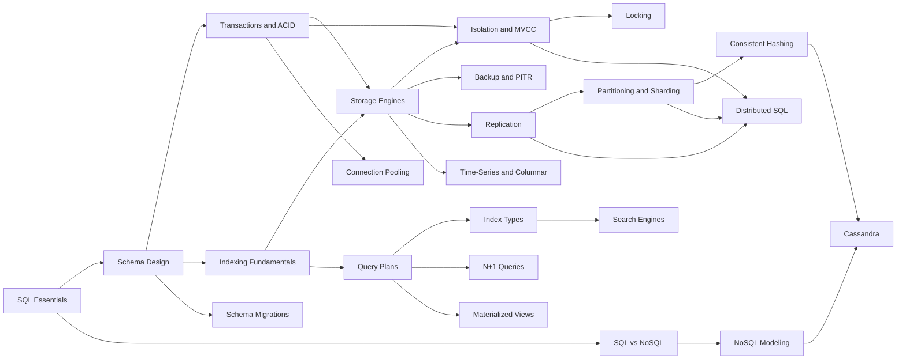

# 07 Databases MOC

> [!summary] What this folder covers
> SQL, transactions, indexes, storage engines, isolation and MVCC, replication, sharding, NoSQL, search and analytics stores. After this folder you can pick a datastore, model data for it, make queries fast, keep data correct under concurrency, and scale it across machines.

## Before and after

- **Before this:** [[01 CS Fundamentals MOC]]
- **After this:** [[08 Caching & Redis MOC]] · [[09 Messaging & Async MOC]] · [[10 Distributed Systems & Resilience MOC]] · [[18 AI Engineering MOC]]

Back to [[Home]].

## Learning path

1. [[SQL Essentials]] · basic. The query language every later note assumes: joins, grouping, window functions and CTEs. · Go code: [[SQL Essentials - Go|SQL Essentials - Go]]
2. [[SQL vs NoSQL]] · basic. How to choose a store from access patterns, consistency needs and scale.
3. [[Relational Schema Design]] · basic. Keys, normalization and constraints that keep data correct. · Go code: [[Relational Schema Design - Go|Relational Schema Design - Go]]
4. [[Transactions and ACID]] · basic. What a transaction guarantees and where to draw its boundaries. · Go code: [[Transactions and ACID - Go|Transactions and ACID - Go]]
5. [[Indexing Fundamentals]] · basic. Why a B-tree index turns a full scan into a few page reads. · Go code: [[Indexing Fundamentals - Go|Indexing Fundamentals - Go]]
6. [[Storage Engines - B-tree vs LSM and WAL]] · intermediate. How data actually lands on disk and survives a crash. · Go code: [[Storage Engines - B-tree vs LSM and WAL - Go|Storage Engines - B-tree vs LSM and WAL - Go]]
7. [[Isolation Levels and MVCC]] · intermediate. The anomalies each level allows and how snapshots prevent them. · Go code: [[Isolation Levels and MVCC - Go|Isolation Levels and MVCC - Go]]
8. [[Locking - Optimistic vs Pessimistic]] · intermediate. Row locks, version columns and deadlocks in practice. · Go code: [[Locking - Optimistic vs Pessimistic - Go|Locking - Optimistic vs Pessimistic - Go]]
9. [[Query Plans and EXPLAIN]] · intermediate. Reading a plan to find out why a query is slow. · Go code: [[Query Plans and EXPLAIN - Go|Query Plans and EXPLAIN - Go]]
10. [[Index Types and Index Design]] · intermediate. Composite, partial, covering, GIN, GiST and BRIN indexes, and how to design them. · Go code: [[Index Types and Index Design - Go|Index Types and Index Design - Go]]
11. [[N+1 Query Problem]] · intermediate. Spotting and fixing the most common ORM performance bug. · Go code: [[N+1 Query Problem - Go|N+1 Query Problem - Go]]
12. [[Connection Pooling]] · intermediate. Sizing pools and avoiding connection exhaustion. · Go code: [[Connection Pooling - Go|Connection Pooling - Go]]
13. [[Zero-Downtime Schema Migrations]] · intermediate. Expand and contract changes that never lock production. · Go code: [[Zero-Downtime Schema Migrations - Go|Zero-Downtime Schema Migrations - Go]]
14. [[Backup, PITR and Disaster Recovery]] · intermediate. RPO, RTO and restoring to any point in time. · Go code: [[Backup, PITR and Disaster Recovery - Go|Backup, PITR and Disaster Recovery - Go]]
15. [[Materialized Views and Denormalization]] · intermediate. Trading write cost and staleness for fast reads. · Go code: [[Materialized Views and Denormalization - Go|Materialized Views and Denormalization - Go]]
16. [[NoSQL Data Modeling]] · intermediate. Designing keys and documents around access patterns. · Go code: [[NoSQL Data Modeling - Go|NoSQL Data Modeling - Go]]
17. [[Replication]] · intermediate. Leaders, followers, lag and failover. · Go code: [[Replication - Go|Replication - Go]]
18. [[Partitioning and Sharding]] · advanced. Splitting data across machines and choosing a shard key. · Go code: [[Partitioning and Sharding - Go|Partitioning and Sharding - Go]]
19. [[Consistent Hashing]] · advanced. Rings and virtual nodes that move little data on resize. · Go code: [[Consistent Hashing - Go|Consistent Hashing - Go]]
20. [[Wide-Column Stores and Cassandra]] · advanced. Partition keys, clustering columns and tunable consistency. · Go code: [[Wide-Column Stores and Cassandra - Go|Wide-Column Stores and Cassandra - Go]]
21. [[Search Engines and Inverted Indexes]] · advanced. How full-text search, analyzers and relevance scoring work. · Go code: [[Search Engines and Inverted Indexes - Go|Search Engines and Inverted Indexes - Go]]
22. [[Time-Series and Columnar Storage]] · advanced. Column layouts, compression and rollups for analytics. · Go code: [[Time-Series and Columnar Storage - Go|Time-Series and Columnar Storage - Go]]
23. [[Distributed SQL]] · advanced. SQL and serializable transactions across many nodes with consensus. · Go code: [[Distributed SQL - Go|Distributed SQL - Go]]

## Concept map

## Interview focus

- What do the four ACID properties guarantee, and where should a transaction begin and end? See [[Transactions and ACID]].
- Which anomalies does each isolation level allow, and how does MVCC work? See [[Isolation Levels and MVCC]].
- When would you use optimistic versus pessimistic locking? See [[Locking - Optimistic vs Pessimistic]].
- How does a B-tree index work, and why does column order matter in a composite index? See [[Indexing Fundamentals]] and [[Index Types and Index Design]].
- This query is slow; how do you diagnose it? See [[Query Plans and EXPLAIN]].
- B-tree or LSM tree: which suits a write-heavy workload, and why? See [[Storage Engines - B-tree vs LSM and WAL]].
- SQL or NoSQL for this system, and why? See [[SQL vs NoSQL]].
- How do you pick a shard key, and what happens with hot partitions? See [[Partitioning and Sharding]].
- How does consistent hashing reduce data movement when nodes join or leave? See [[Consistent Hashing]].
- How does replication lag cause read-your-writes bugs, and how do you fix them? See [[Replication]].

## Sources worth reading

- Martin Kleppmann, *Designing Data-Intensive Applications*, chapters 2 to 9.
- Alex Petrov, *Database Internals*.
- Markus Winand, *Use The Index, Luke* (use-the-index-luke.com).
- The PostgreSQL documentation on concurrency control, indexes and `EXPLAIN`.
- Hermitage by Martin Kleppmann, a test suite of isolation anomalies across databases.
- The DynamoDB, Spanner and Cassandra papers.
