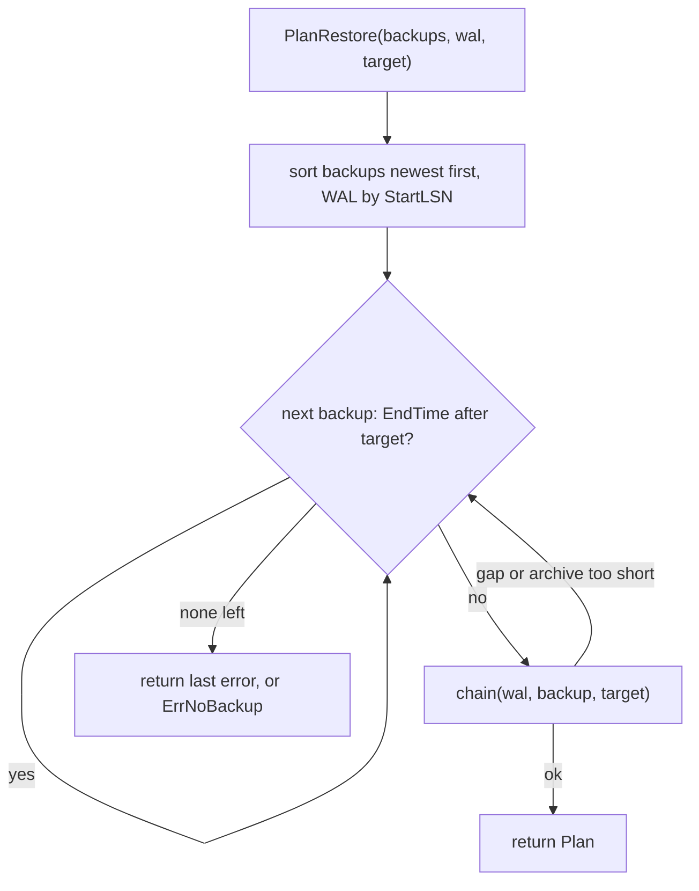
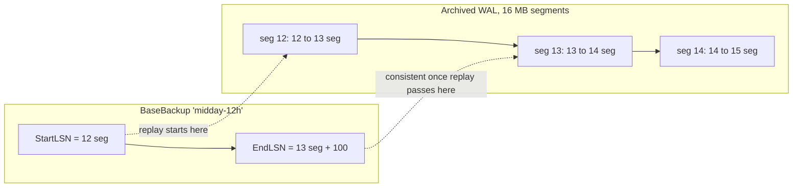
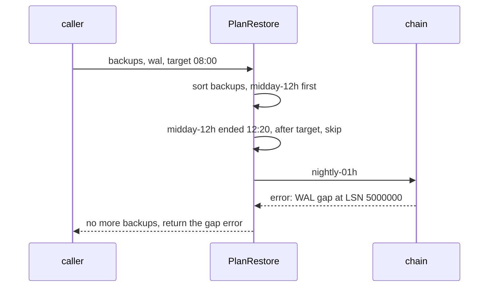
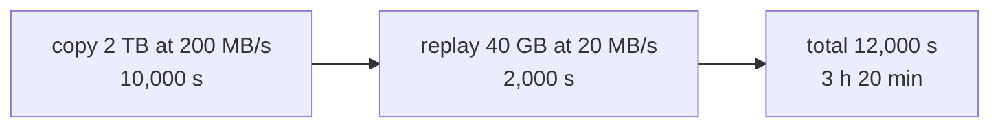
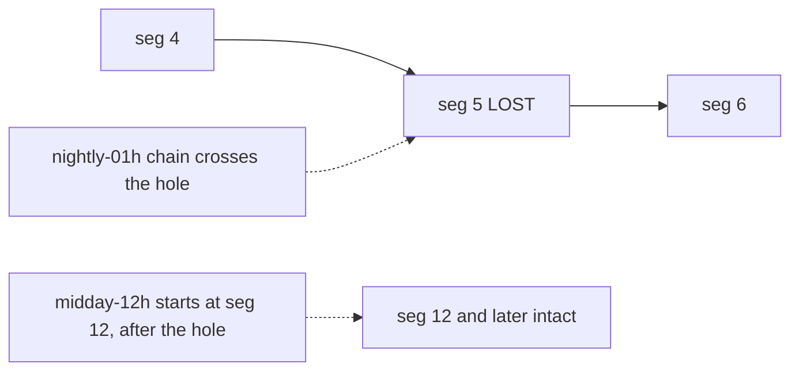

# Backup, PITR and Disaster Recovery - Go

> [!summary] TL;DR
> A small Go package that answers "if we had to restore to time T, which base backup and which WAL segments would we use, and is the chain unbroken?", plus a restore-time estimator. It implements the catalog check described in [[Backup, PITR and Disaster Recovery]] and is tested with `go test -race`.

> [!info] How to read this note (pick your level)
> - 🟢 **New to this?** Read "From zero" just below, then "Before the code" and "What this code shows". Skim the code steps without worrying about every line.
> - 🟡 **Know the basics?** Read the Code steps 1-4 and Design decisions, then Running it.
> - 🔴 **Interview / SDE-3 prep?** Add Tests, Pitfalls and the Exercises. Headings are tagged 🟢🟡🔴 so you always know where you are.

**From zero** 🟢 — This file is the hands-on twin of [[Backup, PITR and Disaster Recovery]]. It builds a tiny Go program that answers one question: "if we had to rewind the database to time T, do we have an unbroken set of backups and log files to do it?" Read the theory note first, then walk the code here top to bottom; each step is short and every test checks one rule.

## Before the code 🟢

- **Structs** (`BaseBackup`, `Segment`, `Plan`): plain records that stand in for the backup catalog; no database or S3 is touched.
- **`time.Time` and `time.Duration`**: the recovery target is a moment in time, and the restore estimate is a duration.
- **Multiple return values with `error`** (`(Plan, error)`): the planner returns either a plan or a reason the restore is impossible.
- **Slices** (`[]Segment`): the ordered list of archived WAL segments the planner walks.
- **Unit tests** with the `testing` package and `errors.Is`: each test builds a fixture and checks one rule.
- **What to run:** `go vet ./... && go test -race ./...` inside the module. No goroutines, interfaces or generics are needed.

## What this code shows 🟢

A point-in-time restore is only as good as the backup catalog behind it. This package models that catalog as plain structs and checks, before any disaster, whether a target time can be reached. Nothing here touches PostgreSQL or S3: the interesting logic is the arithmetic on log sequence numbers (LSNs), and plain structs make it fast and deterministic to test.

| Code | Concept in [[Backup, PITR and Disaster Recovery]] |
| --- | --- |
| `BaseBackup`, `Segment` | A base backup and the archived WAL segments, addressed by LSN ([[Backup, PITR and Disaster Recovery#3.2 Base backup plus WAL archive]]) |
| `PlanRestore` and `chain` | Choosing the newest backup before the target and checking the WAL chain is unbroken ([[Backup, PITR and Disaster Recovery#4.3 Checking that PITR is possible]]) |
| `ErrNoBackup`, gap errors | One missing segment makes the target unreachable |
| `RestoreTime` | The RTO arithmetic: copy time plus replay time ([[Backup, PITR and Disaster Recovery#4.2 Restore-time math]]) |



The diagram is the whole algorithm. Everything in the Code section below is one box of it.

## Setup 🟢

- Go 1.24, standard library only. No PostgreSQL or object storage is needed: backups and segments are plain structs, so the tests are fast and deterministic.
- Module layout: package `pitr` with `pitr.go` and `pitr_test.go`.
- Run it:

```text
go mod init example.com/pitr
go vet ./...
go test -race ./...
```

## Code 🟡

### Step 1: the catalog types

**In plain words:** first we define the records — what a backup is and what one log segment is — as plain Go structs.

**Concept.** A physical backup is a copy of the data files taken while the database kept running, so on its own it is inconsistent.

It becomes consistent only after WAL has been replayed from `StartLSN` up past `EndLSN` ([[Backup, PITR and Disaster Recovery#3.2 Base backup plus WAL archive]]). The WAL archive is a series of 16 MB files, each covering a byte range of the log.

Modelling both with LSNs (64-bit byte positions) lets "is there a gap?" become simple integer comparison. The alternative is to model files by name and parse timeline and segment numbers, which is closer to PostgreSQL but hides the idea behind string handling.

`Segment` also carries commit timestamps, because a recovery target is a time, not a byte position.

```go
package pitr

import (
	"errors"
	"fmt"
	"sort"
	"time"
)

// BaseBackup is one physical backup. Restoring it needs WAL from StartLSN;
// it is consistent once WAL has been replayed past EndLSN (written at EndTime).
type BaseBackup struct {
	Label            string
	StartLSN, EndLSN uint64
	EndTime          time.Time
}

// Segment is one archived WAL file: bytes [StartLSN, EndLSN) and the commit
// timestamps of the first and last transactions it contains.
type Segment struct {
	StartLSN, EndLSN    uint64
	FirstTime, LastTime time.Time
}
```

**How it works.**

1. `BaseBackup.StartLSN` is where WAL replay must begin. Replay cannot start later, or changes made while the copy was running would be lost.
2. `BaseBackup.EndLSN` and `EndTime` mark the moment the copy finished. A target time earlier than `EndTime` cannot use this backup, because the files are not yet consistent at that point.
3. `Segment` uses a half-open range `[StartLSN, EndLSN)`, so two adjacent segments satisfy `a.EndLSN == b.StartLSN` with no overlap and no hole.
4. `FirstTime` and `LastTime` are the commit timestamps inside the segment. They let the planner decide whether a segment reaches the target time.



### Step 2: the planner

**In plain words:** the planner picks the newest backup taken before the target time and asks "can I reach the target from here?"

**Concept.** `PlanRestore` implements the selection rule from [[Backup, PITR and Disaster Recovery#4.3 Checking that PITR is possible]]: use the newest backup that finished before the target, because it needs the least WAL replay and so gives the shortest RTO. The twist is the fallback.

If the newest backup's WAL chain is broken, an older backup might still have an unbroken chain, so the loop keeps trying instead of failing on the first error.

The alternative is to pick one backup and fail fast, which is simpler but turns one lost segment into "restore impossible" even when another path exists. The function also remembers the last error so the caller learns why the final attempt failed.

```go
// Plan is what a restore to a target time needs.
type Plan struct {
	Backup   BaseBackup
	Segments []Segment
}

var ErrNoBackup = errors.New("no base backup finished before the target")

// PlanRestore picks the newest backup that finished before target and checks
// that archived WAL runs without gaps from its StartLSN until a segment whose
// last commit is at or after target. A gap means PITR to target is impossible.
func PlanRestore(backups []BaseBackup, wal []Segment, target time.Time) (Plan, error) {
	sort.Slice(backups, func(i, j int) bool { return backups[i].EndTime.After(backups[j].EndTime) })
	sort.Slice(wal, func(i, j int) bool { return wal[i].StartLSN < wal[j].StartLSN })

	var lastErr error = ErrNoBackup
	for _, b := range backups {
		if b.EndTime.After(target) {
			continue
		}
		segs, err := chain(wal, b, target)
		if err == nil {
			return Plan{Backup: b, Segments: segs}, nil
		}
		lastErr = err // an older backup may still have an unbroken chain
	}
	return Plan{}, lastErr
}
```

**How it works.**

1. `Plan` is the answer: one backup to restore and the ordered segments to replay on top of it.
2. `ErrNoBackup` is a sentinel error. Callers test it with `errors.Is`, so it must be a package-level variable created once.
3. The first `sort.Slice` orders backups newest first by `EndTime`, so the loop visits the cheapest restore first. The second orders WAL by `StartLSN`, which `chain` relies on to walk the log in order.
4. `lastErr` starts as `ErrNoBackup`. If the loop never reaches `chain` (every backup ended after the target), that is the error returned.
5. `continue` skips backups whose `EndTime` is after the target. This is the rule that a backup must finish before the moment you want to restore to.
6. The first backup whose chain succeeds wins and returns at once. A failed chain stores its error in `lastErr` and the loop moves to the next, older backup.



### Step 3: walking the WAL chain

**In plain words:** this walks the log segments one by one, checking each starts exactly where the last one ended — one gap and the restore is impossible.

**Concept.** The chain check is the heart of [[Backup, PITR and Disaster Recovery#4.3 Checking that PITR is possible]]. Keep a cursor `next`, the next LSN byte we need.

Skip segments that end at or before the cursor (already covered), fail if a segment starts after the cursor (a hole), otherwise take it and advance the cursor to its end.

Stop as soon as two things are true: replay has passed the backup's `EndLSN` (the copy is consistent) and the segment reaches the target time.

The alternative is to list expected file names and check each exists, which needs the naming scheme; comparing LSN ranges checks continuity directly and works for any segment size.

```go
func chain(wal []Segment, b BaseBackup, target time.Time) ([]Segment, error) {
	next := b.StartLSN
	var out []Segment
	for _, s := range wal {
		if s.EndLSN <= next {
			continue // fully before what we need
		}
		if s.StartLSN > next {
			return nil, fmt.Errorf("backup %s: WAL gap at LSN %X", b.Label, next)
		}
		out = append(out, s)
		next = s.EndLSN
		if next > b.EndLSN && !s.LastTime.Before(target) {
			return out, nil
		}
	}
	return nil, fmt.Errorf("backup %s: archive ends at LSN %X before target", b.Label, next)
}
```

**How it works.**

1. `next := b.StartLSN`: replay must begin exactly at the backup's start, so the cursor starts there.
2. `s.EndLSN <= next` skips older segments. The archive holds WAL from before this backup too, and those files are irrelevant.
3. `s.StartLSN > next` is the gap test. If the next segment begins after the byte we need, some segment between them is missing, and the error names the exact LSN, printed in hex with `%X` as PostgreSQL does.
4. `out = append(out, s)` and `next = s.EndLSN` accept the segment and move the cursor to its end, so the next segment must start there.
5. The success test `next > b.EndLSN && !s.LastTime.Before(target)` needs both halves. Without the first, a very early target could stop before the backup is consistent. Without the second, we would stop before reaching the target.
6. Falling out of the loop means the archive ended too early. The error says where, which tells an operator that archiving stopped or lags behind.

Trace of the walk for the midday backup and a 14:41:59 target (segment `n` covers hour `n`, so `seg` below means one 16 MB segment):

| Segment | Action | `next` after | Reason |
| --- | --- | --- | --- |
| 0 to 11 | skip | 12 seg | `EndLSN <= next` |
| 12 | take | 13 seg | starts at `next`; 13 seg is not past `EndLSN` (13 seg + 100) |
| 13 | take | 14 seg | past `EndLSN`, but `LastTime` 13:59 is before the target |
| 14 | take, return | 15 seg | `LastTime` 14:59 is at or after 14:41:59 |

### Step 4: the restore-time estimate

**In plain words:** simple arithmetic — time to copy the backup plus time to replay the log — so you know your RTO before the bad day.

**Concept.** RTO is not a promise, it is arithmetic you can do in advance ([[Backup, PITR and Disaster Recovery#4.2 Restore-time math]]). Restoring the database takes two phases: copying the base backup back onto disk, then replaying WAL on top.

Copy speed is bounded by network or disk bandwidth, replay speed by how fast the server applies changes, and the two are usually very different.

The function keeps both rates as parameters instead of constants, because the right numbers come from a restore drill, not from a datasheet.

```go
// RestoreTime estimates RTO for the database step: copy the base backup,
// then replay WAL. Rates are bytes per second.
func RestoreTime(backupBytes, copyRate, walBytes, replayRate float64) time.Duration {
	secs := backupBytes/copyRate + walBytes/replayRate
	return time.Duration(secs * float64(time.Second))
}
```

**How it works.**

1. All four inputs are `float64` so callers can write `2e12` and `200e6`. The result is a `time.Duration`, which prints as `3h20m0s`.
2. `backupBytes/copyRate` is the copy phase. `walBytes/replayRate` is the replay phase. They add, because replay cannot start until the files are in place.
3. Multiplying by `float64(time.Second)` converts seconds to nanoseconds, the unit of `Duration`.

For 2 TB at 200 MB/s plus 40 GB of WAL at 20 MB/s:



## Design decisions 🟡

| Choice | Alternative | Trade-off |
| --- | --- | --- |
| LSN integers for continuity | Parse WAL file names | Integer ranges are simple and size-independent; real tools must still map file names to LSNs |
| Try older backups after a failed chain | Fail on the newest backup | Resilient to one lost segment, at the cost of a longer restore |
| Newest backup first | Oldest backup first | Newest means least WAL to replay and the shortest RTO |
| Sentinel `ErrNoBackup` plus formatted errors | One error type with fields | `errors.Is` is easy; gap details live only in the message text |
| Plain structs, no database | Query `pg_stat_archiver` or S3 | Fast deterministic tests, but the catalog must be filled by something else in production |
| `sort.Slice` in place | Copy then sort | No allocation, but the caller's slices are reordered (see Pitfalls) |
| Rates as parameters | Constants | Honest about being estimates; the caller supplies drill measurements |

## Tests 🟡

The tests share one fixture: one WAL segment per hour from midnight (24 segments of 16 MB), and two backups, a nightly one finishing at 01:30 and a midday one finishing at 12:20.

Five tests then cover the newest-backup choice, the fallback to the nightly backup, a lost segment, no backup, an archive that ends too early, and the restore-time arithmetic.

### The fixture

**In plain words:** the fixture is a small fake catalog (two backups, a handful of segments) that every test reuses.

**Concept.** `walHours(n)` builds `n` consecutive segments, each hour covering `[i*seg, (i+1)*seg)`, with `LastTime` 59 minutes after `FirstTime`. The two backups have `EndLSN` just past a segment boundary (`+ 100` bytes), so the planner must include the segment after the start segment, exactly like a real backup that ends mid-file.

```go
package pitr

import (
	"errors"
	"strings"
	"testing"
	"time"
)

const seg = 16 << 20 // 16 MB WAL segments

var day = time.Date(2026, 11, 3, 0, 0, 0, 0, time.UTC)

// hourly segments from LSN 0, one segment per hour starting at midnight
func walHours(n int) []Segment {
	var w []Segment
	for i := 0; i < n; i++ {
		t := day.Add(time.Duration(i) * time.Hour)
		w = append(w, Segment{uint64(i) * seg, uint64(i+1) * seg, t, t.Add(59 * time.Minute)})
	}
	return w
}

var backups = []BaseBackup{
	{"nightly-01h", 1 * seg, 2*seg + 100, day.Add(1*time.Hour + 30*time.Minute)},
	{"midday-12h", 12 * seg, 13*seg + 100, day.Add(12*time.Hour + 20*time.Minute)},
}
```

**How it works.**

1. `16 << 20` is 16 MiB, the PostgreSQL default WAL segment size.
2. `walHours` returns a fresh slice every call, so tests that delete a segment do not disturb each other.
3. `backups` is declared oldest first on purpose. `PlanRestore` sorts it, so the tests also prove the sort works. Because `PlanRestore` sorts in place, the shared variable ends up newest first after the first test, which is harmless here.

### Test 1: newest backup before the target wins

**Property.** With both backups available, a target in the afternoon must use the midday backup and only the three segments it needs. This matters because choosing the nightly backup would work but replay 13 hours of WAL instead of 3.

| Input | Expected |
| --- | --- |
| target 14:41:59, 24 segments | backup `midday-12h`, 3 segments (12, 13, 14) |

```go
func TestPicksNewestBackupBeforeTarget(t *testing.T) {
	target := day.Add(14*time.Hour + 41*time.Minute + 59*time.Second) // 14:41:59
	p, err := PlanRestore(backups, walHours(24), target)
	if err != nil {
		t.Fatal(err)
	}
	if p.Backup.Label != "midday-12h" || len(p.Segments) != 3 { // segments 12, 13, 14
		t.Fatalf("got %s with %d segments", p.Backup.Label, len(p.Segments))
	}
}
```

**What a failure means.** A wrong label means the sort order or the `EndTime.After(target)` rule is broken. A wrong segment count means `chain` stops too early (before the target time) or too late (does not stop at the first segment that reaches the target), so the RTO estimate would be wrong.

### Test 2: a target before the newest backup finished

**Property.** A backup that finishes after the target must not be used, even though its start LSN is earlier. A base backup is consistent only after its end, so the planner has to drop to the nightly backup.

| Input | Expected |
| --- | --- |
| target 12:05, midday backup ended 12:20 | backup `nightly-01h`, 12 segments (1 to 12), no error |

```go
func TestTargetBeforeMiddayUsesNightly(t *testing.T) {
	target := day.Add(12*time.Hour + 5*time.Minute) // midday backup not finished yet
	p, err := PlanRestore(backups, walHours(24), target)
	if err != nil || p.Backup.Label != "nightly-01h" || len(p.Segments) != 12 {
		t.Fatalf("got %+v, %v", p.Backup, err)
	}
}
```

**What a failure means.** If `midday-12h` were chosen, the restore would start from files that were not yet consistent at 12:05. That is silent corruption, the worst failure a backup tool can have.

### Test 3: a lost segment

**Property.** One lost WAL segment breaks every chain that crosses it, but a backup taken after the hole is still usable. This is the key behaviour of the note: a single missing file removes hours of PITR window.



| Input | Expected |
| --- | --- |
| segment 5 deleted, target 14:00 | backup `midday-12h`, no error |
| segment 5 deleted, target 08:00 | error containing `WAL gap` |

```go
func TestGapFallsBackOrFails(t *testing.T) {
	w := walHours(24)
	w = append(w[:5], w[6:]...) // segment 5 lost: nightly chain is broken
	target := day.Add(14 * time.Hour)
	if p, err := PlanRestore(backups, w, target); err != nil || p.Backup.Label != "midday-12h" {
		t.Fatalf("midday chain is intact, got %v", err)
	}
	_, err := PlanRestore(backups, w, day.Add(8*time.Hour))
	if err == nil || !strings.Contains(err.Error(), "WAL gap") {
		t.Fatalf("want WAL gap error, got %v", err)
	}
}
```

**What a failure means.** If the first call errors, the planner stopped at the gap instead of using a backup that avoids it. If the second call succeeds, the gap check is missing and a restore would fail midway, during a real incident.

### Test 4: no backup, and an archive that stops too early

**Property.** The two remaining failure modes return distinct, diagnosable errors: no backup finished before the target at all, and a chain that is unbroken but ends before the target.

| Input | Expected |
| --- | --- |
| target 01:00 (both backups end later) | `errors.Is(err, ErrNoBackup)` |
| only 14 segments archived, target 20:00 | error containing `before target` |

```go
func TestNoBackupAndArchiveTooShort(t *testing.T) {
	if _, err := PlanRestore(backups, walHours(24), day.Add(time.Hour)); !errors.Is(err, ErrNoBackup) {
		t.Fatalf("want ErrNoBackup, got %v", err)
	}
	_, err := PlanRestore(backups, walHours(14), day.Add(20*time.Hour))
	if err == nil || !strings.Contains(err.Error(), "before target") {
		t.Fatalf("want short-archive error, got %v", err)
	}
}
```

**What a failure means.** The first check protects the sentinel: if the loop wrongly calls `chain` for a too-new backup, a different error leaks out. The second protects the loop-exit message: without it, an archive that stopped (a broken `archive_command`) would look like a success with too few segments.

### Test 5: restore-time arithmetic

**Property.** `RestoreTime` adds copy time and replay time with the right units.

| Input | Expected |
| --- | --- |
| 2 TB at 200 MB/s, 40 GB at 20 MB/s | 10,000 s + 2,000 s = 12,000 s (3 h 20 min) |

```go
func TestRestoreTime(t *testing.T) {
	// 2 TB at 200 MB/s, plus 40 GB of WAL replayed at 20 MB/s
	got := RestoreTime(2e12, 200e6, 40e9, 20e6)
	if got != 12000*time.Second { // 10,000 s + 2,000 s = 3h20m
		t.Fatalf("got %v", got)
	}
}
```

**What a failure means.** A wrong value means a unit slip (bytes versus megabytes) or a swapped rate, which would make the RTO in the runbook wrong by a large factor.

## Running it 🟢

Measured: `go vet` is clean and `go test -race` passes with Go 1.24.4 (darwin/arm64).

```text
--- PASS: TestPicksNewestBackupBeforeTarget (0.00s)
--- PASS: TestTargetBeforeMiddayUsesNightly (0.00s)
--- PASS: TestGapFallsBackOrFails (0.00s)
--- PASS: TestNoBackupAndArchiveTooShort (0.00s)
--- PASS: TestRestoreTime (0.00s)
PASS
ok  	example.com/pitr	1.219s
```

Reading the output line by line:

1. Each `--- PASS` line is one test and its wall time. `0.00s` is expected: the tests do arithmetic on small slices and touch no disk or network.
2. `TestGapFallsBackOrFails` passing is the important line. One lost WAL segment silently removes hours of the PITR window, and only an older-or-newer backup with an unbroken chain can help.
3. `TestRestoreTime` is the 2 TB example with a smaller, 40 GB WAL replay: 10,000 s + 2,000 s = 3 h 20 min.
4. `PASS` is the overall package result.
5. `ok  example.com/pitr  1.219s` is the package summary. The 1.2 s is mostly compiling with the race detector, not test time.

## Pitfalls in the code 🔴

- `PlanRestore` sorts the slices it receives, which reorders the caller's data. Pass copies if order matters to you.
- The segment size here is 16 MB, as in PostgreSQL's default; real WAL files are named by timeline and segment number, and LSNs are 64-bit byte positions.
- The check compares `LastTime` against the target, so segments need correct commit-timestamp metadata. A catalog that records only file times would make the check wrong.
- A backup that ended after the target is skipped even if its start LSN is earlier, because a base backup is consistent only after WAL past its end has been replayed.
- The rates passed to `RestoreTime` are estimates. Measure them in a restore drill.

## Exercises 🔴

1. In `TestGapFallsBackOrFails`, delete segment 13 instead of segment 5 and keep the 14:00 target. Predict whether any backup can serve the target.
2. Change the 40 GB of WAL in `TestRestoreTime` to 48 GB (6 hours at 8 GB per hour). Predict the new duration.
3. Add a third backup `{"afternoon-14h", 14 * seg, 14*seg + 100, day.Add(14*time.Hour + 30*time.Minute)}` and ask for the 14:41:59 target. Predict the chosen label and how many segments the plan contains.

> [!example]- Full file: pitr.go
> ```go
> package pitr
>
> import (
> 	"errors"
> 	"fmt"
> 	"sort"
> 	"time"
> )
>
> // BaseBackup is one physical backup. Restoring it needs WAL from StartLSN;
> // it is consistent once WAL has been replayed past EndLSN (written at EndTime).
> type BaseBackup struct {
> 	Label            string
> 	StartLSN, EndLSN uint64
> 	EndTime          time.Time
> }
>
> // Segment is one archived WAL file: bytes [StartLSN, EndLSN) and the commit
> // timestamps of the first and last transactions it contains.
> type Segment struct {
> 	StartLSN, EndLSN    uint64
> 	FirstTime, LastTime time.Time
> }
>
> // Plan is what a restore to a target time needs.
> type Plan struct {
> 	Backup   BaseBackup
> 	Segments []Segment
> }
>
> var ErrNoBackup = errors.New("no base backup finished before the target")
>
> // PlanRestore picks the newest backup that finished before target and checks
> // that archived WAL runs without gaps from its StartLSN until a segment whose
> // last commit is at or after target. A gap means PITR to target is impossible.
> func PlanRestore(backups []BaseBackup, wal []Segment, target time.Time) (Plan, error) {
> 	sort.Slice(backups, func(i, j int) bool { return backups[i].EndTime.After(backups[j].EndTime) })
> 	sort.Slice(wal, func(i, j int) bool { return wal[i].StartLSN < wal[j].StartLSN })
>
> 	var lastErr error = ErrNoBackup
> 	for _, b := range backups {
> 		if b.EndTime.After(target) {
> 			continue
> 		}
> 		segs, err := chain(wal, b, target)
> 		if err == nil {
> 			return Plan{Backup: b, Segments: segs}, nil
> 		}
> 		lastErr = err // an older backup may still have an unbroken chain
> 	}
> 	return Plan{}, lastErr
> }
>
> func chain(wal []Segment, b BaseBackup, target time.Time) ([]Segment, error) {
> 	next := b.StartLSN
> 	var out []Segment
> 	for _, s := range wal {
> 		if s.EndLSN <= next {
> 			continue // fully before what we need
> 		}
> 		if s.StartLSN > next {
> 			return nil, fmt.Errorf("backup %s: WAL gap at LSN %X", b.Label, next)
> 		}
> 		out = append(out, s)
> 		next = s.EndLSN
> 		if next > b.EndLSN && !s.LastTime.Before(target) {
> 			return out, nil
> 		}
> 	}
> 	return nil, fmt.Errorf("backup %s: archive ends at LSN %X before target", b.Label, next)
> }
>
> // RestoreTime estimates RTO for the database step: copy the base backup,
> // then replay WAL. Rates are bytes per second.
> func RestoreTime(backupBytes, copyRate, walBytes, replayRate float64) time.Duration {
> 	secs := backupBytes/copyRate + walBytes/replayRate
> 	return time.Duration(secs * float64(time.Second))
> }
> ```

## Links

- Theory: [[Backup, PITR and Disaster Recovery]]
- **Before this:** [[Storage Engines - B-tree vs LSM and WAL]], [[Replication]]
- **Next:** [[High Availability and Failover]], [[Incident Response]]
