# Backup, PITR and Disaster Recovery

> [!summary] TL;DR
> A **backup** is a copy of the database you can restore later, kept separate from the live system. **PITR** (point-in-time recovery) restores a full copy and then replays the database's change log up to an exact moment, such as one second before a bad deploy. **Disaster recovery** is the whole plan for getting the service back after losing data or a region, sized by two numbers: how much data you may lose (RPO) and how long you may be down (RTO).

> [!abstract] Core idea
> - A replica is not a backup: a `DROP TABLE` or a buggy `UPDATE` reaches every replica within milliseconds.
> - A physical base backup plus a continuous archive of the write-ahead log (WAL) lets you restore to any second inside the retention window.
> - RPO (data you can lose) and RTO (time to recover) are business numbers; they decide the tools and the cost.
> - Keep 3 copies on 2 kinds of storage, 1 off-site, and make at least one immutable.
> - A backup you have never restored is a hope, not a backup: automate restore drills and verify the data.

## Start here: the basics 🟢

> [!info] How to read this note (pick your level)
> - 🟢 **New to this?** Read "From zero" below, then sections 1, 2 and the cheat sheet (10). Stop there, that is a full first pass.
> - 🟡 **Know the basics?** Add section 3 (how it works), 4 (worked example) and 5-6 (variants and trade-offs).
> - 🔴 **Interview / SDE-3 prep?** Add 7, 8 and 9. Headings are tagged 🟢🟡🔴 so you always know where you are.

> [!note] Before this note
> - [[Storage Engines - B-tree vs LSM and WAL]]: the database writes every change into a log file (the WAL) before it changes the real tables, so the log can be replayed later.
> - [[Replication]]: a replica is a second live server that copies every write from the main one a few milliseconds later.

**From zero, in 60 seconds** 🟢

Your database holds all your invoices. One day someone runs a delete by mistake, and the rows are gone everywhere, even on the live copies.

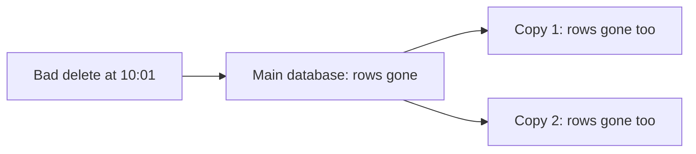

A **backup** is a saved photo of the data, kept somewhere safe. The database also keeps a diary of every change, called the **WAL**. Put the two together and you can rebuild the data as it was at any second. That trick is called **PITR** (point-in-time recovery): start from the photo, replay the diary, stop just before the mistake.


The rest of this note is just these 3 questions:
1. Why can't the live copies save you? (sections 1-2)
2. How do you rebuild to an exact second? (sections 3-4)
3. How do you know your backups will actually work on the bad day? (sections 5-8)

**The problem in one story.**
A teammate runs `DELETE FROM invoices` and forgets the `WHERE`.
The database has two replicas, but they copy the delete within milliseconds.
Every copy now agrees: the invoices are gone.
A backup lets you go back to "one second before the mistake" and get them back.

**Words you need first**

| Word | Plain meaning | Tiny example |
| --- | --- | --- |
| Backup | A saved copy of the data kept somewhere else | Last night's copy of the database in S3 |
| Replica | A live copy that follows the main database | A read-only server that copies every write |
| WAL (write-ahead log) | A diary of every change, written before the change is applied | "10:01:05 deleted invoice 42" |
| PITR | Point-in-time recovery: restore to any chosen second | Restore to 10:01:04, just before the bad delete |
| RPO | How much recent data you can afford to lose | RPO 1 min = lose at most the last minute |
| RTO | How long you can afford to be down while restoring | RTO 1 h = service back within an hour |
| Restore drill | A practice restore to prove backups work | Every Monday, restore to a test server and check row counts |
| Base backup | A full copy of the database files, taken while it runs; the starting point for PITR | The 01:00 copy of all 2 TB |
| WAL segment | One 16 MB file of the WAL; the archive is a long chain of them | Segment 42 holds the changes from 14:00 to 14:05 |
| LSN | Log sequence number: the byte position inside the WAL, like a page number in the diary | "backup starts at LSN 1/0" |
| Failover | Switching traffic to a replica when the main server dies | Replica in zone B becomes the new main |
| Object storage | Cheap cloud storage for files (Amazon S3 and similar) | WAL segments uploaded to an S3 bucket |
| Immutable copy | A backup that nobody, not even an admin, can delete until a set date | S3 Object Lock for 35 days |

**Picture it**

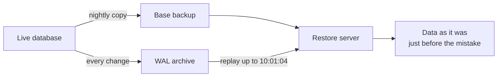

**Analogy.** A base backup is a photo of your room taken last night; the WAL is a video of everything that changed since. To see the room at 10:01, start from the photo and play the video up to 10:01.
Where it breaks: a lost piece of the video means you cannot get past that point, while a real video would just skip a few frames.

**How the rest of this note builds up**

- First, why replicas are not backups (section 1) and the mental model of snapshot plus log (section 2).
- Then how it works: logical vs physical backups, base backup plus WAL archive, the restore procedure and where RPO comes from (section 3).
- Then worked numbers for InvoiceOps: setting RPO/RTO, restore-time math, a one-tenant restore and a drill (section 4).
- Finally the SDE-3 view: DR tiers, managed vs self-managed tools, immutable copies and lessons from real incidents (sections 5-8).

> [!tip] Remember
> A replica copies mistakes; a base backup plus the WAL lets you rewind to the second before them.

## 1. Why it exists 🟢

At 14:42 on a Tuesday an InvoiceOps engineer runs a data-fix script. A missing `WHERE` clause turns it into:

```sql
UPDATE invoices SET status = 'void', amount_due_minor = 0;  -- all 10 M rows
```

InvoiceOps (the running example in these notes: an invoicing app where many customer companies share one database) runs a **primary** (the main server that accepts writes) with two **streaming replicas** (servers that receive each change as a live stream and apply it; see [[Replication]]). Both replicas apply the update within 40 ms. Failover does not help: every copy of the data is now wrong. What helps is a copy of the database **as it was at 14:41:59**, and that needs:

1. a full copy taken earlier (last night's base backup), and
2. every change made since then, in order, so the database can replay them and stop just before the bad statement.

The cost of not having it is concrete. The newest copy without PITR might be last night's 01:00 `pg_dump` (PostgreSQL's tool that writes the whole database out as one SQL file); restoring it loses 13 hours and 42 minutes of invoices, payments and webhooks, which then have to be rebuilt from payment-provider exports and emails.

### Real-life example: a food-delivery order history 🟢

Think of an app like Swiggy, which keeps every order in a database.
Say a late-night script meant to clear test orders deletes real orders from yesterday instead.
The replicas copy the delete within a second, so switching servers does not help.
With PITR the team restores a side copy to one second before the script ran and copies yesterday's orders back.
Customers still see their past orders and refunds still work, and the team loses only a few hours of cleanup time, not the data.

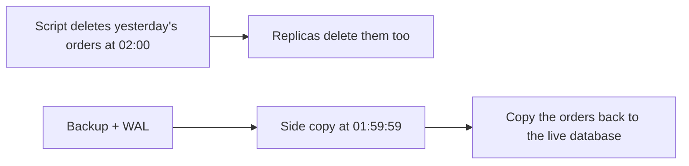

## 2. Mental model 🟢

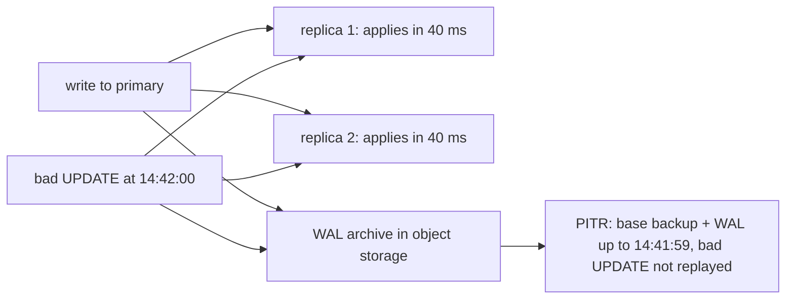

The diagram shows why a replica cannot undo a mistake: it applies the bad statement as faithfully as any other. Only the archive, which can be replayed to a chosen stopping point, can.

Think of the database as a ledger book and the WAL as the carbon copies of every page written since the ledger was photocopied.

- The **base backup** is the photocopy of the whole ledger, taken at night.
- The **WAL archive** is the stack of carbon copies of every entry since, shipped off-site every few minutes.
- **PITR** is: take the photocopy, re-apply carbon copies in order, stop at entry 14:41:59.
- A **replica** is a second ledger that copies every entry as it is written, mistakes included. Good for "the first book burned", useless for "someone wrote nonsense in it".

Two numbers frame every decision:
- **RPO (Recovery Point Objective):** the most data, measured in time, you accept losing. "RPO 5 minutes" means after a disaster at 14:42 you must recover everything up to at least 14:37.
- **RTO (Recovery Time Objective):** the most time you accept being down. "RTO 1 hour" means service is back by 15:42.


## Common beginner mistakes 🟢

- **Treating replicas as backups** → a replica copies a bad `DELETE` within milliseconds, so every copy is wrong → keep PITR backups as well as replicas.
- **Never testing a restore** → backups can fail quietly for months (GitLab in 2017 found out on the bad day) → run an automated restore drill every week and check row counts.
- **Keeping backups in the same account and region as the database** → one leaked admin key or one region outage takes both → copy backups to another account and another region.
- **Restoring on top of production** → you wipe out everyone's good work since the mistake → restore to a new side server, then copy only the damaged rows back.
- **Ignoring the WAL archive** → one missing WAL file breaks PITR for every second after it → alert when archiving fails or falls behind.

## 3. How it works 🟡

> 🟢 → 🟡 **You now know** why replicas cannot undo a mistake and that a backup plus the change diary can rewind time. **Next we open the box**: the two kinds of backup, how the diary gets shipped, how a restore actually runs, and what decides RPO. Each subsection starts with a short step-by-step walk.

### 3.1 Logical vs physical backups

**In plain words:** there are two ways to copy a database — write out the data as SQL you can replay anywhere (logical, like re-typing a book), or copy the raw files byte for byte (physical, like photocopying it). Photocopying is faster but only works on the same kind of machine.

**Step by step:**
1. Logical: `pg_dump` reads every row of `invoices` and writes it out as text, such as `COPY invoices ... 10 M rows`.
2. To restore it, a fresh server re-inserts all 10 M rows and then rebuilds every index, which is slow.
3. Physical: `pg_basebackup` copies the raw data files of the whole server, all 2 TB, as they are.
4. To restore it, you copy those files back and start PostgreSQL. No rows are re-inserted, so it is much faster.
5. Only the physical copy can be combined with the WAL to reach an exact second.

| | Logical (`pg_dump`, `mysqldump`) | Physical (`pg_basebackup`, volume snapshot) |
| --- | --- | --- |
| What it copies | SQL statements or table data: `CREATE TABLE`, `COPY` rows | The data files, byte for byte |
| Scope | One database, or chosen tables or schemas | The whole cluster (every database on the server) |
| Consistency | One snapshot; `pg_dump` uses a single repeatable-read transaction | Consistent only with the WAL written during the copy |
| Restore speed | Slow: reinserts every row and rebuilds every index | Fast: copy files back, replay WAL |
| Portable across major versions / platforms | Yes | No, same major version and architecture |
| PITR | No: a dump is one moment | Yes, with WAL archiving |
| Typical use | Small DBs, upgrades, one-table restores, dev copies | Production recovery |

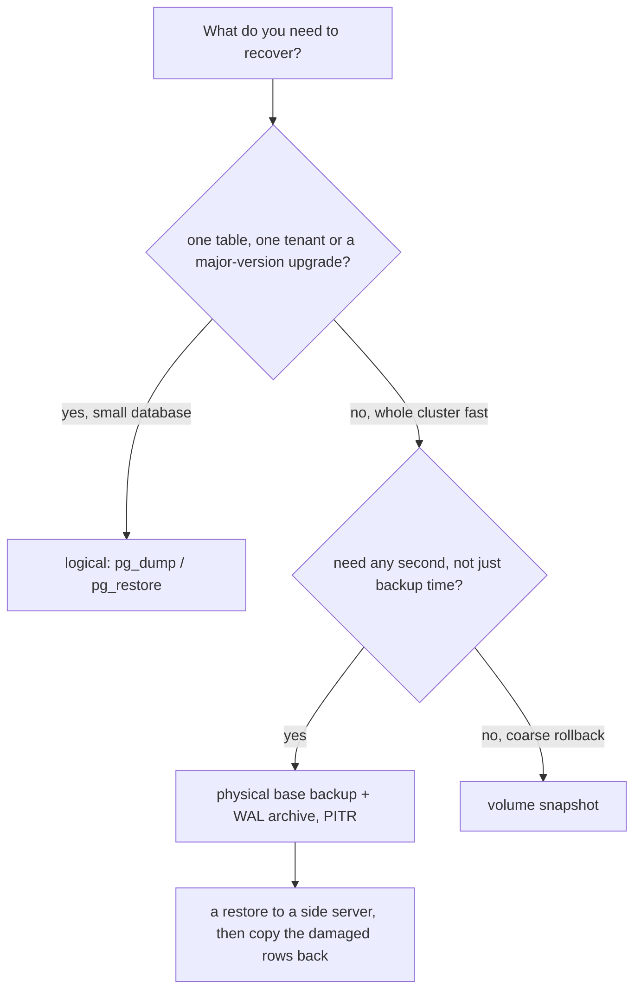

`pg_dump -Fc` (custom format) or `-Fd -j 8` (directory format, 8 parallel jobs) produces dumps that `pg_restore` can restore in parallel or partially, for example only `-t invoices`.

### 3.2 Base backup plus WAL archive

**In plain words:** the base backup is the nightly photo; the WAL archive is the change diary shipped off-site every minute. Together they let you rebuild to any second.

**Step by step:**
1. PostgreSQL writes every change into the WAL, one 16 MB file (a segment) at a time.
2. When a segment is full, PostgreSQL runs your `archive_command`, which uploads it to S3.
3. At 01:00 a backup tool copies all the data files while the server keeps running.
4. Those copied files are a bit messy on their own, because writes kept happening during the copy.
5. Replaying the WAL from the backup's start to its end tidies them into one clean state. From there, more WAL takes you forward to any second you choose.

Every change PostgreSQL makes is first written to the **WAL** (write-ahead log; see [[Storage Engines - B-tree vs LSM and WAL]]) in 16 MB files called segments.

With `archive_mode = on`, each completed segment is handed to `archive_command` (a shell command you configure; or an `archive_library`, a plug-in, since PostgreSQL 15), which copies it to object storage.

A **base backup** is a copy of the **data directory** (the folder on disk where PostgreSQL keeps all its table and index files) taken while the server runs; the files are inconsistent on their own, but together with the WAL from the backup's start to its end they become consistent.

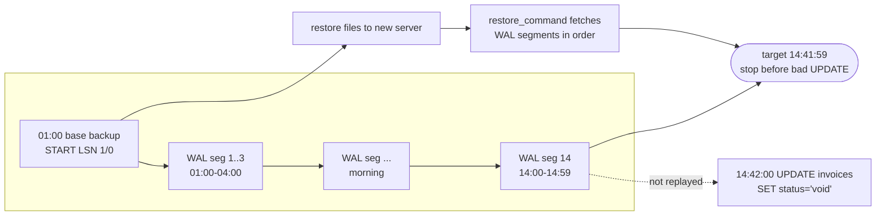

### The restore procedure

**In plain words:** restoring is a recipe — copy the photo to a fresh server, tell it where the diary lives and what second to stop at, then start it and let it replay.

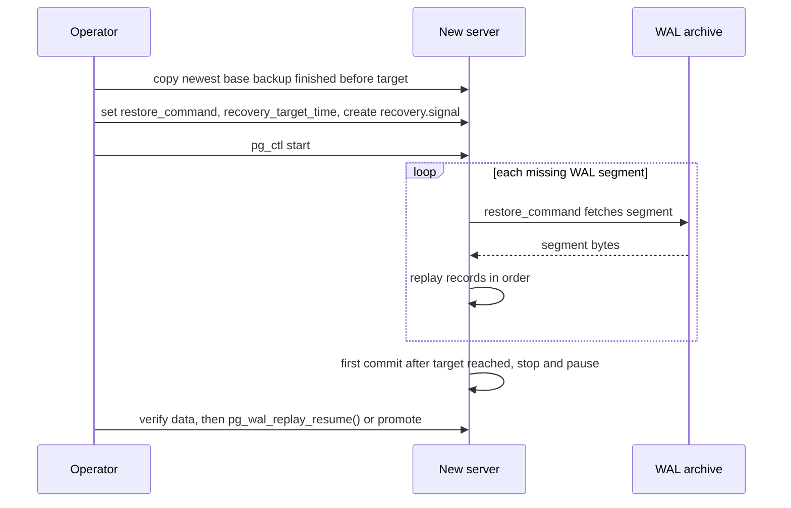

The restore:
1. Copy the newest base backup that **finished before** the target time to a new server.
2. Set `restore_command` (how to fetch archived WAL) and `recovery_target_time = '2026-11-03 14:41:59+05:30'`, and create the file `recovery.signal` (PostgreSQL 12+).
3. Start PostgreSQL. It replays WAL until the first commit after the target, then stops. `recovery_target_action = 'pause'` (the default) lets you inspect the data before calling `pg_wal_replay_resume()` or promoting.
4. Point the application at it, or copy the damaged rows back into the production primary.

**Any missing segment between the backup's start and the target makes the target unreachable.** WAL archiving needs monitoring as much as the backups do.

### 3.3 Where RPO comes from

**In plain words:** RPO is simply "how much of the diary could I lose?" — whatever sits in the page that has not been shipped off-site yet.

**Step by step:**
1. Segments 41 and 42 are full and already sit in S3. They are safe.
2. Segment 43 is still being filled. It lives only on the database server's disk.
3. If the server dies now, whatever is in segment 43 is lost. That gap is your real RPO.
4. On a quiet night segment 43 might take 3 hours to fill, so you could lose 3 hours.
5. `archive_timeout = 60s` closes the segment every minute even if it is not full, so you lose about 1 minute at most.

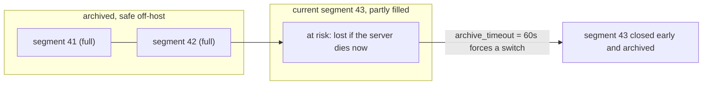

With WAL archiving, the data at risk is whatever sits in the current, not yet archived segment.

On a quiet database a 16 MB segment can take hours to fill, so `archive_timeout = 60s` forces a switch to a new segment at least every 60 seconds, bounding RPO to about a minute plus the upload time.

Tools such as `pg_receivewal`, pgBackRest and Barman can also stream WAL continuously, as a replica does, for an RPO of seconds.

### 3.4 Disaster recovery tiers

**In plain words:** DR tiers are how much of a spare kitchen you keep in another city — from just the recipes (cheap, slow) to a fully staffed duplicate restaurant (fast, expensive).

**Step by step:**
1. Say the Mumbai region of your cloud goes down. DR (disaster recovery) asks: how do we run from Hyderabad?
2. Cheapest: Hyderabad holds only backup files. You build everything from them, which takes hours.
3. Next: a database replica already runs in Hyderabad, but app servers are off. You switch them on in tens of minutes.
4. Next: a small copy of the whole app already runs there. You scale it up in minutes.
5. Most expensive: both regions serve users all the time, so losing one is barely noticed.

| Tier | What runs in the DR region | Typical RPO | Typical RTO | Relative cost |
| --- | --- | --- | --- | --- |
| Backup and restore | Only stored backups | Hours | Hours to a day | $ |
| Pilot light | A replica database, app servers off | Seconds to minutes | Tens of minutes | $$ |
| Warm standby | Scaled-down full stack | Seconds | Minutes | $$$ |
| Multi-site active/active | Full stack serving traffic | Near zero | Near zero | $$$$ |

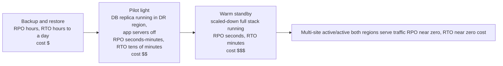

These four tiers and their typical RPO/RTO ranges follow the AWS whitepaper *Disaster Recovery of Workloads on AWS*. Note the trap: every tier above "backup and restore" replicates mistakes too, so **each tier still needs PITR backups** for logical corruption.

## 4. Worked example 🟡

### Whiteboard version

**In plain words:** the three code blocks below are the whole setup — turn on archiving on the live server, point a fresh server at the archive with a stop time, then check the data before trusting it.

```sql
-- postgresql.conf on the primary
-- wal_level = replica
-- archive_mode = on
-- archive_command = 'pgbackrest --stanza=invoiceops archive-push %p'
-- archive_timeout = 60s
```

```sql
-- On a NEW server after restoring last night's base backup:
-- restore_command = 'pgbackrest --stanza=invoiceops archive-get %f "%p"'
-- recovery_target_time = '2026-11-03 14:41:59+05:30'
-- recovery_target_action = 'pause'
-- touch $PGDATA/recovery.signal ; pg_ctl start
```

```sql
-- Paused at the target: verify, then copy the good rows back
SELECT count(*) FILTER (WHERE status = 'void') AS voided,
       sum(amount_due_minor)                   AS due_minor
FROM invoices;
```

### 4.1 Setting RPO and RTO for InvoiceOps

The business agrees on **RPO 5 minutes** and **RTO 1 hour** for the invoices database (these are the chosen targets, not measurements). The design follows from them:

| Requirement | Design choice |
| --- | --- |
| RPO 5 min for logical errors | WAL archiving with `archive_timeout = 60s`; alert if the newest archived segment is older than 3 minutes |
| RPO near 0 for a lost server | Synchronous or quick-async replica in another **availability zone** (a separate data centre in the same cloud region), see [[High Availability and Failover]] |
| RTO 1 hour including PITR | Nightly full + 6-hourly incremental base backups, so WAL replay never spans more than 6 hours |
| Region loss | Backups and WAL copied to a second region and a second account |
| Ransomware or insider deletes | S3 Object Lock in compliance mode on the backup bucket, 35-day retention |

### 4.2 Restore-time math

The database is 2 TB. The numbers below are **estimates** for one restore host; measure your own in a drill.

- Copying 2 TB from object storage at 200 MB/s: 2,000,000 MB ÷ 200 MB/s = 10,000 s ≈ 2 h 47 min.
- Replaying WAL: the database writes about 8 GB of WAL per hour at peak. From a 01:00 backup to 14:42 is about 14 hours, around 110 GB. At an estimated replay rate of 20 MB/s that is 5,500 s ≈ 1 h 32 min.
- Total ≈ 4 h 20 min, before DNS changes, app restarts and verification. **RTO 1 hour is impossible with this design.**

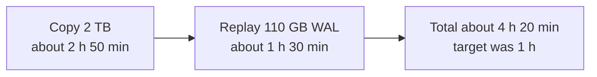

What fixes it:
1. Incremental backups every 6 hours cut the worst-case WAL to 6 × 8 GB = 48 GB ≈ 40 min of replay.
2. A volume snapshot (EBS, Amazon's network disks, can save a copy of a whole disk) restores in minutes because blocks load lazily, at the cost of slow first reads.
3. For a bad `UPDATE` on one table, you do not need to replace production at all: restore to a side server, then copy back only the affected rows (section 4.4).
4. A **delayed replica** (section 8) already sits one hour in the past.

### 4.3 Checking that PITR is possible

A backup catalog check that runs every few minutes answers one question: "If we needed to restore to time T, which backup would we use, and is the WAL chain unbroken?" The LSN (log sequence number) is the byte position in the WAL stream.

The check works like this:

1. Take only backups that finished before the target time, newest first.
2. Walk the archived WAL segments from the backup's start LSN. Each segment must begin exactly where the previous one ended.
3. Stop at the first segment whose last commit is at or after the target.
4. If a gap appears, try the next older backup. If no backup has an unbroken chain, PITR to that target is impossible.

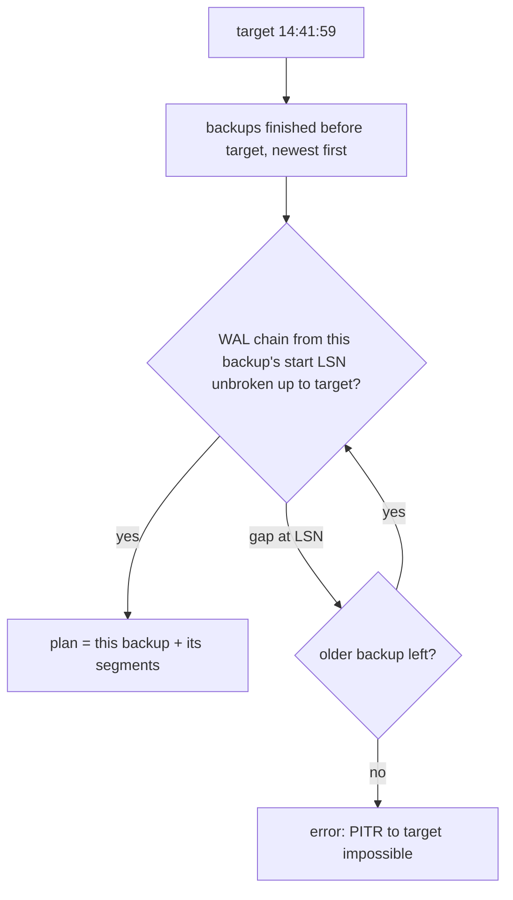

Example: nightly backup at 01:30 and midday backup at 12:20, hourly WAL segments, segment 5 lost. A target of 14:00 uses the midday backup (its chain is intact). A target of 08:00 needs the nightly backup, whose chain crosses the missing segment, so the check reports a WAL gap. One lost segment silently removes hours of the PITR window.

Runnable Go version: [[Backup, PITR and Disaster Recovery - Go]]

### 4.4 Partial restore of one tenant

**In plain words:** when only one customer's rows were deleted, don't rewind the whole database — rebuild a side copy, export just that customer's rows, and paste them back.

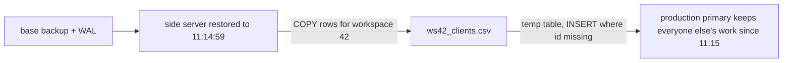

Workspace 42's admin deletes 300 clients by mistake at 11:15. Nobody else is affected, so restoring the whole database would destroy everyone else's work since 11:15.

```sql
-- On the side server restored to 11:14:59, export only that tenant's rows
COPY (SELECT * FROM clients WHERE workspace_id = 42)
  TO '/tmp/ws42_clients.csv' WITH (FORMAT csv, HEADER);
```

```sql
-- On production, inside one transaction, re-insert only missing rows
BEGIN;
CREATE TEMP TABLE restored_clients (LIKE clients INCLUDING DEFAULTS);
COPY restored_clients FROM '/tmp/ws42_clients.csv' WITH (FORMAT csv, HEADER);
INSERT INTO clients
SELECT r.* FROM restored_clients r
WHERE NOT EXISTS (SELECT 1 FROM clients c WHERE c.id = r.id);
COMMIT;
```

`COPY ... TO` a server file needs superuser or the `pg_write_server_files` role; from a laptop use `psql`'s `\copy`.

If the schema uses identity columns, keep the original `id` values so foreign keys from invoices still match; for a `GENERATED ALWAYS` identity column the `INSERT` needs `OVERRIDING SYSTEM VALUE`, otherwise PostgreSQL rejects explicit ids.

A per-tenant `workspace_id` on every table is what makes this cheap; see [[Partitioning and Sharding]].

### 4.5 Restore drill

A weekly job, run by automation rather than a person:

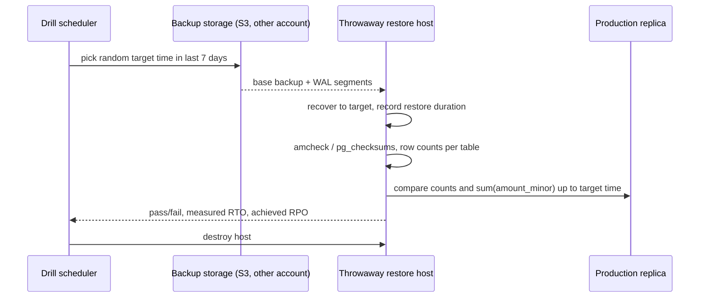

`amcheck` and `pg_checksums` are PostgreSQL tools that scan the restored indexes and pages for damage.

The drill produces measured RTO and RPO each week. If the measured restore time grows past the target, you learn it from a dashboard instead of during an incident.

## 5. Variants and comparison 🟡

**Do not confuse these** 🟡

| Thing | What it protects you from | What it cannot do |
| --- | --- | --- |
| Replica | A server or disk dying | Undo a bad `DELETE`: it copies the mistake |
| Backup with PITR | Bad changes, lost servers | Bring you back in seconds; a restore takes time |
| High availability (HA) | Downtime from one machine failing | Protect data; it is about staying up, not about history |
| Disaster recovery (DR) | Losing a whole region | Replace backups; DR copies mistakes too |

| Method | RPO | RTO for 2 TB (estimate) | Protects against | Misses |
| --- | --- | --- | --- | --- |
| Streaming replica | Seconds (async) or 0 (sync) | Seconds to minutes (failover) | Server or disk loss | Bad writes, drops, ransomware that reaches the DB |
| Delayed replica (1 h) | Up to the delay | Minutes, if caught within the delay | Mistakes noticed within the hour | Mistakes noticed later; region loss unless remote |
| Nightly `pg_dump` | Up to 24 h | Many hours (index rebuild) | Logical errors, version upgrades | Everything since the dump |
| Base backup + WAL archive (PITR) | ~1 min | Hours (copy + replay) | Logical errors, server loss | Region loss unless copied |
| Volume snapshot (EBS) | Snapshot interval | Minutes to start, slow first reads | Server loss, coarse rollback | Fine-grained point in time |
| Managed RDS automated backups | ~5 min (latest restorable time) | Instance creation plus replay | Logical errors within retention | Account compromise unless copied out |

**Managed services.** Amazon RDS automated backups take a daily snapshot plus transaction logs and allow restore to any second within the retention period, which can be set from 1 to 35 days (0 disables them).

The latest restorable time is typically within the last 5 minutes. A restore always creates a **new** DB instance with a new endpoint. Manual snapshots are kept until you delete them, even after the instance is deleted.

RDS can replicate automated backups to another Region, and manual snapshots can be copied cross-Region and shared with another account (an encrypted snapshot needs a customer-managed KMS key, a key you create in AWS's key service, to be shared).

Aurora works differently: storage is continuously backed up, and its backtrack feature (Aurora MySQL) rewinds in place.

**Self-managed tools.** pgBackRest, WAL-G and Barman add what raw `pg_basebackup` lacks: parallel compressed transfer, full/differential/incremental backups, retention policies, checksum verification, encryption and direct S3/GCS/Azure storage. PostgreSQL 17 added native incremental backups (`pg_basebackup --incremental` with `summarize_wal = on`, combined with `pg_combinebackup`).

**MySQL.** `mysqldump` or MySQL Shell dump utilities for logical; Percona XtraBackup or MySQL Enterprise Backup for physical; the **binlog** plays the role of the WAL for PITR (`mysqlbinlog --stop-datetime`).

## 6. Trade-offs and when not to use 🟡

- **Logical dumps do not scale.** Beyond a few hundred GB, restore time is dominated by index rebuilds; keep dumps for small databases, upgrades and partial restores, not as the production recovery path.
- **Short retention is cheap and risky.** Silent corruption or a slow bug is often noticed after days; 7 days of PITR cannot reach a mistake made 9 days ago. Keep weekly or monthly fulls longer (with immutability), even if PITR covers fewer days.
- **Hot DR is expensive and still not a backup.** Warm standby and active/active roughly double infrastructure cost and still copy mistakes. They answer region loss, not data loss.
- **Snapshots of a running database** are safe only if the snapshot is crash-consistent across every volume holding data and WAL; a database spread over several volumes needs multi-volume snapshots or a backup tool.
- **Encryption without key backup** turns backups into noise. Store KMS keys or passphrases where a region or account loss does not take them too.
- **When simpler wins:** a small internal tool with a 24-hour RPO is well served by managed automated backups and a monthly restore test. Do not build pilot light for it.

## 7. In production 🔴

> 🟡 → 🔴 **You now know** how a restore works, how to size RPO and RTO, and which tools exist. **Next comes the senior view**: keeping backups safe from attackers, learning from a real outage, the alerts to set, and tricks like delayed replicas and timelines that interviewers like to probe.

**The 3-2-1 rule:** at least **3** copies of the data, on **2** different kinds of storage, **1** of them off-site. A modern extension is 3-2-1-1-0: one copy immutable or offline, and zero errors in restore verification.

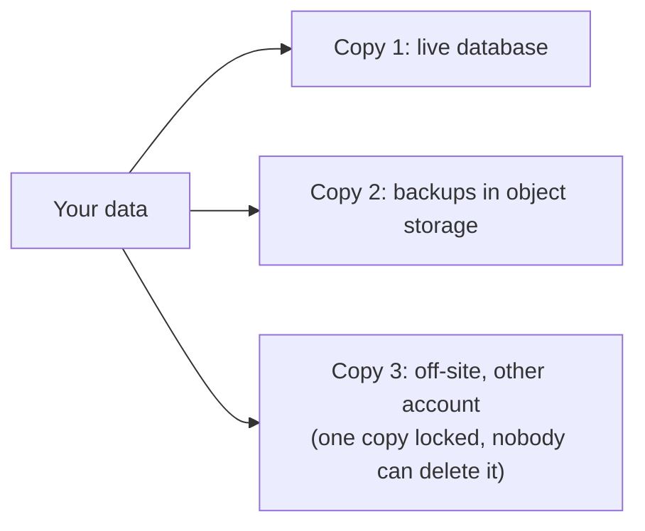

**Immutability.** S3 Object Lock in **compliance mode** prevents anyone, including the root user, from deleting or overwriting an object version until its retention date; **governance mode** can be bypassed by users with a special permission. AWS Backup Vault Lock offers the same for backup vaults.

Put backups in a separate AWS account with its own credentials, so one leaked admin key cannot delete both production and backups.

**Real incident: GitLab, 31 January 2017.** During a replication problem an engineer removed the data directory on the primary instead of the replica.

GitLab's postmortem reports that its regular `pg_dump` backups had been failing silently (the dump binary did not match the server version, and the failure emails were rejected), disk snapshots were not enabled for the database servers, and replication itself had broken.

Recovery used a copy of the database made about six hours earlier for staging, so about six hours of database changes were lost. The lesson they drew: every backup method needs an owner and automated restore testing.

**Failure modes → fixes:**
- Archive command failing → WAL piles up in `pg_wal` until the disk fills and the primary stops. Alert on `pg_stat_archiver.failed_count` and on `pg_wal` size.
- Backups succeed, restores fail (missing extension, wrong version, lost key) → weekly automated drills.
- Retention shorter than detection time → keep long-term fulls; add data-quality checks that notice anomalies early.
- Restore to the same host or overwriting production → always restore to a new server first and copy data back.
- Backups in the same account and region as production → cross-account, cross-region copies.

**What to monitor:** age of the last successful base backup; age of the last archived WAL segment (`pg_stat_archiver.last_archived_time`) against the RPO; archive failures; backup size trend; measured restore duration from the latest drill against the RTO; replication lag of any delayed replica.

## 8. Deep dive 🔴

- **Delayed replica.** A standby with `recovery_min_apply_delay = '1h'` receives WAL immediately but applies each commit only after one hour. If a bad deploy is caught within the hour, pause replay (`pg_wal_replay_pause()`), then set `recovery_target_time` to just before the mistake and restart the standby (recovery target settings take effect only at server start) so it replays up to that point, and read the good data in minutes, without copying terabytes.
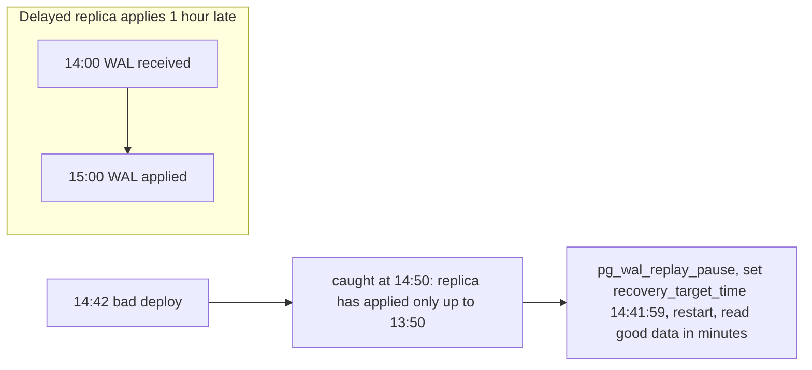

- **Timelines.** When a recovered server is promoted, PostgreSQL starts a new **timeline** (a new history branch, visible in WAL file names like `00000002…`). This lets you do PITR several times from the same archive without overwriting the original history; `recovery_target_timeline = 'latest'` (the default since PostgreSQL 12) follows the newest branch.
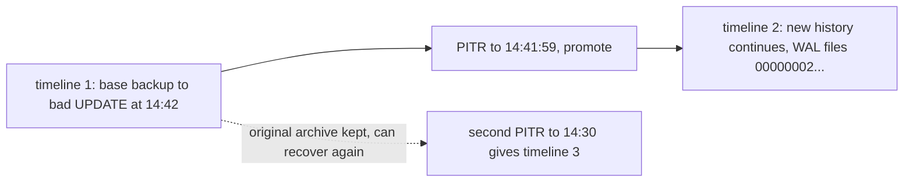

- **Inclusive targets.** `recovery_target_inclusive = on` (default) stops *after* the transaction committed exactly at the target time. For "stop before the bad transaction", use its transaction ID with `recovery_target_xid` and `recovery_target_inclusive = off`, or the LSN from `pg_waldump`.
- **Checksums and verification.** Data checksums (`initdb --data-checksums`, or `pg_checksums --enable` offline) detect torn or corrupted pages; PostgreSQL 18 enables them by default for new clusters. `pg_verifybackup` checks a base backup against its manifest; the `amcheck` extension verifies B-tree index invariants after a restore.
- **Backups and sharding.** With many shards, "restore to 14:41:59" must happen on every shard to the same point, or cross-shard references break. Use the same target time everywhere, and accept that clocks differ slightly; for strict consistency, record a cross-shard restore point with `pg_create_restore_point()` on every shard at the same moment.
- **Backups and logical replication or outbox.** A restored database has an outbox table and consumer offsets from the past; downstream systems have already seen newer events. After a restore, plan for re-emitting or deduplicating events (see [[Transactional Outbox and CDC]]).

## 9. Interview questions 🔴

> [!question]- Trap: "We have three replicas, so we don't need backups." Correct?
> No. Replicas copy every change, including `DROP TABLE`, a bad `UPDATE` and ransomware encryption done through the database, within milliseconds. Replicas protect against hardware loss. Backups with PITR protect against bad changes. You need both.

> [!question]- Explain RPO and RTO with an example.
> RPO is the maximum acceptable data loss, measured in time; RTO is the maximum acceptable downtime. With RPO 5 min and RTO 1 h, a disaster at 14:42 must lose nothing before 14:37 and be serving again by 15:42. RPO drives how often changes are shipped off-host; RTO drives how fast you can rebuild.

> [!question]- How does point-in-time recovery work in PostgreSQL?
> Restore a physical base backup taken before the target, set `restore_command` to fetch archived WAL and `recovery_target_time` to the target, create `recovery.signal`, and start. PostgreSQL replays WAL in order and stops at the target, paused by default for inspection. It needs an unbroken WAL chain from the backup start.

> [!question]- When do you use pg_dump instead of pg_basebackup?
> `pg_dump` for portable, logical copies: major version upgrades, one database or table, dev data, small databases. `pg_basebackup` (or pgBackRest/WAL-G) for production recovery: fast restore of the whole cluster and PITR with WAL. A dump cannot do PITR and restores slowly because it rebuilds every index.

> [!question]- Your 2 TB database has an RTO of 1 hour. Is a nightly base backup plus WAL enough?
> Probably not: copying 2 TB at 200 MB/s is about 2.8 h, before WAL replay (estimates). Use incremental backups to shorten replay, snapshot-based restores, a delayed replica for fast undo, and partial restores of only the damaged rows. Then measure it in a drill.

> [!question]- How do you protect backups from ransomware or a malicious admin?
> Write backups to a separate account with separate credentials, enable S3 Object Lock in compliance mode (or Backup Vault Lock) so nobody can delete them before retention ends, encrypt them with keys stored outside the production account, and keep a cross-region copy.

> [!question]- What did the GitLab 2017 incident teach about backups?
> Having several backup methods is meaningless if nobody verifies them: their dumps failed silently, alerts were not delivered, and snapshots were not enabled. Every backup needs monitoring of its success and automated restore tests that prove it works.

## 10. Cheat sheet 🟢

🟢 **Plain version:** A live copy of the database copies your mistakes, so you also need backups. A backup is a full copy plus a diary of every change, and together they can rebuild the data at any second. Decide two numbers with the business: how much data you may lose, and how long you may be down. Keep copies in another place that nobody can delete. Practise restoring every week, because an untested backup may not work.

- Replica ≠ backup. Replicas fix hardware loss; PITR backups fix bad data.
- PITR = base backup + unbroken WAL archive + `recovery_target_time`. One missing segment breaks the window.
- RPO ≈ `archive_timeout` + upload delay; RTO ≈ copy time + WAL replay + cut-over. Do the math, then measure it.
- `pg_dump`: logical, portable, slow restore, no PITR. `pg_basebackup`/pgBackRest/WAL-G: physical, fast, PITR.
- RDS: automated backups 1–35 days with PITR, restores to a new instance; copy snapshots cross-region and cross-account.
- 3-2-1 (+1 immutable, +0 errors). Object Lock compliance mode, separate account.
- Delayed replica = fast undo for mistakes caught within the delay.
- Automate restore drills; report measured RTO and RPO every week.

## Self-check 🟢🟡

🟢 Easy

> [!question]- Why is a replica not a backup?
> It copies every change within milliseconds, including a bad `DELETE`, so it holds the mistake too.

> [!question]- What two things does PITR combine?
> A base backup (the full copy) and the archived WAL (every change since), replayed up to a chosen second.

> [!question]- What do RPO 5 minutes and RTO 1 hour mean?
> You may lose at most the last 5 minutes of data, and the service must be back within 1 hour.

🟡 Medium

> [!question]- Why does `archive_timeout = 60s` matter on a quiet database?
> Without it a 16 MB WAL segment may take hours to fill and stays on the server unarchived; the timeout ships it every minute, so RPO stays near one minute.

> [!question]- One WAL segment from 05:00 is missing. What breaks?
> Any restore that must replay through 05:00 fails, so every target after that point is unreachable from backups taken before it.

> [!question]- One tenant deleted 300 rows. Why not restore the whole database?
> That would erase every other tenant's work since the mistake; restore a side server and copy back only that tenant's rows.

## Links

- **Runnable Go version:** [[Backup, PITR and Disaster Recovery - Go]]
- **Before this:** [[Storage Engines - B-tree vs LSM and WAL]], [[Replication]]
- **Next:** [[High Availability and Failover]], [[Multi-Region Architecture]], [[Incident Response]]
- **Compare with:** [[Zero-Downtime Schema Migrations]], [[Partitioning and Sharding]], [[Transactional Outbox and CDC]]

### Watch on YouTube

- [Never lose data again with Postgres point-in-time recovery (PITR) & Kamal](https://www.youtube.com/watch?v=5AMLVUPrL0w) · Sam's Notes · practical PITR walkthrough with a real restore scenario
- [PG-03: Point-in-Time Recovery (PITR) in PostgreSQL with pgBackRest using Timestamp](https://www.youtube.com/watch?v=RkESdFnXo8I) · mynoteoracledba · hands-on PITR to a timestamp using pgBackRest
