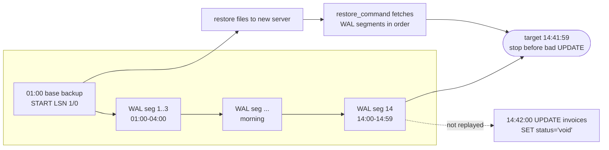
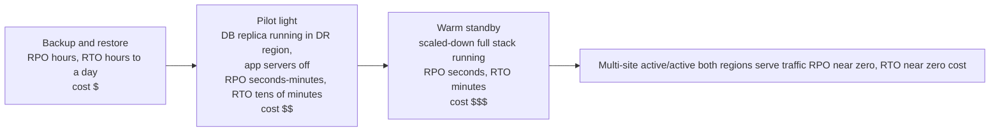
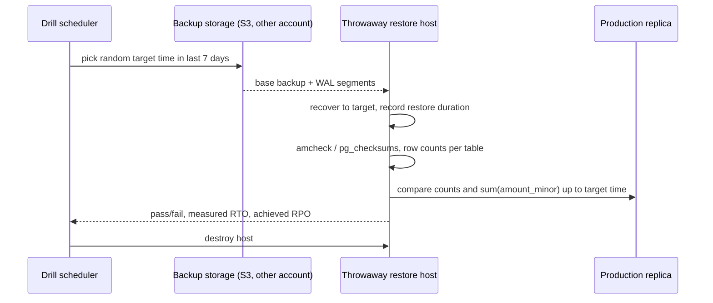

# Backup, PITR and Disaster Recovery

> [!summary] TL;DR
> A **backup** is a copy of the database you can restore later, kept separate from the live system. **PITR** (point-in-time recovery) restores a full copy and then replays the database's change log up to an exact moment, such as one second before a bad deploy. **Disaster recovery** is the whole plan for getting the service back after losing data or a region, sized by two numbers: how much data you may lose (RPO) and how long you may be down (RTO).

> [!abstract] Core idea
> - A replica is not a backup: a `DROP TABLE` or a buggy `UPDATE` reaches every replica within milliseconds.
> - A physical base backup plus a continuous archive of the write-ahead log (WAL) lets you restore to any second inside the retention window.
> - RPO (data you can lose) and RTO (time to recover) are business numbers; they decide the tools and the cost.
> - Keep 3 copies on 2 kinds of storage, 1 off-site, and make at least one immutable.
> - A backup you have never restored is a hope, not a backup: automate restore drills and verify the data.

## 1. Why it exists

At 14:42 on a Tuesday an InvoiceOps engineer runs a data-fix script. A missing `WHERE` clause turns it into:

```sql
UPDATE invoices SET status = 'void', amount_due_minor = 0;  -- all 10 M rows
```

InvoiceOps runs a primary with two streaming replicas (see [[Replication]]). Both replicas apply the update within 40 ms. Failover does not help: every copy of the data is now wrong. What helps is a copy of the database **as it was at 14:41:59**, and that needs:

1. a full copy taken earlier (last night's base backup), and
2. every change made since then, in order, so the database can replay them and stop just before the bad statement.

The cost of not having it is concrete. The newest copy without PITR might be last night's 01:00 `pg_dump`; restoring it loses 13 hours and 42 minutes of invoices, payments and webhooks, which then have to be rebuilt from payment-provider exports and emails.

## 2. Mental model

Think of the database as a ledger book and the WAL as the carbon copies of every page written since the ledger was photocopied.

- The **base backup** is the photocopy of the whole ledger, taken at night.
- The **WAL archive** is the stack of carbon copies of every entry since, shipped off-site every few minutes.
- **PITR** is: take the photocopy, re-apply carbon copies in order, stop at entry 14:41:59.
- A **replica** is a second ledger that copies every entry as it is written, mistakes included. Good for "the first book burned", useless for "someone wrote nonsense in it".

Two numbers frame every decision:
- **RPO (Recovery Point Objective):** the most data, measured in time, you accept losing. "RPO 5 minutes" means after a disaster at 14:42 you must recover everything up to at least 14:37.
- **RTO (Recovery Time Objective):** the most time you accept being down. "RTO 1 hour" means service is back by 15:42.

## 3. How it works

### 3.1 Logical vs physical backups

| | Logical (`pg_dump`, `mysqldump`) | Physical (`pg_basebackup`, volume snapshot) |
| --- | --- | --- |
| What it copies | SQL statements or table data: `CREATE TABLE`, `COPY` rows | The data files, byte for byte |
| Scope | One database, or chosen tables or schemas | The whole cluster (every database on the server) |
| Consistency | One snapshot; `pg_dump` uses a single repeatable-read transaction | Consistent only with the WAL written during the copy |
| Restore speed | Slow: reinserts every row and rebuilds every index | Fast: copy files back, replay WAL |
| Portable across major versions / platforms | Yes | No, same major version and architecture |
| PITR | No: a dump is one moment | Yes, with WAL archiving |
| Typical use | Small DBs, upgrades, one-table restores, dev copies | Production recovery |

`pg_dump -Fc` (custom format) or `-Fd -j 8` (directory format, 8 parallel jobs) produces dumps that `pg_restore` can restore in parallel or partially, for example only `-t invoices`.

### 3.2 Base backup plus WAL archive

Every change PostgreSQL makes is first written to the **WAL** (write-ahead log; see [[Storage Engines - B-tree vs LSM and WAL]]) in 16 MB files called segments. With `archive_mode = on`, each completed segment is handed to `archive_command` (or an `archive_library` since PostgreSQL 15), which copies it to object storage. A **base backup** is a copy of the data directory taken while the server runs; the files are inconsistent on their own, but together with the WAL from the backup's start to its end they become consistent.



The restore:
1. Copy the newest base backup that **finished before** the target time to a new server.
2. Set `restore_command` (how to fetch archived WAL) and `recovery_target_time = '2026-11-03 14:41:59+05:30'`, and create the file `recovery.signal` (PostgreSQL 12+).
3. Start PostgreSQL. It replays WAL until the first commit after the target, then stops. `recovery_target_action = 'pause'` (the default) lets you inspect the data before calling `pg_wal_replay_resume()` or promoting.
4. Point the application at it, or copy the damaged rows back into the production primary.

**Any missing segment between the backup's start and the target makes the target unreachable.** WAL archiving needs monitoring as much as the backups do.

### 3.3 Where RPO comes from

With WAL archiving, the data at risk is whatever sits in the current, not yet archived segment. On a quiet database a 16 MB segment can take hours to fill, so `archive_timeout = 60s` forces a switch to a new segment at least every 60 seconds, bounding RPO to about a minute plus the upload time. Tools such as `pg_receivewal`, pgBackRest and Barman can also stream WAL continuously, as a replica does, for an RPO of seconds.

### 3.4 Disaster recovery tiers



These four tiers and their typical RPO/RTO ranges follow the AWS whitepaper *Disaster Recovery of Workloads on AWS*. Note the trap: every tier above "backup and restore" replicates mistakes too, so **each tier still needs PITR backups** for logical corruption.

## 4. Worked example

### Whiteboard version

```sql
-- postgresql.conf on the primary
-- wal_level = replica
-- archive_mode = on
-- archive_command = 'pgbackrest --stanza=invoiceops archive-push %p'
-- archive_timeout = 60s

-- On a NEW server after restoring last night's base backup:
-- restore_command = 'pgbackrest --stanza=invoiceops archive-get %f "%p"'
-- recovery_target_time = '2026-11-03 14:41:59+05:30'
-- recovery_target_action = 'pause'
-- touch $PGDATA/recovery.signal ; pg_ctl start

-- Paused at the target: verify, then copy the good rows back
SELECT count(*) FILTER (WHERE status = 'void') AS voided,
       sum(amount_due_minor)                   AS due_minor
FROM invoices;
```

### 4.1 Setting RPO and RTO for InvoiceOps

The business agrees on **RPO 5 minutes** and **RTO 1 hour** for the invoices database (these are the chosen targets, not measurements). The design follows from them:

| Requirement | Design choice |
| --- | --- |
| RPO 5 min for logical errors | WAL archiving with `archive_timeout = 60s`; alert if the newest archived segment is older than 3 minutes |
| RPO near 0 for a lost server | Synchronous or quick-async replica in another availability zone, see [[High Availability and Failover]] |
| RTO 1 hour including PITR | Nightly full + 6-hourly incremental base backups, so WAL replay never spans more than 6 hours |
| Region loss | Backups and WAL copied to a second region and a second account |
| Ransomware or insider deletes | S3 Object Lock in compliance mode on the backup bucket, 35-day retention |

### 4.2 Restore-time math

The database is 2 TB. The numbers below are **estimates** for one restore host; measure your own in a drill.

- Copying 2 TB from object storage at 200 MB/s: 2,000,000 MB ÷ 200 MB/s = 10,000 s ≈ 2 h 47 min.
- Replaying WAL: the database writes about 8 GB of WAL per hour at peak. From a 01:00 backup to 14:42 is about 14 hours, around 110 GB. At an estimated replay rate of 20 MB/s that is 5,500 s ≈ 1 h 32 min.
- Total ≈ 4 h 20 min, before DNS changes, app restarts and verification. **RTO 1 hour is impossible with this design.**

What fixes it:
1. Incremental backups every 6 hours cut the worst-case WAL to 6 × 8 GB = 48 GB ≈ 40 min of replay.
2. A volume snapshot (EBS) restores in minutes because blocks load lazily, at the cost of slow first reads.
3. For a bad `UPDATE` on one table, you do not need to replace production at all: restore to a side server, then copy back only the affected rows (section 4.4).
4. A **delayed replica** (section 8) already sits one hour in the past.

### 4.3 Checking that PITR is possible, in Go

A backup catalog check that runs every few minutes answers one question: "If we needed to restore to time T, which backup would we use, and is the WAL chain unbroken?" The LSN (log sequence number) is the byte position in the WAL stream.

```go
package pitr

import (
	"errors"
	"fmt"
	"sort"
	"time"
)

// BaseBackup is one physical backup. Restoring it needs WAL from StartLSN;
// it is consistent once WAL has been replayed past EndLSN (written at EndTime).
type BaseBackup struct {
	Label            string
	StartLSN, EndLSN uint64
	EndTime          time.Time
}

// Segment is one archived WAL file: bytes [StartLSN, EndLSN) and the commit
// timestamps of the first and last transactions it contains.
type Segment struct {
	StartLSN, EndLSN    uint64
	FirstTime, LastTime time.Time
}

// Plan is what a restore to a target time needs.
type Plan struct {
	Backup   BaseBackup
	Segments []Segment
}

var ErrNoBackup = errors.New("no base backup finished before the target")

// PlanRestore picks the newest backup that finished before target and checks
// that archived WAL runs without gaps from its StartLSN until a segment whose
// last commit is at or after target. A gap means PITR to target is impossible.
func PlanRestore(backups []BaseBackup, wal []Segment, target time.Time) (Plan, error) {
	sort.Slice(backups, func(i, j int) bool { return backups[i].EndTime.After(backups[j].EndTime) })
	sort.Slice(wal, func(i, j int) bool { return wal[i].StartLSN < wal[j].StartLSN })

	var lastErr error = ErrNoBackup
	for _, b := range backups {
		if b.EndTime.After(target) {
			continue
		}
		segs, err := chain(wal, b, target)
		if err == nil {
			return Plan{Backup: b, Segments: segs}, nil
		}
		lastErr = err // an older backup may still have an unbroken chain
	}
	return Plan{}, lastErr
}

func chain(wal []Segment, b BaseBackup, target time.Time) ([]Segment, error) {
	next := b.StartLSN
	var out []Segment
	for _, s := range wal {
		if s.EndLSN <= next {
			continue // fully before what we need
		}
		if s.StartLSN > next {
			return nil, fmt.Errorf("backup %s: WAL gap at LSN %X", b.Label, next)
		}
		out = append(out, s)
		next = s.EndLSN
		if next > b.EndLSN && !s.LastTime.Before(target) {
			return out, nil
		}
	}
	return nil, fmt.Errorf("backup %s: archive ends at LSN %X before target", b.Label, next)
}

// RestoreTime estimates RTO for the database step: copy the base backup,
// then replay WAL. Rates are bytes per second.
func RestoreTime(backupBytes, copyRate, walBytes, replayRate float64) time.Duration {
	secs := backupBytes/copyRate + walBytes/replayRate
	return time.Duration(secs * float64(time.Second))
}
```

```go
package pitr

import (
	"errors"
	"strings"
	"testing"
	"time"
)

const seg = 16 << 20 // 16 MB WAL segments

var day = time.Date(2026, 11, 3, 0, 0, 0, 0, time.UTC)

// hourly segments from LSN 0, one segment per hour starting at midnight
func walHours(n int) []Segment {
	var w []Segment
	for i := 0; i < n; i++ {
		t := day.Add(time.Duration(i) * time.Hour)
		w = append(w, Segment{uint64(i) * seg, uint64(i+1) * seg, t, t.Add(59 * time.Minute)})
	}
	return w
}

var backups = []BaseBackup{
	{"nightly-01h", 1 * seg, 2*seg + 100, day.Add(1*time.Hour + 30*time.Minute)},
	{"midday-12h", 12 * seg, 13*seg + 100, day.Add(12*time.Hour + 20*time.Minute)},
}

func TestPicksNewestBackupBeforeTarget(t *testing.T) {
	target := day.Add(14*time.Hour + 41*time.Minute + 59*time.Second) // 14:41:59
	p, err := PlanRestore(backups, walHours(24), target)
	if err != nil {
		t.Fatal(err)
	}
	if p.Backup.Label != "midday-12h" || len(p.Segments) != 3 { // segments 12, 13, 14
		t.Fatalf("got %s with %d segments", p.Backup.Label, len(p.Segments))
	}
}

func TestTargetBeforeMiddayUsesNightly(t *testing.T) {
	target := day.Add(12*time.Hour + 5*time.Minute) // midday backup not finished yet
	p, err := PlanRestore(backups, walHours(24), target)
	if err != nil || p.Backup.Label != "nightly-01h" || len(p.Segments) != 12 {
		t.Fatalf("got %+v, %v", p.Backup, err)
	}
}

func TestGapFallsBackOrFails(t *testing.T) {
	w := walHours(24)
	w = append(w[:5], w[6:]...) // segment 5 lost: nightly chain is broken
	target := day.Add(14 * time.Hour)
	if p, err := PlanRestore(backups, w, target); err != nil || p.Backup.Label != "midday-12h" {
		t.Fatalf("midday chain is intact, got %v", err)
	}
	_, err := PlanRestore(backups, w, day.Add(8*time.Hour))
	if err == nil || !strings.Contains(err.Error(), "WAL gap") {
		t.Fatalf("want WAL gap error, got %v", err)
	}
}

func TestNoBackupAndArchiveTooShort(t *testing.T) {
	if _, err := PlanRestore(backups, walHours(24), day.Add(time.Hour)); !errors.Is(err, ErrNoBackup) {
		t.Fatalf("want ErrNoBackup, got %v", err)
	}
	_, err := PlanRestore(backups, walHours(14), day.Add(20*time.Hour))
	if err == nil || !strings.Contains(err.Error(), "before target") {
		t.Fatalf("want short-archive error, got %v", err)
	}
}

func TestRestoreTime(t *testing.T) {
	// 2 TB at 200 MB/s, plus 40 GB of WAL replayed at 20 MB/s
	got := RestoreTime(2e12, 200e6, 40e9, 20e6)
	if got != 12000*time.Second { // 10,000 s + 2,000 s = 3h20m
		t.Fatalf("got %v", got)
	}
}
```

Measured: `go vet` is clean and `go test -race` passes with Go 1.24.4. The `TestRestoreTime` case is the 2 TB example with a smaller, 40 GB WAL replay: 10,000 s + 2,000 s = 3 h 20 min. `TestGapFallsBackOrFails` shows the important behaviour: one lost WAL segment silently removes hours of the PITR window, and only an older-or-newer backup with an unbroken chain can help.

### 4.4 Partial restore of one tenant

Workspace 42's admin deletes 300 clients by mistake at 11:15. Nobody else is affected, so restoring the whole database would destroy everyone else's work since 11:15.

```sql
-- On the side server restored to 11:14:59, export only that tenant's rows
COPY (SELECT * FROM clients WHERE workspace_id = 42)
  TO '/tmp/ws42_clients.csv' WITH (FORMAT csv, HEADER);

-- On production, inside one transaction, re-insert only missing rows
BEGIN;
CREATE TEMP TABLE restored_clients (LIKE clients INCLUDING DEFAULTS);
COPY restored_clients FROM '/tmp/ws42_clients.csv' WITH (FORMAT csv, HEADER);
INSERT INTO clients
SELECT r.* FROM restored_clients r
WHERE NOT EXISTS (SELECT 1 FROM clients c WHERE c.id = r.id);
COMMIT;
```

`COPY ... TO` a server file needs superuser or the `pg_write_server_files` role; from a laptop use `psql`'s `\copy`. If the schema uses identity columns, keep the original `id` values so foreign keys from invoices still match; for a `GENERATED ALWAYS` identity column the `INSERT` needs `OVERRIDING SYSTEM VALUE`, otherwise PostgreSQL rejects explicit ids. A per-tenant `workspace_id` on every table is what makes this cheap; see [[Partitioning and Sharding]].

### 4.5 Restore drill

A weekly job, run by automation rather than a person:



The drill produces measured RTO and RPO each week. If the measured restore time grows past the target, you learn it from a dashboard instead of during an incident.

## 5. Variants and comparison

| Method | RPO | RTO for 2 TB (estimate) | Protects against | Misses |
| --- | --- | --- | --- | --- |
| Streaming replica | Seconds (async) or 0 (sync) | Seconds to minutes (failover) | Server or disk loss | Bad writes, drops, ransomware that reaches the DB |
| Delayed replica (1 h) | Up to the delay | Minutes, if caught within the delay | Mistakes noticed within the hour | Mistakes noticed later; region loss unless remote |
| Nightly `pg_dump` | Up to 24 h | Many hours (index rebuild) | Logical errors, version upgrades | Everything since the dump |
| Base backup + WAL archive (PITR) | ~1 min | Hours (copy + replay) | Logical errors, server loss | Region loss unless copied |
| Volume snapshot (EBS) | Snapshot interval | Minutes to start, slow first reads | Server loss, coarse rollback | Fine-grained point in time |
| Managed RDS automated backups | ~5 min (latest restorable time) | Instance creation plus replay | Logical errors within retention | Account compromise unless copied out |

**Managed services.** Amazon RDS automated backups take a daily snapshot plus transaction logs and allow restore to any second within the retention period, which can be set from 1 to 35 days (0 disables them). The latest restorable time is typically within the last 5 minutes. A restore always creates a **new** DB instance with a new endpoint. Manual snapshots are kept until you delete them, even after the instance is deleted. RDS can replicate automated backups to another Region, and manual snapshots can be copied cross-Region and shared with another account (an encrypted snapshot needs a customer-managed KMS key to be shared). Aurora works differently: storage is continuously backed up, and its backtrack feature (Aurora MySQL) rewinds in place.

**Self-managed tools.** pgBackRest, WAL-G and Barman add what raw `pg_basebackup` lacks: parallel compressed transfer, full/differential/incremental backups, retention policies, checksum verification, encryption and direct S3/GCS/Azure storage. PostgreSQL 17 added native incremental backups (`pg_basebackup --incremental` with `summarize_wal = on`, combined with `pg_combinebackup`).

**MySQL.** `mysqldump` or MySQL Shell dump utilities for logical; Percona XtraBackup or MySQL Enterprise Backup for physical; the **binlog** plays the role of the WAL for PITR (`mysqlbinlog --stop-datetime`).

## 6. Trade-offs and when not to use

- **Logical dumps do not scale.** Beyond a few hundred GB, restore time is dominated by index rebuilds; keep dumps for small databases, upgrades and partial restores, not as the production recovery path.
- **Short retention is cheap and risky.** Silent corruption or a slow bug is often noticed after days; 7 days of PITR cannot reach a mistake made 9 days ago. Keep weekly or monthly fulls longer (with immutability), even if PITR covers fewer days.
- **Hot DR is expensive and still not a backup.** Warm standby and active/active roughly double infrastructure cost and still copy mistakes. They answer region loss, not data loss.
- **Snapshots of a running database** are safe only if the snapshot is crash-consistent across every volume holding data and WAL; a database spread over several volumes needs multi-volume snapshots or a backup tool.
- **Encryption without key backup** turns backups into noise. Store KMS keys or passphrases where a region or account loss does not take them too.
- **When simpler wins:** a small internal tool with a 24-hour RPO is well served by managed automated backups and a monthly restore test. Do not build pilot light for it.

## 7. In production

**The 3-2-1 rule:** at least **3** copies of the data, on **2** different kinds of storage, **1** of them off-site. A modern extension is 3-2-1-1-0: one copy immutable or offline, and zero errors in restore verification.

**Immutability.** S3 Object Lock in **compliance mode** prevents anyone, including the root user, from deleting or overwriting an object version until its retention date; **governance mode** can be bypassed by users with a special permission. AWS Backup Vault Lock offers the same for backup vaults. Put backups in a separate AWS account with its own credentials, so one leaked admin key cannot delete both production and backups.

**Real incident: GitLab, 31 January 2017.** During a replication problem an engineer removed the data directory on the primary instead of the replica. GitLab's postmortem reports that its regular `pg_dump` backups had been failing silently (the dump binary did not match the server version, and the failure emails were rejected), disk snapshots were not enabled for the database servers, and replication itself had broken. Recovery used a copy of the database made about six hours earlier for staging, so about six hours of database changes were lost. The lesson they drew: every backup method needs an owner and automated restore testing.

**Failure modes → fixes:**
- Archive command failing → WAL piles up in `pg_wal` until the disk fills and the primary stops. Alert on `pg_stat_archiver.failed_count` and on `pg_wal` size.
- Backups succeed, restores fail (missing extension, wrong version, lost key) → weekly automated drills.
- Retention shorter than detection time → keep long-term fulls; add data-quality checks that notice anomalies early.
- Restore to the same host or overwriting production → always restore to a new server first and copy data back.
- Backups in the same account and region as production → cross-account, cross-region copies.

**What to monitor:** age of the last successful base backup; age of the last archived WAL segment (`pg_stat_archiver.last_archived_time`) against the RPO; archive failures; backup size trend; measured restore duration from the latest drill against the RTO; replication lag of any delayed replica.

## 8. Deep dive

- **Delayed replica.** A standby with `recovery_min_apply_delay = '1h'` receives WAL immediately but applies each commit only after one hour. If a bad deploy is caught within the hour, pause replay (`pg_wal_replay_pause()`), then set `recovery_target_time` to just before the mistake and restart the standby (recovery target settings take effect only at server start) so it replays up to that point, and read the good data in minutes, without copying terabytes.
- **Timelines.** When a recovered server is promoted, PostgreSQL starts a new **timeline** (a new history branch, visible in WAL file names like `00000002…`). This lets you do PITR several times from the same archive without overwriting the original history; `recovery_target_timeline = 'latest'` (the default since PostgreSQL 12) follows the newest branch.
- **Inclusive targets.** `recovery_target_inclusive = on` (default) stops *after* the transaction committed exactly at the target time. For "stop before the bad transaction", use its transaction ID with `recovery_target_xid` and `recovery_target_inclusive = off`, or the LSN from `pg_waldump`.
- **Checksums and verification.** Data checksums (`initdb --data-checksums`, or `pg_checksums --enable` offline) detect torn or corrupted pages; PostgreSQL 18 enables them by default for new clusters. `pg_verifybackup` checks a base backup against its manifest; the `amcheck` extension verifies B-tree index invariants after a restore.
- **Backups and sharding.** With many shards, "restore to 14:41:59" must happen on every shard to the same point, or cross-shard references break. Use the same target time everywhere, and accept that clocks differ slightly; for strict consistency, record a cross-shard restore point with `pg_create_restore_point()` on every shard at the same moment.
- **Backups and logical replication or outbox.** A restored database has an outbox table and consumer offsets from the past; downstream systems have already seen newer events. After a restore, plan for re-emitting or deduplicating events (see [[Transactional Outbox and CDC]]).

## 9. Interview questions

> [!question]- Trap: "We have three replicas, so we don't need backups." Correct?
> No. Replicas copy every change, including `DROP TABLE`, a bad `UPDATE` and ransomware encryption done through the database, within milliseconds. Replicas protect against hardware loss. Backups with PITR protect against bad changes. You need both.

> [!question]- Explain RPO and RTO with an example.
> RPO is the maximum acceptable data loss, measured in time; RTO is the maximum acceptable downtime. With RPO 5 min and RTO 1 h, a disaster at 14:42 must lose nothing before 14:37 and be serving again by 15:42. RPO drives how often changes are shipped off-host; RTO drives how fast you can rebuild.

> [!question]- How does point-in-time recovery work in PostgreSQL?
> Restore a physical base backup taken before the target, set `restore_command` to fetch archived WAL and `recovery_target_time` to the target, create `recovery.signal`, and start. PostgreSQL replays WAL in order and stops at the target, paused by default for inspection. It needs an unbroken WAL chain from the backup start.

> [!question]- When do you use pg_dump instead of pg_basebackup?
> `pg_dump` for portable, logical copies: major version upgrades, one database or table, dev data, small databases. `pg_basebackup` (or pgBackRest/WAL-G) for production recovery: fast restore of the whole cluster and PITR with WAL. A dump cannot do PITR and restores slowly because it rebuilds every index.

> [!question]- Your 2 TB database has an RTO of 1 hour. Is a nightly base backup plus WAL enough?
> Probably not: copying 2 TB at 200 MB/s is about 2.8 h, before WAL replay (estimates). Use incremental backups to shorten replay, snapshot-based restores, a delayed replica for fast undo, and partial restores of only the damaged rows. Then measure it in a drill.

> [!question]- How do you protect backups from ransomware or a malicious admin?
> Write backups to a separate account with separate credentials, enable S3 Object Lock in compliance mode (or Backup Vault Lock) so nobody can delete them before retention ends, encrypt them with keys stored outside the production account, and keep a cross-region copy.

> [!question]- What did the GitLab 2017 incident teach about backups?
> Having several backup methods is meaningless if nobody verifies them: their dumps failed silently, alerts were not delivered, and snapshots were not enabled. Every backup needs monitoring of its success and automated restore tests that prove it works.

## 10. Cheat sheet

- Replica ≠ backup. Replicas fix hardware loss; PITR backups fix bad data.
- PITR = base backup + unbroken WAL archive + `recovery_target_time`. One missing segment breaks the window.
- RPO ≈ `archive_timeout` + upload delay; RTO ≈ copy time + WAL replay + cut-over. Do the math, then measure it.
- `pg_dump`: logical, portable, slow restore, no PITR. `pg_basebackup`/pgBackRest/WAL-G: physical, fast, PITR.
- RDS: automated backups 1–35 days with PITR, restores to a new instance; copy snapshots cross-region and cross-account.
- 3-2-1 (+1 immutable, +0 errors). Object Lock compliance mode, separate account.
- Delayed replica = fast undo for mistakes caught within the delay.
- Automate restore drills; report measured RTO and RPO every week.

## Links

- **Before this:** [[Storage Engines - B-tree vs LSM and WAL]], [[Replication]]
- **Next:** [[High Availability and Failover]], [[Multi-Region Architecture]], [[Incident Response]]
- **Compare with:** [[Zero-Downtime Schema Migrations]], [[Partitioning and Sharding]], [[Transactional Outbox and CDC]]
