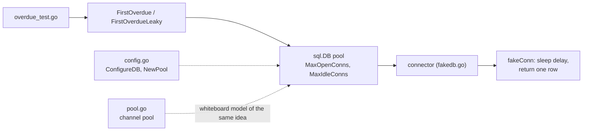
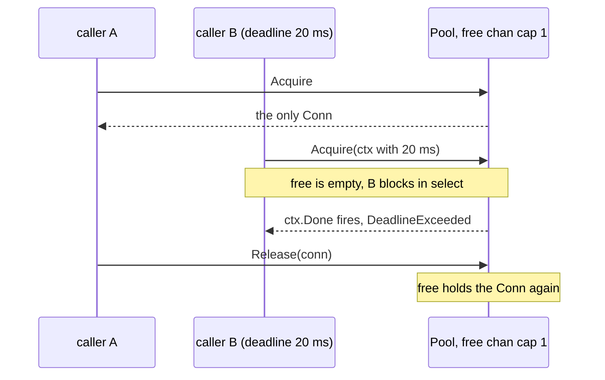
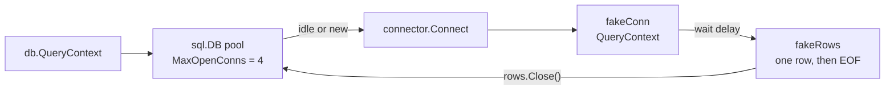
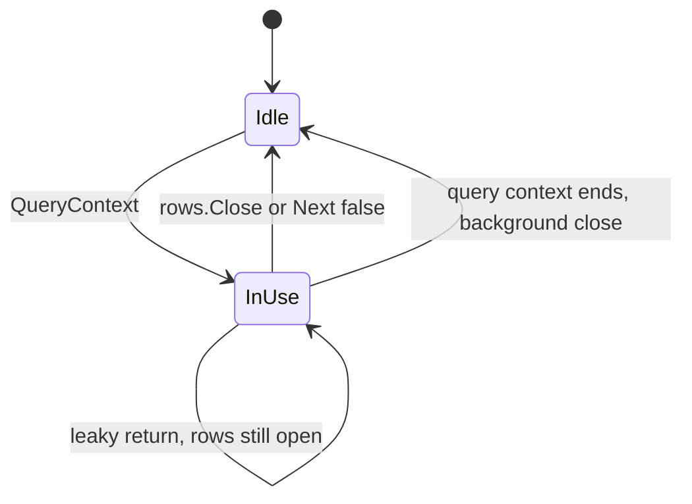

# Connection Pooling - Go

> [!summary] TL;DR
> The runnable side of [[Connection Pooling]]: a pool written as a buffered channel with a deadline on waiting, a fake `database/sql` driver that sleeps 20 ms per query so the real Go pool can be measured without a server, a leaky and a fixed query function with tests that prove the leak and the fix, and the production configuration for `database/sql` and `pgxpool`.

> [!info] How to read this note (pick your level)
> - 🟢 **New to this?** Read "From zero" just below, then "Before the code", "What this code shows" and Step 1 (the tiny channel pool). That is enough for a first pass.
> - 🟡 **Know the basics?** Read all Code steps, Design decisions and Running it.
> - 🔴 **Interview / SDE-3 prep?** Add the Tests, Pitfalls and Exercises. Headings are tagged 🟢🟡🔴 so you always know where you are.

> [!note] Before this note
> - [[Transactions and ACID]]: a transaction keeps one connection from `BEGIN` until `COMMIT` or `ROLLBACK`, so it holds a pool slot the whole time.
> - [[Processes, Threads and Context Switching]]: each PostgreSQL connection is a whole server process, which is why the number of connections must stay small.
> - The theory twin [[Connection Pooling]] explains borrowing, waiting, Little's Law and leaks in plain words; read its sections 1-3 first.

**From zero** 🟢 — This file is the hands-on twin of [[Connection Pooling]]. It builds a pool out of one Go channel, then uses a fake database driver (every query just sleeps 20 ms) to measure the real Go pool: how a small pool caps speed, how a forgotten `rows.Close()` drains it, and how the fix works. Read the theory note first, then walk the steps top to bottom; the tests prove each claim.

## Before the code 🟢

- **Goroutines**: Go's lightweight threads; the tests start 40 of them at once to act like 40 users.
- **Buffered channels** (`chan *Conn`): a queue with a fixed capacity; receiving borrows a connection and sending returns it.
- **`select`**: waits on several channel operations at once, here "a free connection" or "the deadline passed".
- **`context.Context`**: carries a deadline or cancellation, so a waiting request can give up cleanly.
- **Interfaces** (`driver.Connector`, `driver.Conn`): the fake driver implements them so the real `database/sql` pool runs without a server.
- **`defer`**: runs `rows.Close()` when the function returns, which is what prevents the leak.
- **What to run:** `go vet ./... && go test -race -v ./...`; `config.go` needs `github.com/jackc/pgx/v5` (`go mod tidy`).

## What this code shows 🟢

| Code | Concept in the theory note |
| --- | --- |
| `Pool.Acquire` and `Release` | A pool is a bounded queue; a waiter gives up when its context ends ([[Connection Pooling#Waiting for a connection]]) |
| `connector`, `fakeConn` | A fake driver so the real `database/sql` pool can be driven and measured |
| `TestPoolCapsThroughput` | Throughput is capped at `MaxOpenConns / query time` ([[Connection Pooling#The pool turns excess concurrency into queueing]]) |
| `FirstOverdueLeaky` and `FirstOverdue` | A leaked `rows` holds its connection; `defer rows.Close()` fixes it ([[Connection Pooling#A leak, traced]]) |
| `TestLeakedRowsExhaustThePool`, `TestCancelledContextReclaimsALeak` | Pool exhaustion, and a cancelled context closing the rows in the background |
| `ConfigureDB` and `NewPool` | The four lifetime and size knobs, sized from the connection budget ([[Connection Pooling#The knobs]]) |



## Setup 🟢

- Go 1.24. The only dependency is `github.com/jackc/pgx/v5` v5.8.0, used by `config.go`; everything else is the standard library.
- Layout: a module `pool` with `pool.go`, `config.go`, `fakedb.go`, `overdue.go` and their tests (`pool_test.go`, `overdue_test.go`).
- Run it with `go vet ./... && go test -race -v ./...`. No database is needed: the tests use the fake driver. `NewPool` needs a real PostgreSQL DSN (the connection string: host, port, user, password and database name in one line) and is verified to compile only.

## How to read this note 🟢

Each code step has the same shape: a Concept paragraph that links the code to the theory note and names the alternatives, a short block of at most about 25 lines, and a numbered How it works list that walks through the key lines.

Blocks that belong to one file continue each other, so a function may be cut in two pieces with a sentence in between. The files are `pool.go`, `fakedb.go`, `overdue.go`, `config.go`, `pool_test.go` and `overdue_test.go`.

## Code 🟡

> 🟢 → 🟡 **You now know** the plan: build a tiny pool, then measure the real Go pool with a fake database. **Next we open the code**: the channel pool, the fake driver, the leaky and fixed query, and the production settings, each with a line-by-line walk.

### Step 1: the channel pool

**In plain words:** a pool in 30 lines — a channel pre-filled with connections; taking one is borrowing, sending it back is returning, and `select` adds the "give up after a while" rule.

**Concept.** The theory note says a pool is a bounded queue of connections where a caller waits when the queue is empty and gives up when its deadline passes ([[Connection Pooling#Borrowing and returning]], [[Connection Pooling#Waiting for a connection]]).

A buffered Go channel is that queue: its capacity is the pool size, receiving takes a connection out, and sending puts one back. Using `select` on the channel and `ctx.Done()` gives the "wait with a deadline" behaviour in four lines.

The alternatives are a mutex (a lock that lets one goroutine at a time touch shared data) with a slice and a `sync.Cond` (a way to make goroutines sleep until another one signals them), which cannot wait on a context, or a semaphore (a counter that lets at most N goroutines in at once) from `golang.org/x/sync`, which limits concurrency but does not hold the connection objects.

The channel was chosen because it is the smallest correct model; the real `database/sql` pool is much larger because it also opens connections lazily and ages them out.

```go
package pool

import "context"

type Conn struct{ ID int }

// Pool lends at most cap(free) connections; callers queue when all are out.
type Pool struct{ free chan *Conn }

func New(n int) *Pool {
	p := &Pool{free: make(chan *Conn, n)}
	for i := 0; i < n; i++ {
		p.free <- &Conn{ID: i}
	}
	return p
}
```

**How it works.**

1. `Pool` has one field, `free`, a channel of `*Conn`. The channel's capacity is the maximum number of connections the pool will ever hold.
2. `make(chan *Conn, n)` creates a buffered channel, so sends do not block until `n` values are inside.
3. The loop pre-fills the channel with `n` connections. A real pool would open them lazily, but eager filling keeps the model easy to reason about.
4. Because only this package creates connections, "number of connections out" is always `n - len(free)`.

The next piece is the borrowing side.

```go
func (p *Pool) Acquire(ctx context.Context) (*Conn, error) {
	select {
	case c := <-p.free:
		return c, nil
	case <-ctx.Done(): // waited too long: give up instead of piling on
		return nil, ctx.Err()
	}
}

func (p *Pool) Release(c *Conn) { p.free <- c }
```

**How it works.**

1. `select` blocks until one of its cases can proceed. If a connection is idle, the first case fires immediately.
2. If the channel is empty, the goroutine sleeps on both the channel and `ctx.Done()`. Whichever happens first wins.
3. Returning `ctx.Err()` gives the caller `context.DeadlineExceeded` or `context.Canceled`, so the caller can tell a timeout from a failure of the database.
4. `Release` sends the connection back. If a goroutine is blocked in `Acquire`, the Go runtime hands the connection directly to it, which is the "handed straight to a waiter" branch of the theory diagram.



### Step 2: a fake driver

**In plain words:** a pretend database whose every query sleeps 20 ms, so we can measure the real Go pool on a laptop with no server.

**Concept.** To measure a real `database/sql` pool without a PostgreSQL server, the code plugs a fake driver under it.

This is the "pool turns excess concurrency into queueing" idea from [[Connection Pooling#The pool turns excess concurrency into queueing]]: if every query takes exactly 20 ms, the numbers you measure come only from the pool, not from disk or network noise.

The alternatives are a real database in a container, which is closer to production but slower and noisy, or a mock of the `sql.DB` type, which would skip the pool logic that we want to test.

A `driver.Connector` was chosen because `sql.OpenDB` accepts it directly, so the standard-library pool code runs unchanged. The first piece defines the connector and the driver.

```go
package pool

import (
	"context"
	"database/sql"
	"database/sql/driver"
	"io"
	"time"
)

// A fake database/sql driver. Every query sleeps for delay and returns one
// row, so the real Go pool is exercised without a database server.
type connector struct{ delay time.Duration }

func (c *connector) Connect(context.Context) (driver.Conn, error) { return &fakeConn{delay: c.delay}, nil }
func (c *connector) Driver() driver.Driver                        { return fakeDriver{} }

type fakeDriver struct{}

func (fakeDriver) Open(string) (driver.Conn, error) { return &fakeConn{}, nil }
```

**How it works.**

1. `connector` implements `driver.Connector`: `database/sql` calls `Connect` each time the pool needs a new physical connection, so counting `Connect` calls would count connection opens.
2. `Connect` passes the delay to the new `fakeConn`, so every connection in the pool shares one timing.
3. `Driver()` is required by the interface; `fakeDriver.Open` is only used for the DSN path and the tests never take it.
4. Nothing here is a mock of `sql.DB`. The `sql.DB` that wraps this connector is the real thing.

The connection and rows come next.

```go
type fakeConn struct{ delay time.Duration }

func (c *fakeConn) Prepare(string) (driver.Stmt, error) { return nil, driver.ErrSkip }
func (c *fakeConn) Close() error                        { return nil }
func (c *fakeConn) Begin() (driver.Tx, error)           { return nil, driver.ErrSkip }

// QueryContext makes fakeConn a driver.QueryerContext: it sleeps, then
// returns one row, unless the context ends first.
func (c *fakeConn) QueryContext(ctx context.Context, _ string, _ []driver.NamedValue) (driver.Rows, error) {
	select {
	case <-time.After(c.delay):
		return &fakeRows{}, nil
	case <-ctx.Done():
		return nil, ctx.Err()
	}
}
```

**How it works.**

1. `Prepare` and `Begin` return `driver.ErrSkip`, which tells `database/sql` the driver does not support them; the tests only use plain queries.
2. `QueryContext` makes `fakeConn` a `driver.QueryerContext`, so `database/sql` calls it directly without a prepared statement.
3. `time.After(c.delay)` simulates the query taking 20 ms of server time. The connection is busy for that whole time, exactly like a real backend running a query.
4. The `select` on `ctx.Done()` means a cancelled or timed-out request stops waiting; the real driver does the same by sending a cancel request.

```go
type fakeRows struct{ done bool }

func (r *fakeRows) Columns() []string { return []string{"id"} }
func (r *fakeRows) Close() error      { return nil }
func (r *fakeRows) Next(dest []driver.Value) error {
	if r.done {
		return io.EOF
	}
	r.done = true
	dest[0] = int64(1)
	return nil
}

func newDB(delay time.Duration, maxOpen int) *sql.DB {
	db := sql.OpenDB(&connector{delay: delay})
	db.SetMaxOpenConns(maxOpen)
	db.SetMaxIdleConns(maxOpen) // the default of 2 would close and reopen the rest
	return db
}
```

**How it works.**

1. `fakeRows` returns exactly one row with the single column `id`. The first `Next` fills `dest[0]` with `int64(1)`; the second returns `io.EOF`, which `database/sql` turns into `Next() == false`.
2. `Close` on the rows returns nil. The important part is that `database/sql` calls it, and calling it is what returns the connection to the pool.
3. `newDB` builds the pool with `sql.OpenDB` and sets `MaxOpenConns`. This is the cap from [[Connection Pooling#The knobs]].
4. `SetMaxIdleConns(maxOpen)` is essential. The default idle limit is 2, so with a cap of 4 a burst would close and reopen two connections on every cycle and the timing would measure reconnects, not queueing.



### Step 3: the leaky and the fixed query

**In plain words:** two versions of the same function — one forgets `rows.Close()` and quietly steals a connection, the other defers it and always gives the connection back.

**Concept.** The theory note's leak example shows that `QueryContext` holds its connection until `rows.Close()` or until `rows.Next()` returns false ([[Connection Pooling#Borrowing and returning]], [[Connection Pooling#A leak, traced]]).

The two functions below are identical except for one line, so a test can prove that the missing `defer rows.Close()` is the entire bug.

The alternative to writing `defer rows.Close()` yourself is to use `QueryRowContext(...).Scan`, which closes for you, but that cannot be used here because the example wants to show the `rows` pattern that leaks. The fixed function is first because it is the one to copy.

```go
package pool

import (
	"context"
	"database/sql"
)

// FirstOverdue returns the first overdue invoice ID and always gives its
// connection back.
func FirstOverdue(ctx context.Context, db *sql.DB) (int64, error) {
	rows, err := db.QueryContext(ctx, `SELECT id FROM invoices WHERE status = 'overdue' ORDER BY due_at`)
	if err != nil {
		return 0, err
	}
	defer rows.Close()
	if !rows.Next() { // Next returning false closes rows by itself
		if err := rows.Err(); err != nil {
			return 0, err
		}
		return 0, sql.ErrNoRows
	}
	var id int64
	err = rows.Scan(&id)
	return id, err
}
```

**How it works.**

1. `db.QueryContext` borrows a connection. If the pool is full, this line blocks until a connection returns or `ctx` ends.
2. The error check comes before `defer`, because on error `rows` is nil and calling `Close` on it would panic.
3. `defer rows.Close()` runs on every return path below it, including the early return after `Scan`. This one line is what returns the connection.
4. `rows.Next()` false has two meanings: no rows, or an error. `rows.Err()` tells them apart, and the function returns `sql.ErrNoRows` only when there is truly no row.
5. `rows.Scan(&id)` copies the first row into a Go variable.

```go
// FirstOverdueLeaky returns the first overdue invoice ID. It never closes
// rows, so the connection stays checked out of the pool until ctx ends.
func FirstOverdueLeaky(ctx context.Context, db *sql.DB) (int64, error) {
	rows, err := db.QueryContext(ctx, `SELECT id FROM invoices WHERE status = 'overdue' ORDER BY due_at`)
	if err != nil {
		return 0, err
	}
	if !rows.Next() { // Next returning false closes rows by itself
		if err := rows.Err(); err != nil {
			return 0, err
		}
		return 0, sql.ErrNoRows
	}
	var id int64
	err = rows.Scan(&id)
	return id, err // BUG: rows is still open and holds its connection
}
```

**How it works.**

1. The body is the same as `FirstOverdue` with the `defer rows.Close()` line removed.
2. When there are no rows, `Next` returns false and closes the rows by itself, so the leak is invisible in that path and only appears when a row is found.
3. After `Scan`, the function returns while `rows` is still open. The connection stays "in use" even though nobody references the rows any more.
4. The only thing that closes it later is the context: `database/sql` closes rows in a background goroutine when the query's context ends.



### Step 4: production configuration

**In plain words:** the real-world settings — one helper that sets all four pool dials for `database/sql` and one for pgx.

**Concept.** In production you size the pool from the connection budget, not from the defaults ([[Connection Pooling#The knobs]], [[Connection Pooling#Production configuration]]). The defaults are unsafe: `MaxOpenConns` is unlimited, so a traffic spike turns into a connection storm on PostgreSQL.

`ConfigureDB` sets the four `database/sql` knobs, and `NewPool` does the same for `pgxpool`, which also has jitter on the lifetime.

The alternative is to put PgBouncer or RDS Proxy in front and keep the app pool large; this code keeps the app pool small, which is the first line of defence in either case.

```go
package pool

import (
	"context"
	"database/sql"
	"time"

	"github.com/jackc/pgx/v5/pgxpool"
)

// ConfigureDB sizes a database/sql pool. maxOpen comes from the connection
// budget: (max_connections - reserved) / (pods at full scale, plus deploy surge).
func ConfigureDB(db *sql.DB, maxOpen int) {
	db.SetMaxOpenConns(maxOpen)             // default 0 = unlimited
	db.SetMaxIdleConns(maxOpen)             // default 2: bursts would reconnect
	db.SetConnMaxLifetime(30 * time.Minute) // default 0 = forever
	db.SetConnMaxIdleTime(5 * time.Minute)  // default 0 = forever
}
```

**How it works.**

1. `maxOpen` is a parameter because it is a deployment number: the database budget divided by the pods that may run at once.
2. `SetMaxOpenConns` turns excess concurrency into queueing inside the app instead of connections on the server.
3. `SetMaxIdleConns(maxOpen)` keeps the whole pool warm, so a burst after a quiet period does not pay for new connections.
4. `SetConnMaxLifetime` makes every connection retire after 30 minutes. This lets DNS changes, failovers and memory growth in backends heal over time.
5. `SetConnMaxIdleTime` returns unused connections to the server after 5 minutes.

```go
// NewPool opens a pgx pool with the same budget.
func NewPool(ctx context.Context, dsn string, maxConns int32) (*pgxpool.Pool, error) {
	cfg, err := pgxpool.ParseConfig(dsn)
	if err != nil {
		return nil, err
	}
	cfg.MaxConns = maxConns                     // default max(4, runtime.NumCPU())
	cfg.MaxConnLifetime = 30 * time.Minute      // default 1 h
	cfg.MaxConnLifetimeJitter = 5 * time.Minute // spread reconnects; default 0
	cfg.MaxConnIdleTime = 5 * time.Minute       // default 30 min
	pool, err := pgxpool.NewWithConfig(ctx, cfg)
	if err != nil {
		return nil, err
	}
	if err := pool.Ping(ctx); err != nil { // the pool does not connect on creation
		pool.Close()
		return nil, err
	}
	return pool, nil
}
```

**How it works.**

1. `pgxpool.ParseConfig` reads the DSN and fills a `Config` with defaults, so you override only what you need.
2. `MaxConns` is an `int32` in pgx, unlike the `int` of `database/sql`.
3. `MaxConnLifetimeJitter` adds a random extra up to 5 minutes to each connection's lifetime. Without it, all connections opened at deploy time expire together and reconnect together.
4. `NewWithConfig` returns without connecting, so `Ping` makes a wrong DSN or a down database fail at start-up.
5. If `Ping` fails, `pool.Close()` releases the background health-check goroutine before returning the error.

## Design decisions 🟡

| Decision | Alternative | Trade-off |
| --- | --- | --- |
| Buffered channel as the whiteboard pool | Mutex plus slice, `sync.Cond`, semaphore | The channel gives blocking and context-aware waiting in a few lines; it has no lazy opening or ageing |
| A fake `driver.Connector` under the real `sql.DB` | Mocking `sql.DB`, or a containerised PostgreSQL | Tests the real pool code deterministically; it cannot show server-side limits such as CPU saturation |
| Query delay as a constructor argument | A fixed sleep | Lets one helper produce the 2, 4, 10, 20 and 40 connection measurements |
| `SetMaxIdleConns(maxOpen)` in `newDB` and `ConfigureDB` | Keep the default of 2 | Warm pool and honest timing, at the cost of holding idle connections on the server |
| Two near-identical functions, leaky and fixed | One function with a flag | A diff of one line proves the cause of the leak |
| Assert `InUse == 0` after the work | Only assert on results | A cheap leak detector that also works in your own handler tests |
| `Ping` inside `NewPool` | Lazy first-use failure | Fails at start-up, costs one round trip |
| Lifetime jitter only in `NewPool` | Same for both | `database/sql` has no jitter setting, so only pgx can spread reconnects |

## Tests 🟡

### Test 1: acquire waits, then times out

**Property.** A caller that cannot get a connection must stop waiting when its context ends, and the pool must work normally afterwards. This matters because an unbounded wait turns one slow query into a pile of stuck requests ([[Connection Pooling#Waiting for a connection]]).

| Step | Action | Expected |
| --- | --- | --- |
| 1 | `New(1)`, `Acquire` with no deadline | A connection, no error |
| 2 | `Acquire` with a 20 ms timeout while the connection is out | `context.DeadlineExceeded` |
| 3 | `Release`, then `Acquire` again | A connection, no error |

```go
package pool

import (
	"context"
	"testing"
	"time"
)

func TestAcquireWaitsThenTimesOut(t *testing.T) {
	p := New(1)
	c, err := p.Acquire(context.Background())
	if err != nil {
		t.Fatal(err)
	}
	ctx, cancel := context.WithTimeout(context.Background(), 20*time.Millisecond)
	defer cancel()
	if _, err := p.Acquire(ctx); err != context.DeadlineExceeded {
		t.Fatalf("err = %v, want DeadlineExceeded", err)
	}
	p.Release(c)
	if _, err := p.Acquire(context.Background()); err != nil {
		t.Fatal(err)
	}
}
```

**How it works.** The pool has one connection, so the first `Acquire` empties it. The second `Acquire` blocks until the 20 ms deadline and returns the context error. After `Release`, the last `Acquire` succeeds immediately, which shows that giving up did not corrupt the pool.

**If it fails.** A hang means `Acquire` ignores the context. A wrong error means the code returns its own error instead of `ctx.Err()`. A failure on the last line means the timed-out caller took the connection with it.

### Test 2: the pool caps throughput

**Property.** With `MaxOpenConns = 4` and 20 ms per query, at most 200 queries finish per second, so 40 queries cannot finish in under 200 ms, and some callers must have waited ([[Connection Pooling#The pool turns excess concurrency into queueing]]).

| Input | Expected |
| --- | --- |
| 40 goroutines, 4 connections, 20 ms each | elapsed at least 200 ms |
| the same run | `OpenConnections <= 4` and `WaitCount > 0` |

The test is split in two pieces. The first launches the load.

```go
package pool

import (
	"context"
	"errors"
	"sync"
	"testing"
	"time"
)

func TestPoolCapsThroughput(t *testing.T) {
	db := newDB(20*time.Millisecond, 4)
	defer db.Close()

	start := time.Now()
	var wg sync.WaitGroup
	for range 40 {
		wg.Add(1)
		go func() {
			defer wg.Done()
			if _, err := FirstOverdue(context.Background(), db); err != nil {
				t.Error(err)
			}
		}()
	}
	wg.Wait()
	elapsed, st := time.Since(start), db.Stats()
```

The second piece checks the numbers and logs them.

```go
	// 4 connections x 20 ms per query = at most 200 queries/s,
	// so 40 queries cannot finish in under 200 ms.
	if elapsed < 200*time.Millisecond {
		t.Errorf("elapsed %v, want >= 200ms", elapsed)
	}
	if st.OpenConnections > 4 || st.WaitCount == 0 {
		t.Errorf("stats %+v: want <= 4 open connections and some waits", st)
	}
	t.Logf("elapsed=%v WaitCount=%d WaitDuration=%v",
		elapsed.Round(time.Millisecond), st.WaitCount, st.WaitDuration.Round(time.Millisecond))
}
```

**How it works.**

1. Forty goroutines call `FirstOverdue` at once, which is more concurrency than the pool allows.
2. The `WaitGroup` makes the test wait until all forty are done, and `t.Error` (not `t.Fatal`) is used inside goroutines because `Fatal` must only be called from the test goroutine.
3. Ten rounds of four queries at 20 ms each give a lower bound of 200 ms; the assertion checks that bound.
4. `db.Stats()` proves the mechanism: `OpenConnections` never exceeds the cap and `WaitCount` is non-zero because most callers queued.

**If it fails.** Elapsed under 200 ms means the cap is not enforced. More than 4 open connections means `SetMaxOpenConns` is not applied. A zero `WaitCount` means the callers never queued, so the load was not concurrent.

### Test 3: leaked rows exhaust the pool

**Property.** Each leaked `rows` holds one connection, and once all connections are held a healthy caller waits until its deadline ([[Connection Pooling#A leak, traced]]).

| Step | Expected |
| --- | --- |
| Two `FirstOverdueLeaky` calls on a pool of 2 | no error |
| `db.Stats().InUse` | 2 |
| `FirstOverdue` with a 50 ms deadline | `context.DeadlineExceeded` |

```go
func TestLeakedRowsExhaustThePool(t *testing.T) {
	db := newDB(time.Millisecond, 2)
	defer db.Close()
	for range 2 {
		if _, err := FirstOverdueLeaky(context.Background(), db); err != nil {
			t.Fatal(err)
		}
	}
	if st := db.Stats(); st.InUse != 2 {
		t.Fatalf("InUse = %d, want 2 leaked connections", st.InUse)
	}

	// The pool is empty, so the next caller waits until its deadline.
	ctx, cancel := context.WithTimeout(context.Background(), 50*time.Millisecond)
	defer cancel()
	if _, err := FirstOverdue(ctx, db); !errors.Is(err, context.DeadlineExceeded) {
		t.Fatalf("err = %v, want context.DeadlineExceeded", err)
	}
}
```

**How it works.** The leaky calls use `context.Background()`, which never ends, so nothing heals the leak. `InUse == 2` proves both connections are stuck. The fixed function then cannot get a connection and its deadline error is the visible symptom of exhaustion.

**If it fails.** `InUse` of 0 means the rows were closed, so the leaky function is not leaky. A success instead of the deadline error means the pool opened a third connection, so the cap is broken.

### Test 4: the fixed function returns every connection

**Property.** A correct handler leaves `InUse == 0`. Ten calls on a pool of 2 only work if each call returns its connection.

| Input | Expected |
| --- | --- |
| 10 sequential `FirstOverdue` calls, pool of 2 | no error, `InUse == 0` |

```go
func TestFixedFunctionReturnsEveryConnection(t *testing.T) {
	db := newDB(time.Millisecond, 2)
	defer db.Close()
	for range 10 {
		if _, err := FirstOverdue(context.Background(), db); err != nil {
			t.Fatal(err)
		}
	}
	if st := db.Stats(); st.InUse != 0 {
		t.Fatalf("InUse = %d, want 0", st.InUse)
	}
}
```

**How it works.** The loop runs more calls than the pool has connections, so a single leak would block the third call forever. The final `InUse` check is a cheap leak detector that you can copy into handler tests.

**If it fails.** `InUse > 0` means some path does not close its rows. A hang means a leak exhausted the pool.

### Test 5: a cancelled context reclaims a leak

**Property.** `database/sql` closes rows in the background when the query's context ends, so a leak inside a request-scoped context heals itself, and one under `context.Background()` does not (see Test 3). This is why HTTP handlers rarely see a permanent leak but still see a burst of exhaustion.

| Step | Expected |
| --- | --- |
| Leaky call with a cancellable context | `InUse == 1` |
| `cancel()` | `InUse` returns to 0 within 1 s |
| `FirstOverdue` afterwards | succeeds |

The first piece creates the leak and cancels.

```go
// database/sql closes Rows in the background when the query's context ends,
// so a leak inside a request-scoped context heals itself.
func TestCancelledContextReclaimsALeak(t *testing.T) {
	db := newDB(time.Millisecond, 1)
	defer db.Close()

	ctx, cancel := context.WithCancel(context.Background())
	if _, err := FirstOverdueLeaky(ctx, db); err != nil {
		t.Fatal(err)
	}
	if st := db.Stats(); st.InUse != 1 {
		t.Fatalf("InUse = %d, want 1 leaked connection", st.InUse)
	}
	cancel() // what net/http does when the handler returns
```

The second piece polls until the connection comes back.

```go
	deadline := time.Now().Add(time.Second)
	for db.Stats().InUse != 0 {
		if time.Now().After(deadline) {
			t.Fatal("connection was not reclaimed after the context ended")
		}
		time.Sleep(time.Millisecond)
	}
	if _, err := FirstOverdue(context.Background(), db); err != nil {
		t.Fatal(err)
	}
}
```

**How it works.** The reclaim is asynchronous, so the test polls with a 1 s deadline instead of asserting immediately. A pool of 1 makes the final `FirstOverdue` succeed only if the leaked connection really came back.

**If it fails.** A timeout means the rows were never closed after cancel. That would suggest the driver ignores the context or the Go version changed this behaviour.

## Running it 🟢

```bash
go vet ./... && go test -race -v ./...
```

`go vet` is clean and `go test -race -v` passes on Go 1.24.4:

```text
    overdue_test.go:37: elapsed=211ms WaitCount=36 WaitDuration=3.791s
--- PASS: TestPoolCapsThroughput (0.21s)
--- PASS: TestLeakedRowsExhaustThePool (0.05s)
--- PASS: TestFixedFunctionReturnsEveryConnection (0.01s)
--- PASS: TestCancelledContextReclaimsALeak (0.00s)
--- PASS: TestAcquireWaitsThenTimesOut (0.02s)
PASS
ok  	pool	1.598s
```

**Reading the output line by line.**

1. `elapsed=211ms`: 40 queries through 4 connections at 20 ms each need at least 10 rounds, so 200 ms plus scheduling.
2. `WaitCount=36`: of 40 requests, 4 got a connection at once and 36 had to wait.
3. `WaitDuration=3.791s`: the waits added up across goroutines. Divided by 36 that is about 105 ms each, half of the total time, as expected for a queue that drains evenly.
4. Each `--- PASS` line gives the test time. Test 2 takes 0.21 s because of the real sleeps, and Test 3 takes 0.05 s because it waits out its 50 ms deadline.
5. `ok pool 1.598s` is the whole package including race-detector start-up.

The earlier measurements with other pool sizes show the same law, time = 40 / pool size x 20 ms:

| MaxOpenConns | Time for 40 queries | WaitCount | Average wait |
| ------------ | ------------------- | --------- | ------------ |
| 2            | 419 ms              | 38        | 209 ms       |
| 4            | 209 ms              | 36        | 104 ms       |
| 10           | 84 ms               | 30        | 42 ms        |
| 20           | 42 ms               | 20        | 21 ms        |
| 40           | 21 ms               | 0         | 0            |

## Pitfalls in the code 🔴

> 🟡 → 🔴 **You now know** how the pool, the fake driver and the tests fit together. **Next come the sharp edges**: defaults that quietly hurt, early returns that leak, and the limits of a fake database that never gets tired.

- **`SetMaxIdleConns` defaults to 2.** `newDB` raises it to `maxOpen`; without that, bursts close and reopen connections and the timing numbers mean nothing.
- **`rows.Next()` returning false closes the rows,** but returning early after a successful `Next` does not. Always `defer rows.Close()` right after the error check.
- **`NewPool` pings on purpose.** `pgxpool.NewWithConfig` does not connect, so a wrong DSN would otherwise show up on the first request.
- **`pool.Pool.Release` blocks if called more often than `Acquire`** (the channel is full). A real pool must guard against double release.
- **`database/sql` has no connection-lifetime jitter,** so `ConfigureDB` cannot spread reconnects; `NewPool` can, through `MaxConnLifetimeJitter`.
- **The fake database has unlimited capacity,** so a bigger pool always wins in these tests. A real server stops scaling past its cores.

## Exercises 🔴

1. In `TestPoolCapsThroughput`, change the pool size from 4 to 8. Predict the minimum elapsed time and the `WaitCount`, then adjust the assertion and run it.
2. Remove `db.SetMaxIdleConns(maxOpen)` from `newDB` and run with `maxOpen = 4`. Predict which `DBStats` counter starts to climb, and print it.
3. In `TestLeakedRowsExhaustThePool`, pass a cancellable context to `FirstOverdueLeaky` and cancel it. Predict what `InUse` becomes and how long it takes.

## Self-check 🟢🟡

🟢 Easy

> [!question]- In the channel pool, what does receiving from `free` mean?
> Borrowing a connection; sending it back to `free` is returning it.

> [!question]- Why does the fake driver sleep 20 ms per query?
> So every query takes the same time, and the measured numbers come only from the pool, not from disk or network noise.

> [!question]- Which single line is the whole difference between `FirstOverdueLeaky` and `FirstOverdue`?
> `defer rows.Close()`.

🟡 Medium

> [!question]- Pool of 8, 40 queries of 20 ms each, all at once. What is the minimum time?
> 40 / 8 = 5 rounds x 20 ms = 100 ms.

> [!question]- Why does `newDB` call `SetMaxIdleConns(maxOpen)`?
> The default keeps only 2 idle, so a burst would close and reopen connections, and the test would measure reconnects instead of queueing.

> [!question]- Why does a leak under a cancellable context heal, but not under `context.Background()`?
> `database/sql` closes the rows when the query's context ends; `context.Background()` never ends.

## Links

- **Theory:** [[Connection Pooling]]
- **Before this:** [[Transactions and ACID]], [[Processes, Threads and Context Switching]]
- **Related:** [[Database Access (database-sql, pgx, sqlc)]], [[Bulkheads and Concurrency Limits]], [[N+1 Query Problem - Go]]
